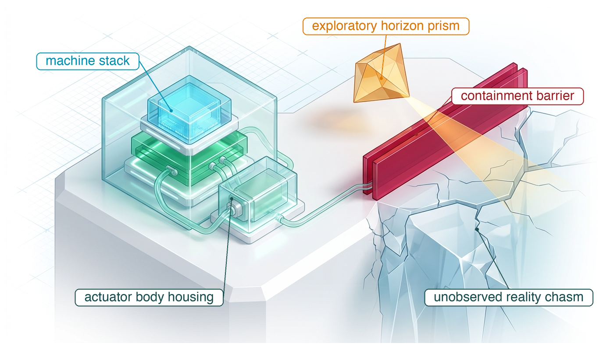
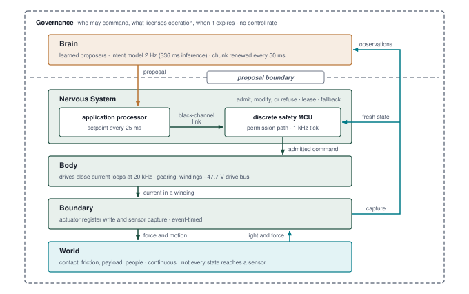

---
format:
  html:
    title: "Engineering Physical AI"
---

# Engineering Physical AI {#sec-frontier}

::: {layout-narrow}
::: {.column-margin}

\chapterminitoc

:::

::: {.content-visible when-format="pdf"}
\noindent
{fig-alt="Isometric blueprint of the epistemic frontier. A layered physical AI stack under glass, cabled to an actuator body housing, sits on a plinth whose edge ends at a red double-walled containment barrier above a cracked chasm labeled unobserved reality, while an amber prism labeled exploratory horizon projects a diagnostic beam across the barrier."}
:::

::: {.content-visible unless-format="pdf"}
{fig-alt="Isometric blueprint of the epistemic frontier: a layered physical AI stack under glass, a red containment barrier at the edge of a chasm labeled unobserved reality, and an amber prism projecting a diagnostic beam across it."}
:::

:::

## Purpose {.unnumbered .unlisted}

::: {.content-visible when-format="pdf"}
\begin{marginfigure}
\resizebox{0.92\linewidth}{!}{\mlphysicalstackfull{20}{20}{20}{20}{20}}
\end{marginfigure}
:::

_What makes a machine that can demonstrate a physical skill into one that can perform useful work within justified limits?_

A successful demonstration begins an engineering argument. Useful service also depends on the body sustaining the task, the learned behavior adapting to the states its own actions create, and the runtime delivering feasible motion on time. Evidence must connect those choices to the conditions in which the machine will operate and remain valid as the machine changes. The completed design therefore joins learning, physical control, and accountable maintenance. Transferring that method to a new task requires recognizing both the capabilities already established and the premises that still need measurement or a different design. At the causal boundary, the engineer must connect what the machine can learn to what its body can do and what its evidence justifies.



::: {.callout-learning-objectives}

- Synthesize the four parts into a design argument for useful, bounded physical service
- Apply the four laws to select and evaluate a candidate operating mode for an unfamiliar machine
- Distinguish proposer autonomy, whole-machine task success, and protection when assessing a completed design
- Construct residual-claims entries with supported restrictions, accountable owners, and predeclared closure tests
- Select the next measurement, learning experiment, or design change needed to extend a machine's capability
:::

## From a Task to Useful Service {#sec-frontier-architectural-synthesis}

The warehouse mobile manipulator began with a useful mission: collect an object from a conveyor, open a spring-latched cage door, and carry a load through an aisle shared with people. Completing that mission requires the abilities promised in @sec-boundary: design, teach, integrate, evaluate, and maintain a machine within justified limits. The four parts have developed these abilities through one connected machine, with each choice constraining the next.

Anatomy made the intended task physically specific. Load, traction, contact force, heat, and energy determined which actions the body could sustain. Those budgets also constrained proposal size and cadence, communication, and the independent execution path. Choosing a model was consequently a joint decision about useful behavior and the resources available to deliver it.

Teaching connected that architecture to experience. Provenance identified what the demonstrations supported; training produced a candidate; closed-loop evaluation tested the states that candidate actually visited. A failed recovery could become a new collection target, followed by retraining and regression evaluation. The initial archive bounds the evidence for the current candidate, while new, qualified experience can expand the next candidate's competence. Protection during collection remains part of the design even when the learning objective is improved autonomy.

Running joined those learned abilities to a complete action. At the pick station, dated observations support a belief about the moving item; the grounded goal identifies the intended target and tolerance; a trajectory turns that goal into smooth, timed motion. The permission path admits a feasible command or applies the least change needed to keep it within the current envelope. The body executes, the item and robot move, and the next observation tests whether the task is progressing. Object identity, observation age, trajectory continuity, and available contact force all matter to the same pick. Workload placement makes these interfaces feasible under sustained load.

Governing turned execution into a service decision. A coworker can take authority through a feasible transfer, fault trials challenge the assembled response using independent witnesses, and release binds the result to operating conditions and maintenance. Proposer autonomy, whole-machine success, and protection remain separate outcomes. A normal speed correction can preserve a successful delivery even though the raw proposal required intervention; an emergency rescue or a contained hazard does not by itself demonstrate successful service.

The actual illustrative records in @sec-release-case-worked-full still yield `REFUSE`. The separately stipulated branch in @sec-release-stipulated-service shows how supporting evidence would change that decision to `COND`. Under its assumed task-performance and fault evidence, the machine may carry out restricted inspected-route mug delivery, the guarded door approach, and local handover, while its standing floor, crossing, feed, and calibration conditions hold. This is a worked engineering result under stated premises, not a report of a qualified deployment. Its value is the complete connection from a useful mission to the evidence and operating conditions that would support it.

@Fig-17-causal-loop-synthesis returns to the five-level machine introduced at the beginning of the book. The Brain proposes, the permission path admits, modifies, or refuses, and the Body delivers the admitted command across the Boundary into a World that continues evolving. Measurements return with their capture times. Release governs the configuration and standing conditions; it does not replace the live permission decision.

::: {#fig-17-causal-loop-synthesis fig-env="figure" fig-pos="t" fig-cap="**Closed causal loop**: The Brain proposes across the proposal boundary, and the permission path in the Nervous System admits, modifies, or refuses each proposal before the Body acts. The Body's current becomes force and motion at the Boundary, the World evolves, and the Boundary returns measurements with capture times to the permission path and the Brain. Not every state of the World reaches a sensor. The governance envelope surrounds all five levels and changes on the timescale of releases rather than control cycles. The 1 kHz permission loop is one implementation, not a universal rate." fig-alt="Five stacked levels inside a dashed governance envelope: Brain, Nervous System, Body, Boundary, and World, with a dashed proposal boundary between the Brain and the Nervous System. Arrows run down from the Brain to the World, labeled proposal, admitted command, current in a winding, and force and motion. A return arrow runs from the World to the Boundary, then up a side lane to the Nervous System, labeled fresh state, and to the Brain, labeled observations. Labels give the intent model 1 to 5 Hz, the chunk policy 10 to 50 Hz, perception at sensor rate, a 1 kHz permission loop in one implementation, and a 10 to 25 kHz current loop; the Boundary is event-timed, the World is continuous, and governance has no control rate."}
{width="100%" fig-alt="Five stacked levels inside a dashed governance envelope: Brain, Nervous System, Body, Boundary, and World, with a dashed proposal boundary between the Brain and the Nervous System. Arrows run down from the Brain to the World, labeled proposal, admitted command, current in a winding, and force and motion. A return arrow runs from the World to the Boundary, then up a side lane to the Nervous System, labeled fresh state, and to the Brain, labeled observations. Labels give the intent model 1 to 5 Hz, the chunk policy 10 to 50 Hz, perception at sensor rate, a 1 kHz permission loop in one implementation, and a 10 to 25 kHz current loop; the Boundary is event-timed, the World is continuous, and governance has no control rate."}
:::

The records in @tbl-17-master-synthesis make the four parts usable together. They preserve the evidence needed to revisit a design when the task, body, or environment changes.

\Needspace{25\baselineskip}

| Law                            | Part                                                                                             | Records that carry it                                                                                        | Condition to maintain                                                                                                       | Engineering result                                                                                                             |
|:-------------------------------|:-------------------------------------------------------------------------------------------------|:-------------------------------------------------------------------------------------------------------------|:----------------------------------------------------------------------------------------------------------------------------|:-------------------------------------------------------------------------------------------------------------------------------|
| **Irreversibility**            | I (@sec-body, @sec-brain, @sec-nervous)                                                          | Limit records (@sec-body); the proposer's limits (@sec-brain), which enter the handoff record (@sec-nervous) | Each measured limit, such as floor friction, payload, brake onset, or observation age, still holds under present conditions | A feasible speed or force envelope, a timed proposal interface, and a reachable fallback                                       |
| **Endogenous data**            | II (@sec-data, @sec-training, @sec-evaluation)                                                   | Demonstration provenance record, policy manifest, evaluation record                                          | The states the machine enters lie inside the target ODD that closed-loop evaluation represents                              | A learned behavior evaluated in its closed loop; new qualified experience can expand its supported task population             |
| **Proposal is not permission** | III (@sec-perception, @sec-memory, @sec-intent, @sec-planning, @sec-enforcement, @sec-placement) | Observation contract, belief record, intent lease, trajectory record, enforcement record, placement record   | The permission path sees fresh, distinguishable state and meets its deadline under load                                     | Useful motion admitted or minimally corrected within current limits; invalid active authority invokes a state-matched fallback |
| **Evidence bounds authority**  | IV (@sec-intervention, @sec-verification, @sec-release)                                          | Authority record, fault record, release manifest, and the residual-claims register of this chapter           | The premises of the release claim still hold after release                                                                  | A named service authorized under standing conditions, with tested intervention and update procedures                           |

: **The four laws as engineering competence**: Each part produces records that support the next design decision. The conditions and results belong to the particular machine and its evidence; they are not universal hardware requirements. {#tbl-17-master-synthesis tbl-colwidths="[14,17,25,22,22]"}

The result is an engineering method that can be carried to another machine. Its transferable elements are the questions, calculations, experiments, and interfaces; its numerical limits must be established again for the new body and task. A packaging cell makes that distinction concrete.

## Generalizing to Unfamiliar Systems {#sec-frontier-generalizing-unfamiliar-systems}

An automated packaging cell must transport containers, close their tabs, and sustain repeated cycles without exceeding its motion, contact, or thermal limits. Designing such a machine requires both a capable learned proposer and an execution path whose authority fits those limits. The four laws of @sec-boundary-bedrock-laws organize that design argument. They connect the intended task to measurable physical bounds, the data and evaluation needed to teach it, the runtime that admits actions, and the conditions under which the complete machine may operate. Applying them to an unfamiliar machine tests whether the book's methods transfer beyond the warehouse mobile manipulator.

### The four-law audit protocol for novel physical systems {#sec-frontier-four-law-audit-protocol}

The audit begins with the intended task and its irreversible consequences, then selects the measurements that define a feasible action envelope. Those limits determine which demonstrations to collect and which closed-loop conditions to evaluate. The candidate proposer then joins a permission path whose timing, observations, and fallback fit the plant. Finally, tests of the assembled machine determine the service claim and the conditions that maintain it. A change at any stage can require revisiting the earlier choices; a slower admitted motion, for example, changes the behavior the learning campaign must establish.

### Multi-archetype case study on automated packaging cells {#sec-frontier-packaging-cell-study}

To see the four-law audit protocol in operation, consider an automated parcel induction and sortation cell in a logistics hub. The machine shuttles containers along a linear track, presses an articulated insertion head onto container flaps to engage structural retention tabs, and drives high-rate linear servo drives during high-throughput transfer. This workcell couples all three machine classes of @sec-boundary-three-classes within a single enclosure: the carriage as moving mass, the insertion head as contact force, and the high-duty actuator drives as thermal dissipation.

The first law asks what the cell cannot undo, so the evaluation begins by cataloging the irreversible state changes\index{State change!irreversible} the cell can produce and the physical bounds\index{Physical bounds} that govern them. A loaded parcel container traversing a linear transfer rail carries momentum. When a carriage strikes an obstruction, kinetic energy is dissipated through plastic deformation of the container and structural deflection of the frame, a state transition that cannot be reversed by commanding the drive motor in reverse. The insertion mechanism introduces a second irreversible boundary. An actuator drives a mechanical tool head against package tabs to lock retaining clips. If the actuator exerts force beyond the compressive load capacity of the carton wall, the container buckles, crushing internal contents. The high-duty drive introduces a third irreversible boundary through Joule heating ($I^2 R$). Continuous high-acceleration cycles pump thermal energy into sealed motor windings; once stator insulation melts or winding enamel degrades under excessive thermal exposure, cooling the housing cannot restore winding dielectric integrity.

```{python}
#| label: calc-frontier-packaging-stop
#| echo: false
#| warning: false
#| message: false
# ┌─────────────────────────────────────────────────────────────────────────────
# │ PACKAGING CELL: A CANDIDATE TRANSPORT MODE
# ├─────────────────────────────────────────────────────────────────────────────
# │ Context: @sec-frontier-packaging-cell-study.
# │ Goal:    Test nominal and restricted speeds against a fixed stop line.
# │ Show:    Delay, stopping distances, reserve, and translational energy.
# │ How:     One-off hypothetical scenario inputs; MLSysIM constant-deceleration
# │          stopping and kinetic-energy models. These are not measurements.
# └─────────────────────────────────────────────────────────────────────────────
from mlsysim import *

class PackagingCell:
    # ┌── 1. LOAD (Scenario assumptions) ───────────────────────────────────────
    mass = 12 * ureg.kg  # scenario assumption: total moving mass, including load
    v_nom = 1.5 * ureg.meter / ureg.second  # scenario assumption: nominal speed
    v_clamp = 0.5 * ureg.meter / ureg.second  # scenario assumption: restricted speed
    clearance = 60 * ureg.mm  # scenario assumption: clearance to a fixed stop line
    reserve = 15 * ureg.mm  # scenario assumption: allocated uncertainty and clearance reserve
    deceleration = 15 * ureg.meter / ureg.second**2  # scenario assumption: braking lower bound after delay
    exposure = 16 * ureg.ms  # scenario assumption: worst-case event-to-usable-frame interval
    processing = 36 * ureg.ms  # scenario assumption: transfer, inference, scheduling, and admission
    bus = 2 * ureg.ms  # scenario assumption: admitted command to brake-driver delivery
    onset = 10 * ureg.ms  # scenario assumption: delivery to full assumed deceleration
    check_rate = 1 * ureg.kHz  # scenario assumption: independent kinematic-check rate
    force_cap = 220 * ureg.N  # scenario assumption: selected limiter setting, not material strength
    temperature_trip = Q_(105, ureg.degC)  # scenario assumption: selected sensor threshold
    stall_timeout = 400 * ureg.ms  # scenario assumption: selected stall-detection timeout
    bus_trip = 60 * ureg.volt  # scenario assumption: selected inverter overvoltage threshold

    # ┌── 2. EXECUTE (Compute) ─────────────────────────────────────────────────
    delay = exposure + processing + bus + onset
    stop_budget = clearance - reserve
    blind_nom = v_nom * delay
    brake_nom = v_nom**2 / (2 * deceleration)
    stop_nom = calc_safe_stopping_distance(v_nom, delay, deceleration)
    deficit = stop_nom - clearance
    blind_clamp = v_clamp * delay
    brake_clamp = v_clamp**2 / (2 * deceleration)
    stop_clamp = calc_safe_stopping_distance(v_clamp, delay, deceleration)
    remaining = clearance - stop_clamp
    energy_nom = calc_kinetic_energy(mass, v_nom)
    energy_clamp = calc_kinetic_energy(mass, v_clamp)
    energy_reduction = (1 - energy_clamp / energy_nom).to(ureg.dimensionless).magnitude

    # ┌── 3. GUARD (Invariants) ────────────────────────────────────────────────
    # 2026-09-28: pin the complete hypothetical budget and the claimed reserve.
    check(delay == 64 * ureg.ms, "All four delay allocations must total 64 ms.")
    check(blind_nom > clearance, "Nominal speed must exhaust clearance before braking.")
    check(abs(stop_nom.to(ureg.mm).magnitude - 171) < 1e-9, "Nominal stop must be 171 mm.")
    check(abs(stop_clamp.to(ureg.mm).magnitude - 40.3333333333) < 1e-6, "Restricted stop must be 40.3 mm.")
    check(stop_clamp < stop_budget and remaining > reserve, "Restricted stop must preserve the allocated reserve.")
    check(abs(energy_nom.to(joule).magnitude - 13.5) < 1e-9, "Nominal translational energy must be 13.5 J.")
    check(abs(energy_clamp.to(joule).magnitude - 1.5) < 1e-9, "Restricted translational energy must be 1.5 J.")

    # ┌── 4. OUTPUT (Formatting) ───────────────────────────────────────────────
    mass_str = fmt_qty(mass, unit=ureg.kg, precision=0)
    v_nom_str = fmt_velocity(v_nom, precision=2)
    v_clamp_str = fmt_velocity(v_clamp, precision=2)
    clearance_str = fmt_length(clearance, unit=ureg.mm, precision=0)
    reserve_str = fmt_length(reserve, unit=ureg.mm, precision=0)
    deceleration_str = fmt_acceleration(deceleration, precision=0)
    exposure_str = fmt_latency(exposure, unit=ureg.ms, precision=0)
    processing_str = fmt_latency(processing, unit=ureg.ms, precision=0)
    bus_str = fmt_latency(bus, unit=ureg.ms, precision=0)
    onset_str = fmt_latency(onset, unit=ureg.ms, precision=0)
    delay_str = fmt_latency(delay, unit=ureg.ms, precision=0)
    blind_nom_str = fmt_length(blind_nom, unit=ureg.mm, precision=0)
    brake_nom_str = fmt_length(brake_nom, unit=ureg.mm, precision=0)
    stop_nom_str = fmt_length(stop_nom, unit=ureg.mm, precision=0)
    deficit_str = fmt_length(deficit, unit=ureg.mm, precision=0)
    stop_budget_str = fmt_length(stop_budget, unit=ureg.mm, precision=0)
    blind_clamp_str = fmt_length(blind_clamp, unit=ureg.mm, precision=0)
    brake_clamp_str = fmt_length(brake_clamp, unit=ureg.mm, precision=1)
    stop_clamp_str = fmt_length(stop_clamp, unit=ureg.mm, precision=1)
    remaining_str = fmt_length(remaining, unit=ureg.mm, precision=1)
    energy_nom_str = fmt_energy(energy_nom, unit=joule, precision=1)
    energy_clamp_str = fmt_energy(energy_clamp, unit=joule, precision=1)
    energy_reduction_str = fmt_percent(energy_reduction, precision=1, style="prose")
    check_rate_str = fmt_frequency(check_rate, unit=ureg.kHz, precision=0)
    force_cap_str = fmt_force(force_cap, precision=0)
    temperature_trip_str = fmt_temperature(temperature_trip, precision=0)
    stall_timeout_str = fmt_latency(stall_timeout, unit=ureg.ms, precision=0)
    bus_trip_str = fmt_voltage(bus_trip, precision=0)
```

Because the carriage's momentum is already committed, the permission path must act before the carriage consumes its clearance. We can test a candidate design using hypothetical inputs, not measurements of an installed cell. The carriage and loaded tray have a combined moving mass of `{python} PackagingCell.mass_str` and travel at `{python} PackagingCell.v_nom_str` toward a gate whose fixed stop line is `{python} PackagingCell.clearance_str` away when the hazardous closure begins. Assume constant speed until braking begins and a braking deceleration of at least `{python} PackagingCell.deceleration_str` thereafter. The latter is a proposed bound to qualify under load, pad wear, and rail conditions, not a motor's peak rating.

The delay budget must cover the entire interval from that closure to effective braking. Allocate `{python} PackagingCell.exposure_str` to obtaining a usable image, including frame phase and exposure; `{python} PackagingCell.processing_str` to transfer, inference, scheduling, and admission; `{python} PackagingCell.bus_str` to command delivery; and `{python} PackagingCell.onset_str` to brake buildup. These assumed upper bounds sum to `{python} PackagingCell.delay_str`. With $v$ the carriage speed, $\tau_{\text{delay}}$ this complete delay, and $a_{\text{brake}}$ the assumed deceleration, the stopping model is
$$d_{\text{stop}} = v\tau_{\text{delay}} + \frac{v^2}{2a_{\text{brake}}}.$$
At nominal speed, delay travel alone is `{python} PackagingCell.blind_nom_str`, already greater than the clearance. Braking adds `{python} PackagingCell.brake_nom_str`, giving a total of `{python} PackagingCell.stop_nom_str` and a deficit of `{python} PackagingCell.deficit_str`. Under these assumptions the carriage reaches the gate before braking even begins.

A candidate transport mode follows from the same model. Reserving `{python} PackagingCell.reserve_str` for uncertainty and residual clearance leaves a stopping budget of `{python} PackagingCell.stop_budget_str`. At a selected speed ceiling of `{python} PackagingCell.v_clamp_str`, delay travel falls to `{python} PackagingCell.blind_clamp_str` and braking distance to `{python} PackagingCell.brake_clamp_str`. Their sum, `{python} PackagingCell.stop_clamp_str`, leaves `{python} PackagingCell.remaining_str` before the stop line, exceeding the allocated reserve. Translational kinetic energy, $E_k = mv^2/2$, falls from `{python} PackagingCell.energy_nom_str` to `{python} PackagingCell.energy_clamp_str`, a reduction of `{python} PackagingCell.energy_reduction_str`. The slower mode is therefore worth qualifying. The calculation does not establish that the delay and deceleration bounds hold, or that the chosen reserve covers clearance error and speed overshoot; those remain measurements and acceptance decisions for the assembled cell.

::: {.column-margin .margin-pointer}
↩ Closed-loop rollouts, distribution shift, and endogenous data generation are developed in @sec-data and @sec-evaluation.
:::

The second law asks what the cell's learned proposers have shown they can do. Three of them propose actions here, one in each domain. A vision model infers container contents to propose carriage transit speeds, a multimodal network estimates packaging cardboard thickness to propose insertion forces and dwell durations, and an electro-thermal estimator proposes acceleration profiles to manage motor winding temperatures. Each proposer's actions choose part of what it observes next. A slower carriage changes the motion blur and timing of the frames the vision model sees, a longer dwell changes the deformation that the next thickness estimate reads, and an acceleration profile changes the temperature trajectory the thermal estimator receives. The evidence for their competence therefore depends on the population sampled by closed-loop evaluation, and the question for this cell is whether that population represents the conditions operation will admit. A restriction imposed after training is itself a change of operating condition. If closed-loop evaluation sampled only the nominal transit speed, the derated mode that the cell's release claim requires moves the vision model into conditions its evaluation never sampled, so the restriction that shortens the stop also opens a regime without evidence. Either the evaluation samples the restricted mode before release, or the release claim records that regime as an open premise.

For the restricted cell, the learning work follows directly from that gap. Demonstrations must cover the admitted transport speed, insertion behavior, and thermal operating regime, with the collection conditions retained in the provenance record. Training produces a candidate proposer; closed-loop trials then test whether it completes the packaging task under those conditions, including interventions by the permission path. If the cell cannot complete the task within its physical bounds, the engineer must revise the task, proposer, or machine design and evaluate the changed system. A defensible speed ceiling alone does not establish a useful packaging cell.

The third law places those proposals beneath an authority split\index{Authority split} that the proposers cannot delay or corrupt. The permission path keeps the proposals from reaching actuators directly. In this hypothetical design, an independent kinematic check runs at `{python} PackagingCell.check_rate_str`, using encoders and range measurements to admit carriage motion only where clearance and the qualified stop path support it. Its scheduling and admission work must fit within the processing allocation above; the check rate alone does not establish that bound.

The insertion head and drive need corresponding physical limits. A selected mechanical force-limiter setting of `{python} PackagingCell.force_cap_str` is a candidate design input, not evidence that every carton tolerates that force. Qualification must establish the peak transmitted force, including overshoot, against the weakest admitted package and tab geometry. Likewise, a winding-sensor trip at `{python} PackagingCell.temperature_trip_str` and a stall timeout of `{python} PackagingCell.stall_timeout_str` are selected thresholds, not a derived thermal envelope. Their adequacy depends on current, winding resistance, heat capacity, cooling, sensor lag, and the temperature rise before the response takes effect. This example supplies none of those measurements and therefore cannot claim a safe sustained duty cycle from the thresholds alone.

Rapid deceleration also transfers mechanical energy into the electrical drive. During regenerative braking, the motor returns energy to the DC bus; a brake chopper and resistor can absorb that energy before the bus reaches the selected inverter trip threshold of `{python} PackagingCell.bus_trip_str`. The energy sink must accommodate repeated stops as well as one stop. Regenerative braking needs a live drive throughout deceleration, while the carriage's electromagnetic track brake needs its own qualified actuation path. Logic hold-up alone supplies neither braking torque nor brake actuation. A thermal response that removes drive power must therefore preserve a feasible stopping or holding response in the current state. The learned policy can propose throughput improvements within these limits, but qualification of the complete response determines which proposals may execute.

The fourth law turns the candidate design into a release argument. The evidence record\index{Evidence record} must support rangefinder coverage, gate clearance, braking, and useful task performance together. It also identifies claims that remain unsupported. To assess flap latching integrity, the engineering team evaluates a vision model that inspects optical surface reflections for container tab engagement. Under overhead illumination, localized plastic wrap reflections and tape glare create optical artifacts that mimic latch defects while masking genuine tab misalignments. Because the cell has no independently qualified measurement that distinguishes an engaged tab from a misaligned one under glare, its sign-off claim lacks a supported detector. Marking this link as detectorless and unsupported in the claims register\index{Claims register} is not an omission in the documentation, but an accurate statement of what the evidence can justify.

The derated stop therefore supports a *candidate restricted mode* for transport at `{python} PackagingCell.v_clamp_str`, provided the stated `{python} PackagingCell.delay_str` end-to-end delay, `{python} PackagingCell.deceleration_str` deceleration, `{python} PackagingCell.clearance_str` clearance, and reserve are validated together. Insertion and thermal management remain conditional on tests of the force limiter, thermal response, material limits, and independent fault path. Autonomous package sign-off is refused because optical glare can conceal tab misalignments from the available vision sensor and the cell has not established latch engagement independently. A qualified engagement measurement could support autonomous sign-off; mandatory downstream inspection instead supports a service that makes no autonomous sign-off claim. A throughput model cannot replace that physical evidence.

The cell turns a physical task into a connected set of engineering decisions. Stopping arithmetic identifies a candidate transport mode, which determines the conditions the learning and evaluation process must cover. Runtime integration then checks that the admitted behavior stays within measured motion, force, and thermal limits. The release argument distinguishes transport capability from the unsupported package sign-off claim. The engineer can select what to build and teach, demonstrate what the integrated machine can do, and bound its authority to those conditions. The unsupported engagement claim also identifies a residual limit. The same discipline that selected a useful transport mode must decide what can justify package sign-off.

## The Epistemic Frontier {#sec-frontier-epistemic-limits}

The packaging cell's camera can support a transport proposal without establishing that a hidden tab engaged. The warehouse machine's navigation sensors likewise support motion without establishing floor traction. These are epistemic limits: limits on what the available observations and argument justify. Additional training can improve a proposal, but the engineer must identify whether the next claim needs new experience or a physical measurement the current inputs do not contain.

A pallet jack with a weeping hydraulic line crosses one aisle of the site where the warehouse mobile manipulator works, and it leaves a clear film of fluid on the concrete. The machine's stopping budget assumes that the floor can supply the friction its credible deceleration needs, and on dry concrete it can. Under the film it may not, and neither the navigation camera nor the lidar can tell the film from dry floor. The permission path can meet every deadline, the chunk lease can expire on time, and the selected braking response can begin on schedule while the stop still runs past the rack end, because the term that failed is a premise that no sensor on the machine reports. The missing evidence is the local friction floor before braking begins. The stopping calculation below evaluates this unobserved friction deficit:

```{python}
#| label: calc-frontier-oil-film
#| echo: false
#| warning: false
#| message: false
# ┌─────────────────────────────────────────────────────────────────────────────
# │ THE OIL FILM ON THE AISLE
# ├─────────────────────────────────────────────────────────────────────────────
# │ Context: @sec-frontier-epistemic-limits (the premise behind the aisle
# │          speed), @sec-frontier-residual-claims-register (the register
# │          entries and @tbl-17-claims-register),
# │          @sec-frontier-failures-without-detectors (detection latency against the spare margin),
# │          @sec-frontier-fallacies-pitfalls (the vision-only pitfall).
# │
# │ Goal:    Show that the 1.3 m/s normal mode always rested on a friction
# │          floor that no sensor on the machine reports.
# │ Show:    the friction the credible deceleration needs; the stop on a clear
# │          film against the clear distance; the inspected-floor ceiling and
# │          restricted mode; the zero-failure closure test; the time the spare
# │          margin buys. The walking-person ceiling is Ch12's
# │          (@sec-enforcement-stopping-envelopes) and is cited, not recomputed.
# │ How:     credible deceleration a = min(a_brake, mu g); the finished budget
# │          (C2 stop, all three overheads) at the aisle speed; its ceiling as
# │          the positive root with a_eff = a / 1.5; zero-failure sample size.
# └─────────────────────────────────────────────────────────────────────────────
from mlsysim import *

RM = Embodied.MobileManipulator.WarehouseMobileManipulator
AISLE = Embodied.Scenario.WarehouseAisle

class OilFilm:
    # ┌── 1. LOAD (Constants & Parameters) ─────────────────────────────────────
    g = (1 * ureg.standard_gravity).to(ureg.meter / ureg.second**2)  # category: measured (physical constant, standard gravity)
    a_brake = AISLE.a_brake  # category: illustrative (credible deceleration, dry floor)
    mu_dry = AISLE.mu_dry  # category: illustrative (dry concrete)
    mu_insp = AISLE.mu_inspected_floor  # category: illustrative (inspected floor)
    mu_oil = AISLE.mu_oil_film  # category: illustrative (clear hydraulic film)
    v_aisle = AISLE.v_aisle  # category: chosen (normal-mode aisle speed)
    d_clear = AISLE.d_clear  # category: illustrative (rack-end clear distance)
    tau_delay = AISLE.tau_delay  # category: derived (total pre-brake delay)
    overhead = AISLE.fixed_overhead  # category: derived (delta_loc + delta_margin + eps_track)
    v_h = AISLE.v_human_approach  # category: datasheet (ISO 13855 walking speed)
    v_restricted = 1.0 * ureg.meter / ureg.second  # category: chosen (scenario assumption: restricted mode on inspected floors)
    p_miss_target = 0.001  # category: chosen (detector miss-rate bound for closure)
    n_contrast = 1000  # category: illustrative (a smaller zero-miss campaign, for contrast)
    confidence = 0.95  # category: chosen (one-sided confidence level)

    # ┌── 2. EXECUTE (Compute) ─────────────────────────────────────────────────
    mu_min = (a_brake / g).to(ureg.dimensionless).magnitude
    a_dry = min(a_brake, mu_dry * g)
    a_insp = min(a_brake, mu_insp * g)
    a_oil = min(a_brake, mu_oil * g)

    # finished budget at the aisle speed: v tau + 0.75 v^2/a (C2 stop) + overhead
    budget_aisle = (v_aisle * tau_delay + calc_c2_stop_suffix(v_aisle, a_dry)["distance"] + overhead).to(ureg.meter)
    spare_aisle = (d_clear - budget_aisle).to(ureg.millimeter)
    t_latest = (spare_aisle / v_aisle).to(ms)
    stop_oil = (v_aisle * tau_delay + calc_c2_stop_suffix(v_aisle, a_oil)["distance"] + overhead).to(ureg.meter)

    # ceilings: positive root of the finished budget with a_eff = a / 1.5
    margin_loc = AISLE.delta_loc + AISLE.eps_track
    ceiling_dry = calc_max_permitted_velocity(d_clear, tau_delay, a_dry / 1.5, margin_loc, AISLE.delta_margin)
    ceiling_insp = calc_max_permitted_velocity(d_clear, tau_delay, a_insp / 1.5, margin_loc, AISLE.delta_margin)

    n_closure = calc_zero_failure_sample_size(1.0 - p_miss_target, confidence=confidence)
    p_miss_contrast = 1.0 - calc_clopper_pearson_zero_failure_bound(n_contrast, confidence=confidence)

    # ┌── 3. GUARD (Invariants) ────────────────────────────────────────────────
    check(abs(mu_min - 0.204) < 5e-4, f"Friction floor should be 0.204, got {mu_min}.")
    check(a_dry == a_brake and mu_dry > mu_min, "On dry concrete the brakes, not friction, must bind.")
    check(mu_oil < mu_min and mu_insp < mu_min, "On the film and on an inspected floor friction must bind.")
    check(abs(a_insp.to(ureg.meter / ureg.second**2).magnitude - 1.1768) < 5e-4, f"Inspected-floor deceleration should be 1.18 m/s², got {a_insp}.")
    check(abs(budget_aisle.to(ureg.millimeter).magnitude - 997.43) < 5e-3, f"Budget at 1.3 m/s should be 997.43 mm, got {budget_aisle}.")
    check(abs(spare_aisle.to(ureg.millimeter).magnitude - 102.57) < 5e-3, f"Spare at 1.3 m/s should be 102.57 mm, got {spare_aisle}.")
    check(abs(t_latest.to(ms).magnitude - 78.9) < 5e-2, f"T_latest should be 78.9 ms, got {t_latest}.")
    check(abs(ceiling_dry.to(ureg.meter / ureg.second).magnitude - 1.3898) < 5e-5, f"Dry-floor ceiling should be 1.3898 m/s, got {ceiling_dry}.")
    check(
        abs(ceiling_insp.to(ureg.meter / ureg.second).magnitude - 1.0947) < 5e-5, f"Inspected-floor ceiling should be 1.0947 m/s, got {ceiling_insp}."
    )
    check(
        v_restricted < ceiling_insp < v_aisle < ceiling_dry,
        "Restricted mode must sit under the inspected ceiling, and the aisle speed under the dry ceiling.",
    )
    check(abs(stop_oil.to(ureg.meter).magnitude - 2.95) < 5e-3, f"Finished budget on the film should be 2.95 m, got {stop_oil}.")
    check(abs(a_oil.to(ureg.meter / ureg.second**2).magnitude - 0.49) < 5e-3, f"Film deceleration should be 0.49 m/s², got {a_oil}.")
    check(stop_oil > 2 * d_clear, f"On the film the stop from the aisle speed must exceed twice the clear distance, got {stop_oil}.")
    check(n_closure == 2995, f"Zero-failure closure test should need 2,995 trials, got {n_closure}.")
    check(abs(p_miss_contrast - 0.002991) < 5e-7, f"1,000 zero-miss trials should bound the miss rate at 0.002991, got {p_miss_contrast}.")

    # ┌── 4. OUTPUT (Formatting) ───────────────────────────────────────────────
    a_brake_str = fmt_acceleration(a_brake, precision=0)
    mu_min_str = fmt(mu_min, precision=3)
    mu_dry_str = fmt(mu_dry, precision=2)
    mu_insp_str = fmt(mu_insp, precision=2)
    mu_oil_str = fmt(mu_oil, precision=2)
    a_insp_str = fmt_acceleration(a_insp, precision=2)
    a_oil_str = fmt_acceleration(a_oil, precision=2)
    v_aisle_str = fmt_velocity(v_aisle, precision=1)
    d_clear_str = fmt_length(d_clear, unit=ureg.meter, precision=2)
    budget_aisle_str = fmt_length(budget_aisle, unit=ureg.millimeter, precision=1)
    spare_aisle_str = fmt_length(spare_aisle, unit=ureg.millimeter, precision=1)
    t_latest_str = fmt_latency(t_latest, unit=ms, precision=1)
    stop_oil_str = fmt_length(stop_oil, unit=ureg.meter, precision=2)
    ceiling_insp_str = fmt_velocity(ceiling_insp, precision=2)
    v_restricted_str = fmt_velocity(v_restricted, precision=0)
    n_closure_str = fmt_int(n_closure, commas=True)
    n_contrast_str = fmt_int(n_contrast, commas=True)
    p_miss_contrast_str = fmt(p_miss_contrast, precision=6)
    p_miss_target_pct_str = fmt_percent(p_miss_target, precision=1, style="prose")
    p_miss_target_sym_str = fmt_percent(p_miss_target, precision=1, style="symbol")
    confidence_pct_str = fmt_percent(confidence, precision=0, style="prose")
    confidence_sym_str = fmt_percent(confidence, precision=0, style="symbol")
    v_h_str = fmt_velocity(v_h, precision=1)
```

The release decision of @sec-release-safety-cases-claims already met this premise. Its claim C3, braking traction, was refused on the book's own evidence and handed to this chapter as an open premise. The machine's credible deceleration is the smaller of what its selected braking response delivers and what the floor interface supplies:
$$a = \min(a_{\text{brake}}, \mu g).$$
The `{python} OilFilm.a_brake_str` credible deceleration that @sec-body-kinetic-momentum established requires a physical friction coefficient of at least $\mu \ge$ `{python} OilFilm.mu_min_str`. Dry industrial concrete, at an illustrative $\mu$ of `{python} OilFilm.mu_dry_str`, supplies far more traction, so the selected braking response binds and governs deceleration. The clear hydraulic film, at $\mu$ = `{python} OilFilm.mu_oil_str` (both coefficients illustrative; see the Reader Guide), supplies only `{python} OilFilm.a_oil_str`, and the tire-floor interface binds. At the candidate `{python} OilFilm.v_aisle_str` aisle speed, the known-component budget of @tbl-enforcement-stopping-budget, `{python} OilFilm.budget_aisle_str` on a dry floor, grows on the film to `{python} OilFilm.stop_oil_str` against a `{python} OilFilm.d_clear_str` clear distance. These calculations omit the still-unqualified dispatch-to-admission interval; that interval adds travel and reduces every derived speed ceiling. Even this incomplete budget already excludes the film.

The friction premise did not become open only when the fluid leaked onto the concrete. The candidate normal operating mode of @sec-enforcement-stopping-envelopes rested on that unmeasured floor on every aisle, including dry ones. Completing the timing evidence would not establish traction, and establishing traction would not complete the timing evidence.

The oil film tests the architecture at the interface between measurement and permission. An independent enforcer can reject a proposal that violates the measured stopping envelope; it cannot establish the friction premise merely by executing faster. The current controller still regulates torque through $\tau = \frac{3}{2} p \lambda_m i_q$, with $p$ the pole-pair count, $\lambda_m$ the magnet flux linkage, and $i_q$ the torque-producing current. Commanded torque supplies useful deceleration only through the tire-floor contact. The architecture therefore needs a supported restriction or an additional measurement at that interface, not another layer of inference.

The manipulator arm's contact limit at the door latch rests on a premise of the identical kind: a structural latch that holds at every force below the arm's contact ceiling. Yet mechanical wear, material fatigue, or chemical corrosion can silently lower the latch's yield force below that ceiling while the joint torque sensors read exactly what they would read against a sound latch. Similarly, a wrist force-torque sensor that limits manipulation contact forces below a fragile workpiece threshold depends on an unshifted analog calibration. Mechanical shock, adhesive creep, or strain gauge thermal drift can shift that zero reference until the control loop regulates against a phantom reading while the true contact wrench breaches structural yield.

In each case, the machine can depart from its assumed operating conditions while its internal telemetry remains nominal. Successful trials under conditions that omit the changed premise do not establish performance after that premise fails. The safety case must explicitly name the missing premise, restrict operational authority while it remains open, and state what empirical evidence could close it. For each open premise, systems discipline asks what the machine can physically measure, what its actuators can still prevent, and which operational claims must remain refused.

### What a shield adds to the claim {#sec-frontier-method-limits}

The mobile manipulator's release claim is a chain of dependent links determined by the operational hazards and the selected mitigations (@sec-boundary-machine-model). The argument must establish the operating domain, measured actuator and stopping bounds, component contracts, and independent permission for learned proposals. Hazards controlled by runtime detection also need measured detector coverage and timely monitoring. Hazards controlled by passive limits or operating restrictions instead need evidence that those measures hold over the declared load, wear, and exposure envelope. Generating extensive evidence for one link cannot compensate for an unsupported premise in another.[^fn-hist-popper-falsification]

[^fn-hist-popper-falsification]: **Popperian Falsification**\index{Falsification!Popperian induction}: Karl Popper formalized the asymmetry of empirical induction: no finite sequence of safe observations can prove universal safety, whereas a single counterexample refutes it. Operational fleet hours establish survival rates strictly under observed stationary conditions, not out-of-distribution guarantees. Extrapolating zero observed incidents to unbounded environments produces an illusory sense of safety that fails upon encountering unmodeled edge cases.

Each premise of a safety case carries one of the Reader Guide's five statuses (established by measurement or derivation, assumed, decided by accountable judgment, unsupported, or outside the threat model). The envelope trichotomy (\ref{dfn-release-envelope-trichotomy}) places a premise that a runtime monitor checks as known-true, known-false, or unknown. The premises that bound the evidence here are ones no monitor now in service can check, so the runtime cannot label them known-true from its own telemetry. Release must establish and maintain them through other evidence or restrict operation around them. For the base, the stopping-distance claim relies on an assumed friction coefficient between wheel and floor that cannot be measured before braking begins. For the arm, the contact argument depends on a declared floor on the strength of the latch and the objects it handles, a floor decided by engineering judgment about structural yield, while the latch's present strength stays unmeasured between proof tests. For the wrist transducer, the force-limit claim assumes a sensor whose zero point has not drifted, a premise that its own live telemetry cannot check without an unloaded physical tare. Naming these premises explicitly does not weaken the release record. It establishes the physical envelope within which the release verdict is justified, and outside of which the verdict ceases to apply.

Separating measurement from judgment is fundamental to systems engineering discipline. Empirical testing and statistical characterization can estimate physical exposure, quantify sensor noise, and bound parametric uncertainty, but no measurement can choose an acceptable **residual risk**\index{Residual risk} or decide which individuals in an operational environment must bear that risk. Those choices are accountable human decisions that must be recorded as explicit judgments rather than disguised as empirical findings. In the same way, the **threat model**\index{Threat model} bounds the validity of the record. Empirical testing across nominal fleet operations and accidental component faults provides no evidence regarding intentional adversarial attacks. A safety record demonstrating that a vision pipeline handles sensor noise, lens blur, and partial occlusions provides no statistical support for claims about resilience against adversarial optical projection, model parameter tampering, or intentional denial of service across the internal communication bus.

#### Conditional shield dilution and common-cause bounds {#sec-frontier-shield-dilution}

When a learned policy operates under a real-time safety shield, systems designers frequently assume that the shield's mathematical guarantees eliminate the need to bound the failure rate of the underlying proposal model. This assumption fails under rigorous probabilistic accounting. The safety shield is a conditional filter whose effectiveness depends strictly on the proposal rate, interception coverage, and unshielded hardware failure terms, as evaluated in the illustrative calculation below:

```{python}
#| label: calc-frontier-architectural-shield-dilution
#| echo: false
#| warning: false
#| message: false
import math
from mlsysim import *
from mlsysim.core.units import ureg
from mlsysim.fmt import fmt_sci, fmt, check
from mlsysim.physics.robotics import (
    calc_empirical_testing_exposure,
    calc_shielded_system_hazard_rate,
)

# ┌── 1. INPUT (Illustrative target and distinct evidence records) ────
p_target = 1.0e-9  # category: illustrative (system incidents/hour target, not a statutory rate)
confidence = 0.95  # category: chosen (one-sided confidence level)
alpha = 1.0 - confidence  # category: derived (significance level)

fleet_units = 100  # category: illustrative (fleet size)
t_cycle_days = 90.0  # category: illustrative (release cycle length)
hours_per_day = 24.0  # category: illustrative (continuous operation)

c_shield_assumed = 0.9999  # category: illustrative (class-specific interception coverage)
p_hw_assumed = 0.0  # category: illustrative (hardware and common-cause residual set to zero)
proposal_events_hypothetical = 0  # category: illustrative (adjudicated counterfactual-oracle proposal log)

# ┌── 2. COMPUTE (Proposal-log bound and shield decomposition) ────────
# The adjudicated proposal log covers one full cycle of the fleet.
t_cycle_hours = t_cycle_days * hours_per_day
proposal_exposure_hours_hypothetical = fleet_units * t_cycle_hours
# Zero hazardous proposals bound the proposal rate (one-sided Poisson).
p_proposal_upper_hypothetical = -math.log(alpha) / proposal_exposure_hours_hypothetical

# Conditional design arithmetic: the proposal-rate bound the target would require
# at the assumed class-specific interception coverage, and the exposure to show it.
p_proposal_limit = (p_target - p_hw_assumed) / (1.0 - c_shield_assumed)
n_brain_hours = calc_empirical_testing_exposure(p_proposal_limit, confidence=confidence)
t_test_days = n_brain_hours.magnitude / (fleet_units * hours_per_day)
p_system_conditional = calc_shielded_system_hazard_rate(
    p_proposal_upper_hypothetical / ureg.hour, c_shield_assumed, p_hw_assumed / ureg.hour
).magnitude
c_required_cycle = 1.0 - (p_target - p_hw_assumed) / p_proposal_upper_hypothetical
test_overrun_days = t_test_days - t_cycle_days

# ┌── 3. GUARDS (Statistical bounds & invariance checks) ──────────────
check(abs(proposal_exposure_hours_hypothetical - 216000.0) < 1.0, f"Unexpected proposal-log hours: {proposal_exposure_hours_hypothetical}")
check(abs(p_proposal_upper_hypothetical - 1.3869e-5) < 1e-8, f"Unexpected proposal bound: {p_proposal_upper_hypothetical}")
check(proposal_events_hypothetical == 0, "Proposal scenario requires zero events")
check(abs(p_proposal_limit - 1.0e-5) < 1e-9, f"Unexpected proposal limit: {p_proposal_limit}")
check(abs(n_brain_hours.magnitude - 299573.0) < 100.0, f"Unexpected brain exposure: {n_brain_hours}")
check(abs(t_test_days - 124.8) < 1.0, f"Unexpected test days: {t_test_days}")
check(abs(p_system_conditional - 1.386913e-9) < 1e-12, f"Unexpected conditional residual: {p_system_conditional}")
check(abs(c_required_cycle - 0.9999278974) < 1e-8, f"Unexpected required coverage: {c_required_cycle}")
check(test_overrun_days > 34.0, f"Unexpected 90-day overrun: {test_overrun_days}")

# ┌── 4. OUTPUT (Canonical formatting) ────────────────────────────────
class ArchitecturalShieldDilution:
    n_proposal_sci_str = fmt_sci(proposal_exposure_hours_hypothetical, precision=2)
    p_proposal_upper_sci_str = fmt_sci(p_proposal_upper_hypothetical, precision=3)

    p_brain_sci_str = fmt_sci(p_proposal_limit, precision=0)
    n_brain_sci_str = fmt_sci(n_brain_hours.magnitude, precision=2)
    t_test_days_str = fmt(t_test_days, precision=3)
    p_system_conditional_sci_str = fmt_sci(p_system_conditional, precision=3)
    c_required_str = fmt(c_required_cycle, precision=7)
    test_overrun_days_str = fmt(test_overrun_days, precision=1)
```

::: {.column-margin .margin-pointer}
↩ The empirical exposure wall and minimal-intervention safety shields are established in @sec-evaluation and @sec-enforcement.
:::

Take as the system target an illustrative $10^{-9}\text{ h}^{-1}$, a rate that no standard assigns to this machine and that, by the exposure wall, operating hours alone cannot feasibly demonstrate.[^fn-math-exposure-updates] The remaining question is what the permission path can add to the claim when it acts between proposal and actuation as the safety shield, and which of its premises need evidence of their own.

[^fn-math-exposure-updates]: **Evidence Across Updates**\index{Exposure wall!retraining reset}: An updated model may alter the proposal distribution. Earlier data can be pooled only with a justified configuration-equivalence and exposure argument; an update does not automatically erase every observation. The exposure wall's constant-rate model also requires a defensible treatment of shared fleet conditions and correlated faults.

A shield argument is *conditional*. Observed system incidents already reflect the mitigations or operator interventions that acted. Multiplying that residual incident rate by the shield's interception factor would count its protection twice. For a defined hazard class $h$, let $\lambda_{\mathrm{proposal},h}$ be the arrival rate of raw, unshielded hazardous proposed actions emitted by the neural policy before the permission layer, and let $c_h=P(\mathrm{intercept}\mid\mathrm{hazardous\ proposal},h)$ be measured interception coverage for that specific class. With a separately bounded hardware and common-cause term $\lambda_{\mathrm{other}}$, the true conditional hazard rate is governed by @eq-frontier-shielded-hazard:
$$\lambda_{\mathrm{system},h} \le \lambda_{\mathrm{proposal},h}(1-c_h)+\lambda_{\mathrm{other}}$$ {#eq-frontier-shielded-hazard}
The relation requires a valid proposal oracle, timely detection, actuator authority, and a justified treatment of correlated failures. It gives no credit for an oil film or a weakened latch that the shield cannot observe, and no release follows from the arithmetic until each premise is supported.

Evaluating this conditional hazard decomposition requires bounding the unshielded proposal arrival rate $\lambda_{\mathrm{proposal},h}$ from empirical telemetry logs before applying shield credit. Under a stationary Poisson model with zero observed hazardous proposals, this bound is governed by the Rule of Three (@sec-verification, @eq-verification-rule-of-three):

::: {#nbk-frontier-fleet-exposure-and-shielded-decomposition .callout-notebook title="A conditional shield calculation"}

**Problem**: In an illustrative scenario, one hundred robots keep a fully adjudicated proposal log for one 90-day cycle, judged by a validated counterfactual oracle, and the log records no hazardous proposal. If a named shield's interception coverage for that hazard class were independently established at $c=0.9999$, would the modeled residual meet the $10^{-9}\text{ h}^{-1}$ system target?

**Proposal bound**: Under a stationary Poisson model, zero hazardous proposals in `{python} ArchitecturalShieldDilution.n_proposal_sci_str` proposal-hours give a one-sided 95 percent upper bound of `{python} ArchitecturalShieldDilution.p_proposal_upper_sci_str` $\text{h}^{-1}$.

**Residual**: With hardware and common-cause residual set to zero for this calculation, @eq-frontier-shielded-hazard gives `{python} ArchitecturalShieldDilution.p_system_conditional_sci_str` $\text{h}^{-1}$, **above** the target. The coverage the target requires is at least `{python} ArchitecturalShieldDilution.c_required_str`.

**Required proposal evidence**: At $c=0.9999$ the proposal-rate bound must fall to `{python} ArchitecturalShieldDilution.p_brain_sci_str` $\text{h}^{-1}$. Zero adjudicated hazardous proposals would then require `{python} ArchitecturalShieldDilution.n_brain_sci_str` proposal-hours, or `{python} ArchitecturalShieldDilution.t_test_days_str` days for 100 units, `{python} ArchitecturalShieldDilution.test_overrun_days_str` days beyond the cycle.

**Systems insight**: A shield changes the system claim only for hazard classes it can detect and intercept in time. Proposal frequency, conditional interception coverage, hardware faults, and common-cause failures need separate evidence. Oil or material failure outside the shield's sensing coverage stays in the residual-claims register.
:::

The calculation uses the exposure model already established in @sec-evaluation-trial-limits and the filter developed in @sec-enforcement. It does not establish new evidence for either. Formal verification has the same obligation to state its scope: a certificate concerns the declared model, observations, disturbances, and timing (@sec-verification-formal-limits). When a premise remains unsupported, the release needs an operating response with an owner.

### A residual-claims register {#sec-frontier-residual-claims-register}

Refusing claim C3 did not remove the friction premise from the machine. The **residual-claims register**\index{Residual-claims register!definition} consumes the upstream release manifest of @sec-release-manifest and keeps each open premise attached to an operating restriction. Without that link, a later model update could restore an unsupported mode while leaving its physical premise unresolved.

Each entry identifies the missing physical observable, active containment or operating restriction, accountable owner, and predeclared empirical closure test. These components give principle \ref{pri-vol4-evidence-bounds-authority} an operational consequence. Authority remains restricted until evidence supports changing the entry; recording a caveat alone does not protect the machine.

::: {#dfn-frontier-residual-claims-register .callout-definition title="Residual-claims register"}

***Residual-claims register***\index{Residual-claims register!definition}\index{Contracts!residual claims} is the sixteenth record in the Physical AI contract chain, consuming the safety case release manifest to record every open or unsupported physical premise and mapping each to its missing physical observable, active operating restriction, accountable human owner, and predeclared empirical closure test.

1.  **Significance**: Prevents unsupported physical premises from vanishing into uncalibrated software optimism, holding machine authority to a restricted operating envelope until evidence supports a revised claim.
2.  **Distinction**: Unlike a static hazard log or bug tracker, the residual-claims register is an offline, machine-readable deployment record whose authorized limits feed runtime checks and whose standing conditions bind site operations.
3.  **Common pitfall**: Treating open safety premises as speculative engineering debt to be resolved in future releases without derating operational speed or restricting the physical operating domain today.

:::

An engineer must define the **missing observable**\index{Missing observable!definition} in terms of the physical claim. An "out-of-distribution latent state" does not specify what a detector must measure or when intervention must occur. An unmeasured friction coefficient or latch strength does. That description lets the team choose between adding sensing, establishing a physical bound, and restricting the task, then state what evidence would justify the choice.

The oil film gives the mobile manipulator its first entry. The premise is that every aisle floor supplies a friction coefficient of at least `{python} OilFilm.mu_min_str`, the value its credible deceleration needs. The missing observable is the friction beneath a clear film, which the navigation camera and the lidar cannot tell from dry concrete. The stop from the aisle speed that fits the clear distance on a dry floor overruns it on the film, so a speed limit the entry imposes can hold only on floors whose friction is measured or controlled.

An open entry requires an **operational response**\index{Operational response!definition}. For the aisles, the separately supported release can permit a restricted mode of `{python} OilFilm.v_restricted_str` on floors under the site's inspection regime. In the stipulated restricted-service branch, qualified friction assessment, cleaning, spill isolation, and access controls support $\mu \ge$ `{python} OilFilm.mu_insp_str`, which gives a credible deceleration of `{python} OilFilm.a_insp_str` and a known-component ceiling of `{python} OilFilm.ceiling_insp_str`. In the actual illustrative records, the restricted mode remains a candidate until the complete timing budget, including dispatch-to-admission work and required reserve, supports it. The stipulated branch assumes that supporting evidence.[^fn-math-velocity-clamp] A route that the inspection regime does not cover is excluded, or the machine is withheld from it.

[^fn-math-velocity-clamp]: **Velocity Kinetic Derating**\index{Velocity clamp!kinetic derating}: $E_k=mv^2/2$ decreases quadratically with speed. Stopping distance still depends on a validated credible deceleration and total response delay; a speed register alone cannot compensate for arbitrarily low friction.

The restricted mode needs an owner able to keep its physical premises true. Site operations owns this entry through its spill procedure for pallet-jack routes, which sets the inspection interval and names the condition that withdraws permission. The signed speed limit on the permission path enforces the restriction, but a claim about friction cannot be maintained by a speed setting alone.

Every entry needs a **closure test**\index{Closure test!definition} declared before collecting data. For online exclusion of the film, the test must qualify a new physical channel, because the existing camera and lidar do not distinguish it in this scenario. A changed floor or containment design could instead support a revised claim through different evidence. One proposed closure test qualifies a floor-film detector whose miss rate is bounded at `{python} OilFilm.p_miss_target_pct_str` by `{python} OilFilm.n_closure_str` failure-free trials on seeded films (@sec-evaluation-trial-limits); until it passes, the restriction holds. A smaller campaign falls short. Zero misses in `{python} OilFilm.n_contrast_str` independent trials bound the miss probability only at `{python} OilFilm.p_miss_contrast_str` with `{python} OilFilm.confidence_pct_str` confidence. The detector must also report the film early enough that detection, permission, and braking together fit the clear distance, and the trial distribution, detection distance, latency, false alarms, and friction after detection must be declared in advance. A wheel-slip reflex can limit later motion but cannot establish friction before the wheels reach the film.

The same aisle carries a second entry. The stopping budget protects a static obstacle. A person who keeps walking toward the machine through the whole stop adds distance that the budget never charges (@sec-memory-belief-through-occlusion), and @sec-enforcement-stopping-envelopes found that charging it would cap the base at this rack end far below its aisle speed. The premise is that no person approaches the rack end during a stop, and the missing observable is presence in the cross aisle the rack hides. The restricted service requires site-controlled separation that excludes continuing human approach during the stop; floor markings alone do not establish that condition. Site operations owns this restriction. A proposed rack-end presence sensor remains unavailable as protection until its coverage, timing, and response pass qualification; the closure campaign uses the same zero-failure sizing for its declared trial population.

The pick station adds a third entry, and this one belongs to the arm. Its premise is that the object the arm grasps, and later hands to the coworker under `accept_item` (@sec-intervention-human-authority), is the object the task names. @Sec-intent-request-to-proposal showed how that premise fails. A thin-walled red glass jar beside the red mug on the takeaway conveyor draws a confident grounding, and the wrong target passes every geometric check the planner and the permission path apply. The missing observable is identity and fragility, which neither the wrist camera nor the grounding model can establish before contact.

The restriction on this entry has two parts. Site operations admits to the conveyor only items on the pick station's declared item list, which holds no fragile look-alike, and the station admits a grasp only when the pick window holds exactly one object, so that a second object refuses the intent and sends the item to the coworker for a manual pick. Singulation makes the grounding unambiguous for the items it admits but supplies no identity information, and a mis-routed jar that arrives alone is contained only by the feed procedure. That residual is why the entry stays open. A grip-force ceiling set for the most fragile look-alike would need a crush limit for every item that might arrive, itself an unmeasured premise, so the register does not rest on one. Site operations owns the feed list and the singulation rule jointly with the task profile. The closure test is a qualified identity check at the station, a tag read or a scale-and-code check, whose false-accept rate is bounded at `{python} OilFilm.p_miss_target_pct_str` with `{python} OilFilm.confidence_pct_str` confidence by the same `{python} OilFilm.n_closure_str` failure-free trials, run here on seeded look-alikes.

@Tbl-17-claims-register sets the three entries side by side. Each row carries the four components the register requires, so any entry can be audited without the prose around it.

\Needspace{31\baselineskip}

| Claim and missing state                                                                                                                | Hazard mechanism                                                                                                                                                                                                                                                                                | Active containment and owner                                                                                                                                                                                                                                                                                            | Predeclared closure test                                                                                                                                                                                                                                                                                                     |
|:---------------------------------------------------------------------------------------------------------------------------------------|:------------------------------------------------------------------------------------------------------------------------------------------------------------------------------------------------------------------------------------------------------------------------------------------------|:------------------------------------------------------------------------------------------------------------------------------------------------------------------------------------------------------------------------------------------------------------------------------------------------------------------------|:-----------------------------------------------------------------------------------------------------------------------------------------------------------------------------------------------------------------------------------------------------------------------------------------------------------------------------|
| **Braking traction**: every aisle floor supplies $\mu \ge$ `{python} OilFilm.mu_min_str`; friction beneath a clear film is unobserved. | At $\mu$ = `{python} OilFilm.mu_oil_str` the credible deceleration falls to `{python} OilFilm.a_oil_str`, and the incomplete known-component budget at `{python} OilFilm.v_aisle_str` already grows to `{python} OilFilm.stop_oil_str` against a `{python} OilFilm.d_clear_str` clear distance. | Candidate in the actual records: `{python} OilFilm.v_restricted_str` on qualified, controlled floors ($\mu \ge$ `{python} OilFilm.mu_insp_str`); full timing and reserve must support it. Uncontrolled routes excluded. *Owner*: site operations, through the spill procedure for pallet-jack routes.                                          | A floor-film detector with a miss rate of at most `{python} OilFilm.p_miss_target_sym_str` at `{python} OilFilm.confidence_sym_str` confidence, from `{python} OilFilm.n_closure_str` failure-free seeded-film trials, plus timing and clearance tests; the restriction holds until it passes.                               |
| **Walking person**: no person approaches the rack end during a stop; presence in the hidden cross aisle is unobserved.                 | A person walking at `{python} OilFilm.v_h_str` through the whole stop would cap the base far below its aisle speed at the rack end (@sec-enforcement-stopping-envelopes).                                                                                                                       | Controlled separation excluding continuing human approach during a stop; no credit for an unqualified presence sensor. *Owner*: site operations.                                                                                                                                                                        | Qualify coverage, detection timing, and the complete response; `{python} OilFilm.n_closure_str` failure-free trials support a `{python} OilFilm.p_miss_target_sym_str` miss bound at `{python} OilFilm.confidence_sym_str` confidence for the declared trial population.                                                                                                                                                 |
| **Object identity**: the object grasped is the object the task names; identity and fragility before contact are unobserved.            | A confident grounding to a thin-walled glass jar beside the red mug passes every geometric check, and a grip the ceramic mug needs can crush the glass.                                                                                                                                         | Feed control admits to the conveyor only items on the station's declared list, none of them a fragile look-alike; singulation admits a grasp only with one object in the pick window. An off-list item arriving alone is contained only by the feed procedure. *Owner*: site operations, jointly with the task profile. | A qualified identity check at the station (tag read or scale-and-code) with a false-accept rate of at most `{python} OilFilm.p_miss_target_sym_str` at `{python} OilFilm.confidence_sym_str` confidence, from `{python} OilFilm.n_closure_str` failure-free seeded look-alike trials; the restriction holds until it passes. |

: **Residual-claims register for the aisle and the pick station**: Proposed responses to three open premises behind the mobile manipulator's aisle speed and its pick; operating credit requires the supporting evidence stipulated in the restricted-service branch. For each, the register names the missing physical observable, the hazard it permits, the operating restriction and its accountable owner, and the predeclared closure test that would retire the restriction. {#tbl-17-claims-register tbl-colwidths="[22,24,26,28]"}

The register also retains the unresolved timing premise from @sec-placement. Capture-to-dispatch age does not include dispatch-to-admission work, and nominal inference cadence does not bound the interval between successful admissions. The runtime team owns a loaded qualification of both intervals against the handoff record's lease and renewal requirements. Until that evidence and a positive required reserve support the complete stop, the normal aisle speed remains a candidate. The stipulated service branch assumes supporting timing evidence for its restricted mode; it does not close this item in the actual records.

A release pipeline records each entry in a fixed schema, and its fields, units, and invariants appear with the other record layouts in @sec-appendix-systems-wire-residual-claims.

#### Maintaining the restrictions {#sec-frontier-operationalizing-claims}

The restrictions in the register must reach the mechanisms that govern deployment and execution. A signed speed ceiling constrains the permission path; an inspection requirement constrains site operations. The release pipeline checks that both belong to the authorized configuration, while runtime monitors check only those conditions their sensors can establish. An unobserved premise cannot become a measured condition merely because it appears in a machine-readable record.

An updated model or configuration must retain every standing restriction whose supporting claim remains unchanged. The deployment gate validates the signed limits and the evidence status before authorizing a mode. A restricted mode needs its own supported release; an open entry does not automatically authorize a downgrade. Runtime checks can enforce the speed ceiling and current authority, while site operations maintains the floor and feed procedures at their specified cadences.

The selected fallback remains the state-dependent response qualified in @sec-enforcement. A rejected replacement proposal need not revoke an active command whose own evidence, lease, and state remain valid. Loss of active permission does require a feasible response within the remaining budget. Powered deceleration, brake application at standstill, torque inhibit, and supply isolation have different physical effects; the register cannot replace those distinctions with a universal cutoff recipe.

The proposed detectors would support broader online claims only after qualification. Conservative actions, passive limits, proof tests, or a narrower task may support different claims without resolving every hidden state. Choosing among these responses requires checking what can still happen before the physical deadline.

### Failures without detectors {#sec-frontier-failures-without-detectors}

A floor-film detector can change the friction claim only if its coverage, false alarms, and response timing support the intended route. These are task-specific acceptance criteria, not universal detector thresholds. The known-component stopping calculation leaves `{python} OilFilm.spare_aisle_str` at the candidate normal aisle speed, equivalent to `{python} OilFilm.t_latest_str` of travel before charging dispatch-to-admission work and preserving the required reserve. This is an upper limit on unallocated time, not a qualified detector budget. It also cannot establish protection against a person who continues approaching throughout the stop.

The floor-film detector faces an even stricter form of the same test. Its forward detection distance, less the travel incurred during its own sensing and inference latency, must cover the dry-floor stop to the film's leading edge. A classification report that arrives once the drive wheels have already crossed onto the film leaves an incomplete stopping budget already at `{python} OilFilm.stop_oil_str` against the `{python} OilFilm.d_clear_str` clear distance. A classification received after that point supports incident diagnosis, but it cannot safeguard the action already taken.

#### Observational indistinguishability and the action deadline {#sec-frontier-observational-indistinguishability-sub}

The fundamental physical limit of runtime detection arises from observational indistinguishability. Consider two physical states of the world, $S_A$ and $S_B$. In state $S_A$, a commanded actuator trajectory $u(t)$ is completely safe. In state $S_B$, the identical trajectory $u(t)$ causes catastrophic structural fracture or human injury, requiring the permission path to intervene and command an immediate stop. Let $t_{\text{harm}}$ denote the harm time under the unchanged trajectory. A conservative latest start time for completing the selected stop before that time subtracts the bounded enforcement, actuation, and braking intervals:
$$t_{\text{deadline}} = t_{\text{harm}} - (t_{\text{enforce}} + t_{\text{actuation}} + t_{\text{brake}}).$$
This planning deadline concerns completion of that response before nominal harm. It is not a universal last opportunity to prevent harm: braking changes the trajectory and therefore can change the harm time itself. Establishing the latest effective intervention requires the coupled motion or contact model. If the telemetry history $y(t)$ provided by onboard instrumentation is identical for $S_A$ and $S_B$ across the entire interval $t \le t_{\text{deadline}}$, no algorithm operating on those observations can reliably distinguish the benign state from the hazardous one. Identical telemetry traces rule out a state-specific response before that deadline. A conservative action chosen for both states or a passive mechanical limit may still protect them, if its own clearance and force assumptions are valid.

#### Responses when the state remains hidden {#sec-frontier-passive-compliance-containment}

When physical states are observationally indistinguishable before the deadline, software cannot choose a different response for each state. A conservative action valid in both states can still be admitted. Where no such action exists, mechanical compliance, physical proof-testing, or structural isolation must establish a supported operating envelope, or operation must be withheld.

Sensing hardware shows the same limit over longer durations. A robot's strain-gauge wrist force-torque transducer can drift as mechanical stress relaxation and temperature cycles affect its bridge output, and a transducer whose zero has drifted low reports the same trend as an interaction that genuinely exerts lower contact force. A single channel reports one scalar wrench component, and no algorithm on that signal can tell a changed physical interaction from a degraded calibration baseline. Without an independent reference, such as an unloaded tare or zero-point proof test, that signal alone cannot establish the drift at runtime.[^fn-hw-piezoresistive-drift]

[^fn-hw-piezoresistive-drift]: **Strain-Gauge Transducer Drift**\index{Strain-gauge transducer!drift}: Mechanical stress relaxation, adhesive creep, and temperature cycles can alter a strain-gauge bridge baseline over extended campaigns. Filtering that signal alone cannot distinguish baseline drift from a true change in force. An unloaded tare, a zero-point proof test, or independently calibrated sensing can supply the reference needed to check the force estimate.

The weakened latch at the door is the arm's case of the same limit, and a faster one. Until the latch yields, the joint torque sensors read the same torques against a weakened latch as against a sound one, because both carry the same contact force, and the channel holds no trace of the strength that remains. The yield is irreversible, and no command issued after it restores the latch, so a faster classifier on the joint torque channel protects nothing. The defensible responses supply what that channel lacks. A proof test establishes the latch's strength at a declared interval, and it covers the interval only if corrosion and wear cannot carry the yield force below the contact ceiling between two tests, a rate that the maintenance record, not the torque channel, must support.

A passive compliant element can limit transmitted force over a qualified stroke, but its stiffness, preload, energy capacity, and bottoming behavior must fit the admitted contact. The stiffness condition in @eq-frontier-passive-compliance is one component of that argument:
$$k_{\text{spring}} \le \frac{F_{\text{allow}}-F_{\text{preload}}}{\Delta x_{\text{stall}}}$$ {#eq-frontier-passive-compliance}
where $F_{\text{allow}}$ is the structural yield threshold of the workpiece, $F_{\text{preload}}$ is the preload resisting nominal manipulation forces, and $\Delta x_{\text{stall}}$ is the compliance stroke available before cutting drive power. A buffer that is too stiff or bottoms out can exceed the admitted contact limit before the selected response takes effect. Qualification must test the complete load path and response, not stiffness alone.[^fn-math-contact-lipschitz]

The same choice applies to the packaging cell. A qualified engagement measurement can support automated sign-off; downstream inspection can support a service that makes no autonomous sign-off claim. Either can be useful if the complete workflow meets its declared task criteria. The engineer chooses a response by the claim it supports and the evidence needed to maintain it.

[^fn-math-contact-lipschitz]: **Contact Boundary**\index{Contact mechanics!non-smooth impact}: Rigid impact and friction transitions can invalidate a smooth free-motion model. Peak contact force and component damage require measured stiffness, damping, geometry, and actuator response; neither a controller nor a passive part alone supplies a universal bound.

## Choosing the Next Capability {#sec-frontier-assumptions-change}

The packaging cell's restricted transport and refused sign-off lead to different research investments. Faster proposal serving may improve throughput; a qualified engagement measurement may support autonomous sign-off. Each advance needs a predeclared task result and a test of the premise it changes. Improvement within an existing envelope and evidence for expanding that envelope are related but distinct outcomes.

### Match the experiment to the missing evidence {#sec-frontier-four-gap-classes}

An unmeasured observable calls for a measurement that distinguishes the relevant states before action becomes ineffective. An evaluation deficit calls for trials or estimators that represent the claimed population, with uncertainty and dependence accounted for. A theoretical deficit calls for a bounded argument whose assumptions can be established for the machine. A scope mismatch calls for a changed architecture or a narrower task. These diagnoses choose the next experiment; they do not force every residual claim to have a detector-based solution.

The tail methods collected in @sec-appendix-ml-evt can help evaluate rare exceedances when their distributional assumptions hold. A fitted tail does not establish those assumptions or validate unobserved contact dynamics. Likewise, the reachability methods in @sec-appendix-control-hj-reachability concern a specified plant and disturbance model. Moving an unsupported friction premise into a simulator or certificate does not discharge it.

### Research that changes an engineering result {#sec-frontier-four-open-challenges}

Low-latency proposal serving can improve work completed before goals and observations become stale. Compression, local memory, and separation of slower intent from faster action generation must be assessed through closed-loop task performance under the sustained workload of @sec-placement. With a valid independent fallback, proposer delay can reduce availability without extending the protective response deadline. Shared-resource interference must be tested separately because it can defeat that independence.

More tractable verification can enlarge the set of candidate operating envelopes the engineer can examine. The useful result is a declared property, model, uncertainty range, and measured verification cost, together with evidence that the physical system meets the premises. State dimension alone does not determine verification time, and a network certificate alone does not qualify an assembled machine.

Continual adaptation can recover useful behavior as tires wear, contact conditions change, or tasks expand. New experience must retain provenance, and the changed candidate must pass closed-loop and regression evaluation. Any earlier evidence retained across an update needs a justified dependency and equivalence argument, as in @sec-release. The independent permission path does not lose its justification merely because proposer weights change, but adaptation must not consume resources that path needs.

Multi-robot coordination adds a joint task to these obligations. Delayed shared intent cannot replace the local observations needed for admission. Conservative yielding may avoid an immediate conflict while preventing every robot from making progress, and a shared payload couples their forces. A useful protocol must establish task completion and physical bounds under its declared communication and failure conditions.

Each direction extends the same engineering discipline rather than suspending it. The next capability begins with a concrete task the current machine cannot yet perform, an identified constraint or missing premise, and evidence that would justify the changed design.

## Fallacies and Pitfalls {#sec-frontier-fallacies-pitfalls}

The warehouse and packaging examples can fail as engineering arguments even when their individual calculations are correct. Three mistakes sever the connection between useful work, physical limits, and evidence.

::: {.fallacy-pitfall}
**Fallacy**: *A protective intervention means the whole machine failed its task.*

A least-change speed correction may let the robot complete its delivery within the permitted envelope. Report raw proposer autonomy separately from whole-machine task success and protective outcomes. Combining them into one failure count obscures whether the next improvement belongs in learning, integration, or the protective response.
:::

::: {.fallacy-pitfall}
**Pitfall**: *Treating a restriction as evidence that its physical premise holds.*

The oil-film calculation still needs traction after the speed ceiling is reduced. Inspection must have a qualified means of establishing the restricted friction floor and a regime that preserves it; a visually clear route or a signed speed value supplies neither by itself. The actual illustrative release remains refused, while the stipulated service branch demonstrates the consequence of supporting those premises.
:::

::: {.fallacy-pitfall}
**Fallacy**: *More model capacity or simulated exposure settles every residual claim.*

A better proposer can improve useful behavior, and simulation can expose failures in modeled conditions. Neither supplies a physical observable absent from its inputs or validates a contact property omitted by its model. Select new experience, measurement, a passive limit, or a narrower task according to the missing claim, then evaluate the changed machine.
:::

## Summary {#sec-frontier-summary}

The warehouse mission now has a connected design argument, and the packaging cell shows how to transfer it. Physical budgets define feasible action; traceable experience and closed-loop evaluation establish useful behavior; timely integration preserves that behavior within current limits; release and maintenance keep the service tied to its evidence. The residual-claims register preserves what remains open and directs the next improvement.

::: {.callout-takeaways title="Engineering a machine that senses and acts"}

* **Useful service joins the four parts:** Body limits, learned competence, runtime integration, and maintained evidence must support the same task.
* **Competence can grow:** New qualified experience, retraining, and regression evaluation can extend what the next candidate can justify.
* **Admission can preserve success:** A minimally corrected proposal can complete useful work; proposer autonomy, task success, and protection require separate measures.
* **Restrictions need evidence:** A lower speed still needs traction, clearance, and a feasible response. A stipulated supported branch teaches the release decision without turning illustrative records into measurements.
* **Residual limits select the next experiment:** Missing observations, evaluation support, proof premises, and task scope call for different engineering responses.
:::

A physical AI engineer can carry an intended task through this entire chain. The engineer derives an action envelope from the body and its environment, develops a learned proposer from traceable data, and evaluates that proposer in the closed loop it will inhabit. The engineer then integrates sensing, state, intent, and planning with an independent permission path, measures its timing and fallback behavior, and tests the complete machine under declared operating conditions. The release decision joins useful capability to the evidence that supports it. When evidence is missing, the engineer can identify whether the next step is a measurement, a learning experiment, an architectural change, or a narrower task. That ability to build and justify a machine that senses and acts is the discipline this book develops.

::: {.callout-chapter-connection title="From physical AI to the systems discipline"}
The next unfamiliar machine will bring a different body, task, and environment. Its engineering begins by tracing how observations become proposals and how admitted commands become force, motion, and heat. The methods developed here provide a way to teach useful behavior, integrate it with timely physical control, and determine which operating claims the resulting evidence supports. This work is dedicated to the students, researchers, and systems engineers who take up the challenge of giving machines safe and capable hands in an open physical world.
:::

```{=latex}
\vspace{5mm}
\begingroup
\raggedleft
```

*Prof. Vijay Janapa Reddi, Harvard University*

```{=latex}
\vspace{10mm}
\endgroup
```

```{=latex}
\part{key:backmatter}
```
