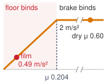
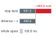
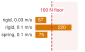

---
format:
  html:
    title: "Engineering Physical AI"
---

# Engineering Physical AI {#sec-frontier}

::: {layout-narrow}
::: {.column-margin}

\chapterminitoc

:::

::: {.content-visible when-format="pdf"}
\noindent
{fig-alt="Isometric blueprint of the epistemic frontier. A layered physical AI stack under glass, cabled to an actuator body housing, sits on a plinth whose edge ends at a red double-walled containment barrier above a cracked chasm labeled unobserved reality, while an amber prism labeled exploratory horizon projects a diagnostic beam across the barrier."}
:::

::: {.content-visible unless-format="pdf"}
{fig-alt="Isometric blueprint of the epistemic frontier: a layered physical AI stack under glass, a red containment barrier at the edge of a chasm labeled unobserved reality, and an amber prism projecting a diagnostic beam across it."}
:::

:::

## Purpose {.unnumbered .unlisted}

::: {.content-visible when-format="pdf"}
\begin{marginfigure}
\resizebox{0.92\linewidth}{!}{\mlphysicalstackfull{20}{20}{20}{20}{20}}
\end{marginfigure}
:::

_Why does a better model not, by itself, make a better machine?_

The learned model is the part of a physical machine that is easiest to improve and easiest to score, so it attracts most of the effort. Useful service depends on everything around it as well. The body must sustain the task across loads, surfaces, and hours of duty, the learned behavior must hold in the states its own actions create, each proposal must be admitted, corrected, or refused before the motion it asks for is already under way, and the evidence for all of it must match the conditions of operation and stay true as the machine and its site change. Each of these can be engineered well in isolation while the machine as a whole remains unjustified, because doubt accumulates across every premise a physical claim depends on, and a premise that no one names or owns is assumed silently. A team that cannot join these parts into one argument keeps improving the model while an unmeasured floor, an unqualified detector, or an unowned restriction decides what the machine actually does. The same joined argument also chooses what to build next, since the most valuable measurement, experience, or design change is the one that retires the weakest open premise. At the causal boundary, irreversibility makes that weakest premise, not the best prediction, the measure of what a machine may be trusted to do.



::: {.callout-learning-objectives}

- Explain why a better prediction can still produce a worse physical action, and synthesize the four laws into the design argument that answers it
- Place current learned proposers in the move from prediction to action, and explain why more capable proposers do not move the permission decision into the model
- Apply the four laws to select and evaluate a candidate operating mode for an unfamiliar machine
- Distinguish proposer autonomy, whole-machine task success, and protection when assessing a completed design
- Construct residual-claims entries with supported restrictions, accountable owners, and predeclared closure tests
- Select the next measurement, learning experiment, or design change needed to extend a machine's capability
:::
## From a Better Prediction to Useful Service {#sec-frontier-architectural-synthesis}

Every engineering division of this book establishes a distinct operational claim about a system whose learned outputs drive physical actions: what its mechanical body can sustain, what its learned proposer demonstrates under closed-loop evaluation, what its execution runtime admits within strict latency deadlines, and what its accumulated evidence licenses in deployment. While individual chapters developed these subsystems in isolation, building a dependable machine requires uniting them into a coherent whole. A robust architectural synthesis must satisfy three demanding criteria. First, it must integrate these disparate claims into an end-to-end operational argument on the warehouse machine they were built around. Second, its underlying methodology must transfer cleanly to unfamiliar hardware, such as the packaging cell analyzed in @sec-frontier-generalizing-unfamiliar-systems. Third, because mechanical actions alter the physical world irreversibly, the architecture must explicitly audit its own epistemic boundaries—documenting unmeasured environmental assumptions (@sec-frontier-epistemic-limits) and providing a structured framework for evolving those assumptions into new capabilities (@sec-frontier-assumptions-change).

In @sec-boundary, we examined the central question of physical artificial intelligence: why a better prediction can still produce a worse physical action, and what the rest of the machine must supply so that speculative model proposals become useful work within justified limits. That journey began in @sec-boundary-beyond-glass by contrasting physical AI with what preceded it. Traditional machine learning evaluated advisory predictions against static datasets, and agentic machine learning deployed iterative reasoning loops within the protective sandboxes of digital software—operating behind glass with elastic virtual time, transactional rollbacks, and symbolic interfaces. Physical AI stepped through that glass into the continuous physical world, where computation commands physical actuators across the causal boundary. That transition stripped away every digital privilege, forcing computer systems engineering to confront four physical realities: inexorable continuous time where computational delay is physical distance, mechanical and thermodynamic irreversibility that forbids undo operations, single-batch real-time constraints ($B=1$), and the imperative separation between speculative proposals and deterministic permission.

That investigation centered on a single reference platform: a warehouse mobile manipulator tasked with retrieving an object from an active conveyor, opening a spring-latched cage door, and transporting the payload through an aisle shared with people. Fulfilling that mission exercises the foundational capabilities introduced in @sec-boundary: designing physical and computational dynamics, teaching learned policies, integrating real-time runtimes, evaluating closed-loop behavior, and maintaining operational safety envelopes under real-world degradation. Every design choice along this pipeline directly constrained the next.

We can now state precisely why a better prediction can produce a worse physical action: physical success depends on dynamic variables that never enter the learned model's training loss or input space. The physical distance a mobile base traverses while a neural network computes its forward pass, the friction available at the tire-floor interface during sudden braking, the cascading states into which the robot's own prior actions thrust it, and the operational shifts between demonstration datasets and live deployment conditions all dictate what an actuator command does once it crosses the causal boundary. Increasing the statistical accuracy of a model refines the proposed trajectory, but it alters none of these underlying physical, temporal, or environmental constraints.

The second half of the question—what the surrounding machine must supply—resolves into the four-step argument of @sec-boundary-central-question, aligning one engineering discipline with each governing law. Under the first law (*irreversibility*), the body's mechanical and thermal limits bound what any proposal may request. Part I translated payload capacity, surface traction, contact forces, motor heating, and energy reserves into strict operational budgets that govern proposal horizons, execution cadence, and deterministic fallback paths. Under the second law (*endogenous data*), policy competence holds only over the empirical distribution of states induced by closed-loop interaction. Part II tied proposer evaluation directly to the states the physical machine actually visits, transforming recovery failures into targeted collection regimes rather than unhandled anomalies. Under the third law (*proposal is not permission*), execution authority resides in an independent permission path rather than the learned model. Part III unified observation freshness contracts, grounded geometric targets, timed trajectories, and real-time admission filters onto a compute topology engineered to meet hard deadlines under heavy load. Under the fourth law (*evidence bounds authority*), deployment scope is bounded by qualified system-wide evidence. Part IV structured physical operation as a governed service contract that decouples proposer autonomy, whole-system task success, and protective intervention. A least-change speed filter, for example, can preserve an in-flight delivery even when a raw proposal requires intervention, whereas an emergency stop protects physical hardware without fulfilling the promised service.

When deployed on physical hardware, this framework culminates in a formal release decision rather than an informal assertion of operational capability. In the baseline audit presented in @sec-release-case-worked-full, the unmitigated system records yield a verdict of `REFUSE`, reflecting unhedged tail risks and unverified fault margins. In contrast, the stipulated branch in @sec-release-stipulated-service demonstrates how comprehensive empirical evidence elevates that status to conditional authorization (`COND`). Under those verified performance and fault distributions, the machine is licensed to execute inspected-route transport, guarded door approaches, and close-proximity handovers—provided that standing environmental conditions governing floor traction, pedestrian crossings, feeder alignment, and sensor calibration remain actively verified. This is a disciplined systems result established under stated premises rather than an ungrounded deployment claim, demonstrating the complete chain of traceability connecting high-level mission goals to concrete operating envelopes and empirical guarantees.

@Fig-17-causal-loop-synthesis diagrams this closed causal loop across five stacked architectural tiers enclosed within a standing governance envelope: at the top, the Brain proposes action chunks across the proposal boundary at `{python} LoopSynthesisFigure.intent_rate_str`; inside the Nervous System, an application processor forwards candidate setpoints across a black-channel link to a discrete safety microcontroller, whose permission path ticks at `{python} LoopSynthesisFigure.permission_str` to evaluate kinematic and dynamic invariants; admitted commands pass to the Body, where motor drives close current loops at `{python} LoopSynthesisFigure.current_loop_str` on a `{python} LoopSynthesisFigure.bus_str` bus to exert forces and torques at the Boundary; and the evolving World returns event-timestamped measurements through sensor channels to both the fast permission filter and the Brain. Release governance establishes the static parameters, safety budgets, and standing operating envelopes across all five levels, providing an institutional framework that enforces operational boundaries without interfering with cycle-by-cycle real-time arbitration.

```{python}
#| label: calc-frontier-loop-figure
#| echo: false
# ┌─────────────────────────────────────────────────────────────────────────────
# │ CLOSED-LOOP SYNTHESIS FIGURE LABELS
# ├─────────────────────────────────────────────────────────────────────────────
# │ Context: @fig-17-causal-loop-synthesis (SVG labels are hand-typed).
# │ Goal:    Keep the machine's rates and bus voltage drawn in the figure
# │          equal to the registry values the rest of the book prints.
# │ Show:    Nothing; the cell only guards the drawn labels.
# │ How:     Compare each drawn label with the registered machine value.
# └─────────────────────────────────────────────────────────────────────────────
from mlsysim import *

RM = Embodied.MobileManipulator.WarehouseMobileManipulator

class LoopSynthesisFigure:
    """Values drawn in fig17_closed_loop_synthesis.svg."""

    # ┌── 1. LOAD (Drawn labels and the registry values they must match) ──────
    drawn = {
        "intent rate (Hz)": (2.0, RM.intent_rate.to(ureg.Hz).magnitude),
        "intent inference (ms)": (336.0, RM.intent_reference_latency.to(ureg.ms).magnitude),
        "chunk renewal (ms)": (50.0, (1 / RM.chunk_rate).to(ureg.ms).magnitude),
        "setpoint step (ms)": (25.0, RM.chunk_step.to(ureg.ms).magnitude),
        "permission tick (kHz)": (1.0, RM.permission_rate.to(ureg.kHz).magnitude),
        "drive bus nominal (V)": (47.7, RM.drive_bus_nominal.to(ureg.volt).magnitude),
        "drive current loop (kHz)": (20.0, RM.current_loop_rate.to(ureg.kHz).magnitude),
    }

    # ┌── 3. GUARD (Invariants) ────────────────────────────────────────────────
    for _name, (_label, _value) in drawn.items():
        check(abs(_label - _value) < 1e-9, f"closed-loop figure label for {_name} is stale ({_label} vs {_value})")

    # ┌── 4. OUTPUT (Formatting) ───────────────────────────────────────────────
    intent_rate_str = fmt_frequency(RM.intent_rate, unit=ureg.Hz, precision=0)
    renewal_str = fmt_latency(1 / RM.chunk_rate, unit=ureg.ms, precision=0)
    setpoint_str = fmt_latency(RM.chunk_step, unit=ureg.ms, precision=0)
    permission_str = fmt_frequency(RM.permission_rate, unit=ureg.kHz, precision=0)
    bus_str = fmt_voltage(RM.drive_bus_nominal, precision=1)
    current_loop_str = fmt_frequency(RM.current_loop_rate, unit=ureg.kHz, precision=0)
```

::: {#fig-17-causal-loop-synthesis fig-env="figure" fig-pos="t" fig-cap="**Closed causal loop**: The Brain proposes across the proposal boundary, and the permission path in the Nervous System admits, modifies, or refuses each proposal before the Body acts. The Body's current becomes force and motion at the Boundary, the World evolves, and the Boundary returns measurements with capture times to the permission path and the Brain. Not every state of the World reaches a sensor. The governance envelope surrounds all five levels and changes on the timescale of releases rather than control cycles. The labels are this machine's values: the intent model proposes at `{python} LoopSynthesisFigure.intent_rate_str`, the chunk is renewed every `{python} LoopSynthesisFigure.renewal_str`, the application processor sends a setpoint every `{python} LoopSynthesisFigure.setpoint_str` over a black-channel link to a discrete safety MCU whose permission path ticks at `{python} LoopSynthesisFigure.permission_str`, and the drives close their current loops at `{python} LoopSynthesisFigure.current_loop_str` from a `{python} LoopSynthesisFigure.bus_str` bus. Another machine sets its own rates." fig-alt="Five stacked levels inside a dashed governance envelope: Brain, Nervous System, Body, Boundary, and World, with a dashed proposal boundary between the Brain and the Nervous System. Inside the Nervous System an application processor sends setpoints over a black-channel link to a discrete safety MCU that runs the permission path. Arrows run from the Brain to the application processor, labeled proposal, from the safety MCU to the Body, labeled admitted command, and on to the World, labeled current in a winding and force and motion. A return arrow runs from the World to the Boundary, then up a side lane to the safety MCU, labeled fresh state, and to the Brain, labeled observations. Labels give the intent model 2 Hz with 336 ms inference, chunk renewal every 50 ms, a setpoint every 25 ms, a 1 kHz permission tick, a 20 kHz current loop in the drives, and a 47.7 V drive bus; the Boundary is event-timed, the World is continuous, and governance has no control rate."}
{width="100%"}
:::

The records summarized in @tbl-17-master-synthesis bring these four governing laws into an integrated engineering workflow. Rather than treating safety as an abstract property of a model, each architectural division produces durable, auditable artifacts that preserve empirical evidence and operational intent when tasks, payloads, or environmental conditions change.

\Needspace{25\baselineskip}

| Law                            | Part                                                                                             | Records that carry it                                                                                        | Condition to maintain                                                                                                                                 | Engineering result                                                                                                             |
|:-------------------------------|:-------------------------------------------------------------------------------------------------|:-------------------------------------------------------------------------------------------------------------|:------------------------------------------------------------------------------------------------------------------------------------------------------|:-------------------------------------------------------------------------------------------------------------------------------|
| **Irreversibility**            | I (@sec-body, @sec-brain, @sec-nervous)                                                          | Limit records (@sec-body); the proposer's limits (@sec-brain), which enter the handoff record (@sec-nervous) | Each measured limit, such as floor friction, payload, brake onset, or observation age, still holds under present conditions                           | A feasible speed or force envelope, a timed proposal interface, and a reachable fallback                                       |
| **Endogenous data**            | II (@sec-data, @sec-training, @sec-evaluation)                                                   | Demonstration provenance record, policy manifest, evaluation record                                          | The states the machine enters lie inside the target operational design domain (ODD, @sec-data-policy-coverage) that closed-loop evaluation represents | A learned behavior evaluated in its closed loop; new qualified experience can expand its supported task population             |
| **Proposal is not permission** | III (@sec-perception, @sec-memory, @sec-intent, @sec-planning, @sec-enforcement, @sec-placement) | Observation contract, belief record, intent lease, trajectory record, enforcement record, placement record   | The permission path sees fresh, distinguishable state and meets its deadline under load                                                               | Useful motion admitted or minimally corrected within current limits; invalid active authority invokes a state-matched fallback |
| **Evidence bounds authority**  | IV (@sec-intervention, @sec-verification, @sec-release)                                          | Authority record, fault record, release manifest, and the residual-claims register of this chapter           | The premises of the release claim still hold after release                                                                                            | A named service authorized under standing conditions, with tested intervention and update procedures                           |

: **The four laws as engineering competence**: Each part produces records that support the next design decision. The conditions and results belong to the particular machine and its evidence; they are not universal hardware requirements. {#tbl-17-master-synthesis tbl-colwidths="[14,17,25,22,22]"}

This architectural synthesis also illuminates the historical trajectory traced in @sec-boundary-prediction-to-action. Over eight decades, machine learning has steadily migrated from the periphery toward raw actuation: evolving from purely deterministic mechanisms, to learned perceptual frontends feeding analytical planners, to end-to-end motor policies, and ultimately to foundation models that propose action chunks across heterogeneous robotic embodiments. With each transition, safety guarantees that once relied on physical isolation or vigilant human operators had to be internalized within the computational stack itself.

The warehouse platform exemplifies this modern equilibrium. Its hierarchical split between an intent model proposing at 2 Hz and an action-chunk policy operating at higher frequencies mirrors contemporary vision-language-action pipelines, yet the safety guarantees displaced by these statistical models are preserved by the deterministic architecture surrounding them. The reflex halts beneath Shakey's STRIPS planner and the persistent low-level behaviors of Brooks's subsumption architecture have evolved into our discrete permission path, governed by mathematically signed kinematic and dynamic envelopes tailored to this mechanical body. Similarly, the safety pilot who hovered near the loop during the DARPA Robotics Challenge has been transformed into a formal intervention authority equipped with deterministic handover budgets, while the environmental oversight once provided by a human operator is now codified as explicit standing release conditions.

The next evolutionary phase, highlighted by the open challenges in @sec-frontier-four-open-challenges, involves foundation models that control diverse physical bodies while continuously learning from fleet-wide deployments. While cross-embodiment pretraining broadens model capabilities, it also stretches the model further beyond the empirical distribution of any single operating environment. Expanding what a proposer can suggest makes an independent permission path even more critical. Granting a learned model greater proposing latitude demands more rigorous dynamic verification at runtime and more defensible empirical evidence at release—a principle directly reflected in the European machinery regulations examined in @sec-frontier-thesis-in-law.

This systems architecture provides an engineering method designed to generalize across platforms. The transferable core consists of the foundational questions, dynamic budgets, empirical protocols, and interface boundaries; the platform-specific elements are the calibrated numerical thresholds, kinematic envelopes, and actuator limits. Applying this framework to the packaging cell in @sec-frontier-generalizing-unfamiliar-systems demonstrates how these invariant principles adapt when mechanics, cycle frequencies, and operational environments change.
## Generalizing to Unfamiliar Systems {#sec-frontier-generalizing-unfamiliar-systems}

When an automated packaging cell shuttles containers, closes closure tabs, and repeats high-rate cycles across a full shift, it operates against strict physical limits: kinematic reach, contact force, and thermal buildup in the drive motors. Building such an embodied system requires pairing a capable learned proposer with an execution pipeline whose runtime authority respects those physical bounds. The four bedrock laws of @sec-boundary-bedrock-laws formalize this engineering discipline. Together, they trace an unbroken chain from the task's irreversible consequences to measurable physical envelopes, through the closed-loop data required to train and validate policies, down to the real-time runtime that gates motor commands, and ultimately to the operational envelope certified for deployment. Applying this four-law framework to a novel packaging cell demonstrates how the systems principles developed throughout this book generalize far beyond the warehouse mobile manipulator.

### The four-law audit protocol for novel physical systems {#sec-frontier-four-law-audit-protocol}

The audit proceeds through a disciplined sequence. It begins by identifying the irreversible physical consequences of the intended task—the kinematic collisions, plastic structural deformations, and thermal overloads that no control command can undo—and establishing the measurable bounds that define a safe operational envelope. These physical boundaries directly dictate the data-collection campaign: training demonstrations and closed-loop evaluations must reflect the actual dynamics that safety limiters will permit. Next, the learned policy integrates with an independent permission path whose timing budgets, sensor observations, and deterministic fallbacks match the physical plant. Finally, end-to-end qualification of the integrated machine establishes the operational boundaries under which the system may safely execute. Because each layer constrains the next, adjustments ripple upstream; reducing the permitted transit speed to satisfy a stopping budget, for example, alters the visual flow and dynamic distribution that the learning pipeline must master.

### Multi-archetype case study on automated packaging cells {#sec-frontier-packaging-cell-study}

Consider an automated parcel induction and sortation cell operating inside a high-throughput logistics hub. The machine shuttles shipping containers along a linear track, actuates an articulated insertion head onto container flaps to engage structural retention tabs, and drives high-rate linear servo drives through rapid, cyclic acceleration profiles. This single workcell couples all three physical machine classes of @sec-boundary-three-classes within a single enclosure: the carriage as moving mass, the insertion head as contact force, and the high-duty actuator drives as thermal dissipation.

The first law focuses on what the machine cannot undo. We therefore begin by cataloging the cell's irreversible state changes\index{State change!irreversible} alongside the governing physical bounds\index{Physical bounds}. A loaded parcel container traversing a linear transfer rail carries momentum. When a carriage strikes an obstruction, kinetic energy dissipates through plastic deformation of the container and structural deflection of the frame—a mechanical state transition that cannot be reversed by commanding the drive motor in reverse. The insertion mechanism introduces a second irreversible boundary: an actuator drives a mechanical tool head against package tabs to lock retaining clips. If the actuator exerts force beyond the compressive load capacity of the carton wall, the container buckles, crushing internal contents. The high-duty drive introduces a third irreversible boundary through Joule heating ($I^2 R$). Continuous high-acceleration cycles pump thermal energy into sealed motor windings. Winding insulation does not need to melt to fail; elevated temperatures accelerate chemical degradation over time, shortening insulation life rapidly [@iec60085-2007]. Cooling the housing afterward cannot restore the dielectric strength already lost. Because the damage accumulates monotonically across duty cycles, an instantaneous temperature trip threshold alone cannot bound it.

```{python}
#| label: calc-frontier-packaging-stop
#| echo: false
#| warning: false
#| message: false
# ┌─────────────────────────────────────────────────────────────────────────────
# │ PACKAGING CELL: A CANDIDATE TRANSPORT MODE
# ├─────────────────────────────────────────────────────────────────────────────
# │ Context: @sec-frontier-packaging-cell-study.
# │ Goal:    Test nominal speed against a fixed stop line, solve the speed
# │          ceiling the stop budget admits, and check a restricted speed below it.
# │ Show:    Delay, stopping distances, the ceiling, reserve, and translational energy.
# │ How:     One-off hypothetical scenario inputs; MLSysIM constant-deceleration
# │          stopping (calc_safe_stopping_distance), its positive root
# │          (calc_max_permitted_velocity), and kinetic-energy models. These are
# │          not measurements.
# └─────────────────────────────────────────────────────────────────────────────
from mlsysim import *

class PackagingCell:
    # ┌── 1. LOAD (Scenario assumptions) ───────────────────────────────────────
    mass = 12 * ureg.kg  # scenario assumption: total moving mass, including load
    v_nom = 1.5 * ureg.meter / ureg.second  # scenario assumption: nominal speed
    v_clamp = 0.5 * ureg.meter / ureg.second  # scenario assumption: restricted speed
    clearance = 60 * ureg.mm  # scenario assumption: clearance to a fixed stop line
    reserve = 15 * ureg.mm  # scenario assumption: allocated uncertainty and clearance reserve
    deceleration = 15 * ureg.meter / ureg.second**2  # scenario assumption: braking lower bound after delay
    exposure = 16 * ureg.ms  # scenario assumption: worst-case event-to-usable-frame interval
    processing = 36 * ureg.ms  # scenario assumption: transfer, inference, scheduling, and admission
    bus = 2 * ureg.ms  # scenario assumption: admitted command to brake-driver delivery
    onset = 10 * ureg.ms  # scenario assumption: delivery to full assumed deceleration
    check_rate = 1 * ureg.kHz  # scenario assumption: independent kinematic-check rate
    force_cap = 220 * ureg.N  # scenario assumption: selected limiter setting, not material strength
    temperature_trip = Q_(105, ureg.degC)  # scenario assumption: selected sensor threshold
    stall_timeout = 400 * ureg.ms  # scenario assumption: selected stall-detection timeout
    bus_trip = 60 * ureg.volt  # scenario assumption: selected inverter overvoltage threshold
    deceleration_check = 12 * ureg.meter / ureg.second**2  # scenario assumption: a lower qualified braking bound (checkpoint estimate)

    # ┌── 2. EXECUTE (Compute) ─────────────────────────────────────────────────
    delay = exposure + processing + bus + onset
    stop_budget = clearance - reserve
    blind_nom = v_nom * delay
    brake_nom = v_nom**2 / (2 * deceleration)
    stop_nom = calc_safe_stopping_distance(v_nom, delay, deceleration)
    deficit = stop_nom - clearance
    # Speed ceiling: positive root of v tau + v^2/(2a) = clearance - reserve
    v_ceiling = calc_max_permitted_velocity(clearance, delay, deceleration, physical_margin=reserve).to(ureg.meter / ureg.second)
    # What changes if: halve the processing allocation, or halve the braking bound
    v_ceiling_fast_proc = calc_max_permitted_velocity(clearance, exposure + processing / 2 + bus + onset, deceleration, physical_margin=reserve).to(
        ureg.meter / ureg.second
    )
    v_ceiling_half_decel = calc_max_permitted_velocity(clearance, delay, deceleration / 2, physical_margin=reserve).to(ureg.meter / ureg.second)
    blind_clamp = v_clamp * delay
    brake_clamp = v_clamp**2 / (2 * deceleration)
    stop_clamp = calc_safe_stopping_distance(v_clamp, delay, deceleration)
    remaining = clearance - stop_clamp
    energy_nom = calc_kinetic_energy(mass, v_nom)
    energy_clamp = calc_kinetic_energy(mass, v_clamp)
    energy_reduction = (1 - energy_clamp / energy_nom).to(ureg.dimensionless).magnitude
    # Operands of the positive root, shown in the notebook
    a_tau = (deceleration * delay).to(ureg.meter / ureg.second)
    two_a_d = (2 * deceleration * stop_budget).to(ureg.meter**2 / ureg.second**2)
    root_term = ((a_tau**2 + two_a_d) ** 0.5).to(ureg.meter / ureg.second)
    v_ceiling_check = calc_max_permitted_velocity(clearance, delay, deceleration_check, physical_margin=reserve).to(ureg.meter / ureg.second)

    # ┌── 3. GUARD (Invariants) ────────────────────────────────────────────────
    # 2026-09-28: pin the complete hypothetical budget and the claimed reserve.
    check(delay == 64 * ureg.ms, "All four delay allocations must total 64 ms.")
    check(blind_nom > clearance, "Nominal speed must exhaust clearance before braking.")
    check(abs(stop_nom.to(ureg.mm).magnitude - 171) < 1e-9, "Nominal stop must be 171 mm.")
    check(abs(stop_clamp.to(ureg.mm).magnitude - 40.3333333333) < 1e-6, "Restricted stop must be 40.3 mm.")
    check(stop_clamp < stop_budget and remaining > reserve, "Restricted stop must preserve the allocated reserve.")
    check(abs(v_ceiling.magnitude - 0.5471) < 5e-4, "Carriage speed ceiling must be 0.55 m/s.")
    check(
        abs(calc_safe_stopping_distance(v_ceiling, delay, deceleration).to(ureg.mm).magnitude - stop_budget.to(ureg.mm).magnitude) < 1e-6,
        "At the ceiling the stop must fill the stop budget exactly.",
    )
    check(v_clamp < v_ceiling < v_nom, "The restricted speed is chosen below the ceiling, which sits below nominal.")
    check(abs(v_ceiling_fast_proc.magnitude - 0.6613) < 5e-4, "Halving processing raises the ceiling to 0.66 m/s.")
    check(abs(v_ceiling_half_decel.magnitude - 0.4715) < 5e-4, "Halving the braking bound lowers the ceiling to 0.47 m/s.")
    check(v_ceiling_half_decel < v_clamp, "At half the braking bound the 0.5 m/s mode no longer fits.")
    check(abs(energy_nom.to(joule).magnitude - 13.5) < 1e-9, "Nominal translational energy must be 13.5 J.")
    check(abs(energy_clamp.to(joule).magnitude - 1.5) < 1e-9, "Restricted translational energy must be 1.5 J.")
    check(abs(a_tau.magnitude - 0.96) < 1e-9 and abs(two_a_d.magnitude - 1.35) < 1e-9, "Root operands must be 0.96 m/s and 1.35 m²/s².")
    check(abs((root_term - a_tau - v_ceiling).magnitude) < 1e-9, "The shown root minus a*tau must equal the ceiling.")
    check(
        abs(v_ceiling_check.magnitude - 0.5242) < 5e-4 and v_ceiling_check > v_clamp,
        "At 12 m/s² the ceiling (0.52 m/s) must still admit the 0.5 m/s mode.",
    )

    # ┌── 4. OUTPUT (Formatting) ───────────────────────────────────────────────
    mass_str = fmt_qty(mass, unit=ureg.kg, precision=0)
    v_nom_str = fmt_velocity(v_nom, precision=2)
    v_clamp_str = fmt_velocity(v_clamp, precision=2)
    v_ceiling_str = fmt_velocity(v_ceiling, precision=2)
    v_ceiling_fast_proc_str = fmt_velocity(v_ceiling_fast_proc, precision=2)
    v_ceiling_half_decel_str = fmt_velocity(v_ceiling_half_decel, precision=2)
    processing_half_str = fmt_latency(processing / 2, unit=ureg.ms, precision=0)
    deceleration_half_str = fmt_acceleration(deceleration / 2, precision=1)
    clearance_str = fmt_length(clearance, unit=ureg.mm, precision=0)
    reserve_str = fmt_length(reserve, unit=ureg.mm, precision=0)
    deceleration_str = fmt_acceleration(deceleration, precision=0)
    exposure_str = fmt_latency(exposure, unit=ureg.ms, precision=0)
    processing_str = fmt_latency(processing, unit=ureg.ms, precision=0)
    bus_str = fmt_latency(bus, unit=ureg.ms, precision=0)
    onset_str = fmt_latency(onset, unit=ureg.ms, precision=0)
    delay_str = fmt_latency(delay, unit=ureg.ms, precision=0)
    blind_nom_str = fmt_length(blind_nom, unit=ureg.mm, precision=0)
    brake_nom_str = fmt_length(brake_nom, unit=ureg.mm, precision=0)
    stop_nom_str = fmt_length(stop_nom, unit=ureg.mm, precision=0)
    deficit_str = fmt_length(deficit, unit=ureg.mm, precision=0)
    stop_budget_str = fmt_length(stop_budget, unit=ureg.mm, precision=0)
    blind_clamp_str = fmt_length(blind_clamp, unit=ureg.mm, precision=0)
    brake_clamp_str = fmt_length(brake_clamp, unit=ureg.mm, precision=1)
    stop_clamp_str = fmt_length(stop_clamp, unit=ureg.mm, precision=1)
    remaining_str = fmt_length(remaining, unit=ureg.mm, precision=1)
    energy_nom_str = fmt_energy(energy_nom, unit=joule, precision=1)
    energy_clamp_str = fmt_energy(energy_clamp, unit=joule, precision=1)
    energy_reduction_str = fmt_percent(energy_reduction, precision=1, style="prose")
    check_rate_str = fmt_frequency(check_rate, unit=ureg.kHz, precision=0)
    force_cap_str = fmt_force(force_cap, precision=0)
    temperature_trip_str = fmt_temperature(temperature_trip, precision=0)
    stall_timeout_str = fmt_latency(stall_timeout, unit=ureg.ms, precision=0)
    bus_trip_str = fmt_voltage(bus_trip, precision=0)
    a_tau_str = fmt_velocity(a_tau, precision=2)
    two_a_d_str = fmt_qty(two_a_d, unit=ureg.meter**2 / ureg.second**2, precision=2)
    root_term_str = fmt_velocity(root_term, precision=2)
    deceleration_check_str = fmt_acceleration(deceleration_check, precision=0)
```

Because the carriage's momentum is already committed, the permission path must act before the carriage consumes its clearance. We test a candidate design using the constant-deceleration stopping formulation from @sec-body, evaluating hypothetical scenario inputs rather than measurements from a commissioned workcell.

::: {#nbk-frontier-packaging-delay-wall .callout-notebook title="The delay wall"}

**Problem**: The loaded carriage travels at `{python} PackagingCell.v_nom_str` toward a gate whose fixed stop line is `{python} PackagingCell.clearance_str` away when the hazardous closure begins, maintaining constant speed until braking begins. Can it stop short of the line, and if not, what is the fastest speed whose stop fits once a `{python} PackagingCell.reserve_str` reserve is held back?

**Variables**:

- Moving mass of carriage and loaded tray $m$ = `{python} PackagingCell.mass_str` and nominal speed $v$ = `{python} PackagingCell.v_nom_str` (Illustrative)
- Clearance `{python} PackagingCell.clearance_str`, less `{python} PackagingCell.reserve_str` reserved for uncertainty and residual clearance, leaves a stopping budget $d_{\text{budget}}$ = `{python} PackagingCell.stop_budget_str` (Illustrative)
- Braking lower bound $a_{\text{brake}}$ = `{python} PackagingCell.deceleration_str` after the delay (Illustrative; a bound to qualify under load, pad wear, and rail conditions, not a motor's peak rating)
- Delay from closure to full braking $\tau_{\text{delay}}$: `{python} PackagingCell.exposure_str` to a usable image, including frame phase and exposure, `{python} PackagingCell.processing_str` for transfer, inference, scheduling, and admission, `{python} PackagingCell.bus_str` for command delivery, and `{python} PackagingCell.onset_str` for brake buildup, in all `{python} PackagingCell.delay_str` (Illustrative upper bounds)

**Math**:

1. **Nominal stop** (@eq-body-stopping-distance, margins held in the reserve): $d_{\text{stop}} = v\tau_{\text{delay}} + v^2/2a_{\text{brake}}$ = `{python} PackagingCell.v_nom_str` $\times$ `{python} PackagingCell.delay_str` $+$ (`{python} PackagingCell.v_nom_str`)$^2/(2 \times$ `{python} PackagingCell.deceleration_str`) = `{python} PackagingCell.blind_nom_str` $+$ `{python} PackagingCell.brake_nom_str` = `{python} PackagingCell.stop_nom_str`, a deficit of `{python} PackagingCell.deficit_str`.
2. **Speed ceiling** (@eq-body-velocity-ceiling with $d_{\text{budget}}$ as the available distance): $a_{\text{brake}}\tau_{\text{delay}}$ = `{python} PackagingCell.a_tau_str` and $2a_{\text{brake}}d_{\text{budget}}$ = `{python} PackagingCell.two_a_d_str`, and the square root of (`{python} PackagingCell.a_tau_str`)$^2$ $+$ `{python} PackagingCell.two_a_d_str` is `{python} PackagingCell.root_term_str`. The positive root is $v_{\max}$ = `{python} PackagingCell.root_term_str` $-$ `{python} PackagingCell.a_tau_str` = `{python} PackagingCell.v_ceiling_str`.
3. **Candidate mode** at `{python} PackagingCell.v_clamp_str`, below the ceiling: `{python} PackagingCell.blind_clamp_str` of delay travel $+$ `{python} PackagingCell.brake_clamp_str` of braking = `{python} PackagingCell.stop_clamp_str`, leaving `{python} PackagingCell.remaining_str` before the stop line. Translational energy $E_k = mv^2/2$ falls from `{python} PackagingCell.energy_nom_str` to `{python} PackagingCell.energy_clamp_str`, a reduction of `{python} PackagingCell.energy_reduction_str`.

**Result**: At nominal speed the carriage reaches the gate before braking even begins. The budget admits at most `{python} PackagingCell.v_ceiling_str`, and the `{python} PackagingCell.v_clamp_str` candidate keeps more than the allocated reserve.

**Systems insight**: At these speeds delay travel, not braking, exhausts the clearance. The `{python} PackagingCell.delay_str` chain alone carries the nominal carriage `{python} PackagingCell.blind_nom_str`, farther than the stop line, so the condition $d_{\text{stop}} \le D_{\text{clear}}$ of principle \ref{pri-vol4-irreversibility} is met first by lowering speed or shortening the chain from closure to braking. The carriage's speed limit belongs to that whole chain, not to its brake alone.

:::

The slower mode is therefore worth qualifying. @Fig-17-packaging-cell partitions the physical plant, sensorimotor timing chain, and stopping envelopes across three aligned panels: panel (a) schematizes the physical track, mapping the carriage mass, carton insertion head, and drive motor against the optical gate stop line; panel (b) decomposes the cumulative `{python} PackagingCell.delay_str` pre-braking delay chain across image acquisition, transfer inference, bus transport, and brake onset; and panel (c) charts stopping distance on a millimeter axis, contrasting the nominal `{python} PackagingCell.v_nom_str` trajectory—which overruns the `{python} PackagingCell.clearance_str` stop line into the red hazard zone at `{python} PackagingCell.stop_nom_str`—against the clamped `{python} PackagingCell.v_clamp_str` mode that halts safely in `{python} PackagingCell.stop_clamp_str`, preserving the `{python} PackagingCell.reserve_str` stopping reserve.

```{python}
#| label: calc-frontier-packaging-figure
#| echo: false
# ┌─────────────────────────────────────────────────────────────────────────────
# │ PACKAGING CELL FIGURE LABELS
# ├─────────────────────────────────────────────────────────────────────────────
# │ Context: @fig-17-packaging-cell (SVG labels are hand-typed).
# │ Goal:    Keep every delay and distance drawn in the figure equal to the
# │          PackagingCell values the prose prints.
# │ Show:    Nothing; the cell only guards the drawn labels.
# │ How:     Compare each drawn label (ms, mm, m/s) with its computed value.
# └─────────────────────────────────────────────────────────────────────────────
class PackagingCellFigure:
    """Values drawn in fig17_packaging_cell.svg."""

    _P = PackagingCell
    _ms = lambda q: q.to(ureg.ms).magnitude
    _mm = lambda q: q.to(ureg.mm).magnitude
    _mps = lambda q: q.to(ureg.meter / ureg.second).magnitude
    drawn = [
        ("image", 16.0, _ms(_P.exposure), 1e-9),
        ("transfer, inference, admission", 36.0, _ms(_P.processing), 1e-9),
        ("bus", 2.0, _ms(_P.bus), 1e-9),
        ("onset", 10.0, _ms(_P.onset), 1e-9),
        ("total delay", 64.0, _ms(_P.delay), 1e-9),
        ("clearance", 60.0, _mm(_P.clearance), 1e-9),
        ("reserve start", 45.0, _mm(_P.stop_budget), 1e-9),
        ("nominal speed", 1.5, _mps(_P.v_nom), 1e-9),
        ("restricted speed", 0.5, _mps(_P.v_clamp), 1e-9),
        ("nominal delay travel", 96.0, _mm(_P.blind_nom), 1e-9),
        ("nominal braking", 75.0, _mm(_P.brake_nom), 1e-9),
        ("nominal stop", 171.0, _mm(_P.stop_nom), 1e-9),
        ("restricted delay travel", 32.0, _mm(_P.blind_clamp), 1e-9),
        ("restricted stop", 40.3, _mm(_P.stop_clamp), 0.05),
        ("restricted spare", 19.7, _mm(_P.remaining), 0.05),
    ]
    for _name, _label, _value, _tol in drawn:
        check(abs(_label - _value) < _tol, f"packaging-cell figure label for {_name} is stale ({_label} vs {_value})")
```

::: {#fig-17-packaging-cell fig-env="figure" fig-pos="t" fig-cap="**Three machine classes in one packaging cell**: (a) The carriage is the moving mass whose impact deforms carton and frame, the insertion head applies the contact force that can buckle a carton wall, and the drive dissipates heat that ages winding insulation. (b) The assumed delay chain from gate closure to full braking totals `{python} PackagingCell.delay_str`. (c) At `{python} PackagingCell.v_nom_str` the carriage travels `{python} PackagingCell.blind_nom_str` before braking begins and stops after `{python} PackagingCell.stop_nom_str`, far beyond the `{python} PackagingCell.clearance_str` stop line; at the restricted `{python} PackagingCell.v_clamp_str` it stops in `{python} PackagingCell.stop_clamp_str`, clear of the `{python} PackagingCell.reserve_str` reserve. All inputs are hypothetical design allocations, not measurements." fig-alt="Three panels. Panel a is a side-view schematic of a linear track with a drive box at the left end, a carriage carrying a carton, an insertion head pressing down on the carton, and a gate with a red dashed stop line at the right; labels name the drive as thermal dissipation with insulation aging, the carriage as moving mass whose impact deforms carton and frame, and the insertion head as contact force that buckles the carton wall. Panel b is a horizontal delay bar of four segments, image 16 ms, transfer inference and admission 36 ms, bus 2 ms, and brake onset 10 ms, totaling 64 ms from closure. Panel c shows two stopping-distance bars on a millimeter axis from 0 to 180 with a red dashed stop line at 60 mm and a hatched reserve band just before it. At 1.5 m/s the bar has 96 mm of delay travel and 75 mm of braking, reaching 171 mm, with the part beyond the stop line shaded red. At 0.5 m/s the bar has 32 mm of delay travel and a short braking segment, stopping at 40.3 mm with 19.7 mm to spare."}
{width="100%"}
:::

The quadratic root demonstrates how sensitive the velocity ceiling is to both computational latency and mechanical braking limits. Halving the processing allocation to `{python} PackagingCell.processing_half_str` raises the ceiling to `{python} PackagingCell.v_ceiling_fast_proc_str`; because reaction delay dominates stopping distance at high speed, faster admission buys the most velocity. Conversely, halving the qualified braking bound to `{python} PackagingCell.deceleration_half_str` lowers the ceiling to `{python} PackagingCell.v_ceiling_half_decel_str`, falling below the candidate `{python} PackagingCell.v_clamp_str` mode and eliminating it from consideration. The two premises play fundamentally different engineering roles. Shortening software latency creates an opportunity for higher throughput, whereas an unexpected braking shortfall invalidates the operational mode entirely. This asymmetry explains why engineers must qualify loaded deceleration empirically across worst-case operating conditions before commissioning the cell. The stopping equation defines the governing physical relationship, but only physical measurements on the assembled machine can establish that the latency budgets, deceleration bounds, and clearance reserves hold.

::: {.column-margin .margin-pointer}
↩ This speed ceiling is the positive root first solved for the mobile base in @sec-body-dynamic-velocity-ceilings.
:::

The second law evaluates the empirical competence of the cell's learned proposers. This packaging cell deploys three distinct learned proposers: a vision model that infers container contents to propose carriage transit speeds, a multimodal network that estimates packaging cardboard thickness to propose insertion forces and dwell durations, and an electro-thermal estimator that proposes acceleration profiles to manage motor winding temperatures. In an embodied system, a proposer's actions directly alter what it observes next. Throttling carriage speed changes camera frame timing and optical motion blur; extending tool dwell changes the material deformation that subsequent thickness estimations read; and reshaping acceleration profiles changes the temperature trajectory measured by the thermal estimator. Empirical evidence of proposer competence therefore depends strictly on the state distribution sampled during closed-loop evaluation, raising the crucial question of whether that distribution matches the conditions admitted at runtime. Imposing a safety restriction after training creates an operational shift: if closed-loop evaluation sampled only the nominal transit speed of `{python} PackagingCell.v_nom_str`, clamping speed to `{python} PackagingCell.v_clamp_str` pushes the vision model into a regime of visual dynamics it never encountered during evaluation. A restriction designed to guarantee physical stopping distance simultaneously opens a regime without empirical evidence. The engineering team must either evaluate the policy under derated conditions prior to release or document the unverified regime as an open premise in the release sign-off.

::: {.column-margin .margin-pointer}
↩ A policy whose actions choose its next observations is the endogenous covariate shift of @sec-data-covariate-shift; why evidence must come from the closed loop the machine will run is @sec-evaluation-closed-loop-dynamics.
:::

Closing this gap requires aligning the data-collection and evaluation campaign directly with the restricted operational envelope. Expert demonstrations must span the admitted transport velocities, insertion forces, and thermal regimes, preserving complete environmental metadata within the dataset provenance record. Once trained, the candidate proposer must undergo closed-loop trials on the physical cell to confirm that it successfully completes the packaging task under those conditions, including during interventions by the permission path. If the cell cannot maintain acceptable task performance within its physical bounds, engineers must revise the task specification, the proposer architecture, or the mechanical plant before re-evaluating the modified system. Calculating a defensible speed ceiling establishes physical safety, but only closed-loop verification demonstrates a viable packaging cell.

The third law places these proposed actions beneath an architectural authority split\index{Authority split} that the proposers cannot bypass, delay, or corrupt. The permission path prevents unverified neural proposals from reaching physical actuators directly. In this packaging workcell, an independent kinematic monitor runs at `{python} PackagingCell.check_rate_str`, evaluating optical encoders and rangefinder measurements to admit carriage motion commands only when real-time clearance supports the qualified stopping distance. The monitor's scheduling, sensory acquisition, and admission checks must execute within the `{python} PackagingCell.processing_str` processing budget; executing at a high loop frequency alone does not establish that end-to-end timing bound.

While the software kinematic check confines normal operation to the derated velocity mode, it does not carry the cell's formal protection claims. In an industrial deployment, harm-prevention claims rest upon hardware-certified drive safety functions codified under IEC 61800-5-2 [@iec61800part52] and mapped for warehouse automation in @tbl-12-certified-functions. The restricted transport mode maps to safely limited speed (SLS) on the carriage drive, an independent hardware function that continuously monitors motor velocity and triggers an emergency stop if the limit is exceeded. The emergency response executes as a ramp-monitored safe stop 1 (SS1) terminating in safe torque off (STO), with safe brake control (SBC) engaging mechanical holding brakes at rest. Each safety function requires a validated timing budget and an integrity metric. Under ISO 13849-1 [@iso13849part1], safety functions are classified by performance level (PL), which bounds their average probability of dangerous failure per hour according to the cell's risk assessment. The camera-triggered stop budgeted earlier represents an application-level proposal stop rather than a protective safety function. A safety-rated optical gate sensor feeding the drive's SS1 input directly replaces the frame-exposure and neural-inference allocations with its certified hardware response time, and that response time becomes $\tau_{\text{delay}}$ in the physical stopping model.

Physical safety limits must govern the insertion tool and actuator drives just as strictly as carriage motion. Configuring a mechanical force limiter to `{python} PackagingCell.force_cap_str` represents a nominal design setting rather than proof that every parcel resists crushing; empirical qualification must verify that peak transmitted forces—including dynamic overshoot during contact impact—remain below the yield strength of the weakest admitted carton and tab geometry. Similarly, setting a winding thermistor trip threshold at `{python} PackagingCell.temperature_trip_str` and a stall detection timeout of `{python} PackagingCell.stall_timeout_str` establishes basic supervisory cutoffs rather than a certified thermal envelope. Safe continuous operation depends on drive current profiles, winding resistance, heat capacity, cooling airflow, and sensor thermal lag. Because internal winding temperatures can surge before external housing sensors register the heat, engineers cannot validate a sustained duty cycle from trip thresholds alone without empirical thermal characterization.

High-rate deceleration also transfers mechanical kinetic energy back into the electrical drive system. During regenerative braking, the decelerating motor returns power to the inverter DC bus; a dynamic brake chopper and power resistor must absorb this energy before bus voltage exceeds the inverter trip threshold of `{python} PackagingCell.bus_trip_str`. The energy sink must accommodate repeated, cyclic stops throughout a shift rather than an isolated emergency event. Furthermore, regenerative braking requires an energized inverter stage throughout deceleration, whereas the carriage's electromechanical track brake relies on its own spring-actuated mechanism. Logic power hold-up alone supplies neither regenerative braking torque nor friction-brake clamping force. A thermal fault or electrical shutdown that cuts drive power disables regenerative braking, leaving deceleration entirely to the mechanical brake. System designers must ensure that safety-directed power cuts preserve a deterministic deceleration and holding response across every possible plant state.

The fourth law synthesizes these engineering decisions into a formal release argument. The cell's release manifest\index{Release manifest!packaging cell} must validate rangefinder coverage, gate clearance margins, braking deceleration, and sustained task throughput as an integrated whole. Equally important, the manifest explicitly records any claims that physical evidence cannot support. To verify tab latching integrity, the engineering team evaluates a vision model that inspects optical surface reflections for container tab engagement. Under industrial overhead lighting, specular reflections from tape and crinkled plastic packaging produce optical artifacts that mimic latch defects while masking genuine tab misalignments. Because the cell lacks an independent physical measurement—such as a tactile switch or a laser profile scanner—that distinguishes engaged tabs from misaligned flaps under glare, the sign-off claim lacks a qualified detector. Documenting this limitation as detectorless and unsupported in the residual-claims register\index{Residual-claims register!packaging cell} (@sec-frontier-residual-claims-register) is not a documentation failure, but an accurate statement of what the physical evidence justifies.

The stopping analysis therefore supports a *candidate restricted mode* for carriage transit at `{python} PackagingCell.v_clamp_str`, provided that the `{python} PackagingCell.delay_str` end-to-end latency, `{python} PackagingCell.deceleration_str` braking deceleration, `{python} PackagingCell.clearance_str` physical clearance, and uncertainty reserve are validated concurrently on the physical cell. Insertion forces and thermal duty cycles remain restricted until physical testing confirms material compressive limits, sensor thermal lag, and independent fault paths. Autonomous package sign-off is refused because optical glare obscures tab engagement from the vision system and the cell lacks an independent verification sensor. A qualified tactile or laser engagement sensor could support autonomous sign-off; mandatory downstream manual inspection instead supports a commercial deployment that makes no autonomous sign-off claim. An analytical throughput model cannot substitute for that empirical evidence.

By auditing the packaging cell across the four laws, systems engineers transform abstract safety objectives into an integrated sequence of concrete technical choices. Stopping mechanics identify a viable transport velocity envelope, which in turn defines the precise dynamic regime that data collection and closed-loop evaluation must cover. Runtime safety monitors enforce these dynamic limits in hardware and deterministic software, preventing policy proposals from breaching physical constraints. Finally, the release argument provides a transparent boundary between validated capabilities and unsupported claims, preventing catastrophic failures in edge cases. Physical AI systems succeed not by eliminating uncertainty through ever-larger models, but by bounding autonomy through verifiable physical laws.

This four-law audit protocol extends naturally beyond the mechanical archetypes of @sec-boundary-three-classes into fluid and chemical process systems, where the conserved irreversible quantity is mass flow or thermodynamic enthalpy rather than kinetic momentum. Consider a learned proposer that adjusts a dosing valve feeding a chemical reaction vessel. The first law asks: what mass of reagent has already been irrevocably committed? If a shutoff command experiences latency $\tau_{\text{delay}}$ at a volumetric flow rate $Q$, fluid continues to discharge, adding roughly $Q\tau_{\text{delay}}$ to the volume delivered while the valve physically closes—a direct fluidic analog of the mechanical stopping distance model. Stored thermodynamic and hydraulic energy similarly complicates fallback architectures. A pressurized accumulator, a cryogenic transfer line, or a heated pressure vessel retains stored energy even when electronic control power is severed. Much like balancing a bipedal humanoid, abruptly de-energizing the computational controller does not produce a safe state; the engineering design must name a qualified physical sink, such as a spring-loaded pressure relief bypass, to safely dissipate stored energy. The remaining three laws follow identically: policy evaluation must sample the throttled flow regimes that safety limits enforce; the permission path must guarantee valve closure within the allowable volumetric tolerance; and operational sign-off must ground all safety guarantees in measured valve slew rates and sensor response times.

::: {#chk-frontier-packaging-transfer .callout-checkpoint title="Transferring the four-law audit"}

The packaging cell demonstrates how the four-law audit organizes system design for an entirely novel machine, anchoring every operational claim to physical bounds and empirical measurements.

- [ ] **Speed-ceiling estimate**: Suppose physical load testing qualifies the carriage's braking bound at only `{python} PackagingCell.deceleration_check_str`, assuming the same `{python} PackagingCell.delay_str` total delay and `{python} PackagingCell.stop_budget_str` stopping budget. Estimate the updated velocity ceiling from the positive root of the stopping equation, and determine whether the candidate `{python} PackagingCell.v_clamp_str` mode still fits within this certified budget.
- [ ] **Machine classes**: For the carriage, the insertion head, and the linear drive motors, identify each component's physical machine class, the irreversible physical state transition it can produce, and the governing physical boundary.
- [ ] **Derated evaluation**: Explain why imposing a runtime velocity restriction after training induces an endogenous covariate shift for the vision proposer. What two engineering options can close this evaluation gap prior to operational sign-off?
- [ ] **Sign-off verdict**: What specific physical sensing evidence would be required to transition autonomous package sign-off from refused to supported, and why does simply expanding the training dataset with more glare-corrupted images fail to resolve the underlying detector deficiency?

:::
## The Epistemic Frontier {#sec-frontier-epistemic-limits}

A packaging cell's camera can confirm an arm's position and approve a transport motion without verifying that a hidden mechanical tab has engaged. Similarly, a warehouse robot's lidar and cameras can clear a navigation path across an aisle without determining whether the concrete floor provides sufficient traction to brake. These gaps represent fundamental epistemic limits: boundaries on what available sensory observations and analytical arguments can mathematically or physically justify. While additional training can improve a policy's action proposals, machine learning cannot manufacture unobserved physical reality. Systems engineers must identify whether validating the next operational claim demands broader training experience or a physical measurement absent from the existing sensor suite.

Consider an operational scenario where a pallet jack with a leaking hydraulic line crosses an active warehouse aisle, depositing a thin, transparent film of fluid onto polished concrete. The mobile manipulator's stopping budget assumes the floor provides sufficient surface friction for credible deceleration, which dry industrial concrete reliably supplies. Under an oil film, however, available traction collapses, yet neither standard navigation cameras nor time-of-flight lidars can distinguish the clear fluid from dry concrete. In this failure mode, the safety architecture operates exactly as specified: the software permission path clears every deadline, chunk leases expire predictably, and the actuator controller executes braking torque precisely on schedule. Nevertheless, the robot overruns the rack end and collides with the boundary. The failure stems not from software latency or actuator lag, but from an unmonitored premise: the local wheel-floor friction coefficient prior to braking. The stopping calculation evaluates this unobserved friction deficit:

```{python}
#| label: calc-frontier-oil-film
#| echo: false
#| warning: false
#| message: false
# ┌─────────────────────────────────────────────────────────────────────────────
# │ THE OIL FILM ON THE AISLE
# ├─────────────────────────────────────────────────────────────────────────────
# │ Context: @sec-frontier-epistemic-limits (the premise behind the aisle
# │          speed), @sec-frontier-residual-claims-register (the register
# │          entries and @tbl-17-claims-register),
# │          @sec-frontier-failures-without-detectors (detection latency against the spare margin),
# │          @sec-frontier-fallacies-pitfalls (the vision-only pitfall).
# │
# │ Goal:    Show that the 1.3 m/s normal mode always rested on a friction
# │          floor that no sensor on the machine reports.
# │ Show:    the friction the credible deceleration needs; the stop on a clear
# │          film against the clear distance; the inspected-floor ceiling and
# │          restricted mode; the zero-failure closure test; the time the spare
# │          margin buys; the film-detector range at a chosen latency; how much
# │          a time-form action deadline over-reserves against the distance form. The walking-person ceiling is Ch12's
# │          (@sec-enforcement-stopping-envelopes) and is cited, not recomputed.
# │ How:     credible deceleration a = min(a_brake, mu g); the finished budget
# │          (jerk-limited S-curve stop, all three overheads) at the aisle speed,
# │          jerk bound = the reference C2 polynomial's peak jerk at the drive
# │          limit (@sec-planning-c2-stopping-suffix); its ceiling from
# │          calc_scurve_max_permitted_velocity; zero-failure sample size.
# └─────────────────────────────────────────────────────────────────────────────
from mlsysim import *
from mlsysim.physics import calc_scurve_stop_time

RM = Embodied.MobileManipulator.WarehouseMobileManipulator
AISLE = Embodied.Scenario.WarehouseAisle

class OilFilm:
    # ┌── 1. LOAD (Constants & Parameters) ─────────────────────────────────────
    g = (1 * ureg.standard_gravity).to(ureg.meter / ureg.second**2)  # category: measured (physical constant, standard gravity)
    a_brake = AISLE.a_brake  # category: illustrative (credible deceleration, dry floor)
    mu_dry = AISLE.mu_dry  # category: illustrative (dry concrete)
    mu_insp = AISLE.mu_inspected_floor  # category: illustrative (inspected floor)
    mu_oil = AISLE.mu_oil_film  # category: illustrative (clear hydraulic film)
    v_aisle = AISLE.v_aisle  # category: chosen (normal-mode aisle speed)
    d_clear = AISLE.d_clear  # category: illustrative (rack-end clear distance)
    tau_delay = AISLE.tau_delay  # category: derived (pre-brake delay, excluding Delta_da)
    delta_da = AISLE.t_dispatch_to_admission  # category: illustrative (allocation of @sec-placement, not yet measured)
    overhead = AISLE.fixed_overhead  # category: derived (delta_loc + delta_margin + eps_track)
    v_h = AISLE.v_human_approach  # category: datasheet (ISO 13855 walking speed)
    v_restricted = 1.0 * ureg.meter / ureg.second  # category: chosen (scenario assumption: restricted mode on inspected floors)
    p_miss_target = 0.001  # category: chosen (detector miss-rate bound for closure)
    n_contrast = 1000  # category: illustrative (a smaller zero-miss campaign, for contrast)
    confidence = 0.95  # category: chosen (one-sided confidence level)
    t_detect = 100 * ms  # category: chosen (film-detector sensing and inference latency, for the range condition)
    mu_check = 0.15  # category: illustrative (a measured floor, for the checkpoint estimate)

    # ┌── 2. EXECUTE (Compute) ─────────────────────────────────────────────────
    mu_min = (a_brake / g).to(ureg.dimensionless).magnitude
    a_dry = min(a_brake, mu_dry * g)
    a_insp = min(a_brake, mu_insp * g)
    a_oil = min(a_brake, mu_oil * g)
    # Jerk bound: the reference C2 polynomial's peak jerk at the drive limit; the
    # floor caps the deceleration, while the jerk bound belongs to the load.
    j_brake = calc_c2_stop_suffix(RM.base.max_velocity, a_brake)["peak_jerk"].to(ureg.meter / ureg.second**3)

    # finished budget at the aisle speed: v tau + S-curve stop + overhead
    budget_aisle = (v_aisle * tau_delay + calc_scurve_stop_distance(v_aisle, a_dry, j_brake) + overhead).to(ureg.meter)
    spare_aisle = (d_clear - budget_aisle).to(ureg.millimeter)
    t_latest = (spare_aisle / v_aisle).to(ms)
    reserve_da = (t_latest - delta_da).to(ms)  # timing allowance left after the Delta_da allocation
    stop_oil = (v_aisle * tau_delay + calc_scurve_stop_distance(v_aisle, a_oil, j_brake) + overhead).to(ureg.meter)
    # Visible terms of the finished budget (trapezoidal regime: v^2/2a + v a/2j, @sec-enforcement-stopping-envelopes)
    v_tau = (v_aisle * tau_delay).to(ureg.millimeter)
    brake_dry = (v_aisle**2 / (2 * a_dry)).to(ureg.millimeter)
    ramp_dry = (v_aisle * a_dry / (2 * j_brake)).to(ureg.millimeter)
    brake_oil = (v_aisle**2 / (2 * a_oil)).to(ureg.millimeter)
    ramp_oil = (v_aisle * a_oil / (2 * j_brake)).to(ureg.millimeter)

    # ceilings: the largest speed whose finished budget fits the clear distance
    margin_loc = AISLE.delta_loc + AISLE.eps_track
    ceiling_dry = calc_scurve_max_permitted_velocity(d_clear, tau_delay, a_dry, j_brake, margin_loc, AISLE.delta_margin)
    ceiling_insp = calc_scurve_max_permitted_velocity(d_clear, tau_delay, a_insp, j_brake, margin_loc, AISLE.delta_margin)

    # film detector: range needed so the dry-floor stop ends before the film's leading edge
    d_detect_min = (v_aisle * t_detect + budget_aisle).to(ureg.meter)

    # action deadline, time form vs distance form, for the S-curve stop at the aisle speed
    t_brake_aisle = calc_scurve_stop_time(v_aisle, a_dry, j_brake).to(ms)
    d_brake_aisle = calc_scurve_stop_distance(v_aisle, a_dry, j_brake).to(ureg.millimeter)
    t_brake_equiv = (d_brake_aisle / v_aisle).to(ms)  # time at the unchanged speed that the stop's distance represents
    t_overreserve = (t_brake_aisle - t_brake_equiv).to(ms)
    d_overreserve = (v_aisle * t_overreserve).to(ureg.millimeter)

    n_closure = calc_zero_failure_sample_size(1.0 - p_miss_target, confidence=confidence)
    p_miss_contrast = 1.0 - calc_clopper_pearson_zero_failure_bound(n_contrast, confidence=confidence)

    # ┌── 3. GUARD (Invariants) ────────────────────────────────────────────────
    check(abs(mu_min - 0.204) < 5e-4, f"Friction floor should be 0.204, got {mu_min}.")
    check(a_dry == a_brake and mu_dry > mu_min, "On dry concrete the brakes, not friction, must bind.")
    check(mu_oil < mu_min and mu_insp < mu_min, "On the film and on an inspected floor friction must bind.")
    check(abs(a_insp.to(ureg.meter / ureg.second**2).magnitude - 1.1768) < 5e-4, f"Inspected-floor deceleration should be 1.18 m/s², got {a_insp}.")
    check(abs(j_brake.magnitude - 64.0 / 9.0) < 1e-9, f"Jerk bound should be the reference polynomial's 7.11 m/s^3 peak, got {j_brake}.")
    check(abs(budget_aisle.to(ureg.millimeter).magnitude - 968.9925) < 5e-3, f"Budget at 1.3 m/s should be 968.99 mm, got {budget_aisle}.")
    check(abs(spare_aisle.to(ureg.millimeter).magnitude - 131.0075) < 5e-3, f"Spare at 1.3 m/s should be 131.01 mm, got {spare_aisle}.")
    check(abs(t_latest.to(ms).magnitude - 100.775) < 5e-3, f"T_latest should be 100.8 ms, got {t_latest}.")
    check(reserve_da.magnitude > 0, "The Delta_da allocation must leave positive reserve at the aisle speed.")
    check(t_detect + delta_da > t_latest, "The chosen detector latency and the Delta_da allocation cannot both fit the allowance.")
    check(abs(ceiling_dry.to(ureg.meter / ureg.second).magnitude - 1.4367) < 5e-5, f"Dry-floor ceiling should be 1.4367 m/s, got {ceiling_dry}.")
    check(
        abs(ceiling_insp.to(ureg.meter / ureg.second).magnitude - 1.2309) < 5e-5, f"Inspected-floor ceiling should be 1.2309 m/s, got {ceiling_insp}."
    )
    check(
        v_restricted < ceiling_insp < v_aisle < ceiling_dry,
        "Restricted mode must sit under the inspected ceiling, and the aisle speed under the dry ceiling.",
    )
    check(abs(stop_oil.to(ureg.meter).magnitude - 2.13) < 5e-3, f"Finished budget on the film should be 2.13 m, got {stop_oil}.")
    check(abs(a_oil.to(ureg.meter / ureg.second**2).magnitude - 0.49) < 5e-3, f"Film deceleration should be 0.49 m/s², got {a_oil}.")
    check(stop_oil > d_clear, f"On the film the incomplete budget from the aisle speed must already exceed the clear distance, got {stop_oil}.")
    check(n_closure == 2995, f"Zero-failure closure test should need 2,995 trials, got {n_closure}.")
    check(abs(d_detect_min.to(ureg.millimeter).magnitude - 1098.9925) < 5e-3, f"Film-detector range should be 1.10 m, got {d_detect_min}.")
    check(abs(t_brake_aisle.magnitude - 931.25) < 1e-6, f"S-curve stop from 1.3 m/s should take 931.25 ms, got {t_brake_aisle}.")
    check(abs(d_brake_aisle.magnitude - 605.3125) < 1e-6, f"S-curve stop from 1.3 m/s should cover 605.31 mm, got {d_brake_aisle}.")
    check(abs(t_overreserve.magnitude - 465.625) < 1e-6, f"Time form over-reserves 465.6 ms, got {t_overreserve}.")
    check(d_overreserve > spare_aisle, "The time form's over-reservation exceeds the whole spare margin.")
    check(v_aisle > a_dry**2 / j_brake and v_aisle > a_oil**2 / j_brake, "Both stops must be in the trapezoidal regime for the shown terms.")
    check(
        abs((v_tau + brake_dry + ramp_dry + overhead - budget_aisle).to(ureg.millimeter).magnitude) < 1e-6, "Shown dry terms must sum to the budget."
    )
    check(
        abs((v_tau + brake_oil + ramp_oil + overhead - stop_oil).to(ureg.millimeter).magnitude) < 1e-6,
        "Shown film terms must sum to the film budget.",
    )
    check(mu_check * g < a_brake and mu_check > mu_insp, "The checkpoint floor must bind and lie above the inspected floor.")
    check(abs(p_miss_contrast - 0.002991) < 5e-7, f"1,000 zero-miss trials should bound the miss rate at 0.002991, got {p_miss_contrast}.")
    # margin_friction_floor_deceleration_knee.svg fig-alt hand-types 2 m/s², 0.204, 0.60, 0.12, 1.18, 0.05 and 0.49
    check(abs(a_brake.to(ureg.meter / ureg.second**2).magnitude - 2.0) < 1e-9, f"Credible deceleration should be 2 m/s², got {a_brake}.")
    check(abs(mu_dry - 0.60) < 1e-9 and abs(mu_insp - 0.12) < 1e-9 and abs(mu_oil - 0.05) < 1e-9, "Floor coefficients should be 0.60, 0.12 and 0.05.")
    # margin_stop_time_overreserve_envelope.svg fig-alt hand-types 931.2, 465.6, 465.6 and 100.8 ms (guards above)

    # ┌── 4. OUTPUT (Formatting) ───────────────────────────────────────────────
    a_brake_str = fmt_acceleration(a_brake, precision=0)
    mu_min_str = fmt(mu_min, precision=3)
    mu_dry_str = fmt(mu_dry, precision=2)
    mu_insp_str = fmt(mu_insp, precision=2)
    mu_oil_str = fmt(mu_oil, precision=2)
    a_insp_str = fmt_acceleration(a_insp, precision=2)
    a_oil_str = fmt_acceleration(a_oil, precision=2)
    v_aisle_str = fmt_velocity(v_aisle, precision=1)
    d_clear_str = fmt_length(d_clear, unit=ureg.meter, precision=2)
    budget_aisle_str = fmt_length(budget_aisle, unit=ureg.millimeter, precision=1)
    spare_aisle_str = fmt_length(spare_aisle, unit=ureg.millimeter, precision=1)
    t_latest_str = fmt_latency(t_latest, unit=ms, precision=1)
    delta_da_str = fmt_latency(delta_da, unit=ms, precision=1)
    reserve_da_str = fmt_latency(reserve_da, unit=ms, precision=1)
    stop_oil_str = fmt_length(stop_oil, unit=ureg.meter, precision=2)
    ceiling_insp_str = fmt_velocity(ceiling_insp, precision=2)
    v_restricted_str = fmt_velocity(v_restricted, precision=0)
    n_closure_str = fmt_int(n_closure, commas=True)
    n_contrast_str = fmt_int(n_contrast, commas=True)
    p_miss_contrast_str = fmt(p_miss_contrast, precision=6)
    p_miss_target_pct_str = fmt_percent(p_miss_target, precision=1, style="prose")
    p_miss_target_sym_str = fmt_percent(p_miss_target, precision=1, style="symbol")
    confidence_pct_str = fmt_percent(confidence, precision=0, style="prose")
    confidence_sym_str = fmt_percent(confidence, precision=0, style="symbol")
    v_h_str = fmt_velocity(v_h, precision=1)
    t_detect_str = fmt_latency(t_detect, unit=ms, precision=0)
    d_detect_min_str = fmt_length(d_detect_min, unit=ureg.meter, precision=2)
    t_brake_aisle_str = fmt_latency(t_brake_aisle, unit=ms, precision=1)
    t_brake_equiv_str = fmt_latency(t_brake_equiv, unit=ms, precision=1)
    t_overreserve_str = fmt_latency(t_overreserve, unit=ms, precision=1)
    d_overreserve_str = fmt_length(d_overreserve, unit=ureg.millimeter, precision=1)
    g_str = fmt_acceleration(g, precision=2)
    tau_delay_str = fmt_latency(tau_delay, unit=ms, precision=1)
    j_brake_str = fmt_qty(j_brake, unit=ureg.meter / ureg.second**3, precision=2)
    overhead_str = fmt_length(overhead, unit=ureg.millimeter, precision=0)
    v_tau_str = fmt_length(v_tau, unit=ureg.millimeter, precision=1)
    brake_dry_str = fmt_length(brake_dry, unit=ureg.millimeter, precision=1)
    ramp_dry_str = fmt_length(ramp_dry, unit=ureg.millimeter, precision=1)
    brake_oil_str = fmt_length(brake_oil, unit=ureg.millimeter, precision=1)
    ramp_oil_str = fmt_length(ramp_oil, unit=ureg.millimeter, precision=1)
    mu_check_str = fmt(mu_check, precision=2)
```

The release decision in @sec-release-safety-cases-claims already encountered this premise: claim C3 (braking traction) was refused on this book's own evidence and deferred to this chapter as an unresolved premise. A machine's credible deceleration is governed by whichever is smaller—actuator braking capacity or tire-floor contact traction:[^fn-amontons-coulomb-friction]
$$a = \min(a_{\text{brake}}, \mu g).$$ {#eq-frontier-credible-deceleration}
This friction term establishes the physical ceiling on wheel-ground force illustrated in @fig-02-braking-fbd. On an oily surface, interface friction—not motor torque—becomes the binding constraint.

::: {#nbk-frontier-friction-floor .callout-notebook title="The friction floor"}

**Problem**: A clear hydraulic film lies across the aisle. Does the finished dry-floor stop from the candidate `{python} OilFilm.v_aisle_str` aisle speed still fit the rack end's `{python} OilFilm.d_clear_str` clear distance?

**Variables**:

- Credible deceleration $a_{\text{brake}}$ = `{python} OilFilm.a_brake_str` (Illustrative, @sec-body-kinetic-momentum) and $g$ = `{python} OilFilm.g_str` (Measured constant)
- Floor friction $\mu$ = `{python} OilFilm.mu_dry_str` on dry industrial concrete and `{python} OilFilm.mu_oil_str` under the film (both Illustrative; see the Reader Guide)
- Aisle speed $v$ = `{python} OilFilm.v_aisle_str` (Chosen) and clear distance $D_{\text{clear}}$ = `{python} OilFilm.d_clear_str` (Illustrative)
- Known-component terms of @tbl-enforcement-stopping-budget: pre-brake delay $\tau_{\text{delay}}$ = `{python} OilFilm.tau_delay_str`, jerk bound $j_{\max}$ = `{python} OilFilm.j_brake_str`, and fixed overheads of `{python} OilFilm.overhead_str` (all Derived)

**Math**:

1. **Friction floor** (@eq-frontier-credible-deceleration): The brake binds only while $\mu \ge a_{\text{brake}}/g$ = `{python} OilFilm.a_brake_str` $/$ `{python} OilFilm.g_str` = `{python} OilFilm.mu_min_str`. Dry concrete clears it; the film does not, so $a = \mu g$ = `{python} OilFilm.mu_oil_str` $\times$ `{python} OilFilm.g_str` = `{python} OilFilm.a_oil_str`.
2. **Dry-floor budget**: Delay travel $v\tau_{\text{delay}}$ $+$ braking $v^2/2a$ $+$ jerk-ramp travel $va/2j_{\max}$ $+$ overheads = `{python} OilFilm.v_tau_str` $+$ `{python} OilFilm.brake_dry_str` $+$ `{python} OilFilm.ramp_dry_str` $+$ `{python} OilFilm.overhead_str` = `{python} OilFilm.budget_aisle_str`.
3. **Film budget**: The same terms at $a$ = `{python} OilFilm.a_oil_str` give `{python} OilFilm.v_tau_str` $+$ `{python} OilFilm.brake_oil_str` $+$ `{python} OilFilm.ramp_oil_str` $+$ `{python} OilFilm.overhead_str` = `{python} OilFilm.stop_oil_str`.

**Result**: On the film the stop grows from `{python} OilFilm.budget_aisle_str` to `{python} OilFilm.stop_oil_str`, far past the `{python} OilFilm.d_clear_str` clear distance, and this budget still omits the dispatch-to-admission interval.

**Systems insight**: Below $\mu$ = `{python} OilFilm.mu_min_str` the floor, not the brake or the timing, sets the deceleration, and the braking term grows as $1/\mu$. Faster admission can recover only the `{python} OilFilm.v_tau_str` of delay travel, so no improvement in the permission path restores the dry-floor mode on the film. Only a restriction or a measurement at the tire-floor interface can keep $d_{\text{stop}} \le D_{\text{clear}}$.

:::

The calculation omits the dispatch-to-admission interval, which @sec-placement allocates but no loaded measurement yet confirms; that interval adds travel and reduces every derived speed ceiling. Even this incomplete budget already excludes the film.

[^fn-amontons-coulomb-friction]: **Amontons-Coulomb Friction**\index{Friction coefficient!Amontons-Coulomb}: The classical laws of sliding friction make the friction force proportional to the normal load and independent of the apparent contact area, which is what lets a single coefficient $\mu$ describe a contact. @bowden1950friction traced the law to the small true area of contact, whose shear strength sets $\mu$, and showed that a lubricant film only molecules thick can lower it several-fold. The coefficient therefore belongs to the pair of surfaces and whatever lies between them, not to the floor alone, and the braking premise needs a measurement at the tire-floor interface that no camera viewing the floor supplies.

The friction premise did not emerge merely when fluid leaked onto the concrete. The candidate normal operating mode of @sec-enforcement-stopping-envelopes implicitly assumed that unmeasured friction floor across every aisle, dry or wet. These evidence streams are orthogonal: resolving software timing uncertainties does not guarantee physical traction, and confirming traction does not eliminate scheduling delays.

::: {.column-margin}
{width="100%" fig-alt="Plot of credible deceleration against floor friction coefficient. An amber line rises from the origin to 2 meters per second squared at a dashed vertical line marked μ 0.204, then runs flat. The region left of the dashed line is shaded and labeled floor binds; the flat part is labeled brake binds. A dot on the flat part marks dry μ 0.60. On the rising part, an amber dot marks the inspected floor, μ 0.12, at 1.18, and a red dot marks the film, μ 0.05, at 0.49."}

*Below $\mu$ = `{python} OilFilm.mu_min_str`, the floor, not the brake, sets the deceleration.*
:::

The oil film stresses the safety architecture directly at the boundary between physical measurement and software permission. An independent safety enforcer can reject action proposals that violate a validated stopping envelope, but accelerating enforcer execution cannot overcome an unverified friction coefficient. The drive electronics continue to regulate motor current and commanded torque with millisecond precision (@sec-body-electrical-time-constants), yet that torque translates into deceleration solely through tire-floor contact mechanics. Ensuring safety requires either a verified physical sensor at the interface or an enforceable operational restriction rather than another layer of neural inference.

The manipulator arm's contact limit at the door latch exposes an identical structural vulnerability: safety depends on a latch that holds under any force below the arm's contact ceiling. Yet mechanical wear, material fatigue, or chemical corrosion can silently reduce the latch's yield force below that threshold, even while joint torque sensors report nominal readings identical to those against a pristine strike plate. A wrist force-torque sensor whose zero-point calibration has drifted creates the same hazard for every contact threshold that depends on its signal (@sec-frontier-passive-compliance-containment).

In each scenario, a machine can depart from its safe operating envelope while internal telemetry remains completely nominal. Successful empirical runs under nominal conditions provide no safety guarantee once an underlying physical premise fails. A rigorous safety case must explicitly catalog each unobserved premise, restrict operational authority while that premise remains unverified, and define the empirical evidence required to close it. For every open entry, systems discipline requires determining what the machine can physically measure, what actuator limits can still prevent, and which operational claims must remain refused.

### What the release claim rests on {#sec-frontier-method-limits}

A mobile manipulator's release claim forms a chain of dependent arguments determined by operational hazards and selected mitigations (@sec-boundary-machine-model). The complete safety case must establish the operational design domain, measured actuator performance, stopping bounds, component interface contracts, and independent permission filtering for learned proposals. Hazards managed by runtime detection demand verified detector coverage and bounded monitoring latency. Conversely, hazards managed through passive compliance or operational constraints require empirical evidence that those safeguards hold across declared payloads, component wear, and environmental exposures. Extensive testing of one link cannot compensate for an unsupported premise in another.[^fn-popper-falsification-asymmetry]

[^fn-popper-falsification-asymmetry]: **Popperian Falsification**\index{Falsification!Popperian induction}: The asymmetry holds for universal hypotheses [@popper1959logic]. No finite run of safe stops proves that every aisle floor supplies the friction floor, and one measured film below it refutes that premise. A rate claim, such as a hazard rate per hour, is neither refuted by one incident nor proved by many incident-free hours, so it is bounded statistically and revised as exposure accumulates. This chapter therefore holds deterministic premises in register entries and rate claims in confidence bounds.

Each premise in a safety case carries one of five formal statuses defined in the Reader Guide: established by measurement or derivation, assumed, decided by accountable judgment, unsupported, or outside the threat model. The envelope trichotomy (\ref{dfn-release-envelope-trichotomy}) classifies an actively monitored runtime condition as known-true, known-false, or unknown. Crucially, the unobserved premises bounding physical AI systems cannot be evaluated by active runtime monitors; internal telemetry cannot label them known-true. Consequently, release certification must either validate and maintain these premises through external physical evidence or constrain operational authority accordingly. For the mobile base, stopping-distance guarantees rest on an assumed wheel-floor friction coefficient that cannot be observed prior to braking. For the manipulator arm, contact safety assumes a minimum yield strength for the door latch and manipulated objects—a threshold established by engineering judgment rather than real-time measurement. For the wrist transducer, force-limiting safety functions assume zero-point calibration stability, a condition internal telemetry cannot verify without an unloaded physical tare. Documenting these premises explicitly does not weaken a release case; rather, it delineates the precise physical boundary where system guarantees hold and beyond which operational authority must be revoked.

Separating empirical measurement from accountable judgment is fundamental to systems engineering discipline. Rigorous testing and statistical characterization can estimate physical exposure, quantify sensor noise, and bound parametric uncertainty, but empirical data cannot select an acceptable residual risk\index{Residual risk} or dictate which individuals in an operating facility must bear that risk. Those choices represent accountable engineering decisions that must be documented as explicit judgments rather than disguised as objective empirical facts. Similarly, the threat model\index{Threat model} in @sec-verification circumscribes the operational validity of the safety record. Empirical evaluations across nominal fleet workflows and random component faults provide zero evidence regarding intentional adversarial attacks. A test campaign demonstrating that a vision pipeline tolerates lens flare, sensor noise, and partial occlusions provides no statistical support for claims regarding resilience against adversarial optical projections, policy weight tampering, or intentional denial-of-service disruptions across the internal communication bus.

#### Conditional shield dilution and common-cause bounds {#sec-frontier-shield-dilution}

Among the links in the safety chain, system designers most frequently overestimate the permission path. While @sec-enforcement-minimal-intervention established deterministic guarantees for each command evaluated by a safety shield, translating those per-command filtering guarantees into system-level hazard-rate claims requires careful statistical accounting. A pervasive misconception in physical AI is that adding a safety shield renders the upstream policy's proposal error rate irrelevant. In reality, a shield acts as a conditional filter: the resulting operational hazard rate depends directly on how often the neural policy proposes hazardous actions, the shield's conditional interception probability, and failures that occur entirely outside the shield's sensing domain. The following calculation quantifies these interactions in an illustrative deployment:

```{python}
#| label: calc-frontier-architectural-shield-dilution
#| echo: false
#| warning: false
#| message: false
import math
from mlsysim import *
from mlsysim.core.units import ureg
from mlsysim.fmt import fmt_sci, fmt, fmt_int, check
from mlsysim.physics.robotics import (
    calc_empirical_testing_exposure,
    calc_shielded_system_hazard_rate,
    calc_zero_failure_sample_size,
)

# ┌── 1. INPUT (Illustrative target and distinct evidence records) ────
p_target = 1.0e-9  # category: illustrative (system incidents/hour target, not a statutory rate)
confidence = 0.95  # category: chosen (one-sided confidence level)
alpha = 1.0 - confidence  # category: derived (significance level)

fleet_units = 100  # category: illustrative (fleet size)
t_cycle_days = 90.0  # category: illustrative (release cycle length)
hours_per_day = 24.0  # category: illustrative (continuous operation)

c_shield_assumed = 0.9999  # category: illustrative (class-specific interception coverage)
p_hw_assumed = 0.0  # category: illustrative (hardware and common-cause residual set to zero)
proposal_events_hypothetical = 0  # category: illustrative (adjudicated counterfactual-oracle proposal log)

# ┌── 2. COMPUTE (Proposal-log bound and shield decomposition) ────────
# The adjudicated proposal log covers one full cycle of the fleet.
t_cycle_hours = t_cycle_days * hours_per_day
proposal_exposure_hours_hypothetical = fleet_units * t_cycle_hours
# Zero hazardous proposals bound the proposal rate (one-sided Poisson).
p_proposal_upper_hypothetical = -math.log(alpha) / proposal_exposure_hours_hypothetical

# Conditional design arithmetic: the proposal-rate bound the target would require
# at the assumed class-specific interception coverage, and the exposure to show it.
p_proposal_limit = (p_target - p_hw_assumed) / (1.0 - c_shield_assumed)
n_brain_hours = calc_empirical_testing_exposure(p_proposal_limit, confidence=confidence)
t_test_days = n_brain_hours.magnitude / (fleet_units * hours_per_day)
p_system_conditional = calc_shielded_system_hazard_rate(
    p_proposal_upper_hypothetical / ureg.hour, c_shield_assumed, p_hw_assumed / ureg.hour
).magnitude
c_required_cycle = 1.0 - (p_target - p_hw_assumed) / p_proposal_upper_hypothetical
test_overrun_days = t_test_days - t_cycle_days

# Coverage is itself a claim: zero misses in n seeded hazardous proposals of
# the class bound c_h from below. A joint statement from two one-sided bounds
# needs each at 1 - alpha/2 (Bonferroni), which moves both numbers.
n_coverage = calc_zero_failure_sample_size(c_shield_assumed, confidence=confidence)
confidence_split = 1.0 - alpha / 2.0
n_coverage_joint = calc_zero_failure_sample_size(c_shield_assumed, confidence=confidence_split)
p_proposal_upper_joint = -math.log(alpha / 2.0) / proposal_exposure_hours_hypothetical
p_system_joint = calc_shielded_system_hazard_rate(p_proposal_upper_joint / ureg.hour, c_shield_assumed, p_hw_assumed / ureg.hour).magnitude

# ┌── 3. GUARDS (Statistical bounds & invariance checks) ──────────────
check(abs(proposal_exposure_hours_hypothetical - 216000.0) < 1.0, f"Unexpected proposal-log hours: {proposal_exposure_hours_hypothetical}")
check(abs(p_proposal_upper_hypothetical - 1.3869e-5) < 1e-8, f"Unexpected proposal bound: {p_proposal_upper_hypothetical}")
check(proposal_events_hypothetical == 0, "Proposal scenario requires zero events")
check(abs(p_proposal_limit - 1.0e-5) < 1e-9, f"Unexpected proposal limit: {p_proposal_limit}")
check(abs(n_brain_hours.magnitude - 299573.0) < 100.0, f"Unexpected brain exposure: {n_brain_hours}")
check(abs(t_test_days - 124.8) < 1.0, f"Unexpected test days: {t_test_days}")
check(abs(p_system_conditional - 1.386913e-9) < 1e-12, f"Unexpected conditional residual: {p_system_conditional}")
check(abs(c_required_cycle - 0.9999278974) < 1e-8, f"Unexpected required coverage: {c_required_cycle}")
check(test_overrun_days > 34.0, f"Unexpected 90-day overrun: {test_overrun_days}")
check(n_coverage == 29956, f"Coverage campaign at 95 percent should be 29,956 trials, got {n_coverage}")
check(n_coverage_joint == 36887, f"Coverage campaign at 97.5 percent should be 36,887 trials, got {n_coverage_joint}")
check(abs(p_proposal_upper_joint - 1.7078e-5) < 1e-8, f"Unexpected 97.5 percent proposal bound: {p_proposal_upper_joint}")
check(abs(p_system_joint - 1.7078e-9) < 1e-12, f"Unexpected joint residual: {p_system_joint}")

# ┌── 4. OUTPUT (Canonical formatting) ────────────────────────────────
class ArchitecturalShieldDilution:
    n_proposal_sci_str = fmt_sci(proposal_exposure_hours_hypothetical, precision=2)
    p_proposal_upper_sci_str = fmt_sci(p_proposal_upper_hypothetical, precision=3)

    p_brain_sci_str = fmt_sci(p_proposal_limit, precision=0)
    n_brain_sci_str = fmt_sci(n_brain_hours.magnitude, precision=2)
    t_test_days_str = fmt(t_test_days, precision=1)
    p_system_conditional_sci_str = fmt_sci(p_system_conditional, precision=3)
    c_required_str = fmt(c_required_cycle, precision=7)
    test_overrun_days_str = fmt(test_overrun_days, precision=1)
    n_coverage_str = fmt_int(n_coverage, commas=True)
    n_coverage_joint_str = fmt_int(n_coverage_joint, commas=True)
    p_proposal_upper_joint_sci_str = fmt_sci(p_proposal_upper_joint, precision=3)
    p_system_joint_sci_str = fmt_sci(p_system_joint, precision=3)
    # Operands shown in the notebook's Math lines
    fleet_units_str = fmt_int(fleet_units)
    t_cycle_days_str = fmt(t_cycle_days, precision=0)
    hours_per_day_str = fmt(hours_per_day, precision=0)
    neg_ln_alpha_str = fmt(-math.log(alpha), precision=3)
    neg_ln_alpha_half_str = fmt(-math.log(alpha / 2.0), precision=3)
    c_shield_str = fmt(c_shield_assumed, precision=4)
    one_minus_c_sci_str = fmt_sci(1.0 - c_shield_assumed, precision=0)
    p_target_sci_str = fmt_sci(p_target, precision=0)
    confidence_pct_str = fmt_percent(confidence, precision=0, style="prose")
    confidence_split_pct_str = fmt_percent(confidence_split, precision=1, style="prose")
    alpha_str = fmt(alpha, precision=2)
```

::: {.column-margin .margin-pointer}
↩ The exposure wall is defined in @sec-evaluation-limits, from the zero-failure rule of three of @sec-evaluation-closed-loop-survival.
:::

Consider an illustrative system target of `{python} ArchitecturalShieldDilution.p_target_sci_str` $\text{h}^{-1}$. This metric originates in civil aviation certification, where catastrophic failure conditions must be demonstrated to be "extremely improbable," on the order of $10^{-9}$ per flight hour[^fn-extremely-improbable-band] [@faa1988ac251309]. While no industrial robotics standard mandates this specific threshold, examining it illustrates the severe statistical burdens imposed by borrowed safety targets. Furthermore, as established by the exposure wall, physical operating hours alone cannot feasibly certify failure rates of this magnitude.[^fn-pooling-evidence-updates] The critical engineering question is what safety margin a runtime shield genuinely contributes against that target, and what supporting evidence its own operation demands.

[^fn-extremely-improbable-band]: **Extremely Improbable Band**\index{Extremely improbable!failure condition}: The advisory circular offers its probability bands as aids to engineering judgment, expressed per flight hour of a mean-duration flight and applied to each failure condition separately, and it grounds such criteria in historical accident data [@faa1988ac251309]. The $10^{-9}$ figure is therefore one catastrophic condition's share of a certified design's risk, not a rate for a whole aircraft, let alone for another kind of machine. Borrowing the number without the argument that set its share borrows a figure without its budget.

[^fn-pooling-evidence-updates]: **Pooling Evidence Across Updates**\index{Exposure wall!retraining reset}: An updated model may alter the proposal distribution. Earlier data can be pooled only with a justified configuration-equivalence and exposure argument; an update does not automatically erase every observation. The exposure wall's constant-rate model also requires a defensible treatment of shared fleet conditions and correlated faults.

A safety shield argument is inherently *conditional*. Observed incident rates across an operating fleet already incorporate the protective interventions of runtime filters and human supervisors. Multiplying an observed incident rate by a shield's interception factor double-counts that protection. For a defined hazard class $h$, let $\lambda_{\mathrm{proposal},h}$ denote the arrival rate of unshielded, hazardous action proposals emitted by the policy prior to the permission layer, and let $c_h = P(\mathrm{intercept}\mid\mathrm{hazardous\ proposal},h)$ represent the verified interception coverage for that specific hazard class. Accounting for an independently bounded hardware fault and common-cause arrival rate $\lambda_{\mathrm{other}}$, the true conditional hazard rate is governed by @eq-frontier-shielded-hazard:
$$\lambda_{\mathrm{system},h} \le \lambda_{\mathrm{proposal},h}(1-c_h)+\lambda_{\mathrm{other}}$$ {#eq-frontier-shielded-hazard}
Here, $\lambda_{\mathrm{system},h}$, $\lambda_{\mathrm{proposal},h}$, and $\lambda_{\mathrm{other}}$ represent rates per operating hour, while $c_h$ is a unitless conditional probability. The asymptotic limits clarify the shield's operational capability. With perfect detection and interception ($c_h = 1$), the system hazard rate reduces to the hardware and common-cause floor $\lambda_{\mathrm{other}}$. Conversely, if the shield possesses zero coverage ($c_h = 0$), the raw proposal hazard rate passes unattenuated to the actuators. This relation translates the runtime assurance architecture of @sec-enforcement—which pairs an unverified primary controller with a verified safety filter [@sha2001using; @hsu2024safetyfilter]—into operational reliability metrics.

Evaluating @eq-frontier-shielded-hazard requires four foundational premises. The first is a verified **counterfactual oracle**\index{Counterfactual oracle!definition}—an objective evaluation harness that determines whether an unshielded action proposal would have caused a safety violation; without this oracle, the raw proposal error rate $\lambda_{\mathrm{proposal},h}$ cannot be measured. The remaining requirements comprise timely hazard detection, adequate actuator braking authority, and a rigorous accounting of correlated failures\index{Common-cause failure!shield coverage}. Designers frequently neglect this final common-cause term. Release claim C5 required empirical validation rather than theoretical assumption because distinct implementations of identical specifications exhibit correlated failures far more frequently than statistical independence assumes (@sec-release-contextual-assumptions). The product $\lambda_{\mathrm{proposal},h}(1-c_h)$ treats an enforcer miss as independent of the environmental conditions that triggered the hazardous proposal. Yet an occluded camera frame that induces a bad trajectory proposal in the neural policy can simultaneously corrupt the state estimator in the safety shield. Such common-cause degradation does not simply add an independent background term to $\lambda_{\mathrm{other}}$; it systematically depresses $c_h$ precisely in the operational states where errors occur. Consequently, interception coverage $c_h$ must be evaluated over the empirical distribution of policy failures rather than an idealized set of synthetic test cases. The mathematical formulation provides no safety credit for unobserved hazards such as oil films or fatigue-weakened latches, and release approval cannot proceed until each premise is empirically supported.

Bounding the system hazard rate requires bounding the raw proposal rate $\lambda_{\mathrm{proposal},h}$ using an adjudicated execution log before crediting shield attenuation. Under a stationary Poisson arrival model with zero observed hazardous proposals, this upper bound follows the rule of three [@hanley1983nothing] introduced in @sec-evaluation-closed-loop-survival (@eq-eval-rule-of-three), substituting proposal operating hours for discrete trials. For an adjudicated evaluation log spanning $T$ operating hours at significance level $\alpha$, the one-sided upper confidence bound is $-\ln\alpha/T$, which evaluates to approximately $3/T$ at `{python} ArchitecturalShieldDilution.confidence_pct_str` confidence:

::: {#nbk-frontier-fleet-exposure-and-shielded-decomposition .callout-notebook title="The coverage bill"}

**Problem**: In an illustrative scenario, a fleet keeps a fully adjudicated proposal log for one release cycle, judged by a validated counterfactual oracle, and the log records no hazardous proposal. If a named shield's interception coverage for that hazard class were independently established, would the modeled residual of @eq-frontier-shielded-hazard meet the system target, and what evidence would it take to show that it does?

**Variables**:

- System target $\lambda_{\text{target}}$ = `{python} ArchitecturalShieldDilution.p_target_sci_str` $\text{h}^{-1}$ (Illustrative)
- Proposal log $T$ = `{python} ArchitecturalShieldDilution.fleet_units_str` units $\times$ `{python} ArchitecturalShieldDilution.t_cycle_days_str` days $\times$ `{python} ArchitecturalShieldDilution.hours_per_day_str` h = `{python} ArchitecturalShieldDilution.n_proposal_sci_str` proposal-hours with zero hazardous proposals (Illustrative)
- Class-specific coverage $c_h$ = `{python} ArchitecturalShieldDilution.c_shield_str` and $\lambda_{\text{other}}$ = 0 (Illustrative; the hardware and common-cause term is set to zero for this calculation)
- Confidence `{python} ArchitecturalShieldDilution.confidence_pct_str`, significance $\alpha$ = `{python} ArchitecturalShieldDilution.alpha_str` (Chosen)

**Math**:

1. **Proposal bound** (rule of three with hours in place of trials): $-\ln\alpha / T$ = `{python} ArchitecturalShieldDilution.neg_ln_alpha_str` $/$ `{python} ArchitecturalShieldDilution.n_proposal_sci_str` h = `{python} ArchitecturalShieldDilution.p_proposal_upper_sci_str` $\text{h}^{-1}$.
2. **Residual**: `{python} ArchitecturalShieldDilution.p_proposal_upper_sci_str` $\times$ `{python} ArchitecturalShieldDilution.one_minus_c_sci_str` $+$ 0 = `{python} ArchitecturalShieldDilution.p_system_conditional_sci_str` $\text{h}^{-1}$, **above** the target. Meeting it at this bound needs $c_h \ge 1 -$ `{python} ArchitecturalShieldDilution.p_target_sci_str` $/$ `{python} ArchitecturalShieldDilution.p_proposal_upper_sci_str` = `{python} ArchitecturalShieldDilution.c_required_str`.
3. **Proposal evidence at the assumed coverage**: The bound must fall to `{python} ArchitecturalShieldDilution.p_target_sci_str` $/$ `{python} ArchitecturalShieldDilution.one_minus_c_sci_str` = `{python} ArchitecturalShieldDilution.p_brain_sci_str` $\text{h}^{-1}$, which takes `{python} ArchitecturalShieldDilution.neg_ln_alpha_str` $/$ `{python} ArchitecturalShieldDilution.p_brain_sci_str` = `{python} ArchitecturalShieldDilution.n_brain_sci_str` proposal-hours, or `{python} ArchitecturalShieldDilution.t_test_days_str` days for the fleet, `{python} ArchitecturalShieldDilution.test_overrun_days_str` days beyond the cycle.
4. **Coverage evidence**: Bounding $c_h$ itself takes $\ln$ `{python} ArchitecturalShieldDilution.alpha_str` $/ \ln$ `{python} ArchitecturalShieldDilution.c_shield_str` = `{python} ArchitecturalShieldDilution.n_coverage_str` seeded hazardous proposals of that class with no miss, drawn from the states in which the policy errs.
5. **Joint confidence**: The probability that at least one of two bounds fails is at most the sum of their failure probabilities, so a joint `{python} ArchitecturalShieldDilution.confidence_pct_str` statement needs each bound at `{python} ArchitecturalShieldDilution.confidence_split_pct_str` (the Bonferroni split). The proposal bound becomes `{python} ArchitecturalShieldDilution.neg_ln_alpha_half_str` $/$ `{python} ArchitecturalShieldDilution.n_proposal_sci_str` h = `{python} ArchitecturalShieldDilution.p_proposal_upper_joint_sci_str` $\text{h}^{-1}$, the coverage campaign `{python} ArchitecturalShieldDilution.n_coverage_joint_str` trials, and the residual `{python} ArchitecturalShieldDilution.p_system_joint_sci_str` $\text{h}^{-1}$.

**Result**: The modeled residual misses the target even with the common-cause term set to zero. Supporting the claim takes both a proposal log longer than the release cycle and tens of thousands of seeded interceptions, and the confidence of the combined claim must be budgeted across them.

**Systems insight**: A shield changes the system claim only for hazard classes it can detect and intercept in time. Proposal frequency, conditional interception coverage, hardware faults, and common-cause failures need separate evidence. Oil or material failure outside the shield's sensing coverage stays in the residual-claims register.

:::

This analysis applies the exposure model established in @sec-evaluation-trial-limits alongside the safety filter from @sec-enforcement without fabricating empirical evidence for either. Formal verification carries the identical burden of explicit scoping: any mathematical certificate applies solely to the declared kinematic model, sensory observations, disturbance bounds, and timing guarantees (@sec-verification-formal-limits). Whenever a physical premise lacks empirical proof, the release argument must substitute an operational restriction assigned to an accountable owner.

### A residual-claims register {#sec-frontier-residual-claims-register}

Refusing claim C3 in the safety case did not eliminate the underlying friction premise. The **residual-claims register**\index{Residual-claims register!definition}\index{Contracts!residual claims} serves as the fifteenth and concluding document in the systems record chain (@sec-appendix-systems-record-register). Consuming the upstream release manifest from @sec-release-manifest, the register tethers every unresolved physical premise directly to an operational restriction. Without this explicit linkage, a subsequent model update could restore an unauthorized operating mode while leaving its invalid physical premise entirely unaddressed.

Each register entry specifies four required elements: the missing physical observable, the active containment mechanism or operational restriction, the accountable owner, and a predeclared empirical closure test. These components give principle \ref{pri-vol4-evidence-bounds-authority} direct operational force. Unlike a conventional defect log or issue tracker, the register is a machine-readable deployment record. Its parameters govern runtime enforcer bounds, and its standing stipulations bind facility operations. Operational authority remains strictly derated until rigorous empirical evidence satisfies the designated closure test; documenting an engineering caveat or deferring an open premise to a future release without restricting speed or narrowing the operational design domain provides zero physical protection.

Engineers must define each **missing observable**\index{Missing observable!definition} through concrete physical quantities rather than modeling abstractions. Labeling an anomaly as an "out-of-distribution latent state" offers no guidance on what physical transducer must measure it or when an enforcer must intervene. By contrast, identifying an unmeasured friction coefficient or latch yield force provides immediate actionable clarity. A physical definition allows the engineering team to evaluate the trade-offs among adding physical sensors, enforcing passive mechanical boundaries, or narrowing the operational design domain—and establishes precisely what evidence is required to retire the restriction.

The undetected oil film establishes the first register entry for the mobile manipulator. The foundational premise asserts that all aisle floors provide a friction coefficient of at least $\mu \ge$ `{python} OilFilm.mu_min_str`, the threshold required to achieve credible deceleration. The missing observable is the local friction coefficient beneath a clear fluid film, which neither onboard cameras nor lidars can distinguish from clean concrete. Because a stopping trajectory calibrated for dry concrete overruns the available clearance on an oily surface, the normal velocity limit can be justified only across surfaces where friction is verified or actively controlled.

An unresolved premise mandates an immediate **operational response**\index{Operational response!definition}. For warehouse aisles, release certification can authorize a derated operational speed of `{python} OilFilm.v_restricted_str` on designated transit paths maintained under a strict facility inspection protocol. In this restricted-service regime, qualified surface scrubbing, spill isolation, and controlled access ensure a minimum friction coefficient of $\mu \ge$ `{python} OilFilm.mu_insp_str`. This floor yields a credible deceleration of `{python} OilFilm.a_insp_str` and a known-component velocity ceiling of `{python} OilFilm.ceiling_insp_str`, corresponding to the dashed envelope in @fig-12-stopping-vs-speed. This floor represents an illustrative baseline chosen below dry concrete to tolerate minor surface contamination; a production deployment must derive this value from empirical friction surveys across the designated routes. In the illustrative project records, restricted-mode operation remains provisional until the full timing budget—including dispatch-to-admission latency and required reserves—is empirically verified. Routes not covered by the facility inspection regime are strictly excluded from automated navigation.

Restricted operations require an accountable owner capable of maintaining the validity of the underlying physical assumptions. Facility operations owns this entry through its maintenance and spill-response procedures along material-handling routes, specifying inspection cadences and defining environmental conditions that trigger operational shutdown. While the cryptographically signed speed ceiling in the onboard permission path enforces motion constraints, a software speed setting alone cannot guarantee surface friction.

Every register entry must specify a rigorous **closure test**\index{Closure test!definition} formulated prior to data collection. To detect surface films online, the closure test must qualify an independent physical sensing modality, since standard visual cameras and lidars cannot resolve clear fluids in this environment. Alternatively, modified floor coatings or active physical containment could support a revised safety claim through separate structural evidence. One proposed closure campaign evaluates an optical film detector, requiring a bounded miss rate of at most `{python} OilFilm.p_miss_target_pct_str` demonstrated through `{python} OilFilm.n_closure_str` zero-failure trials on seeded fluid films (@sec-evaluation-trial-limits); until the sensor passes this qualification, the operational speed derating remains mandatory. Smaller evaluation campaigns fail to provide adequate statistical confidence: achieving zero misses across `{python} OilFilm.n_contrast_str` independent trials bounds the miss probability only at `{python} OilFilm.p_miss_contrast_str` at `{python} OilFilm.confidence_pct_str` confidence. Furthermore, the detector must provide sufficient forward sensing range so that sensing latency, permission processing, and physical braking complete prior to reaching the contaminant. Forward range, inference latency, false-positive rates, and post-detection friction assumptions must all be specified in advance. Reactive wheel-slip reflexes can limit subsequent acceleration but cannot guarantee stopping distance before the drive wheels strike the fluid.

While the target miss rate of `{python} OilFilm.p_miss_target_pct_str` is chosen illustratively here, a production deployment must formally derive it. The detector operates within the conditional shield framework of @eq-frontier-shielded-hazard, where fluid film encounters replace hazardous action proposals. If films occur along transit routes at an arrival rate $\lambda_{\text{film}}$ and facility engineering allocates a hazard budget $\lambda_{\text{alloc}}$ to this failure mode, the detector must satisfy $\lambda_{\text{film}}\,p_{\text{miss}} \le \lambda_{\text{alloc}}$. Defining the risk allocation $\lambda_{\text{alloc}}$ is an accountable engineering judgment, whereas estimating the encounter rate $\lambda_{\text{film}}$ requires empirical data from historical maintenance logs.

Aisle navigation introduces a second register entry: obstacle dynamics. Stopping-distance budgets are formulated to avoid stationary obstacles. A pedestrian who continues walking toward the mobile base throughout the braking maneuver consumes clearance distance that the stopping budget does not allocate (@sec-memory-belief-through-occlusion). As demonstrated in @sec-enforcement-stopping-envelopes, accounting for continuous human approach velocity caps the permissible base speed at the rack intersection far below normal transit velocities. The underlying safety premise assumes that pedestrians do not approach the rack corner during an emergency stop, leaving pedestrian presence in the occluded cross aisle as an unobserved state. Restricted service therefore requires physical barriers or facility access controls that prevent human cross-traffic during automated transit; painted floor warnings do not satisfy this condition. Facility operations owns this operational restriction. A proposed blind-corner presence sensor cannot be credited in the safety case until its detection field, latency, and reliability pass formal qualification using the zero-failure statistical criteria established earlier in this section.

The automated picking station contributes a third entry, governing manipulator interaction. This premise asserts that an object grasped by the end-effector—and subsequently handed to a human coworker via the `accept_item` interface (@sec-intervention-human-authority)—matches the precise object requested by the task planner. As revealed in @sec-intent-request-to-proposal, semantic grounding can fail silently: when a thin-walled red glass jar is positioned adjacent to a red ceramic mug on the takeaway conveyor, the grounding model confidently selects the jar, satisfying every geometric tolerance in the planner and permission layers. The missing observables are object identity and structural fragility, which neither wrist cameras nor visual foundation models can reliably verify prior to physical contact.

Mitigating this hazard requires a two-part operational restriction. First, facility operations restricts conveyor loading strictly to verified items from a declared SKU manifest that excludes fragile look-alikes. Second, the pick station admits grasp execution only when optical singulation confirms exactly one object in the pick zone; the presence of multiple objects aborts the automated intent and flags the item for manual picking. Singulation eliminates geometric ambiguity among permitted items but provides no independent confirmation of material composition; an off-manifest glass jar arriving in isolation is contained solely by upstream loading procedures. Setting a global grip-force threshold low enough to protect fragile items would require establishing crush limits for every inventory item—itself an unverified physical assumption. Facility operations and the application engineering team co-own the item catalog and singulation protocols. The closure test requires qualifying an automated identification mechanism at the workstation—such as an RFID scanner or an integrated scale-and-barcode reader—with a false-accept rate bounded at `{python} OilFilm.p_miss_target_pct_str` at `{python} OilFilm.confidence_pct_str` confidence across `{python} OilFilm.n_closure_str` failure-free trials with seeded look-alikes.

@Tbl-17-claims-register compares these three entries side by side, documenting the four required architectural components for each open premise.

\Needspace{31\baselineskip}

| Claim and missing state                                                                                                                | Hazard mechanism                                                                                                                                                                                                                                                                                | Active containment and owner                                                                                                                                                                                                                                                                                            | Predeclared closure test                                                                                                                                                                                                                                                                                                     |
|:---------------------------------------------------------------------------------------------------------------------------------------|:------------------------------------------------------------------------------------------------------------------------------------------------------------------------------------------------------------------------------------------------------------------------------------------------|:------------------------------------------------------------------------------------------------------------------------------------------------------------------------------------------------------------------------------------------------------------------------------------------------------------------------|:-----------------------------------------------------------------------------------------------------------------------------------------------------------------------------------------------------------------------------------------------------------------------------------------------------------------------------|
| **Braking traction**: every aisle floor supplies $\mu \ge$ `{python} OilFilm.mu_min_str`; friction beneath a clear film is unobserved. | At $\mu$ = `{python} OilFilm.mu_oil_str` the credible deceleration falls to `{python} OilFilm.a_oil_str`, and the incomplete known-component budget at `{python} OilFilm.v_aisle_str` already grows to `{python} OilFilm.stop_oil_str` against a `{python} OilFilm.d_clear_str` clear distance. | Candidate in the actual records: `{python} OilFilm.v_restricted_str` on qualified, controlled floors ($\mu \ge$ `{python} OilFilm.mu_insp_str`); full timing and reserve must support it. Uncontrolled routes excluded. *Owner*: site operations, through the spill procedure for pallet-jack routes.                   | A floor-film detector with a miss rate of at most `{python} OilFilm.p_miss_target_sym_str` at `{python} OilFilm.confidence_sym_str` confidence, from `{python} OilFilm.n_closure_str` failure-free seeded-film trials, plus timing and clearance tests; the restriction holds until it passes.                               |
| **Walking person**: no person approaches the rack end during a stop; presence in the hidden cross aisle is unobserved.                 | A person walking at `{python} OilFilm.v_h_str` through the whole stop would cap the base far below its aisle speed at the rack end (@sec-enforcement-stopping-envelopes).                                                                                                                       | Controlled separation excluding continuing human approach during a stop; no credit for an unqualified presence sensor. *Owner*: site operations.                                                                                                                                                                        | Qualify coverage, detection timing, and the complete response; `{python} OilFilm.n_closure_str` failure-free trials support a `{python} OilFilm.p_miss_target_sym_str` miss bound at `{python} OilFilm.confidence_sym_str` confidence for the declared trial population.                                                     |
| **Object identity**: the object grasped is the object the task names; identity and fragility before contact are unobserved.            | A confident grounding to a thin-walled glass jar beside the red mug passes every geometric check, and a grip the ceramic mug needs can crush the glass.                                                                                                                                         | Feed control admits to the conveyor only items on the station's declared list, none of them a fragile look-alike; singulation admits a grasp only with one object in the pick window. An off-list item arriving alone is contained only by the feed procedure. *Owner*: site operations, jointly with the task profile. | A qualified identity check at the station (tag read or scale-and-code) with a false-accept rate of at most `{python} OilFilm.p_miss_target_sym_str` at `{python} OilFilm.confidence_sym_str` confidence, from `{python} OilFilm.n_closure_str` failure-free seeded look-alike trials; the restriction holds until it passes. |

: **Residual-claims register for the aisle and the pick station**: Proposed responses to three open premises behind the mobile manipulator's aisle speed and its pick; operating credit requires the supporting evidence stipulated in the restricted-service branch. For each, the register names the missing physical observable, the hazard it permits, the operating restriction and its accountable owner, and the predeclared closure test that would retire the restriction. {#tbl-17-claims-register tbl-colwidths="[22,24,26,28]"}

The register also maintains the unresolved timing premise from @sec-placement. Measured capture-to-dispatch latency excludes downstream dispatch-to-admission processing. In @sec-placement, this duration is budgeted at `{python} OilFilm.delta_da_str` out of the total `{python} OilFilm.t_latest_str` timing allowance at nominal aisle velocity, reserving `{python} OilFilm.reserve_da_str` of execution margin. This allocation represents an engineering budget rather than an empirical measurement, and steady-state inference benchmarks do not bound worst-case admission delays. The runtime systems team owns the loaded empirical qualification of both latency intervals against the lease duration and renewal requirements established in the execution contracts. Until physical measurements validate this timing allocation and confirm positive margin, nominal aisle speeds remain uncertified candidates. While the stipulated service regime assumes supporting timing evidence for its derated mode, this open item remains unclosed in the baseline system records.

Production release pipelines format each register entry according to a standardized data schema; detailed wire formats, data fields, and structural invariants are documented in @sec-appendix-systems-wire-residual-claims.

#### Maintaining the restrictions {#sec-frontier-operationalizing-claims}

Operational restrictions recorded in the register must couple directly to the runtime enforcement mechanisms and physical workflows that govern site execution. Cryptographically signed velocity envelopes constrain the onboard permission path, while mandated maintenance intervals bind facility operations. Deployment pipelines verify that both constraints exist in the authorized system configuration, whereas runtime monitors enforce only the physical properties accessible through onboard telemetry. Formatting an unobserved assumption into a machine-readable data schema does not transform it into a measured physical state.

Model retraining or software reconfiguration must inherit all unresolved restrictions whose empirical claims remain unproven. Deployment gates must validate signed operational limits and underlying evidentiary status prior to authorizing operational execution. Downgrading to a restricted mode requires its own validated safety case; an unresolved register entry does not grant automatic operational clearance. At runtime, low-level controllers enforce speed ceilings and actuator limits, while facility personnel maintain surface friction and conveyor feed protocols at qualified operational intervals.

When an unverified proposal is rejected, the system falls back to the state-dependent contingency maneuvers established in @sec-enforcement. Rejecting a newly proposed trajectory does not invalidate an executing trajectory chunk whose lease, state estimate, and safety envelope remain sound. However, the complete loss of active permission demands an immediate, physically feasible stopping response within the remaining stopping budget. Systems engineers must distinguish between controlled dynamic deceleration, holding brakes at zero velocity, actuator torque disablement, and complete power isolation: each produces vastly different transient dynamics, and no software registry can replace these physical distinctions with a generic emergency-stop primitive.

Novel sensing modalities can justify expanded operational envelopes only after formal empirical qualification. Where real-time detection remains infeasible, designers must rely on conservative trajectories, passive mechanical compliance, periodic proof-testing, or restricted operational design domains. Selecting among these mitigations requires evaluating what physical hazards can unfold before the system crosses its hard physical deadline.

### Failures without detectors {#sec-frontier-failures-without-detectors}

An automated floor-film detector can validate the surface friction premise only if its coverage, false-alarm rate, and detection latency satisfy route-specific kinematic constraints. These requirements represent application-specific engineering bounds rather than arbitrary model benchmarks. In the known-component stopping analysis, operating at candidate aisle velocity leaves `{python} OilFilm.spare_aisle_str` of physical margin, corresponding to an allowable delay of `{python} OilFilm.t_latest_str`. Allocating `{python} OilFilm.delta_da_str` to dispatch-to-admission processing leaves `{python} OilFilm.reserve_da_str` of timing reserve. This margin represents an absolute upper bound on unallocated latency, not a certified budget for new perception pipelines. Furthermore, this timing allowance provides zero protection against a pedestrian who continues walking toward the vehicle throughout the stopping maneuver.

A forward-looking fluid detector faces an even more demanding kinematic deadline. The required detection range, minus the distance traversed during sensor integration and neural inference latency, must accommodate the full dry-floor stopping distance prior to the machine reaching the film's leading boundary:
$$d_{\text{detect}} \ge v\,t_{\text{detect}} + d_{\text{budget}}(v),$$ {#eq-frontier-film-detection-range}
where $d_{\text{budget}}(v)$ denotes the completed dry-floor stopping budget defined in @tbl-enforcement-stopping-budget. Assuming an aggressive perception latency of `{python} OilFilm.t_detect_str` at nominal velocity `{python} OilFilm.v_aisle_str`, the sensor must detect surface contamination at least `{python} OilFilm.d_detect_min_str` in advance. This requirement consumes virtually the entire `{python} OilFilm.d_clear_str` clearance distance to the rack end, because sensor processing consumes nearly all of the available `{python} OilFilm.t_latest_str` timing allowance, leaving no margin for the `{python} OilFilm.delta_da_str` dispatch-to-admission interval. If classification occurs only after the drive wheels enter the fluid, the stopping distance expands to `{python} OilFilm.stop_oil_str`, vastly exceeding the `{python} OilFilm.d_clear_str` physical clearance. Sensory classifications received after the wheels cross onto the contaminant can serve forensic incident analysis, but they arrive too late to avert a collision.

#### Observational indistinguishability and the action deadline {#sec-frontier-observational-indistinguishability-sub}

The fundamental limit of runtime safety filtering stems from observational indistinguishability. Consider two physical world states, $S_A$ and $S_B$. In state $S_A$, a commanded actuator trajectory $u(t)$ executes safely. In state $S_B$, that identical control input $u(t)$ triggers catastrophic structural damage or human injury, requiring the permission system to intervene with an emergency stop. The physical constraint governing this response is distance rather than elapsed time. Because deceleration alters the spatial trajectory, the point of harm is a physical coordinate. Let $d_{\text{rem}}$ represent the remaining distance to that boundary when the discriminating observation arrives. An emergency stop completes safely short of the hazard only if:
$$d_{\text{rem}} \ge v\,(t_{\text{enforce}} + t_{\text{actuation}}) + d_{\text{brake}}(v),$$ {#eq-frontier-action-deadline}
matching the physical stopping formulation applied throughout this book since @sec-body, where $d_{\text{brake}}(v)$ is the braking distance of the chosen stopping maneuver. Dividing this spatial constraint by the approach velocity yields an equivalent observation deadline: $t_{\text{deadline}} = t_{\text{harm}} - t_{\text{enforce}} - t_{\text{actuation}} - d_{\text{brake}}(v)/v$, where $t_{\text{harm}}$ denotes the moment the unbraked trajectory would reach the point of impact. A common engineering error subtracts the full stopping duration $t_{\text{brake}}$ rather than the velocity-normalized distance $d_{\text{brake}}/v$, implicitly assuming the vehicle maintains constant velocity until coming to an instantaneous halt. For the jerk-limited profile from `{python} OilFilm.v_aisle_str`, braking lasts `{python} OilFilm.t_brake_aisle_str` but traverses a distance equivalent to only `{python} OilFilm.t_brake_equiv_str` of constant-velocity travel. Formulating the deadline purely in time over-reserves `{python} OilFilm.t_overreserve_str`, or `{python} OilFilm.d_overreserve_str` of spatial clearance—an error that exceeds the entire `{python} OilFilm.spare_aisle_str` margin. Manipulator contact introduces an analogous coupled dynamic: once an end-effector contacts a rigid surface, contact force rather than spatial position dictates the observation deadline (@sec-enforcement-intentional-contact).

::: {.column-margin}
{width="100%" fig-alt="Three horizontal bars in milliseconds. The top bar, labeled stop lasts, totals 931.2 milliseconds: a slate part of 465.6 milliseconds and a red extension labeled plus 465.6 milliseconds over. The middle bar, labeled distance divided by v, is 465.6 milliseconds and ends at a dotted line where the red extension begins. The bottom bar, labeled whole spare, is a short gray bar of 100.8 milliseconds."}

*Charging the full stop time over-reserves several times the entire spare.*
:::

If the observation telemetry $y(t)$ generated under state $S_A$ is identical to that under $S_B$ up to $t_{\text{deadline}}$ for every admissible control input, no software algorithm operating on those observations can discriminate the safe state from the hazardous state in time to prevent harm. This condition defines observational indistinguishability:

::: {#dfn-frontier-observational-indistinguishability .callout-definition title="Observational indistinguishability"}

***Observational indistinguishability***\index{Observational indistinguishability!definition} is the condition in which two physical states that require different responses produce the same observation history, under every input the machine may admissibly apply, until the deadline by which a state-specific response must begin.

1.  **Significance**: It turns an observation limit into a stopping-budget violation. The deadline is set by @eq-frontier-action-deadline, so if the film and the dry floor look identical until the remaining distance falls below $v\,(t_{\text{enforce}} + t_{\text{actuation}}) + d_{\text{brake}}(v)$, no response chosen on that evidence can keep $d_{\text{stop}} \le D_{\text{clear}}$ for the hazardous state.
2.  **Distinction**: Noise and weak detectors obscure information that more data or a better model can recover; indistinguishability means the information is absent from the channel. Unlike classical unobservability, which asks whether a state can ever be reconstructed, it is tied to a deadline and to the inputs the machine may apply.
3.  **Common pitfall**: A frequent misconception is that a more capable classifier on the same channel will eventually separate the states. Identical histories give every classifier identical inputs, so only a new channel, a designed probe, or a response valid in both states changes the outcome.

:::

The qualification regarding *every admissible input* is essential. State distinguishability depends directly on system excitation, as formalized in nonlinear observability theory [@hermann1977nonlinear]. In specific settings, an engineer can synthesize an active control perturbation that forces the states to diverge observationally before the critical deadline. This technique is known as **active probing**\index{Active probing!definition}: the deliberate injection of a bounded excitation designed to expose hidden state differences within the observation channel prior to the action deadline. Active probing builds upon the principles of auxiliary signal design[^fn-auxiliary-signal-design] developed for fault detection [@campbell2004auxiliary]. For example, applying a controlled pre-contact tug on a door latch below its yield ceiling, or commanding a momentary micro-torque pulse on a known floor patch, transforms an unobserved physical property into measurable telemetry. The operational cost of active probing is latency and dynamic disturbance, both of which must respect system safety bounds. Where no admissible probing action can safely separate the states within the timing budget, designers must fall back on conservative worst-case trajectories or passive physical containment.

[^fn-auxiliary-signal-design]: **Auxiliary Signal Design**\index{Auxiliary signal design!active fault detection}: The multimodel method computes a small test input that guarantees the normal model and each declared failure model produce different outputs within a fixed test horizon, despite bounded disturbances [@campbell2004auxiliary]. A probe can therefore rule out only the failures someone wrote down as models, which is why the hidden premise must first be named in the register. The input bound and the horizon map onto this chapter's budgets, since the probe must fit the force envelope and the separation must arrive before $t_{\text{deadline}}$.

::: {.column-margin .margin-pointer}
↩ The observation contract of @sec-perception-observation-contract bounds the age and error of what a channel reports; it cannot certify a state the channel never carries.
:::

#### Responses when the state remains hidden {#sec-frontier-passive-compliance-containment}

When physical states remain observationally indistinguishable prior to an action deadline, software algorithms cannot execute state-specific branching logic. Under these conditions, exactly four engineering alternatives remain: injecting an admissible active probe to reveal the state before the deadline, executing a conservative maneuver that remains safe across both candidate states, enforcing passive mechanical compliance or physical proof-testing to bound interaction forces, or withholding operational authority entirely.

Sensor degradation exhibits identical observability barriers across extended operating horizons. Strain-gauge force-torque sensors at the robot wrist drift over time as mechanical stress relaxation and ambient thermal cycles alter bridge resistance. A sensor experiencing negative baseline drift produces a telemetry profile indistinguishable from an interaction that genuinely applies lower contact force. Because a single transducer reports only a scalar wrench component, no software algorithm processing that data stream can differentiate between genuine physical compliance and calibration drift. Without an external reference—such as a periodic unloaded tare or physical proof-test fixture—internal telemetry cannot detect sensor drift at runtime.

A structurally degraded door latch presents the same observability barrier on a millisecond timescale. Prior to mechanical failure, joint torque sensors record identical forces against a weakened latch as against a sound latch: both supply the identical reaction force, and the torque channel contains zero information regarding remaining yield margin. Mechanical yield is plastic and irreversible; no software command issued after yield occurs can undo the damage. Consequently, running faster classification models on joint torque signals provides zero protection. Defensible safety strategies must inject information that the sensing channel lacks. Periodic proof tests[^fn-proof-test-interval] verify latch yield strength at scheduled intervals. However, a proof-testing strategy remains valid only if maintenance records confirm that material fatigue, wear, and corrosion cannot degrade the latch's yield threshold below the robot's contact ceiling between consecutive test intervals.

[^fn-proof-test-interval]: **Proof Test**\index{Proof test!interval}: Functional safety defines a proof test as a periodic test that reveals dangerous failures no online diagnostic can detect, so that the function can be restored to its as-new condition [@iec61508]. A hidden failure that arrives at a constant rate $\lambda$ is present, on average over a test interval $T$, for a fraction of about $\lambda T/2$ of the time when $\lambda T$ is small. The interval is therefore itself a safety parameter, because it bounds how long a weakened latch can go unseen.

```{python}
#| label: calc-frontier-latch-compliance
#| echo: false
#| warning: false
#| message: false
# ┌─────────────────────────────────────────────────────────────────────────────
# │ A SERIES COMPLIANT ELEMENT AT THE DOOR LATCH
# ├─────────────────────────────────────────────────────────────────────────────
# │ Context: @sec-frontier-passive-compliance-containment,
# │          @eq-frontier-passive-compliance.
# │ Goal:    Size the stiffness and stroke of a series spring that lets the
# │          arm meet the latch at the faster approach speed without passing
# │          the declared force floor, using the registry's latch values.
# │ Show:    rigid-plate result at both approach speeds; the stiffness bound;
# │          the element stiffness, stroke, and the peak if torque is removed.
# │ How:     after the tripwire, the arm travels v t_resp + v^2/(2 a_arm)
# │          (calc_latch_contact_stopping_profile, the Ch10 model); the force
# │          condition F_trip + k_eq * stroke <= F_floor bounds the series
# │          stiffness k_eq; springs in series give the element stiffness; a
# │          coasting mass stores m v^2/2 on top of the tripwire energy.
# └─────────────────────────────────────────────────────────────────────────────
import math
from mlsysim import *
from mlsysim.physics import calc_latch_contact_stopping_profile

RM = Embodied.MobileManipulator.WarehouseMobileManipulator
AISLE = Embodied.Scenario.WarehouseAisle

class LatchCompliance:
    # ┌── 1. LOAD (Registry and chosen design inputs) ──────────────────────────
    k_plate = AISLE.k_latch  # category: illustrative (strike-plate contact stiffness)
    v_guarded = AISLE.v_latch_approach  # category: illustrative (guarded approach, the declared ODD)
    v_fast = AISLE.v_latch_high  # category: illustrative (faster approach the policy proposes)
    f_trip = AISLE.f_latch_tripwire  # category: chosen (contact tripwire)
    t_resp = AISLE.t_contact_response  # category: illustrative (tripwire to brake onset)
    f_floor = AISLE.f_latch_limit  # category: illustrative (declared force floor, a judgment, not a measured strength)
    m_eff = RM.arm_effective_contact_mass  # category: derived (robot-side effective mass at the TCP)
    f_pre = 0.0 * ureg.newton  # category: chosen (series spring without preload)

    # ┌── 2. EXECUTE (Compute) ─────────────────────────────────────────────────
    rigid_guarded = calc_latch_contact_stopping_profile(scenario=AISLE)
    rigid_fast = calc_latch_contact_stopping_profile(approach_velocity=v_fast, scenario=AISLE)
    a_arm = rigid_guarded["a_arm_needed"].to(ureg.meter / ureg.second**2)  # hold the arm to the guarded approach's stop
    a_arm_fast_rigid = rigid_fast["a_arm_needed"].to(ureg.meter / ureg.second**2)

    stroke_fast = (v_fast * t_resp + v_fast**2 / (2 * a_arm)).to(ureg.millimeter)  # driven stroke after the tripwire
    k_eq_max = ((f_floor - f_trip) / stroke_fast).to(ureg.newton / ureg.meter)
    k_spring_max = (1 / (1 / k_eq_max - 1 / k_plate)).to(ureg.newton / ureg.meter)
    stroke_needed = ((f_floor - f_pre) / k_spring_max).to(ureg.millimeter)  # element deflection at the floor force

    def coast_peak(k, v, m, f0):
        # Peak force if drive torque is removed at the tripwire: f0^2/(2k) + m v^2/2 = F^2/(2k)
        return (f0**2 + k * m * v**2) ** 0.5

    f_coast_rigid_guarded = coast_peak(k_plate, v_guarded, m_eff, f_trip).to(ureg.newton)
    f_coast_rigid_fast = coast_peak(k_plate, v_fast, m_eff, f_trip).to(ureg.newton)
    f_coast_compliant_fast = coast_peak(k_eq_max, v_fast, m_eff, f_trip).to(ureg.newton)
    check_profile = calc_latch_contact_stopping_profile(approach_velocity=v_fast, latch_stiffness=k_eq_max, scenario=AISLE)

    # ┌── 3. GUARD (Invariants) ────────────────────────────────────────────────
    check(abs(a_arm.magnitude - 2.9508) < 5e-4, f"Guarded-approach arm stop should be 2.95 m/s^2, got {a_arm}.")
    check(abs(a_arm_fast_rigid.magnitude - 400.0) < 1e-6, f"Rigid plate at the fast approach needs 400 m/s^2, got {a_arm_fast_rigid}.")
    check(abs(stroke_fast.magnitude - 1.8944) < 5e-4, f"Driven stroke at the fast approach should be 1.89 mm, got {stroke_fast}.")
    check(abs(k_eq_max.magnitude - 44868.0) < 5.0, f"Series stiffness bound should be 44.9 kN/m, got {k_eq_max}.")
    check(abs(k_spring_max.magnitude - 50537.0) < 5.0, f"Element stiffness should be 50.5 kN/m, got {k_spring_max}.")
    check(abs(stroke_needed.magnitude - 1.979) < 5e-3, f"Element stroke should be 1.98 mm, got {stroke_needed}.")
    check(k_eq_max < k_plate, "The fast approach needs a softer load path than the rigid plate.")
    check(abs(check_profile["a_arm_needed"].magnitude - a_arm.magnitude) < 1e-6, "With k_eq at the bound, the Ch10 model needs the same arm stop.")
    check(f_coast_rigid_guarded < f_floor, "At the guarded approach the rigid plate stays under the floor even if torque is removed.")
    check(f_coast_rigid_fast > 2 * f_floor, "At the fast approach the rigid plate more than doubles the floor.")
    check(f_coast_compliant_fast < f_floor, "With the element, removing torque at the tripwire stays under the floor.")
    # margin_latch_coasting_peak_envelope.svg fig-alt hand-types 67, 220, 75 and 100 N, 0.03 and 0.1 m/s
    check(abs(f_coast_rigid_guarded.magnitude - 67.4) < 0.05, f"Rigid guarded coasting peak should be 67.4 N, got {f_coast_rigid_guarded}.")
    check(abs(f_coast_rigid_fast.magnitude - 219.6) < 0.05, f"Rigid fast coasting peak should be 219.6 N, got {f_coast_rigid_fast}.")
    check(abs(f_coast_compliant_fast.magnitude - 74.9) < 0.05, f"Compliant fast coasting peak should be 74.9 N, got {f_coast_compliant_fast}.")
    check(abs(f_floor.magnitude - 100.0) < 1e-9, f"Declared force floor should be 100 N, got {f_floor}.")
    check(
        abs(v_guarded.to(ureg.meter / ureg.second).magnitude - 0.03) < 1e-9 and abs(v_fast.to(ureg.meter / ureg.second).magnitude - 0.1) < 1e-9,
        "Approach speeds should be 0.03 and 0.1 m/s.",
    )

    # ┌── 4. OUTPUT (Formatting) ───────────────────────────────────────────────
    k_plate_str = fmt_sci_qty(k_plate, ureg.newton / ureg.meter, precision=1)
    v_guarded_str = fmt_velocity(v_guarded, precision=2)
    v_fast_str = fmt_velocity(v_fast, precision=2)
    f_trip_str = fmt_force(f_trip, precision=0)
    t_resp_str = fmt_latency(t_resp, unit=ureg.ms, precision=0)
    f_floor_str = fmt_force(f_floor, precision=0)
    m_eff_str = fmt_mass(m_eff, unit=ureg.kg, precision=0)
    a_arm_str = fmt_acceleration(a_arm, precision=2)
    a_arm_fast_rigid_str = fmt_acceleration(a_arm_fast_rigid, precision=0)
    stroke_fast_str = fmt_length(stroke_fast, unit=ureg.millimeter, precision=2)
    k_eq_max_str = fmt_qty(k_eq_max.to(ureg.kilonewton / ureg.meter), unit=ureg.kilonewton / ureg.meter, precision=1)
    k_spring_max_str = fmt_qty(k_spring_max.to(ureg.kilonewton / ureg.meter), unit=ureg.kilonewton / ureg.meter, precision=1)
    stroke_needed_str = fmt_length(stroke_needed, unit=ureg.millimeter, precision=1)
    f_coast_rigid_guarded_str = fmt_force(f_coast_rigid_guarded, precision=1)
    f_coast_rigid_fast_str = fmt_force(f_coast_rigid_fast, precision=1)
    f_coast_compliant_fast_str = fmt_force(f_coast_compliant_fast, precision=1)
```

Integrating a passive compliant element into the mechanical structure can physically limit transmitted interaction forces across a qualified deflection stroke—the foundational principle underlying series elastic actuators [@pratt1995series] and mechanical torque limiters. Two physical conditions govern compliant load paths, both determined by the stroke the arm *actively drives* following contact detection rather than the total uncompressed spring length. When a contact tripwire $F_{\text{trip}}$ triggers, the manipulator continues moving during its controller response latency $t_{\text{resp}}$ before decelerating at rate $a_{\text{arm}}$, driving the mechanism through a post-contact displacement of $\Delta x_{\text{driven}} = v\,t_{\text{resp}} + v^2/(2a_{\text{arm}})$. To prevent the interaction force from exceeding the declared structural threshold $F_{\text{floor}}$, the equivalent stiffness $k_{\text{eq}}$ of the combined series load path (compliant element and strike plate) must satisfy @eq-frontier-passive-compliance:
$$F_{\text{trip}} + k_{\text{eq}}\,\Delta x_{\text{driven}} \le F_{\text{floor}} \quad\Longleftrightarrow\quad k_{\text{eq}} \le \frac{F_{\text{floor}}-F_{\text{trip}}}{v\,t_{\text{resp}} + v^2/(2a_{\text{arm}})}.$$ {#eq-frontier-passive-compliance}
In addition, the compliant element's allowable stroke must exceed its deflection under the peak allowable force, $(F_{\text{floor}}-F_{\text{preload}})/k_{\text{spring}}$, ensuring the mechanism never bottoms out into a rigid mechanical stop. The threshold $F_{\text{floor}}$ does not represent the latch's actual physical yield strength, which remains unobserved between proof tests; rather, it represents the lower bound on yield strength established through accountable engineering judgment and documented in the system register.

The warehouse door latch demonstrates the concrete protection provided by passive compliance. During a guarded approach at `{python} LatchCompliance.v_guarded_str`, interacting with a rigid strike plate of stiffness `{python} LatchCompliance.k_plate_str` satisfies @eq-frontier-passive-compliance with a required arm deceleration of `{python} LatchCompliance.a_arm_str`, consistent with the kinematic budget established in @sec-intent-handoff. However, at an elevated approach velocity of `{python} LatchCompliance.v_fast_str`, the same rigid contact would require an impossible arm deceleration of `{python} LatchCompliance.a_arm_fast_rigid_str`, compelling the safety layer to reject the trajectory. By constraining arm deceleration to the guarded stopping bound, the manipulator drives through a displacement of `{python} LatchCompliance.stroke_fast_str` after triggering the `{python} LatchCompliance.f_trip_str` tripwire, capping the allowable series stiffness at `{python} LatchCompliance.k_eq_max_str`. Because series compliance combines inversely ($1/k_{\text{eq}} = 1/k_{\text{spring}} + 1/k_{\text{plate}}$), coupling the compliant element with the strike plate demands a spring stiffness no greater than `{python} LatchCompliance.k_spring_max_str` and an available stroke of at least `{python} LatchCompliance.stroke_needed_str` to withstand the `{python} LatchCompliance.f_floor_str` design force.

This quasi-static formulation assumes the actuator drive actively applies braking torque throughout the post-tripwire stroke. If the safety response instead cuts motor torque completely, the arm's effective inertia `{python} LatchCompliance.m_eff_str` coasts dynamically into the compliant element, where peak force is governed by conservation of energy. A spring compressed to force $F$ stores potential energy $F^2/(2k_{\text{eq}})$; at tripwire detection, the spring already contains $F_{\text{trip}}^2/(2k_{\text{eq}})$, and the coasting mass adds its full kinetic energy $m_{\text{eff}}v^2/2$. The resulting peak impact force is $\sqrt{F_{\text{trip}}^2 + k_{\text{eq}}\,m_{\text{eff}}\,v^2}$—the dynamic impact regime that dominates high-speed robotic collisions [@haddadin2009requirements]. With the compliant element installed, this coasting peak evaluates to `{python} LatchCompliance.f_coast_compliant_fast_str`. In contrast, striking the rigid plate without compliance yields peak forces of `{python} LatchCompliance.f_coast_rigid_fast_str` at high approach velocity and `{python} LatchCompliance.f_coast_rigid_guarded_str` under guarded approach. The compliant element guarantees that transmitted forces remain below the latch's declared design strength regardless of software state. However, passive compliance does not verify structural latch integrity: system qualification must empirically validate dynamic damping, material fatigue, and structural load paths rather than spring stiffness alone.

::: {.column-margin}
{width="100%" fig-alt="Three amber bars of peak latch force against a red dashed line labeled 100 newton floor, with the region beyond it shaded. A rigid plate at 0.03 m/s reaches 67 newtons, under the line. A rigid plate at 0.1 m/s reaches 220 newtons, far past it. A series spring at 0.1 m/s reaches 75 newtons, under the line."}

*A series spring keeps the coasting peak under the declared `{python} LatchCompliance.f_floor_str` floor.*
:::

The door latch, the surface oil film, and the packaging tab share an identical systems challenge. When an essential safety premise cannot be evaluated prior to an execution deadline, systems engineers must select among active probing, conservative universal control actions, passive mechanical boundaries, periodic physical proof-testing, or restricted operational design domains. The selection is governed by the specific operational claim each strategy can substantiate and the physical evidence required to maintain it. Furthermore, every architectural mitigation must define the exact empirical criteria required to retire it, delineating the physical and epistemic boundaries of the machine.

::: {#chk-frontier-hidden-premises .callout-checkpoint title="Premises no sensor reports"}

The warehouse machine's hardest limits are premises its own telemetry cannot check, and each one needs an entry, a restriction, and a response chosen before the deadline.

- [ ] **Friction estimate**: A friction survey measures an aisle at $\mu$ = `{python} OilFilm.mu_check_str`. Given the `{python} OilFilm.a_brake_str` braking bound, can you compute the credible deceleration from @eq-frontier-credible-deceleration and say whether the brake or the floor binds?
- [ ] **Register entry**: For the weakened door latch, can you state the four components of its register entry, the missing observable, the restriction, the owner, and the closure test?
- [ ] **Shield credit**: Why does @eq-frontier-shielded-hazard give no credit against the oil film, and which term would the film enter?
- [ ] **Hidden-state responses**: When two states stay indistinguishable until the deadline, which responses remain, and which of them does the series spring at the latch represent?

:::
## Choosing the Next Capability {#sec-frontier-assumptions-change}

In a deployed packaging cell, restricted transit speeds and human-supervised sign-offs drive fundamentally different research investments. Accelerating proposal generation improves throughput within the current safety envelope, whereas qualifying a new contact or engagement sensor can retire the need for human sign-off entirely. Each advance demands two deliverables: a predeclared task metric and an empirical test of the operational premise it modifies. Optimizing execution inside an existing envelope and producing the evidence required to expand that envelope represent related but distinct engineering programs.

### What a restriction costs {#sec-frontier-deployment-economics}

```{python}
#| label: calc-frontier-restriction-cost
#| echo: false
#| warning: false
#| message: false
# ┌─────────────────────────────────────────────────────────────────────────────
# │ THE PRICE OF A RESTRICTION
# ├─────────────────────────────────────────────────────────────────────────────
# │ Context: @sec-frontier-deployment-economics.
# │ Goal:    Price the oil-film entry's restricted mode in the one unit that
# │          holds on every site, time per aisle leg, and set it beside the
# │          size of the campaigns that would retire it.
# │ Show:    the speed cut, cruise time per leg at both speeds, the added time,
# │          and the closure and coverage campaign sizes from the cells above.
# │ How:     cruise time = leg length / speed (acceleration and stops omitted,
# │          so the figure is a lower bound on the added time).
# └─────────────────────────────────────────────────────────────────────────────
from mlsysim import *

AISLE = Embodied.Scenario.WarehouseAisle

class RestrictionCost:
    # ┌── 1. LOAD ─────────────────────────────────────────────────────────────
    v_nominal = AISLE.v_aisle  # category: chosen (normal-mode aisle speed)
    v_restricted = OilFilm.v_restricted  # category: chosen (restricted mode on inspected floors)
    leg = AISLE.aisle_length  # category: illustrative (aisle length)
    totes_reported = 100_000  # category: measured, vendor-reported (Agility Robotics, 20 Nov 2025: Digit at GXO Flowery Branch)

    # ┌── 2. EXECUTE ──────────────────────────────────────────────────────────
    speed_cut = (1 - v_restricted / v_nominal).to(ureg.dimensionless).magnitude
    t_leg_nominal = (leg / v_nominal).to(ureg.second)
    t_leg_restricted = (leg / v_restricted).to(ureg.second)
    t_leg_added = (t_leg_restricted - t_leg_nominal).to(ureg.second)
    time_increase = (t_leg_added / t_leg_nominal).to(ureg.dimensionless).magnitude

    # ┌── 3. GUARD ────────────────────────────────────────────────────────────
    check(abs(speed_cut - 0.2308) < 5e-4, f"Speed cut should be 23.1 percent, got {speed_cut}.")
    check(abs(t_leg_nominal.magnitude - 23.077) < 5e-3, f"Nominal leg should take 23.1 s, got {t_leg_nominal}.")
    check(abs(t_leg_restricted.magnitude - 30.0) < 1e-9, f"Restricted leg should take 30.0 s, got {t_leg_restricted}.")
    check(abs(time_increase - 0.30) < 1e-9, f"Leg time should rise 30 percent, got {time_increase}.")
    check(time_increase > speed_cut, "A speed cut lengthens the leg by more than its own percentage.")

    # ┌── 4. OUTPUT ───────────────────────────────────────────────────────────
    v_nominal_str = fmt_velocity(v_nominal, precision=1)
    v_restricted_str = fmt_velocity(v_restricted, precision=0)
    leg_str = fmt_length(leg, unit=ureg.meter, precision=0)
    speed_cut_str = fmt_percent(speed_cut, precision=1, style="prose")
    t_leg_nominal_str = fmt_latency(t_leg_nominal, unit=ureg.second, precision=1)
    t_leg_restricted_str = fmt_latency(t_leg_restricted, unit=ureg.second, precision=0)
    time_increase_str = fmt_percent(time_increase, precision=0, style="prose")
    totes_reported_str = fmt_int(totes_reported, commas=True)
```

Every entry in the residual-claims register purchases physical protection at the expense of operational throughput. In our warehouse baseline, the oil-film restriction lowers cruising speed along the aisle from `{python} RestrictionCost.v_nominal_str` to `{python} RestrictionCost.v_restricted_str`, imposing a `{python} RestrictionCost.speed_cut_str` speed penalty. At steady cruise, this derating stretches transit time across each `{python} RestrictionCost.leg_str` aisle segment from `{python} RestrictionCost.t_leg_nominal_str` to `{python} RestrictionCost.t_leg_restricted_str`. That single constraint adds `{python} RestrictionCost.time_increase_str` more transit time per leg before accounting for acceleration profiles and docking maneuvers. Because transit time scales nonlinearly as $1/v$, the percentage increase in cycle time substantially outstrips the percentage reduction in speed.

An operational restriction remains in force until its closure test passes. That test carries a tangible empirical cost: either the `{python} OilFilm.n_closure_str` seeded-film physical trials specified in the register, or the `{python} ArchitecturalShieldDilution.n_coverage_str` seeded hazardous proposals required to establish safety shield coverage. The claims register therefore confronts systems engineers with an economic optimization problem alongside the technical one. Mounting a formal closure campaign makes financial sense only when the cumulative throughput lost to the restriction exceeds the combined cost of the test campaign and the sensing instrument it qualifies. Conversely, an operational restriction remains the superior choice when its underlying premise is cheap to maintain administratively, such as enforcing standard floor-cleaning protocols along a few pallet-jack routes. Evaluating this trade-off requires site-specific parameters: the economic value of a completed task, the machine's active duty hours on restricted routes, and the marginal expense of executing controlled test trials. In the absence of proprietary site economics, time provides the universal benchmark that transfers directly across facilities.

The same operational accounting governs fleet deployments. When commercial logistics facilities contract bipedal humanoids under robots-as-a-service agreements [@gxo2024agility], commercial performance is measured strictly by volume moved—reaching `{python} RestrictionCost.totes_reported_str` totes at an initial customer facility by late 2025 [@agility2025totes]. In these operational environments, every physical intervention, speed restriction, and withheld autonomy mode directly reduces billing throughput. The gating criteria established during release validation (@sec-release) translate directly into ongoing operating expenses.
Intervention rates incur a double cost. Frequent human takeovers consume costly labor hours and tether fleet operations to local technician availability. Conversely, rare interventions introduce the classic ironies of automation: an operator who seldom intervenes struggles to maintain the situational awareness and manual dexterity needed when an emergency takeover occurs [@bainbridge1983ironies]. A defensible business case therefore reports proposer autonomy, whole-machine task success, and protective responses separately, as the first fallacy below insists, because each carries a different price.

### Who bears the costs that safety does not count {#sec-frontier-workforce-accountability}

The accounting above prices an operational restriction purely in machine cycle time. In practice, automated deployments also shift burdens onto human workers—costs that traditional product-safety certifications never measure. When an autonomous mobile manipulator operates in a warehouse, the labor required to move a tote never truly vanishes. Instead, physical tasks shift to the human specialists who assume manual teleoperation whenever a motion planner stalls (@sec-intervention), technicians who physically sweep and inspect restricted transit corridors, and facility crews who maintain the environmental assumptions codified in the claims register. The intervention frequency logged during release testing defines the operational profile of human labor: technician dispatch frequency, required response latencies, and physical staging locations across the facility floor. Across United States local labor markets, greater exposure to fixed industrial robotics between 1990 and 2007 depressed both employment rates and wages [@acemoglu2020robots]. Whether mobile collaborative manipulators in logistics will follow that historical pattern has not yet been measured at scale. The operational audit trails designed in this book provide the precise empirical data required for such investigations, capturing tasks completed, manual takeovers, and technician hours dedicated to each route.

System accountability extends beyond physical product safety into operational governance. While conformity assessment under the European Union Machinery Regulation certifies that an autonomous machine can operate safely alongside human workers, regulatory compliance alone does not govern how telemetry records are used downstream. An embodied system's authority logs and black-box flight recorders capture the identity of every human operator initiating a manual takeover. If an enterprise repurposes these telemetry streams to score employee performance, the infrastructure crosses a significant legal threshold. Under the European Union Artificial Intelligence Act, Annex III explicitly classifies AI systems intended to monitor and evaluate employee performance as high-risk systems, while Article 26 mandates that employers formally notify employee representatives and affected workers prior to workplace deployment [@eu2024aiact]. Our system architecture addresses this risk by treating governance metadata as an enforceable invariant. Every generated record explicitly specifies its declared operational purpose, data owner, and authorized access control policies. Predeployment release validation treats these contractual boundaries as standing conditions (@sec-release-recorded-people), ensuring that audit logs recorded for safety incident reconstruction cannot be silently repurposed for employee evaluation. By enforcing these architectural boundaries, an embodied platform assigns clear operational accountability for its workforce impact, mirroring how it tracks every physical residual claim.

### Proposal is not permission, in law {#sec-frontier-thesis-in-law}

In this book, the third architectural law—that a learned proposal is not permission—becomes a statutory mandate for machinery placed on the European Union market. The Machinery Regulation, whose enforcement dates and jurisdictional scope are detailed in @sec-release-standards-map, explicitly identifies safety components "with fully or partially self-evolving behaviour using machine learning approaches ensuring safety functions," and the machinery embedding them, as high-risk categories whose conformity requires assessment by a notified body (Annex I, Part A) [@eu2023machinery]. Its essential health and safety requirements establish the operational boundary: the limits of safety functions must be formally documented in the manufacturer's risk assessment, and no rule or parameter generated by the machine, even during an active learning phase, may modify those limits whenever the change could induce a hazardous condition (Annex III, Section 1.2.1).

Mapped directly to our system architecture, European Union statutory requirements formalize the proposal boundary. The pivotal regulatory distinction centers on whether a learned component executes or ensures a certified safety function. When a learned neural proposer generates candidate actions that reach motor drives only through an independent permission pipeline with fixed, cryptographically signed limits, the learned model does not ensure a safety function. Instead, safety enforcement rests exclusively on certified, deterministic components: the safety-rated drive functions and laser scanners detailed in @tbl-12-certified-functions, accompanied by a dedicated safety microcontroller executing a hardware lease watchdog that asserts Safe Torque Off (STO) or Safe Stop 1 (SS1) on the drives whenever software permission lapses. Upstream admission filters—such as control barrier function projections, kinodynamic feasibility checks, and message freshness tests—shape proposal generation within nominal limits set by formal risk assessments rather than learned heuristics.
By contrast, if an embodied system relies on a learned neural component to ensure a protective function—such as a deep vision detector acting as the primary perimeter guard, or an end-to-end policy streaming torque commands to motor drives without independent admission filtering—the learned module falls under Annex I, Part A and requires third-party assessment. System architecture directly determines regulatory certification pathways, although final determinations remain subject to the manufacturer's risk assessment and notified body review. Here, the residual-claims register serves as the auditable artifact demanded by Section 1.2.1, formally documenting envelope boundaries, supporting verification evidence, and conditions prohibiting unverified online weight updates. How notified bodies will ultimately audit and certify high-dimensional learned policies whose closed-loop behaviors depend entirely on training distributions remains an open question as of 2026, as examined in @sec-frontier-four-open-challenges.

### Match the experiment to the missing evidence {#sec-frontier-four-gap-classes}

When an embodied platform encounters verification roadblocks, systems engineers must match the diagnostic experiment to the nature of the missing evidence:

- *Unmeasured observables* demand dedicated sensing modalities capable of distinguishing relevant physical states before dynamic control authority becomes ineffective.
- *Evaluation deficits* demand randomized field trials or statistical estimators that faithfully represent the operational population while accounting for sample dependence and rare tail risks.
- *Theoretical deficits* demand bounded analytical arguments whose governing physical assumptions can be mathematically or experimentally proven for the specific hardware plant.
- *Scope mismatches* demand structural modifications to the system architecture or a deliberate contraction of operational design domains.
Diagnosing the precise failure mode directs the next experiment, steering engineers away from the reflex of attempting to solve every residual claim with another neural detector.

Applying this taxonomy to our claims register separates unresolved engineering premises into actionable initiatives. Undetected surface oil slicks, occluded pedestrians, ambiguous object classifications, and misaligned packaging tabs are unmeasured observables; each demands either a qualified sensing channel with validated miss rates or an operational constraint that circumvents the hazard. Loaded dispatch-to-admission timing bounds and the empirical coverage metric $c_h$ for architectural safety shields represent evaluation deficits, resolved through randomized stress trials sampled across operational boundary states. Gaps between formal plant dynamics models and physical hardware constitute theoretical deficits (@sec-verification-formal-limits), requiring robust control bounds. Finally, attempting autonomous shipping sign-offs with an uncalibrated optical camera is a scope mismatch, corrected only by introducing downstream automated checkweighers or narrowing the autonomous operational domain.

Statistical extreme value theory (@sec-appendix-ml-evt) provides powerful tools for quantifying rare tail exceedances, provided that underlying asymptotic and independence assumptions hold. However, fitting a parametric distribution to empirical data cannot validate unmodeled contact physics or detect unobserved friction regimes. Similarly, Hamilton-Jacobi reachability analysis (@sec-appendix-control-hj-reachability) yields formal invariant sets only relative to an explicitly declared plant and bounded disturbance model. Shifting an unverified friction assumption from field testing into a rigid-body simulator or an analytical certificate merely relocates the epistemic debt without discharging the underlying engineering obligation.

### Research that changes an engineering result {#sec-frontier-four-open-challenges}

In physical AI, the open research problems that warrant industry and academic investment are those whose resolution directly alters a release gate verdict. As of 2026, six central challenges define the frontier of embodied machine learning. Each stresses one of the core architectural laws, maps directly to the gap taxonomy established earlier, and exhibits a measurable trajectory of empirical progress. @Tbl-17-frontier-agenda summarizes these challenges alongside contemporary benchmarks; the following discussions articulate the enduring systems principles underlying each.

Generalist and cross-embodiment policies fundamentally alter how systems engineers evaluate proposer boundaries. A single pretrained vision-language-action (VLA) foundation model can now control diverse kinematics. For example, flow-matching architectures have been trained across single-arm, dual-arm, and mobile manipulation platforms from a unified model [@black2024pi0], leveraging heterogeneous embodiment datasets (@sec-data-cross-embodiment). Modern pipelines continuously fine-tune from production deployments via reinforcement learning with human interventions [@physicalintelligence2025recap] or remap learned trajectories across distinct kinematic morphologies [@geminirobotics2025gemini15].
However, empirical safety evidence compiled on a dual-arm cobot cannot be assumed to hold when that same policy executes on a mobile manipulator. Furthermore, policies that continually adapt in production invalidate static release evidence gathered during predeployment audits (@sec-release-deployment-lifecycle). The enduring challenge is establishing formal transfer guarantees across both physical embodiments and continuous model updates. Concrete progress requires rigorous transfer arguments with explicit kinematic and dynamic equivalence conditions, verifiable by predicting a new morphology's closed-loop failure distributions prior to physical deployment. Crucially, this cross-embodiment paradigm reinforces the necessity of an independent permission pipeline: physical protection limits are calibrated to each specific mechanical chassis and remain invariant regardless of how frequently upstream generalist weights are updated.

Data scaling represents the empirical frontier of our second law (governing endogenous data distributions). Large-scale empirical studies encompassing more than 40,000 real-robot teleoperated demonstrations indicate that out-of-distribution generalization across novel environments and visual scenes follows an approximate power law governed by environmental diversity, whereas collecting redundant demonstrations within identical scenes exhibits sharp diminishing returns [@lin2025datascaling]. In physical systems, structural diversity rather than raw sample count dictates data utility (@sec-data-scaling-frontier).
The open challenge is determining whether these empirical scaling laws generalize to contact-rich manipulation, long-horizon multi-step planning, and safety-critical edge states. In embodied settings, an agent's closed-loop control actions actively determine its subsequent perceptual distributions, concentrating risk in rare, unmodeled corner cases. Meaningful progress requires publishing verified scaling curves that measure tail-risk closed-loop failure rates within declared operational design domains (ODDs), replacing benchmark evaluations that measure only average-case task completion rates.

Generative world models offer a promising strategy to bypass the physical exposure wall. Latent dynamics formulations and high-fidelity video generation models increasingly act as general-purpose physics simulators [@nvidia2025cosmos; @assran2025vjepa2]. Researchers have begun deploying these generative models directly as policy evaluators, demonstrating strong correlation with real-robot task execution on benchmark tasks [@jeon2026roboworld]. Synthetic rollouts execute at massive parallel scale for a fraction of the cost of physical hardware hours.
Nevertheless, fundamental epistemic limits constrain synthetic evaluation. A learned world model cannot supply physical state variables missing from its training inputs, nor can it faithfully extrapolate friction discontinuities or structural compliance omitted from its training distribution. The critical research question is establishing when synthetic evaluation in a learned world model constitutes valid evidentiary support for real-world release claims. Genuine progress requires formalizing proxy-transfer bounds (@sec-evaluation-proxy-transfer-law) validated against the empirical tail of real-world physical failures rather than aggregate nominal success, accompanied by end-to-end dataset and architecture provenance tracking (@sec-training-simulator-component).

Dynamically stable machines—such as bipedal humanoids and high-speed quadrupeds—represent the most stringent test of our first law (the physical irreversibility of actuation). As highlighted in Perspectives \ref{capstone-nervous-humanoid-crucible}, \ref{capstone-evaluation-humanoid-crucible}, \ref{capstone-placement-humanoid-crucible}, and \ref{capstone-release-humanoid-crucible}, the entire architectural chain of proposal, permission, and admission applies directly to balancing robots, with one catastrophic exception: fallback safe states.
On a wheeled platform or a stationary manipulator, the canonical safe fallback is to de-energize the actuators and apply mechanical brakes. On a balancing biped in mid-stride, cutting motor power induces an unrecoverable ballistic fall, transforming the safety mechanism into the primary hazard. Instead of bringing the system to an immediate stop, a balancing machine must execute dynamic recovery maneuvers: taking a stabilizing step, initiating a controlled crouch, or executing an active powered descent to a mechanically supported resting posture. Traditional functional safety standards, however, were architected around fail-passive de-energization, creating what safety researchers term the *fail-passive gap*[^fn-fail-passive-operational] [@ding2026failpassive]. Bridging this divide requires certifying active closed-loop balance stabilization as a safety-rated critical function. Demonstrating meaningful progress requires designing certifiable dynamic reaction chains—analogous to automotive emergency braking profiles—that reliably steer the robot from any arbitrary gait phase into a stable, supported configuration within bounded peak power and kinetic energy budgets. Ironically, the most capable learned machines are precisely those for which defining a safe 'stop' is most difficult.

[^fn-fail-passive-operational]: **Fail-Passive and Fail-Operational**\index{Fail-operational!balancing machine}: Avionics separates a fail-passive function, whose failure causes no significant deviation of path or attitude and hands the task back to the crew, from a fail-operational one, which keeps performing through a failure. Removing torque from a wheeled base is fail-passive in this sense, because nothing moves once the base is at rest. A balancing biped has no such state, so its posture control must remain operational until the machine reaches a supported rest, and the certifiable reaction must be a controlled one.

Contact-rich, dexterous manipulation centers on physical AI's canonical unobserved state: high-frequency contact interaction. Determining whether a snap-fit latch yields, a packaging tab seats, or a fragile container begins to crush cannot be reliably deduced from joint motor currents or external RGB-D cameras alone. High-resolution tactile sensing represents the primary modality capable of observing these hidden dynamics. Modern vision-based elastomeric tactile sensors directly capture surface deformation fields, contact geometry, and distributed shear stresses at the end-effector [@yuan2017gelsight].
However, closing the loop on contact challenges our third law (proposal is not permission). Contact forces escalate within milliseconds of initial impact (@sec-enforcement-intentional-contact), far outstripping the round-trip latency of high-level neural planners and placing strict burdens on low-level passive or series elastic compliance (@sec-frontier-passive-compliance-containment). The open engineering challenge is integrating tactile feedback into the formal permission path. Concrete progress requires qualifying tactile perception channels with rigorous statistical miss rates for incipient slip and shear yield, coupled with low-latency impedance controllers whose force limits can be deterministically verified and bounded by safety hardware [@tedrake2023manipulation].

Certifying learned models that directly implement safety functions constitutes the central challenge of our fourth law (evidence bounds authority). While the European Union Machinery Regulation mandates third-party notified body assessments for machine learning models executing safety-critical tasks (@sec-frontier-thesis-in-law), the robotics industry lacks standardized methodologies to certify deep neural networks at automotive or industrial safety integrity levels (SIL / PL).
Current verification techniques face stark limitations. Exact SMT-based and mixed-integer linear programming verification tools can establish formal input-output properties over declared neural network weights [@katz2017reluplex], yet these proofs remain vulnerable to the open-world modeling gaps analyzed in @sec-verification-formal-limits. Purely statistical validation collides with the exposure wall, requiring billions of physical test cycles to establish low target failure probabilities. Runtime safety filters and shield wrappers simply transfer the verification burden onto the shield's own coverage and latency envelope [@hsu2024safetyfilter]. The unresolved systems challenge is constructing hybrid safety arguments: composing analytical proofs where deterministic physics models are tractable with statistical bounds where perceptual models operate, and allocating risk budgets across both tiers. Until such composite certification arguments mature, isolating learned models outside the safety-critical permission path remains the only defensible systems posture. Verifiable progress requires publishing complete, audited conformity dossiers for learned safety components alongside their formal assurance cases.

\Needspace{24\baselineskip}

| Open problem                              | Law stressed               | Gap class             | Progress would be                                                                      | State of practice, as of 2026                                                                                                                                                                        |
|:------------------------------------------|:---------------------------|:----------------------|:---------------------------------------------------------------------------------------|:-----------------------------------------------------------------------------------------------------------------------------------------------------------------------------------------------------|
| **Generalist, cross-embodiment policies** | Evidence bounds authority  | Evaluation deficit    | Evidence that transfers across bodies and updates under a stated equivalence condition | One policy across several robot types [@black2024pi0]; learning from deployment with corrections [@physicalintelligence2025recap]; motion transfer between embodiments [@geminirobotics2025gemini15] |
| **Data scaling**                          | Endogenous data            | Evaluation deficit    | Scaling curves on closed-loop failure rates inside a declared ODD                      | Roughly power-law gains in environment and object diversity, saturating in demonstrations per environment [@lin2025datascaling]                                                                      |
| **World models as evaluators**            | Evidence bounds authority  | Evaluation deficit    | A proxy-transfer condition validated on the failure tail                               | General world foundation models [@nvidia2025cosmos; @assran2025vjepa2]; a world model built for policy evaluation [@jeon2026roboworld]                                                               |
| **Fall-safe dynamically stable machines** | Irreversibility            | Scope mismatch        | A certified, actively controlled reaction chain to a supported rest state              | The fail-passive gap located in a humanoid pick-and-place cell [@ding2026failpassive]                                                                                                                |
| **Contact-rich, dexterous manipulation**  | Proposal is not permission | Unmeasured observable | A qualified tactile channel and a checkable contact-force bound                        | High-resolution vision-based tactile sensing [@yuan2017gelsight]                                                                                                                                     |
| **Certifying learned safety functions**   | Evidence bounds authority  | Theoretical deficit   | A published conformity assessment of a learned safety component                        | Third-party assessment required in the EU from 20 January 2027 [@eu2023machinery]; network verification of declared models [@katz2017reluplex]                                                       |

: **A research agenda keyed to the four laws, as of 2026**: Each row names an open problem, the law it stresses, the gap class of @sec-frontier-four-gap-classes it belongs to, and the evidence that would count as progress. The last column dates the state of practice and should be refreshed in later editions; the durable content is in the first four columns. {#tbl-17-frontier-agenda tbl-colwidths="[18,15,14,25,28]"}

Two foundational systems challenges cut across all six frontier problems:
First, continual online adaptation turns the model into a moving target. Whether a proposer retrains asynchronously on aggregated fleet telemetry or adapts its latent state online to accommodate component wear and shifting terrain [@kumar2021rma], background model updates must never starve the permission pipeline of compute or bus bandwidth.
Second, multi-robot fleet coordination tightly couples otherwise independent permission boundaries. Transmitting shared task intents across lossy wireless links cannot substitute for the local, hard-real-time sensor streams required by an individual robot's admission gate, while physically cooperative manipulation of a shared payload directly couples actuator contact dynamics across platforms.
Advancing physical AI does not require abandoning established systems rigor; it requires extending it. Unlocking the next capability begins by isolating a concrete physical task that the current system cannot safely execute, identifying the missing empirical premise or unmeasured observable, and engineering the precise evidential argument required to justify expanding the machine's operational envelope.
## Fallacies and Pitfalls {#sec-frontier-fallacies-pitfalls}

When engineers transition physical AI systems—such as autonomous mobile manipulators in warehouses or high-speed packaging arms—from isolated algorithmic benchmarks to production floors, subtle conceptual traps frequently emerge. Even when every local calculation or trajectory optimization succeeds numerically, system-level reasoning fails if teams misunderstand the relationship between physical dynamics, learned proposers, and runtime safety enforcement. Three common fallacies and pitfalls routinely undermine embodied machine learning architectures.

::: {.fallacy-pitfall}
**Fallacy**: *A protective intervention means the whole machine failed its task.*

When a runtime safety governor or control barrier filter modifies an actuator command, engineers often mistakenly log the episode as a system-level failure. In practice, a least-change speed correction or torque clamp often allows an autonomous mobile robot or packaging arm to complete its physical mission smoothly within safe boundaries. If a warehouse robot approaches a blind turn and the protective governor trims its forward velocity from 2.0 m/s to 1.4 m/s to maintain braking margins, the delivery proceeds to completion without incident.

Treating every safety intervention as a mission failure corrupts operational telemetry. Conflating proposer interventions with unrecoverable task aborts conceals where engineering effort should be directed. Development teams must track three metrics independently: raw proposer autonomy (the fraction of time the learned model operates without override), whole-machine task success (whether the physical objective was achieved within operational deadlines), and protective intervention frequency. Decoupling these signals reveals whether system bottlenecks stem from policy distribution shift, sensor latency in the perception pipeline, or overly conservative governor tuning.
:::

::: {.fallacy-pitfall}
**Pitfall**: *Treating a restriction as evidence that its physical premise holds.*

Deriving a tighter operational limit does not guarantee that the physical environment satisfies the assumptions behind that limit. For example, if an autonomous mobile robot encounters a warehouse floor contaminated by an oil film, reducing its software speed ceiling from 2.5 m/s to 1.0 m/s provides a valid stopping margin only if the tires can still achieve a minimum friction coefficient. If slick oil drops the friction coefficient toward zero, the vehicle will slide regardless of the reduced speed setpoint.

Digital artifacts cannot substitute for physical friction. Neither a signed configuration parameter in software, nor a clear path reported by an RGB camera, proves that the ground provides adequate traction. Vision pipelines readily mistake transparent oil or thin ice for dry concrete. When engineers rely on a restricted operating envelope to certify deployment safety, they must validate the physical premise through qualified measurement and environmental maintenance. This requires direct physical sensing—such as monitoring drive-wheel slip ratios and inertial deceleration—alongside site operational controls that regularly inspect and clean floor surfaces. A safety envelope is only as credible as the physical dynamics supporting it.
:::

::: {.fallacy-pitfall}
**Fallacy**: *More model capacity or simulated exposure settles every residual claim.*

Scaling up neural network parameter counts or running billions of simulated training steps improves policy interpolation across modeled conditions, but neither technique can overcome an unmodeled physical reality. A deep learning policy cannot infer an unobserved physical state—such as internal material stress, micro-slip at a fingertip, or variable ground compliance—if the sensor suite lacks the transducers to measure it. Similarly, physics simulators rely on simplified approximations of rigid-body contact, Coulomb friction, and non-deformable geometry. Generating massive synthetic datasets within a simulator that omits real contact mechanics merely produces policies optimized for fictitious physical dynamics.

When an embodied system displays persistent edge-case failures, the solution rarely lies in adding more transformer layers or randomizing synthetic textures. Engineers must diagnose the specific physical claim that lacks empirical grounding. Resolving the defect requires choosing the appropriate engineering intervention: integrating a dedicated physical sensor to observe the missing state, introducing passive mechanical compliance to absorb unmodeled impact energy, constraining the operational design domain, or calibrating friction models against instrumented hardware trials.
:::
## Historical Perspective and Further Reading {#sec-frontier-history}

The architectural boundaries developed throughout this chapter emerged historically from hard limits of evidence, verification, and observability. Physical systems must operate in unconstrained environments where empirical testing alone cannot provide safety guarantees. Popper established the epistemological foundation of this constraint by demonstrating that no finite sequence of observations can verify a universal hypothesis, whereas a single counterexample refutes it [@popper1959logic]. In safety-critical software engineering, Butler and Finelli formalized this evidentiary barrier as the exposure wall [@butler1993infeasibility]. They proved mathematically that certifying catastrophic failure rates on the order of $10^{-9}$ failures per operational hour requires billions of operating hours without failure—a testing volume that is physically and economically impossible for embodied systems. Decades earlier, civil aviation confronted this statistical impasse by establishing argued safety cases rather than relying solely on raw empirical testing. FAA Advisory Circular AC 25.1309 required airframers to allocate safety targets across subsystems, defining catastrophic failures as "extremely improbable" events backed by qualitative failure modes analysis and quantitative reliability budgets [@faa1988ac251309]. Modern autonomous vehicle and robotics standards build directly on this methodology: UL 4600 mandates explicit, structured safety cases connecting claims, arguments, and evidence [@ul4600], providing the disciplined engineering framework that Koopman formalizes to evaluate when an autonomous system is safe enough for public deployment [@koopman2022how].

The architectural separation between an unverified, high-capacity proposer and a deterministic permission path predates modern machine learning. In real-time fault-tolerant control, the Simplex architecture introduced by @seto1998simplex paired an unverified high-performance controller with a formally verified baseline safety controller. Simplex monitored invariant state boundaries, instantly preempting the primary controller and transferring actuation authority to the baseline fallback before the system drifted beyond its recoverable set. Sha generalized this mechanism into a fundamental principle of runtime assurance: verifiable safety requires architectural simplicity, isolating complex optimization policies from the verifiable deterministic envelopes that enforce physical invariants [@sha2001using]. Modern control theory evolved this discrete switching paradigm into continuous, minimally invasive interventions. Control barrier functions define forward-invariant safe sets, computing least-effort corrections via real-time quadratic programming to enforce state constraints while preserving policy performance [@ames2019control]. @hsu2024safetyfilter synthesize switching, reachability, and barrier mechanisms into a unified theory of safety filters. However, systems engineers must not mistake software diversity for statistical independence. Knight and Leveson demonstrated experimentally that multi-version software channels, developed independently against identical specifications, frequently exhibit correlated failures when exposed to unanticipated corner cases [@knight1986experimental]. This architectural split has since entered statutory law: the European Union's 2023 Machinery Regulation explicitly regulates safety components governed by machine learning, mandating verifiable isolation between learned optimization and deterministic protection [@eu2023machinery].

The final intellectual lineage concerns the limits of passive observation. In nonlinear dynamical systems, state distinguishability is fundamentally active rather than passive. Hermann and Krener proved that distinguishing between two candidate internal states depends strictly on the control inputs applied to the system [@hermann1977nonlinear]. Campbell and Nikoukhah operationalized this mathematical insight into active auxiliary signal design, synthesizing targeted perturbation inputs that force distinct dynamical responses between nominal and degraded operational modes within a bounded time horizon [@campbell2004auxiliary]. This chapter grounds each of these lineages directly in physical hardware execution. Abstract evidence limits become concrete risk registers backed by operational design domains and closure tests. Runtime permission logic is charged directly against physical actuation latencies, sensor staleness, and worst-case stopping distances. Finally, epistemic observation horizons translate into spatial deadlines, requiring an embodied agent to actively probe ambiguous environmental premises before physical momentum carries it past its point of safe recovery.

For further reading, six works trace the core concepts joined in this chapter:

- @butler1993infeasibility demonstrates in a few concise pages why neither black-box testing nor software reliability growth models can validate ultra-high reliability, establishing the exposure wall that bounds every statistical safety claim in physical systems.
- @leveson2011engineering formulates system safety as a dynamic control problem governing the entire sociotechnical lifecycle, providing the theoretical basis for assigning accountable owners and verifiable operational restrictions to residual hazard claims.
- @sha2001using articulates the core runtime-assurance argument that separates high-performance proposal from deterministic permission, an architectural pattern that this book develops as the foundation of safe physical AI.
- @hsu2024safetyfilter surveys modern safety filter formulations across control barrier functions, Hamilton-Jacobi reachability, and Simplex-style switching, making explicit the coverage assumptions and model fidelity priced by the shield-dilution calculations in @sec-frontier-shield-dilution.
- @campbell2004auxiliary establishes the methodology of active fault detection through designed test inputs, providing the mathematical machinery needed to probe latent environmental hypotheses before actuation deadlines expire.
- @koopman2022how presents a rigorous, practitioner-oriented framework for setting, arguing, and validating autonomous system safety goals, detailing how open risk registers and explicit safety cases replace ungrounded empirical mileage claims.
## Problems {#sec-frontier-problems}

```{python}
#| label: calc-frontier-problems
#| echo: false
#| warning: false
#| message: false
# ┌─────────────────────────────────────────────────────────────────────────────
# │ GIVENS FOR THE END-OF-CHAPTER PROBLEMS (LEGO)
# ├─────────────────────────────────────────────────────────────────────────────
# │ Context: @sec-frontier-problems.
# │ Goal:    Hold the givens the problems add to the chapter's cells: a
# │          certified gate-sensor response and a trial carriage speed, a shift
# │          log, a film arrival rate and hazard allocation, a common-cause
# │          term, traffic and trial costs on the restricted routes, a dosing
# │          valve (the process-system transfer machine), and a retraining set.
# │          Answers are not printed; the private solution script computes them.
# │ Show:    8 ms, 1.0 m/s; 1,000 / 880 / 874 / 95 / 93 / 25 / 12 / 8 moves;
# │          2e-3 and 1e-6 per hour, 1 percent; 2e-10 per hour; 40 legs/h,
# │          16 h/day, 10 min/trial; 2 L/s, 150 ms, 400 ms, 0.5 L; 10,000 images.
# │ How:     Every value is illustrative or chosen and is labeled so in the
# │          problem text; guards pin the relations the problems rely on.
# └─────────────────────────────────────────────────────────────────────────────
from mlsysim import *
from mlsysim.core.units import liter, minute

class FrontierProblems:
    """Givens that the chapter's problems add beyond the worked examples."""

    # ┌── 1. LOAD (Constants & Parameters) ─────────────────────────────────
    t_sensor = 8 * ureg.ms  # category: illustrative (certified gate-sensor response time)
    v_trial = 1.0 * ureg.meter / ureg.second  # category: illustrative (trial carriage speed)
    n_moves = 1000  # category: illustrative (tote moves in one shift)
    n_clean = 880  # category: illustrative (every proposal admitted unchanged)
    n_clean_done = 874  # category: illustrative
    n_corrected = 95  # category: illustrative (least-change correction, no stop)
    n_corrected_done = 93  # category: illustrative
    n_stopped = 25  # category: illustrative (protective stop)
    n_stopped_resumed = 12  # category: illustrative (resumed and delivered)
    n_stopped_takeover = 8  # category: illustrative (delivered after human takeover)
    lam_film = 2e-3  # per operating hour; category: illustrative (films reaching the path)
    lam_alloc = 1e-6  # per hour; category: illustrative (hazard budget allocated to the entry)
    p_miss_relaxed = 0.01  # category: chosen (tenfold relaxation of the 0.1 percent bound)
    lam_other = 2e-10  # per hour; category: illustrative (hardware and common-cause term)
    legs_per_hour = 40  # category: illustrative (restricted-route traffic)
    hours_per_day = 16  # category: illustrative (operating hours)
    trial_time = 10 * minute  # category: illustrative (machine time per seeded-film trial)
    q_valve = 2.0  # liters per second; category: illustrative (dosing flow)
    t_valve_delay = 150 * ureg.ms  # category: illustrative (detection to close command)
    t_valve_close = 400 * ureg.ms  # category: illustrative (linear full closing time)
    v_headroom = 0.5 * liter  # category: illustrative (tank headroom above high level)
    n_images = 10_000  # category: illustrative (proposed wet-floor retraining set)

    # ┌── 2. EXECUTE (Compute) ─────────────────────────────────────────────
    _P = PackagingCell
    brake_chain = (_P.bus + _P.onset).to(ureg.ms)
    tau_sensor = (t_sensor + brake_chain).to(ureg.ms)
    v_sensor_ceiling = calc_max_permitted_velocity(_P.clearance, tau_sensor, _P.deceleration, physical_margin=_P.reserve).to(ureg.meter / ureg.second)
    tau_trial_max = ((_P.stop_budget - v_trial**2 / (2 * _P.deceleration)) / v_trial).to(ureg.ms)
    v_delivered = q_valve * (t_valve_delay + t_valve_close / 2).to(ureg.second).magnitude  # liters

    # ┌── 3. GUARD (Invariants) ───────────────────────────────────────────
    check(n_clean + n_corrected + n_stopped == n_moves, "Problem 3: the shift log must account for every move.")
    check(n_stopped_resumed + n_stopped_takeover < n_stopped, "Problem 3: some stopped moves must be abandoned.")
    check(v_sensor_ceiling < v_trial < _P.v_nom, "Problem 1: the sensor ceiling must fall below the trial speed.")
    check(tau_trial_max < brake_chain, "Problem 1: the trial speed must be infeasible with the brake chain unchanged.")
    check(lam_alloc / lam_film < OilFilm.p_miss_target, "Problem 4: the derived bound must be stricter than the chosen one.")
    check(lam_other < p_target, "Problem 5: the common-cause term must leave room under the target.")
    check(v_delivered > v_headroom.to(liter).magnitude, "Problem 7: nominal flow must overfill the headroom.")

    # ┌── 4. OUTPUT (Formatting) ──────────────────────────────────────────
    t_sensor_str = fmt_latency(t_sensor, unit=ureg.ms, precision=0)
    v_trial_str = fmt_velocity(v_trial, precision=0)
    n_moves_str = fmt_int(n_moves, commas=True)
    n_clean_str = fmt_int(n_clean)
    n_clean_done_str = fmt_int(n_clean_done)
    n_corrected_str = fmt_int(n_corrected)
    n_corrected_done_str = fmt_int(n_corrected_done)
    n_stopped_str = fmt_int(n_stopped)
    n_stopped_resumed_str = fmt_int(n_stopped_resumed)
    n_stopped_takeover_str = fmt_int(n_stopped_takeover)
    lam_film_sci_str = fmt_sci(lam_film, precision=0)
    lam_alloc_sci_str = fmt_sci(lam_alloc, precision=0)
    p_miss_relaxed_pct_str = fmt_percent(p_miss_relaxed, precision=0, style="prose")
    lam_other_sci_str = fmt_sci(lam_other, precision=0)
    legs_per_hour_str = fmt_int(legs_per_hour)
    hours_per_day_str = fmt_int(hours_per_day)
    trial_time_str = fmt_latency(trial_time, unit=minute, precision=0)
    q_valve_str = fmt(q_valve, precision=0)
    t_valve_delay_str = fmt_latency(t_valve_delay, unit=ureg.ms, precision=0)
    t_valve_close_str = fmt_latency(t_valve_close, unit=ureg.ms, precision=0)
    v_headroom_str = fmt_water(v_headroom, unit=liter, precision=1)
    n_images_str = fmt_int(n_images, commas=True)
```

The following problems apply the chapter's physical AI principles to concrete engineering decisions. They extend the warehouse transport machine and the high-speed packaging cell, using illustrative parameters that stand in for physical plant measurements. Each exercise identifies the specific architectural or operational decision required. The bracketed tags designate the mode of analysis—computation, design, or critique—along with the corresponding learning objectives assessed. @Tbl-17-key-equations summarizes the primary governing equations, their operational significance, and where this book derives them.

\Needspace{16\baselineskip}

| Equation                                                                                                                                | What it bounds or decides                                                         | Where derived                                                      |
|:----------------------------------------------------------------------------------------------------------------------------------------|:----------------------------------------------------------------------------------|:-------------------------------------------------------------------|
| $d_{\text{stop}} = v\tau_{\text{delay}} + v^2/2a_{\text{brake}}$                                                                        | Whether a mode's stop fits its clearance, and whether delay or braking dominates  | @eq-body-stopping-distance                                         |
| $v_{\max} = -a_{\text{brake}}\tau_{\text{delay}} + \sqrt{(a_{\text{brake}}\tau_{\text{delay}})^2 + 2a_{\text{brake}}d_{\text{budget}}}$ | The speed ceiling a stopping budget admits                                        | @eq-body-velocity-ceiling; jerk ramps in @eq-enforce-speed-ceiling |
| $a = \min(a_{\text{brake}}, \mu g)$                                                                                                     | Whether the brake or the floor binds, and the friction floor $a_{\text{brake}}/g$ | @eq-frontier-credible-deceleration                                 |
| $\lambda_{\text{system},h} \le \lambda_{\text{proposal},h}(1-c_h) + \lambda_{\text{other}}$                                             | What a shield adds to a hazard-rate claim, and the coverage the claim needs       | @eq-frontier-shielded-hazard                                       |
| $n = \lceil \ln\alpha / \ln(1-p) \rceil$                                                                                                | Failure-free trials that bound a miss or false-accept probability $p$             | @eq-eval-zero-failure-sample-size                                  |
| $d_{\text{detect}} \ge v\,t_{\text{detect}} + d_{\text{budget}}(v)$                                                                     | The range at which a detector must report a hazard ahead of the machine           | @eq-frontier-film-detection-range                                  |
| $d_{\text{rem}} \ge v\,(t_{\text{enforce}} + t_{\text{actuation}}) + d_{\text{brake}}(v)$                                               | The latest point at which a distinguishing observation can still help             | @eq-frontier-action-deadline                                       |
| $F_{\text{trip}} + k_{\text{eq}}\,\Delta x_{\text{driven}} \le F_{\text{floor}}$                                                        | The stiffness of a passive element that bounds contact force                      | @eq-frontier-passive-compliance                                    |

: **Key equations of the chapter**: Each equation the chapter applies to the warehouse machine or the packaging cell, what it bounds or decides, and where the book derives it. The first two and the zero-failure count are derived in earlier chapters and reused here; the others are stated in this chapter. {#tbl-17-key-equations tbl-colwidths="[42,36,22]"}

1. **[Compute, LO3] A certified gate sensor.** On a production packaging cell, a safety-rated gate interlock sensor triggering Safe Stop 1 (SS1) replaces the camera-triggered stop (@sec-frontier-packaging-cell-study). Suppose its illustrative certified response time of `{python} FrontierProblems.t_sensor_str` replaces the image acquisition and processing allocations, while the `{python} PackagingCell.bus_str` command delivery delay, `{python} PackagingCell.onset_str` brake torque buildup, `{python} PackagingCell.deceleration_str` braking bound, and `{python} PackagingCell.stop_budget_str` stopping budget remain unchanged. Compute the new carriage velocity ceiling. Determine whether any gate sensor could admit an illustrative trial speed of `{python} FrontierProblems.v_trial_str` with the mechanical brake chain unchanged, and calculate the braking bound required to admit the `{python} PackagingCell.v_nom_str` nominal speed even under zero sensor delay. Finally, name the physical subsystem investment that the packaging cell's throughput goal demands.
2. **[Compute, LO3, LO5] How far the inspected floor may fall.** The claims register entry for surface oil films admits a restricted speed of `{python} OilFilm.v_restricted_str` on warehouse floors inspected to maintain a surface friction coefficient of $\mu \ge$ `{python} OilFilm.mu_insp_str`. Using the complete stopping budget from \ref{nbk-frontier-friction-floor} along with its established sensing delay, jerk bound, and overheads, find the friction coefficient below which this restricted mode exceeds the `{python} OilFilm.d_clear_str` clear distance. State the safety margin that the routine inspection regime preserves below `{python} OilFilm.mu_insp_str`. Finally, write the formal pass/fail acceptance criterion that an automated friction survey along a served route must satisfy for the register entry to continue admitting this restricted mode.
3. **[Compute, LO4] Three outcomes from one shift.** An illustrative shift log for the autonomous warehouse machine records `{python} FrontierProblems.n_moves_str` tote transport dispatches. In `{python} FrontierProblems.n_clean_str` of these moves, the safety shield admitted every proposal unchanged, and `{python} FrontierProblems.n_clean_done_str` were delivered successfully. In `{python} FrontierProblems.n_corrected_str` moves, the permission path applied a least-change speed clamp without stopping the vehicle, and `{python} FrontierProblems.n_corrected_done_str` completed delivery. In `{python} FrontierProblems.n_stopped_str` moves, the system triggered a protective stop: `{python} FrontierProblems.n_stopped_resumed_str` resumed autonomously and were delivered, `{python} FrontierProblems.n_stopped_takeover_str` were delivered only after manual operator intervention, and the remainder were abandoned. Compute the raw proposer autonomy rate, whole-machine task success both with and without takeover-assisted deliveries, and the protective-response rate. Compare these metrics against a blunt single count that classifies every intervention as a failure. Finally, decide whether the next engineering improvement belongs in proposer policy learning, system integration, or the protective-stop recovery workflow.
4. **[Compute, LO5, LO6] Deriving the miss bound.** Rather than adopting the claims register's preselected miss bound of `{python} OilFilm.p_miss_target_pct_str` for the floor-film detector, derive a target from operational hazard allocations. Suppose site spill records indicate that lubricant films enter the vehicle's path at an illustrative rate of `{python} FrontierProblems.lam_film_sci_str` per operating hour across served routes, and the facility safety case allocates this specific hazard entry an illustrative budget of `{python} FrontierProblems.lam_alloc_sci_str` per hour. Find the maximum permissible miss probability that the detector must meet, along with the number of consecutive failure-free physical trials needed to bound it at `{python} OilFilm.confidence_pct_str` statistical confidence. Compare your result with the preselected bound and with a relaxed bound of `{python} FrontierProblems.p_miss_relaxed_pct_str`, calculating the residual film-hazard rate each alternative leaves against the allocated budget.
5. **[Compute, LO6] Coverage with a common-cause term.** Revisit the residual hazard calculation in \ref{nbk-frontier-fleet-exposure-and-shielded-decomposition}, this time including an illustrative hardware and common-cause failure rate of $\lambda_{\text{other}} =$ `{python} FrontierProblems.lam_other_sci_str` $\text{h}^{-1}$ rather than assuming an idealized zero. Determine the shield coverage $c$ that the system hazard target demands given the `{python} ArchitecturalShieldDilution.confidence_pct_str` proposal bound, and find the sample size of the seeded-trial campaign needed to certify that coverage. Recompute both values under a conservative Bonferroni confidence split. Finally, calculate the critical threshold for $\lambda_{\text{other}}$ above which no degree of shield coverage can satisfy the target, and explain what form of engineering evidence must change when this hardware floor binds.
6. **[Compute, LO6] When to buy the closure test.** In @sec-frontier-deployment-economics, the operational cost of the oil-film operating restriction was priced per `{python} RestrictionCost.leg_str` aisle leg. Suppose that across restricted routes, the vehicle completes an illustrative `{python} FrontierProblems.legs_per_hour_str` legs per operating hour over `{python} FrontierProblems.hours_per_day_str` operating hours each day. Concurrently, executing each seeded-film test run in the `{python} OilFilm.n_closure_str`-trial empirical closure campaign consumes an illustrative `{python} FrontierProblems.trial_time_str` of dedicated machine time. Express both the daily penalty of the operating restriction and the total expenditure of the validation campaign in machine-hours. Compute the operational break-even period for the validation campaign, and recompute this payoff horizon assuming route traffic falls by half. Finally, identify what operational data the facility team must verify before authorizing the capital expenditure for the closure campaign.
7. **[Compute, LO3] Transfer to a dosing valve.** The process-system case study in @sec-frontier-packaging-cell-study features a learned neural network proposer setting the opening of an industrial dosing valve feeding a tank. The illustrative fluid flow rate is `{python} FrontierProblems.q_valve_str` liters per second, the sensing and processing delay from a tank high-level trip to the valve closure command is `{python} FrontierProblems.t_valve_delay_str`, and the valve closes linearly over `{python} FrontierProblems.t_valve_close_str` (passing an average of half its full flow during actuation). The receiving vessel provides `{python} FrontierProblems.v_headroom_str` of volumetric headroom above the high-level trip threshold. Compute the total liquid volume delivered into the tank after a high-level event occurs. Determine the highest flow rate whose overrun volume fits within the available headroom, and recompute this flow ceiling assuming either the mechanical closing time or the control delay is halved. Finally, decide the fail-safe state that the valve actuator must assume upon total loss of electrical power, and state what mechanical relief mechanism the qualified fallback must specify if the upstream feed line remains pressurized.
8. **[Design, LO3, LO5] A humanoid at a tote wall.** A bipedal humanoid robot extracts totes from a high shelving wall and carries them across a facility floor shared with human pedestrians to reach a staging cart. Apply the causal boundary scope test from @sec-boundary and the four-law audit protocol from @sec-frontier-four-law-audit-protocol to this operation. Deliver a structured audit table with columns for Claim, Premise, Status (using one of the five classifications defined in the Reader's Guide), and Verdict, providing explicit evaluation rows for walking transport, shelf tote picking, and the protective response upon loss of execution permission. In addition, draft at least two formal residual-claims register entries. Because numerical plant parameters are not specified, explicitly label every assumed input as either chosen or illustrative. Finally, explain why the wheeled vehicle's zero-velocity stop-and-hold fallback fails to provide a viable safe state for an unconstrained bipedal gait (@sec-frontier-four-open-challenges), and identify which specific safety claims your audit table must therefore reject.
9. **[Design, LO5, LO6] Register entries for the packaging cell.** Draft formal residual-claims register entries for two packaging cell failure modes: carton tab engagement under severe optical glare, and motor winding thermal duty during continuous high-cadence cycling. For each entry, specify the unobserved physical state, the mandatory operating restriction, the accountable engineering owner, and a predeclared closure test, categorizing each by its epistemic gap class (@sec-frontier-four-gap-classes). For the thermal duty entry, identify the key physical wear mechanisms that the hardware's `{python} PackagingCell.temperature_trip_str` temperature trip and `{python} PackagingCell.stall_timeout_str` stall timeout fail to observe directly. Finally, state what an empirical closure test must demonstrate regarding cumulative winding insulation degradation and dielectric breakdown rather than instantaneous operating temperature.
10. **[Critique, LO1] Retraining on wet floors.** An engineering team proposes closing the oil-film claims register entry by retraining the vision navigation network on `{python} FrontierProblems.n_images_str` labeled images of wet and specular warehouse floors. Critique this proposal using the friction dynamics from \ref{nbk-frontier-friction-floor} and the third fallacy analyzed in @sec-frontier-fallacies-pitfalls. Clearly distinguish between the epistemic claim that image dataset retraining can legitimately substantiate and the physical dynamics claim that it cannot. Finally, identify what empirical evidence the formal closure test in @tbl-17-claims-register still requires regarding real-world braking force and stopping distances before the operational restriction can be lifted.
11. **[Critique, LO2] Capable enough to drive the actuators.** A robotics vendor claims that its next cross-embodiment foundation policy halves the rate of hazardous trajectory proposals, arguing that this reliability gain justifies eliminating the independent permission path and routing neural network action commands directly to actuator motor drives. Critique this architectural change using the shielded hazard formulation from @eq-frontier-shielded-hazard and the legal accountability thesis from @sec-frontier-thesis-in-law. Determine the residual hazard rate that results when the architectural shield is removed ($c_h = 0$). Evaluate the empirical sample size needed to statistically certify this halving against the fleet exposure wall, and identify which specific conformity assessment route the unshielded machine architecture must pursue under the European Union Machinery Regulation.
12. **[Critique, LO5] Ranking operators by takeovers.** A facility operations manager proposes ranking floor supervisors by their recorded manual takeover counts in the machine's authority log, tying annual performance bonuses to low takeover frequencies. Critique this proposal using the workforce accountability principles of @sec-frontier-workforce-accountability. Detail what confounding physical and system variables a takeover count reflects beyond the operator's vigilance, such as localized traction loss, transient sensor occlusions, or overly conservative shield margins. Outline the regulatory obligations and compliance burdens that the European Union AI Act imposes on automated systems deployed for worker evaluation and monitoring. Finally, explain how establishing a declared purpose, designated engineering owner, and restricted readership for the authority log protects the integrity of safety reporting and prevents dangerous gaming of the control handoff.
## Summary {#sec-frontier-summary}

The warehouse mobile manipulator now possesses a complete, connected design argument, and the high-speed packaging cell demonstrates how to transfer that argument to an unfamiliar machine. Across seventeen chapters, this book has traced the systems discipline demanded when machine learning moves from disembodied computation to physical agency. The journey began at the causal boundary, stepping past the digital glass of advisory inference and virtual software sandboxes into a physical world governed by continuous dynamics, thermodynamics, and the irreversible flow of time. Where digital systems could rely on transactional rollback, unconstrained test-time deliberation, and batch processing, embodied machines must govern single-batch execution ($B=1$) under hard real-time deadlines where every millisecond of computational delay translates irrevocably into physical distance traveled.

The book opened by asking why a better prediction can still produce a worse physical action. This chapter's synthesis provides the definitive answer. A neural network optimizes expected statistical loss over its training distribution, but the physical plant operates under continuous Newtonian mechanics, electromagnetism, and thermodynamics. A better proposer cannot supply the friction premise that an unobserved oil film removes, because no input it receives measures the tire-ground contact interface. It cannot make a derated operating mode evaluated, because the operational restriction that shortens the stop also displaces the proposer into physical configurations its training and evaluation never sampled. It cannot close a detectorless claim such as the glare-hidden packaging tab, because the physical sensor required to resolve that state does not exist on the machine. Nor can a faster forward pass recover the stopping distance already consumed while the vehicle cruised under unguided momentum ($d = v \tau_{\text{delay}}$). In each case, the physical outcome is judged by dynamics, timing, and environmental evidence that the learned prediction does not contain.

For this reason, the learned model must be engineered as an unprivileged component of a machine rather than as the machine itself. The rest of the machine supplies what the statistical model lacks, one law at a time:

- Under the first law (*irreversibility*), the Body establishes immutable kinetic, actuator, and thermal budgets that bound what any proposal may request.
- Under the second law (*endogenous data*), the closed loop recognizes that actions dictate subsequent observations, requiring that policy competence be evaluated on the empirical state distribution induced by physical execution and that only qualified new experience can expand the operational design domain.
- Under the third law (*proposal is not permission*), the proposal boundary separates the speculative Brain from an independent, deterministic Nervous System that polices the causal boundary, enforcing forward-invariant safety envelopes and maintaining an assured fallback on isolated real-time silicon.
- Under the fourth law (*evidence bounds authority*), operational governance ensures that authority never exceeds accumulated empirical evidence, codifying unobserved physical states, mandatory operational restrictions, accountable engineering owners, and predeclared closure tests in a formal residual-claims register.

::: {.callout-takeaways title="Engineering a machine that senses and acts"}

* **Useful service joins the four laws:** Body limits, learned competence, independent permission, and maintained evidence must support the same task; a better prediction strengthens only one link of that argument.
* **Competence can grow:** New qualified experience, retraining, and regression evaluation can extend what the next candidate can justify.
* **Admission can preserve success:** A minimally corrected proposal can complete useful work; proposer autonomy, task success, and protection require separate measures.
* **Restrictions need evidence:** A lower speed still needs traction, clearance, and a feasible response. A stipulated supported branch teaches the release decision without turning illustrative records into measurements.
* **Residual limits select the next experiment:** Missing observations, evaluation support, proof premises, and task scope call for different engineering responses.
:::

A physical AI engineer can carry an intended task through this entire chain. The engineer derives an action envelope from the body and its environment, develops a learned proposer from traceable data, and evaluates that proposer in the closed loop it will inhabit. The engineer then integrates sensing, state, intent, and planning with an independent permission path, measures its timing and fallback behavior, and tests the complete machine under declared operating conditions. The release decision joins useful capability to the evidence that supports it. When evidence is missing, the engineer can identify whether the next step is a physical measurement, a learning experiment, an architectural change, or a narrower operational domain. @Sec-boundary promised the ability to design, teach, integrate, evaluate, and maintain such a machine within justified operating limits, and to name, when the evidence is incomplete, what would support the next capability. That ability to build, verify, and justify a machine that senses and acts is the enduring discipline this book develops.

::: {.callout-chapter-connection title="From physical AI to the systems discipline"}
The next unfamiliar machine will bring a different body, task, and environment. Its engineering begins by tracing how observations become proposals and how admitted commands become force, motion, and heat. The methods developed here provide a way to teach useful behavior, integrate it with timely physical control, and determine which operating claims the resulting evidence supports. This work is dedicated to the students, researchers, and systems engineers who take up the challenge of giving machines safe and capable hands in an open physical world.
:::

```{=latex}
\vspace{5mm}
\begingroup
\raggedleft
```

*Prof. Vijay Janapa Reddi, Harvard University*

```{=latex}
\vspace{10mm}
\endgroup
```

```{=latex}
\part{key:backmatter}
```
