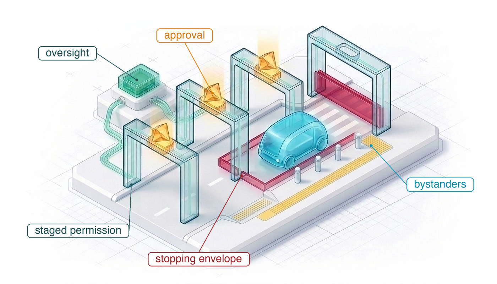
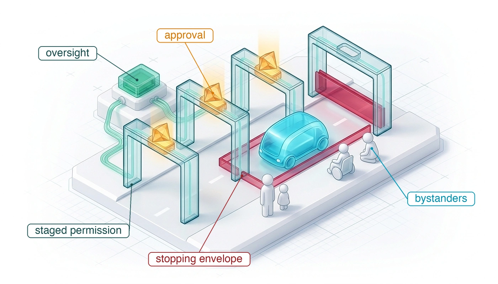
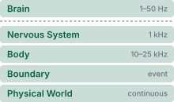
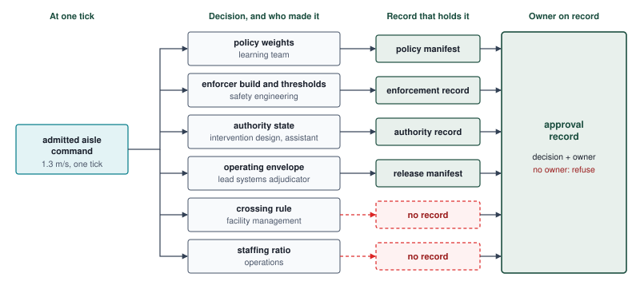

# Responsible Physical AI {#sec-responsibility}

::: {layout-narrow}
::: {.column-margin}

\chapterminitoc

:::

::: {.content-visible when-format="pdf"}
\noindent
{fig-alt="Isometric blueprint of staged permission: a driverless vehicle moves along a road through a series of gates, each opened by an amber approval seal and linked to an oversight console, toward a final gate that stays closed without one; a red stopping envelope surrounds the vehicle and reaches over a crosswalk, where a curb ramp, tactile paving, and bollards mark the space people on foot share with it."}
:::

::: {.content-visible unless-format="pdf"}
{fig-alt="Isometric blueprint of staged permission: a driverless vehicle moves along a road through a series of gates, each opened by an amber approval seal and linked to an oversight console, toward a final gate that stays closed without one; a red stopping envelope surrounds the vehicle and reaches over a crosswalk, where a curb ramp, tactile paving, and bollards mark the space people on foot share with it."}
:::

:::

## Purpose {.unnumbered .unlisted}

::: {.content-visible when-format="pdf"}
\begin{marginfigure}
\resizebox{0.92\linewidth}{!}{\mlphysicalstackfull{20}{20}{20}{20}{20}}
\end{marginfigure}
:::

::: {.content-visible unless-format="pdf"}
::: {.column-margin}
{width="100%" fig-alt="Physical AI Systems Stack"}

*Physical AI stack focus for this chapter.*
:::
:::

_Who answers for a machine that moves on its own when its motion harms someone?_

A machine's logs can show, tick by tick, what it sensed, proposed, and admitted, and still not show who decided that it could travel at that speed, among those people, with that person as its only backup. When harm arrives, blame settles on whoever stood closest to the event, often an operator handed a duty no person could have carried out, while the decisions that set the machine's limits stay spread across engineering teams, suppliers, site managers, and regulators. The machine's effects also reach people who never chose it: pedestrians and coworkers whose detection rate was never measured for people like them, workers whose jobs shift to rescuing and watching it, and bystanders whose faces fill the records kept to explain its mistakes. A machine is fit to be given authority only when each decision behind its actions names the person who answers for it, each human role it relies on is one a person can actually perform, and each group that bears its risk or its recording has been counted. Assigning responsibility after a collision cannot take back the energy the machine has already delivered across the causal boundary, so it has to be assigned before the machine moves.



::: {.callout-learning-objectives}

- Explain why reconstructing what a machine did does not establish who answers for it, and trace an admitted action back to the decisions that allowed it
- Evaluate whether a human role gives its holder the time, information, and authority to act, using the takeover budget and supervisor utilization
- Specify the stages of operating permission, what each stage allows and must report, and what withdraws it
- Calculate how a gap in per-frame detection between groups of people becomes a gap in stopping distance and impact energy
- Size a per-group evaluation whose confidence interval can resolve a detection gap of a stated size
- Distinguish risk borne by people who chose the machine from risk borne by people who did not, and specify exposure reporting for each group
- Design an approval record that names an owner for every decision behind an admitted action, so that a missing owner blocks release

:::

## Who Answered for the Cruise Collision {#sec-responsibility-who-answered}

```{python}
#| label: calc-responsibility-cruise-record
#| echo: false
#| warning: false
#| message: false
# ┌─────────────────────────────────────────────────────────────────────────────
# │ THE CRUISE RECORD: WHAT THE MACHINE DID AND HOW LONG THE ACCOUNT TOOK
# ├─────────────────────────────────────────────────────────────────────────────
# │ Context: @sec-responsibility-who-answered and @sec-responsibility-revocation.
# │ Goal:    Quote the pullover the record captured and the days the complete
# │          account took to reach the state regulator.
# │ Show:    Drag distance in feet and meters, peak pullover speed, the days the
# │          CPUC counted, and the penalty that count produced.
# │ How:     Sourced values in LOAD (the boards' review and its technical
# │          appendix; the CPUC decision); conversions and the per-day product
# │          computed here. Chapters render in separate kernels, so the values
# │          @sec-boundary quotes are loaded again rather than imported.
# └─────────────────────────────────────────────────────────────────────────────
from mlsysim import *
from mlsysim.core.units import foot, mph, meter, second
from mlsysim.fmt import fmt_length, fmt_velocity, fmt_int, fmt_usd, check

class CruiseRecord:
    """The pullover the record captured and the account regulators received."""

    # ┌── 1. LOAD (Constants & Parameters) ─────────────────────────────────
    d_drag = 20 * foot  # category: measured (approximate pullover distance; Quinn Emanuel review, Exponent appendix)
    v_drag = 7.7 * mph  # category: measured (peak pullover speed; same source)
    days_withheld = 15  # category: sourced (CPUC Decision 24-07-004: 3 to 18 October 2023)
    cpuc_daily_max = 7_500  # category: sourced (USD per day, Pub. Util. Code 5378(b), as the decision applies it)
    cpuc_penalty_reported = 112_500  # category: sourced (USD, the penalty the decision states)

    # ┌── 2. EXECUTE (Compute) ─────────────────────────────────────────────
    d_drag_m = d_drag.to(meter)
    v_drag_ms = v_drag.to(meter / second)
    cpuc_penalty = days_withheld * cpuc_daily_max

    # ┌── 3. GUARD (Invariants) ───────────────────────────────────────────
    check(abs(d_drag_m.magnitude - 6.096) < 1e-3, "20 ft is 6.1 m")
    check(abs(v_drag_ms.magnitude - 3.442) < 1e-3, "7.7 mph is 3.4 m/s")
    check(cpuc_penalty == cpuc_penalty_reported, "15 days at the daily maximum reproduces the stated CPUC penalty")

    # ┌── 4. OUTPUT (Formatting) ──────────────────────────────────────────
    d_drag_str = fmt_length(d_drag, unit=foot, precision=0)
    d_drag_m_str = fmt_length(d_drag_m, unit=meter, precision=1)
    v_drag_str = fmt_velocity(v_drag, unit=mph, precision=1)
    days_withheld_str = fmt_int(days_withheld)
    cpuc_daily_str = fmt_usd(cpuc_daily_max)
    cpuc_penalty_str = fmt_usd(cpuc_penalty)
```

Release left the running machine with a signed manifest: a verdict, the records it binds by digest, and the standing conditions that withdraw it. The manifest names the lead systems adjudicator who signed it. It does not name who decided the aisle speed the warehouse would accept, who decided that one remote assistant would serve every machine on the floor, or who would report an incident, to whom, and how fast, if the machine hurt someone. Those decisions shape what the machine does once a command crosses the causal boundary as surely as the enforcer's thresholds do, and none of them appears in a per-tick log.

The Cruise collision in San Francisco on the night of October 2, 2023 shows what happens when they are left unassigned. A human-driven car struck a pedestrian in a crosswalk and threw her into the path of a driverless Cruise robotaxi, which braked hard, ran over her, and stopped. With her still beneath it, the vehicle then began a pullover toward the curb and moved about `{python} CruiseRecord.d_drag_str` (`{python} CruiseRecord.d_drag_m_str`) at up to `{python} CruiseRecord.v_drag_str` before it stopped [@quinnemanuel2024cruise]. The engineering failure belongs to the permission path. A post-collision classifier placed the pedestrian at the side of the vehicle rather than in front of it, and the fallback it selected moved the vehicle without any evidence that the space beneath it was clear.

::: {.column-margin .margin-pointer}
↩ The fallback rule that forbids renewed motion while the space beneath a vehicle is unverified is established in @sec-enforcement-four-rungs.
:::

The machine's own records were enough to reconstruct that motion. The engineers who analyzed the event for the company's boards rebuilt it from the vehicle's logs and video, including the dropped pedestrian track before impact and the pullover after it [@quinnemanuel2024cruise]. What failed after the collision was the account given to the people who had licensed the vehicle. On October 3, a Cruise representative told an analyst at the California Public Utilities Commission (CPUC) by telephone that the vehicle had stopped on impact and contacted remote assistance; the description left out the pullover and the dragging. The commission later counted `{python} CruiseRecord.days_withheld_str` days, October 3 through 18, in which Cruise withheld a full account, and it received the full video on October 19 [@cpuc2024cruisedecision]. Cruise's crash reports to the National Highway Traffic Safety Administration (NHTSA) also omitted the dragging [@doj2024cruise]. On October 24, the California Department of Motor Vehicles (DMV) suspended Cruise's permits for driverless testing and driverless deployment, citing among its grounds that the company had misrepresented information related to the safety of its autonomous technology [@cadmv2023cruise]. A review commissioned by Cruise's boards found no evidence that anyone intended to mislead regulators, but it described a "passive, non-transparent approach" to disclosure and a leadership focused on correcting media coverage of the crash [@quinnemanuel2024cruise].

Each group involved held one piece of the outcome: the engineers who designed the classifier and the fallback, the remote-assistance staff, the people who drafted the reports, and the executives who managed the response. Each could describe its own piece truthfully, and none of those descriptions said who had decided the whole. The CPUC had granted Cruise commercial driverless service in San Francisco at any hour seven weeks earlier [@cpuc2023cruiseapproval]. The logs answered what the vehicle did. They did not answer who had decided that a driverless vehicle should pull over after a side impact without checking beneath itself, who decided what regulators would be told, or who answered for either decision. Five years earlier, after the Uber test vehicle killed a pedestrian in Tempe, the person who answered in court was the vehicle's backup operator, who pleaded guilty to endangerment in 2023 [@mcao2023vasquez].

Responsibility for a physical machine therefore has to be engineered like any other premise of its authority: written down before the machine moves, attached to the decisions that set its limits, and checked when it is released. The same questions arise on the warehouse machine without a public road in sight. A remote assistant answers for takeovers, facility management for the crossing rule that keeps people out of the aisle, a data team for the camera traces the black box keeps, and someone, so far unnamed, for the decision that one person can watch every machine on the floor. The sections that follow take these decisions in turn: the links behind one admitted action, the human roles the design relies on, the stages of permission to operate, the detection of different groups of people, the people who bear the machine's risk and appear in its records, and the labor it moves rather than removes. The approval record collects these decisions in one place that the release gate reads, so that a decision with no named owner blocks operation the way an unknown premise does.

## Decisions Behind an Admitted Action {#sec-responsibility-many-hands}

```{python}
#| label: calc-responsibility-decision-chain
#| echo: false
#| warning: false
#| message: false
# ┌─────────────────────────────────────────────────────────────────────────────
# │ HOW OFTEN A CHAIN OF DECISIONS CAN BE FOLLOWED TO THE END
# ├─────────────────────────────────────────────────────────────────────────────
# │ Context: @sec-responsibility-many-hands and
# │          @sec-responsibility-untraced-decisions.
# │ Goal:    Show that a chain of separately kept links is complete only with
# │          the product of the links' probabilities.
# │ Show:    The aisle command, the link count, and chain completeness at three
# │          per-link retrieval probabilities.
# │ How:     AISLE.v_aisle from the registry; six links (policy, enforcer,
# │          authority state, envelope, crossing rule, staffing); completeness
# │          = p ** k under independent links.
# └─────────────────────────────────────────────────────────────────────────────
from mlsysim import *
from mlsysim.core.units import meter, second
from mlsysim.fmt import fmt, fmt_int, fmt_velocity, fmt_percent, fmt_math, check

AISLE = Embodied.Scenario.WarehouseAisle

class DecisionChain:
    """Completeness of a chain of independently kept decision records."""

    # ┌── 1. LOAD (Constants & Parameters) ─────────────────────────────────
    v_aisle = AISLE.v_aisle  # category: chosen (signed aisle speed)
    k_links = 6  # category: illustrative (decisions behind one admitted aisle command)
    p_good = 0.99  # category: illustrative (each link recorded and retrievable)
    p_mid = 0.95  # category: illustrative
    p_poor = 0.90  # category: illustrative (links left to memory and email)

    # ┌── 2. EXECUTE (Compute) ─────────────────────────────────────────────
    c_good = p_good**k_links
    c_mid = p_mid**k_links
    c_poor = p_poor**k_links

    # ┌── 3. GUARD (Invariants) ───────────────────────────────────────────
    check(abs(c_good - 0.9415) < 5e-4, "six links at 0.99 resolve 94 percent of the time")
    check(abs(c_mid - 0.7351) < 5e-4, "six links at 0.95 resolve 74 percent of the time")
    check(abs(c_poor - 0.5314) < 5e-4, "six links at 0.90 resolve 53 percent of the time")
    check(c_poor < c_mid < c_good < p_good, "a chain is weaker than any one of its links")

    # ┌── 4. OUTPUT (Formatting) ──────────────────────────────────────────
    v_aisle_str = fmt_velocity(v_aisle, unit=meter / second, precision=1)
    k_links_str = fmt_int(k_links)
    p_good_str = fmt(p_good, precision=2)
    p_mid_str = fmt(p_mid, precision=2)
    p_poor_str = fmt(p_poor, precision=2)
    c_good_str = fmt(c_good, precision=2)
    c_mid_str = fmt(c_mid, precision=2)
    c_poor_str = fmt(c_poor, precision=2)
    c_poor_pct_str = fmt_percent(round(c_poor, 2), precision=0, style="prose")  # rounded to whole percent on purpose
    chain_good_math = fmt_math(f"{p_good:.2f}^{{{k_links}}} = {c_good:.2f}")
```

Consider one command the enforcer admitted in the aisle: a base velocity of `{python} DecisionChain.v_aisle_str` toward a rack end. The enforcement record shows that it passed the stopping check at that tick, under the thresholds in force, yet behind that single log line stand at least six decisions made by different people at different times. Four of them leave traces in the engineering records built in earlier chapters. The learning team trained and approved the policy weights that proposed the command. The safety engineering team built and signed the enforcer and its thresholds. The intervention design and the remote assistant on shift set the authority state at that tick. The lead systems adjudicator signed the operating envelope into the release manifest, including the aisle speed and the floor-friction premise beneath it. The other two decisions govern the site rather than the machine: facility management wrote the crossing rule that lets people enter the aisle only at marked points, while operations decided how many machines one remote assistant would serve. @Fig-17-decision-chain draws the six links and the record, if any, that holds each one.

::: {.column-margin .margin-pointer}
↩ The lead systems adjudicator, whose signature binds the release verdict to a named person, is established in @sec-release-three-verdicts.
:::

::: {#fig-17-decision-chain fig-env="figure" fig-pos="htb" fig-cap="**Six decisions behind one admitted command**: An aisle command admitted at one tick traces back to decisions made weeks earlier by six different parties. Four of them land in a record the book has built (the policy manifest, the enforcement record, the authority record, and the release manifest); the crossing rule and the staffing ratio land in none, so no log can name who made them. The approval record lists each decision with its owner and refuses operation while any link has no owner." fig-alt="Diagram. On the left, a box labeled admitted aisle command, 1.3 meters per second, one tick. Six arrows run right from it to six decision boxes stacked vertically, each paired with the party that made it and the record that holds it. Policy weights, made by the learning team, held in the policy manifest. Enforcer build and thresholds, made by safety engineering, held in the enforcement record. Authority state, made by the intervention design and the remote assistant on shift, held in the authority record. Operating envelope, made by the lead systems adjudicator, held in the release manifest. Crossing rule, made by facility management, held in no record, drawn in red. Staffing ratio, made by operations, held in no record, drawn in red. On the far right, a box labeled approval record collects all six with their owners."}
{width="100%"}
:::

When each of these decisions belongs to a different party, every party can truthfully say that the harm came from someone else's part. Thompson called this the **problem of many hands**\index{Problem of many hands!definition} in his study of public officials, where responsibility for a policy that many people shaped ends up resting on no one [@thompson1980manyhands]. Nissenbaum showed that computer systems make it worse: they are built by many people, they fail in ways no single person caused, and their failures are easily excused as bugs that no one could have prevented [@nissenbaum1996accountability]. A learned proposer adds a further excuse. Its behavior was learned rather than written, so no engineer wrote the rule it followed, and Matthias argued that machines which learn create a real gap in who can be held responsible for what they do [@matthias2004responsibility]. The architecture of this book closes that gap at the point where it matters. The model proposes and never admits (principle \ref{pri-vol4-proposal-permission}), so every admitted action passed a check that someone designed, under an envelope that someone signed, and "the model did it" is never a complete answer.

### Decisions that leave no trace in a log {#sec-responsibility-untraced-decisions}

When an incident investigator opens a machine's runtime logs, the decisions that made the incident possible are missing because most of them happened weeks or months before a command crossed the causal boundary. The book's records capture runtime events: an observation and its age, a proposal, an admission, a change of authority, a fault trial. By contrast, other decisions happen in meetings and documents long before the machine moves. A safety engineer approves an operating envelope, an operations manager sets a staffing ratio, a team disables a protective function, a company applies for a permit, and a data team declares what its camera traces may be used for. In the Cruise case, the rule that a side impact should trigger a pullover was a design decision made long before October 2, and the choices about what to tell regulators were made in the days after. Neither could appear in the vehicle's log, because the vehicle did not make them.

Such decisions have to be recorded on purpose, and a chain of them is less complete than any one of its links. Suppose each of the `{python} DecisionChain.k_links_str` links behind the aisle command can be retrieved when an investigator asks with probability `{python} DecisionChain.p_good_str`, independently of the others. The whole chain then resolves with probability `{python} DecisionChain.chain_good_math`. At `{python} DecisionChain.p_mid_str` per link it resolves with probability `{python} DecisionChain.c_mid_str`, and at `{python} DecisionChain.p_poor_str`, roughly what a decision held only in memory and email achieves once its author has changed jobs, with probability `{python} DecisionChain.c_poor_str`. An investigator would then find the full chain in about `{python} DecisionChain.c_poor_pct_str` of incidents. The same arithmetic makes a conjunctive release argument weaker than any one of its premises, and the remedy is also the same: each link has to be written down as part of the design, not left to accumulate.

::: {.column-margin .margin-pointer}
↩ The conjunctive arithmetic that makes an argument no stronger than its weakest premise is established in @sec-release-contextual-assumptions.
:::

These links are held in the decision block of the approval record (@sec-responsibility-approval-record). For each decision it names the type of decision, the role that owns it, the signed approval, the evidence it relied on, and the date after which it must be made again. A link with no owner is not a gap in paperwork; it is a premise of the machine's authority that no one has accepted.

## Oversight a Person Can Perform {#sec-responsibility-meaningful-oversight}

Placing a human operator in the loop—a safety driver behind the wheel, a remote assistant at a console, or a spotter walking beside a robot during commissioning—often shifts blame onto that person without adding any real protection. A person in the loop provides genuine oversight only if three conditions hold: the person must have the time to act before the hazard arrives, the information to understand what the machine is doing, and the authority to change what it does, not only to report it. Santoni de Sio and van den Hoven state the same requirement in two parts: the system must respond to the reasons of the people meant to control it, and every outcome must trace back to someone who understood both the system and their own role in it [@santonidesio2018meaningful].

::: {#dfn-responsibility-human-oversight-role .callout-definition title="Human oversight role"}

A ***human oversight role***\index{Human oversight role!definition} is a duty that a design assigns to a person, such as stopping the machine, taking over a channel, or approving a motion, and that the safety argument relies on. The role counts as a countermeasure only if its holder has the time, the information, and the authority to carry it out within the time the hazard leaves.

1.  **Significance**: A role that fails any of the three conditions adds no protection, yet it moves blame onto the person who holds it, so every role the safety case cites must be tested like any other premise.
2.  **Distinction**: The takeover budget measures how long a person needs; the oversight role asks whether the design leaves that much time, gives that person what they need to see, and lets them act on it.
3.  **Common pitfall**: A frequent misconception is that adding a person to the loop makes a design responsible. A person who cannot act in time is a place to put blame, not a safety layer.

:::

When a role fails any of these conditions, the person in it absorbs responsibility for control they never had. Elish calls the person in that position a **moral crumple zone**\index{Moral crumple zone!definition}. Like the crumple zone of a car, the person absorbs the impact, except that here the impact is blame, and what the crumpling protects is the reputation of the system rather than the person [@elish2019moral]. The three conditions give a design team a test it can apply before the machine moves.

### Time to act {#sec-responsibility-oversight-time}

```{python}
#| label: calc-responsibility-oversight-time
#| echo: false
#| warning: false
#| message: false
# ┌─────────────────────────────────────────────────────────────────────────────
# │ THE TIME A SUPERVISOR HAS, AGAINST THE TIME A PERSON NEEDS
# ├─────────────────────────────────────────────────────────────────────────────
# │ Context: @sec-responsibility-oversight-time.
# │ Goal:    Show that the out-of-loop takeover outlasts the hazard window.
# │ Show:    Aisle speed, clear distance, time to the rack end, the design
# │          out-of-loop takeover time, and the travel it costs.
# │ How:     WarehouseAisle fields; window = d_clear / v_aisle; travel =
# │          v_aisle * t_takeover_out_of_loop (the value @sec-intervention uses).
# └─────────────────────────────────────────────────────────────────────────────
from mlsysim import *
from mlsysim.core.units import meter, second
from mlsysim.fmt import fmt_length, fmt_velocity, fmt_latency, fmt_multiple, check

AISLE = Embodied.Scenario.WarehouseAisle

class OversightTime:
    """Hazard window at aisle speed against the out-of-loop takeover."""

    # ┌── 1. LOAD (Constants & Parameters) ─────────────────────────────────
    v = AISLE.v_aisle  # category: chosen
    d_clear = AISLE.d_clear  # category: illustrative
    t_ool = AISLE.t_takeover_out_of_loop  # category: derived (sourced p90 take-over time plus transport)

    # ┌── 2. EXECUTE (Compute) ─────────────────────────────────────────────
    t_window = (d_clear / v).to(second)
    travel = (v * t_ool).to(meter)
    shortfall_ratio = (t_ool / t_window).to("").magnitude

    # ┌── 3. GUARD (Invariants) ───────────────────────────────────────────
    check(abs(t_window.magnitude - 0.8462) < 5e-4, "the rack end arrives in 0.85 s at aisle speed")
    check(abs(travel.magnitude - 5.8045) < 5e-4, "the out-of-loop pause carries the machine 5.8 m, as in the intervention chapter")
    check(shortfall_ratio > 5, "the person needs more than five times the time the hazard leaves")

    # ┌── 4. OUTPUT (Formatting) ──────────────────────────────────────────
    v_str = fmt_velocity(v, unit=meter / second, precision=1)
    d_clear_str = fmt_length(d_clear, unit=meter, precision=2)
    t_window_str = fmt_latency(t_window, unit=second, precision=2)
    t_ool_str = fmt_latency(t_ool, unit=second, precision=1)
    travel_str = fmt_length(travel, unit=meter, precision=1)
    ratio_mult_str = fmt_multiple(round(shortfall_ratio), precision=0)  # "about five times"
```

Time is the condition most often violated, and it is the easiest to check. At the `{python} OversightTime.v_str` aisle speed, a person who steps out `{python} OversightTime.d_clear_str` ahead of the machine leaves `{python} OversightTime.t_window_str` before the rack end. A remote assistant who has been monitoring rather than driving needs about `{python} OversightTime.t_ool_str` to take over, the design out-of-loop takeover time, during which the machine travels `{python} OversightTime.travel_str`. The person needs about `{python} OversightTime.ratio_mult_str` the time the hazard leaves. No training, attention, or diligence closes a gap of that size, so a design that names the remote assistant as the countermeasure for a person stepping out at a rack end has not added a layer of protection. It has recorded in advance who will be blamed.

::: {.column-margin .margin-pointer}
↩ The out-of-loop takeover time and its price in the stopping budget are established in @sec-intervention-reaction-drift.
:::

The engineering consequence is already in the book's design. The machine stops itself first and asks for help from standstill, where waiting costs time but not clearance. What the time test adds is the duty to write that choice down. For every human role the safety case relies on, the approval record lists the response time the role requires, the time the hazard leaves, and a verdict of `FEASIBLE`, `INFEASIBLE`, or `UNKNOWN`. A role marked `INFEASIBLE` may stay in the design as a productivity resource; it may not appear in the safety argument as a countermeasure.

### One person, many machines {#sec-responsibility-supervisor-utilization}

```{python}
#| label: calc-responsibility-supervisor-load
#| echo: false
#| warning: false
#| message: false
# ┌─────────────────────────────────────────────────────────────────────────────
# │ ONE REMOTE ASSISTANT SERVING A FLEET
# ├─────────────────────────────────────────────────────────────────────────────
# │ Context: @sec-responsibility-supervisor-utilization, notebook
# │          nbk-responsibility-supervisor-load, @sec-responsibility-worker-burden.
# │ Goal:    Show how the share of time one assistant is busy, and the wait a
# │          request sees, grow with the number of machines served.
# │ Show:    Utilization and mean wait for 10, 20, and 32 machines; the p99 wait
# │          at 20; the largest fleet that keeps utilization at one half.
# │ How:     rho = lambda * s with lambda = N * per-machine assist rate;
# │          M/M/1 mean wait rho * s / (1 - rho); p99 from
# │          calc_queue_latency_mmc with one server.
# └─────────────────────────────────────────────────────────────────────────────
import math
from mlsysim import *
from mlsysim.core.units import second, minute, hour
from mlsysim.physics import calc_queue_latency_mmc
from mlsysim.fmt import fmt, fmt_int, fmt_latency, fmt_percent, check

class SupervisorLoad:
    """Utilization and waiting time for one remote assistant."""

    # ┌── 1. LOAD (Constants & Parameters) ─────────────────────────────────
    assist_rate = 0.5 / hour  # category: illustrative (help requests per machine per operating hour)
    t_service = 3.0 * minute  # category: illustrative (mean time one request holds the assistant)
    n_small, n_mid, n_large = 10, 20, 32  # category: illustrative (machines served by one assistant)
    rho_target = 0.5  # category: chosen (utilization ceiling a staffing plan may adopt)

    # ┌── 2. EXECUTE (Compute) ─────────────────────────────────────────────
    def _load(n, rate=assist_rate, s=t_service):
        lam = (n * rate).to(1 / second)
        rho = (lam * s).to("").magnitude
        wq = (rho * s / (1 - rho)).to(second)
        _, _, p99 = calc_queue_latency_mmc(lam.magnitude, (1 / s).to(1 / second).magnitude, 1)
        return rho, wq, p99

    rho_small, wq_small, _ = _load(n_small)
    rho_mid, wq_mid, p99_mid = _load(n_mid)
    rho_large, wq_large, _ = _load(n_large)
    n_max = math.floor(rho_target / (assist_rate * t_service).to("").magnitude)
    assist_min_per_hour_mid = (n_mid * assist_rate * t_service).to(minute / hour)

    # ┌── 3. GUARD (Invariants) ───────────────────────────────────────────
    check(abs(rho_small - 0.25) < 1e-9 and abs(rho_mid - 0.50) < 1e-9 and abs(rho_large - 0.80) < 1e-9, "utilization 0.25, 0.50, 0.80")
    check(abs(wq_small.magnitude - 60.0) < 1e-6, "mean wait at 10 machines is 60 s")
    check(abs(wq_mid.magnitude - 180.0) < 1e-6, "mean wait at 20 machines is 180 s")
    check(abs(wq_large.magnitude - 720.0) < 1e-6, "mean wait at 32 machines is 720 s")
    check(p99_mid > wq_mid, "the tail wait exceeds the mean")
    check(n_max == 20, "a one-half ceiling admits 20 machines")
    check(abs(assist_min_per_hour_mid.magnitude - 30.0) < 1e-9, "20 machines need 30 assist-minutes per operating hour")

    # ┌── 4. OUTPUT (Formatting) ──────────────────────────────────────────
    assist_rate_str = fmt(assist_rate.to(1 / hour).magnitude, precision=1)
    t_service_str = fmt_latency(t_service, unit=minute, precision=0)
    t_service_s_str = fmt_latency(t_service, unit=second, precision=0)
    n_small_str, n_mid_str, n_large_str = fmt_int(n_small), fmt_int(n_mid), fmt_int(n_large)
    rho_small_str = fmt(rho_small, precision=2)
    rho_mid_str = fmt(rho_mid, precision=2)
    rho_large_str = fmt(rho_large, precision=2)
    rho_mid_pct_str = fmt_percent(rho_mid, precision=0, style="prose")
    rho_target_str = fmt(rho_target, precision=1)
    wq_small_str = fmt_latency(wq_small, unit=second, precision=0)
    wq_mid_str = fmt_latency(wq_mid, unit=second, precision=0)
    wq_large_str = fmt_latency(wq_large, unit=second, precision=0)
    wq_large_min_str = fmt_latency(wq_large, unit=minute, precision=0)
    p99_mid_min_str = fmt_latency(round(p99_mid.to(minute).magnitude) * minute, unit=minute, precision=0)  # whole minutes on purpose
    n_max_str = fmt_int(n_max)
```

A remote assistant who serves many machines is a server in a queue, and queueing theory says how busy that person is. If help requests arrive from the whole fleet at rate $\ArrivalRate$ and each holds the assistant for a mean time $\IntervalMean$, the share of time the assistant is busy, the utilization, is
$$\ServingUtilization = \ArrivalRate\,\IntervalMean.$$ {#eq-responsibility-supervisor-load}
A request that arrives while the assistant is busy waits. Under the simplest queueing model, with random arrivals and random service times, the mean wait before service begins is
$$\QueueWaitTime = \frac{\ServingUtilization\,\IntervalMean}{1-\ServingUtilization}.$$ {#eq-responsibility-supervisor-wait}
The wait grows without bound as $\ServingUtilization$ approaches one. Moreover, a request arriving while the assistant is busy, which happens with probability $\ServingUtilization$ in this model, gets no human attention at all until the request ahead of it is finished.

::: {#nbk-responsibility-supervisor-load .callout-notebook title="One assistant, twenty machines"}

**Problem**: A site plans to run `{python} SupervisorLoad.n_mid_str` mobile manipulators with one remote assistant. Each machine asks for help `{python} SupervisorLoad.assist_rate_str` times per operating hour, and each request holds the assistant for `{python} SupervisorLoad.t_service_str` on average. How busy is the assistant, and how long does a request wait?

**Variables**:

* Requests per machine: `{python} SupervisorLoad.assist_rate_str` per operating hour (Illustrative); mean service time $\IntervalMean =$ `{python} SupervisorLoad.t_service_s_str` (Illustrative).
* Machines served: `{python} SupervisorLoad.n_small_str`, `{python} SupervisorLoad.n_mid_str`, or `{python} SupervisorLoad.n_large_str` (Illustrative).

**Math**: By @eq-responsibility-supervisor-load, `{python} SupervisorLoad.n_mid_str` machines give $\ServingUtilization =$ `{python} SupervisorLoad.rho_mid_str`, and @eq-responsibility-supervisor-wait gives a mean wait $\QueueWaitTime =$ `{python} SupervisorLoad.wq_mid_str`. One request in a hundred waits longer than `{python} SupervisorLoad.p99_mid_min_str`. With `{python} SupervisorLoad.n_small_str` machines the figures are `{python} SupervisorLoad.rho_small_str` and `{python} SupervisorLoad.wq_small_str`; with `{python} SupervisorLoad.n_large_str` they are `{python} SupervisorLoad.rho_large_str` and `{python} SupervisorLoad.wq_large_str`, about `{python} SupervisorLoad.wq_large_min_str`.

**Result**: The assistant is busy `{python} SupervisorLoad.rho_mid_pct_str` of the time, and a typical request waits minutes. Adding machines past that point makes the wait grow much faster than the fleet.

**Systems insight**: Every one of these waits is longer than the `{python} OversightTime.t_window_str` a person stepping out at a rack end leaves. The ratio of machines to assistants is therefore a productivity budget and never a safety layer. A staffing plan that caps utilization at `{python} SupervisorLoad.rho_target_str` limits this assistant to `{python} SupervisorLoad.n_max_str` machines, and the approval record lists that cap as the decision of whoever set it.

:::

::: {.column-margin .margin-pointer}
↩ Admitting a remote-assistant session only when the machine is in a state where waiting costs no clearance is established in @sec-intervention-session-admission.
:::

The queue shows why the staffing ratio is a decision someone must own. A manager who adds machines to one assistant's load is not changing a number in a spreadsheet; that manager is deciding how long a stranded machine, and the people working around it, will wait for a person. If that decision is written down with the utilization it implies and an owner, it can be reviewed when the fleet grows. If it is not, it changes silently every time a machine is added.

### Information and authority {#sec-responsibility-oversight-information}

Time is necessary but not enough. A person with time to act must also know what the machine is doing and be able to change it. A console that shows the camera feed but not which channel the machine still owns leaves the operator guessing about the most important fact of a handover, and an operator who believes they hold a channel they do not hold can make a takeover worse. A role whose only output is a report, a flag raised to a supervisor or a note in a log, gives its holder no authority over the motion at all. The test for authority is mechanical. The person must be able to stop the machine, through a channel the permission path honors within the time the hazard leaves, without asking anyone else.

::: {.column-margin .margin-pointer}
↩ Mode confusion, and the per-channel annunciation that keeps an operator's picture of who owns each channel current, are established in @sec-intervention-failure-modes.
:::

For each human role, the approval record therefore holds three fields beside the timing verdict: the information channel the person reads, the authority channel the person can act through, and whether that channel reaches the permission path. A remote assistant on the running machine passes the information and authority tests for a stranded machine at standstill and fails the time test for a person stepping out at a rack end. Both facts belong in the record, because they assign that one person two different duties.

::: {#chk-responsibility-oversight-feasibility .callout-checkpoint title="Oversight a person can perform"}

A design names three people in its safety argument: the remote assistant, a teach-pendant operator during commissioning, and a floor supervisor who watches the fleet dashboard.

- [ ] **Time**: Can you state, for each role, the time the role requires and the time the relevant hazard leaves, and mark the role `FEASIBLE`, `INFEASIBLE`, or `UNKNOWN`?
- [ ] **Load**: A site runs 24 machines with one assistant; requests arrive at 0.8 per machine-hour and take 75 s. Can you compute the assistant's utilization and mean wait, and say whether the assistant may be listed as a countermeasure for any hazard faster than a minute?
- [ ] **Authority**: Can you say which of the three roles can stop the machine through a channel the permission path honors, and which can only report?

:::

## Permission in Stages {#sec-responsibility-staged-permission}

Granting a machine full operating permission on day one exposes the public or the workforce before the configuration has accumulated the field evidence needed to support that exposure. Regulators of driverless vehicles therefore grant permission in stages. California's rules separate testing with a safety driver, testing without one, and deployment to the public, each under its own permit and conditions [@cadmv2018testingregs; @cadmv2018deploymentregs]. The CPUC adds a second ladder for carrying passengers. Before August 2023, Cruise could carry paying passengers without a safety driver only in limited areas of San Francisco between 10 p.m. and 6 a.m., could carry paying passengers anywhere in the city at any hour only with a safety driver present, and could give free driverless rides anywhere at any hour. On August 10, 2023, the commission removed the time limit on driverless fared service [@cpuc2023cruiseapproval]. Each rung named a configuration, a place, a time, and who could be aboard.

::: {#dfn-responsibility-permission-stage .callout-definition title="Permission stage"}

A ***permission stage***\index{Permission stage!definition} is a grant, made by the party entitled to grant it, that allows a named configuration of a machine to operate in a named domain, among named groups of people, on named evidence, and under named reporting duties. A machine moves to the next stage only on evidence gathered at the current one, and a stage can be withdrawn for a configuration change, an incident, or a withheld record.

1.  **Significance**: Exposure grows one stage at a time, so the evidence for the next stage is gathered under the protection of the current one, and a failure at one stage costs only what that stage exposes.
2.  **Distinction**: A release verdict is the engineering decision about whether a configuration's claims are supported; a permission stage is the grant that decides who may be exposed to that configuration and what must be reported about it.
3.  **Common pitfall**: A frequent misconception is that a stage, once reached, belongs to the company. It belongs to a configuration, and it carries duties that, if broken, withdraw it.

:::

Each stage carries reporting duties, and the duties grow with the stage. California requires a manufacturer testing on public roads to report, within ten days and on a set form, any collision that causes damage, injury, or death, and to file an annual report of every disengagement, each transfer of control from the automation to the safety driver [@cadmv2018testingregs]. Since 2021, a federal order has required companies operating automated driving systems to report crashes to NHTSA. Under the version in force in 2023, a crash that involved a death, an injury treated at a hospital, or a pedestrian or other vulnerable road user had to be reported within one day, with an update at ten days [@nhtsa2021sgo]. The disengagement reports are the data behind @fig-14-disengagement-record, whose two series come from two different stages, testing with a driver and testing without one.

A warehouse has no public permit office, but the same ladder exists. The machine is commissioned with a spotter walking beside it, then allowed to run unattended in a zone people cannot enter while it operates, and only then released onto an open floor among workers. The facility owner, the integrator, and the workers' representatives grant these stages, and the approval record names who granted each one, for which configuration, on what evidence, and with which reporting duties. The stage and the verdict are recorded separately. A `COND` verdict for restricted inspected-route delivery says which claims the evidence supports; the stage says whether that restricted service may run on the open floor yet.

### Leaving a stage on evidence {#sec-responsibility-stage-exit}

```{python}
#| label: calc-responsibility-stage-exit
#| echo: false
#| warning: false
#| message: false
# ┌─────────────────────────────────────────────────────────────────────────────
# │ HOW LONG A STAGE MUST RUN BEFORE ITS EXIT CLAIM HOLDS
# ├─────────────────────────────────────────────────────────────────────────────
# │ Context: @sec-responsibility-stage-exit.
# │ Goal:    Size the failure-free operation that supports leaving a stage.
# │ Show:    Target rate, required hours at 95 percent confidence, and the
# │          calendar days a small fleet needs to accumulate them.
# │ How:     Zero-failure exposure T = ln(1/alpha) / rate (the exposure wall of
# │          @sec-evaluation); days = T / (machines * hours per day).
# └─────────────────────────────────────────────────────────────────────────────
import math
from mlsysim import *
from mlsysim.core.units import hour, day
from mlsysim.fmt import fmt, fmt_int, check

class StageExit:
    """Failure-free exposure needed to leave the supervised stage."""

    # ┌── 1. LOAD (Constants & Parameters) ─────────────────────────────────
    rate_target = 1.0e-3 / hour  # category: chosen (safety-relevant interventions per operating hour to demonstrate)
    alpha = 0.05  # category: chosen (one-sided, 95 percent confidence)
    n_machines = 10  # category: illustrative (machines in the supervised stage)
    hours_per_day = 16 * hour / day  # category: illustrative (two shifts)

    # ┌── 2. EXECUTE (Compute) ─────────────────────────────────────────────
    t_required = (math.log(1 / alpha) / rate_target).to(hour)
    days_required = (t_required / (n_machines * hours_per_day)).to(day)

    # ┌── 3. GUARD (Invariants) ───────────────────────────────────────────
    check(abs(t_required.magnitude - 2995.7) < 0.1, "about 3,000 failure-free hours at 95 percent")
    check(abs(days_required.magnitude - 18.72) < 0.01, "ten machines on two shifts need about 19 days")

    # ┌── 4. OUTPUT (Formatting) ──────────────────────────────────────────
    rate_str = fmt_int(round(1 / rate_target.to(1 / hour).magnitude))
    t_required_str = fmt_int(t_required.magnitude)
    n_machines_str = fmt_int(n_machines)
    hours_per_day_str = fmt_int(hours_per_day.to(hour / day).magnitude)
    days_required_str = fmt_int(math.ceil(days_required.magnitude))
```

A stage is left on evidence, not on a calendar date, and the evidence a lower stage produces is partly hidden by the protection that stage provides. A safety driver or a spotter masks failures: when the person intervenes, the machine's own error never reaches its consequence, and the stage records an intervention rather than a collision. Counting failures at the supervised stage therefore means reconstructing, for each intervention, whether the machine would have failed without it, which is why the disengagement reports matter and why they must say why control was transferred.

::: {.column-margin .margin-pointer}
↩ Interventions that end a trial before its outcome is known, and how they are counted, are established in @sec-evaluation-closed-loop-survival.
:::

The exposure arithmetic sets how long a stage must run. To claim, at 95 percent confidence, fewer than one safety-relevant intervention per `{python} StageExit.rate_str` operating hours after observing none, the machines must accumulate about `{python} StageExit.t_required_str` failure-free operating hours. A fleet of `{python} StageExit.n_machines_str` machines running `{python} StageExit.hours_per_day_str` hours a day reaches that in `{python} StageExit.days_required_str` days. Those hours support the claim only for the configuration that ran them. A new policy, a new enforcer build, or a new site layout starts its own count, because the evidence belongs to a configuration, and so does the stage it supports.

### Withdrawal and disclosure {#sec-responsibility-revocation}

Permission is withdrawn the way it is granted, one stage at a time. The DMV's October 2023 order suspended Cruise's driverless testing and deployment permits but left in place its permit to test with a safety driver [@cadmv2023cruise], stepping the company back down the ladder rather than off it. The grounds the DMV cited show what a permit protects. One was that the vehicles were not safe for public operation, a finding about the motion. Another was that the company had misrepresented information related to the safety of its technology, a finding about the record.

The regulatory fines that followed were for the record. The CPUC counted the `{python} CruiseRecord.days_withheld_str` days in which it lacked a full account, applied its daily maximum of `{python} CruiseRecord.cpuc_daily_str` to each, and fined Cruise `{python} CruiseRecord.cpuc_penalty_str` [@cpuc2024cruisedecision]. In September 2024, NHTSA imposed a consent order with a \$1.5 million penalty for crash reports that omitted the dragging [@nhtsa2024cruiseconsent]. In November 2024, Cruise entered a deferred prosecution agreement and paid a \$500,000 criminal fine for submitting a false record to influence the federal investigation [@doj2024cruise]. Regulators withdrew authority from the company because of what its vehicle did and because of what the company did not tell them about it.

The **incident disclosure duty**\index{Incident disclosure duty!definition} is the obligation, attached to an operating permit, to report an incident completely and on time to the parties the permit names. It is a decision with an owner like any other: someone decides what an incident report contains, someone signs it, and someone decides when a record has been withheld long enough to break the permit. The permit block of the approval record therefore lists, for each stage, the regulator or grantor, the configuration the stage covers, the reporting duties with their deadlines, and a disclosure log of every report sent, with its author and the evidence attached. A release manifest that binds raw traces to the configuration that produced them, and that an assessor can open, is the engineering half of that duty. The disclosure log is the other half, because it shows what was actually sent, to whom, and when.

::: {.column-margin .margin-pointer}
↩ The release manifest that binds raw traces to the configuration that produced them is established in @sec-release-manifest.
:::

## When Detection Depends on Who Is Detected {#sec-responsibility-perception-disparity}

Learned detectors do not see all people equally well. Buolamwini and Gebru found that commercial face-analysis systems misclassified darker-skinned women far more often than lighter-skinned men, and that the benchmarks used to evaluate them contained few of the people they failed on [@buolamwini2018gender]. Pedestrian detection shows the same pattern. Wilson, Hoffman, and Morgenstern annotated pedestrians in a driving dataset by skin type and found that standard detectors reached an average precision of 67.1 percent on lighter-skinned pedestrians and 55.9 percent on darker-skinned ones under a strict overlap criterion. Time of day and occlusion did not explain the gap [@wilson2019predictive]. Testing widely used pedestrian detectors, Li and colleagues found the proportion of children left undetected 20.14 percent higher than that of adults, and significant gender bias at night [@li2025biaswheel].

A warehouse has its own groups. A detector trained mostly on people walking upright may see a kneeling worker, a person carrying a carton that hides the torso, a wheelchair user, or a worker without a high-visibility vest later or less often. Where the machine relies only on its certified safety scanner, which stops for any object above its resolution without deciding what it is, these differences do not matter. They matter wherever the design relies on a learned detector to recognize a person: to slow down when a person is near, to keep a wider separation from people than from pallets, or to predict where a person will walk. In those places, a difference in detection becomes a difference in how close the machine comes to each group before it begins to brake.

### From a detection gap to a stopping gap {#sec-responsibility-range-to-stop}

```{python}
#| label: calc-responsibility-detection-shortfall
#| echo: false
#| warning: false
#| message: false
# ┌─────────────────────────────────────────────────────────────────────────────
# │ A PER-FRAME DETECTION GAP BECOMES A STOPPING GAP
# ├─────────────────────────────────────────────────────────────────────────────
# │ Context: @sec-responsibility-range-to-stop, notebook
# │          nbk-responsibility-detection-shortfall, @tbl-17-detection-shortfall,
# │          @fig-17-detection-shortfall.
# │ Goal:    Convert a lower per-frame detection probability into the distance
# │          lost before braking, the impact speed, and the impact energy.
# │ Show:    Frames each group needs, the extra distance, the impact speed and
# │          energy at the aisle speed, for three lower-detection groups.
# │ How:     N = ceil(ln p_miss / ln(1 - p_frame)) with independent frames;
# │          shortfall = v * T_frame * (N_low - N_ref); a stop sized for the
# │          reference group ends at the person, so v_imp = sqrt(2 a dR) and
# │          E = m a dR while dR stays below the braking distance.
# └─────────────────────────────────────────────────────────────────────────────
import math
from mlsysim import *
from mlsysim.core.units import meter, second, millimeter, millisecond, joule, kilogram
from mlsysim.fmt import (
    fmt,
    fmt_int,
    fmt_length,
    fmt_velocity,
    fmt_energy,
    fmt_latency,
    fmt_mass,
    fmt_acceleration,
    fmt_math,
    fmt_percent,
    sci_latex,
    check,
)

RM = Embodied.MobileManipulator.WarehouseMobileManipulator
AISLE = Embodied.Scenario.WarehouseAisle

def _whole(q, unit):
    """Round a quantity to whole display units on purpose, for prose."""
    return round(q.to(unit).magnitude) * unit

def _frames(p_frame, p_miss):
    """Consecutive frames before the all-miss probability falls to p_miss."""
    return math.ceil(math.log(p_miss) / math.log(1.0 - p_frame) - 1e-12)

class DetectionShortfall:
    """Stopping consequences of a per-group detection gap."""

    # ┌── 1. LOAD (Constants & Parameters) ─────────────────────────────────
    v = AISLE.v_aisle  # category: chosen
    a_brake = AISLE.a_brake  # category: illustrative (credible loaded deceleration)
    m = RM.loaded_mass  # category: derived (registry loaded mass)
    t_frame = (1 / RM.nav_camera.frame_rate).to(millisecond)  # category: datasheet (navigation camera frame rate)
    p_miss = 1.0e-3  # category: chosen (allowed probability of missing a person in every frame)
    p_ref = 0.95  # category: illustrative (per-frame detection, best-detected group)
    p_lows = (0.85, 0.75, 0.60)  # category: illustrative (per-frame detection, three lower-detection groups)

    # ┌── 2. EXECUTE (Compute) ─────────────────────────────────────────────
    n_ref = _frames(p_ref, p_miss)
    d_brake = (v**2 / (2 * a_brake)).to(meter)
    rows = []
    all_within_brake = True
    energy_forms_agree = True
    for p in p_lows:
        n_low = _frames(p, p_miss)
        dn = n_low - n_ref
        dr = (v * t_frame * dn).to(meter)
        v_imp = ((2 * a_brake * dr) ** 0.5).to(meter / second)
        e_imp = (m * a_brake * dr).to(joule)
        rows.append((p, n_low, dn, dr, v_imp, e_imp))
        all_within_brake = all_within_brake and dr < d_brake
        energy_forms_agree = energy_forms_agree and abs((0.5 * m * v_imp**2).to(joule).magnitude - e_imp.magnitude) < 1e-6
    # The notebook works the middle row.
    p_low, n_low, dn, dr, v_imp, e_imp = rows[1]

    # ┌── 3. GUARD (Invariants) ───────────────────────────────────────────
    check(abs(t_frame.magnitude - 16.667) < 1e-3, "60 Hz navigation camera, 16.7 ms frames")
    check(n_ref == 3, "the best-detected group needs 3 frames")
    check([r[1] for r in rows] == [4, 5, 8], "lower groups need 4, 5, and 8 frames")
    check(abs(dr.magnitude - 0.04333) < 1e-4, "two extra frames at 1.3 m/s cost 43 mm")
    check(abs(v_imp.magnitude - 0.4163) < 1e-3, "the stop ends in a 0.42 m/s impact")
    check(abs(e_imp.magnitude - 31.89) < 0.01, "at 368 kg and 2 m/s^2 that is 32 J")
    check(all_within_brake, "every shortfall lies within the braking distance, so the impact formula holds")
    check(energy_forms_agree, "m a dR equals one half m v_imp^2")

    # ┌── 4. OUTPUT (Formatting) ──────────────────────────────────────────
    v_str = fmt_velocity(v, unit=meter / second, precision=1)
    a_brake_str = fmt_acceleration(a_brake, precision=0)
    m_str = fmt_mass(m, unit=kilogram, precision=0)
    t_frame_str = fmt_latency(t_frame, unit=millisecond, precision=1)
    p_miss_math = fmt_math(r"10^{-3}")
    p_ref_str = fmt(p_ref, precision=2)
    p_low_str = fmt(p_low, precision=2)
    p_ref_pct_str = fmt_percent(p_ref, precision=0, style="prose")
    p_low_pct_str = fmt_percent(p_low, precision=0, style="prose")
    n_ref_str = fmt_int(n_ref)
    n_low_str = fmt_int(n_low)
    dn_str = fmt_int(dn)
    dt_str = fmt_latency(t_frame * dn, unit=millisecond, precision=1)
    dr_mm_str = fmt_length(_whole(dr, millimeter), unit=millimeter, precision=0)
    v_imp_str = fmt_velocity(v_imp, unit=meter / second, precision=2)
    e_imp_str = fmt_energy(_whole(e_imp, joule), unit=joule, precision=0)
    d_brake_str = fmt_length(d_brake, unit=meter, precision=2)
    table_p = [fmt(r[0], precision=2) for r in rows]
    worst_p_pct_str = fmt_percent(rows[2][0], precision=0, style="prose")
    worst_n_str = fmt_int(rows[2][1])
    table_n = [fmt_int(r[1]) for r in rows]
    table_dn = [fmt_int(r[2]) for r in rows]
    table_dr = [fmt_length(_whole(r[3], millimeter), unit=millimeter, precision=0) for r in rows]
    table_v = [fmt_velocity(r[4], unit=meter / second, precision=2) for r in rows]
    table_e = [fmt_energy(_whole(r[5], joule), unit=joule, precision=0) for r in rows]
    worst_e_str = fmt_energy(_whole(rows[2][5], joule), unit=joule, precision=0)
    worst_v_str = fmt_velocity(rows[2][4], unit=meter / second, precision=2)
```

When a detector sees one group of people less reliably than another, the machine travels farther before braking begins and can strike a person in the less-detected group even when the stop was sized to clear the best-detected group. The conversion from a detection rate to a stopping shortfall runs through the camera's frames. Suppose a design requires that the chance of missing a person in every frame of a window be no more than $\DetectorMissProbability$, and that a detector reports a person in view in each frame with probability $\PerFrameDetectionProbability$, independently from frame to frame. The number of consecutive frames the person must be in view before the design may count on detection is
$$\ReliableDetectionFrameCount = \left\lceil \frac{\ln \DetectorMissProbability}{\ln\left(1-\PerFrameDetectionProbability\right)} \right\rceil.$$ {#eq-responsibility-detection-frames}
A group the detector sees less often needs more frames, and each extra frame is travel before the machine can count on knowing the person is there. If the stop was sized for the best-detected group, a group that needs $\FiniteChange\ReliableDetectionFrameCount$ more frames, at camera frame period $\CameraFramePeriod$ and speed $\SpeedAtDetection$, loses a distance
$$\DetectionRangeShortfall = \SpeedAtDetection\,\CameraFramePeriod\,\FiniteChange\ReliableDetectionFrameCount$$ {#eq-responsibility-range-shortfall}
before braking begins. A stop that would have ended just short of a person in the reference group now ends at the person, and the machine is still moving when it gets there. While the shortfall is smaller than the braking distance, braking at $\CredibleBrakingDeceleration$ over the remaining distance leaves an impact speed and an impact energy of
$$\ImpactSpeed = \sqrt{2\,\CredibleBrakingDeceleration\,\DetectionRangeShortfall}, \qquad \KineticEnergy = \tfrac{1}{2}\Mass\ImpactSpeed^2 = \Mass\,\CredibleBrakingDeceleration\,\DetectionRangeShortfall.$$ {#eq-responsibility-impact}
The last form says that the energy delivered to the person grows in direct proportion to the distance lost to late detection. Fairness for a moving machine is therefore measured in meters and joules, not only in percentage points of recall.

::: {#nbk-responsibility-detection-shortfall .callout-notebook title="Two frames late"}

**Problem**: The running machine slows near people only after its learned detector reports a person. Its stop is sized for a group the detector sees in `{python} DetectionShortfall.p_ref_pct_str` of frames. A second group, kneeling workers, is seen in `{python} DetectionShortfall.p_low_pct_str` of frames. At the aisle speed, what impact speed and energy does the second group receive from a stop that would have just cleared the first?

**Variables**:

* $\DetectorMissProbability =$ `{python} DetectionShortfall.p_miss_math` (Chosen); $\PerFrameDetectionProbability =$ `{python} DetectionShortfall.p_ref_str` and `{python} DetectionShortfall.p_low_str` (Illustrative).
* $\CameraFramePeriod =$ `{python} DetectionShortfall.t_frame_str` (Datasheet, navigation camera); $\SpeedAtDetection =$ `{python} DetectionShortfall.v_str` (Chosen); $\CredibleBrakingDeceleration =$ `{python} DetectionShortfall.a_brake_str` (Illustrative); $\Mass =$ `{python} DetectionShortfall.m_str` (Derived, loaded).

**Math**: By @eq-responsibility-detection-frames, the first group needs `{python} DetectionShortfall.n_ref_str` frames and the second `{python} DetectionShortfall.n_low_str`, so $\FiniteChange\ReliableDetectionFrameCount =$ `{python} DetectionShortfall.dn_str`, or `{python} DetectionShortfall.dt_str`. By @eq-responsibility-range-shortfall, $\DetectionRangeShortfall =$ `{python} DetectionShortfall.dr_mm_str`, well inside the `{python} DetectionShortfall.d_brake_str` braking distance. By @eq-responsibility-impact, $\ImpactSpeed =$ `{python} DetectionShortfall.v_imp_str` and $\KineticEnergy =$ `{python} DetectionShortfall.e_imp_str`.

**Result**: A stop designed to end short of a standing worker ends in contact with a kneeling one at `{python} DetectionShortfall.v_imp_str`.

**Systems insight**: A few centimeters of late detection become a collision because the stop was sized with no margin for the slower group. The result also assumes the detector's misses are independent from frame to frame; a detector that systematically fails on a pose misses it in many frames in a row, and the shortfall grows well beyond this best case.

:::

@Tbl-17-detection-shortfall repeats the calculation for three lower-detection groups. The relationship is steep at the low end: a group seen in `{python} DetectionShortfall.worst_p_pct_str` of frames needs `{python} DetectionShortfall.table_dn[2]` extra frames and receives a `{python} DetectionShortfall.worst_v_str` impact carrying `{python} DetectionShortfall.worst_e_str`. @Fig-17-detection-shortfall plots the speed of the machine against distance for the reference group and for that group.

|                                 Per-frame detection |                            Frames needed |                              Extra frames |                             Distance lost |                             Impact speed |                            Impact energy |
|----------------------------------------------------:|-----------------------------------------:|------------------------------------------:|------------------------------------------:|-----------------------------------------:|-----------------------------------------:|
| `{python} DetectionShortfall.p_ref_str` (reference) |  `{python} DetectionShortfall.n_ref_str` |                                         0 |                                      0 mm |                                    0 m/s |                                      0 J |
|            `{python} DetectionShortfall.table_p[0]` | `{python} DetectionShortfall.table_n[0]` | `{python} DetectionShortfall.table_dn[0]` | `{python} DetectionShortfall.table_dr[0]` | `{python} DetectionShortfall.table_v[0]` | `{python} DetectionShortfall.table_e[0]` |
|            `{python} DetectionShortfall.table_p[1]` | `{python} DetectionShortfall.table_n[1]` | `{python} DetectionShortfall.table_dn[1]` | `{python} DetectionShortfall.table_dr[1]` | `{python} DetectionShortfall.table_v[1]` | `{python} DetectionShortfall.table_e[1]` |
|            `{python} DetectionShortfall.table_p[2]` | `{python} DetectionShortfall.table_n[2]` | `{python} DetectionShortfall.table_dn[2]` | `{python} DetectionShortfall.table_dr[2]` | `{python} DetectionShortfall.table_v[2]` | `{python} DetectionShortfall.table_e[2]` |

: **A detection gap measured in meters and joules**: Each row is a group of people the detector reports with the given probability per frame. The stop is sized for the reference group at the running machine's aisle speed, loaded mass, and credible deceleration, with an allowed all-frames miss probability of one in a thousand and independent frames. Groups seen less often need more frames, lose the distance shown before braking can begin, and are struck at the speed and energy shown. {#tbl-17-detection-shortfall tbl-colwidths="[18,15,14,17,17,19]"}

::: {#fig-17-detection-shortfall fig-env="figure" fig-pos="htb" fig-cap="**One stop, two groups of people**: Speed of the running machine against distance traveled from the moment a person enters the detector's view, for a stop sized so that it ends just short of a person in the best-detected group. That group is detected after `{python} DetectionShortfall.n_ref_str` frames; a group seen in `{python} DetectionShortfall.worst_p_pct_str` of frames is detected after `{python} DetectionShortfall.worst_n_str`, so braking begins later and the same deceleration leaves the machine still moving when it reaches the person. The impact speed and energy follow from the distance lost, not from the recall gap alone." fig-alt="Line plot of speed in meters per second against distance in meters. Both curves start at 1.3 meters per second. The reference curve stays flat through the detection and reaction distance, then falls along a braking parabola to zero exactly at a vertical dashed line marking the person. The second curve stays flat about 0.11 meters longer before braking, then falls along the same parabola shape and crosses the person line at about 0.66 meters per second, marked with a red point labeled impact, 0.66 meters per second, 80 joules."}

```{python}
#| echo: false
# ┌─────────────────────────────────────────────────────────────────────────────
# │ ONE STOP, TWO GROUPS OF PEOPLE (FIGURE)
# ├─────────────────────────────────────────────────────────────────────────────
# │ Context: @fig-17-detection-shortfall
# │
# │ Goal: Show the same stop arriving at a person still moving when detection
# │       comes late.
# │ Show: Speed against distance for the reference group and the 0.60 group;
# │       the person's position; the impact point.
# │ How:  DetectionShortfall (this chapter); constant speed through the
# │       detection frames and the pre-brake delay, then constant deceleration.
# └─────────────────────────────────────────────────────────────────────────────
import numpy as np
from mlsysim.core.units import meter, second, joule, millisecond
from binder.tools.figures import style as book_style

DS = DetectionShortfall
v0 = DS.v.to(meter / second).magnitude
a = DS.a_brake.to(meter / second**2).magnitude
tau = AISLE.tau_delay.to(second).magnitude
t_f = DS.t_frame.to(second).magnitude
p_w, n_w, dn_w, dr_w, vimp_w, e_w = DS.rows[2]
dr_w = dr_w.to(meter).magnitude
x_ref_brake = v0 * (DS.n_ref * t_f + tau)
x_person = x_ref_brake + v0**2 / (2 * a)

def profile(x_brake, x_end):
    x = np.linspace(0, x_end, 600)
    v = np.where(x < x_brake, v0, np.sqrt(np.clip(v0**2 - 2 * a * (x - x_brake), 0, None)))
    return x, v

fig, ax, COLORS, plt = book_style.setup_plot(figsize=(6.2, 3.6))
x1, v1 = profile(x_ref_brake, x_person)
x2, v2 = profile(x_ref_brake + dr_w, x_person)
ax.plot(x1, v1, color=COLORS["BlueLine"], lw=2.0, label=f"Reference group, {DS.n_ref} frames")
ax.plot(x2, v2, color=COLORS["OrangeLine"], lw=2.0, label=f"Group seen in {100 * p_w:.0f}% of frames, {n_w} frames")
ax.axvline(x_person, color=COLORS["primary"], lw=1.0, ls="--")
ax.text(x_person - 0.01, v0 * 1.04, "person", ha="right", va="bottom")
v_hit = vimp_w.to(meter / second).magnitude
ax.plot([x_person], [v_hit], "o", color=COLORS["RedLine"], ms=6, zorder=5)
ax.annotate(
    f"impact {v_hit:.2f} m/s, {e_w.to(joule).magnitude:.0f} J",
    xy=(x_person, v_hit),
    xytext=(x_person - 0.035, v0 * 0.94),
    ha="right",
    va="center",
    arrowprops=dict(arrowstyle="-", color=COLORS["RedLine"], lw=0.8),
)
ax.set_xlim(0, x_person * 1.06)
ax.set_ylim(0, v0 * 1.18)
ax.set_xlabel("Distance from first view of the person (m)")
ax.set_ylabel("Machine speed (m/s)")
ax.legend(frameon=False, loc="lower left")
fig.tight_layout()
plt.show()
plt.close()
```

:::

### Sample sizes for each group {#sec-responsibility-subgroup-intervals}

```{python}
#| label: calc-responsibility-subgroup-intervals
#| echo: false
#| warning: false
#| message: false
# ┌─────────────────────────────────────────────────────────────────────────────
# │ HOW MANY PEOPLE OF EACH GROUP AN EVALUATION NEEDS
# ├─────────────────────────────────────────────────────────────────────────────
# │ Context: @sec-responsibility-subgroup-intervals.
# │ Goal:    Show that a small group's detection estimate is too uncertain to
# │          resolve the gaps that matter, and size the sample that can.
# │ Show:    Exact 95 percent intervals for a 2 percent group and for the rest
# │          of a 10,000-person test set; the per-group sample needed to tell
# │          0.95 from 0.92 at 80 percent power.
# │ How:     Clopper-Pearson intervals from beta quantiles (scipy.stats); the
# │          normal-approximation two-proportion sample size, two-sided 0.05.
# └─────────────────────────────────────────────────────────────────────────────
import math
from scipy.stats import beta, norm
from mlsysim.fmt import fmt, fmt_int, fmt_percent, fmt_multiple, check

def _cp_interval(k, n, conf=0.95):
    """Exact two-sided Clopper-Pearson interval for k successes in n trials."""
    a = 1.0 - conf
    lo = 0.0 if k == 0 else beta.ppf(a / 2, k, n - k + 1)
    hi = 1.0 if k == n else beta.ppf(1 - a / 2, k + 1, n - k)
    return lo, hi

class SubgroupIntervals:
    """Interval width for a small group and the sample that resolves a gap."""

    # ┌── 1. LOAD (Constants & Parameters) ─────────────────────────────────
    n_total = 10_000  # category: illustrative (people in the evaluation set)
    share_small = 0.02  # category: illustrative (share of the set from the smaller group)
    recall = 0.95  # category: illustrative (observed detection rate in both groups)
    p_a, p_b = 0.95, 0.92  # category: chosen (the gap the evaluation must resolve)
    alpha, power = 0.05, 0.80  # category: chosen (two-sided test level and power)

    # ┌── 2. EXECUTE (Compute) ─────────────────────────────────────────────
    n_small = round(n_total * share_small)
    n_large = n_total - n_small
    lo_s, hi_s = _cp_interval(round(recall * n_small), n_small)
    lo_l, hi_l = _cp_interval(round(recall * n_large), n_large)
    width_s, width_l = hi_s - lo_s, hi_l - lo_l
    width_ratio = width_s / width_l
    z_a, z_b = norm.ppf(1 - alpha / 2), norm.ppf(power)
    p_bar = (p_a + p_b) / 2
    n_needed = math.ceil((z_a * math.sqrt(2 * p_bar * (1 - p_bar)) + z_b * math.sqrt(p_a * (1 - p_a) + p_b * (1 - p_b))) ** 2 / (p_a - p_b) ** 2)
    share_needed = n_needed / n_total

    # ┌── 3. GUARD (Invariants) ───────────────────────────────────────────
    check(n_small == 200 and n_large == 9_800, "a 2 percent group of 10,000 is 200 people")
    check(lo_s < p_b < p_a < hi_s, "the small group's interval cannot tell 0.92 from 0.95")
    check(hi_l - lo_l < p_a - p_b, "the large group's interval can")
    check(5 < width_ratio < 9, "the small interval is several times wider")
    check(1_000 < n_needed < 1_200, "about 1,060 people per group resolve a three-point gap")

    # ┌── 4. OUTPUT (Formatting) ──────────────────────────────────────────
    n_total_str = fmt_int(n_total)
    share_small_pct_str = fmt_percent(share_small, precision=0, style="prose")
    n_small_str, n_large_str = fmt_int(n_small), fmt_int(n_large)
    recall_str = fmt(recall, precision=2)
    lo_s_str, hi_s_str = fmt(lo_s, precision=3), fmt(hi_s, precision=3)
    lo_l_str, hi_l_str = fmt(lo_l, precision=3), fmt(hi_l, precision=3)
    width_ratio_mult_str = fmt_multiple(round(width_ratio), precision=0)  # "about N times"
    p_a_str, p_b_str = fmt(p_a, precision=2), fmt(p_b, precision=2)
    power_pct_str = fmt_percent(power, precision=0, style="prose")
    n_needed_str = fmt_int(n_needed)
    share_needed_pct_str = fmt_percent(round(share_needed, 2), precision=0, style="prose")  # whole percent
```

A detection gap can be managed only if it can be measured, and measuring it per group takes more data than measuring it overall. Suppose an evaluation set holds `{python} SubgroupIntervals.n_total_str` people, of whom `{python} SubgroupIntervals.share_small_pct_str` belong to a smaller group, `{python} SubgroupIntervals.n_small_str` people, and the detector finds `{python} SubgroupIntervals.recall_str` of both groups. The exact 95 percent interval for the larger group runs from `{python} SubgroupIntervals.lo_l_str` to `{python} SubgroupIntervals.hi_l_str`. For the smaller group it runs from `{python} SubgroupIntervals.lo_s_str` to `{python} SubgroupIntervals.hi_s_str`, about `{python} SubgroupIntervals.width_ratio_mult_str` wider, too wide to tell a detection rate of `{python} SubgroupIntervals.p_a_str` from one of `{python} SubgroupIntervals.p_b_str`. A pooled detection rate reported for "pedestrians" or "workers" hides exactly the group the machine serves worst.

::: {.column-margin .margin-pointer}
↩ The exact binomial bound, and why a few observed failures drop it sharply, are established in @sec-evaluation-bounds-with-failures.
:::

Telling a detection rate of `{python} SubgroupIntervals.p_a_str` from one of `{python} SubgroupIntervals.p_b_str` with `{python} SubgroupIntervals.power_pct_str` power takes about `{python} SubgroupIntervals.n_needed_str` people in each group, about `{python} SubgroupIntervals.share_needed_pct_str` of the whole evaluation set for every group the evaluation must resolve. A group that makes up a few percent of the people a site employs will not reach that count by chance; the evaluation has to recruit it deliberately. The same arithmetic sets how long field monitoring must run before a per-group detection rate can be trusted, and it is why the sample size for each group belongs in the plan before data collection begins, not in the report after it.

### Where the measurement lives {#sec-responsibility-measurement-home}

If per-group detection rates live only in a research benchmark report, the release gate cannot check them before admitting the machine to an open floor. Tracking them does not need a new pipeline; it needs a new dimension in records the book already keeps. The observation contract states its detection qualification for each group the machine must slow down for. The fault list adds a coverage dimension that seeds kneeling, carrying, and seated people as deliberately as it seeds stale frames. The evaluation record reports detection per group with its confidence interval rather than only in aggregate. From those qualified measurements, the exposure block of the approval record stores, for each group the machine relies on detecting, the sample size, the rate, its interval, and the distance shortfall it implies at the operating speed. A group with no entry is an unknown premise, and the release gate treats it as one.

::: {.column-margin .margin-pointer}
↩ The observation contract, which states what each measurement may be relied on for, is established in @sec-perception-observation-contract.
:::

::: {#chk-responsibility-detection-gap .callout-checkpoint title="Detection gaps and sample sizes"}

- [ ] **Conversion**: A detector reaches a person kneeling between racks two frames later than a standing person. Can you compute, at the running machine's aisle speed, loaded mass, and credible deceleration, the impact speed and energy if the stop was sized for standing workers?
- [ ] **Remedy**: Can you compare three remedies (a lower speed near racks, a sensor that does not depend on the person's pose, and a zone rule that keeps the machine out while people kneel there) by what each costs and what evidence each needs?
- [ ] **Sample**: Can you size an evaluation that distinguishes 0.95 from 0.92 detection at 80 percent power, and say what share of a 10,000-person test set each group must be?

:::

## Who Bears the Risk {#sec-responsibility-who-bears-risk}

```{python}
#| label: calc-responsibility-exposure
#| echo: false
#| warning: false
#| message: false
# ┌─────────────────────────────────────────────────────────────────────────────
# │ EXPOSURE CONCENTRATED AT A FEW CROSSINGS
# ├─────────────────────────────────────────────────────────────────────────────
# │ Context: @sec-responsibility-who-bears-risk.
# │ Goal:    Show that a site-wide encounter rate can hide a group exposed many
# │          times the average.
# │ Show:    Share of encounters at three crossings, share of workers who use
# │          them, and the ratio of their per-person exposure to the average.
# │ How:     ratio = encounter share / worker share.
# └─────────────────────────────────────────────────────────────────────────────
from mlsysim.fmt import fmt_percent, fmt_multiple, check

class ExposureConcentration:
    """Per-person exposure at the busiest crossings against the site average."""

    # ┌── 1. LOAD (Constants & Parameters) ─────────────────────────────────
    encounter_share = 0.80  # category: illustrative (machine-person encounters at three crossings)
    worker_share = 0.10  # category: illustrative (workers whose routes use those crossings)

    # ┌── 2. EXECUTE (Compute) ─────────────────────────────────────────────
    ratio = encounter_share / worker_share
    rest_ratio = (1 - encounter_share) / (1 - worker_share)

    # ┌── 3. GUARD (Invariants) ───────────────────────────────────────────
    check(abs(ratio - 8.0) < 1e-9, "the crossing users carry eight times the average exposure")
    check(rest_ratio < 0.25, "everyone else carries under a quarter of the average")

    # ┌── 4. OUTPUT (Formatting) ──────────────────────────────────────────
    encounter_pct_str = fmt_percent(encounter_share, precision=0, style="prose")
    worker_pct_str = fmt_percent(worker_share, precision=0, style="prose")
    ratio_mult_str = fmt_multiple(ratio, precision=0)
    rest_ratio_str = fmt_percent(round(rest_ratio, 2), precision=0, style="prose")  # whole percent
```

The people a machine puts at risk are not only the people who chose it. The facility operator chose to buy the machine and the integrator chose how to configure it; a rider chooses to take a robotaxi. The pedestrian in the crosswalk, the coworker at an aisle crossing, and the visitor walking through a loading area made no such choice. An aggregate comparison, such as a fleet's injury rate against a human benchmark, can improve while the remaining risk concentrates on people who never agreed to carry it. The risk such people carry without having chosen it is **unconsented risk**\index{Unconsented risk!definition}, and it has to be counted separately because no aggregate figure reveals it.

::: {.column-margin .margin-pointer}
↩ Fleet crash rates reported outcome by outcome, each with its own interval, are established in @sec-release-fleet-exposure-liability.
:::

Choices that look purely operational move that risk around. The site crossing rule, which lets people enter the aisle only at marked points, buys the machine its speed by asking pedestrians to wait and to comply. Suppose `{python} ExposureConcentration.encounter_pct_str` of the encounters between machines and people happen at three crossings used by `{python} ExposureConcentration.worker_pct_str` of the workforce. Those workers then carry `{python} ExposureConcentration.ratio_mult_str` the site's average exposure per person, while everyone else carries `{python} ExposureConcentration.rest_ratio_str` of it, and the site-wide encounter rate looks the same either way. Routing, the boundaries of the operating domain, and the hours a machine runs all shift exposure among groups in the same way.

::: {.column-margin .margin-pointer}
↩ The site crossing rule, and the access restriction it places on pedestrians, are established in @sec-release-verdicts-ssm.
:::

The requirement that follows is a reporting one. The exposure block of the approval record lists each group exposed to the machine, whether its members chose that exposure, how their exposure is measured (encounters per person-hour, near misses, close passes), and the routing and domain decisions that changed it. A group that bears risk it did not choose is owed two things a fleet-wide statistic cannot give it: a measurement of its own exposure, and a way to see the machine coming.

### Legible intent {#sec-responsibility-legible-intent}

People protect themselves from a moving machine by predicting where it will go and getting out of the way. Yet a machine that follows an efficient path until the last moment leaves nearby coworkers unable to tell whether it will continue straight or turn across their path. Dragan, Lee, and Srinivasa distinguish two properties of robot motion: motion is predictable when it matches what an observer who knows the goal expects, and **legible**\index{Legible intent!definition} when it lets an observer who does not know the goal infer it quickly [@dragan2013legibility]. A mobile base that drifts toward the side of the aisle it will turn into, or an arm that moves toward the shelf it will reach before it reaches, is legible. A machine that moves along the efficient path until the last moment is predictable only to someone who already knows its plan.

Explicit signals add to legible motion. A light that projects the planned path on the floor, a sound before a reversing move, or a display that shows which way the machine will turn at a crossing lets a coworker begin to yield earlier. A person who yields earlier approaches the machine more slowly, which shrinks the approach-speed term of the separation the enforcer must keep. Signals help only if people's trust follows what the machine can actually do. Lee and See showed that people rely on automation in proportion to their trust in it. Trust miscalibrated in either direction causes harm: too much leads to people stepping in front of a machine that will not stop for them, too little to people ignoring a machine that would [@lee2004trust]. A signal that the machine slows for people should therefore be shown only where the machine's detection of people has been measured, group by group, to support it.

::: {.column-margin .margin-pointer}
↩ The human separation distance, whose approach-speed term a person who yields earlier reduces, is established in @sec-enforcement-stopping-envelopes.
:::

## Data About People {#sec-responsibility-sensed-data}

When the warehouse machine logs a near miss at a rack end, its black-box camera frames capture the face of the coworker in the aisle, its authority log records the identifier of the remote assistant on shift, and its training archive holds hours of motion linked to the demonstrators who taught the policy. The records that make a machine answerable are also records about people. The same evidence that settles who answers for an incident can, if it is kept forever and read by anyone, become a tool for watching the people it was meant to protect. How those records are declared, kept, and read is therefore part of the design, not an afterthought to it.

### Recorded people as a standing condition {#sec-release-recorded-people}

Every record a release relies on also records people. The authority record of @sec-intervention-authority-log names the operator behind each takeover tick by tick. The event-triggered traces of the black box hold camera frames of whoever stood in the aisle, including workers who never touched the console. The demonstration archive of @sec-data-schema binds each episode to the operator who produced it. If those traces are retained indefinitely or opened to unrestricted browsing, the safety evidence store turns into continuous workplace surveillance. A release must retain the evidence needed for incident reconstruction while keeping identifying data to a minimum and within justified retention limits. The release therefore carries one more premise, and it is administrative rather than physical: each record that identifies a person declares its purpose, its retention period, and who may read it, and the site operates within those declarations.

Where the machine runs in the European Union, the General Data Protection Regulation makes that premise law [@gdpr2016]. Article 5(1) requires personal data to be collected for specified, explicit, and legitimate purposes and not further processed in a manner incompatible with them (point b), to be limited to what those purposes need (point c), and to be kept in identifiable form no longer than they require (point e). Article 25(2) makes the minimum the default, in the amount collected, the extent of processing, the storage period, and accessibility. Article 35 requires a data protection impact assessment before processing that is likely to result in a high risk to the people concerned. Article 88 lets member states and collective agreements set more specific rules for employee data, naming monitoring systems at the workplace among the safeguards those rules must address. Other jurisdictions differ in detail; the engineering premise does not.

Each declaration becomes a standing condition of the kind @sec-release-standing-conditions defines, with a detector and a response. Incident reconstruction sets the retention of the black-box and authority logs: the traces around an intervention are kept for a declared, justified review period, with any extension documented under the applicable retention rules, and routine ticks with no event roll off the ring buffer as they already do. Access follows the purpose, so an incident reviewer may read a trace and an operator's supervisor may not score from it. A trace promoted into the experience pipeline carries its purpose and retention with it, which is what the consent and retention field of @tbl-05-provenance-schema records. The detector is an access and retention audit on the evidence store. Its response follows from the rule that a verdict stands only while its premises are known-true, so a record used outside its declared purpose, or held past its period, suspends that use and returns the premise to the adjudicator. Stated this way, the premise keeps the traces an investigator needs to reconstruct a stop and bars their use for watching workers.

### Keeping less {#sec-responsibility-minimization}

```{python}
#| label: calc-responsibility-retention
#| echo: false
#| warning: false
#| message: false
# ┌─────────────────────────────────────────────────────────────────────────────
# │ HOW MUCH FOOTAGE EVENT-TRIGGERED RETENTION KEEPS
# ├─────────────────────────────────────────────────────────────────────────────
# │ Context: @sec-responsibility-minimization.
# │ Goal:    Compare event-triggered retention with keeping the whole day.
# │ Show:    Retained window per event, events per day, share of the operating
# │          day kept, and the reduction factor.
# │ How:     window = AISLE.pre_trigger_window (the design takeover rounded up,
# │          as the authority record uses it) + a chosen post-event capture;
# │          share = events * window / operating day.
# └─────────────────────────────────────────────────────────────────────────────
from mlsysim import *
from mlsysim.core.units import second, hour
from mlsysim.fmt import fmt_int, fmt_latency, fmt_percent, fmt_multiple, check

AISLE = Embodied.Scenario.WarehouseAisle

class Retention:
    """Share of camera footage kept under event-triggered retention."""

    # ┌── 1. LOAD (Constants & Parameters) ─────────────────────────────────
    t_pre = AISLE.pre_trigger_window  # category: derived (out-of-loop takeover rounded up)
    t_post = 25 * second  # category: chosen (capture after the event, through the physical response)
    events_per_day = 20  # category: illustrative (interventions and boundary excursions per machine-day)
    day_hours = 16 * hour  # category: illustrative (two shifts)

    # ┌── 2. EXECUTE (Compute) ─────────────────────────────────────────────
    window = (t_pre + t_post).to(second)
    kept = (events_per_day * window / day_hours).to("").magnitude
    reduction = 1 / kept

    # ┌── 3. GUARD (Invariants) ───────────────────────────────────────────
    check(abs(window.magnitude - 30.0) < 1e-9, "30 s kept per event")
    check(abs(kept - 0.010417) < 1e-5, "about 1 percent of the day is kept")
    check(abs(reduction - 96.0) < 1e-6, "a 96-fold reduction")

    # ┌── 4. OUTPUT (Formatting) ──────────────────────────────────────────
    t_pre_str = fmt_latency(t_pre, unit=second, precision=0)
    window_str = fmt_latency(window, unit=second, precision=0)
    events_str = fmt_int(events_per_day)
    day_str = fmt_int(day_hours.to(hour).magnitude)
    kept_pct_str = fmt_percent(round(kept, 2), precision=0, style="prose")  # "about 1 percent"
    reduction_mult_str = fmt_multiple(reduction, precision=0)
```

Continuous video recording keeps every frame of every worker's shift, creating a permanent surveillance archive when an incident investigation needs only the seconds around a fault. The first way to protect recorded people is therefore to record less of them. Event-triggered retention keeps only the window around an intervention or a boundary excursion: the `{python} Retention.t_pre_str` before the trigger that the authority record needs to reconstruct a takeover, and the response after it, `{python} Retention.window_str` in all. At `{python} Retention.events_str` such events per machine over a `{python} Retention.day_str`-hour operating day, the machine keeps about `{python} Retention.kept_pct_str` of its footage, a `{python} Retention.reduction_mult_str` reduction, and everything else rolls off the ring buffer within seconds.

::: {.column-margin .margin-pointer}
↩ The pre-trigger window the black box must hold to reconstruct a takeover is established in @sec-intervention-trustworthy-logs.
:::

Two further steps reduce what the kept footage reveals. Faces and badge numbers can be blurred on the machine before a frame is stored, provided the investigation does not need them. The declaration then records which fields stay identifiable and why, for example that the operator's identity is kept in the authority record but not in the camera trace. People whose demonstrations train the policy are a separate case: they are recorded on purpose and at length, so their consent, what their episodes may be used for, and how long those episodes are kept travel with the data from the moment of collection. The data block of the approval record lists each record class, the people it records, its purpose, its retention, what is removed before storage, who may read it, and the result of the last access and retention audit.

### When safety records become performance scores {#sec-responsibility-workplace-monitoring}

The records most likely to be misused are the ones that measure workers. The machine's authority logs and black-box recorders capture the identity of every operator who initiates a manual takeover, how long each takeover took, and how often each operator intervened. If an employer uses those records to score employee performance, the records have crossed from safety into monitoring. Conformity assessment under the European Union Machinery Regulation addresses the machinery safety requirements for the declared use; it does not govern every later use of the machine's records. One such use falls under a different law, the European Union Artificial Intelligence Act. Its Annex III lists AI systems intended to monitor and evaluate the performance and behavior of people at work among the employment uses subject to the high-risk classification rules of Article 6. Article 26(7) requires an employer deploying a high-risk system in the workplace to inform workers' representatives and the affected workers before putting it into use [@eu2024aiact].

The declarations of @sec-release-recorded-people are where the line is drawn. A record declared for incident reconstruction may not be read to rank operators, and an access audit that finds such a read suspends that use and returns the premise to the adjudicator. If a site does want to evaluate workers, that is a separate system with its own declaration, its own legal classification, and its own owner, and the approval record lists it as a separate decision rather than letting it grow out of the safety records.

## The Labor the Machine Moves {#sec-responsibility-worker-burden}

```{python}
#| label: calc-responsibility-shifted-labor
#| echo: false
#| warning: false
#| message: false
# ┌─────────────────────────────────────────────────────────────────────────────
# │ WHERE THE TOTE'S LABOR WENT
# ├─────────────────────────────────────────────────────────────────────────────
# │ Context: @sec-responsibility-worker-burden, notebook
# │          nbk-responsibility-shifted-labor.
# │ Goal:    Count the human hours a fleet creates in rescue, sweeping, and
# │          monitoring.
# │ Show:    Assist hours, sweep hours, monitoring hours, the daily total, and
# │          the full-time shifts it equals.
# │ How:     assist = SupervisorLoad utilization at 20 machines * operating
# │          hours; sweeps = count * duration; monitoring = a staffed assistant
# │          for every operating hour; shifts = total / shift length.
# └─────────────────────────────────────────────────────────────────────────────
from mlsysim.core.units import hour, minute, day
from mlsysim.fmt import fmt, fmt_int, fmt_latency, fmt_percent, check

class ShiftedLabor:
    """Human hours a 20-machine fleet moves into rescue, sweeping, and monitoring."""

    # ┌── 1. LOAD (Constants & Parameters) ─────────────────────────────────
    rho = SupervisorLoad.rho_mid  # category: derived (assistant utilization at 20 machines)
    n_machines = SupervisorLoad.n_mid  # category: illustrative
    day_hours = 16 * hour  # category: illustrative (two shifts of operation)
    sweeps_per_day = 4  # category: illustrative (inspections of the restricted corridors)
    t_sweep = 20 * minute  # category: illustrative (one corridor sweep)
    shift = 8 * hour  # category: illustrative (one full-time shift)

    # ┌── 2. EXECUTE (Compute) ─────────────────────────────────────────────
    assist_h = (rho * day_hours).to(hour)
    sweep_h = (sweeps_per_day * t_sweep).to(hour)
    monitor_h = day_hours.to(hour)
    idle_monitor_h = (monitor_h - assist_h).to(hour)
    total_h = (monitor_h + sweep_h).to(hour)
    shifts = (total_h / shift).to("").magnitude

    # ┌── 3. GUARD (Invariants) ───────────────────────────────────────────
    check(abs(assist_h.magnitude - 8.0) < 1e-9, "8 h of the assistant's day are spent on requests")
    check(abs(sweep_h.magnitude - 1.3333) < 1e-3, "sweeps take 1.3 h a day")
    check(abs(total_h.magnitude - 17.3333) < 1e-3, "17.3 person-hours a day in all")
    check(2.0 < shifts < 2.3, "a little over two full-time shifts")

    # ┌── 4. OUTPUT (Formatting) ──────────────────────────────────────────
    n_machines_str = fmt_int(n_machines)
    rho_pct_str = fmt_percent(rho, precision=0, style="prose")
    day_str = fmt_int(day_hours.to(hour).magnitude)
    assist_h_str = fmt_latency(assist_h, unit=hour, precision=0)
    idle_h_str = fmt_latency(idle_monitor_h, unit=hour, precision=0)
    sweeps_str = fmt_int(sweeps_per_day)
    t_sweep_str = fmt_latency(t_sweep, unit=minute, precision=0)
    sweep_h_str = fmt_latency(sweep_h, unit=hour, precision=1)
    monitor_h_str = fmt_latency(monitor_h, unit=hour, precision=0)
    total_h_str = fmt(total_h.to(hour).magnitude, precision=1)
    shifts_str = fmt(shifts, precision=1)
```

Automating a task does not remove the labor the task needs. It moves that labor to the people who take over a machine when its planner stalls, the technicians who sweep and inspect the corridors the machine's restrictions depend on, the crews who keep the floor in the state the release assumed, and the operators who record demonstrations for the next policy. The intervention frequency logged during release testing defines the human work the deployment creates: how often a technician is dispatched, how fast that person must arrive, and where on the floor that person must be stationed.

::: {.column-margin .margin-pointer}
↩ The authority record that logs each takeover, its actor, and its timing is established in @sec-intervention-authority-log.
:::

::: {#nbk-responsibility-shifted-labor .callout-notebook title="Where the tote's labor went"}

**Problem**: The site of notebook \ref{nbk-responsibility-supervisor-load} runs `{python} ShiftedLabor.n_machines_str` machines for `{python} ShiftedLabor.day_str` hours a day with one remote assistant, and sweeps the restricted corridors `{python} ShiftedLabor.sweeps_str` times a day. How many person-hours of work does the fleet create each day?

**Variables**:

* Assistant utilization: `{python} ShiftedLabor.rho_pct_str` (Derived, notebook \ref{nbk-responsibility-supervisor-load}); operating day: `{python} ShiftedLabor.day_str` hours (Illustrative).
* Corridor sweeps: `{python} ShiftedLabor.sweeps_str` per day of `{python} ShiftedLabor.t_sweep_str` each (Illustrative).

**Math**: The assistant must be staffed for all `{python} ShiftedLabor.monitor_h_str` of operation, of which `{python} ShiftedLabor.assist_h_str` go to requests and `{python} ShiftedLabor.idle_h_str` to watching and waiting. Sweeps add `{python} ShiftedLabor.sweep_h_str`. The fleet creates `{python} ShiftedLabor.total_h_str` person-hours of work a day, about `{python} ShiftedLabor.shifts_str` full-time shifts.

**Result**: The fleet needs more than two people's working days of human labor every day it runs, before counting maintenance, charging, or the collection of new demonstrations.

**Systems insight**: The waiting hours are labor too. A person paid to watch a console for half of every shift, ready to act within seconds, does a job that monitoring research has long shown people perform poorly [@bainbridge1983ironies], and the design that creates the job owns its conditions.

:::

The burden is not only hours. Across United States local labor markets, greater exposure to industrial robots between 1990 and 2007 lowered both employment and wages [@acemoglu2020robots]. Inside warehouses, the effect on safety cuts both ways. Burtch, Greenwood, and Ravindran found warehouse robotics associated with a 40 percent decrease in severe injuries and a 77 percent increase in non-severe ones, an increase they attribute at least partly to the faster pace of work at robotic facilities [@burtch2025warehouse]. Across United States commuting zones, Gihleb and colleagues found that greater exposure to industrial robots lowered work-related injury rates while raising other harms, including drug- and alcohol-related deaths [@gihleb2022robots]. A deployment can make the most dangerous injuries rarer and the work around the machine harder at the same time. Whether mobile manipulators in logistics follow either pattern has not yet been measured at scale. The task, takeover, and technician-hour records built in the book can inform that measurement; estimating causal effects on workers also requires comparison sites and labor-market data that no single deployment holds.

The labor block of the approval record therefore lists the work a deployment moves: takeover hours, technician dispatches, sweep hours, staffed monitoring hours, and the pace targets set for workers who share the floor. It also states the uses of worker data that the deployment bars, so that the labor the machine creates is not measured with records collected for safety. A site that cannot fill these fields does not know what its machine costs the people who work beside it.

::: {.column-margin .margin-pointer}
↪ The cost of an operating restriction in throughput, against the cost of the test campaign that would lift it, is developed in @sec-frontier-deployment-economics.
:::

## The Approval Record {#sec-responsibility-approval-record}

Each section so far has uncovered decisions that can fail or shift risk onto people without leaving a trace in the book's runtime logs. These decisions settle who approved each link behind an admitted action, and which human roles the design relies on and whether a person can perform them. They settle which permission stage the machine holds and what it must report, and which groups bear its risk and how well it detects them. They also settle what the machine records about people and what labor it moves. Left scattered across emails and meeting notes, any one of those decisions can lapse without blocking release. The **approval record**\index{Approval record!definition} collects them in a single gate-checked artifact: it binds by digest the authority record, the enforcement record, the fault records, and the release manifest, and it adds the decisions behind them, each with a named owner.

::: {#dfn-responsibility-approval-record .callout-definition title="Approval record"}

The ***approval record***\index{Approval record!fields} is the signed record that names, for each decision behind a machine's admitted actions, the person who approved it and answers for it, and that declares the human roles the design relies on, the permission stage and its reporting duties, the groups exposed to the machine, the records kept about people, and the labor the deployment moves.

1.  **Significance**: The release gate reads the approval record as a standing condition, so a decision with no named owner refuses operation exactly as an unknown physical premise does.
2.  **Distinction**: The authority record shows who held each channel at each tick; the approval record shows who decided that the machine could be in that situation at all.
3.  **Common pitfall**: A frequent misconception is that a complete runtime log makes someone answerable. A log reconstructs events; only a record of decisions and their owners says who answers for them.

:::

The approval record has seven blocks, a header that binds it to the release and one block for each kind of decision this chapter has set out (@tbl-17-approval-record). Each block names the decision owner alongside the specific evidence, bounds, or reporting duties that keep the release valid.

| Block                | What it holds                                                                                                                                                                                                                              | Set in                                                                       |
|:---------------------|:-------------------------------------------------------------------------------------------------------------------------------------------------------------------------------------------------------------------------------------------|:-----------------------------------------------------------------------------|
| Header               | Record identifier; digests of the release manifest, authority record, enforcement record, and fault records; the permission stage; the validity window                                                                                     | @sec-responsibility-approval-record                                          |
| Decisions            | For each decision behind an admitted action: its type (envelope sign-off, configuration approval, update approval, staffing, protective-function change, permit application, data use), owner, signed approval, evidence, date, and expiry | @sec-responsibility-many-hands                                               |
| Human roles          | For each role the safety argument cites: the duty, the response time it requires, the time the hazard leaves, the utilization bound, the information and authority channels, and a verdict of `FEASIBLE`, `INFEASIBLE`, or `UNKNOWN`       | @sec-responsibility-meaningful-oversight                                     |
| Permit and reporting | For each stage: the grantor, the configuration digest, the operating domain, the reporting duties and deadlines, and the disclosure log                                                                                                    | @sec-responsibility-staged-permission                                        |
| Exposure             | For each group exposed: whether it chose the exposure, how its exposure is measured, its per-group detection (sample size, rate, interval, distance shortfall), and the routing and domain choices that change it                          | @sec-responsibility-perception-disparity, @sec-responsibility-who-bears-risk |
| Records about people | For each record class: the people recorded, the purpose, the retention, what is removed before storage, the readers, and the last audit result                                                                                             | @sec-responsibility-sensed-data                                              |
| Labor                | Takeover hours, technician dispatches, sweep hours, staffed monitoring hours, pace targets, and the uses of worker data the deployment bars                                                                                                | @sec-responsibility-worker-burden                                            |

: **The approval record**: Each block holds a kind of decision the runtime records cannot hold, and each entry names an owner. The header binds the record to the release it governs by digest, so a new release requires a new approval record. {#tbl-17-approval-record tbl-colwidths="[16,62,22]"}

::: {.column-margin .margin-pointer}
↪ **Byte layout:** The approval record's fields, their encodings, and the check the release gate applies to each are given in @sec-appendix-systems-wire-responsibility.
:::

The approval record gates release. The release gate reads it as a standing condition of the manifest. Four findings refuse operation the way an unknown premise does. A decision behind an admitted action class has no named owner. A human role cited as a countermeasure has a verdict of `INFEASIBLE` or `UNKNOWN`. An exposed group the machine relies on detecting has no per-group entry. A declaration about recorded people has expired or failed its audit. Each returns the premise to the adjudicator with its cause logged. A decision whose owner leaves the organization expires with that person's role, so the approval record is kept current the same way the standing conditions are: by checking, on a declared schedule, that every premise still holds.

::: {.column-margin .margin-pointer}
↩ Standing conditions, each with a detector, a cadence, and a response that withdraws the grant, are established in @sec-release-standing-conditions.
:::

Not every open entry can be closed before release. A decision may wait on a regulator, a per-group sample may still be filling, a staffing plan may depend on a hire. Those entries do not vanish into a footnote. Each one leaves the approval record with an operating restriction that holds until it closes, such as a lower speed near the group not yet measured or a zone the machine may not enter. It also enters the residual-claims register with an owner and a closure test, alongside the physical premises no sensor can check.

::: {.column-margin .margin-pointer}
↪ The residual-claims register, which carries each open premise with its restriction, owner, and closure test, is developed in @sec-frontier-residual-claims-register.
:::

::: {#chk-responsibility-cruise-approval-record .callout-checkpoint title="An approval record for the Cruise configuration"}

- [ ] **Decisions**: Using @sec-responsibility-who-answered, can you list the decisions behind the October 2023 pullover (the post-collision response rule, the operating domain, the commercial stage, the reporting duties) and name the role that should own each?
- [ ] **Unknown fields**: Which of those fields could have been marked `UNKNOWN` before the collision, and which would have refused operation under the gate rule of this section?
- [ ] **Disclosure**: Can you write the disclosure-log entry that the permit block requires for the first report after the collision: who sends it, to whom, by when, and with what evidence attached?

:::

## Fallacies and Pitfalls {#sec-responsibility-fallacies-pitfalls}

Responsibility for a machine fails in predictable ways, and most of them come from treating it as something settled after an incident rather than designed before one. Each misconception below assumes that a record, a person, or an average carries a responsibility that no one has actually accepted.

::: {.fallacy-pitfall}
**Fallacy**: *A complete runtime log makes someone answerable for what the machine did.*

The logs of the Cruise vehicle were complete enough for engineers to rebuild the pullover in detail, and still the question of who had decided the vehicle should pull over, and who decided what regulators would hear, took months and an outside investigation to answer. A log records events. The decisions that made an event possible (the operating envelope, the response rule, the staffing ratio, the permit application) were made earlier, by people who appear in no tick. Six such links, each retrievable with probability `{python} DecisionChain.p_poor_str`, form a chain an investigator can follow to the end only `{python} DecisionChain.c_poor_pct_str` of the time.

**Reconstruction is not attribution: only a record of decisions and their owners says who answers for an admitted action.**
:::

::: {.fallacy-pitfall}
**Pitfall**: *Naming a person as the countermeasure for a hazard faster than a person can act.*

A design that lists the remote assistant as the response to a person stepping out at a rack end asks for a takeover that needs about `{python} OversightTime.t_ool_str` when the hazard leaves `{python} OversightTime.t_window_str`. The person in that role adds no protection and absorbs the blame for an outcome the design controlled. Utilization makes it worse: at `{python} SupervisorLoad.n_mid_str` machines per assistant, a request waits `{python} SupervisorLoad.wq_mid_str` on average before anyone looks at it.

**Architect's countermeasure:** Test every human role the safety argument cites for time, information, and authority, mark it `FEASIBLE`, `INFEASIBLE`, or `UNKNOWN`, and let only feasible roles count as countermeasures.
:::

::: {.fallacy-pitfall}
**Fallacy**: *One detection rate for "people" describes how safe the machine is for everyone.*

A pooled rate is dominated by the largest group. At `{python} SubgroupIntervals.n_small_str` people, a smaller group's exact interval is about `{python} SubgroupIntervals.width_ratio_mult_str` wider than the rest of the set's, too wide to resolve a gap of three points in detection. A group detected two frames later at the aisle speed loses `{python} DetectionShortfall.dr_mm_str` of clearance and is struck at `{python} DetectionShortfall.v_imp_str`.

**Detection must be reported per group, with a sample large enough for its interval to resolve the gap that matters, and converted into meters and joules.**
:::

::: {.fallacy-pitfall}
**Pitfall**: *Justifying a deployment for everyone exposed with a favorable fleet-wide comparison.*

An aggregate injury rate can fall while risk concentrates on the people who never chose the machine. When `{python} ExposureConcentration.encounter_pct_str` of encounters happen at crossings used by `{python} ExposureConcentration.worker_pct_str` of workers, those workers carry `{python} ExposureConcentration.ratio_mult_str` the average exposure, and the site-wide rate does not show it.

**Architect's countermeasure:** Report exposure per group and per location, record whether each group chose it, and treat routing and operating-domain choices as decisions about who bears the risk.
:::

::: {.fallacy-pitfall}
**Fallacy**: *Keeping every recording is the safe choice, because an investigation might need it.*

Continuous recording keeps every frame of every worker for as long as the storage lasts. Event-triggered retention keeps the windows an investigation actually uses, about `{python} Retention.kept_pct_str` of the day, and lets the rest roll off within seconds. Records kept without a declared purpose and period drift into uses no one approved, such as ranking operators by their takeovers.

**Each record about people is kept only for a declared purpose and period, and read only by the readers that purpose names.**
:::

::: {.fallacy-pitfall}
**Pitfall**: *Carrying a permission stage across a configuration change.*

A stage authorizes a configuration in a domain under reporting duties. A new policy, a new enforcer build, or an expanded operating domain is a different configuration, and the failure-free hours that supported the old stage, about `{python} StageExit.t_required_str` for the claim in @sec-responsibility-stage-exit, do not transfer to it. A withheld or incomplete incident report breaks the stage as surely as the motion does.

**Architect's countermeasure:** Bind each stage to a configuration digest in the permit block of the approval record, so an update reopens the stage along with the release claims it touches.
:::

::: {.fallacy-pitfall}
**Fallacy**: *Automation removes the work it automates.*

A fleet of `{python} ShiftedLabor.n_machines_str` machines with one remote assistant creates about `{python} ShiftedLabor.total_h_str` person-hours of rescue, sweeping, and monitoring every operating day, and warehouse robotics has been associated with more minor injuries even as severe ones fell. The work moves to fewer, different people, often under a faster pace.

**A deployment accounts for the labor it moves and bars the use of its safety records to measure the people who do it.**
:::

## Summary {#sec-responsibility-summary}

A machine's records can reconstruct every admitted action and still leave open who decided that the machine could be in that situation at all. The decisions that set a machine's limits (the operating envelope, the response rules, the staffing ratio, the permission stage, the uses of its data) are made by different people, before any command crosses the causal boundary, and they appear in no runtime log. Each party can truthfully point to another. The Cruise collision showed the consequence: a record good enough to rebuild the motion, an account to regulators that left out the part that mattered, and penalties imposed for the record rather than the motion. Responsibility therefore has to be designed like any other premise of the machine's authority, written into a record before the machine moves and checked when it is released.

The same discipline applies to the people around the machine. A human role counts as a countermeasure only if its holder has the time, information, and authority to act; a remote assistant whose takeover needs several times the time the hazard leaves, or whose queue makes requests wait minutes, adds blame rather than protection. Permission to operate is granted in stages, each for a configuration, a domain, and reporting duties, and is withdrawn for a withheld record as well as for unsafe motion. A gap in detection between groups of people becomes a gap in stopping distance and impact energy, and it can be managed only with per-group samples large enough to resolve it. Risk falls on people who did not choose the machine, records about people must be declared and kept no longer than their purpose needs, and the labor a machine moves must be counted. The approval record collects all of these with named owners, and the release gate refuses operation while any of them is missing.

@Tbl-17-key-equations collects the chapter's equations.

| Equation                                                                                                                                                           | What it bounds or decides                                                                                          | Derived in                          |
|:-------------------------------------------------------------------------------------------------------------------------------------------------------------------|:-------------------------------------------------------------------------------------------------------------------|:------------------------------------|
| $\ServingUtilization = \ArrivalRate\,\IntervalMean$                                                                                                                | The share of time one remote assistant is busy, which caps how many machines that person can serve                 | @eq-responsibility-supervisor-load  |
| $\QueueWaitTime = \ServingUtilization\,\IntervalMean/(1-\ServingUtilization)$                                                                                      | The mean wait before a help request receives a person's attention, which no hazard faster than minutes can rely on | @eq-responsibility-supervisor-wait  |
| $\ReliableDetectionFrameCount = \left\lceil \ln \DetectorMissProbability / \ln(1-\PerFrameDetectionProbability) \right\rceil$                                      | The frames a person must stay in view before the design may count on detecting them, for one group                 | @eq-responsibility-detection-frames |
| $\DetectionRangeShortfall = \SpeedAtDetection\,\CameraFramePeriod\,\FiniteChange\ReliableDetectionFrameCount$                                                      | The clearance a less-detected group loses before braking begins                                                    | @eq-responsibility-range-shortfall  |
| $\ImpactSpeed = \sqrt{2\,\CredibleBrakingDeceleration\,\DetectionRangeShortfall},\ \KineticEnergy = \Mass\,\CredibleBrakingDeceleration\,\DetectionRangeShortfall$ | The impact speed and energy a stop sized for the best-detected group delivers to a less-detected one               | @eq-responsibility-impact           |

: **Key equations of responsibility for physical AI**: Each equation, what it bounds or decides about a person's role or a group's exposure, and where it is derived. {#tbl-17-key-equations tbl-colwidths="[44,38,18]"}

::: {.callout-takeaways title="Responsibility for a machine that acts"}

* **Reconstruction is not attribution:** A log shows what was admitted. Only a record of decisions, each with a named owner, shows who made the admission possible, and those decisions must be recorded on purpose because the machine does not make them.
* **A role no person can perform assigns blame, not protection:** Test every human role the safety argument cites for time, information, and authority, including the queue one person serves, and let only feasible roles count as countermeasures.
* **Permission is staged and can be withdrawn:** Each stage covers a configuration, a domain, and reporting duties. It is left on evidence gathered at that stage and withdrawn for a configuration change, an incident, or a withheld record.
* **Measure fairness in meters and joules:** Convert per-group detection into the distance lost before braking and the impact it causes, and size each group's sample so its interval can resolve the gap.
* **Count the people who did not choose the machine:** Report exposure per group and per location, and give the people who bear the risk legible motion and signals backed by measured detection.
* **Records and labor about people carry their own premises:** Declare each record's purpose, retention, and readers, and account for the work a deployment moves onto people and the uses of their data it bars.
* **A missing owner refuses like an unknown premise:** The approval record is a standing condition of release; entries that cannot close go to the residual-claims register with a restriction and an owner.

:::

The fourth law, permission must be earned (principle \ref{pri-vol4-evidence-bounds-authority}), lets a machine operate only as far as its evidence supports, and the earlier chapters of this part applied it to channels, faults, and claims. Responsibility applies it to the decisions behind them: an envelope is supported only if someone accepted it, a human safeguard only if a person can perform it, and a detection claim only if it holds for each group the machine meets. The approval record makes those conditions checkable by the same gate that checks friction and timing, so the release that admits the running machine to an open floor also names who answers for each of its decisions. No assignment of responsibility after a collision returns the energy the machine has already delivered across the causal boundary, which is why every one of these decisions has an owner before the first command is admitted.

## Historical Perspective and Further Reading {#sec-responsibility-history}

The question of who answers for an outcome that many people produced is older than computing. @thompson1980manyhands named the problem of many hands in public administration, where officials who each contribute a small part to a harmful policy can each disclaim it. @nissenbaum1996accountability carried the problem into computing and identified the barriers specific to software: the many hands that build it, the treatment of failures as unavoidable bugs, the use of the computer as a scapegoat, and the ownership of software without liability for it. @matthias2004responsibility argued that machines which learn make the gap wider, because their behavior is not fully determined by any rule their makers wrote. The field's founding case remains Therac-25, the radiation therapy machine whose software removed the hardware interlocks that had protected patients [@leveson1993investigating].

A second line of work asked when a person placed in the loop actually controls the outcome. @sheridan1992telerobotics laid out supervisory control, in which a person sets goals and monitors while the machine acts, and @bainbridge1983ironies showed why the person left to handle only the rare emergency is the one least prepared to handle it. @santonidesio2018meaningful turned the debate over autonomous weapons into general conditions for meaningful human control, and @elish2019moral named the moral crumple zone after tracing how blame was assigned in accidents from aviation to nuclear power.

A third line measured who the machine serves well. @buolamwini2018gender showed that the benchmarks used to evaluate face analysis left out the people the systems failed on, @wilson2019predictive and @li2025biaswheel found the same pattern in pedestrian detection. @nissenbaum2009privacy recast privacy as the question of whether information flows in the way its context expects, which is the question a declaration about recorded people answers. Regulation followed the same arc, from the General Data Protection Regulation [@gdpr2016] to the European Union Artificial Intelligence Act [@eu2024aiact] and the state and federal reporting duties for driverless vehicles [@cadmv2018testingregs; @nhtsa2021sgo].

Six works reward careful study:

- @thompson1980manyhands defines the problem of many hands and the forms of responsibility that survive it, the starting point for recording decisions with their owners.
- @nissenbaum1996accountability names the four barriers to answering for computer systems, each of which reappears in a physical machine's chain of decisions.
- @elish2019moral introduces the moral crumple zone and shows, case by case, how blame settles on the person nearest the event.
- @santonidesio2018meaningful states the conditions under which human control of an autonomous system is real rather than nominal.
- @wilson2019predictive measures how pedestrian detection differs across skin types, the evidence behind measuring detection per group.
- @nissenbaum2009privacy explains privacy as appropriate flow, the frame for declaring what each record about people may be used for.

::: {.callout-chapter-connection title="From responsibility to engineering judgment"}
What do the release verdict and its approval record say about the question this book opened with? On the book's own records, the warehouse mobile manipulator is refused. The stipulated branch earns it only a restricted mission, and the approval record adds entries that cannot close before release: a per-group detection sample that is still filling, a staffing plan that depends on a hire, and a crossing rule that no sensor checks. @Sec-frontier reads this verdict as the answer to why a better prediction can still produce a worse physical action. It transfers the same four-law method to an unfamiliar machine. It also gives each premise left open, whether physical or human, an owner, a restriction, and a closure test in the residual-claims register.
:::

```{=latex}
\part{key:synthesis}
```
