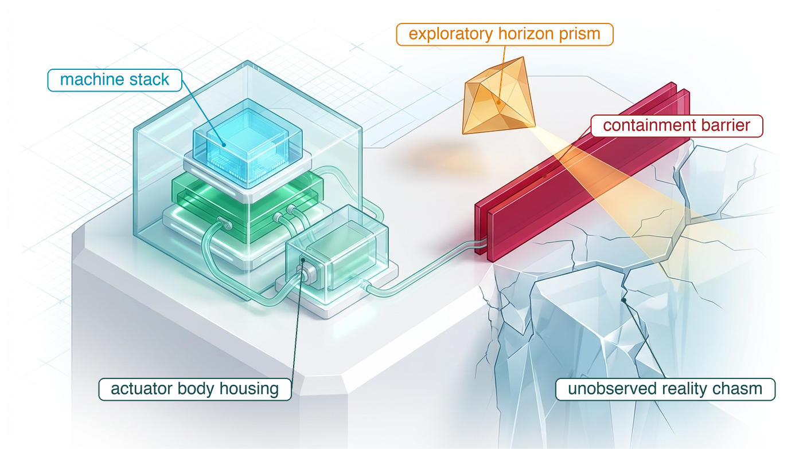
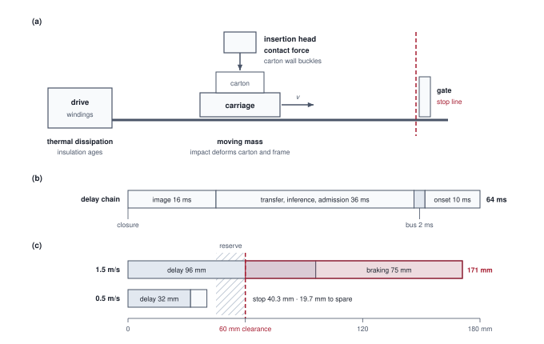
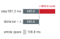
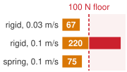

# Engineering Physical AI {#sec-frontier}

::: {layout-narrow}
::: {.column-margin}

\chapterminitoc

:::

::: {.content-visible when-format="pdf"}
\noindent
{fig-alt="Isometric blueprint of the epistemic frontier. A layered physical AI stack under glass, cabled to an actuator body housing, sits on a plinth whose edge ends at a red double-walled containment barrier above a cracked chasm labeled unobserved reality, while an amber prism labeled exploratory horizon projects a diagnostic beam across the barrier."}
:::

::: {.content-visible unless-format="pdf"}
{fig-alt="Isometric blueprint of the epistemic frontier: a layered physical AI stack under glass, a red containment barrier at the edge of a chasm labeled unobserved reality, and an amber prism projecting a diagnostic beam across it."}
:::

:::

## Purpose {.unnumbered .unlisted}

::: {.content-visible when-format="pdf"}
\begin{marginfigure}
\resizebox{0.92\linewidth}{!}{\mlphysicalstackfull{20}{20}{20}{20}{20}}
\end{marginfigure}
:::

::: {.content-visible unless-format="pdf"}
::: {.column-margin}
{width="100%" fig-alt="Physical AI Systems Stack"}

*Physical AI stack focus for this chapter.*
:::
:::

_Why does a better model not, by itself, make a better machine?_

The learned model is the part of a physical machine that is easiest to improve and easiest to score, so it attracts most of the effort. Useful service depends on everything around it as well. The body must sustain the task across loads, surfaces, and hours of duty, the learned behavior must hold in the states its own actions create, each proposal must be admitted, corrected, or refused before the motion it asks for is already under way, and the evidence for all of it must match the conditions of operation and stay true as the machine and its site change. Each of these can be engineered well in isolation while the machine as a whole remains unjustified, because doubt accumulates across every premise a physical claim depends on, and a premise that no one names or owns is assumed silently. A team that cannot join these parts into one argument keeps improving the model while an unmeasured floor, an unqualified detector, or an unowned restriction decides what the machine actually does. The same joined argument also chooses what to build next, since the most valuable measurement, experience, or design change is the one that retires the weakest open premise. At the causal boundary, irreversibility makes that weakest premise, not the best prediction, the measure of what a machine may be trusted to do.



::: {.callout-learning-objectives}

- Explain why a better prediction can still produce a worse physical action, and synthesize the four laws into the design argument that answers it
- Distinguish an unobserved premise from a monitored unknown, and explain why only a standing restriction can contain an unobserved premise
- Apply the four laws to select and evaluate a candidate operating mode for an unfamiliar machine
- Construct residual-claims entries with supported restrictions, accountable owners, and predeclared closure tests
- Evaluate the throughput cost of an operating restriction against the cost of the closure campaign that would retire it
- Select the next measurement, learning experiment, or design change needed to extend a machine's capability
:::

## From a Better Prediction to Useful Service {#sec-frontier-architectural-synthesis}

The release review of @sec-release ended with a verdict, and @sec-responsibility named who answers for each decision behind it. On this book's own records the warehouse mobile manipulator is refused, and even the stipulated evidence branch earns it only conditional service, held in place by premises that no sensor on the machine reports, such as the friction of the aisle floor. Improving its learned models alone would not change that verdict while the supporting physical and timing premises remain unqualified. The verdict is therefore the engineering form of the answer to the question @sec-boundary opened with: why a better prediction can still produce a worse physical action, and what the rest of the machine must supply so that a model's proposals become useful work within justified limits. This chapter joins the book's parts into that answer on the warehouse machine, transfers the same method to an unfamiliar machine, the packaging cell of @sec-frontier-generalizing-unfamiliar-systems, and then examines the premises no sensor can check, giving each an owner, a restriction, and a closure test in a residual-claims register (@sec-frontier-epistemic-limits), before showing how those open premises select the next capability to build (@sec-frontier-assumptions-change).

The question began with a contrast. Traditional machine learning evaluated advisory predictions against static datasets, and agentic machine learning could run iterative reasoning loops inside controlled digital sandboxes, behind glass, with elastic time, transactional rollback, and symbolic interfaces. Those privileges depended on the sandbox; external calls could already produce irreversible effects. Physical AI stepped through that glass into the continuous world, where computation commands actuators across the causal boundary. That step exposed computation to continuous time, in which delay becomes distance traveled, and to mechanical and thermodynamic irreversibility, which forbids undo. The illustrated feedback workload also required one action at a time under a real-time deadline, a batch size of one ($\BatchSize=1$); this scheduling constraint does not prohibit coordinated axes or batching elsewhere in the system. These constraints forced an architectural response, the separation of speculative proposals from deterministic permission, which is a design choice rather than a fact of physics.

One reference platform carried the argument: a warehouse mobile manipulator that picks an object from a moving conveyor, opens a spring-latched cage door, and carries the payload down an aisle shared with people. That mission exercised every capability the book develops (sizing the physical and computational dynamics, teaching learned policies, integrating a real-time runtime, evaluating closed-loop behavior, and maintaining the operating envelope as the machine and its site degrade), and each design choice constrained the next.

The question can now be answered precisely. Predictive accuracy alone does not establish the operating premises on which physical success depends. The physical distance a mobile base traverses while a neural network computes its forward pass, the friction available at the tire-floor interface during sudden braking, the cascading states into which the robot's own prior actions thrust it, and the operational shifts between demonstration datasets and live deployment conditions all dictate what an actuator command does once it crosses the causal boundary. Increasing the statistical accuracy of a model can refine the proposed trajectory, and shortening inference can recover timing margin, but neither result by itself qualifies traction, closed-loop competence, or the complete stopping budget.

The second half of the question, what the surrounding machine must supply, resolves into the four-step argument of @sec-boundary-central-question, aligning one engineering discipline with each of the four laws. Under the first law (*irreversibility*), the body's mechanical and thermal limits bound what any proposal may request. Part I translated payload capacity, surface traction, contact forces, motor heating, and energy reserves into strict operational budgets that govern proposal horizons, execution cadence, and deterministic fallback paths. Under the second law (*endogenous data*), policy competence holds only over the empirical distribution of states induced by closed-loop interaction. Part II tied proposer evaluation directly to the states the physical machine actually visits, transforming recovery failures into targeted collection regimes rather than unhandled anomalies. Under the third law (*proposal is not permission*), execution authority resides in an independent permission path rather than the learned model. Part III unified observation freshness contracts, grounded geometric targets, timed trajectories, and real-time admission filters onto a compute topology engineered to meet hard deadlines under heavy load. Under the fourth law (*permission must be earned*), deployment scope extends only as far as qualified system-wide evidence supports it. Part IV structured physical operation as a governed service contract that decouples proposer autonomy, whole-system task success, and protective intervention. A least-change speed filter, for example, can preserve an in-flight delivery even when a raw proposal requires intervention, whereas an emergency stop protects physical hardware without fulfilling the promised service.

The release verdict is where the four laws meet. In the baseline audit of @sec-release-case-worked-full, the book's illustrative records yield `REFUSE`, because tail risks and fault margins remain unverified. The stipulated branch of @sec-release-stipulated-service shows which evidence would raise that verdict to conditional authorization (`COND`): under those stipulated performance and fault records, the machine may run inspected-route transport, guarded door approaches, and close-proximity handovers, provided that standing conditions on floor traction, pedestrian crossings, feeder alignment, and sensor calibration stay verified. Each condition traces back through the record chain to a measured limit, an evaluated behavior, or a timed check, which is what separates a result stated under premises from a deployment claim.

```{python}
#| label: calc-frontier-loop-figure
#| echo: false
# ┌─────────────────────────────────────────────────────────────────────────────
# │ CLOSED-LOOP SYNTHESIS FIGURE LABELS
# ├─────────────────────────────────────────────────────────────────────────────
# │ Context: @fig-18-causal-loop-synthesis (SVG labels are hand-typed).
# │ Goal:    Keep the machine's rates and bus voltage drawn in the figure
# │          equal to the registry values the rest of the book prints.
# │ Show:    Nothing; the cell only guards the drawn labels.
# │ How:     Compare each drawn label with the registered machine value.
# └─────────────────────────────────────────────────────────────────────────────
from mlsysim import *

RM = Embodied.MobileManipulator.WarehouseMobileManipulator

class LoopSynthesisFigure:
    """Values drawn in fig18_closed_loop_synthesis.svg."""

    # ┌── 1. LOAD (Drawn labels and the registry values they must match) ──────
    drawn = {
        "intent rate (Hz)": (2.0, RM.intent_rate.to(ureg.Hz).magnitude),
        "intent inference (ms)": (336.0, RM.intent_reference_latency.to(ureg.ms).magnitude),
        "chunk renewal (ms)": (50.0, (1 / RM.chunk_rate).to(ureg.ms).magnitude),
        "setpoint step (ms)": (25.0, RM.chunk_step.to(ureg.ms).magnitude),
        "permission tick (kHz)": (1.0, RM.permission_rate.to(ureg.kHz).magnitude),
        "drive bus nominal (V)": (47.7, RM.drive_bus_nominal.to(ureg.volt).magnitude),
        "drive current loop (kHz)": (20.0, RM.current_loop_rate.to(ureg.kHz).magnitude),
    }

    # ┌── 3. GUARD (Invariants) ────────────────────────────────────────────────
    for _name, (_label, _value) in drawn.items():
        check(abs(_label - _value) < 1e-9, f"closed-loop figure label for {_name} is stale ({_label} vs {_value})")

    # ┌── 4. OUTPUT (Formatting) ───────────────────────────────────────────────
    intent_rate_str = fmt_frequency(RM.intent_rate, unit=ureg.Hz, precision=0)
    renewal_str = fmt_latency(1 / RM.chunk_rate, unit=ureg.ms, precision=0)
    setpoint_str = fmt_latency(RM.chunk_step, unit=ureg.ms, precision=0)
    permission_str = fmt_frequency(RM.permission_rate, unit=ureg.kHz, precision=0)
    bus_str = fmt_voltage(RM.drive_bus_nominal, precision=1)
    current_loop_str = fmt_frequency(RM.current_loop_rate, unit=ureg.kHz, precision=0)
```

Assembled, these parts close one causal loop through the physical world (@fig-18-causal-loop-synthesis). The loop runs at rates four orders of magnitude apart: the Brain proposes at `{python} LoopSynthesisFigure.intent_rate_str`, the permission path on the discrete safety microcontroller admits, corrects, or refuses at `{python} LoopSynthesisFigure.permission_str`, and the drives close their current loops at `{python} LoopSynthesisFigure.current_loop_str`. The loop closes only through the World, and the World returns only what its sensors capture, with capture times, to the permission path and to the Brain. A state the sensors never carry, such as the friction under a clear film, is invisible to every level at once. Governance surrounds all five levels and changes on the timescale of releases, so it sets the budgets and standing conditions that the fast loop enforces without taking part in any single control cycle.

::: {#fig-18-causal-loop-synthesis fig-env="figure" fig-pos="t" fig-cap="**Closed causal loop**: The Brain proposes across the proposal boundary, and the permission path in the Nervous System admits, modifies, or refuses each proposal before the Body acts. The Body's current becomes force and motion at the Boundary, the World evolves, and the Boundary returns measurements with capture times to the permission path and the Brain. Not every state of the World reaches a sensor. The governance envelope surrounds all five levels and changes on the timescale of releases rather than control cycles. The labels are this machine's values: the intent model proposes at `{python} LoopSynthesisFigure.intent_rate_str`, the chunk is renewed every `{python} LoopSynthesisFigure.renewal_str`, the application processor sends a setpoint every `{python} LoopSynthesisFigure.setpoint_str` over a black-channel link to a discrete safety microcontroller unit (MCU) whose permission path ticks at `{python} LoopSynthesisFigure.permission_str`, and the drives close their current loops at `{python} LoopSynthesisFigure.current_loop_str` from a `{python} LoopSynthesisFigure.bus_str` bus. Another machine sets its own rates." fig-alt="Five stacked levels inside a dashed governance envelope: Brain, Nervous System, Body, Boundary, and World, with a dashed proposal boundary between the Brain and the Nervous System. Inside the Nervous System an application processor sends setpoints over a black-channel link to a discrete safety MCU that runs the permission path. Arrows run from the Brain to the application processor, labeled proposal, from the safety MCU to the Body, labeled admitted command, and on to the World, labeled current in a winding and force and motion. A return arrow runs from the World to the Boundary, then up a side lane to the safety MCU, labeled fresh state, and to the Brain, labeled observations. Labels give the intent model 2 Hz with 336 ms inference, chunk renewal every 50 ms, a setpoint every 25 ms, a 1 kHz permission tick, a 20 kHz current loop in the drives, and a 47.7 V drive bus; the Boundary is event-timed, the World is continuous, and governance has no control rate."}
{width="100%"}
:::

The records summarized in @tbl-18-master-synthesis bring the four laws into an integrated engineering workflow. Rather than treating safety as an abstract property of a model, each architectural division produces durable, auditable artifacts that preserve empirical evidence and operational intent when tasks, payloads, or environmental conditions change.

\Needspace{25\baselineskip}

| Law                            | Part                                                                                             | Records that carry it                                                                                               | Condition to maintain                                                                                                                                                              | Engineering result                                                                                                             |
|:-------------------------------|:-------------------------------------------------------------------------------------------------|:--------------------------------------------------------------------------------------------------------------------|:-----------------------------------------------------------------------------------------------------------------------------------------------------------------------------------|:-------------------------------------------------------------------------------------------------------------------------------|
| **Irreversibility**            | I (@sec-body, @sec-brain, @sec-nervous)                                                          | Limit records; the proposer's limits, which enter the handoff record                                                | Each measured limit, such as floor friction, payload, brake onset, or observation age, still holds under present conditions                                                        | A feasible speed or force envelope, a timed proposal interface, and a reachable fallback                                       |
| **Endogenous data**            | II (@sec-data, @sec-training, @sec-evaluation)                                                   | Provenance record, policy manifest, evaluation record                                                               | The states the machine enters lie inside the target operational design domain (ODD, @sec-data-curse-dimensionality-recoverability-geometry) that closed-loop evaluation represents | A learned behavior evaluated in its closed loop; new qualified experience can expand its supported task population             |
| **Proposal is not permission** | III (@sec-perception, @sec-memory, @sec-intent, @sec-planning, @sec-enforcement, @sec-placement) | Observation contract, belief record, intent lease, trajectory record, enforcement record, placement record          | The permission path sees fresh, distinguishable state and meets its deadline under load                                                                                            | Useful motion admitted or minimally corrected within current limits; invalid active authority invokes a state-matched fallback |
| **Permission must be earned**  | IV (@sec-intervention, @sec-verification, @sec-release, @sec-responsibility)                     | Authority record, fault record, release manifest, approval record, and the residual-claims register of this chapter | The premises of the release claim still hold after release                                                                                                                         | A named service authorized under standing conditions, with tested intervention and update procedures                           |

: **The four laws as engineering competence**: Each part produces records that support the next design decision. The conditions and results belong to the particular machine and its evidence; they are not universal hardware requirements. {#tbl-18-master-synthesis tbl-colwidths="[14,17,25,22,22]"}

The synthesis also completes the history traced in @sec-boundary-prediction-to-action. Over eight decades, learning moved from the machine's periphery toward its actuators. Deterministic mechanisms gave way to learned perception feeding analytical planners, then to end-to-end motor policies, and now to foundation models that propose action chunks across many robot bodies. At each step, a guarantee that physical separation or a watchful person once supplied had to move inside the machine.

The warehouse platform shows where that history now stands. Its split between an intent model proposing at `{python} LoopSynthesisFigure.intent_rate_str` and a chunk policy renewed every `{python} LoopSynthesisFigure.renewal_str` mirrors current vision-language-action pipelines, and the guarantees those statistical models displaced survive in the deterministic architecture around them. The reflex halt beneath Shakey's STRIPS planner and the lower layers of Brooks's subsumption architecture, which kept running while higher layers were busy or wrong, have become the discrete permission path, enforcing signed kinematic and dynamic envelopes sized for this body. The remote operators who stayed close to the loop at the DARPA Robotics Challenge have become a formal intervention authority with timed handover budgets, and the environmental oversight a person once supplied has become explicit standing conditions of release.

The next phase, taken up in @sec-frontier-four-open-challenges, brings foundation models that control many bodies while learning continuously from fleet deployments. Cross-embodiment pretraining broadens what a model can propose, and it also carries the model further from the empirical distribution of any single site. Wider proposing latitude therefore makes the independent permission path more necessary, not less: it demands stronger checks at runtime and more defensible evidence at release, an architectural response to the safety-limit and conformity requirements of European machinery law (@sec-release-standards-map).

This systems architecture provides an engineering method designed to generalize across platforms. The transferable core consists of the foundational questions, dynamic budgets, empirical protocols, and interface boundaries; the platform-specific elements are the calibrated numerical thresholds, kinematic envelopes, and actuator limits. Applying this framework to the packaging cell in @sec-frontier-generalizing-unfamiliar-systems demonstrates how that transferable core adapts when mechanics, cycle frequencies, and operational environments change.

## Generalizing to Unfamiliar Systems {#sec-frontier-generalizing-unfamiliar-systems}

When an automated packaging cell shuttles containers, closes closure tabs, and repeats high-rate cycles across a full shift, it operates against strict physical limits: kinematic reach, contact force, and thermal buildup in the drive motors. Building such an embodied system requires pairing a capable learned proposer with an execution pipeline whose runtime authority respects those physical bounds. The four bedrock laws formalize this engineering discipline. Together, they trace an unbroken chain from the task's irreversible consequences to measurable physical envelopes, through the closed-loop data required to train and validate policies, down to the real-time runtime that gates motor commands, and ultimately to the operational envelope certified for deployment. Applying this four-law framework to a novel packaging cell demonstrates how the systems principles developed throughout this book generalize far beyond the warehouse mobile manipulator.

::: {.column-margin .margin-pointer}
↩ The four bedrock laws, from irreversibility to permission must be earned, are established in @sec-boundary-bedrock-laws.
:::

### The four-law audit protocol for novel physical systems {#sec-frontier-four-law-audit-protocol}

The audit asks one question per law, in the order the laws constrain one another, and each answer leaves a record behind:

1. **Irreversibility.** What can the task do that no later command can undo, and what measured bound keeps it from happening? The answer names the collisions, plastic deformations, and thermal overloads of the task and sizes the envelope that excludes them, such as a speed ceiling from the stopping budget. It produces the machine's limit records.
2. **Endogenous data.** Do the demonstrations and the closed-loop evaluation cover the states the machine will enter once that envelope is enforced? A limit added in step 1 changes the states the proposer sees, so the evaluation must be run inside the envelope, not before it. It produces the provenance record and the evaluation record.
3. **Proposal is not permission.** Which independent path admits, corrects, or refuses each proposal, on which sensors, within which timing budget, and with which fallback when permission lapses? It produces the enforcement record and the timing budget the permission path must meet.
4. **Permission must be earned.** Which operating claims does the assembled evidence support, under which standing conditions, who answers for each decision behind them, and which premises remain open? It produces the release manifest, the approval record, and the residual-claims register entries for every premise left open.

Because each step constrains the next, adjustments ripple back up the list. Reducing the permitted transit speed to satisfy a stopping budget in step 1, for example, alters the visual flow and dynamic distribution that step 2 must evaluate.

### A packaging cell across the three machine classes {#sec-frontier-packaging-cell-study}

Consider a packaging cell in a logistics hub, laid out as in @fig-18-packaging-cell (panel a). A carriage carrying one carton runs along a straight track, driven by a linear servo drive at the track's near end. Partway along, an insertion head presses down on the carton's flaps to seat its retention tabs. At the far end, a gate closes across the track whenever the next station cannot accept a carton, and a carriage still moving when the gate closes drives its carton into the gate and the frame. The cell is laid out tightly for cycle rate, so the carriage is only a few centimeters from its stop line when a closure can begin. This single cell couples all three machine classes within one enclosure: the carriage as moving mass, the insertion head as contact force, and the drive as thermal dissipation, because it cycles the carriage through rapid accelerations all shift.

::: {.column-margin .margin-pointer}
↩ The three machine classes (mass-dominated mobility, contact-dominated manipulation, and energy- and thermal-dominated operation) are established in @sec-boundary-three-classes.
:::

The first law asks what the machine cannot undo, so the audit begins by cataloging the cell's irreversible state changes\index{State change!irreversible} alongside the governing physical bounds\index{Physical bounds}. A loaded parcel container traversing a linear transfer rail carries momentum. When a carriage strikes an obstruction, kinetic energy dissipates through plastic deformation of the container and structural deflection of the frame, and commanding the drive motor in reverse cannot undo that deformation. The insertion mechanism introduces a second irreversible boundary: an actuator drives a mechanical tool head against package tabs to lock retaining clips. If the actuator exerts force beyond the compressive load capacity of the carton wall, the container buckles, crushing internal contents. The high-duty drive introduces a third irreversible boundary through Joule heating ($\WindingLossPower = \TorqueProducingCurrent^2 \ElectricalResistance(\WindingTemperature)$). Continuous high-acceleration cycles pump thermal energy into sealed motor windings. Winding insulation does not need to melt to fail; elevated temperatures accelerate chemical degradation over time, shortening insulation life rapidly [@iec60085-2007]. Cooling the housing afterward cannot restore the dielectric strength already lost. Because insulation degradation accumulates across duty cycles, an instantaneous temperature trip threshold alone cannot bound lifetime damage.

```{python}
#| label: calc-frontier-packaging-stop
#| echo: false
#| warning: false
#| message: false
# ┌─────────────────────────────────────────────────────────────────────────────
# │ PACKAGING CELL: A CANDIDATE TRANSPORT MODE
# ├─────────────────────────────────────────────────────────────────────────────
# │ Context: @sec-frontier-packaging-cell-study.
# │ Goal:    Test nominal speed against a fixed stop line, solve the speed
# │          ceiling the stop budget admits, and check a restricted speed below it.
# │ Show:    Delay, stopping distances, the ceiling, reserve, and translational energy.
# │ How:     One-off hypothetical scenario inputs; MLSysIM constant-deceleration
# │          stopping (calc_safe_stopping_distance), its positive root
# │          (calc_max_permitted_velocity), and kinetic-energy models. These are
# │          not measurements.
# └─────────────────────────────────────────────────────────────────────────────
from mlsysim import *

class PackagingCell:
    # ┌── 1. LOAD (Scenario assumptions) ───────────────────────────────────────
    mass = 12 * ureg.kg  # scenario assumption: total moving mass, including load
    v_nom = 1.5 * ureg.meter / ureg.second  # scenario assumption: nominal speed
    v_clamp = 0.5 * ureg.meter / ureg.second  # scenario assumption: restricted speed
    clearance = 60 * ureg.mm  # scenario assumption: clearance to a fixed stop line
    reserve = 15 * ureg.mm  # scenario assumption: allocated uncertainty and clearance reserve
    deceleration = 15 * ureg.meter / ureg.second**2  # scenario assumption: braking lower bound after delay
    exposure = 16 * ureg.ms  # scenario assumption: worst-case event-to-usable-frame interval
    processing = 36 * ureg.ms  # scenario assumption: transfer, inference, scheduling, and admission
    bus = 2 * ureg.ms  # scenario assumption: admitted command to brake-driver delivery
    onset = 10 * ureg.ms  # scenario assumption: delivery to full assumed deceleration
    check_rate = 1 * ureg.kHz  # scenario assumption: independent kinematic-check rate
    force_cap = 220 * ureg.N  # scenario assumption: selected limiter setting, not material strength
    temperature_trip = Q_(105, ureg.degC)  # scenario assumption: selected sensor threshold
    stall_timeout = 400 * ureg.ms  # scenario assumption: selected stall-detection timeout
    bus_trip = 60 * ureg.volt  # scenario assumption: selected inverter overvoltage threshold
    deceleration_check = 12 * ureg.meter / ureg.second**2  # scenario assumption: a lower qualified braking bound (checkpoint estimate)

    # ┌── 2. EXECUTE (Compute) ─────────────────────────────────────────────────
    delay = exposure + processing + bus + onset
    stop_budget = clearance - reserve
    blind_nom = v_nom * delay
    brake_nom = v_nom**2 / (2 * deceleration)
    stop_nom = calc_safe_stopping_distance(v_nom, delay, deceleration)
    deficit = stop_nom - clearance
    # Speed ceiling: positive root of v tau + v^2/(2a) = clearance - reserve
    v_ceiling = calc_max_permitted_velocity(clearance, delay, deceleration, physical_margin=reserve).to(ureg.meter / ureg.second)
    # What changes if: halve the processing allocation, or halve the braking bound
    v_ceiling_fast_proc = calc_max_permitted_velocity(clearance, exposure + processing / 2 + bus + onset, deceleration, physical_margin=reserve).to(
        ureg.meter / ureg.second
    )
    v_ceiling_half_decel = calc_max_permitted_velocity(clearance, delay, deceleration / 2, physical_margin=reserve).to(ureg.meter / ureg.second)
    blind_clamp = v_clamp * delay
    brake_clamp = v_clamp**2 / (2 * deceleration)
    stop_clamp = calc_safe_stopping_distance(v_clamp, delay, deceleration)
    remaining = clearance - stop_clamp
    energy_nom = calc_kinetic_energy(mass, v_nom)
    energy_clamp = calc_kinetic_energy(mass, v_clamp)
    energy_reduction = (1 - energy_clamp / energy_nom).to(ureg.dimensionless).magnitude
    # Operands of the positive root, shown in the notebook
    a_tau = (deceleration * delay).to(ureg.meter / ureg.second)
    two_a_d = (2 * deceleration * stop_budget).to(ureg.meter**2 / ureg.second**2)
    root_term = ((a_tau**2 + two_a_d) ** 0.5).to(ureg.meter / ureg.second)
    v_ceiling_check = calc_max_permitted_velocity(clearance, delay, deceleration_check, physical_margin=reserve).to(ureg.meter / ureg.second)

    # ┌── 3. GUARD (Invariants) ────────────────────────────────────────────────
    # 2026-09-28: pin the complete hypothetical budget and the claimed reserve.
    check(delay == 64 * ureg.ms, "All four delay allocations must total 64 ms.")
    check(blind_nom > clearance, "Nominal speed must exhaust clearance before braking.")
    check(abs(stop_nom.to(ureg.mm).magnitude - 171) < 1e-9, "Nominal stop must be 171 mm.")
    check(abs(stop_clamp.to(ureg.mm).magnitude - 40.3333333333) < 1e-6, "Restricted stop must be 40.3 mm.")
    check(stop_clamp < stop_budget and remaining > reserve, "Restricted stop must preserve the allocated reserve.")
    check(abs(v_ceiling.magnitude - 0.5471) < 5e-4, "Carriage speed ceiling must be 0.55 m/s.")
    check(
        abs(calc_safe_stopping_distance(v_ceiling, delay, deceleration).to(ureg.mm).magnitude - stop_budget.to(ureg.mm).magnitude) < 1e-6,
        "At the ceiling the stop must fill the stop budget exactly.",
    )
    check(v_clamp < v_ceiling < v_nom, "The restricted speed is chosen below the ceiling, which sits below nominal.")
    check(abs(v_ceiling_fast_proc.magnitude - 0.6613) < 5e-4, "Halving processing raises the ceiling to 0.66 m/s.")
    check(abs(v_ceiling_half_decel.magnitude - 0.4715) < 5e-4, "Halving the braking bound lowers the ceiling to 0.47 m/s.")
    check(v_ceiling_half_decel < v_clamp, "At half the braking bound the 0.5 m/s mode no longer fits.")
    check(abs(energy_nom.to(joule).magnitude - 13.5) < 1e-9, "Nominal translational energy must be 13.5 J.")
    check(abs(energy_clamp.to(joule).magnitude - 1.5) < 1e-9, "Restricted translational energy must be 1.5 J.")
    check(abs(a_tau.magnitude - 0.96) < 1e-9 and abs(two_a_d.magnitude - 1.35) < 1e-9, "Root operands must be 0.96 m/s and 1.35 m²/s².")
    check(abs((root_term - a_tau - v_ceiling).magnitude) < 1e-9, "The shown root minus a*tau must equal the ceiling.")
    check(
        abs(v_ceiling_check.magnitude - 0.5242) < 5e-4 and v_ceiling_check > v_clamp,
        "At 12 m/s² the ceiling (0.52 m/s) must still admit the 0.5 m/s mode.",
    )

    # ┌── 4. OUTPUT (Formatting) ───────────────────────────────────────────────
    mass_str = fmt_qty(mass, unit=ureg.kg, precision=0)
    v_nom_str = fmt_velocity(v_nom, precision=2)
    v_clamp_str = fmt_velocity(v_clamp, precision=2)
    v_ceiling_str = fmt_velocity(v_ceiling, precision=2)
    v_ceiling_fast_proc_str = fmt_velocity(v_ceiling_fast_proc, precision=2)
    v_ceiling_half_decel_str = fmt_velocity(v_ceiling_half_decel, precision=2)
    processing_half_str = fmt_latency(processing / 2, unit=ureg.ms, precision=0)
    deceleration_half_str = fmt_acceleration(deceleration / 2, precision=1)
    clearance_str = fmt_length(clearance, unit=ureg.mm, precision=0)
    reserve_str = fmt_length(reserve, unit=ureg.mm, precision=0)
    deceleration_str = fmt_acceleration(deceleration, precision=0)
    exposure_str = fmt_latency(exposure, unit=ureg.ms, precision=0)
    processing_str = fmt_latency(processing, unit=ureg.ms, precision=0)
    bus_str = fmt_latency(bus, unit=ureg.ms, precision=0)
    onset_str = fmt_latency(onset, unit=ureg.ms, precision=0)
    delay_str = fmt_latency(delay, unit=ureg.ms, precision=0)
    blind_nom_str = fmt_length(blind_nom, unit=ureg.mm, precision=0)
    brake_nom_str = fmt_length(brake_nom, unit=ureg.mm, precision=0)
    stop_nom_str = fmt_length(stop_nom, unit=ureg.mm, precision=0)
    deficit_str = fmt_length(deficit, unit=ureg.mm, precision=0)
    stop_budget_str = fmt_length(stop_budget, unit=ureg.mm, precision=0)
    blind_clamp_str = fmt_length(blind_clamp, unit=ureg.mm, precision=0)
    brake_clamp_str = fmt_length(brake_clamp, unit=ureg.mm, precision=1)
    stop_clamp_str = fmt_length(stop_clamp, unit=ureg.mm, precision=1)
    remaining_str = fmt_length(remaining, unit=ureg.mm, precision=1)
    energy_nom_str = fmt_energy(energy_nom, unit=joule, precision=1)
    energy_clamp_str = fmt_energy(energy_clamp, unit=joule, precision=1)
    energy_reduction_str = fmt_percent(energy_reduction, precision=1, style="prose")
    check_rate_str = fmt_frequency(check_rate, unit=ureg.kHz, precision=0)
    force_cap_str = fmt_force(force_cap, precision=0)
    temperature_trip_str = fmt_temperature(temperature_trip, precision=0)
    stall_timeout_str = fmt_latency(stall_timeout, unit=ureg.ms, precision=0)
    bus_trip_str = fmt_voltage(bus_trip, precision=0)
    a_tau_str = fmt_velocity(a_tau, precision=2)
    two_a_d_str = fmt_qty(two_a_d, unit=ureg.meter**2 / ureg.second**2, precision=2)
    root_term_str = fmt_velocity(root_term, precision=2)
    deceleration_check_str = fmt_acceleration(deceleration_check, precision=0)
```

Because the carriage's momentum is already committed, the permission path must act before the carriage consumes its clearance. The stop modeled next is the cell's application-level path: a camera watches the gate, a learned model recognizes that a closure has begun, and the admitted stop command goes to the carriage brake. That path keeps normal operation clear of the gate, but it is not the cell's certified protective function, which the third-law discussion below and Problem 1 take up. The constant-deceleration stopping relation of @sec-body-stopping-distance-prebrake tests a candidate design for it, here on hypothetical scenario inputs rather than measurements from a commissioned cell.

::: {#nbk-frontier-packaging-delay-wall .callout-notebook title="The delay wall"}

**Problem**: The loaded carriage travels at `{python} PackagingCell.v_nom_str` toward a gate whose fixed stop line is `{python} PackagingCell.clearance_str` away when the hazardous closure begins, maintaining constant speed until braking begins. Can it stop short of the line, and if not, what is the fastest speed whose stop fits once a `{python} PackagingCell.reserve_str` reserve is held back?

**Variables**:

- Moving mass of carriage and loaded tray $\Mass$ = `{python} PackagingCell.mass_str` and nominal speed $\SpeedAtDetection$ = `{python} PackagingCell.v_nom_str` (Illustrative)
- Clearance `{python} PackagingCell.clearance_str`, less `{python} PackagingCell.reserve_str` reserved for uncertainty and residual clearance, leaves a stopping budget $\StoppingDistanceBudget$ = `{python} PackagingCell.stop_budget_str` (Illustrative)
- Braking lower bound $\CredibleBrakingDeceleration$ = `{python} PackagingCell.deceleration_str` after the delay, for whichever brake the stop command engages (Illustrative; a bound to qualify under load, pad wear, and rail conditions, not a motor's peak rating)
- Delay from closure to full braking $\PrebrakeDelay$: `{python} PackagingCell.exposure_str` to a usable image, including frame phase and exposure, `{python} PackagingCell.processing_str` for transfer, inference, scheduling, and admission, `{python} PackagingCell.bus_str` for command delivery, and `{python} PackagingCell.onset_str` for brake buildup, in all `{python} PackagingCell.delay_str` (Illustrative upper bounds)

**Math**:

1. **Nominal stop** (@eq-body-stopping-distance, margins held in the reserve): $\StoppingDistance = \SpeedAtDetection\PrebrakeDelay + \SpeedAtDetection^2/2\CredibleBrakingDeceleration$ = `{python} PackagingCell.v_nom_str` $\times$ `{python} PackagingCell.delay_str` $+$ (`{python} PackagingCell.v_nom_str`)$^2/(2 \times$ `{python} PackagingCell.deceleration_str`) = `{python} PackagingCell.blind_nom_str` $+$ `{python} PackagingCell.brake_nom_str` = `{python} PackagingCell.stop_nom_str`, a deficit of `{python} PackagingCell.deficit_str`.
2. **Speed ceiling** (@eq-body-velocity-ceiling with $\StoppingDistanceBudget$ as the available distance): $\CredibleBrakingDeceleration\PrebrakeDelay$ = `{python} PackagingCell.a_tau_str` and $2\CredibleBrakingDeceleration{}\StoppingDistanceBudget$ = `{python} PackagingCell.two_a_d_str`, and the square root of (`{python} PackagingCell.a_tau_str`)$^2$ $+$ `{python} PackagingCell.two_a_d_str` is `{python} PackagingCell.root_term_str`. The positive root is $\SpeedBound$ = `{python} PackagingCell.root_term_str` $-$ `{python} PackagingCell.a_tau_str` = `{python} PackagingCell.v_ceiling_str`.
3. **Candidate mode** at `{python} PackagingCell.v_clamp_str`, below the ceiling: `{python} PackagingCell.blind_clamp_str` of delay travel $+$ `{python} PackagingCell.brake_clamp_str` of braking = `{python} PackagingCell.stop_clamp_str`, leaving `{python} PackagingCell.remaining_str` before the stop line. Translational energy $\KineticEnergy = \Mass \SpeedAtDetection^2/2$ falls from `{python} PackagingCell.energy_nom_str` to `{python} PackagingCell.energy_clamp_str`, a reduction of `{python} PackagingCell.energy_reduction_str`.

**Result**: At nominal speed the carriage reaches the gate before braking even begins. The budget admits at most `{python} PackagingCell.v_ceiling_str`, and the `{python} PackagingCell.v_clamp_str` candidate keeps more than the allocated reserve.

**Systems insight**: At these speeds delay travel, not braking, exhausts the clearance. The `{python} PackagingCell.delay_str` chain alone carries the nominal carriage `{python} PackagingCell.blind_nom_str`, farther than the stop line, so the condition $\StoppingDistance \le \ClearDistance$ of principle \ref{pri-vol4-irreversibility} is met first by lowering speed or shortening the chain from closure to braking. The carriage's speed limit belongs to that whole chain, not to its brake alone.

:::

The slower mode is therefore worth qualifying. Cutting speed to a third shrinks the two terms of the stop unequally (@fig-18-packaging-cell). Delay travel is linear in speed and falls threefold, from `{python} PackagingCell.blind_nom_str` to `{python} PackagingCell.blind_clamp_str`; braking distance is quadratic and falls ninefold, to `{python} PackagingCell.brake_clamp_str`. At the restricted speed the delay chain, not the brake, therefore sets most of the stop, which is why the next question is which premise moves the ceiling most.

```{python}
#| label: calc-frontier-packaging-figure
#| echo: false
# ┌─────────────────────────────────────────────────────────────────────────────
# │ PACKAGING CELL FIGURE LABELS
# ├─────────────────────────────────────────────────────────────────────────────
# │ Context: @fig-18-packaging-cell (SVG labels are hand-typed).
# │ Goal:    Keep every delay and distance drawn in the figure equal to the
# │          PackagingCell values the prose prints.
# │ Show:    Nothing; the cell only guards the drawn labels.
# │ How:     Compare each drawn label (ms, mm, m/s) with its computed value.
# └─────────────────────────────────────────────────────────────────────────────
class PackagingCellFigure:
    """Values drawn in fig18_packaging_cell.svg."""

    _P = PackagingCell
    _ms = lambda q: q.to(ureg.ms).magnitude
    _mm = lambda q: q.to(ureg.mm).magnitude
    _mps = lambda q: q.to(ureg.meter / ureg.second).magnitude
    drawn = [
        ("image", 16.0, _ms(_P.exposure), 1e-9),
        ("transfer, inference, admission", 36.0, _ms(_P.processing), 1e-9),
        ("bus", 2.0, _ms(_P.bus), 1e-9),
        ("onset", 10.0, _ms(_P.onset), 1e-9),
        ("total delay", 64.0, _ms(_P.delay), 1e-9),
        ("clearance", 60.0, _mm(_P.clearance), 1e-9),
        ("reserve start", 45.0, _mm(_P.stop_budget), 1e-9),
        ("nominal speed", 1.5, _mps(_P.v_nom), 1e-9),
        ("restricted speed", 0.5, _mps(_P.v_clamp), 1e-9),
        ("nominal delay travel", 96.0, _mm(_P.blind_nom), 1e-9),
        ("nominal braking", 75.0, _mm(_P.brake_nom), 1e-9),
        ("nominal stop", 171.0, _mm(_P.stop_nom), 1e-9),
        ("restricted delay travel", 32.0, _mm(_P.blind_clamp), 1e-9),
        ("restricted stop", 40.3, _mm(_P.stop_clamp), 0.05),
        ("restricted spare", 19.7, _mm(_P.remaining), 0.05),
    ]
    for _name, _label, _value, _tol in drawn:
        check(abs(_label - _value) < _tol, f"packaging-cell figure label for {_name} is stale ({_label} vs {_value})")
```

::: {#fig-18-packaging-cell fig-env="figure" fig-pos="t" fig-cap="**Three machine classes in one packaging cell**: (a) The carriage is the moving mass whose impact deforms carton and frame, the insertion head applies the contact force that can buckle a carton wall, and the drive dissipates heat that ages winding insulation. (b) The assumed delay chain from gate closure to full braking totals `{python} PackagingCell.delay_str`. (c) At `{python} PackagingCell.v_nom_str` the carriage travels `{python} PackagingCell.blind_nom_str` before braking begins and stops after `{python} PackagingCell.stop_nom_str`, far beyond the `{python} PackagingCell.clearance_str` stop line; at the restricted `{python} PackagingCell.v_clamp_str` it stops in `{python} PackagingCell.stop_clamp_str`, clear of the `{python} PackagingCell.reserve_str` reserve. All inputs are hypothetical design allocations, not measurements." fig-alt="Three panels. Panel a is a side-view schematic of a linear track with a drive box at the left end, a carriage carrying a carton, an insertion head pressing down on the carton, and a gate with a red dashed stop line at the right; labels name the drive as thermal dissipation with insulation aging, the carriage as moving mass whose impact deforms carton and frame, and the insertion head as contact force that buckles the carton wall. Panel b is a horizontal delay bar of four segments, image 16 ms, transfer inference and admission 36 ms, bus 2 ms, and brake onset 10 ms, totaling 64 ms from closure. Panel c shows two stopping-distance bars on a millimeter axis from 0 to 180 with a red dashed stop line at 60 mm and a hatched reserve band just before it. At 1.5 m/s the bar has 96 mm of delay travel and 75 mm of braking, reaching 171 mm, with the part beyond the stop line shaded red. At 0.5 m/s the bar has 32 mm of delay travel and a short braking segment, stopping at 40.3 mm with 19.7 mm to spare."}
{width="100%"}
:::

The positive root also shows how the ceiling responds to each premise. Halving the processing allocation to `{python} PackagingCell.processing_half_str` raises the ceiling to `{python} PackagingCell.v_ceiling_fast_proc_str`; because delay travel dominates this stop, reducing that allocation recovers substantial speed margin. Halving the qualified braking bound to `{python} PackagingCell.deceleration_half_str` lowers the ceiling to `{python} PackagingCell.v_ceiling_half_decel_str`, below the candidate `{python} PackagingCell.v_clamp_str` mode, which then no longer fits. The two premises play different roles. Shorter latency is an opportunity for throughput, whereas a braking shortfall invalidates the mode outright, which is why the loaded deceleration must be qualified under worst-case conditions before the cell is commissioned. The stopping equation fixes the relationship; only measurements on the assembled cell can establish that the latency budget, the deceleration bound, and the reserve hold.

::: {.column-margin .margin-pointer}
↩ This speed ceiling, the positive root of the stopping equation, is established for the mobile base in @sec-body-dynamic-velocity-ceilings.
:::

The second law evaluates the empirical competence of the cell's learned proposers. This packaging cell deploys three distinct learned proposers: a vision model that infers container contents to propose carriage transit speeds (fragile or liquid contents tolerate gentler accelerations and stops than solid goods), a multimodal network that estimates packaging cardboard thickness to propose insertion forces and dwell durations, and an electro-thermal estimator that proposes acceleration profiles to manage motor winding temperatures. In an embodied system, a proposer's actions directly alter what it observes next. Throttling carriage speed changes camera frame timing and optical motion blur; extending tool dwell changes the material deformation that subsequent thickness estimations read; and reshaping acceleration profiles changes the temperature trajectory measured by the thermal estimator. Empirical evidence of proposer competence therefore depends strictly on the state distribution sampled during closed-loop evaluation, raising the crucial question of whether that distribution matches the conditions admitted at runtime. Imposing a safety restriction after training shifts that distribution. If closed-loop evaluation sampled only the nominal transit speed of `{python} PackagingCell.v_nom_str`, clamping speed to `{python} PackagingCell.v_clamp_str` pushes the vision model into a regime of visual dynamics it never encountered during evaluation. A restriction designed to guarantee physical stopping distance simultaneously opens a regime without empirical evidence. The engineering team must either evaluate the policy under derated conditions prior to release or document the unverified regime as an open premise in the release sign-off.

::: {.column-margin .margin-pointer}
↩ A policy whose actions choose its next observations exhibits the endogenous covariate shift established in @sec-data-covariate-shift.
:::

Closing this gap requires aligning the data-collection and evaluation campaign directly with the restricted operational envelope. Expert demonstrations must span the admitted transport velocities, insertion forces, and thermal regimes, preserving complete environmental metadata in the provenance record. Once trained, the candidate proposer must undergo closed-loop trials on the physical cell to confirm that it successfully completes the packaging task under those conditions, including during interventions by the permission path. If the cell cannot maintain acceptable task performance within its physical bounds, engineers must revise the task specification, the proposer architecture, or the mechanical plant before re-evaluating the modified system. Calculating a speed ceiling tests the transport stopping budget under its stated premises; qualifying those premises and demonstrating closed-loop task performance are both required for a viable packaging cell.

::: {.column-margin .margin-pointer}
↩ Why proposer evidence must come from the closed loop the machine will actually run is established in @sec-evaluation-closed-loop-dynamics.
:::

The third law places these proposed actions beneath an architectural authority split\index{Authority split} that the proposers cannot bypass, delay, or corrupt. The permission path prevents unverified neural proposals from reaching physical actuators directly. In this packaging cell, an independent kinematic monitor runs at `{python} PackagingCell.check_rate_str`, reading the carriage's optical encoders and a rangefinder aimed at the gate, and admits a carriage motion command only when the measured clearance supports the qualified stopping distance. This monitor is the admission stage of the camera path in notebook \ref{nbk-frontier-packaging-delay-wall}: the camera reports that a closure has begun, and the monitor admits the stop. Its work is therefore part of the `{python} PackagingCell.processing_str` processing allocation, and a `{python} PackagingCell.check_rate_str` tick bounds only how long a command waits for the next check, not the transfer, inference, and scheduling that come before it.

While the software kinematic check confines normal operation to the derated velocity mode, it does not carry the cell's formal protection claims. In an industrial deployment, harm-prevention claims rest upon hardware-certified drive safety functions codified under IEC 61800-5-2 [@iec61800part52] and mapped for warehouse automation in @tbl-12-certified-functions. The restricted transport mode maps to safely limited speed (SLS) on the carriage drive, an independent hardware function that continuously monitors motor velocity and triggers an emergency stop if the limit is exceeded. The emergency response executes as a ramp-monitored safe stop 1 (SS1) terminating in safe torque off (STO), with safe brake control (SBC) engaging mechanical holding brakes at rest. Each safety function requires a validated timing budget and an integrity metric. Under ISO 13849-1 [@iso13849part1], safety functions are classified by performance level (PL), which bounds their average probability of dangerous failure per hour according to the cell's risk assessment. The camera-triggered stop budgeted in notebook \ref{nbk-frontier-packaging-delay-wall} is the application-level path announced before it, not a protective safety function. A safety-rated optical gate sensor feeding the drive's SS1 input directly replaces the frame-exposure and neural-inference allocations with its certified hardware response time, while command delivery and brake onset still contribute to $\PrebrakeDelay$ in the physical stopping model.

Physical safety limits must govern the insertion tool and actuator drives just as strictly as carriage motion. Configuring a mechanical force limiter to `{python} PackagingCell.force_cap_str` represents a nominal design setting rather than proof that every parcel resists crushing; empirical qualification must verify that peak transmitted forces, including dynamic overshoot during contact impact, remain below the yield strength of the weakest admitted carton and tab geometry. Similarly, setting a winding thermistor trip threshold at `{python} PackagingCell.temperature_trip_str` and a stall detection timeout of `{python} PackagingCell.stall_timeout_str` establishes basic supervisory cutoffs rather than a certified thermal envelope. Safe continuous operation depends on drive current profiles, winding resistance, heat capacity, cooling airflow, and sensor thermal lag. Because internal winding temperatures can surge before external housing sensors register the heat, as modeled in @sec-body-thermal-capacity, engineers cannot validate a sustained duty cycle from trip thresholds alone without empirical thermal characterization.

High-rate deceleration also transfers mechanical kinetic energy back into the electrical drive system. During regenerative braking, the decelerating motor returns power to the inverter DC bus; a dynamic brake chopper and power resistor must absorb this energy before bus voltage exceeds the inverter trip threshold of `{python} PackagingCell.bus_trip_str`, following the bus energy balance in @sec-body-regenerative-surges. The energy sink must accommodate repeated, cyclic stops throughout a shift rather than an isolated emergency event. Furthermore, regenerative braking requires an energized inverter stage throughout deceleration, whereas the carriage's electromechanical track brake relies on its own spring-actuated mechanism. Logic power hold-up alone supplies neither regenerative braking torque nor friction-brake clamping force. A thermal fault or electrical shutdown that cuts drive power disables regenerative braking, leaving deceleration entirely to the mechanical brake. The notebook's `{python} PackagingCell.deceleration_str` bound therefore holds after a power cut only if the spring-applied track brake is itself qualified to it; otherwise the power-cut case has a lower deceleration, a longer stop, and a lower speed ceiling of its own. System designers must ensure that safety-directed power cuts preserve a qualified deceleration and holding response across the declared operating states and fault conditions.

The fourth law synthesizes these engineering decisions into a formal release argument. The cell's release manifest\index{Release manifest!packaging cell} must validate rangefinder coverage, gate clearance margins, braking deceleration, and sustained task throughput as an integrated whole. Equally important, the manifest explicitly records any claims that physical evidence cannot support. To verify tab latching integrity, the engineering team evaluates a vision model that inspects optical surface reflections for container tab engagement. Under industrial overhead lighting, specular reflections from tape and crinkled plastic packaging produce optical artifacts that mimic latch defects while masking genuine tab misalignments. Because the cell lacks an independent physical measurement, such as a tactile switch or a laser profile scanner, that distinguishes engaged tabs from misaligned flaps under glare, the sign-off claim lacks a qualified detector. Documenting this limitation as detectorless and unsupported in the residual-claims register\index{Residual-claims register!packaging cell} (@sec-frontier-residual-claims-register) is not a documentation failure but an accurate statement of what the physical evidence justifies.

The stopping analysis therefore supports a *candidate restricted mode* for carriage transit at `{python} PackagingCell.v_clamp_str`, provided that the `{python} PackagingCell.delay_str` end-to-end latency, `{python} PackagingCell.deceleration_str` braking deceleration, `{python} PackagingCell.clearance_str` physical clearance, and uncertainty reserve are validated concurrently on the physical cell. Insertion forces and thermal duty cycles remain restricted until physical testing confirms material compressive limits, sensor thermal lag, and independent fault paths. Autonomous package sign-off is refused because optical glare obscures tab engagement from the vision system and the cell lacks an independent verification sensor. A qualified tactile or laser engagement sensor could support autonomous sign-off; mandatory downstream manual inspection instead supports a commercial deployment that makes no autonomous sign-off claim. An analytical throughput model cannot substitute for that empirical evidence.

By auditing the packaging cell across the four laws, systems engineers transform abstract safety objectives into an integrated sequence of concrete technical choices. Stopping mechanics identify a viable transport velocity envelope, which in turn defines the precise dynamic regime that data collection and closed-loop evaluation must cover. Runtime safety monitors enforce these dynamic limits in hardware and deterministic software, preventing policy proposals from breaching physical constraints. Finally, the release argument draws a transparent boundary between validated capabilities and unsupported claims, and restricts the machine wherever a claim falls on the unsupported side. Physical AI systems succeed not by eliminating uncertainty through ever-larger models, but by bounding autonomy with measured physical limits and the evidence that supports them.

This four-law audit protocol extends naturally beyond the three machine classes of the packaging cell into fluid and chemical process systems, where the irreversible consequence may be reagent already delivered or thermal energy already transferred rather than damage from a moving mass. Consider a learned proposer that sets the opening of a dosing valve feeding a reaction tank, with a high-level trip that commands the valve shut before the tank overfills. The first law asks what reagent has already been irrevocably committed. If the shutoff command arrives after a delay $\PrebrakeDelay$ at a volumetric flow rate $\VolumetricFlowRate$, fluid continues to discharge, adding roughly $\VolumetricFlowRate\PrebrakeDelay$ to the volume delivered before the valve even begins to move, the fluidic analog of the delay travel $\SpeedAtDetection\PrebrakeDelay$ in the stopping distance. The valve's closing stroke then adds the fluidic analog of braking distance, and both must fit within the headroom above the trip level, as the clearance did for the carriage. Stored thermodynamic and hydraulic energy similarly complicates fallback architectures. A pressurized accumulator, a cryogenic transfer line, or a heated pressure vessel retains stored energy even when electronic control power is severed. As with a balancing biped, whose fall begins the moment its torque is removed, de-energizing the controller does not by itself produce a safe state; the engineering design must name a qualified physical sink, such as a spring-loaded pressure relief bypass, to dissipate stored energy. The remaining three laws apply in the same way: policy evaluation must sample the throttled flow regimes that safety limits enforce; the permission path must guarantee valve closure within the allowable volumetric tolerance; and operational sign-off must ground all safety guarantees in measured valve slew rates and sensor response times. Whether a machine moves parcels, throttles reagent, or navigates aisles, its operational claims hold only as far as its physical evidence reaches; when essential physical states remain unobserved prior to an execution deadline, the system encounters the epistemic boundary of physical AI.

::: {#chk-frontier-packaging-transfer .callout-checkpoint title="Transferring the four-law audit"}

The packaging cell demonstrates how the four-law audit organizes system design for an entirely novel machine, anchoring every operational claim to physical bounds and empirical measurements.

- [ ] **Speed-ceiling estimate**: Suppose physical load testing qualifies the carriage's braking bound at only `{python} PackagingCell.deceleration_check_str`, assuming the same `{python} PackagingCell.delay_str` total delay and `{python} PackagingCell.stop_budget_str` stopping budget. Estimate the updated velocity ceiling from the positive root of the stopping equation, and determine whether the candidate `{python} PackagingCell.v_clamp_str` mode still fits within the updated stopping budget under the remaining assumed inputs.
- [ ] **Machine classes**: For the carriage, the insertion head, and the linear drive motors, identify each component's physical machine class, the irreversible physical state transition it can produce, and the governing physical boundary.
- [ ] **Derated evaluation**: Explain why imposing a runtime velocity restriction after training induces an endogenous covariate shift for the vision proposer. What two engineering options can close this evaluation gap prior to operational sign-off?
- [ ] **Sign-off verdict**: What specific physical sensing evidence would be required to transition autonomous package sign-off from refused to supported, and why does simply expanding the training dataset with more glare-corrupted images fail to resolve the underlying detector deficiency?

:::

## The Epistemic Frontier {#sec-frontier-epistemic-limits}

A packaging cell's camera can confirm an arm's position and approve a transport motion without verifying that a hidden mechanical tab has engaged. Similarly, a warehouse robot's lidar and cameras can clear a navigation path across an aisle without determining whether the concrete floor provides sufficient traction to brake. These gaps represent fundamental epistemic limits: boundaries on what available sensory observations and analytical arguments can mathematically or physically justify. While additional training can improve a policy's action proposals, machine learning cannot manufacture unobserved physical reality. Systems engineers must identify whether validating the next operational claim demands broader training experience or a physical measurement absent from the existing sensor suite.

Consider an operational scenario where a pallet jack with a leaking hydraulic line crosses an active warehouse aisle, depositing a thin, transparent film of fluid onto polished concrete. The mobile manipulator's stopping budget assumes the floor provides sufficient surface friction for credible deceleration, which dry industrial concrete reliably supplies. Under an oil film, however, available traction collapses, yet neither standard navigation cameras nor time-of-flight lidars can distinguish the clear fluid from dry concrete. In this failure mode, the safety architecture operates exactly as specified: the software permission path clears every deadline, chunk leases expire predictably, and the actuator controller executes braking torque precisely on schedule. Nevertheless, the robot overruns its stop and collides at the rack end. The failure stems not from software latency or actuator lag but from an unmonitored premise, the local wheel-floor friction coefficient before braking, and the stopping budget prices that premise.

```{python}
#| label: calc-frontier-oil-film
#| echo: false
#| warning: false
#| message: false
# ┌─────────────────────────────────────────────────────────────────────────────
# │ THE OIL FILM ON THE AISLE
# ├─────────────────────────────────────────────────────────────────────────────
# │ Context: @sec-frontier-epistemic-limits (the premise behind the aisle
# │          speed), @sec-frontier-residual-claims-register (the register
# │          entries and @tbl-18-claims-register),
# │          @sec-frontier-failures-without-detectors (detection latency against the spare margin),
# │          @sec-frontier-fallacies-pitfalls (the vision-only pitfall).
# │
# │ Goal:    Show that the 1.3 m/s normal mode always rested on a friction
# │          floor that no sensor on the machine reports.
# │ Show:    the friction the credible deceleration needs; the stop on a clear
# │          film against the clear distance; the inspected-floor ceiling and
# │          restricted mode; the zero-failure closure test; the time the spare
# │          margin buys; the film-detector range at a chosen latency; how much
# │          a time-form action deadline over-reserves against the distance form. The walking-person ceiling is Ch12's
# │          (@sec-enforcement-composite-budget) and is cited, not recomputed.
# │ How:     credible deceleration a = min(a_brake, mu g); the finished budget
# │          (jerk-limited S-curve stop, all three overheads) at the aisle speed,
# │          jerk bound = the reference C2 polynomial's peak jerk at the drive
# │          limit (@sec-planning-base-stopping-budget); its ceiling from
# │          calc_scurve_max_permitted_velocity; zero-failure sample size.
# └─────────────────────────────────────────────────────────────────────────────
from mlsysim import *
from mlsysim.physics import calc_scurve_stop_time

RM = Embodied.MobileManipulator.WarehouseMobileManipulator
AISLE = Embodied.Scenario.WarehouseAisle

class OilFilm:
    # ┌── 1. LOAD (Constants & Parameters) ─────────────────────────────────────
    g = (1 * ureg.standard_gravity).to(ureg.meter / ureg.second**2)  # category: measured (physical constant, standard gravity)
    a_brake = AISLE.a_brake  # category: illustrative (credible deceleration, dry floor)
    mu_dry = AISLE.mu_dry  # category: illustrative (dry concrete)
    mu_insp = AISLE.mu_inspected_floor  # category: illustrative (inspected floor)
    mu_oil = AISLE.mu_oil_film  # category: illustrative (clear hydraulic film)
    v_aisle = AISLE.v_aisle  # category: chosen (normal-mode aisle speed)
    d_clear = AISLE.d_clear  # category: illustrative (rack-end clear distance)
    tau_delay = AISLE.tau_delay  # category: derived (pre-brake delay, excluding Delta_da)
    delta_da = AISLE.t_dispatch_to_admission  # category: illustrative (allocation of @sec-placement-dispatch-admission, not yet measured)
    overhead = AISLE.fixed_overhead  # category: derived (delta_loc + delta_margin + eps_track)
    v_h = AISLE.v_human_approach  # category: datasheet (ISO 13855 walking speed)
    v_restricted = 1.0 * ureg.meter / ureg.second  # category: chosen (scenario assumption: restricted mode on inspected floors)
    p_miss_target = 0.001  # category: chosen (detector miss-rate bound for closure)
    n_contrast = 1000  # category: illustrative (a smaller zero-miss campaign, for contrast)
    confidence = 0.95  # category: chosen (one-sided confidence level)
    t_detect = 100 * ms  # category: chosen (film-detector sensing and inference latency, for the range condition)
    mu_check = 0.15  # category: illustrative (a measured floor, for the checkpoint estimate)

    # ┌── 2. EXECUTE (Compute) ─────────────────────────────────────────────────
    mu_min = (a_brake / g).to(ureg.dimensionless).magnitude
    a_dry = min(a_brake, mu_dry * g)
    a_insp = min(a_brake, mu_insp * g)
    a_oil = min(a_brake, mu_oil * g)
    # Jerk bound: the reference C2 polynomial's peak jerk at the drive limit; the
    # floor caps the deceleration, while the jerk bound belongs to the load.
    j_brake = calc_c2_stop_suffix(RM.base.max_velocity, a_brake)["peak_jerk"].to(ureg.meter / ureg.second**3)

    # finished budget at the aisle speed: v tau + S-curve stop + overhead
    budget_aisle = (v_aisle * tau_delay + calc_scurve_stop_distance(v_aisle, a_dry, j_brake) + overhead).to(ureg.meter)
    spare_aisle = (d_clear - budget_aisle).to(ureg.millimeter)
    t_latest = (spare_aisle / v_aisle).to(ms)
    reserve_da = (t_latest - delta_da).to(ms)  # timing allowance left after the Delta_da allocation
    stop_oil = (v_aisle * tau_delay + calc_scurve_stop_distance(v_aisle, a_oil, j_brake) + overhead).to(ureg.meter)
    # Visible terms of the finished budget (trapezoidal regime: v^2/2a + v a/2j, @sec-enforcement-composite-budget)
    v_tau = (v_aisle * tau_delay).to(ureg.millimeter)
    brake_dry = (v_aisle**2 / (2 * a_dry)).to(ureg.millimeter)
    ramp_dry = (v_aisle * a_dry / (2 * j_brake)).to(ureg.millimeter)
    brake_oil = (v_aisle**2 / (2 * a_oil)).to(ureg.millimeter)
    ramp_oil = (v_aisle * a_oil / (2 * j_brake)).to(ureg.millimeter)

    # ceilings: the largest speed whose finished budget fits the clear distance
    margin_loc = AISLE.delta_loc + AISLE.eps_track
    ceiling_dry = calc_scurve_max_permitted_velocity(d_clear, tau_delay, a_dry, j_brake, margin_loc, AISLE.delta_margin)
    ceiling_insp = calc_scurve_max_permitted_velocity(d_clear, tau_delay, a_insp, j_brake, margin_loc, AISLE.delta_margin)

    # film detector: range needed so the dry-floor stop ends before the film's leading edge
    d_detect_min = (v_aisle * t_detect + budget_aisle).to(ureg.meter)

    # action deadline, time form vs distance form, for the S-curve stop at the aisle speed
    t_brake_aisle = calc_scurve_stop_time(v_aisle, a_dry, j_brake).to(ms)
    d_brake_aisle = calc_scurve_stop_distance(v_aisle, a_dry, j_brake).to(ureg.millimeter)
    t_brake_equiv = (d_brake_aisle / v_aisle).to(ms)  # time at the unchanged speed that the stop's distance represents
    t_overreserve = (t_brake_aisle - t_brake_equiv).to(ms)
    d_overreserve = (v_aisle * t_overreserve).to(ureg.millimeter)

    n_closure = calc_zero_failure_sample_size(1.0 - p_miss_target, confidence=confidence)
    p_miss_contrast = 1.0 - calc_clopper_pearson_zero_failure_bound(n_contrast, confidence=confidence)

    # ┌── 3. GUARD (Invariants) ────────────────────────────────────────────────
    check(abs(mu_min - 0.204) < 5e-4, f"Friction floor should be 0.204, got {mu_min}.")
    check(a_dry == a_brake and mu_dry > mu_min, "On dry concrete the brakes, not friction, must bind.")
    check(mu_oil < mu_min and mu_insp < mu_min, "On the film and on an inspected floor friction must bind.")
    check(abs(a_insp.to(ureg.meter / ureg.second**2).magnitude - 1.1768) < 5e-4, f"Inspected-floor deceleration should be 1.18 m/s², got {a_insp}.")
    check(abs(j_brake.magnitude - 64.0 / 9.0) < 1e-9, f"Jerk bound should be the reference polynomial's 7.11 m/s^3 peak, got {j_brake}.")
    check(abs(budget_aisle.to(ureg.millimeter).magnitude - 968.9925) < 5e-3, f"Budget at 1.3 m/s should be 968.99 mm, got {budget_aisle}.")
    check(abs(spare_aisle.to(ureg.millimeter).magnitude - 131.0075) < 5e-3, f"Spare at 1.3 m/s should be 131.01 mm, got {spare_aisle}.")
    check(abs(t_latest.to(ms).magnitude - 100.775) < 5e-3, f"T_latest should be 100.8 ms, got {t_latest}.")
    check(reserve_da.magnitude > 0, "The Delta_da allocation must leave positive reserve at the aisle speed.")
    check(t_detect + delta_da > t_latest, "The chosen detector latency and the Delta_da allocation cannot both fit the allowance.")
    check(abs(ceiling_dry.to(ureg.meter / ureg.second).magnitude - 1.4367) < 5e-5, f"Dry-floor ceiling should be 1.4367 m/s, got {ceiling_dry}.")
    check(
        abs(ceiling_insp.to(ureg.meter / ureg.second).magnitude - 1.2309) < 5e-5, f"Inspected-floor ceiling should be 1.2309 m/s, got {ceiling_insp}."
    )
    check(
        v_restricted < ceiling_insp < v_aisle < ceiling_dry,
        "Restricted mode must sit under the inspected ceiling, and the aisle speed under the dry ceiling.",
    )
    check(abs(stop_oil.to(ureg.meter).magnitude - 2.13) < 5e-3, f"Finished budget on the film should be 2.13 m, got {stop_oil}.")
    check(abs(a_oil.to(ureg.meter / ureg.second**2).magnitude - 0.49) < 5e-3, f"Film deceleration should be 0.49 m/s², got {a_oil}.")
    check(stop_oil > d_clear, f"On the film the incomplete budget from the aisle speed must already exceed the clear distance, got {stop_oil}.")
    check(n_closure == 2995, f"Zero-failure closure test should need 2,995 trials, got {n_closure}.")
    check(abs(d_detect_min.to(ureg.millimeter).magnitude - 1098.9925) < 5e-3, f"Film-detector range should be 1.10 m, got {d_detect_min}.")
    check(abs(t_brake_aisle.magnitude - 931.25) < 1e-6, f"S-curve stop from 1.3 m/s should take 931.25 ms, got {t_brake_aisle}.")
    check(abs(d_brake_aisle.magnitude - 605.3125) < 1e-6, f"S-curve stop from 1.3 m/s should cover 605.31 mm, got {d_brake_aisle}.")
    check(abs(t_overreserve.magnitude - 465.625) < 1e-6, f"Time form over-reserves 465.6 ms, got {t_overreserve}.")
    check(d_overreserve > spare_aisle, "The time form's over-reservation exceeds the whole spare margin.")
    check(v_aisle > a_dry**2 / j_brake and v_aisle > a_oil**2 / j_brake, "Both stops must be in the trapezoidal regime for the shown terms.")
    check(
        abs((v_tau + brake_dry + ramp_dry + overhead - budget_aisle).to(ureg.millimeter).magnitude) < 1e-6, "Shown dry terms must sum to the budget."
    )
    check(
        abs((v_tau + brake_oil + ramp_oil + overhead - stop_oil).to(ureg.millimeter).magnitude) < 1e-6,
        "Shown film terms must sum to the film budget.",
    )
    check(mu_check * g < a_brake and mu_check > mu_insp, "The checkpoint floor must bind and lie above the inspected floor.")
    check(abs(p_miss_contrast - 0.002991) < 5e-7, f"1,000 zero-miss trials should bound the miss rate at 0.002991, got {p_miss_contrast}.")
    # margin_friction_floor_deceleration_knee.svg fig-alt hand-types 2 m/s², 0.204, 0.60, 0.12, 1.18, 0.05 and 0.49
    check(abs(a_brake.to(ureg.meter / ureg.second**2).magnitude - 2.0) < 1e-9, f"Credible deceleration should be 2 m/s², got {a_brake}.")
    check(abs(mu_dry - 0.60) < 1e-9 and abs(mu_insp - 0.12) < 1e-9 and abs(mu_oil - 0.05) < 1e-9, "Floor coefficients should be 0.60, 0.12 and 0.05.")
    # margin_stop_time_overreserve_envelope.svg fig-alt hand-types 931.2, 465.6, 465.6 and 100.8 ms (guards above)

    # ┌── 4. OUTPUT (Formatting) ───────────────────────────────────────────────
    a_brake_str = fmt_acceleration(a_brake, precision=0)
    mu_min_str = fmt(mu_min, precision=3)
    mu_dry_str = fmt(mu_dry, precision=2)
    mu_insp_str = fmt(mu_insp, precision=2)
    mu_oil_str = fmt(mu_oil, precision=2)
    a_insp_str = fmt_acceleration(a_insp, precision=2)
    a_oil_str = fmt_acceleration(a_oil, precision=2)
    v_aisle_str = fmt_velocity(v_aisle, precision=1)
    d_clear_str = fmt_length(d_clear, unit=ureg.meter, precision=2)
    budget_aisle_str = fmt_length(budget_aisle, unit=ureg.millimeter, precision=1)
    spare_aisle_str = fmt_length(spare_aisle, unit=ureg.millimeter, precision=1)
    t_latest_str = fmt_latency(t_latest, unit=ms, precision=1)
    delta_da_str = fmt_latency(delta_da, unit=ms, precision=1)
    reserve_da_str = fmt_latency(reserve_da, unit=ms, precision=1)
    stop_oil_str = fmt_length(stop_oil, unit=ureg.meter, precision=2)
    ceiling_insp_str = fmt_velocity(ceiling_insp, precision=2)
    v_restricted_str = fmt_velocity(v_restricted, precision=0)
    n_closure_str = fmt_int(n_closure, commas=True)
    n_contrast_str = fmt_int(n_contrast, commas=True)
    p_miss_contrast_str = fmt(p_miss_contrast, precision=6)
    p_miss_target_pct_str = fmt_percent(p_miss_target, precision=1, style="prose")
    p_miss_target_sym_str = fmt_percent(p_miss_target, precision=1, style="symbol")
    confidence_pct_str = fmt_percent(confidence, precision=0, style="prose")
    confidence_sym_str = fmt_percent(confidence, precision=0, style="symbol")
    v_h_str = fmt_velocity(v_h, precision=1)
    t_detect_str = fmt_latency(t_detect, unit=ms, precision=0)
    d_detect_min_str = fmt_length(d_detect_min, unit=ureg.meter, precision=2)
    t_brake_aisle_str = fmt_latency(t_brake_aisle, unit=ms, precision=1)
    t_brake_equiv_str = fmt_latency(t_brake_equiv, unit=ms, precision=1)
    t_overreserve_str = fmt_latency(t_overreserve, unit=ms, precision=1)
    d_overreserve_str = fmt_length(d_overreserve, unit=ureg.millimeter, precision=1)
    g_str = fmt_acceleration(g, precision=2)
    tau_delay_str = fmt_latency(tau_delay, unit=ms, precision=1)
    j_brake_str = fmt_qty(j_brake, unit=ureg.meter / ureg.second**3, precision=2)
    overhead_str = fmt_length(overhead, unit=ureg.millimeter, precision=0)
    v_tau_str = fmt_length(v_tau, unit=ureg.millimeter, precision=1)
    brake_dry_str = fmt_length(brake_dry, unit=ureg.millimeter, precision=1)
    ramp_dry_str = fmt_length(ramp_dry, unit=ureg.millimeter, precision=1)
    brake_oil_str = fmt_length(brake_oil, unit=ureg.millimeter, precision=1)
    ramp_oil_str = fmt_length(ramp_oil, unit=ureg.millimeter, precision=1)
    mu_check_str = fmt(mu_check, precision=2)
```

The claim adjudication in @sec-release-argument-plant-alignment already encountered this premise: claim C3 (braking traction) was refused on this book's own evidence and deferred to this chapter as an unresolved premise. The credible deceleration $\CredibleBrakingDeceleration$ that @sec-body credited to the brakes was always conditional on the floor. Made explicit, that condition says the deceleration a machine actually has available is the smaller of what its brakes can deliver and what tire-floor traction can transmit:[^fn-amontons-coulomb-friction]
$$\AvailableDeceleration = \min(\CredibleBrakingDeceleration, \CoulombFrictionCoefficient \Gravity).$$ {#eq-frontier-credible-deceleration}
The friction term is the traction ceiling of @sec-body (@fig-02-braking-fbd) and notebook \ref{nbk-body-braking-drive-limits}, $\CoulombFrictionCoefficient \DrivenWheelLoadFraction \Gravity$, taken with all of the weight on the driven wheels ($\DrivenWheelLoadFraction = 1$). That is the case that sets the friction floor, the same optimistic all-weight screen that claim C3 was adjudicated against; at the drive wheels' rated load share the floor is higher, as that notebook computes, so every friction margin below is the optimistic one. On an oily surface, interface friction rather than motor torque becomes the binding constraint.

::: {#nbk-frontier-friction-floor .callout-notebook title="The friction floor"}

**Problem**: A clear hydraulic film lies across the aisle. Does the known-component stop from the candidate `{python} OilFilm.v_aisle_str` aisle speed still fit the rack end's `{python} OilFilm.d_clear_str` clear distance?

**Variables**:

- Credible deceleration $\CredibleBrakingDeceleration$ = `{python} OilFilm.a_brake_str` (Illustrative, @sec-body-kinetic-momentum) and $\Gravity$ = `{python} OilFilm.g_str` (Defined standard-gravity constant)
- Floor friction $\CoulombFrictionCoefficient$ = `{python} OilFilm.mu_dry_str` on dry industrial concrete and `{python} OilFilm.mu_oil_str` under the film (both Illustrative; see the Reader Guide)
- Aisle speed $\SpeedAtDetection$ = `{python} OilFilm.v_aisle_str` (Chosen) and clear distance $\ClearDistance$ = `{python} OilFilm.d_clear_str` (Illustrative)
- Known-component budget, the seven rows of @tbl-enforcement-stopping-budget, which leave out the dispatch-to-admission interval $\DispatchAdmissionInterval$ that is allocated but not yet measured: pre-brake delay $\PrebrakeDelay$ = `{python} OilFilm.tau_delay_str`, jerk bound $\JerkLimit$ = `{python} OilFilm.j_brake_str`, and fixed overheads of `{python} OilFilm.overhead_str` (all Derived)

**Math**:

1. **Friction floor** (@eq-frontier-credible-deceleration): The brake binds only while $\CoulombFrictionCoefficient \ge \CredibleBrakingDeceleration/\Gravity$ = `{python} OilFilm.a_brake_str` $/$ `{python} OilFilm.g_str` = `{python} OilFilm.mu_min_str`. Dry concrete clears it; the film does not, so $\AvailableDeceleration = \CoulombFrictionCoefficient \Gravity$ = `{python} OilFilm.mu_oil_str` $\times$ `{python} OilFilm.g_str` = `{python} OilFilm.a_oil_str`.
2. **Dry-floor budget**: Delay travel $\SpeedAtDetection\PrebrakeDelay$ $+$ braking $\SpeedAtDetection^2/2\AvailableDeceleration$ $+$ jerk-ramp travel $\SpeedAtDetection \AvailableDeceleration/2\JerkLimit$ (the S-curve term of row 6, valid in the trapezoidal regime because $\SpeedAtDetection > \AvailableDeceleration^2/\JerkLimit$) $+$ overheads = `{python} OilFilm.v_tau_str` $+$ `{python} OilFilm.brake_dry_str` $+$ `{python} OilFilm.ramp_dry_str` $+$ `{python} OilFilm.overhead_str` = `{python} OilFilm.budget_aisle_str`.
3. **Film budget**: The same terms at $\AvailableDeceleration$ = `{python} OilFilm.a_oil_str` give `{python} OilFilm.v_tau_str` $+$ `{python} OilFilm.brake_oil_str` $+$ `{python} OilFilm.ramp_oil_str` $+$ `{python} OilFilm.overhead_str` = `{python} OilFilm.stop_oil_str`.

**Result**: On the film the stop grows from `{python} OilFilm.budget_aisle_str` to `{python} OilFilm.stop_oil_str`, far past the `{python} OilFilm.d_clear_str` clear distance, before the dispatch-to-admission interval is even added.

**Systems insight**: Below $\CoulombFrictionCoefficient$ = `{python} OilFilm.mu_min_str` the floor, not the brake or the timing, sets the deceleration, and the braking term grows as $1/\CoulombFrictionCoefficient$. Faster admission can recover only the `{python} OilFilm.v_tau_str` of delay travel, so no improvement in the permission path restores the dry-floor mode on the film. Only a restriction or a measurement at the tire-floor interface can keep $\StoppingDistance \le \ClearDistance$.

:::

The calculation omits the dispatch-to-admission interval, which the discrete placement of @sec-placement-dispatch-admission allocates but no loaded measurement yet confirms; that interval adds travel and reduces every derived speed ceiling. Even the known-component budget, which leaves it out, already excludes the film.

[^fn-amontons-coulomb-friction]: **Amontons-Coulomb Friction**\index{Friction coefficient!Amontons-Coulomb}: The classical laws of sliding friction make the friction force proportional to the normal load and independent of the apparent contact area, which is what lets a single coefficient $\CoulombFrictionCoefficient$ describe a contact. @bowden1950friction traced the law to the small true area of contact, whose shear strength sets $\CoulombFrictionCoefficient$, and showed that a lubricant film only molecules thick can lower it several-fold. The coefficient therefore belongs to the pair of surfaces and whatever lies between them, not to the floor alone, and the braking premise needs a measurement at the tire-floor interface that no camera viewing the floor supplies.

The friction premise did not emerge merely when fluid leaked onto the concrete. The candidate normal operating mode of @sec-enforcement-composite-budget implicitly assumed that unmeasured friction floor across every aisle, dry or wet. These evidence streams are orthogonal: resolving software timing uncertainties does not guarantee physical traction, and confirming traction does not eliminate scheduling delays.

::: {.column-margin}
{width="100%" fig-alt="Plot of credible deceleration against floor friction coefficient. An amber line rises from the origin to 2 meters per second squared at a dashed vertical line marked μ 0.204, then runs flat. The region left of the dashed line is shaded and labeled floor binds; the flat part is labeled brake binds. The friction axis is broken between the knee and the dry value. A dot on the flat part marks dry μ 0.60. On the rising part, a red dot marks the film, μ 0.05, at 0.49 meters per second squared."}

*Below $\CoulombFrictionCoefficient$ = `{python} OilFilm.mu_min_str`, the floor, not the brake, sets the deceleration.*
:::

On the oil film, the drive electronics continue to regulate motor current and commanded torque with millisecond precision, yet that torque translates into deceleration solely through tire-floor contact mechanics, so neither a faster enforcer nor another layer of neural inference replaces the interface measurement or the restriction the notebook calls for.

::: {.column-margin .margin-pointer}
↩ Current regulation within milliseconds through electrical time constants and current clamping is established in @sec-body-electrical-time-constants.
:::

The manipulator arm's contact limit at the door latch exposes an identical structural vulnerability: safety depends on a latch that holds under any force below the arm's contact ceiling. However, mechanical wear, material fatigue, or chemical corrosion can silently reduce the latch's yield force below that threshold, even while joint torque sensors report nominal readings identical to those against a pristine strike plate. A wrist force-torque sensor whose zero-point calibration has drifted creates the same hazard for every contact threshold that depends on its signal (@sec-frontier-passive-compliance-containment).

In each scenario, a machine can depart from its safe operating envelope while internal telemetry remains completely nominal. Successful empirical runs under nominal conditions provide no safety guarantee once an underlying physical premise fails. A safety case must explicitly catalog each unobserved premise, restrict operational authority while that premise remains unverified, and define the empirical evidence required to close it. For every open entry, systems discipline requires determining what the machine can physically measure, what actuator limits can still prevent, and which operational claims must remain refused.

### What the release claim rests on {#sec-frontier-method-limits}

A mobile manipulator's release claim forms a chain of dependent arguments determined by operational hazards and selected mitigations. The complete safety case must establish the operational design domain, measured actuator performance, stopping bounds, component interface contracts, and independent permission filtering for learned proposals. Hazards managed by runtime detection demand verified detector coverage and bounded monitoring latency. Conversely, hazards managed through passive compliance or operational constraints require empirical evidence that those safeguards hold across declared payloads, component wear, and environmental exposures. Extensive testing of one link cannot compensate for an unsupported premise in another.[^fn-popper-falsification-asymmetry]

[^fn-popper-falsification-asymmetry]: **Popperian Falsification**\index{Falsification!Popperian induction}: The asymmetry holds for universal hypotheses [@popper1959logic]. No finite run of safe stops proves that every aisle floor supplies the friction floor, and one measured film below it refutes that premise. A rate claim, such as a hazard rate per hour, is neither refuted by one incident nor proved by many incident-free hours, so it is bounded statistically and revised as exposure accumulates. This chapter therefore holds deterministic premises in register entries and rate claims in confidence bounds.

Each premise in a safety case carries one of five statuses: established by measurement or derivation, assumed, decided by accountable judgment, unsupported, or outside the threat model. (The Reader Guide lists the same five with examples; the audits of this chapter and its problems use exactly these labels.) The envelope trichotomy (definition \ref{dfn-release-envelope-trichotomy}) classifies an actively monitored runtime condition as known-true, known-false, or unknown. That trichotomy presupposes a monitor. "Unknown" marks a monitored condition whose evidence has lapsed, and the permission path answers it at once with a validated stop or hold until fresh evidence returns. An unobserved premise has no runtime monitor whose report can trigger that transition; its absent evidence must instead be recorded in the release argument. Telemetry stays nominal while the premise fails, and holding the machine until a report arrived would hold it forever, because no report will come. Such premises require standing restrictions decided before operation; a fallback cannot be triggered by evidence the machine never receives. Consequently, release certification must either validate and maintain these premises through external physical evidence or constrain operational authority accordingly. For the mobile base, stopping-distance guarantees rest on an assumed wheel-floor friction coefficient that cannot be observed prior to braking. For the manipulator arm, contact safety assumes a minimum yield strength for the door latch and the objects it handles, a threshold set by engineering judgment rather than real-time measurement. For the wrist transducer, force-limiting safety functions assume zero-point calibration stability, a condition internal telemetry cannot verify without an unloaded physical tare. Documenting these premises explicitly does not weaken a release case; rather, it delineates the precise physical boundary where system guarantees hold and beyond which operational authority must be revoked.

Separating empirical measurement from accountable judgment is fundamental to systems engineering discipline. Rigorous testing and statistical characterization can estimate physical exposure, quantify sensor noise, and bound parametric uncertainty, but empirical data cannot select an acceptable residual risk\index{Residual risk} or dictate which individuals in an operating facility must bear that risk. Those choices represent accountable engineering decisions that must be documented as explicit judgments rather than disguised as objective empirical facts. Similarly, the verification campaign's threat model\index{Threat model} circumscribes the operational validity of the safety record. Empirical evaluations across nominal fleet workflows and random component faults do not by themselves support claims about intentional adversarial attacks outside the tested conditions. A test campaign demonstrating that a vision pipeline tolerates lens flare, sensor noise, and partial occlusions provides no statistical support for claims regarding resilience against adversarial optical projections, policy weight tampering, or intentional denial-of-service disruptions across the internal communication bus.

::: {.column-margin .margin-pointer}
↩ The fault list that bounds what verification tests, including transduction-layer attacks on sensors and on the proposer, is established in @sec-verification-deriving-fault-list.
:::

### Conditional shield dilution and common-cause bounds {#sec-frontier-shield-dilution}

A premise with no monitor requires an operational restriction and an accountable owner. A common objection posits that because the machine already operates with an independent permission path, that path should absorb the oil-film claim. Evaluating that premise requires pricing what the permission path actually contributes to a hazard-rate claim, which in turn identifies the register entries that a shield can never close. Among the links in the safety chain, system designers most frequently overestimate this one. While @sec-enforcement-minimal-intervention established deterministic guarantees for each command evaluated by a safety shield, translating those per-command filtering guarantees into system-level hazard-rate claims requires careful statistical accounting. A pervasive misconception in physical AI is that adding a safety shield renders the upstream policy's proposal error rate irrelevant. In reality, a shield acts as a conditional filter: the resulting operational hazard rate depends directly on how often the neural policy proposes hazardous actions, the shield's conditional interception probability, and failures that occur entirely outside the shield's sensing domain. Notebook \ref{nbk-frontier-fleet-exposure-and-shielded-decomposition} quantifies these interactions in an illustrative deployment.

```{python}
#| label: calc-frontier-architectural-shield-dilution
#| echo: false
#| warning: false
#| message: false
import math
from mlsysim import *
from mlsysim.core.units import ureg
from mlsysim.fmt import fmt_sci, fmt, fmt_int, check
from mlsysim.physics.robotics import (
    calc_empirical_testing_exposure,
    calc_shielded_system_hazard_rate,
    calc_zero_failure_sample_size,
)

class ArchitecturalShieldDilution:
    # ┌── 1. INPUT (Illustrative target and distinct evidence records) ────
    p_target = 1.0e-9  # category: illustrative (system incidents/hour target, not a statutory rate)
    confidence = 0.95  # category: chosen (one-sided confidence level)
    alpha = 1.0 - confidence  # category: derived (significance level)

    fleet_units = 100  # category: illustrative (fleet size)
    t_cycle_days = 90.0  # category: illustrative (release cycle length)
    hours_per_day = 24.0  # category: illustrative (continuous operation)

    c_shield_assumed = 0.9999  # category: illustrative (class-specific interception coverage)
    p_hw_assumed = 0.0  # category: illustrative (hardware and common-cause residual set to zero)
    proposal_events_hypothetical = 0  # category: illustrative (adjudicated counterfactual-oracle proposal log)

    # ┌── 2. COMPUTE (Proposal-log bound and shield decomposition) ────────
    # The adjudicated proposal log covers one full cycle of the fleet.
    t_cycle_hours = t_cycle_days * hours_per_day
    proposal_exposure_hours_hypothetical = fleet_units * t_cycle_hours
    # Zero hazardous proposals bound the proposal rate (one-sided Poisson).
    p_proposal_upper_hypothetical = -math.log(alpha) / proposal_exposure_hours_hypothetical

    # Conditional design arithmetic: the proposal-rate bound the target would require
    # at the assumed class-specific interception coverage, and the exposure to show it.
    p_proposal_limit = (p_target - p_hw_assumed) / (1.0 - c_shield_assumed)
    n_brain_hours = calc_empirical_testing_exposure(p_proposal_limit, confidence=confidence)
    t_test_days = n_brain_hours.magnitude / (fleet_units * hours_per_day)
    p_system_conditional = calc_shielded_system_hazard_rate(
        p_proposal_upper_hypothetical / ureg.hour, c_shield_assumed, p_hw_assumed / ureg.hour
    ).magnitude
    c_required_cycle = 1.0 - (p_target - p_hw_assumed) / p_proposal_upper_hypothetical
    test_overrun_days = t_test_days - t_cycle_days

    # Coverage is itself a claim: zero misses in n seeded hazardous proposals of
    # the class bound c_h from below. A joint statement from two one-sided bounds
    # needs each at 1 - alpha/2 (Bonferroni), which moves both numbers.
    n_coverage = calc_zero_failure_sample_size(c_shield_assumed, confidence=confidence)
    confidence_split = 1.0 - alpha / 2.0
    n_coverage_joint = calc_zero_failure_sample_size(c_shield_assumed, confidence=confidence_split)
    p_proposal_upper_joint = -math.log(alpha / 2.0) / proposal_exposure_hours_hypothetical
    p_system_joint = calc_shielded_system_hazard_rate(p_proposal_upper_joint / ureg.hour, c_shield_assumed, p_hw_assumed / ureg.hour).magnitude

    # ┌── 3. GUARD (Statistical bounds & invariance checks) ──────────────
    check(abs(proposal_exposure_hours_hypothetical - 216000.0) < 1.0, f"Unexpected proposal-log hours: {proposal_exposure_hours_hypothetical}")
    check(abs(p_proposal_upper_hypothetical - 1.3869e-5) < 1e-8, f"Unexpected proposal bound: {p_proposal_upper_hypothetical}")
    check(proposal_events_hypothetical == 0, "Proposal scenario requires zero events")
    check(abs(p_proposal_limit - 1.0e-5) < 1e-9, f"Unexpected proposal limit: {p_proposal_limit}")
    check(abs(n_brain_hours.magnitude - 299573.0) < 100.0, f"Unexpected brain exposure: {n_brain_hours}")
    check(abs(t_test_days - 124.8) < 1.0, f"Unexpected test days: {t_test_days}")
    check(abs(p_system_conditional - 1.386913e-9) < 1e-12, f"Unexpected conditional residual: {p_system_conditional}")
    check(abs(c_required_cycle - 0.9999278974) < 1e-8, f"Unexpected required coverage: {c_required_cycle}")
    check(test_overrun_days > 34.0, f"Unexpected 90-day overrun: {test_overrun_days}")
    check(n_coverage == 29956, f"Coverage campaign at 95 percent should be 29,956 trials, got {n_coverage}")
    check(n_coverage_joint == 36887, f"Coverage campaign at 97.5 percent should be 36,887 trials, got {n_coverage_joint}")
    check(abs(p_proposal_upper_joint - 1.7078e-5) < 1e-8, f"Unexpected 97.5 percent proposal bound: {p_proposal_upper_joint}")
    check(abs(p_system_joint - 1.7078e-9) < 1e-12, f"Unexpected joint residual: {p_system_joint}")

    # ┌── 4. OUTPUT (Canonical formatting) ────────────────────────────────
    n_proposal_sci_str = fmt_sci(proposal_exposure_hours_hypothetical, precision=2)
    p_proposal_upper_sci_str = fmt_sci(p_proposal_upper_hypothetical, precision=3)

    p_brain_sci_str = fmt_sci(p_proposal_limit, precision=0)
    n_brain_sci_str = fmt_sci(n_brain_hours.magnitude, precision=2)
    t_test_days_str = fmt(t_test_days, precision=1)
    p_system_conditional_sci_str = fmt_sci(p_system_conditional, precision=3)
    c_required_str = fmt(c_required_cycle, precision=7)
    test_overrun_days_str = fmt(test_overrun_days, precision=1)
    n_coverage_str = fmt_int(n_coverage, commas=True)
    n_coverage_joint_str = fmt_int(n_coverage_joint, commas=True)
    p_proposal_upper_joint_sci_str = fmt_sci(p_proposal_upper_joint, precision=3)
    p_system_joint_sci_str = fmt_sci(p_system_joint, precision=3)
    # Operands shown in the notebook's Math lines
    fleet_units_str = fmt_int(fleet_units)
    t_cycle_days_str = fmt(t_cycle_days, precision=0)
    hours_per_day_str = fmt(hours_per_day, precision=0)
    neg_ln_alpha_str = fmt(-math.log(alpha), precision=3)
    neg_ln_alpha_half_str = fmt(-math.log(alpha / 2.0), precision=3)
    c_shield_str = fmt(c_shield_assumed, precision=4)
    one_minus_c_sci_str = fmt_sci(1.0 - c_shield_assumed, precision=0)
    p_target_sci_str = fmt_sci(p_target, precision=0)
    confidence_pct_str = fmt_percent(confidence, precision=0, style="prose")
    confidence_split_pct_str = fmt_percent(confidence_split, precision=1, style="prose")
    alpha_str = fmt(alpha, precision=2)

p_target = ArchitecturalShieldDilution.p_target
```

Consider an illustrative system target of `{python} ArchitecturalShieldDilution.p_target_sci_str` $\text{h}^{-1}$. This metric originates in civil aviation certification, where catastrophic failure conditions must be demonstrated to be "extremely improbable," on the order of $10^{-9}$ per flight hour[^fn-extremely-improbable-band] [@faa1988ac251309]. While no industrial robotics standard mandates this specific threshold, examining it illustrates the severe statistical burdens imposed by borrowed safety targets. Furthermore, as established by the exposure wall, physical operating hours alone cannot feasibly certify failure rates of this magnitude.[^fn-pooling-evidence-updates] The critical engineering question is what safety margin a runtime shield genuinely contributes against that target, and what supporting evidence its own operation demands.

[^fn-extremely-improbable-band]: **Extremely Improbable Band**\index{Extremely improbable!failure condition}: The advisory circular offers its probability bands as aids to engineering judgment, expressed per flight hour of a mean-duration flight and applied to each failure condition separately, and it grounds such criteria in historical accident data [@faa1988ac251309]. The $10^{-9}$ figure is therefore one catastrophic condition's share of a certified design's risk, not a rate for a whole aircraft, let alone for another kind of machine. Borrowing the number without the argument that set its share borrows a figure without its budget.

[^fn-pooling-evidence-updates]: **Pooling Evidence Across Updates**\index{Exposure wall!retraining reset}: An updated model may alter the proposal distribution. Earlier data can be pooled only with a justified configuration-equivalence and exposure argument; an update does not automatically erase every observation. The exposure wall's constant-rate model also requires a defensible treatment of shared fleet conditions and correlated faults.

::: {.column-margin .margin-pointer}
↩ The exposure wall, the event-free operating hours needed to bound a rare hazard rate, is established in @sec-evaluation-limits.
:::

A safety shield argument is inherently *conditional*. Observed incident rates across an operating fleet already incorporate the protective interventions of runtime filters and human supervisors. Multiplying an observed incident rate by a shield's interception factor double-counts that protection. For a defined hazard class $\HazardClassIndex$, let $\HazardousProposalRate$ denote the arrival rate of unshielded, hazardous action proposals emitted by the policy prior to the permission layer, and let $\ShieldInterceptionCoverage = \Pr(\text{intercept} \mid \text{hazardous proposal}, \HazardClassIndex)$ represent the verified interception coverage for that specific hazard class. Accounting for an independently bounded hardware fault and common-cause arrival rate $\HardwareCommonCauseRate$, the true conditional hazard rate is governed by @eq-frontier-shielded-hazard:
$$\SystemHazardRate \le \HazardousProposalRate(1-\ShieldInterceptionCoverage)+\HardwareCommonCauseRate$$ {#eq-frontier-shielded-hazard}
Here, $\SystemHazardRate$, $\HazardousProposalRate$, and $\HardwareCommonCauseRate$ represent rates per operating hour, while $\ShieldInterceptionCoverage$ is a unitless conditional probability. The asymptotic limits clarify the shield's operational capability. With perfect detection and interception ($\ShieldInterceptionCoverage = 1$), the upper bound reduces to the hardware and common-cause term $\HardwareCommonCauseRate$, a residual no coverage removes. Conversely, if the shield possesses zero coverage ($\ShieldInterceptionCoverage = 0$), the raw proposal hazard rate passes unattenuated to the actuators. This relation turns the runtime assurance architecture, which pairs an unverified primary controller with a verified safety filter [@sha2001using; @hsu2024safetyfilter], into a hazard-rate claim.

::: {.column-margin .margin-pointer}
↩ The Simplex architecture, which pairs a capable unverified proposer with a verified protective controller, is established in @sec-enforcement-deterministic-gatekeeper.
:::

Evaluating @eq-frontier-shielded-hazard requires four foundational premises. The first is a verified **counterfactual oracle**\index{Counterfactual oracle!definition}, an evaluation harness that determines whether an unshielded action proposal would have caused a safety violation. Without this oracle or another justified method of identifying or conservatively bounding hazardous proposals, the raw proposal error rate $\HazardousProposalRate$ lacks evidentiary support. The remaining requirements comprise timely hazard detection, adequate actuator braking authority, and a rigorous accounting of correlated failures\index{Common-cause failure!shield coverage}. Designers frequently neglect this final common-cause term. Release claim C5 required empirical validation rather than theoretical assumption because distinct implementations of identical specifications exhibit correlated failures far more frequently than statistical independence assumes (@sec-release-contextual-assumptions). The product $\HazardousProposalRate(1-\ShieldInterceptionCoverage)$ uses interception coverage conditional on hazardous proposals; substituting coverage measured on unrelated environmental states would erase that conditioning. An occluded camera frame that induces a bad trajectory proposal in the neural policy can simultaneously corrupt the state estimator in the safety shield. Such common-cause degradation does not simply add an independent background term to $\HardwareCommonCauseRate$; it systematically depresses $\ShieldInterceptionCoverage$ precisely in the operational states where errors occur. Consequently, interception coverage $\ShieldInterceptionCoverage$ must be evaluated over the empirical distribution of policy failures rather than an idealized set of synthetic test cases. The formulation gives no credit for hazards the shield cannot sense, such as oil films or fatigue-weakened latches, and no credit for the shield at all until each of the four premises is supported; until then the release must restrict instead.

Bounding the system hazard rate requires bounding the raw proposal rate $\HazardousProposalRate$ using an adjudicated execution log before crediting shield attenuation. Under a stationary Poisson arrival model with zero observed hazardous proposals, this upper bound follows the rule of three [@hanley1983nothing] from @eq-eval-rule-of-three, substituting proposal operating hours for discrete trials. For an adjudicated evaluation log spanning $\Time$ operating hours at significance level $\HypothesisTestSignificanceLevel$, the one-sided upper confidence bound is $-\ln\HypothesisTestSignificanceLevel/\Time$, which evaluates to approximately $3/\Time$ at `{python} ArchitecturalShieldDilution.confidence_pct_str` confidence:

::: {#nbk-frontier-fleet-exposure-and-shielded-decomposition .callout-notebook title="The coverage bill"}

**Problem**: In an illustrative scenario, a fleet keeps a fully adjudicated proposal log for one release cycle, judged by a validated counterfactual oracle, and the log records no hazardous proposal. If a named shield's interception coverage for that hazard class were independently established, would the modeled residual of @eq-frontier-shielded-hazard meet the system target, and what evidence would it take to show that it does?

**Variables**:

- System target $\TargetHazardRate$ = `{python} ArchitecturalShieldDilution.p_target_sci_str` $\text{h}^{-1}$ (Illustrative)
- Proposal log $\Time$ = `{python} ArchitecturalShieldDilution.fleet_units_str` units $\times$ `{python} ArchitecturalShieldDilution.t_cycle_days_str` days $\times$ `{python} ArchitecturalShieldDilution.hours_per_day_str` h = `{python} ArchitecturalShieldDilution.n_proposal_sci_str` proposal-hours with zero hazardous proposals (Illustrative)
- Class-specific coverage $\ShieldInterceptionCoverage$ = `{python} ArchitecturalShieldDilution.c_shield_str` and $\HardwareCommonCauseRate$ = 0 (Illustrative; the hardware and common-cause term is set to zero for this calculation)
- Confidence `{python} ArchitecturalShieldDilution.confidence_pct_str`, significance $\HypothesisTestSignificanceLevel$ = `{python} ArchitecturalShieldDilution.alpha_str` (Chosen)

**Math**:

1. **Proposal bound** (rule of three with hours in place of trials): $-\ln\HypothesisTestSignificanceLevel / \Time$ = `{python} ArchitecturalShieldDilution.neg_ln_alpha_str` $/$ `{python} ArchitecturalShieldDilution.n_proposal_sci_str` h = `{python} ArchitecturalShieldDilution.p_proposal_upper_sci_str` $\text{h}^{-1}$.
2. **Residual**: `{python} ArchitecturalShieldDilution.p_proposal_upper_sci_str` $\times$ `{python} ArchitecturalShieldDilution.one_minus_c_sci_str` $+$ 0 = `{python} ArchitecturalShieldDilution.p_system_conditional_sci_str` $\text{h}^{-1}$, **above** the target. Meeting it at this bound needs $\ShieldInterceptionCoverage \ge 1 -$ `{python} ArchitecturalShieldDilution.p_target_sci_str` $/$ `{python} ArchitecturalShieldDilution.p_proposal_upper_sci_str` = `{python} ArchitecturalShieldDilution.c_required_str`.
3. **Proposal evidence at the assumed coverage**: The bound must fall to `{python} ArchitecturalShieldDilution.p_target_sci_str` $/$ `{python} ArchitecturalShieldDilution.one_minus_c_sci_str` = `{python} ArchitecturalShieldDilution.p_brain_sci_str` $\text{h}^{-1}$, which takes `{python} ArchitecturalShieldDilution.neg_ln_alpha_str` $/$ `{python} ArchitecturalShieldDilution.p_brain_sci_str` = `{python} ArchitecturalShieldDilution.n_brain_sci_str` proposal-hours, or `{python} ArchitecturalShieldDilution.t_test_days_str` days for the fleet, `{python} ArchitecturalShieldDilution.test_overrun_days_str` days beyond the cycle.
4. **Coverage evidence**: Bounding $\ShieldInterceptionCoverage$ itself takes $\ln$ `{python} ArchitecturalShieldDilution.alpha_str` $/ \ln$ `{python} ArchitecturalShieldDilution.c_shield_str` = `{python} ArchitecturalShieldDilution.n_coverage_str` seeded hazardous proposals of that class with no miss, drawn from the states in which the policy errs.
5. **Joint confidence**: The probability that at least one of two bounds fails is at most the sum of their failure probabilities, so a joint `{python} ArchitecturalShieldDilution.confidence_pct_str` statement needs each bound at `{python} ArchitecturalShieldDilution.confidence_split_pct_str` (the Bonferroni split). The proposal bound becomes `{python} ArchitecturalShieldDilution.neg_ln_alpha_half_str` $/$ `{python} ArchitecturalShieldDilution.n_proposal_sci_str` h = `{python} ArchitecturalShieldDilution.p_proposal_upper_joint_sci_str` $\text{h}^{-1}$, the coverage campaign `{python} ArchitecturalShieldDilution.n_coverage_joint_str` trials, and the residual `{python} ArchitecturalShieldDilution.p_system_joint_sci_str` $\text{h}^{-1}$.

**Result**: The modeled residual misses the target even with the common-cause term set to zero. Supporting the claim takes both a proposal log longer than the release cycle and tens of thousands of seeded interceptions, and the confidence of the combined claim must be budgeted across them.

**Systems insight**: A shield changes the system claim only for hazard classes it can detect and intercept in time. Proposal frequency, conditional interception coverage, hardware faults, and common-cause failures need separate evidence. Oil or material failure outside the shield's sensing coverage stays in the residual-claims register.

:::

This analysis applies the exposure model and the safety filter without fabricating empirical evidence for either. Formal verification carries the identical burden of explicit scoping: any mathematical certificate applies solely to the declared kinematic model, sensory observations, disturbance bounds, and timing guarantees. Whenever a physical premise lacks empirical proof, the release argument must substitute an operational restriction assigned to an accountable owner.

::: {.column-margin .margin-pointer}
↩ The scoping limits of formal certificates to their declared plant, observations, and disturbances are established in @sec-verification-formal-limits.
:::

### A residual-claims register {#sec-frontier-residual-claims-register}

Refusing claim C3 in the safety case did not eliminate the underlying friction premise. The **residual-claims register**\index{Residual-claims register!definition}\index{Contracts!residual claims} serves as the sixteenth and concluding document in the systems record chain. Consuming the upstream release manifest and approval record, the register tethers every unresolved physical premise directly to an operational restriction. Without this explicit linkage, a subsequent model update could restore an unauthorized operating mode while leaving its invalid physical premise entirely unaddressed.

::: {.column-margin .margin-pointer}
↪ The sixteen-record chain, which the residual-claims register closes, is developed in @sec-appendix-systems-record-register.
:::

Each register entry specifies four required elements: the missing physical observable, the active containment mechanism or operational restriction, the accountable owner, and a predeclared empirical closure test. These components give principle \ref{pri-vol4-evidence-bounds-authority} direct operational force. Unlike a conventional defect log or issue tracker, the register is a machine-readable deployment record with a fixed schema. Its parameters govern runtime enforcer bounds, and its standing stipulations bind facility operations. Operational authority remains derated until empirical evidence satisfies the designated closure test; documenting an engineering caveat or deferring an open premise to a future release without restricting speed or narrowing the operational design domain provides zero physical protection.

::: {.column-margin .margin-pointer}
↪ **Byte layout:** Wire formats, data fields, and structural invariants for register entries are documented in @sec-appendix-systems-wire-residual-claims.
:::

Not every open premise is physical. Entries that the approval record of @sec-responsibility-approval-record cannot close before release, such as a human role whose feasibility is still `UNKNOWN`, a decision waiting for an owner, or a group of people whose detection has not yet been measured, enter the register in the same form. Each carries the restriction that holds meanwhile, such as a lower speed wherever the unmeasured group works, an owner, and the test that would close it.

Engineers must define each **missing observable**\index{Missing observable!definition} through concrete physical quantities rather than modeling abstractions. Labeling an anomaly as an "out-of-distribution latent state" offers no guidance on what physical transducer must measure it or when an enforcer must intervene. By contrast, identifying an unmeasured friction coefficient or latch yield force provides immediate actionable clarity. A physical definition allows the engineering team to evaluate the trade-offs among adding physical sensors, enforcing passive mechanical boundaries, or narrowing the operational design domain, and it establishes precisely what evidence is required to retire the restriction.

The undetected oil film establishes the first register entry for the mobile manipulator. The foundational premise asserts that all aisle floors provide a friction coefficient of at least $\CoulombFrictionCoefficient \ge$ `{python} OilFilm.mu_min_str`, the threshold required to achieve credible deceleration. The missing observable is the local friction coefficient beneath a clear fluid film, which neither onboard cameras nor lidars can distinguish from clean concrete. Because a stopping trajectory calibrated for dry concrete overruns the available clearance on an oily surface, the normal velocity limit can be justified only across surfaces where friction is verified or actively controlled.

An unresolved premise mandates an immediate **operational response**\index{Operational response!definition}. For warehouse aisles, release certification can authorize a derated operational speed of `{python} OilFilm.v_restricted_str` on designated transit paths maintained under a strict facility inspection protocol. In this restricted-service regime, qualified surface scrubbing, spill isolation, and controlled access must support a minimum friction coefficient of $\CoulombFrictionCoefficient \ge$ `{python} OilFilm.mu_insp_str`. That friction level yields an available deceleration of `{python} OilFilm.a_insp_str` and a known-component velocity ceiling of `{python} OilFilm.ceiling_insp_str`, the inspected-floor ceiling that the release envelope carries (@tbl-16-odd-invariants), drawn as the dashed envelope in the stopping distance analysis of @sec-enforcement (@fig-12-stopping-vs-speed). The restricted mode sits below that ceiling rather than at it, because the ceiling, like the budget it comes from, still leaves out $\DispatchAdmissionInterval$ and any reserve for it. This inspected level is an illustrative baseline chosen below dry concrete to tolerate minor surface contamination; a production deployment must derive this value from empirical friction surveys across the designated routes and justify how prevention or bounded spill response maintains it between inspections. In the illustrative project records, restricted-mode operation remains provisional until the full timing budget, including dispatch-to-admission latency and the required reserves, is empirically verified. Routes not covered by the facility inspection regime are strictly excluded from automated navigation.

Restricted operations require an accountable owner capable of maintaining the validity of the underlying physical assumptions. Facility operations owns this entry through its maintenance and spill-response procedures along material-handling routes, specifying inspection cadences and defining environmental conditions that trigger operational shutdown. While the cryptographically signed speed ceiling in the onboard permission path enforces motion constraints, a software speed setting alone cannot guarantee surface friction.

Every register entry must specify a rigorous **closure test**\index{Closure test!definition} formulated prior to data collection. To detect surface films online, the closure test must qualify an independent physical sensing modality, since standard visual cameras and lidars cannot resolve clear fluids in this environment. Alternatively, modified floor coatings or active physical containment could support a revised safety claim through separate structural evidence. One proposed closure campaign evaluates an optical film detector, requiring a bounded miss rate of at most `{python} OilFilm.p_miss_target_pct_str` demonstrated through `{python} OilFilm.n_closure_str` zero-failure trials on seeded fluid films, the count the zero-failure sizing of @sec-evaluation-trials-per-claim requires; until the sensor passes this qualification, the operational speed derating remains mandatory. Smaller evaluation campaigns fail to provide adequate statistical confidence: achieving zero misses across `{python} OilFilm.n_contrast_str` independent trials bounds the miss probability only at `{python} OilFilm.p_miss_contrast_str` at `{python} OilFilm.confidence_pct_str` confidence. Furthermore, the detector must provide sufficient forward sensing range so that sensing latency, permission processing, and physical braking complete prior to reaching the contaminant. Forward range, inference latency, false-positive rates, and post-detection friction assumptions must all be specified in advance. Reactive wheel-slip reflexes can limit subsequent acceleration but cannot guarantee stopping distance before the drive wheels strike the fluid.

While the target miss rate of `{python} OilFilm.p_miss_target_pct_str` is chosen illustratively here, a production deployment must formally derive it. The detector operates within the conditional shield framework of @eq-frontier-shielded-hazard, where fluid film encounters replace hazardous action proposals. If films occur along transit routes at an arrival rate $\FilmEncounterRate$ and facility engineering allocates a hazard budget $\AllocatedHazardRate$ to this failure mode, the detector must satisfy $\FilmEncounterRate\,\DetectorMissProbability \le \AllocatedHazardRate$. Defining the risk allocation $\AllocatedHazardRate$ is an accountable engineering judgment, whereas estimating the encounter rate $\FilmEncounterRate$ requires empirical data from historical maintenance logs.

Aisle navigation introduces a second register entry: obstacle dynamics. Stopping-distance budgets are formulated to avoid stationary obstacles. A pedestrian who continues walking toward the mobile base throughout the braking maneuver consumes clearance distance that the stopping budget does not allocate. As demonstrated in @sec-enforcement-composite-budget, accounting for continuous human approach velocity caps the permissible base speed at the rack intersection far below normal transit velocities. The underlying safety premise assumes that pedestrians do not approach the rack corner during an emergency stop, leaving pedestrian presence in the occluded cross aisle as an unobserved state. Restricted service therefore requires physical barriers or facility access controls that prevent human cross-traffic during automated transit; painted floor warnings do not satisfy this condition. Facility operations owns this operational restriction. A proposed blind-corner presence sensor cannot be credited in the safety case until its detection field, latency, and reliability pass formal qualification using the zero-failure statistical criteria applied to the film detector.

::: {.column-margin .margin-pointer}
↩ Clearance eroded by a person approaching from an occluded cross aisle at walking speed is established in @sec-memory-belief-through-occlusion.
:::

The automated picking station contributes a third entry, governing manipulator interaction. Its premise is that the object the end-effector grasps, and then hands to a human coworker through the `accept_item` interface, is the object the task names. As revealed in @sec-intent-failure-modes, semantic grounding can fail silently: when a thin-walled red glass jar sits alone where the red ceramic mug was expected, the grounding model confidently misidentifies the jar as the mug, satisfying every geometric tolerance in the planner and permission layers. The missing observables are object identity and structural fragility, which neither wrist cameras nor visual foundation models can reliably verify prior to physical contact.

::: {.column-margin .margin-pointer}
↩ The `accept_item` handover entry, which grants no motion authority and caps the arm's approach to the coworker's hand, is established in @sec-intervention-capability-split.
:::

Mitigating this hazard requires a two-part operational restriction. First, facility operations restricts conveyor loading strictly to verified items from a declared stock-keeping unit (SKU) manifest that excludes fragile look-alikes. Second, the pick station admits grasp execution only when optical singulation confirms exactly one object in the pick zone; the presence of multiple objects aborts the automated intent and flags the item for manual picking. Singulation eliminates geometric ambiguity among permitted items but provides no independent confirmation of material composition; an off-manifest glass jar arriving in isolation is contained solely by upstream loading procedures. Setting a global grip-force threshold low enough to protect fragile items would require crush limits for every inventory item, which is itself an unverified physical assumption. Facility operations and the application engineering team co-own the item catalog and singulation protocols. The closure test requires qualifying an automated identification mechanism at the workstation, such as a radio-frequency identification (RFID) scanner or an integrated scale-and-barcode reader, with a false-accept rate bounded at `{python} OilFilm.p_miss_target_pct_str` at `{python} OilFilm.confidence_pct_str` confidence across `{python} OilFilm.n_closure_str` failure-free trials with seeded look-alikes.

@Tbl-18-claims-register compares these three entries side by side, documenting the four required architectural components for each open premise.

\Needspace{31\baselineskip}

| Claim and missing state                                                                                                                                        | Hazard mechanism                                                                                                                                                                                                                                                                                              | Active containment and owner                                                                                                                                                                                                                                                                                                  | Predeclared closure test                                                                                                                                                                                                                                                                                                     |
|:---------------------------------------------------------------------------------------------------------------------------------------------------------------|:--------------------------------------------------------------------------------------------------------------------------------------------------------------------------------------------------------------------------------------------------------------------------------------------------------------|:------------------------------------------------------------------------------------------------------------------------------------------------------------------------------------------------------------------------------------------------------------------------------------------------------------------------------|:-----------------------------------------------------------------------------------------------------------------------------------------------------------------------------------------------------------------------------------------------------------------------------------------------------------------------------|
| **Braking traction**: every aisle floor supplies $\CoulombFrictionCoefficient \ge$ `{python} OilFilm.mu_min_str`; friction beneath a clear film is unobserved. | At $\CoulombFrictionCoefficient$ = `{python} OilFilm.mu_oil_str` the available deceleration falls to `{python} OilFilm.a_oil_str`, and the known-component budget at `{python} OilFilm.v_aisle_str` already grows to `{python} OilFilm.stop_oil_str` against a `{python} OilFilm.d_clear_str` clear distance. | Candidate in the actual records: `{python} OilFilm.v_restricted_str` on qualified, controlled floors ($\CoulombFrictionCoefficient \ge$ `{python} OilFilm.mu_insp_str`); full timing and reserve must support it. Uncontrolled routes excluded. *Owner*: site operations, through the spill procedure for pallet-jack routes. | A floor-film detector with a miss rate of at most `{python} OilFilm.p_miss_target_sym_str` at `{python} OilFilm.confidence_sym_str` confidence, from `{python} OilFilm.n_closure_str` failure-free seeded-film trials, plus timing and clearance tests; the restriction holds until it passes.                               |
| **Walking person**: no person approaches the rack end during a stop; presence in the hidden cross aisle is unobserved.                                         | A person walking at `{python} OilFilm.v_h_str` through the whole stop would cap the base far below its aisle speed at the rack end (@sec-enforcement-composite-budget).                                                                                                                                       | Controlled separation excluding continuing human approach during a stop; no credit for an unqualified presence sensor. *Owner*: site operations.                                                                                                                                                                              | Qualify coverage, detection timing, and the complete response; `{python} OilFilm.n_closure_str` failure-free trials support a `{python} OilFilm.p_miss_target_sym_str` miss bound at `{python} OilFilm.confidence_sym_str` confidence for the declared trial population.                                                     |
| **Object identity**: the object grasped is the object the task names; identity and fragility before contact are unobserved.                                    | A confident grounding to a thin-walled glass jar in place of the absent mug passes every geometric check, and a grip the ceramic mug needs can crush the glass.                                                                                                                                               | Feed control admits to the conveyor only items on the station's declared list, none of them a fragile look-alike; singulation admits a grasp only with one object in the pick window. An off-list item arriving alone is contained only by the feed procedure. *Owner*: site operations, jointly with the task profile.       | A qualified identity check at the station (tag read or scale-and-code) with a false-accept rate of at most `{python} OilFilm.p_miss_target_sym_str` at `{python} OilFilm.confidence_sym_str` confidence, from `{python} OilFilm.n_closure_str` failure-free seeded look-alike trials; the restriction holds until it passes. |

: **Residual-claims register for the aisle and the pick station**: Proposed responses to three open premises behind the mobile manipulator's aisle speed and its pick; operating credit requires the supporting evidence stipulated in the restricted-service branch. For each, the register names the missing physical observable, the hazard it permits, the operating restriction and its accountable owner, and the predeclared closure test that would retire the restriction. {#tbl-18-claims-register tbl-colwidths="[22,24,26,28]"}

The register also holds a fourth entry, a timing premise, which the table leaves out because its hazard is the same overrun as the first row's and only its missing evidence differs. Measured capture-to-dispatch latency excludes the downstream dispatch-to-admission interval. The placement allocation budgets that interval at `{python} OilFilm.delta_da_str` out of the `{python} OilFilm.t_latest_str` timing allowance at the aisle speed, leaving `{python} OilFilm.reserve_da_str` of reserve. Stated in the register's four elements, the missing observable is the loaded worst-case dispatch-to-admission interval, which steady-state inference benchmarks do not bound. The restriction is that the aisle speed remains an uncertified candidate rather than an authorized mode. The owner is the runtime systems team. The closure test requires supported timing and response analysis under declared workload and resource bounds, challenged by loaded and adversarial measurements of both latency intervals. The argument must show that the interval fits its allocation with positive reserve and meets the lease duration and renewal requirements of the execution contracts. The stipulated service branch assumes that timing evidence for its derated mode; in the baseline records the entry remains open.

#### Maintaining the restrictions {#sec-frontier-operationalizing-claims}

Operational restrictions recorded in the register must couple directly to the runtime enforcement mechanisms and physical workflows that govern site execution. Cryptographically signed velocity envelopes constrain the onboard permission path, while mandated maintenance intervals bind facility operations. Deployment pipelines verify that both constraints exist in the authorized system configuration, whereas runtime monitors enforce only the physical properties accessible through onboard telemetry. Formatting an unobserved assumption into a machine-readable data schema does not transform it into a measured physical state.

Model retraining or software reconfiguration must inherit all unresolved restrictions whose empirical claims remain unproven. Deployment gates must validate signed operational limits and underlying evidentiary status prior to authorizing operational execution. Downgrading to a restricted mode requires its own validated safety case; an unresolved register entry does not grant automatic operational clearance. At runtime, low-level controllers enforce speed ceilings and actuator limits, while facility personnel maintain surface friction and conveyor feed protocols at qualified operational intervals.

A restriction can also lapse in the middle of a motion, when a signed envelope expires, an inspection interval runs out while the base is in a route, or a deployment gate withdraws a mode. The lapse must hand over to the fallback ladder rather than to a generic stop. A trajectory chunk already executing inside the old restriction may finish only if its lease, state estimate, envelope, and supporting physical premises remain valid through completion. Withdrawing permission for new proposals can preserve an already admitted chunk under those conditions; loss of a premise that supports its execution cannot. Losing active permission altogether demands a physically feasible stop within the remaining budget, and the rung must match the state, because controlled deceleration, holding brakes at zero velocity, torque removal, and full power isolation produce very different transients. No register entry can replace those physical distinctions with a single emergency-stop primitive.

::: {.column-margin .margin-pointer}
↩ The ladder of state-matched fallback responses, from minimal projection to complete torque removal, is established in @sec-enforcement-fallback-ladder.
:::

Novel sensing modalities can justify expanded operational envelopes only after formal empirical qualification. Where real-time detection remains infeasible, the register must rely on a conservative action, passive containment, periodic proof testing, or a restricted operational domain, the responses to a hidden state that @sec-frontier-passive-compliance-containment develops. Selecting among them requires knowing what hazard can unfold before the machine crosses its deadline, which is the subject of the next section.

### Failures without detectors {#sec-frontier-failures-without-detectors}

An automated floor-film detector can validate the surface friction premise only if its coverage, false-alarm rate, and detection latency satisfy route-specific kinematic constraints. These requirements represent application-specific engineering bounds rather than arbitrary model benchmarks. In the known-component budget, operating at candidate aisle velocity leaves `{python} OilFilm.spare_aisle_str` of physical margin, corresponding to an allowable delay of `{python} OilFilm.t_latest_str`. Allocating `{python} OilFilm.delta_da_str` to dispatch-to-admission processing leaves `{python} OilFilm.reserve_da_str` of timing reserve. This margin represents an absolute upper bound on unallocated latency, not a certified budget for new perception pipelines. Furthermore, this timing allowance provides zero protection against a pedestrian who continues walking toward the vehicle throughout the stopping maneuver.

A forward-looking fluid detector faces an even more demanding kinematic deadline. The required detection range, minus the distance traversed during sensor integration and neural inference latency, must accommodate the full dry-floor stopping distance prior to the machine reaching the film's leading boundary:
$$\RequiredDetectionRange \ge \SpeedAtDetection\,\DetectionInterval + \KnownComponentStopDistance(\SpeedAtDetection),$$ {#eq-frontier-film-detection-range}
where $\KnownComponentStopDistance(\SpeedAtDetection)$ denotes the known-component dry-floor budget of notebook \ref{nbk-frontier-friction-floor}, the seven rows of @tbl-enforcement-stopping-budget. The detection interval $\DetectionInterval$ covers only the film detector's own work, from the moment the film enters its range to the moment it reports. That report is the observation that starts the pre-brake chain, so the observation age and admission already inside $\KnownComponentStopDistance$ follow it rather than overlap it; where the two do overlap in a real pipeline, adding them is conservative. With a chosen sensing and inference latency of `{python} OilFilm.t_detect_str` at the `{python} OilFilm.v_aisle_str` aisle speed, the detector must see the film at least `{python} OilFilm.d_detect_min_str` ahead. That range is almost exactly the `{python} OilFilm.d_clear_str` clear distance, and not by coincidence: the dry budget and the spare together make up the clear distance, and the detector's `{python} OilFilm.t_detect_str` of travel nearly equals the `{python} OilFilm.t_latest_str` that the spare buys. A detector that sees only as far as the clear distance therefore spends the whole timing allowance by itself, leaving nothing for the `{python} OilFilm.delta_da_str` dispatch-to-admission allocation; to fit beside that allocation, its latency must stay under the `{python} OilFilm.reserve_da_str` reserve, or its range must grow. If classification occurs only after the drive wheels enter the fluid, the stopping distance expands to `{python} OilFilm.stop_oil_str`, vastly exceeding the `{python} OilFilm.d_clear_str` physical clearance. Sensory classifications received after the wheels cross onto the contaminant can serve forensic incident analysis, but they arrive too late to avert a collision.

#### Observational indistinguishability and the action deadline {#sec-frontier-observational-indistinguishability-sub}

The fundamental limit of runtime safety filtering stems from observational indistinguishability. Consider two physical world states, $\SafeWorldState$ and $\HazardousWorldState$. In state $\SafeWorldState$, a commanded actuator trajectory $\ControlInput(\TimeInstant)$ executes safely. In state $\HazardousWorldState$, that identical control input $\ControlInput(\TimeInstant)$ triggers catastrophic structural damage or human injury, requiring the permission system to intervene with an emergency stop. The physical constraint governing this response is distance rather than elapsed time. Because deceleration alters the spatial trajectory, the point of harm is a physical coordinate. Let $\RemainingHarmDistance$ represent the remaining distance to that boundary when the discriminating observation arrives. An emergency stop completes safely short of the hazard only if:
$$\RemainingHarmDistance \ge \SpeedAtDetection\,(\EnforcerComputeTime + \ActuatorResponseTime) + \BrakingDistance(\SpeedAtDetection),$$ {#eq-frontier-action-deadline}
matching the physical stopping formulation applied throughout this book. The enforcer's compute time and the actuator's response time together play the role of the pre-brake delay $\PrebrakeDelay$, counted from the arrival of the discriminating observation rather than from a fixed capture event, and $\BrakingDistance(\SpeedAtDetection)$ is the braking distance of the chosen stopping maneuver. Dividing this spatial constraint by the approach velocity yields an equivalent observation deadline: $\DeadlineInstant = \HarmInstant - \EnforcerComputeTime - \ActuatorResponseTime - \BrakingDistance(\SpeedAtDetection)/\SpeedAtDetection$, where $\HarmInstant$ denotes the moment the unbraked trajectory would reach the point of impact. A common engineering error subtracts the full stopping duration $\StoppingDuration$ rather than the velocity-normalized distance $\BrakingDistance/\SpeedAtDetection$, implicitly assuming the vehicle maintains constant velocity until coming to an instantaneous halt. For the jerk-limited profile from `{python} OilFilm.v_aisle_str`, braking lasts `{python} OilFilm.t_brake_aisle_str` but traverses a distance equivalent to only `{python} OilFilm.t_brake_equiv_str` of constant-velocity travel. Formulating the deadline purely in time over-reserves `{python} OilFilm.t_overreserve_str`, or `{python} OilFilm.d_overreserve_str` of spatial clearance, an error larger than the entire `{python} OilFilm.spare_aisle_str` spare. The time form errs on the safe side, so it never admits an unsafe stop, but it wastes more than the whole spare and would refuse operating modes that the distance form correctly admits. Manipulator contact introduces an analogous coupled dynamic: once an end-effector contacts a rigid surface, contact force rather than spatial position dictates the observation deadline (@sec-enforcement-intentional-contact).

::: {.column-margin}
{width="100%" fig-alt="Three horizontal bars in milliseconds. The top bar, labeled stop 931.2 milliseconds, has a slate part labeled 465.6 milliseconds and a red extension labeled plus 465.6 milliseconds over. The middle bar, labeled distance divided by v, is 465.6 milliseconds and ends at a dotted line where the red extension begins. The bottom bar, labeled whole spare, is a short gray bar of 100.8 milliseconds."}

*Charging the full stop time over-reserves several times the entire spare.*
:::

If the observation telemetry $\MeasurementVector(\TimeInstant)$ generated under state $\SafeWorldState$ is identical to that under $\HazardousWorldState$ up to $\DeadlineInstant$ for every admissible control input, no software algorithm operating on those observations can discriminate the safe state from the hazardous state in time to prevent harm. This condition defines observational indistinguishability:

::: {#dfn-frontier-observational-indistinguishability .callout-definition title="Observational indistinguishability"}

***Observational indistinguishability***\index{Observational indistinguishability!definition} is the condition in which two physical states that require different responses produce the same observation history, under every input the machine may admissibly apply, until the deadline by which a state-specific response must begin.

1.  **Significance**: It turns an observation limit into a stopping-budget violation. The deadline is set by @eq-frontier-action-deadline, so if the film and the dry floor look identical until the remaining distance falls below $\SpeedAtDetection\,(\EnforcerComputeTime + \ActuatorResponseTime) + \BrakingDistance(\SpeedAtDetection)$, that evidence cannot justify continuing the dry-floor mode; the machine must instead use a response already qualified for both states or withhold that mode.
2.  **Distinction**: Noise and weak detectors obscure information that more data or a better model can recover; indistinguishability means the information is absent from the channel. Unlike unobservability (definition \ref{dfn-memory-observability}), which asks whether a state can ever be reconstructed from the output history, it is tied to a deadline and to the inputs the machine may apply.
3.  **Common pitfall**: A frequent misconception is that a more capable classifier on the same channel will eventually separate the states. Identical histories give every classifier identical inputs. A designed probe can separate states hidden under the current observation policy only when an admissible excitation reveals a difference before the deadline; if every admissible input leaves the histories identical, the response requires a new channel or an action valid in both states.

:::

::: {.column-margin .margin-pointer}
↩ The observation contract, which bounds the age and error of what a channel reports but cannot certify a state the channel never carries, is established in @sec-perception-observation-contract.
:::

The qualification regarding *every admissible input* is essential. State distinguishability depends directly on system excitation, as formalized in nonlinear observability theory [@hermann1977nonlinear]. In specific settings, an engineer can synthesize an active control perturbation that forces the states to diverge observationally before the critical deadline. This technique is known as **active probing**\index{Active probing!definition}: the deliberate injection of a bounded excitation designed to expose hidden state differences within the observation channel prior to the action deadline, the same excitation that @sec-memory-state-estimation-bounds uses to expose a drifting force-sensor bias. Active probing builds upon the principles of auxiliary signal design[^fn-auxiliary-signal-design] developed for fault detection [@campbell2004auxiliary]. For example, a controlled tug at a qualified proof load can reveal whether a door latch holds at that load before the arm commits to its full approach; it does not establish the latch's remaining yield margin. On the floor, a brief torque pulse at low speed, applied before the base enters a route, makes the wheels slip measurably on a film and not on dry concrete, which turns the friction under the wheels into telemetry. Such a slip test measures only the floor the wheels already stand on; it cannot see a film ahead, which is why the forward detector above has its own range condition. The operational cost of active probing is latency and dynamic disturbance, both of which must respect system safety bounds. Where no admissible probing action can safely separate the states within the timing budget, designers must fall back on conservative worst-case trajectories or passive physical containment.

[^fn-auxiliary-signal-design]: **Auxiliary Signal Design**\index{Auxiliary signal design!active fault detection}: The multimodel method computes a small test input that guarantees the normal model and each declared failure model produce different outputs within a fixed test horizon, despite bounded disturbances [@campbell2004auxiliary]. A probe can therefore rule out only the failures someone wrote down as models, which is why the hidden premise must first be named in the register. The input bound and the horizon map onto this chapter's budgets, since the probe must fit the force envelope and the separation must arrive before $\DeadlineInstant$.

#### Responses when the state remains hidden {#sec-frontier-passive-compliance-containment}

When physical states remain hidden under the current observation policy, software algorithms lack the evidence for state-specific branching logic. Five responses address that gap in different ways. *Active probing* is available only when an admissible excitation separates the states before the deadline; if every admissible input leaves them indistinguishable, the remaining responses must carry the claim. *Proof testing* measures the state from outside the channel at scheduled intervals, such as an unloaded tare of a sensor or a load test of a latch, and covers the time between tests by argument. A *conservative action* is chosen to be safe in both candidate states, such as a speed low enough for the film. *Passive containment* bounds the consequence mechanically, such as a compliant element that caps contact force whatever the software believes. A *restricted operational domain* withholds authority from the states that cannot be told apart, such as routes without a spill procedure. The register entries above already used the conservative action and the restricted domain, and active probing was shown at the latch and the floor; the wrist sensor and the latch below show proof testing and passive containment at work on the running machine.

Sensor drift is the slow form of the same barrier. The wrist strain gauge of @sec-memory-state-estimation-bounds, whose bias wanders as thermal cycles and mechanical stress relaxation alter its bridge resistance, reports only the sum of contact force and bias, so a drifting bias and a real change in force produce the same reading and a zero innovation. What this chapter adds is the choice of response. Every contact threshold that depends on that signal inherits the drift, and no response chosen at runtime can see it, so the response must be proof testing: an unloaded tare or a proof-test fixture at an interval short enough that the drift accumulated between tests stays inside the threshold's margin.

::: {.column-margin .margin-pointer}
↩ Mechanical degradation and thermal calibration drift as continuing obligations of a release verdict are established in @sec-release-calibration-drift.
:::

A structurally degraded door latch presents the same observability barrier on a millisecond timescale. Prior to mechanical failure, joint torque sensors record identical forces against a weakened latch as against a sound latch: both supply the identical reaction force, and the torque channel contains zero information regarding remaining yield margin. Mechanical yield is plastic and irreversible; no software command issued after yield occurs can undo the damage. Consequently, running faster classification models on joint torque signals provides zero protection. Defensible safety strategies must inject information that the sensing channel lacks. Periodic proof tests[^fn-proof-test-interval] demonstrate survival at a specified qualified proof load at scheduled intervals, without measuring the latch's actual yield strength. However, a proof-testing strategy remains valid only if maintenance records confirm that material fatigue, wear, and corrosion cannot degrade the latch's yield threshold below the robot's contact ceiling between consecutive test intervals.

[^fn-proof-test-interval]: **Proof Test**\index{Proof test!interval}: Functional safety defines a proof test as a periodic test that reveals dangerous failures no online diagnostic can detect, so that the function can be restored to its as-new condition [@iec61508]. A hidden failure that arrives at a constant rate $\ComponentFailureRate$ is present, on average over a test interval $\Time$, for a fraction of about $\ComponentFailureRate \Time/2$ of the time when $\ComponentFailureRate \Time$ is small. The interval is therefore itself a safety parameter, because it bounds how long a weakened latch can go unseen.

```{python}
#| label: calc-frontier-latch-compliance
#| echo: false
#| warning: false
#| message: false
# ┌─────────────────────────────────────────────────────────────────────────────
# │ A SERIES COMPLIANT ELEMENT AT THE DOOR LATCH
# ├─────────────────────────────────────────────────────────────────────────────
# │ Context: @sec-frontier-passive-compliance-containment,
# │          @eq-frontier-passive-compliance.
# │ Goal:    Size the stiffness and stroke of a series spring that lets the
# │          arm meet the latch at the faster approach speed without passing
# │          the declared force floor, using the registry's latch values.
# │ Show:    rigid-plate result at both approach speeds; the stiffness bound;
# │          the element stiffness, stroke, and the peak if torque is removed.
# │ How:     after the tripwire, the arm travels v t_resp + v^2/(2 a_arm)
# │          (calc_latch_contact_stopping_profile, the Ch10 model); the force
# │          condition F_trip + k_eq * stroke <= F_floor bounds the series
# │          stiffness k_eq; springs in series give the element stiffness; a
# │          coasting mass stores m v^2/2 on top of the tripwire energy.
# └─────────────────────────────────────────────────────────────────────────────
import math
from mlsysim import *
from mlsysim.physics import calc_latch_contact_stopping_profile

RM = Embodied.MobileManipulator.WarehouseMobileManipulator
AISLE = Embodied.Scenario.WarehouseAisle

class LatchCompliance:
    # ┌── 1. LOAD (Registry and chosen design inputs) ──────────────────────────
    k_plate = AISLE.k_latch  # category: illustrative (strike-plate contact stiffness)
    v_guarded = AISLE.v_latch_approach  # category: illustrative (guarded approach, the declared ODD)
    v_fast = AISLE.v_latch_high  # category: illustrative (faster approach the policy proposes)
    f_trip = AISLE.f_latch_tripwire  # category: chosen (contact tripwire)
    t_resp = AISLE.t_contact_response  # category: illustrative (tripwire to brake onset)
    f_floor = AISLE.f_latch_limit  # category: illustrative (declared force floor, a judgment, not a measured strength)
    m_eff = RM.arm_effective_contact_mass  # category: derived (robot-side effective mass at the TCP)
    f_pre = 0.0 * ureg.newton  # category: chosen (series spring without preload)

    # ┌── 2. EXECUTE (Compute) ─────────────────────────────────────────────────
    rigid_guarded = calc_latch_contact_stopping_profile(scenario=AISLE)
    rigid_fast = calc_latch_contact_stopping_profile(approach_velocity=v_fast, scenario=AISLE)
    a_arm = rigid_guarded["a_arm_needed"].to(ureg.meter / ureg.second**2)  # hold the arm to the guarded approach's stop
    a_arm_fast_rigid = rigid_fast["a_arm_needed"].to(ureg.meter / ureg.second**2)

    stroke_fast = (v_fast * t_resp + v_fast**2 / (2 * a_arm)).to(ureg.millimeter)  # driven stroke after the tripwire
    k_eq_max = ((f_floor - f_trip) / stroke_fast).to(ureg.newton / ureg.meter)
    k_spring_max = (1 / (1 / k_eq_max - 1 / k_plate)).to(ureg.newton / ureg.meter)
    stroke_needed = ((f_floor - f_pre) / k_spring_max).to(ureg.millimeter)  # element deflection at the floor force

    def coast_peak(k, v, m, f0):
        # Peak force if drive torque is removed at the tripwire: f0^2/(2k) + m v^2/2 = F^2/(2k)
        return (f0**2 + k * m * v**2) ** 0.5

    f_coast_rigid_guarded = coast_peak(k_plate, v_guarded, m_eff, f_trip).to(ureg.newton)
    f_coast_rigid_fast = coast_peak(k_plate, v_fast, m_eff, f_trip).to(ureg.newton)
    f_coast_compliant_fast = coast_peak(k_eq_max, v_fast, m_eff, f_trip).to(ureg.newton)
    check_profile = calc_latch_contact_stopping_profile(approach_velocity=v_fast, latch_stiffness=k_eq_max, scenario=AISLE)

    # ┌── 3. GUARD (Invariants) ────────────────────────────────────────────────
    check(abs(a_arm.magnitude - 2.9508) < 5e-4, f"Guarded-approach arm stop should be 2.95 m/s^2, got {a_arm}.")
    check(abs(a_arm_fast_rigid.magnitude - 400.0) < 1e-6, f"Rigid plate at the fast approach needs 400 m/s^2, got {a_arm_fast_rigid}.")
    check(abs(stroke_fast.magnitude - 1.8944) < 5e-4, f"Driven stroke at the fast approach should be 1.89 mm, got {stroke_fast}.")
    check(abs(k_eq_max.magnitude - 44868.0) < 5.0, f"Series stiffness bound should be 44.9 kN/m, got {k_eq_max}.")
    check(abs(k_spring_max.magnitude - 50537.0) < 5.0, f"Element stiffness should be 50.5 kN/m, got {k_spring_max}.")
    check(abs(stroke_needed.magnitude - 1.979) < 5e-3, f"Element stroke should be 1.98 mm, got {stroke_needed}.")
    check(k_eq_max < k_plate, "The fast approach needs a softer load path than the rigid plate.")
    check(abs(check_profile["a_arm_needed"].magnitude - a_arm.magnitude) < 1e-6, "With k_eq at the bound, the Ch10 model needs the same arm stop.")
    check(f_coast_rigid_guarded < f_floor, "At the guarded approach the rigid plate stays under the floor even if torque is removed.")
    check(f_coast_rigid_fast > 2 * f_floor, "At the fast approach the rigid plate more than doubles the floor.")
    check(f_coast_compliant_fast < f_floor, "With the element, removing torque at the tripwire stays under the floor.")
    # margin_latch_coasting_peak_envelope.svg fig-alt hand-types 67, 220, 75 and 100 N, 0.03 and 0.1 m/s
    check(abs(f_coast_rigid_guarded.magnitude - 67.4) < 0.05, f"Rigid guarded coasting peak should be 67.4 N, got {f_coast_rigid_guarded}.")
    check(abs(f_coast_rigid_fast.magnitude - 219.6) < 0.05, f"Rigid fast coasting peak should be 219.6 N, got {f_coast_rigid_fast}.")
    check(abs(f_coast_compliant_fast.magnitude - 74.9) < 0.05, f"Compliant fast coasting peak should be 74.9 N, got {f_coast_compliant_fast}.")
    check(abs(f_floor.magnitude - 100.0) < 1e-9, f"Declared force floor should be 100 N, got {f_floor}.")
    check(
        abs(v_guarded.to(ureg.meter / ureg.second).magnitude - 0.03) < 1e-9 and abs(v_fast.to(ureg.meter / ureg.second).magnitude - 0.1) < 1e-9,
        "Approach speeds should be 0.03 and 0.1 m/s.",
    )

    # ┌── 4. OUTPUT (Formatting) ───────────────────────────────────────────────
    k_plate_str = fmt_sci_qty(k_plate, ureg.newton / ureg.meter, precision=1)
    v_guarded_str = fmt_velocity(v_guarded, precision=2)
    v_fast_str = fmt_velocity(v_fast, precision=2)
    f_trip_str = fmt_force(f_trip, precision=0)
    t_resp_str = fmt_latency(t_resp, unit=ureg.ms, precision=0)
    f_floor_str = fmt_force(f_floor, precision=0)
    m_eff_str = fmt_mass(m_eff, unit=ureg.kg, precision=0)
    a_arm_str = fmt_acceleration(a_arm, precision=2)
    a_arm_fast_rigid_str = fmt_acceleration(a_arm_fast_rigid, precision=0)
    stroke_fast_str = fmt_length(stroke_fast, unit=ureg.millimeter, precision=2)
    k_eq_max_str = fmt_qty(k_eq_max.to(ureg.kilonewton / ureg.meter), unit=ureg.kilonewton / ureg.meter, precision=1)
    k_spring_max_str = fmt_qty(k_spring_max.to(ureg.kilonewton / ureg.meter), unit=ureg.kilonewton / ureg.meter, precision=1)
    stroke_needed_str = fmt_length(stroke_needed, unit=ureg.millimeter, precision=1)
    f_coast_rigid_guarded_str = fmt_force(f_coast_rigid_guarded, precision=1)
    f_coast_rigid_fast_str = fmt_force(f_coast_rigid_fast, precision=1)
    f_coast_compliant_fast_str = fmt_force(f_coast_compliant_fast, precision=1)
```

Integrating a passive compliant element into the mechanical structure can physically limit transmitted interaction forces across a qualified deflection stroke, the principle behind series elastic actuators [@pratt1995series] and mechanical torque limiters. Two physical conditions govern compliant load paths, both determined by the stroke the arm *actively drives* following contact detection rather than the total uncompressed spring length. When a contact tripwire $\ContactTripwireForce$ triggers, the manipulator continues moving during its controller response latency $\ContactResponseLatency$ before decelerating at rate $\ArmStoppingDeceleration$, driving the mechanism through a post-contact displacement of $\PostContactDrivenStroke = \SpeedAtDetection\,\ContactResponseLatency + \SpeedAtDetection^2/(2\ArmStoppingDeceleration)$. To prevent the interaction force from exceeding the declared structural threshold $\LatchStrengthFloor$ (a floor in the sense of a lower bound on the latch's strength, unrelated to the friction floor), the equivalent stiffness $\EquivalentSeriesStiffness$ of the combined series load path (compliant element and strike plate) must satisfy @eq-frontier-passive-compliance:
$$\ContactTripwireForce + \EquivalentSeriesStiffness\,\PostContactDrivenStroke \le \LatchStrengthFloor \quad\Longleftrightarrow\quad \EquivalentSeriesStiffness \le \frac{\LatchStrengthFloor-\ContactTripwireForce}{\SpeedAtDetection\,\ContactResponseLatency + \SpeedAtDetection^2/(2\ArmStoppingDeceleration)}.$$ {#eq-frontier-passive-compliance}
In addition, the compliant element's allowable stroke must exceed its deflection under the peak allowable force, $(\LatchStrengthFloor-\CompliantElementPreload)/\CompliantElementStiffness$, ensuring the mechanism never bottoms out into a rigid mechanical stop. The threshold $\LatchStrengthFloor$ does not represent the latch's actual physical yield strength, which remains unobserved between proof tests; rather, it represents a chosen lower strength bound documented as an assumption in the system register until physical evidence supports it. Accountable judgment selects the design bound; it cannot establish material strength.

The warehouse door latch demonstrates the concrete protection provided by passive compliance. During a guarded approach at `{python} LatchCompliance.v_guarded_str`, interacting with a rigid strike plate of stiffness `{python} LatchCompliance.k_plate_str` satisfies @eq-frontier-passive-compliance with a required arm deceleration of `{python} LatchCompliance.a_arm_str`, consistent with the guarded latch stop derived in @sec-enforcement-intentional-contact. However, at an elevated approach velocity of `{python} LatchCompliance.v_fast_str`, the same rigid contact would require an impossible arm deceleration of `{python} LatchCompliance.a_arm_fast_rigid_str`, compelling the safety layer to reject the trajectory. By constraining arm deceleration to the guarded stopping bound, the manipulator drives through a displacement of `{python} LatchCompliance.stroke_fast_str` after triggering the `{python} LatchCompliance.f_trip_str` tripwire, capping the allowable series stiffness at `{python} LatchCompliance.k_eq_max_str`. Because series compliance combines inversely ($1/\EquivalentSeriesStiffness = 1/\CompliantElementStiffness + 1/\LatchPlateStiffness$), coupling the compliant element with the strike plate demands a spring stiffness no greater than `{python} LatchCompliance.k_spring_max_str` and an available stroke of at least `{python} LatchCompliance.stroke_needed_str` to withstand the `{python} LatchCompliance.f_floor_str` design force.

This quasi-static formulation assumes the actuator drive actively applies braking torque throughout the post-tripwire stroke. If the safety response instead cuts motor torque completely, the arm's effective inertia `{python} LatchCompliance.m_eff_str` coasts dynamically into the compliant element, where peak force is governed by conservation of energy. A spring compressed to force $\SpringCompressionForce$ stores potential energy $\SpringCompressionForce^2/(2\EquivalentSeriesStiffness)$; at tripwire detection, the spring already contains $\ContactTripwireForce^2/(2\EquivalentSeriesStiffness)$, and the coasting mass adds its full kinetic energy $\EffectiveImpactMass{}\SpeedAtDetection^2/2$. The resulting peak impact force is $\sqrt{\ContactTripwireForce^2 + \EquivalentSeriesStiffness\,\EffectiveImpactMass\,\SpeedAtDetection^2}$, the dynamic impact regime that dominates high-speed robotic collisions [@haddadin2009requirements]. With the compliant element installed, this coasting peak evaluates to `{python} LatchCompliance.f_coast_compliant_fast_str`, below the `{python} LatchCompliance.f_floor_str` that the braked case reaches. The comparison is not a paradox. The stiffness bound was sized for a drive that holds the arm to the gentle `{python} LatchCompliance.a_arm_str` stop and so keeps pushing through the whole `{python} LatchCompliance.stroke_fast_str` stroke, which brings the force exactly to the floor. With torque removed, nothing pushes; the spring alone decelerates the `{python} LatchCompliance.m_eff_str` effective mass, harder than that commanded stop, and halts it in a shorter stroke at a lower force. In contrast, striking the rigid plate without compliance yields peak forces of `{python} LatchCompliance.f_coast_rigid_fast_str` at high approach velocity and `{python} LatchCompliance.f_coast_rigid_guarded_str` under guarded approach. Within the qualified approach-speed and stroke envelope, the compliant element keeps both modeled responses at or below the latch's declared design strength; continued drive beyond that stroke would bottom out the element and invalidate the bound. However, passive compliance does not verify structural latch integrity: system qualification must empirically validate dynamic damping, material fatigue, and structural load paths rather than spring stiffness alone.

::: {.column-margin}
{width="100%" fig-alt="Three amber bars of peak latch force against a red dashed line labeled 100 newton floor, with the region beyond it shaded. A rigid plate at 0.03 m/s reaches 67 newtons, under the line. A rigid plate at 0.1 m/s reaches 220 newtons, far past it, with the part of its bar beyond the line drawn in red. A series spring at 0.1 m/s reaches 75 newtons, under the line."}

*A series spring keeps the coasting peak under the declared `{python} LatchCompliance.f_floor_str` floor.*
:::

The door latch, the surface oil film, and the packaging tab share an identical systems challenge. When an essential safety premise cannot be evaluated before an execution deadline, engineers first determine whether an admissible probe can separate the states in time. If it can, active probing supplies the missing observation; otherwise proof testing, a conservative action, passive containment, or a restricted operational domain must support the claim. The selection is governed by the specific operational claim each strategy can substantiate and the physical evidence required to maintain it. Furthermore, every architectural mitigation must define the exact empirical criteria required to retire it, delineating the physical and epistemic boundaries of the machine.

::: {#chk-frontier-hidden-premises .callout-checkpoint title="Premises no sensor reports"}

The warehouse machine's hardest limits are premises its own telemetry cannot check, and each one needs an entry, a restriction, and a response chosen before the deadline.

- [ ] **Friction estimate**: A friction survey measures an aisle at $\CoulombFrictionCoefficient$ = `{python} OilFilm.mu_check_str`. Given the `{python} OilFilm.a_brake_str` braking bound, compute the available deceleration from @eq-frontier-credible-deceleration and determine whether the brake or the floor binds.
- [ ] **Register entry**: For the weakened door latch, state the four components of its register entry: the missing observable, the restriction, the owner, and the closure test.
- [ ] **Shield credit**: Explain why @eq-frontier-shielded-hazard gives no credit against the oil film, and identify which term the film would enter.
- [ ] **Hidden-state responses**: For a state hidden under the current observation policy, identify the five possible engineering responses, determine when active probing is available, and classify the series spring at the latch.

:::

## Choosing the Next Capability {#sec-frontier-assumptions-change}

In a deployed packaging cell, restricted transit speeds and human-supervised sign-offs call for different research investments. Accelerating proposal generation improves throughput within the current safety envelope, whereas qualifying a new contact or engagement sensor can retire the need for human sign-off entirely. Each advance demands two deliverables: a predeclared task metric and an empirical test of the operational premise it modifies. Optimizing execution inside an existing envelope and producing the evidence required to expand that envelope are related but distinct engineering programs, and the register's open entries decide which of them the next increment of capability needs.

### Match the experiment to the missing evidence {#sec-frontier-four-gap-classes}

The open entries do not all call for the same kind of work. Each falls into one of four gap classes, and the class, not the entry's urgency, determines which experiment can close it:

- *Unmeasured observables* demand dedicated sensing modalities capable of distinguishing relevant physical states before dynamic control authority becomes ineffective.
- *Evaluation deficits* demand randomized field trials or statistical estimators that faithfully represent the operational population while accounting for sample dependence and rare tail risks.
- *Theoretical deficits* demand bounded analytical arguments whose governing physical assumptions can be mathematically or experimentally proven for the specific hardware plant.
- *Scope mismatches* demand structural modifications to the system architecture or a deliberate contraction of operational design domains.

Diagnosing the precise failure mode directs the next experiment, steering engineers away from the reflex of attempting to solve every residual claim with another neural detector.

Applied to the claims register, the taxonomy turns unresolved premises into separate initiatives. Undetected surface oil films, occluded pedestrians, ambiguous object identities, and unseated packaging tabs are unmeasured observables; each demands either a qualified sensing channel with validated miss rates or an operational constraint that circumvents the hazard, such as the downstream manual inspection that stands in for the tab sensor. Loaded dispatch-to-admission timing requires a supported architectural timing bound under declared workload and resource limits, challenged by loaded and adversarial measurements. By contrast, the empirical coverage metric $\ShieldInterceptionCoverage$ for architectural safety shields requires statistical qualification on the declared population of hazardous proposals. Finite stress measurements alone do not establish a worst-case timing bound. Gaps between formal plant dynamics models and physical hardware constitute theoretical deficits, requiring robust control bounds. A scope mismatch differs from all three because no measurement, trial, or proof inside the present architecture can repair it. Claiming a de-energized safe stop for a balancing biped is the clearest case: cutting torque is itself the hazard, so the remedy is a different fallback architecture or a narrower claim, as @sec-frontier-four-open-challenges discusses.

Statistical extreme value theory provides powerful tools for quantifying rare tail exceedances, provided that underlying asymptotic and independence assumptions hold. However, fitting a parametric distribution to empirical data cannot validate unmodeled contact physics or detect unobserved friction regimes. Similarly, Hamilton-Jacobi reachability analysis yields formal invariant sets only relative to an explicitly declared plant and bounded disturbance model. Shifting an unverified friction assumption from field testing into a rigid-body simulator or an analytical certificate merely relocates the epistemic debt without discharging the underlying engineering obligation.

::: {.column-margin .margin-pointer}
↪ Extreme value theory and its asymptotic and independence assumptions are developed in @sec-appendix-ml-evt.
:::

::: {.column-margin .margin-pointer}
↪ Hamilton-Jacobi reachability and its declared disturbance model are developed in @sec-appendix-control-hj-reachability.
:::

### What a restriction costs {#sec-frontier-deployment-economics}

```{python}
#| label: calc-frontier-restriction-cost
#| echo: false
#| warning: false
#| message: false
# ┌─────────────────────────────────────────────────────────────────────────────
# │ THE PRICE OF A RESTRICTION
# ├─────────────────────────────────────────────────────────────────────────────
# │ Context: @sec-frontier-deployment-economics.
# │ Goal:    Price the oil-film entry's restricted mode in the one unit that
# │          holds on every site, time per aisle leg, and set it beside the
# │          size of the campaigns that would retire it.
# │ Show:    the speed cut, cruise time per leg at both speeds, the added time,
# │          and the closure and coverage campaign sizes from the cells above.
# │ How:     cruise time = leg length / speed; the difference compares steady
# │          cruise only and does not bound the full-cycle time difference.
# └─────────────────────────────────────────────────────────────────────────────
from mlsysim import *

AISLE = Embodied.Scenario.WarehouseAisle

class RestrictionCost:
    # ┌── 1. LOAD ─────────────────────────────────────────────────────────────
    v_nominal = AISLE.v_aisle  # category: chosen (normal-mode aisle speed)
    v_restricted = OilFilm.v_restricted  # category: chosen (restricted mode on inspected floors)
    leg = AISLE.aisle_length  # category: illustrative (aisle length)
    totes_reported = 100_000  # category: measured, vendor-reported (Agility Robotics, 20 Nov 2025: Digit at GXO Flowery Branch)

    # ┌── 2. EXECUTE ──────────────────────────────────────────────────────────
    speed_cut = (1 - v_restricted / v_nominal).to(ureg.dimensionless).magnitude
    t_leg_nominal = (leg / v_nominal).to(ureg.second)
    t_leg_restricted = (leg / v_restricted).to(ureg.second)
    t_leg_added = (t_leg_restricted - t_leg_nominal).to(ureg.second)
    time_increase = (t_leg_added / t_leg_nominal).to(ureg.dimensionless).magnitude

    # ┌── 3. GUARD ────────────────────────────────────────────────────────────
    check(abs(speed_cut - 0.2308) < 5e-4, f"Speed cut should be 23.1 percent, got {speed_cut}.")
    check(abs(t_leg_nominal.magnitude - 23.077) < 5e-3, f"Nominal leg should take 23.1 s, got {t_leg_nominal}.")
    check(abs(t_leg_restricted.magnitude - 30.0) < 1e-9, f"Restricted leg should take 30.0 s, got {t_leg_restricted}.")
    check(abs(time_increase - 0.30) < 1e-9, f"Leg time should rise 30 percent, got {time_increase}.")
    check(time_increase > speed_cut, "A speed cut lengthens the leg by more than its own percentage.")

    # ┌── 4. OUTPUT ───────────────────────────────────────────────────────────
    v_nominal_str = fmt_velocity(v_nominal, precision=1)
    v_restricted_str = fmt_velocity(v_restricted, precision=0)
    leg_str = fmt_length(leg, unit=ureg.meter, precision=0)
    speed_cut_str = fmt_percent(speed_cut, precision=1, style="prose")
    t_leg_nominal_str = fmt_latency(t_leg_nominal, unit=ureg.second, precision=1)
    t_leg_restricted_str = fmt_latency(t_leg_restricted, unit=ureg.second, precision=0)
    time_increase_str = fmt_percent(time_increase, precision=0, style="prose")
    totes_reported_str = fmt_int(totes_reported, commas=True)
```

Knowing which experiment would close an entry does not say whether running it is worth the cost. An entry in the residual-claims register can buy protection at a throughput cost. On the warehouse machine, the oil-film restriction lowers cruising speed along the aisle from `{python} RestrictionCost.v_nominal_str` to `{python} RestrictionCost.v_restricted_str`, imposing a `{python} RestrictionCost.speed_cut_str` speed penalty. At steady cruise, this derating stretches transit time across each `{python} RestrictionCost.leg_str` aisle segment from `{python} RestrictionCost.t_leg_nominal_str` to `{python} RestrictionCost.t_leg_restricted_str`. That single constraint adds `{python} RestrictionCost.time_increase_str` more transit time per leg before accounting for acceleration profiles and docking maneuvers. Because transit time scales as $1/\SpeedAtDetection$, the percentage increase in leg time exceeds the percentage cut in speed.

An operational restriction remains in force until its closure test passes. That test carries a tangible empirical cost: the `{python} OilFilm.n_closure_str` seeded-film physical trials specified in the register, for example. The separate claim about safety shield coverage requires `{python} ArchitecturalShieldDilution.n_coverage_str` seeded hazardous proposals; that campaign does not close the film entry. The claims register therefore confronts systems engineers with an economic optimization problem alongside the technical one. On throughput savings alone, a formal closure campaign pays back when the cumulative value recovered exceeds the combined cost of the test campaign and the sensing instrument it qualifies. A full investment decision must also account for changes in exposure, maintenance, and the value of newly supported tasks. An operational restriction can remain the economical choice when its physical premise can be maintained reliably at low cost, such as through qualified cleaning and spill-control procedures along a few pallet-jack routes. Evaluating this trade-off requires site-specific parameters: the economic value of a completed task, the machine's active duty hours on restricted routes, and the marginal expense of executing controlled test trials. In the absence of proprietary site economics, time provides the universal benchmark that transfers directly across facilities.

The same operational accounting governs fleet deployments. When commercial logistics facilities contract bipedal humanoids under robots-as-a-service agreements [@gxo2024agility], commercial performance is measured by volume moved, `{python} RestrictionCost.totes_reported_str` totes at an initial customer facility by late 2025 [@agility2025totes]. In these operational environments, physical interventions, speed restrictions, and withheld autonomy modes can reduce completed-task throughput; their billing effect depends on the service contract. The gating criteria established during release validation translate directly into ongoing operating expenses.

Intervention rates incur a double cost. Frequent human takeovers consume costly labor hours and tether fleet operations to local technician availability. Conversely, rare interventions introduce the classic ironies of automation: an operator who seldom intervenes struggles to maintain the situational awareness and manual dexterity needed when an emergency takeover occurs [@bainbridge1983ironies]. A defensible business case therefore reports proposer autonomy, whole-machine task success, and protective responses separately, as the first fallacy in @sec-frontier-fallacies-pitfalls insists, because each carries a different price.

::: {.column-margin .margin-pointer}
↩ The labor a deployment moves onto technicians, sweep crews, and remote assistants, and the uses of their data it bars, are established in @sec-responsibility-worker-burden.
:::

### Research that changes an engineering result {#sec-frontier-four-open-challenges}

In physical AI, research warrants industry and academic investment when its resolution improves useful task performance within justified limits or supplies support for a broader operating claim. As of 2026, six central challenges define the frontier of embodied machine learning. Each stresses one of the four laws, maps onto the gap taxonomy of @sec-frontier-four-gap-classes, and exhibits a measurable trajectory of empirical progress. @Tbl-18-frontier-agenda summarizes these challenges alongside contemporary benchmarks; the following discussions articulate the enduring systems principles underlying each.

Generalist and cross-embodiment policies stress the fourth law, permission must be earned, because evidence gathered on one body and one model version must now earn permission for another. A single pretrained vision-language-action (VLA) foundation model can now control diverse kinematics. For example, flow-matching architectures have been trained across single-arm, dual-arm, and mobile manipulation platforms from a unified model [@black2024pi0], using heterogeneous embodiment datasets. Modern pipelines continuously fine-tune from production deployments via reinforcement learning with human interventions [@physicalintelligence2025recap] or remap learned trajectories across distinct kinematic morphologies [@geminirobotics2025gemini15].

::: {.column-margin .margin-pointer}
↩ Why demonstrations logged on one embodiment carry its dynamics and do not transfer unchanged to another is established in @sec-data-cross-embodiment.
:::

However, empirical safety evidence compiled on a dual-arm cobot cannot be assumed to hold when that same policy executes on a mobile manipulator. Furthermore, policies that continually adapt in production require reopening the release claims whose supporting evidence depends on the changed behavior (@sec-release-deployment-lifecycle). The enduring challenge is establishing formal transfer guarantees across both physical embodiments and continuous model updates. Concrete progress requires rigorous transfer arguments with explicit kinematic and dynamic equivalence conditions, verifiable by predicting a new morphology's closed-loop failure distributions prior to physical deployment. The cross-embodiment paradigm also reinforces the necessity of an independent permission pipeline: physical protection limits are calibrated to each specific mechanical chassis and remain invariant regardless of how frequently upstream generalist weights are updated.

Data scaling is the empirical frontier of the second law, endogenous data. Large-scale empirical studies encompassing more than 40,000 real-robot teleoperated demonstrations indicate that out-of-distribution generalization across novel environments and visual scenes follows an approximate power law governed by environmental diversity, whereas collecting redundant demonstrations within identical scenes exhibits sharp diminishing returns [@lin2025datascaling]. In physical systems, structural diversity rather than raw sample count dictates data utility.

The open challenge is determining whether these empirical scaling laws generalize to contact-rich manipulation, long-horizon multi-step planning, and safety-critical edge states. In embodied settings, an agent's closed-loop control actions actively determine its subsequent perceptual distributions, concentrating risk in rare, unmodeled corner cases. Meaningful progress requires publishing verified scaling curves that measure tail-risk closed-loop failure rates within declared operational design domains (ODDs), replacing benchmark evaluations that measure only average-case task completion rates.

::: {.column-margin .margin-pointer}
↩ Why the diversity of pooled demonstrations, not their raw count, governs their value to a target task is established in @sec-data-scaling-frontier.
:::

Generative world models also stress the fourth law, because they offer a way around the physical exposure wall only if their rollouts count as evidence. Latent dynamics formulations and high-fidelity video generation models increasingly act as general-purpose physics simulators [@nvidia2025cosmos; @assran2025vjepa2]. Researchers have begun deploying these generative models directly as policy evaluators, demonstrating strong correlation with real-robot task execution on benchmark tasks [@jeon2026roboworld]. Synthetic rollouts execute at massive parallel scale for a fraction of the cost of physical hardware hours.

Nevertheless, fundamental epistemic limits constrain synthetic evaluation. A learned world model may estimate latent physical variables, but its training fit does not validate those estimates in unobserved regimes or justify extrapolating friction discontinuities or structural compliance omitted from its training distribution. The critical research question is establishing when synthetic evaluation in a learned world model constitutes valid evidentiary support for real-world release claims. Genuine progress requires formalizing proxy-transfer bounds (@sec-evaluation-proxy-transfer-law) validated against the empirical tail of real-world physical failures rather than aggregate nominal success, accompanied by end-to-end dataset and architecture provenance tracking.

::: {.column-margin .margin-pointer}
↩ Provenance records for learned world models, binding architecture, checkpoint, and dataset lineage, are established in @sec-training-world-models.
:::

Dynamically stable machines, such as bipedal humanoids and high-speed quadrupeds, are the most stringent test of the first law, irreversibility. As highlighted in Perspectives \ref{capstone-nervous-humanoid-crucible}, \ref{capstone-evaluation-humanoid-crucible}, \ref{capstone-placement-humanoid-crucible}, and \ref{capstone-release-humanoid-crucible}, the entire architectural chain of proposal, permission, and admission applies directly to balancing robots, with one catastrophic exception: fallback safe states.

For the wheeled platform or stationary manipulator considered here, the fallback first reaches a qualified, mechanically restrained standstill before removing drive torque. On a balancing biped in mid-stride, cutting motor power induces an unrecoverable ballistic fall, transforming the safety mechanism into the primary hazard. Instead of bringing the system to an immediate stop, a balancing machine must execute dynamic recovery maneuvers: taking a stabilizing step, initiating a controlled crouch, or executing an active powered descent to a mechanically supported resting posture. Traditional functional safety standards, however, were architected around fail-passive de-energization (the torque-removal rungs of the fallback ladder, which @sec-enforcement-four-rungs treats as fail-safe only for a plant already at a mechanically restrained standstill), creating what safety researchers term the *fail-passive gap*[^fn-fail-passive-operational] [@ding2026failpassive]. Bridging this divide requires certifying active closed-loop balance stabilization as a safety-rated critical function. Demonstrating meaningful progress requires designing certifiable dynamic reaction chains, analogous to automotive emergency braking profiles, that reliably steer the robot from each qualified gait phase under the declared fault conditions into a stable, supported configuration within bounded peak power and kinetic energy budgets. Ironically, the most capable learned machines are precisely those for which defining a safe 'stop' is most difficult.

[^fn-fail-passive-operational]: **Fail-Passive and Fail-Operational**\index{Fail-operational!balancing machine}: Avionics separates a fail-passive function, whose failure causes no significant deviation of path or attitude and hands the task back to the crew, from a fail-operational one, which keeps performing through a failure. Removing torque from a wheeled base is fail-passive in this sense only after it reaches a qualified, mechanically restrained rest. A balancing biped in mid-stride has no such resting state, so its posture control must remain operational until the machine reaches a supported rest, and the certifiable reaction must be a controlled one.

Contact-rich, dexterous manipulation centers on physical AI's canonical unobserved state: high-frequency contact interaction. Determining whether a snap-fit latch yields, a packaging tab seats, or a fragile container begins to crush cannot be reliably deduced from joint motor currents or external RGB-D cameras alone. High-resolution tactile sensing provides a direct channel for several of these contact dynamics; each claimed observation still needs qualification for its materials, geometry, and deadline. Modern vision-based elastomeric tactile sensors directly capture surface deformation fields, contact geometry, and distributed shear stresses at the end-effector [@yuan2017gelsight].

::: {.column-margin .margin-pointer}
↩ Optical elastomer tactile sensing and its timing and calibration obligations are established in @sec-perception-tactile-grounding.
:::

Closing the loop on contact, however, challenges the third law, proposal is not permission. Contact forces escalate within milliseconds of initial impact, far outstripping the round-trip latency of high-level neural planners and placing strict burdens on low-level passive or series elastic compliance (@sec-frontier-passive-compliance-containment). The open engineering challenge is integrating tactile feedback into the formal permission path. Concrete progress requires qualifying tactile perception channels with rigorous statistical miss rates for incipient slip and shear yield, coupled with low-latency impedance controllers whose force limits can be deterministically verified and bounded by safety hardware [@tedrake2023manipulation].

Certifying learned models that directly implement safety functions is the central challenge of the fourth law. Although such components are assigned the notified-body route of @sec-release-standards-map, the robotics industry lacks standardized methodologies to certify deep neural networks at automotive or industrial safety integrity levels (SIL) or PL.

Current verification techniques face stark limitations. Exact satisfiability modulo theories (SMT)-based and mixed-integer linear programming verification tools can establish formal input-output properties over declared neural network weights [@katz2017reluplex], yet these proofs remain vulnerable to open-world modeling gaps outside the declared plant and observations. Purely statistical validation collides with the exposure wall, requiring billions of physical test cycles to establish low target failure probabilities. Runtime safety filters and shield wrappers simply transfer the verification burden onto the shield's own coverage and latency envelope [@hsu2024safetyfilter]. The unresolved systems challenge is constructing hybrid safety arguments: composing analytical proofs where deterministic physics models are tractable with statistical bounds where perceptual models operate, and allocating risk budgets across both tiers. Until such composite certification arguments mature, the architecture developed here keeps learned proposers outside the safety-critical permission path. Verifiable progress requires publishing complete, audited conformity dossiers for learned safety components alongside their formal assurance cases.

\Needspace{24\baselineskip}

| Open problem                              | Law stressed               | Gap class             | Progress would be                                                                      | State of practice, as of 2026                                                                                                                                                                        |
|:------------------------------------------|:---------------------------|:----------------------|:---------------------------------------------------------------------------------------|:-----------------------------------------------------------------------------------------------------------------------------------------------------------------------------------------------------|
| **Generalist, cross-embodiment policies** | Permission must be earned  | Evaluation deficit    | Evidence that transfers across bodies and updates under a stated equivalence condition | One policy across several robot types [@black2024pi0]; learning from deployment with corrections [@physicalintelligence2025recap]; motion transfer between embodiments [@geminirobotics2025gemini15] |
| **Data scaling**                          | Endogenous data            | Evaluation deficit    | Scaling curves on closed-loop failure rates inside a declared ODD                      | Roughly power-law gains in environment and object diversity, saturating in demonstrations per environment [@lin2025datascaling]                                                                      |
| **World models as evaluators**            | Permission must be earned  | Evaluation deficit    | A proxy-transfer condition validated on the failure tail                               | General world foundation models [@nvidia2025cosmos; @assran2025vjepa2]; a world model built for policy evaluation [@jeon2026roboworld]                                                               |
| **Fall-safe dynamically stable machines** | Irreversibility            | Scope mismatch        | A certified, actively controlled reaction chain to a supported rest state              | The fail-passive gap located in a humanoid pick-and-place cell [@ding2026failpassive]                                                                                                                |
| **Contact-rich, dexterous manipulation**  | Proposal is not permission | Unmeasured observable | A qualified tactile channel and a checkable contact-force bound                        | High-resolution vision-based tactile sensing [@yuan2017gelsight]                                                                                                                                     |
| **Certifying learned safety functions**   | Permission must be earned  | Theoretical deficit   | A published conformity assessment of a learned safety component                        | Third-party assessment required in the EU from 20 January 2027 [@eu2023machinery]; network verification of declared models [@katz2017reluplex]                                                       |

: **A research agenda keyed to the four laws, as of 2026**: Each row names an open problem, the law it stresses, the gap class of @sec-frontier-four-gap-classes it belongs to, and the evidence that would count as progress. The last column dates the state of practice and should be refreshed in later editions; the durable content is in the first four columns. {#tbl-18-frontier-agenda tbl-colwidths="[18,15,14,25,28]"}

Two systems challenges cut across all six problems. The first is continual online adaptation, which turns the model into a moving target. Whether a proposer retrains asynchronously on aggregated fleet telemetry or adapts its latent state online to accommodate component wear and shifting terrain [@kumar2021rma], background model updates must never starve the permission pipeline of compute or bus bandwidth.

The second is multi-robot fleet coordination, which couples otherwise independent permission boundaries. Transmitting shared task intents across lossy wireless links cannot substitute for the local, hard-real-time sensor streams required by an individual robot's admission gate, while physically cooperative manipulation of a shared payload directly couples actuator contact dynamics across platforms.

Advancing physical AI does not require abandoning established systems rigor; it requires extending it. Unlocking the next capability begins by isolating a concrete physical task that the current system cannot safely execute, identifying the missing empirical premise or unmeasured observable, and engineering the precise evidential argument required to justify expanding the machine's operational envelope.

## Fallacies and Pitfalls {#sec-frontier-fallacies-pitfalls}

When engineers move physical AI systems such as the warehouse mobile manipulator or the packaging cell from isolated benchmarks to production floors, the traps that remain are conceptual. Every local calculation can succeed numerically while the system-level reasoning fails, because the team has misread how physical dynamics, learned proposers, and runtime enforcement relate. The traps below recur on both machines.

::: {.fallacy-pitfall}
**Fallacy**: *A protective intervention means the whole machine failed its task.*

When a runtime safety governor or control barrier filter modifies an actuator command, engineers often mistakenly log the episode as a system-level failure. In practice, a least-change speed correction or torque clamp often allows an autonomous mobile robot or packaging arm to complete its physical mission smoothly within safe boundaries. If the warehouse machine enters a route whose floor is inspected only to $\CoulombFrictionCoefficient \ge$ `{python} OilFilm.mu_insp_str` and the governor trims its speed from the `{python} OilFilm.v_aisle_str` aisle speed to the register's `{python} OilFilm.v_restricted_str` restricted mode for that floor, the delivery still completes; the leg simply takes `{python} RestrictionCost.time_increase_str` longer.

Treating every safety intervention as a mission failure corrupts operational telemetry. Conflating proposer interventions with unrecoverable task aborts conceals where engineering effort should be directed. Development teams must track three metrics independently: raw proposer autonomy (the fraction of time the learned model operates without override), whole-machine task success (whether the physical objective was achieved within operational deadlines), and protective intervention frequency. Decoupling these signals reveals whether system bottlenecks stem from policy distribution shift, sensor latency in the perception pipeline, or overly conservative governor tuning.
:::

::: {.column-margin .margin-pointer}
↩ Proposer autonomy, task success, and protective intervention as separately recorded outcome channels are established in @sec-evaluation-what-measured.
:::

::: {.fallacy-pitfall}
**Pitfall**: *Treating a restriction as evidence that its physical premise holds.*

Deriving a tighter operational limit does not guarantee that the physical environment satisfies the assumptions behind that limit. The register's restricted mode for the warehouse machine, `{python} OilFilm.v_restricted_str` instead of `{python} OilFilm.v_aisle_str`, provides a stopping margin only on floors that hold $\CoulombFrictionCoefficient \ge$ `{python} OilFilm.mu_insp_str`. Under the clear film, where $\CoulombFrictionCoefficient$ falls to `{python} OilFilm.mu_oil_str` and the available deceleration to `{python} OilFilm.a_oil_str`, the lower speed setpoint carries no stopping guarantee at all; the restriction rests on the same unmeasured premise as the mode it replaced.

Digital artifacts cannot substitute for physical friction. Neither a signed configuration parameter in software, nor a clear path reported by an RGB camera, proves that the ground provides adequate traction. Vision pipelines readily mistake transparent oil or thin ice for dry concrete. A restricted envelope therefore needs its own premise kept true, through the inspection and spill procedure the register assigns to facility operations or through a qualified forward film detector. Monitoring wheel slip and inertial deceleration can reveal after the fact that a premise failed, and should trigger the restriction for later motion, but it cannot rescue the stop already under way. A safety envelope is only as credible as the physical premise beneath it.
:::

::: {.fallacy-pitfall}
**Fallacy**: *More model capacity or simulated exposure settles every residual claim.*

Scaling up neural network parameter counts or running billions of simulated training steps improves policy interpolation across modeled conditions, but neither technique can overcome an unmodeled physical reality. A deep learning policy cannot infer an unobserved physical state, such as internal material stress, micro-slip at a fingertip, or variable ground compliance, if the sensor suite lacks the transducers to measure it. Similarly, physics simulators rely on simplified approximations of rigid-body contact, Coulomb friction, and non-deformable geometry. Generating massive synthetic datasets within a simulator that omits real contact mechanics merely produces policies optimized for fictitious physical dynamics.

When an embodied system displays persistent edge-case failures, the solution rarely lies in adding more transformer layers or randomizing synthetic textures. Engineers must diagnose the specific physical claim that lacks empirical grounding. Resolving the defect requires choosing the appropriate engineering intervention: integrating a dedicated physical sensor to observe the missing state, introducing passive mechanical compliance to absorb unmodeled impact energy, constraining the operational design domain, or calibrating friction models against instrumented hardware trials.
:::

::: {.fallacy-pitfall}
**Pitfall**: *Charging the full stop time against an action deadline.*

An engineer who sizes the latest useful observation by subtracting the whole braking duration treats the machine as if it held its speed until it stopped instantly. For the jerk-limited stop from the `{python} OilFilm.v_aisle_str` aisle speed, braking lasts `{python} OilFilm.t_brake_aisle_str` but covers only the distance of `{python} OilFilm.t_brake_equiv_str` of travel at constant speed. The time form therefore over-reserves `{python} OilFilm.t_overreserve_str`, or `{python} OilFilm.d_overreserve_str`, more than the entire `{python} OilFilm.spare_aisle_str` spare.

The error is safe in the narrow sense that it never admits an unsafe stop, which is why it survives review. Its cost appears elsewhere. A deadline computed this way refuses operating modes the distance form correctly admits, and it hides how much timing allowance a new detector or a slower admission stage can still spend. The deadline belongs to the remaining distance, @eq-frontier-action-deadline, with the braking term divided by speed, never to the stop's duration.
:::

::: {.fallacy-pitfall}
**Fallacy**: *A safety shield makes the proposer's error rate irrelevant.*

A shield attenuates hazardous proposals; it does not erase them. In notebook \ref{nbk-frontier-fleet-exposure-and-shielded-decomposition}, a full release cycle of adjudicated proposals with no hazardous event still bounds the proposal rate only at `{python} ArchitecturalShieldDilution.p_proposal_upper_sci_str` $\text{h}^{-1}$. A shield with interception coverage `{python} ArchitecturalShieldDilution.c_shield_str` then leaves a modeled residual of `{python} ArchitecturalShieldDilution.p_system_conditional_sci_str` $\text{h}^{-1}$, above the `{python} ArchitecturalShieldDilution.p_target_sci_str` $\text{h}^{-1}$ target even with the common-cause term set to zero. Meeting the target at that proposal bound would need coverage of `{python} ArchitecturalShieldDilution.c_required_str`, and showing the assumed coverage alone takes `{python} ArchitecturalShieldDilution.n_coverage_str` seeded hazardous proposals with no miss.

The residual of @eq-frontier-shielded-hazard is a product, so both factors need evidence, and a common-cause failure that blinds the shield in the same states where the proposer errs lowers coverage exactly where it matters. The shield is the reason the proposer need not be perfect, not a reason to stop measuring how often it errs.
:::

::: {.fallacy-pitfall}
**Pitfall**: *Qualifying a forward detector by its miss rate alone.*

A floor-film detector that passes `{python} OilFilm.n_closure_str` failure-free seeded trials has a miss bound of `{python} OilFilm.p_miss_target_pct_str`, and a team may treat that result as closing the register entry. Detection that arrives too late is a miss in every sense that matters to the stop. At the `{python} OilFilm.v_aisle_str` aisle speed with a `{python} OilFilm.t_detect_str` sensing and inference latency, @eq-frontier-film-detection-range requires the detector to see the film `{python} OilFilm.d_detect_min_str` ahead, about the whole `{python} OilFilm.d_clear_str` clear distance, and at that range the latency leaves nothing for the `{python} OilFilm.delta_da_str` dispatch-to-admission allocation; to fit beside it, the detector's latency must stay under the `{python} OilFilm.reserve_da_str` reserve. A detector that reports once the wheels are on the film faces a `{python} OilFilm.stop_oil_str` stop.

The closure test must therefore predeclare range, latency, false-alarm rate, and the friction assumed after detection, alongside the miss rate, and qualify them together on the routes the restriction covers.
:::

## Summary {#sec-frontier-summary}

The warehouse mobile manipulator now carries one connected design argument, and the packaging cell shows that the same argument transfers to a machine with different mechanics, rates, and hazards. The book opened by asking why a better prediction can still produce a worse physical action, and the chapter's answer is concrete. A neural network optimizes expected statistical loss over its training distribution, but the physical plant operates under continuous Newtonian mechanics, electromagnetism, and thermodynamics. A better proposer cannot supply the friction premise that an unobserved oil film removes, because no input it receives measures the tire-ground contact interface. It cannot make a derated operating mode evaluated, because the operational restriction that shortens the stop also displaces the proposer into physical configurations its training and evaluation never sampled. It cannot close a detectorless claim such as the glare-hidden packaging tab, because the physical sensor required to resolve that state does not exist on the machine. Nor can a faster forward pass recover the stopping distance already consumed while the vehicle cruised under unguided momentum ($\BlindTravelDistance = \SpeedAtDetection \PrebrakeDelay$). In each case, the physical outcome is judged by dynamics, timing, and environmental evidence that the learned prediction does not contain.

The learned model must therefore be engineered as an unprivileged component of a machine, with the rest of the machine supplying what the model lacks, one law at a time. The first law, irreversibility, turns the body's kinetic, actuator, and thermal limits into budgets that bound any proposal, and the friction floor showed that a single unmeasured term can void those budgets. The second law, endogenous data, confines competence to the states the closed loop actually visits, which is why the packaging cell's restricted mode opened a regime its evaluation never sampled. The third law, proposal is not permission, places an independent permission path between proposal and actuator, and the shield-dilution bound showed that this path improves a hazard-rate claim only for the hazards it can detect and intercept in time. The fourth law, permission must be earned, grants the machine only what its evidence supports, and the residual-claims register gives each unobserved premise a restriction, an owner, and a predeclared closure test.

@Tbl-18-key-equations collects the relations the chapter applied to both machines, what each bounds or decides, and where the book derives it.

\Needspace{16\baselineskip}

| Equation                                                                                                                                                                       | What it bounds or decides                                                                            | Where derived                                                      |
|:-------------------------------------------------------------------------------------------------------------------------------------------------------------------------------|:-----------------------------------------------------------------------------------------------------|:-------------------------------------------------------------------|
| $\StoppingDistance = \SpeedAtDetection\PrebrakeDelay + \SpeedAtDetection^2/2\CredibleBrakingDeceleration$                                                                      | Whether a mode's stop fits its clearance, and whether delay or braking dominates                     | @eq-body-stopping-distance                                         |
| $\SpeedBound = -\CredibleBrakingDeceleration\PrebrakeDelay + \sqrt{(\CredibleBrakingDeceleration\PrebrakeDelay)^2 + 2\CredibleBrakingDeceleration{}\AvailableBrakingDistance}$ | The speed ceiling a stopping budget admits                                                           | @eq-body-velocity-ceiling; jerk ramps in @eq-enforce-speed-ceiling |
| $\AvailableDeceleration = \min(\CredibleBrakingDeceleration, \CoulombFrictionCoefficient \Gravity)$                                                                            | Whether the brake or the floor binds, and the friction floor $\CredibleBrakingDeceleration/\Gravity$ | @eq-frontier-credible-deceleration                                 |
| $\SystemHazardRate \le \HazardousProposalRate(1-\ShieldInterceptionCoverage) + \HardwareCommonCauseRate$                                                                       | What a shield adds to a hazard-rate claim, and the coverage the claim needs                          | @eq-frontier-shielded-hazard                                       |
| $\ZeroFailureTrialCount = \lceil \ln\HypothesisTestSignificanceLevel / \ln(1-\TrialFailureProbability) \rceil$                                                                 | Failure-free trials that bound a miss or false-accept probability $\TrialFailureProbability$         | @eq-eval-zero-failure-sample-size                                  |
| $\RequiredDetectionRange \ge \SpeedAtDetection\,\DetectionInterval + \KnownComponentStopDistance(\SpeedAtDetection)$                                                           | The range at which a detector must report a hazard ahead of the machine                              | @eq-frontier-film-detection-range                                  |
| $\RemainingHarmDistance \ge \SpeedAtDetection\,(\EnforcerComputeTime + \ActuatorResponseTime) + \BrakingDistance(\SpeedAtDetection)$                                           | The latest point at which a distinguishing observation can still help                                | @eq-frontier-action-deadline                                       |
| $\ContactTripwireForce + \EquivalentSeriesStiffness\,\PostContactDrivenStroke \le \LatchStrengthFloor$                                                                         | The stiffness of a passive element that bounds contact force                                         | @eq-frontier-passive-compliance                                    |

: **Key equations of the chapter**: Each equation the chapter applies to the warehouse machine or the packaging cell, what it bounds or decides, and where the book derives it. The first two and the zero-failure count are derived in earlier chapters and reused here; the others are stated in this chapter. {#tbl-18-key-equations tbl-colwidths="[42,36,22]"}

::: {.callout-takeaways title="Engineering a machine that senses and acts"}

* **Useful service joins the four laws:** Body limits, learned competence, independent permission, and maintained evidence must support the same task; a better prediction strengthens only one link of that argument.
* **Competence can grow:** New qualified experience, retraining, and regression evaluation can extend what the next candidate can justify.
* **Admission can preserve success:** A minimally corrected proposal can complete useful work; proposer autonomy, task success, and protection require separate measures.
* **Restrictions need evidence:** A lower speed still needs traction, clearance, and a feasible response. A stipulated supported branch teaches the release decision without turning illustrative records into measurements.
* **Residual limits select the next experiment:** Missing observations, evaluation support, proof premises, and task scope call for different engineering responses.
:::

The chain from body limits to a release decision can be carried through for any machine, but the chapter's last lesson lies where that chain runs out. The running machine's hardest limits were not its slowest computation or its weakest model; they were premises no sensor reports, a floor's friction and a latch's strength. Engineering judgment at that edge means naming such a premise, restricting the machine until evidence arrives, and choosing the next measurement, learning experiment, architectural change, or narrower domain by which open premise it retires. @Sec-boundary promised the ability to design, teach, integrate, evaluate, and maintain such a machine within justified operating limits, and to name, when the evidence is incomplete, what would support the next capability. That ability to build, verify, and justify a machine that senses and acts is the enduring discipline this book develops.

## Historical Perspective and Further Reading {#sec-frontier-history}

The architectural boundaries developed throughout this chapter emerged historically from hard limits of evidence, verification, and observability. Physical systems must operate in unconstrained environments where empirical testing alone cannot provide safety guarantees. Popper established the epistemological foundation of this constraint by demonstrating that no finite sequence of observations can verify a universal hypothesis, whereas a single counterexample refutes it [@popper1959logic]. In safety-critical software engineering, Butler and Finelli formalized this evidentiary barrier as the exposure wall [@butler1993infeasibility]. They proved mathematically that certifying catastrophic failure rates on the order of $10^{-9}$ failures per operational hour requires billions of operating hours without failure, a testing volume no embodied fleet can accumulate. Decades earlier, civil aviation confronted this statistical impasse by establishing argued safety cases rather than relying solely on raw empirical testing. FAA Advisory Circular AC 25.1309 required airframers to allocate safety targets across subsystems, defining catastrophic failures as "extremely improbable" events backed by qualitative failure modes analysis and quantitative reliability budgets [@faa1988ac251309]. Modern autonomous vehicle and robotics standards build directly on this methodology: UL 4600 mandates explicit, structured safety cases connecting claims, arguments, and evidence [@ul4600], providing the disciplined engineering framework that Koopman formalizes to evaluate when an autonomous system is safe enough for public deployment [@koopman2022how].

The architectural separation between an unverified, high-capacity proposer and a deterministic permission path predates modern machine learning. In real-time fault-tolerant control, the Simplex architecture introduced by @seto1998simplex paired an unverified high-performance controller with a formally verified baseline safety controller. Simplex monitored invariant state boundaries, preempting the primary controller and transferring actuation authority to the baseline fallback within a bounded response time before the system drifted beyond its recoverable set. Sha generalized this mechanism into a fundamental principle of runtime assurance: verifiable safety requires architectural simplicity, isolating complex optimization policies from the verifiable deterministic envelopes that enforce physical invariants [@sha2001using]. Modern control theory evolved this discrete switching paradigm into continuous, minimally invasive interventions. Control barrier functions define forward-invariant safe sets, computing least-effort corrections via real-time quadratic programming to enforce state constraints while preserving policy performance [@ames2019control]. @hsu2024safetyfilter synthesize switching, reachability, and barrier mechanisms into a unified theory of safety filters. However, systems engineers must not mistake software diversity for statistical independence. Knight and Leveson demonstrated experimentally that multi-version software channels, developed independently against identical specifications, frequently exhibit correlated failures when exposed to unanticipated corner cases [@knight1986experimental]. The European Union's 2023 Machinery Regulation regulates self-evolving machine-learning components that ensure safety functions and requires documented safety limits that learning must not modify in ways that create hazards [@eu2023machinery]. The separation developed in this book is one architecture for carrying those obligations into operation.

The final intellectual lineage concerns the limits of passive observation. In nonlinear dynamical systems, state distinguishability depends on the observation model and the inputs the system may apply. Hermann and Krener formalized this input-dependent notion of observability [@hermann1977nonlinear]. Campbell and Nikoukhah operationalized this mathematical insight into active auxiliary signal design, synthesizing targeted perturbation inputs that force distinct dynamical responses between nominal and degraded operational modes within a bounded time horizon [@campbell2004auxiliary]. This chapter grounds each of these lineages directly in physical hardware execution. Abstract evidence limits become concrete risk registers backed by operational design domains and closure tests. Runtime permission logic is charged directly against physical actuation latencies, sensor staleness, and worst-case stopping distances. Finally, epistemic observation horizons translate into spatial deadlines, requiring an embodied agent to obtain discriminating evidence or choose an action valid in the unresolved states before physical momentum carries it past its point of safe recovery.

For further reading, six works trace the core concepts joined in this chapter:

- @butler1993infeasibility demonstrates in a few concise pages why neither black-box testing nor software reliability growth models can validate ultra-high reliability, establishing the exposure wall that bounds every statistical safety claim in physical systems.
- @leveson2011engineering formulates system safety as a dynamic control problem governing the entire sociotechnical lifecycle, providing the theoretical basis for assigning accountable owners and verifiable operational restrictions to residual hazard claims.
- @sha2001using articulates the core runtime-assurance argument that separates high-performance proposal from deterministic permission, an architectural pattern that this book develops as the foundation of safe physical AI.
- @hsu2024safetyfilter surveys modern safety filter formulations across control barrier functions, Hamilton-Jacobi reachability, and Simplex-style switching, making explicit the coverage assumptions and model fidelity priced by the shield-dilution calculations in @sec-frontier-shield-dilution.
- @campbell2004auxiliary establishes the methodology of active fault detection through designed test inputs, providing the mathematical machinery needed to probe latent environmental hypotheses before actuation deadlines expire.
- @koopman2022how presents a rigorous, practitioner-oriented framework for setting, arguing, and validating autonomous system safety goals, detailing how open risk registers and explicit safety cases replace ungrounded empirical mileage claims.

::: {.callout-chapter-connection title="From physical AI to the systems discipline"}
The next unfamiliar machine will bring a different body, task, and environment. Its engineering begins by tracing how observations become proposals and how admitted commands become force, motion, and heat. The methods developed here provide a way to teach useful behavior, integrate it with timely physical control, and determine which operating claims the resulting evidence supports. This work is dedicated to the students, researchers, and systems engineers who take up the challenge of giving machines safe and capable hands in an open physical world.
:::

```{=latex}
\vspace{5mm}
\begingroup
\raggedleft
```

*Prof. Vijay Janapa Reddi, Harvard University*

```{=latex}
\vspace{10mm}
\endgroup
```

```{=latex}
\part{key:backmatter}
```
