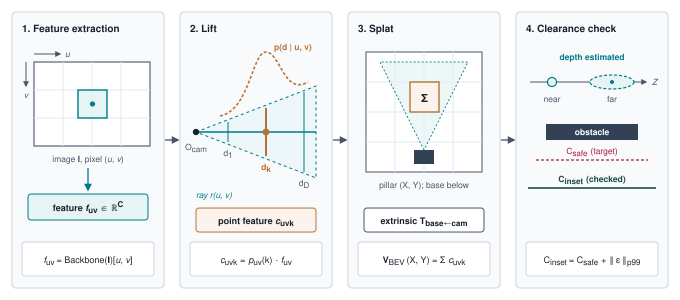
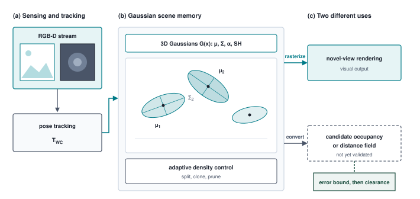
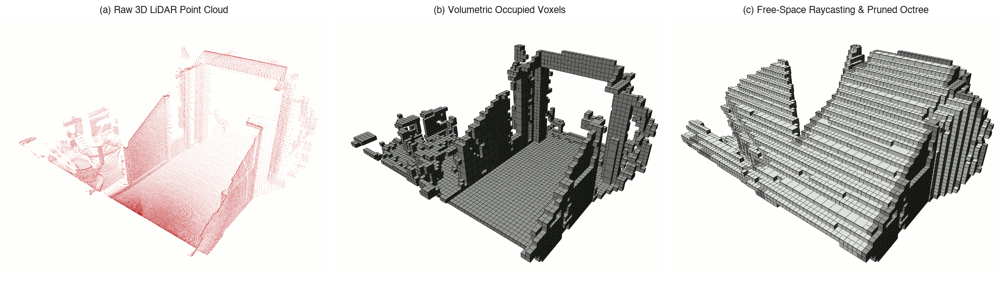
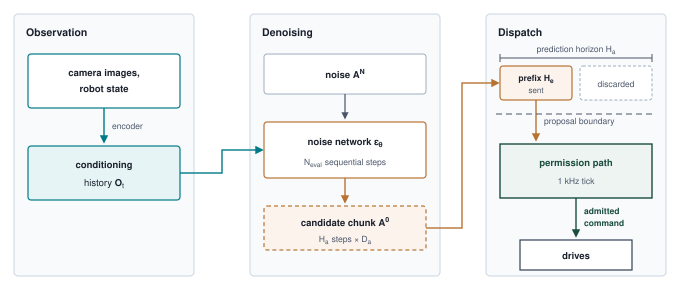
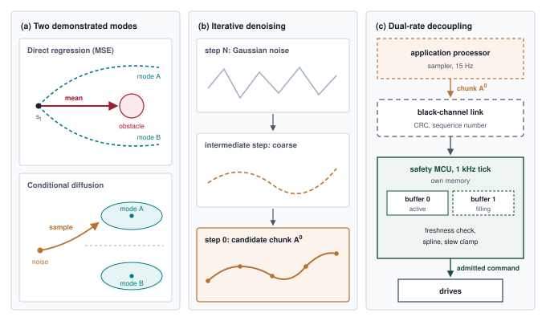

# Machine Learning Background {#sec-appendix-ml}

This appendix supplies the machine learning and statistical tools needed to interpret learned action proposals, size their computation, and evaluate the evidence for their use. It develops uncertainty measures, spatial representations, policy-learning objectives, and rare-event bounds as consultable references for the main text. Each tool separates what a model or test establishes from the physical clearance and timing conditions that the permission path must enforce.

## How to Use This Appendix

Use the table to enter at the relevant problem. The probability section explains expectations, densities, and uncertainty; spatial representations then connect image arrays to metric geometry. Policy sections distinguish the training objective from runtime execution, and the final sections distinguish statistical evidence from a physical guarantee. The derivations use matrix multiplication, derivatives, and integrals; the prose following each result states the engineering consequence so that a reader can consult the result before working through its proof.

| When you encounter this systems symptom                                                          | Consult                           | For this quantitative tool                                                                                            |
|--------------------------------------------------------------------------------------------------|-----------------------------------|-----------------------------------------------------------------------------------------------------------------------|
| A vision-language model hallucinates actions under perceptual ambiguity                          | @sec-appendix-ml-probability      | Posterior entropy metrics, Shannon uncertainty, and refusal thresholds                                                |
| Overconfident neural outputs command aggressive actions out-of-distribution                      | @sec-appendix-ml-calibration      | Softmax simplex geometry and Expected Calibration Error (ECE)                                                         |
| Multi-camera extrinsics, 2D tokenization, or 3D scene geometry drift                             | @sec-appendix-ml-spatial          | $\SpecialEuclideanGroup$ transforms, patch embeddings, attention, and metric 3D lifting                               |
| Camera features must be placed in one metric ground-plane grid                                   | @sec-appendix-ml-bev-lifting      | Lift-Splat depth hypotheses, frustum size, and BEV splatting                                                          |
| Differentiable 3D scene reconstruction diverges during real-time tracking                        | @sec-appendix-ml-3dgs             | 3D Gaussian Splatting parameters and covariance projection                                                            |
| Occupancy mapping retains phantom obstacles after objects move                                   | @sec-appendix-ml-voxels           | Log-odds voxel updates, TSDF fusion, and raycast DRAM traffic                                                         |
| Small sensor noise produces explosive, unconstrained actuator commands                           | @sec-appendix-ml-lipschitz        | Lipschitz continuity bounds and spectral normalization                                                                |
| A behavioral cloning policy drifts into unrecoverable off-trajectory states                      | @sec-appendix-ml-compounding      | $\CovariateDriftBound$ compounding error and DAgger linear reduction                                                  |
| $\ell_2$ regression averages bimodal demonstrations into lethal obstacle collisions              | @sec-appendix-ml-multimodal       | Conditional expectation proof and multimodal policy decoders                                                          |
| A generative decoder cannot finish a chunk within the setpoint period                            | @sec-appendix-ml-diffusion        | Denoising evaluations $\DecoderEvaluationCount$ latency-expressiveness trade-off and flow matching                    |
| Offline reinforcement learning selects ungrounded, destructive motor setpoints                   | @sec-appendix-ml-affordances      | Bellman value overestimation and SayCan affordance grounding                                                          |
| Continuous policy optimization diverges under function approximation error                       | @sec-appendix-ml-continuous-rl    | DDPG, TD3 clipped double Q-learning, SAC maximum entropy, and PPO clipping                                            |
| Sim-to-real transfer fails due to unobservable physical environmental parameters                 | @sec-appendix-ml-asymmetric-ac    | Asymmetric actor-critic architectures and privileged simulation states                                                |
| Comparing policy decoders across latency, compute intensity, and memory footprint                | @sec-appendix-ml-policy-tradeoffs | Comparative systems taxonomy (MLP, CNN, ACT, Diffusion, Flow, RL)                                                     |
| Verifying time-varying physical safety properties across continuous traces                       | @sec-appendix-ml-stl              | Signal Temporal Logic (STL) syntax and quantitative robustness degree                                                 |
| Zero-failure fleet testing encounters the Poisson Exposure Wall                                  | @sec-appendix-ml-exposure         | Rule of Three ($\FailureObservationInterval \ge 3.0/\ConstantHazardRate$), Wald breakdown, and Clopper-Pearson bounds |
| Physical testbed wear explodes during fixed-sample policy qualification                          | @sec-appendix-ml-sprt             | Sequential Probability Ratio Test (SPRT) and Wald stopping boundaries                                                 |
| Contact collision shocks and latency spikes exceed Gaussian $6\GaussianStandardDeviation$ bounds | @sec-appendix-ml-evt              | Tail-family selection, GEV/GPD fits, and conditional high-quantile sizing                                             |

## Probability, Information Theory, and Calibration {#sec-appendix-ml-probability}

Commanding an uncalibrated motor torque stresses gearboxes, violates physical clearance envelopes, and risks destructive contact collisions across an irreversible causal boundary, unlike a software prediction error that merely degrades a recommendation or text token. Autonomous machines must therefore reason quantitatively about uncertainty across perception, intent estimation, and world modeling. In closed-loop physical AI, uncertainty quantification determines whether a candidate action proposal is dispatched to motor controllers or intercepted by a safety governor.

### Conditional probability and Bayes' rule

The conditional distribution $\ProbabilityFunction(\ExampleLabel \mid \ModelInput)$ characterizes the distribution of $\ExampleLabel$ given observed evidence $\ModelInput$. For continuous parameters, $\ProbabilityFunction$ in the following expressions denotes a density; probabilities over regions require integration. By Bayes' rule:\index{Bayes' rule!parameter estimation}
$$ \ProbabilityFunction(\ModelParameters \mid \ObservationDataset) = \frac{\ProbabilityFunction(\ObservationDataset \mid \ModelParameters) \ProbabilityFunction(\ModelParameters)}{\ProbabilityFunction(\ObservationDataset)} = \frac{\ProbabilityFunction(\ObservationDataset \mid \ModelParameters) \ProbabilityFunction(\ModelParameters)}{\int_\ParameterSpace \ProbabilityFunction(\ObservationDataset \mid \MarginalizedModelParameters) \ProbabilityFunction(\MarginalizedModelParameters) \, d\MarginalizedModelParameters} $$
where $\ProbabilityFunction(\ModelParameters)$ represents prior belief over model parameters or latent states $\ModelParameters \in \ParameterSpace$, $\ProbabilityFunction(\ObservationDataset \mid \ModelParameters)$ represents the likelihood of physical dataset or sensor observation sequence $\ObservationDataset = \{\ObservedDataPoint_1, \dots, \ObservedDataPoint_{\ObservationCount}\}$, and $\ProbabilityFunction(\ModelParameters \mid \ObservationDataset)$ represents the updated posterior belief.

In high-dimensional learning systems, integrating over the parameter manifold $\ParameterSpace$ to compute the marginal likelihood (evidence) $\ProbabilityFunction(\ObservationDataset) = \int_\ParameterSpace \ProbabilityFunction(\ObservationDataset \mid \ModelParameters) \ProbabilityFunction(\ModelParameters) \, d\ModelParameters$ is analytically and computationally intractable. Real-time autonomy resolves this intractability through two complementary paradigms:

1. **Maximum a posteriori (MAP) estimation:** Replacing posterior integration with point optimization:
   $$ \MapParameterEstimate = \arg\max_\ModelParameters \left[ \sum_{i=1}^\ObservationCount \ln \ProbabilityFunction(\ObservedDataPoint_i \mid \ModelParameters) + \ln \ProbabilityFunction(\ModelParameters) \right] $$
   With conditionally independent observations and a summed log-likelihood, a zero-mean isotropic Gaussian prior $\ProbabilityFunction(\ModelParameters) = \GaussianDistribution(\ZeroVector, \PriorStandardDeviation^2 \IdentityMatrix)$ gives the log-prior $\ln \ProbabilityFunction(\ModelParameters) = -\frac{\|\ModelParameters\|_2^2}{2\PriorStandardDeviation^2} - \frac{\RandomVectorDimension}{2}\ln(2\pi\PriorStandardDeviation^2)$. Maximizing the posterior objective is mathematically identical to minimizing negative log-likelihood with an explicit $\ell_2$ penalty $\frac{\WeightPenaltyStrength}{2} \|\ModelParameters\|_2^2$, where $\WeightPenaltyStrength = 1/\PriorStandardDeviation^2$. However, MAP estimation yields only a single deterministic point estimate $\MapParameterEstimate$. The point estimate does not report posterior variance; it does not establish that the underlying uncertainty is zero. In continuous control, epistemic uncertainty (ignorance arising from lack of training data in unfamiliar operational domains) must be sharply distinguished from aleatoric uncertainty (stochasticity inherent to sensor noise, turbulent airflow, or non-deterministic contact friction). A point-estimated model can still predict observation noise, but that output alone does not quantify uncertainty about its fitted parameters.
2. **Variational inference:** Approximating the true posterior $\ProbabilityFunction(\ModelParameters \mid \ObservationDataset)$ with a tractable variational distribution family $\VariationalDistribution(\ModelParameters)$ by maximizing the Evidence Lower Bound (ELBO):
   $$ \ln \ProbabilityFunction(\ObservationDataset) = \mathbb{E}_{\ModelParameters \sim \VariationalDistribution(\ModelParameters)} \left[ \ln \frac{\ProbabilityFunction(\ObservationDataset, \ModelParameters)}{\VariationalDistribution(\ModelParameters)} \right] + \KlDivergence\left( \VariationalDistribution(\ModelParameters) \,\parallel\, \ProbabilityFunction(\ModelParameters \mid \ObservationDataset) \right) \ge \mathbb{E}_{\ModelParameters \sim \VariationalDistribution(\ModelParameters)} [\ln \ProbabilityFunction(\ObservationDataset \mid \ModelParameters)] - \KlDivergence\left( \VariationalDistribution(\ModelParameters) \,\parallel\, \ProbabilityFunction(\ModelParameters) \right) $$
   Because the Kullback-Leibler divergence is non-negative ($\KlDivergence \ge 0$), the lower bound holds, with equality when the variational distribution equals the posterior almost everywhere. Variational inference converts intractable high-dimensional integration into continuous gradient-based optimization over variational parameters $\VariationalParameters$. This formulation provides the analytical foundation for the latent-variable action chunking and generative decoders derived in @sec-appendix-ml-multimodal, where latent variables capture human demonstrator intent and style without collapsing multimodal physical actions into destructive spatial averages.

### Shannon entropy and ambiguity thresholds

Entropy quantifies the average uncertainty or information content contained in a probability distribution. For a discrete random variable $\DiscreteRandomVariable$ taking values in alphabet $\OutcomeAlphabet$:[^fn-ml-shannon-entropy]
$$ \ShannonEntropy(\DiscreteRandomVariable) = - \sum_{\DiscreteOutcome \in \OutcomeAlphabet} \ProbabilityFunction(\DiscreteOutcome) \log_2 \ProbabilityFunction(\DiscreteOutcome) = \mathbb{E}_{\DiscreteOutcome \sim \ProbabilityFunction} \left[ \log_2 \frac{1}{\ProbabilityFunction(\DiscreteOutcome)} \right] $$
For continuous random variables governing physical state $\ContinuousOutcome \in \mathbb{R}^\RandomVectorDimension$ with probability density $\ProbabilityFunction(\ContinuousOutcome)$, the **differential entropy** evaluates to:
$$ \DifferentialEntropy(\ContinuousRandomVariable) = - \int_{\mathbb{R}^\RandomVectorDimension} \ProbabilityFunction(\ContinuousOutcome) \ln \ProbabilityFunction(\ContinuousOutcome) \, d\ContinuousOutcome $$
Under a multivariate Gaussian distribution $\ContinuousOutcome \sim \GaussianDistribution(\GaussianMeanVector, \GaussianCovarianceMatrix)$ with positive-definite covariance $\GaussianCovarianceMatrix \in \mathbb{R}^{\RandomVectorDimension \times \RandomVectorDimension}$, substituting the Gaussian density $\ProbabilityFunction(\ContinuousOutcome) = (2\pi)^{-\RandomVectorDimension/2} (\det \GaussianCovarianceMatrix)^{-1/2} \exp(-\frac{1}{2}(\ContinuousOutcome-\GaussianMeanVector)^\top \GaussianCovarianceMatrix^{-1} (\ContinuousOutcome-\GaussianMeanVector))$ yields:
$$
\begin{aligned}
\DifferentialEntropy(\ContinuousRandomVariable) &= -\mathbb{E}\left[ -\frac{\RandomVectorDimension}{2}\ln(2\pi) - \frac{1}{2}\ln(\det \GaussianCovarianceMatrix) - \frac{1}{2}(\ContinuousOutcome - \GaussianMeanVector)^\top \GaussianCovarianceMatrix^{-1}(\ContinuousOutcome - \GaussianMeanVector) \right] \\
&= \frac{\RandomVectorDimension}{2}\ln(2\pi) + \frac{1}{2}\ln(\det \GaussianCovarianceMatrix) + \frac{1}{2}\operatorname{Tr}\left(\GaussianCovarianceMatrix^{-1} \mathbb{E}[(\ContinuousOutcome-\GaussianMeanVector)(\ContinuousOutcome-\GaussianMeanVector)^\top]\right) \\
&= \frac{1}{2} \ln\left( (2\pi \NaturalLogarithmBase)^\RandomVectorDimension \det \GaussianCovarianceMatrix \right)
\end{aligned}
$$
Unlike discrete entropy, differential entropy depends on coordinate units and can be negative. Comparisons require the same coordinates and units. For a Gaussian it scales with the logarithmic volume of the physical uncertainty ellipsoid $\det \GaussianCovarianceMatrix$. In state estimation, sensor fusion, and Kalman filtering, an informative measurement update shrinks $\det \GaussianCovarianceMatrix$, producing an exact physical information gain $\FiniteChange \DifferentialEntropy = \PriorDifferentialEntropy - \PosteriorDifferentialEntropy = \frac{1}{2} \ln(\det \PriorCovarianceMatrix / \det \PosteriorCovarianceMatrix)$. Under an isotropic Gaussian distribution $\GaussianDistribution(\GaussianMeanVector, \GaussianStandardDeviation^2 \IdentityMatrix)$, this reduces to $\DifferentialEntropy(\ContinuousRandomVariable) = \frac{\RandomVectorDimension}{2} \ln(2\pi \NaturalLogarithmBase \GaussianStandardDeviation^2)$. In continuous reinforcement learning, such as Soft Actor-Critic (SAC), the unsquashed diagonal Gaussian policy has entropy $\PolicyEntropy(\pi(\cdot \mid \PolicyObservedState)) = \frac{\ActionDimension}{2}(1 + \ln(2\pi)) + \sum_{i=1}^{\ActionDimension} \ln \PolicyActionStandardDeviation_i(\PolicyObservedState)$ with $\ActionDimension$ action dimensions and conditional standard deviations $\PolicyActionStandardDeviation_i$. Entropy regularization encourages exploration; after bounding actions with a nonlinear transformation, its Jacobian changes this entropy, as the SAC derivation below shows.

To quantify information divergence between an empirical demonstrator distribution $\ProbabilityFunction$ and a learned policy distribution $\ApproximatingDistribution$, information theory defines the **Kullback-Leibler (KL) divergence** (relative entropy):
$$ \KlDivergence(\ProbabilityFunction \,\parallel\, \ApproximatingDistribution) = \int_{\mathbb{R}^\RandomVectorDimension} \ProbabilityFunction(\ContinuousOutcome) \ln \left( \frac{\ProbabilityFunction(\ContinuousOutcome)}{\ApproximatingDistribution(\ContinuousOutcome)} \right) d\ContinuousOutcome $$
where $\KlDivergence(\ProbabilityFunction \parallel \ApproximatingDistribution) \ge 0$ by Gibbs' inequality, with equality if and only if $\ProbabilityFunction = \ApproximatingDistribution$ almost everywhere.

In closed-loop decision making, Shannon entropy provides an instantaneous monitor of policy ambiguity. When a vision-language planner encounters an underspecified scene with two equally probable referents (such as two identical cups), the discrete action entropy approaches its maximum $\ShannonEntropy(\DiscreteRandomVariable) \to \log_2 2 = 1.0\text{ bit}$. A calibrated threshold gates actuation, issuing an ambiguity fault (`ERR_GROUNDING_AMBIGUITY`) that commands a stationary hold while active perception collects disambiguating viewpoints. However, because an overfitted neural network can be confidently wrong, entropy alone cannot guarantee semantic correctness; it must operate in tandem with physical clearance monitors.

[^fn-ml-shannon-entropy]: **Shannon Information Entropy**\index{Shannon entropy!information theory}: Entropy quantifies average uncertainty within a specified discrete distribution. Its physical meaning depends on whether that distribution is calibrated to the relevant referents and observations.

### Softmax overconfidence and calibration error {#sec-appendix-ml-calibration}

A perception classifier that reports a $0.99$ softmax score on a wet-floor reflection or an unfamiliar obstacle is measuring logit separation rather than empirical accuracy. Standard neural classification heads normalize raw logit vectors $\LogitVector = [\OutputLogit_1, \dots, \OutputLogit_{\ClassCount}]^\top \in \mathbb{R}^\ClassCount$ into categorical distributions using the softmax function:
$$ \SoftmaxFunction(\LogitVector)_i = \frac{e^{\OutputLogit_i / \CalibrationTemperature}}{\sum_{j=1}^\ClassCount e^{\OutputLogit_j / \CalibrationTemperature}} $$
where $\CalibrationTemperature > 0$ is a temperature hyperparameter (defaulting to $\CalibrationTemperature = 1$). The softmax operator maps logits onto the open probability simplex $\ProbabilitySimplex^{\ClassCount-1} = \{\ClassProbabilityVector \in \mathbb{R}^\ClassCount : \sum_i \SoftmaxOutputProbability_i = 1, \SoftmaxOutputProbability_i > 0\}$ strictly through algebraic exponentiation.

A cross-entropy training objective does not by itself establish calibration. At $\CalibrationTemperature=1$, for target class $\ExampleLabel \in \{1, \dots, \ClassCount\}$, the cross-entropy loss evaluates to $\CrossEntropyLoss(\LogitVector, \ExampleLabel) = -\CorrectClassLogit + \ln \sum_{j=1}^\ClassCount e^{\OutputLogit_j}$. Differentiating with respect to any logit $\OutputLogit_i$:
$$ \frac{\partial \CrossEntropyLoss}{\partial \OutputLogit_i} = \frac{e^{\OutputLogit_i}}{\sum_{j=1}^\ClassCount e^{\OutputLogit_j}} - \EventIndicator(\LabelCategoryIndex = \ExampleLabel) = \SoftmaxFunction(\LogitVector)_i - \EventIndicator(\LabelCategoryIndex = \ExampleLabel) $$
For the ground-truth class $\ExampleLabel$, the derivative is negative until its predicted probability approaches unity. For an individually fitted example, cross-entropy decreases as the correct class separates from the other logits; separable, unregularized training can therefore keep increasing those margins. This is not a proof that every trained network is overconfident or that noisy examples can all be fitted simultaneously. A large softmax output measures relative logit separation, while calibration asks whether predictions with that confidence are correct at the corresponding frequency.

To quantify whether predicted probabilities match empirical physical frequencies, reliability engineering computes the **Expected Calibration Error (ECE)** and **Maximum Calibration Error (MCE)**:[^fn-ml-binned-ece]
$$ \text{ECE} = \sum_{\CalibrationBinIndex=1}^{\CalibrationBinCount} \frac{|\CalibrationBinExampleSet|}{\EvaluationSampleCount} \left| \text{acc}(\CalibrationBinExampleSet) - \text{conf}(\CalibrationBinExampleSet) \right|, \qquad \text{MCE} = \max_{\CalibrationBinIndex \in \{1, \dots, \CalibrationBinCount\}} \left| \text{acc}(\CalibrationBinExampleSet) - \text{conf}(\CalibrationBinExampleSet) \right| $$
Empty bins contribute zero to ECE and are omitted from MCE; accuracy and confidence averages are defined only for nonempty bins. Here $\CalibrationBinExampleSet$ is the set of validation examples whose predicted confidence falls in $((\CalibrationBinIndex-1)/\CalibrationBinCount,\CalibrationBinIndex/\CalibrationBinCount]$. The size $|\CalibrationBinExampleSet|$ is the sample count in bin $\CalibrationBinIndex$, and $\EvaluationSampleCount$ is the total validation sample count. The mean predicted confidence is $\text{conf}(\CalibrationBinExampleSet) = \frac{1}{|\CalibrationBinExampleSet|} \sum_{i \in \CalibrationBinExampleSet} \PredictedConfidence_i$, and the empirical accuracy is $\text{acc}(\CalibrationBinExampleSet) = \frac{1}{|\CalibrationBinExampleSet|} \sum_{i \in \CalibrationBinExampleSet} \EventIndicator(\ModelPrediction_i = \ExampleLabel_i)$.

To recalibrate an overconfident model post-hoc without altering its classification accuracy, **temperature scaling** optimizes a single scalar parameter $\CalibrationTemperature > 0$ on a held-out calibration dataset $\ConfidenceCalibrationDataset$:
$$ \CalibrationTemperature^* = \arg\min_{\CalibrationTemperature > 0} \left[ - \sum_{(\InputFeatureVector, \ExampleLabel) \in \ConfidenceCalibrationDataset} \ln \left( \frac{e^{\CorrectClassLogit(\InputFeatureVector) / \CalibrationTemperature}}{\sum_{j=1}^\ClassCount e^{\OutputLogit_j(\InputFeatureVector) / \CalibrationTemperature}} \right) \right] $$
Because $\CalibrationTemperature^*$ scales all logits uniformly, the ranking $\arg\max_i (\OutputLogit_i / \CalibrationTemperature) = \arg\max_i \OutputLogit_i$ remains unchanged for all $\CalibrationTemperature > 0$, preserving top-1 accuracy. Temperatures above one soften probabilities, while temperatures below one sharpen them; optimizing calibration loss does not guarantee exact calibration. However, temperature scaling rests on the classical assumption that deployment data is identically distributed to calibration data ($\DeploymentDistribution = \CalibrationDataDistribution$). In physical AI, an embodied agent continually encounters non-stationary environmental shifts: lens flare, wet floor reflectance, novel obstacle textures, or altered motor dynamics. Temperature scaling cannot repair or detect out-of-distribution inputs: scaling an out-of-distribution logit vector by scalar $\CalibrationTemperature^*$ still yields near-unity confidence if the raw relative logit separation remains large. In safety-critical autonomy, post-hoc calibration requires separately validated uncertainty and clearance checks. Conformal coverage also depends on its sampling assumptions, commonly exchangeability; it does not automatically survive deployment shift.

[^fn-ml-binned-ece]: **Expected Calibration Error**\index{Expected Calibration Error!binned accuracy metric}: Binned calibration metrics quantify the divergence between neural prediction confidence and realized empirical accuracy across confidence intervals. Separable, unregularized cross-entropy training can keep increasing logit margins; whether a fitted network is overconfident must be assessed on representative held-out data. Relying on uncalibrated confidence scores to gate safety fallbacks permits undetected distribution shifts to corrupt closed-loop actuation.

## Spatial Representations and Scene Parameterization {#sec-appendix-ml-spatial}

Detecting a door handle at pixel $(142, 88)$ in a wrist-camera image cannot tell a joint controller where to move until that pixel ray is combined with metric depth and transformed through the camera, wrist, arm, and mobile-base coordinate frames. Unlike language models that operate on discrete semantic tokens, an embodied policy must bind high-dimensional sensor arrays (RGB-D cameras, time-of-flight rangefinders, and lidars) to rigid physical links and Euclidean 3D reference frames.

### Special Euclidean group $\SpecialEuclideanGroup$ transforms

Rigid body transformations in 3D Euclidean space belong to the Special Euclidean Lie group $\SpecialEuclideanGroup$, combining a $3 \times 3$ orthonormal rotation matrix $\DirectionalCosineMatrix \in \SpecialOrthogonalGroup$ ($\DirectionalCosineMatrix^\top \DirectionalCosineMatrix = \IdentityMatrix$, $\det(\DirectionalCosineMatrix) = +1$) with a translation vector $\RigidTransformTranslation \in \mathbb{R}^3$:\index{Spatial coordinate frames!SE(3) representation}\index{Lie group!SE(3) manifold}
$$ \Pose = \begin{bmatrix} \DirectionalCosineMatrix & \RigidTransformTranslation \\ \ZeroVector^\top & 1 \end{bmatrix} \in \SpecialEuclideanGroup \subset \mathbb{R}^{4 \times 4} $$
A homogeneous coordinate vector $\HomogeneousPointCoordinates = [\CartesianPosition^\top, 1]^\top \in \mathbb{R}^4$ transforms across coordinate frames via matrix-vector multiplication:
$$ \TransformedHomogeneousPointCoordinates = \Pose \HomogeneousPointCoordinates \iff \TransformedCartesianPosition = \DirectionalCosineMatrix \CartesianPosition + \RigidTransformTranslation $$
Let $\HomogeneousTransform$ denote the transform mapping coordinates from frame $\Glyph{B}$ into frame $\Glyph{A}$. For a kinematic chain comprising world frame $\Glyph{W}$, mobile base $\Glyph{B}$, end effector $\Glyph{E}$, and wrist camera $\Glyph{C}$, the forward composite transformation evaluates via associative matrix multiplication:
$$ \CameraToWorldTransform = \WorldBaseTransform \BodyEndEffectorTransform \EndEffectorCameraTransform $$
The inverse transform admits an exact closed-form evaluation avoiding general $4 \times 4$ matrix inversion:
$$ \Pose^{-1} = \begin{bmatrix} \DirectionalCosineMatrix^\top & -\DirectionalCosineMatrix^\top \RigidTransformTranslation \\ \ZeroVector^\top & 1 \end{bmatrix} $$

#### Lie algebra $\SpecialEuclideanAlgebra$ and manifold perturbation

Because $\SpecialEuclideanGroup$ forms a smooth, non-Euclidean Riemannian manifold rather than a linear vector space, unconstrained optimization (such as gradient descent during camera pose estimation or neural trajectory generation) cannot directly add matrices ($\Pose_1 + \Pose_2 \notin \SpecialEuclideanGroup$). Regressing 3D rotations directly using Euler angles induces topological singularities (gimbal lock at pitch $\pm 90^\circ$) where degrees of freedom collapse. Unconstrained unit quaternions $\UnitQuaternion \in \UnitQuaternionSphere$ suffer from the antipodal double-cover ambiguity ($\UnitQuaternion$ and $-\UnitQuaternion$ represent the identical physical rotation). In continuous neural policy training, minimizing $\ell_2$ regression loss over quaternions produces severe gradient cancellation when the network predicts opposite hemispheres for nearby states. To ensure topological continuity across continuous rotations, modern spatial policies either output continuous 6D rotation representations (the first two columns of $\DirectionalCosineMatrix$ orthonormalized via Gram-Schmidt) or parameterize local variations in the tangent space at the identity: the Lie algebra $\SpecialEuclideanAlgebra$.

For the finite pose increment below, a twist coordinate vector $\TwistCoordinates = [\Velocity^\top, \TwistRotationCoordinates^\top]^\top \in \mathbb{R}^6$ combines integrated translation coordinates $\Velocity$ and rotation coordinates $\TwistRotationCoordinates$. If these symbols instead denote velocities, multiply the matrix twist by elapsed time before exponentiating. The wedge operator $(\cdot)^{\TwistWedgeOperator}$ maps $\TwistCoordinates$ to its matrix Lie algebra representation:
$$ \TwistMatrix = \TwistCoordinates^{\TwistWedgeOperator} = \begin{bmatrix} [\TwistRotationCoordinates]_\times & \Velocity \\ \ZeroVector^\top & 0 \end{bmatrix} \in \SpecialEuclideanAlgebra, \quad \text{where } [\TwistRotationCoordinates]_\times = \begin{bmatrix} 0 & -\ZAxisRotationCoordinate & \YAxisRotationCoordinate \\ \ZAxisRotationCoordinate & 0 & -\XAxisRotationCoordinate \\ -\YAxisRotationCoordinate & \XAxisRotationCoordinate & 0 \end{bmatrix} $$
The exponential map $\exp: \SpecialEuclideanAlgebra \to \SpecialEuclideanGroup$ computes finite rigid transformations in closed form via Rodrigues' formula:
$$ \exp(\TwistMatrix) = \begin{bmatrix} \exp([\TwistRotationCoordinates]_\times) & \TwistTranslationMatrix \Velocity \\ \ZeroVector^\top & 1 \end{bmatrix} $$
where $\TwistRotationAngle = \|\TwistRotationCoordinates\|$, $\exp([\TwistRotationCoordinates]_\times) = \IdentityMatrix + \frac{\sin\TwistRotationAngle}{\TwistRotationAngle} [\TwistRotationCoordinates]_\times + \frac{1 - \cos\TwistRotationAngle}{\TwistRotationAngle^2} [\TwistRotationCoordinates]_\times^2$, and $\TwistTranslationMatrix = \IdentityMatrix + \frac{1 - \cos\TwistRotationAngle}{\TwistRotationAngle^2} [\TwistRotationCoordinates]_\times + \frac{\TwistRotationAngle - \sin\TwistRotationAngle}{\TwistRotationAngle^3} [\TwistRotationCoordinates]_\times^2$.

In spatial tracking and state estimation, small pose uncertainties are modeled by perturbing the mean transform with a zero-mean Gaussian twist vector in the local frame: $\PerturbedPose = \Pose \exp(\PoseTwistPerturbationMatrix)$, with $\PoseTwistPerturbation \sim \GaussianDistribution(\ZeroVector, \TwistCovarianceMatrix)$ and covariance $\TwistCovarianceMatrix \in \mathbb{R}^{6 \times 6}$. The exponential keeps the updated pose on $\SpecialEuclideanGroup$. The covariance describes local tangent coordinates, not a Gaussian distribution over matrix entries; its approximation is reliable only while the local perturbation model is adequate. At zero rotation, evaluate the coefficients above by their continuous limits to avoid division by zero.

### Visual patch tokenization, attention, and 3D metric lifting {#sec-appendix-ml-patch-embedding}

A vision transformer that slices three $224 \times 224$ camera frames into $14 \times 14$-pixel patches produces 768 visual tokens per control step. Yet none of those tokens carries metric 3D distance until camera intrinsics and depth measurements lift the 2D image plane into Euclidean space. Embodied vision-language-action (VLA) models and spatial transformers convert continuous sensory streams into discrete tokens for neural attention, then lift candidate spatial predictions into 3D coordinates for physical reasoning.\index{Patch tokenization!vision transformers}\index{Metric unprojection!camera intrinsics} @Sec-brain-learned-representations and @sec-brain-cognitive-pipeline use the token counts derived here to size the application processor's memory traffic.

#### Convolutional encoders versus vision transformer tokenization

Physical AI architectures employ two primary paradigms for encoding raw camera observations into visual features:

1. **Convolutional Encoders (ConvNets):** Classical visuomotor backbones (such as ResNet-18/34/50 or modern ConvNeXt variants) process images through hierarchical sliding-window convolutions. Convolutions possess an intrinsic inductive bias: **translational equivariance** ($\text{Conv}(\text{Shift}(\CameraImage)) = \text{Shift}(\text{Conv}(\CameraImage))$) and local spatial compactness. Because small $3 \times 3$ filter weights are repeatedly applied across thousands of image pixel locations, convolutional feature extraction achieves high arithmetic intensity (FLOPs per byte transferred from DRAM) in early layers. Intermediate feature activations stream through on-chip SRAM line buffers, minimizing off-chip memory bandwidth consumption and reducing traffic when the accelerator mapping and buffer capacity permit reuse. Deterministic latency still requires a timing analysis under contention. However, local receptive fields require deep network stacks to capture global scene context, limiting their ability to resolve long-range semantic relationships (such as attending from a robot gripper to a distant receptacle).
2. **Vision Transformers (ViTs):** Vision transformers discard local sliding windows in favor of non-overlapping patch tokenization and global multi-head self-attention. While ViTs lack hardwired translational equivariance, they establish global receptive fields across the entire image at layer 1. The operational trade-off is computational complexity and memory bandwidth: self-attention scales quadratically ($\mathcal{O}(\PatchTokenCount^2)$) in token count $\PatchTokenCount$. On embedded edge accelerators operating at single-frame batch sizes, materializing full $\PatchTokenCount \times \PatchTokenCount$ attention matrices generates substantial activation memory traffic that stresses shared system memory buses.

#### 2D vision transformer patch tokenization

Consider an RGB image $\CameraImage \in \mathbb{R}^{\ImageHeight \times \ImageWidth \times \ImageChannelCount}$ captured by an onboard camera with spatial resolution $\ImageHeight \times \ImageWidth$ and $\ImageChannelCount$ color channels. Feeding raw pixels to a multilayer perceptron would discard spatial locality and inflate the parameter count. A vision transformer frontend therefore partitions the image into a non-overlapping sequence of $\PatchTokenCount$ patches of $\VitPatchSize \times \VitPatchSize$ pixels, with $\ImageHeight$ and $\ImageWidth$ divisible by $\VitPatchSize$ after any chosen crop or padding:
$$ \PatchTokenCount = \frac{\ImageHeight \cdot \ImageWidth}{\VitPatchSize^2} $$
Each patch, indexed by its row and column $(\PatchRowIndex, \PatchColumnIndex)$ in the camera plane, is flattened into a vector $\VitImagePatch^{(\PatchRowIndex, \PatchColumnIndex)} \in \mathbb{R}^{\VitPatchSize^2 \ImageChannelCount}$. A trainable linear projection $\VitPatchProjectionWeights \in \mathbb{R}^{(\VitPatchSize^2 \ImageChannelCount) \times \HiddenDimension}$ maps each flattened patch into the transformer's hidden dimension $\HiddenDimension$. Without positional information or position-dependent masks, self-attention is permutation-equivariant: permuting the input rows permutes the output rows. Therefore the model knows nothing of spatial proximity unless position is added explicitly:
$$ \VitPatchTokenEmbedding_0^{(\PatchRowIndex, \PatchColumnIndex)} = \VitImagePatch^{(\PatchRowIndex, \PatchColumnIndex)} \VitPatchProjectionWeights + \PlanarPositionEmbedding(\PatchRowIndex, \PatchColumnIndex) + \CameraIdentifierEmbedding $$
The 2D position embedding $\PlanarPositionEmbedding(\PatchRowIndex, \PatchColumnIndex)$ decomposes along the vertical axis $\PatchRowIndex$ and the horizontal axis $\PatchColumnIndex$, using sinusoidal frequency bands or learned coordinate embeddings. It encodes position in the image plane and carries no metric 3D distance. When several cameras feed one model, such as an overhead camera for scene context and a wrist camera for millimeter-scale alignment, a learned camera identifier $\CameraIdentifierEmbedding \in \{\OverheadCameraEmbedding, \WristCameraEmbedding\}$ distinguishes their reference frames. Some architectures also prepend a summary token $\SummaryTokenEmbedding \in \mathbb{R}^{\HiddenDimension}$ to the sequence.

```{python}
#| label: calc-appendix-ml-patch-tokens
#| echo: false
#| warning: false
#| message: false

# ┌─────────────────────────────────────────────────────────────────────────────
# │ PATCH TOKENS PER FRAME
# ├─────────────────────────────────────────────────────────────────────────────
# │ Context: The patch tokenization worked example in
# │          @sec-appendix-ml-patch-embedding.
# │ Goal: Show how one frame becomes a token tensor and how cameras multiply it.
# │ Show: patch grid, patch count, flattened patch length, tokens for three
# │       cameras.
# │ How: N = (H/P)^2 for a square frame; flattened length P^2 C.
# └─────────────────────────────────────────────────────────────────────────────
from mlsysim import *

class AppxPatchTokens:
    # ┌── 1. LOAD (Constants) ──────────────────────
    side_px = 224  # category: illustrative (square RGB frame, pixels per side)
    patch_px = 14  # category: illustrative (ViT patch size, pixels per side)
    channels = 3  # category: datasheet (RGB color channels)
    d_model = 4096  # category: illustrative (backbone hidden dimension)
    cameras = 3  # category: illustrative (two wrist cameras and one overhead)

    # ┌── 2. EXECUTE (The Compute) ─────────────────
    grid = side_px // patch_px  # patches per side
    n_patches = grid * grid  # patch tokens per frame
    patch_pixels = patch_px * patch_px  # pixels per patch
    patch_len = patch_pixels * channels  # flattened patch vector length
    visual_tokens = cameras * n_patches  # visual tokens across all cameras

    # ┌── 3. GUARD (Invariants) ────────────────────
    check(side_px % patch_px == 0, "the patch size must tile the frame exactly")
    check(grid == 16, f"patch grid {grid}")
    check(n_patches == 256, f"patches per frame {n_patches}")
    check(patch_len == 588, f"flattened patch length {patch_len}")
    check(visual_tokens == 768, f"visual tokens {visual_tokens}")

    # ┌── 4. OUTPUT (Formatting) ───────────────────
    side_str = fmt_int(side_px)
    patch_str = fmt_int(patch_px)
    channels_str = fmt_int(channels)
    grid_str = fmt_int(grid)
    n_patches_str = fmt_int(n_patches)
    patch_pixels_str = fmt_int(patch_pixels)
    patch_len_str = fmt_int(patch_len)
    d_model_str = fmt_int(d_model, commas=False)
    cameras_str = fmt_int(cameras)
    visual_tokens_str = fmt_int(visual_tokens)
```

To make the dimensions concrete, take a square RGB frame `{python} AppxPatchTokens.side_str` pixels on a side (illustrative; see the Reader Guide) with patch size $\VitPatchSize =$ `{python} AppxPatchTokens.patch_str`. The frame divides into `{python} AppxPatchTokens.grid_str` patches on a side, `{python} AppxPatchTokens.n_patches_str` in all. Each patch holds `{python} AppxPatchTokens.patch_pixels_str` pixels across `{python} AppxPatchTokens.channels_str` color channels, a flattened vector of `{python} AppxPatchTokens.patch_len_str` values, and $\VitPatchProjectionWeights$ maps each such vector into a `{python} AppxPatchTokens.d_model_str`-dimensional model space. One frame therefore becomes `{python} AppxPatchTokens.n_patches_str` tokens of width `{python} AppxPatchTokens.d_model_str`. A robot with `{python} AppxPatchTokens.cameras_str` cameras (two wrist cameras and one overhead) supplies `{python} AppxPatchTokens.cameras_str` $\times$ `{python} AppxPatchTokens.n_patches_str` = `{python} AppxPatchTokens.visual_tokens_str` visual tokens per step before any text or proprioceptive token is added.

The visual tokens then join the rest of the input. A natural-language directive such as "grasp the red mug by its handle" is tokenized by byte-pair encoding into text embeddings $\TextTokenEmbeddings \in \mathbb{R}^{\TextTokenCount \times \HiddenDimension}$. The robot's configuration (joint angles, joint velocities, and gripper state) passes through a linear layer into proprioceptive tokens $\ProprioceptiveTokenEmbeddings \in \mathbb{R}^{\StateTokenCount \times \HiddenDimension}$. The three streams concatenate into one multimodal input sequence:
$$ \MultimodalFusedTokenStream = [\VisionTokenEmbeddings \,|\, \TextTokenEmbeddings \,|\, \ProprioceptiveTokenEmbeddings] \in \mathbb{R}^{\FusedTokenCount \times \HiddenDimension} $$

#### Self-attention over the combined sequence

The combined sequence $\MultimodalFusedTokenStream$ passes through a stack of transformer layers, each consisting of multi-head self-attention and a feed-forward network. Self-attention projects each token through learned matrices $\QueryProjectionMatrix$, $\KeyProjectionMatrix$, and $\AttentionValuesProjectionMatrix$ into a query $\QueryVector_i$, a key $\KeyVector_j$, and a value, and computes pairwise attention weights over the whole sequence:\index{Self-attention!multimodal token sequence}
$$ \AttentionWeightEntry = \frac{\exp\left(\QueryVector_i^\top \KeyVector_j / \sqrt{\AttentionHeadDimension}\right)}{\sum_{\NormalizingKeyIndex} \exp\left(\QueryVector_i^\top \KeyVector_{\NormalizingKeyIndex} / \sqrt{\AttentionHeadDimension}\right)} $$
A text token such as "handle" can attend to visual patch tokens, but a high attention weight is not a verified grasp location or metric pose. A trained spatial decoder may produce a 2D affordance heatmap, and placing the gripper in 3D still takes depth evidence, camera calibration, and the metric lifting below. A rolling key-value (KV) cache stores prior token states for attention. It neither tracks object permanence nor maintains a 3D position and velocity; an explicit state estimator must associate observations across frames and widen its uncertainty while the mug is occluded.

#### Pinhole back-projection and 3D metric lifting

Standard 2D patch tokens lack metric scale due to projective ambiguity: along any optical ray $\ProjectiveRayScale [\PixelColumnCoordinate, \PixelRowCoordinate, 1]^\top$, infinitely many 3D points project to identical pixel coordinates. To interface with physical control barrier filters, kinetic stopping calculators, and obstacle clearance envelopes, 2D visual predictions must be lifted into metric 3D coordinates $\WorldFramePoint \in \mathbb{R}^3$.

Let $[\PixelColumnCoordinate, \PixelRowCoordinate]^\top$ denote pixel coordinates on the image sensor, and let the calibrated pinhole camera intrinsic matrix be:
$$ \CameraIntrinsicCalibrationMatrix = \begin{bmatrix} \HorizontalFocalLength & 0 & \PrincipalPointColumn \\ 0 & \VerticalFocalLength & \PrincipalPointRow \\ 0 & 0 & 1 \end{bmatrix} $$
where $(\HorizontalFocalLength, \VerticalFocalLength)$ are focal lengths in pixels and $(\PrincipalPointColumn, \PrincipalPointRow)$ is the principal point. Given an aligned optical-axis depth measurement $\MeasuredPixelDepth = \CameraFrameDepth > 0$ (obtained from stereo disparity, time-of-flight lidar, or calibrated depth sensors), the 3D position in the camera coordinate frame $\CameraFramePoint \in \mathbb{R}^3$ is recovered via inverse intrinsic projection:
$$ \CameraFramePoint = \MeasuredPixelDepth \cdot \CameraIntrinsicCalibrationMatrix^{-1} \begin{bmatrix} \PixelColumnCoordinate \\ \PixelRowCoordinate \\ 1 \end{bmatrix} = \begin{bmatrix} (\PixelColumnCoordinate - \PrincipalPointColumn) \frac{\MeasuredPixelDepth}{\HorizontalFocalLength} \\ (\PixelRowCoordinate - \PrincipalPointRow) \frac{\MeasuredPixelDepth}{\VerticalFocalLength} \\ \MeasuredPixelDepth \end{bmatrix} $$
Transforming $\CameraFramePoint$ into the robot base or world frame $\Glyph{W}$ uses the rigid extrinsic transform $\CameraToWorldTransform \in \SpecialEuclideanGroup$ defined in this section:
$$ \HomogeneousWorldFramePoint = \CameraToWorldTransform \HomogeneousCameraFramePoint \implies \WorldFramePoint = \CameraToWorldRotation \CameraFramePoint + \CameraToWorldTranslation $$
A sensor reporting range along a ray must first convert it to optical-axis depth; substituting raw range for $\MeasuredPixelDepth$ distorts off-axis geometry. The permission path and kinematic reachability evaluators require this metric 3D reconstruction; ungrounded 2D tokens cannot establish whether a proposed trajectory satisfies physical clearance boundaries $\StoppingDistance$.

### Camera-to-bird's-eye-view lifting {#sec-appendix-ml-bev-lifting}

Checking whether a mobile base can pass a warehouse pillar requires obstacle footprints in meters on the floor plane, whereas each onboard camera observes the aisle in perspective pixels along rays of unknown depth. A bird's-eye-view (BEV) representation places the features of every camera in one metric grid on the ground plane, the frame in which planners and clearance checks work. @Fig-08-ray-frustum-voxel-lifting stages this transformation across four sequential processing blocks. Monocular 2D feature extraction works on the raw camera images. Categorical depth distribution estimation lifts each feature ray into a 3D frustum of discrete hypothesis bins. Extrinsic coordinate transformation splats the frustum points into a metric ground-plane grid of vertical pillars. A final permission gate bounds spatial clearance residuals before dispatching commands.\index{Lift-Splat-Shoot!bird's-eye-view lifting}

```{python}
#| label: calc-appendix-ml-bev-frustum
#| echo: false
#| warning: false
#| message: false

# ┌─────────────────────────────────────────────────────────────────────────────
# │ LIFT-SPLAT FRUSTUM AND BEV GRID
# ├─────────────────────────────────────────────────────────────────────────────
# │ Context: @sec-appendix-ml-bev-lifting.
# │ Goal: Size the lifted frustum tensor and the BEV grid it is splatted into.
# │ Show: depth-bin span, frustum values and bytes per frame, BEV cells.
# │ How: values = feature cells^2 * depth bins * channels; bytes at FP16;
# │      cells per side = workspace side / resolution.
# └─────────────────────────────────────────────────────────────────────────────
from mlsysim import *

class AppxBevFrustum:
    # ┌── 1. LOAD (Constants) ──────────────────────
    feat_side = 128  # category: illustrative (feature-map cells per side)
    depth_bins = 64  # category: illustrative (categorical depth bins)
    feat_ch = 64  # category: illustrative (feature channels per cell)
    bytes_per_value = 2 * byte  # category: chosen (FP16 storage)
    d_min = 0.5 * meter  # category: illustrative (nearest depth bin)
    d_max = 20.0 * meter  # category: illustrative (farthest depth bin)
    workspace_side = 20.0 * meter  # category: illustrative (BEV workspace side)
    bev_res = 0.1 * meter  # category: chosen (BEV cell size)

    # ┌── 2. EXECUTE (The Compute) ─────────────────
    frustum_values = feat_side * feat_side * depth_bins * feat_ch
    frustum_bytes = (frustum_values * bytes_per_value).to(MB)
    bev_cells = round((workspace_side / bev_res).to("dimensionless").magnitude)

    # ┌── 3. GUARD (Invariants) ────────────────────
    check(frustum_values == 67_108_864, f"frustum values {frustum_values}")
    check(abs(frustum_bytes.to(MB).magnitude - 134.217728) < 1e-6, f"frustum bytes {frustum_bytes}")
    check(bev_cells == 200, f"BEV cells per side {bev_cells}")
    check(d_max > d_min, "depth span must be positive")

    # ┌── 4. OUTPUT (Formatting) ───────────────────
    feat_side_str = fmt_int(feat_side)
    depth_bins_str = fmt_int(depth_bins)
    feat_ch_str = fmt_int(feat_ch)
    d_min_str = fmt_length(d_min, unit=meter, precision=1)
    d_max_str = fmt_length(d_max, unit=meter, precision=0)
    frustum_values_str = fmt_count(frustum_values, scale="M", precision=1, scale_style="word")
    frustum_bytes_str = fmt_memory(frustum_bytes, unit=MB, precision=1)
    workspace_str = fmt_length(workspace_side, unit=meter, precision=0)
    bev_res_str = fmt_length(bev_res, unit=meter, precision=1)
    bev_cells_str = fmt_int(bev_cells)
```

1. **Feature extraction.** A vision backbone, such as DINOv2 [@oquab2023dinov2] or a lightweight convolutional network, maps image $\CameraImage \in \mathbb{R}^{\ImageHeight \times \ImageWidth \times 3}$ to a grid of feature vectors:
   $$ \FeatureCellVector = \text{Backbone}(\CameraImage)[\PixelColumnCoordinate, \PixelRowCoordinate] \in \mathbb{R}^\FeatureChannelCount $$
   Forward projection (@eq-percep-pinhole-projection) collapses each 3D ray onto one pixel. Consequently, a feature $\FeatureCellVector$ stands for a whole ray in space while its metric depth remains unknown.

2. **Lift.** LSS represents that ambiguity rather than resolving it. Along the bearing ray $\CameraIntrinsicCalibrationMatrix^{-1}[\PixelColumnCoordinate, \PixelRowCoordinate, 1]^\top$ of @eq-percep-bearing-ray, the network scores $\DepthBinCount$ discrete depth bins spanning $[\MinimumDepthHypothesis, \MaximumDepthHypothesis]$, for example `{python} AppxBevFrustum.depth_bins_str` bins from `{python} AppxBevFrustum.d_min_str` to `{python} AppxBevFrustum.d_max_str`, spaced linearly or logarithmically:
   $$ \DepthBinDistribution = \text{softmax}(\DepthBinLogits) \in \ProbabilitySimplex^{\DepthBinCount-1} $$
   An outer product lifts each 2D feature into a frustum of 3D points, one per depth hypothesis:
   $$ \FrustumFeature = \DepthBinProbability(\DepthBinIndex) \cdot \FeatureCellVector \in \mathbb{R}^\FeatureChannelCount \quad \text{at } \CameraFramePoint(\PixelColumnCoordinate, \PixelRowCoordinate, \DepthHypothesis_k) = \DepthHypothesis_k \CameraIntrinsicCalibrationMatrix^{-1} \begin{bmatrix} \PixelColumnCoordinate \\ \PixelRowCoordinate \\ 1 \end{bmatrix} $$
   For a feature map `{python} AppxBevFrustum.feat_side_str` cells on a side, with `{python} AppxBevFrustum.depth_bins_str` depth bins and `{python} AppxBevFrustum.feat_ch_str` feature channels, the frustum tensor holds about `{python} AppxBevFrustum.frustum_values_str` values, `{python} AppxBevFrustum.frustum_bytes_str` per frame at FP16. This is a materialized tensor footprint for one camera. Actual DRAM traffic depends on whether the runtime materializes, tiles, or fuses lifting with pooling; zero-copy handoff avoids an extra copy but does not eliminate tensor reads and writes.

3. **Splat.** The calibrated extrinsic transform $\BaseCameraTransform\in \SpecialEuclideanGroup$, with rotation $\BaseCameraRotation$ and translation $\BaseCameraTranslation$, maps every frustum point from the camera's optical frame into the robot base frame:
   $$ \BodyFramePoint = \BaseCameraRotation \CameraFramePoint + \BaseCameraTranslation $$
   The workspace is discretized into a grid of vertical pillars, for example `{python} AppxBevFrustum.bev_cells_str` cells on a side covering a `{python} AppxBevFrustum.workspace_str` square at `{python} AppxBevFrustum.bev_res_str` resolution. The splat sums every frustum feature that falls within pillar $(\BevPillarXIndex, \BevPillarYIndex)$, using accelerated cumulative sums or point-pillar pooling [@philion2020lift; @liu2023bevfusion]:
   $$ \BevPillarFeature(\BevPillarXIndex, \BevPillarYIndex) = \sum_{(\PixelColumnCoordinate, \PixelRowCoordinate, k) \in \text{Pillar}(\BevPillarXIndex, \BevPillarYIndex)} \FrustumFeature $$
   On parallel GPU accelerators, naive scatter-add operations create severe write-port contention and non-coalesced DRAM transactions when hundreds of frustum points map to the identical BEV pillar. Optimized runtimes eliminate this bottleneck by sorting frustum points by pillar index and executing parallel cumulative-sum prefix scans or precomputed index-table indirection [@liu2023bevfusion]. The splat aligns the cameras' hypotheses in one metric frame. It cannot fill a region no camera saw or remove depth-scale error, so the footprint it assigns to a pedestrian still depends on the depth hypotheses and the calibration. That dependence is why the clearance panel closing @fig-08-ray-frustum-voxel-lifting marks depth as estimated and only the inset as checked.

::: {#fig-08-ray-frustum-voxel-lifting fig-env="figure" fig-pos="t" fig-cap="**Camera ray frustum lifting and BEV splatting**: LSS [@philion2020lift] places learned depth hypotheses from each camera in a shared metric BEV frame; that coordinate transform does not resolve monocular depth ambiguity. The final clearance inset requires separately validated metric residuals, bias, and a chosen tail quantile or deterministic error bound before permission. (Architecture adapted from @philion2020lift.)" fig-alt="Four stages show image features, a ray with several learned depth hypotheses, a shared bird's-eye-view grid, and a clearance decision. The last panel labels depth as estimated and the inset as checked; learned depth-bin weights alone do not establish a metric error bound."}
{width="100%"}
:::

The softmax over depth bins expresses weights the model assigns, and its entropy is not a calibrated metric covariance. The clearance inset of @sec-perception-error-clearance therefore rests on separately validated spatial residuals, not on the lifted weights.

### Inverse-depth parameterization

In visual-inertial odometry and SLAM, representing distant 3D landmarks in standard Cartesian coordinates $(\CartesianXCoordinate, \CartesianYCoordinate, \CartesianZCoordinate)$ induces extreme non-linearity: small pixel tracking errors produce quadratic depth errors ($\SmallPerturbation \CartesianZCoordinate \propto \CartesianZCoordinate^2$). Under **inverse-depth parameterization**, a 3D feature is parameterized by the 6D vector $\InverseDepthLandmarkParameters = [\CartesianXCoordinate_0, \CartesianYCoordinate_0, \CartesianZCoordinate_0, \AzimuthAngle, \ElevationAngle, \InverseDepth]^\top$. Here $(\CartesianXCoordinate_0, \CartesianYCoordinate_0, \CartesianZCoordinate_0)$ is the optical center when first observed, $(\AzimuthAngle, \ElevationAngle)$ are azimuth and elevation angles, and $\InverseDepth = 1/\LandmarkDepth$ is inverse depth:[^fn-ml-inverse-depth]
$$ \CartesianPosition(\LandmarkDepth) = \begin{bmatrix} \CartesianXCoordinate_0 \\ \CartesianYCoordinate_0 \\ \CartesianZCoordinate_0 \end{bmatrix} + \frac{1}{\InverseDepth} \begin{bmatrix} \cos\ElevationAngle \sin\AzimuthAngle \\ -\sin\ElevationAngle \\ \cos\ElevationAngle \cos\AzimuthAngle \end{bmatrix} $$
At optical infinity ($\LandmarkDepth \to \infty$), inverse depth approaches zero ($\InverseDepth \to 0$). This parameterization can improve estimator conditioning for distant features; covariance shape and numerical stability still depend on the measurement model, noise assumptions, and estimator implementation.

[^fn-ml-inverse-depth]: **Inverse-Depth Parameterization**\index{Inverse-depth parameterization!visual odometry}: Civera and colleagues used inverse depth to represent distant visual landmarks in monocular estimation.

### 3D Gaussian splatting parameters {#sec-appendix-ml-3dgs}

A neural scene reconstructed from camera images can render a photorealistic view of a workcell while filling unobserved regions with semi-transparent floaters or hollow shells that offer no conservative collision surface. Continuous neural scene representations parameterize physical environments through collections of 3D Gaussians [@kerbl20233d], where each Gaussian $\GaussianPrimitiveDensity_i(\CartesianPosition)$ is defined by four core physical and radiometric attributes:\index{Machine Learning!3D Gaussian splatting}\index{3D Gaussian splatting!projection Jacobian}

1. **Spatial mean ($\GaussianPrimitiveMean_i \in \mathbb{R}^3$):** The 3D centroid in world coordinates.
2. **Covariance matrix ($\GaussianPrimitiveCovariance_i \in \mathbb{R}^{3 \times 3}$):** Defining ellipsoidal shape and orientation. To guarantee that $\GaussianPrimitiveCovariance_i$ remains symmetric and positive semi-definite throughout gradient descent, it is factorized into an orthonormal rotation matrix $\DirectionalCosineMatrix_i \in \SpecialOrthogonalGroup$ (parameterized by a unit quaternion ${\UnitQuaternion}_i$) and a positive scaling diagonal matrix $\GaussianPrimitiveScaleMatrix_i = \text{diag}({\GaussianFirstAxisScale}_i, {\GaussianSecondAxisScale}_i, {\GaussianThirdAxisScale}_i)$:
   $$ \GaussianPrimitiveCovariance_i = \DirectionalCosineMatrix_i \GaussianPrimitiveScaleMatrix_i \GaussianPrimitiveScaleMatrix_i^\top \DirectionalCosineMatrix_i^\top $$
3. **Radiance appearance ($\GaussianViewDependentColor_i$):** Parameterized via Spherical Harmonics (SH) coefficients up to degree 3 (16 coefficients per color channel) to capture view-dependent specular reflections.
4. **Opacity ($\GaussianPrimitiveOpacity_i \in [0, 1]$):** Modeled via a sigmoid activation $\GaussianPrimitiveOpacity_i = \SigmoidFunction(\GaussianOpacityLogit_i) = \frac{1}{1 + e^{-\GaussianOpacityLogit_i}}$ over unbounded logit $\GaussianOpacityLogit_i \in \mathbb{R}$ to bound opacity. Sigmoid gradients can still vanish near saturation.

#### Camera projection and screen-space covariance

During real-time novel-view synthesis, 3D Gaussians are transformed into the camera optical frame via rigid extrinsic transform $\WorldToCameraTransform\in \SpecialEuclideanGroup$, where $\WorldToCameraRotation \in \SpecialOrthogonalGroup$ is the rotational component:
$$ \CameraFramePoint = [\CartesianXCoordinate, \CartesianYCoordinate, \CartesianZCoordinate]^\top = \WorldToCameraRotation \GaussianPrimitiveMean_i + \WorldToCameraTranslation $$
The pinhole camera model projects 3D point $\CameraFramePoint$ to image pixel coordinates $[\PixelColumnCoordinate, \PixelRowCoordinate]^\top$:
$$ \pi(\CartesianXCoordinate, \CartesianYCoordinate, \CartesianZCoordinate) = \begin{bmatrix} \HorizontalFocalLength \frac{\CartesianXCoordinate}{\CartesianZCoordinate} + \PrincipalPointColumn \\ \VerticalFocalLength \frac{\CartesianYCoordinate}{\CartesianZCoordinate} + \PrincipalPointRow \end{bmatrix} $$
Because perspective projection is non-linear in depth $\CartesianZCoordinate$, 3D Gaussian Splatting applies an affine first-order Taylor approximation evaluated at the Gaussian center $\CameraFramePoint$. The projection Jacobian $\FunctionJacobian \in \mathbb{R}^{2 \times 3}$ evaluates to:
$$ \FunctionJacobian = \frac{\partial \pi}{\partial \CameraFramePoint} = \begin{bmatrix} \frac{\partial \PixelColumnCoordinate}{\partial \CartesianXCoordinate} & \frac{\partial \PixelColumnCoordinate}{\partial \CartesianYCoordinate} & \frac{\partial \PixelColumnCoordinate}{\partial \CartesianZCoordinate} \\ \frac{\partial \PixelRowCoordinate}{\partial \CartesianXCoordinate} & \frac{\partial \PixelRowCoordinate}{\partial \CartesianYCoordinate} & \frac{\partial \PixelRowCoordinate}{\partial \CartesianZCoordinate} \end{bmatrix} = \begin{bmatrix} \frac{\HorizontalFocalLength}{\CartesianZCoordinate} & 0 & -\frac{\HorizontalFocalLength \CartesianXCoordinate}{\CartesianZCoordinate^2} \\ 0 & \frac{\VerticalFocalLength}{\CartesianZCoordinate} & -\frac{\VerticalFocalLength \CartesianYCoordinate}{\CartesianZCoordinate^2} \end{bmatrix} $$
The projected 2D screen-space covariance $\ScreenSpaceCovariance \in \mathbb{R}^{2 \times 2}$ is then:
$$ \ScreenSpaceCovariance = \FunctionJacobian \WorldToCameraRotation \GaussianPrimitiveCovariance_i \WorldToCameraRotation^\top \FunctionJacobian^\top $$
where a low-pass filter ($\FilteredScreenSpaceCovariance = \ScreenSpaceCovariance + \AntialiasingFilterVariance \IdentityMatrix_2$ with $\AntialiasingFilterVariance \approx 0.3\text{ pixel}^2$) is added to prevent aliasing when a Gaussian projects to sub-pixel footprints.

#### Differentiable alpha-blending and clearance limits

To render pixel color $\RenderedPixelColor(\PixelColumnCoordinate, \PixelRowCoordinate)$, tile-based rasterization bins Gaussians into $16 \times 16$ pixel screen tiles, sorts overlapping Gaussians along the camera optical axis by depth $\CartesianZCoordinate$, and computes front-to-back alpha-blended volume rendering:
$$ \RenderedPixelColor = \sum_{i \in \OverlappingGaussianSet} \GaussianViewDependentColor_i \PixelOpacityContribution_i \CumulativeTransmittance_i, \quad \text{where } \CumulativeTransmittance_i = \prod_{j=1}^{\GaussianPrimitiveIndex-1} (1 - \PixelOpacityContribution_j) $$
Here $\CumulativeTransmittance_i$ represents cumulative optical transmittance along the viewing ray, initialized to $\CumulativeTransmittance_1=1$. In this rendering equation, $\PixelOpacityContribution_i$ is the pixel-dependent opacity contribution, including the projected Gaussian footprint, rather than the stored opacity $\GaussianPrimitiveOpacity_i$. An implementation may terminate when the remaining transmittance is sufficiently small; the error tolerance, scene density, and hardware determine the resulting speed.

However, a physical AI systems engineer must recognize the boundary between visual rendering and physical clearance. The 3D Gaussian parameters are optimized strictly against 2D photometric rendering loss (such as $\ell_1$ color difference and SSIM). Gaussians frequently fit unobserved scene regions with semi-transparent "floaters," hollow shells, or blurred volumetric density. Neither the stored opacity $\GaussianPrimitiveOpacity_i$ nor the spatial gradient $\nabla_{\CartesianPosition} \GaussianPrimitiveDensity_i(\CartesianPosition)$ of its density constitutes a conservative collision surface. @Fig-3dgs-slam-splatam partitions this architectural handoff across three functional panels. Panel (a) tracks camera poses from an incoming RGB-D stream. Panel (b) maintains the 3D Gaussian memory primitives (mean, covariance ellipsoid, opacity, and spherical-harmonic color) under adaptive splitting, cloning, and pruning. Panel (c) decouples photometric rasterization from physical safety, routing Gaussian primitives through an unvalidated candidate occupancy or signed distance field before an explicit error-bounding step admits the clearance envelope.

::: {#fig-3dgs-slam-splatam fig-env="figure" fig-pos="t" fig-cap="**Gaussian memory and clearance handoff**: Camera observations update a Gaussian scene for novel-view rendering. Its visual output does not directly supply conservative collision distance; a separately validated geometry or occupancy conversion and permission check are required [@kerbl20233d; @matsuki2024gaussian]." fig-alt="Three-panel schematic. Panel a: an RGB-D stream feeds pose tracking, which outputs the camera pose. Panel b: a Gaussian scene memory holding 3D Gaussians with mean, covariance, opacity, and spherical-harmonic color, drawn as three oriented ellipses, above an adaptive density control step that splits, clones, and prunes. Panel c: a rasterize arrow leads to novel-view rendering, a visual output; a convert arrow leads to a dashed candidate occupancy or distance field marked not yet validated, which connects to an error-bound-then-clearance step."}
{width="100%"}
:::

Storage per primitive depends on its packing and spherical-harmonic degree, so a map's footprint is its primitive count times that packing. A dense cubic grid instead stores $\mathcal{O}(\GridSideCellCount^3)$ cells, and a sparse occupancy map stores only allocated structure, whose size depends on the observed geometry and the accuracy target. @Fig-09-volumetric-memory-scaling plots these three storage scaling regimes on logarithmic axes as grid resolution spans from 10 to $10^4$ cells per dimension. The cubic grid grows steeply as $\mathcal{O}(\GridSideCellCount^3)$ and passes gigabytes at modest resolutions. The surface-allocated octree scales along an $\mathcal{O}(\GridSideCellCount^2)$ trajectory. The stylized Gaussian scene maintains a flat baseline under an assumed fixed primitive count of 500,000 elements.

::: {#fig-09-volumetric-memory-scaling fig-env="figure" fig-pos="htb" fig-cap="**Constructed spatial-memory storage scenarios**: A dense cube uses four bytes per voxel, the octree allocates one 32-byte surface cell per squared grid dimension, and the Gaussian scene holds a fixed count and packing while grid resolution varies. These are storage models, not equal-fidelity or measured runtime benchmarks; Gaussian count must rise if a stricter geometry target requires it." fig-alt="Log-scale plot of calculated storage against grid cells per dimension for a dense cubic voxel grid, an assumed surface-allocated octree, and a Gaussian scene held at a fixed primitive count. The fixed Gaussian line is an assumption, not a claim of constant cost at equal geometric fidelity."}

```{python}
#| echo: false
#| warning: false
#| message: false
import pandas as pd
import matplotlib.pyplot as plt
from mlsysim import viz, calc_3dgs_memory_footprint, GB, MB
from mlsysim.fmt import fmt_memory, fmt_int

# Constructed storage model; equal geometric fidelity is not assumed.
data = pd.read_csv("vol4/09_memory/data/volumetric_memory_scaling.csv")
N = data["Resolution"].to_numpy()
gaussian_count = 500_000  # category: illustrative (fixed primitive count)
gaussian_bytes = 56  # category: illustrative (assumed position/shape/opacity/color packing)
memory_gaussian = calc_3dgs_memory_footprint(gaussian_count, gaussian_bytes)
appx_gaussian_mem_str = fmt_memory(memory_gaussian, unit=MB, precision=0)
appx_gaussian_count_str = fmt_int(gaussian_count, commas=True)
appx_gaussian_bytes_str = fmt_int(gaussian_bytes)
dense_bytes_per_voxel = 4  # category: illustrative (assumed dense voxel packing)
octree_bytes_per_cell = 32  # category: illustrative (assumed octree surface-cell packing)
dense_gb = dense_bytes_per_voxel * N**3 / 1e9
octree_gb = octree_bytes_per_cell * N**2 / 1e9  # assumed N^2 allocated surface cells
three_dgs_gb = [memory_gaussian.to(GB).magnitude] * len(N)

fig, ax, COLORS, plt = viz.setup_plot(figsize=(6.2, 4.2))
ax.plot(N, dense_gb, marker='o', linewidth=2.5, label=f'Dense: {dense_bytes_per_voxel}N³ B', color="#1A202C")
ax.plot(N, octree_gb, marker='s', linewidth=2.5, label=f'Assumed surface: {octree_bytes_per_cell}N² B', color="#007A87")
ax.plot(
    N,
    three_dgs_gb,
    marker='^',
    linewidth=2.5,
    label=f'Fixed {gaussian_count // 1000}k Gaussians × {gaussian_bytes} B',
    color="#B87333",
    linestyle='--',
)
ax.set_xscale('log', base=2)
ax.set_yscale('log', base=10)
ax.set_xlabel('Grid cells per dimension N')
ax.set_ylabel('Constructed storage (decimal GB)')
ax.legend(fontsize=9)
plt.tight_layout()
plt.show()
plt.close()
```

:::

For the Gaussian packing in the plot, `{python} appx_gaussian_count_str` primitives at `{python} appx_gaussian_bytes_str` bytes each require `{python} appx_gaussian_mem_str`. A deployment chooses its representation after measuring map completeness, update time, query time, and the conversion needed for conservative clearance.

### Log-odds occupancy and signed-distance fusion {#sec-appendix-ml-voxels}

When a pallet jack moves out of a warehouse aisle, an occupancy map that records only range hits leaves a phantom obstacle blocking the path unless subsequent sensor rays actively clear the empty sightlines. Discrete volumetric grids model 3D occupancy uncertainty through recursive Bayesian estimation. Let $\VoxelOccupancyState_i \in \{0, 1\}$ denote the binary occupancy state of voxel $\VoxelIndex$ ($\VoxelOccupancyState_i = 1$ occupied, $\VoxelOccupancyState_i = 0$ free). Given a temporal sequence of range observations $\RangeObservationHistory = (\RangeObservation_1, \dots, \RangeObservation_t)$, Bayes' rule expresses the posterior occupancy:
$$ \ProbabilityFunction(\VoxelOccupancyState_i \mid \RangeObservationHistory) = \frac{\ProbabilityFunction(\RangeObservation_t \mid \VoxelOccupancyState_i, \PreviousRangeObservationHistory) \ProbabilityFunction(\VoxelOccupancyState_i \mid \PreviousRangeObservationHistory)}{\ProbabilityFunction(\RangeObservation_t \mid \PreviousRangeObservationHistory)} $$
Assuming that observation $\RangeObservation_t$ is conditionally independent of past observations given the true static occupancy $\VoxelOccupancyState_i$ ($\ProbabilityFunction(\RangeObservation_t \mid \VoxelOccupancyState_i, \PreviousRangeObservationHistory) = \ProbabilityFunction(\RangeObservation_t \mid \VoxelOccupancyState_i)$), and writing the identical relation for the unoccupied state $\neg \VoxelOccupancyState_i$ ($\VoxelOccupancyState_i = 0$):
$$ \ProbabilityFunction(\neg \VoxelOccupancyState_i \mid \RangeObservationHistory) = \frac{\ProbabilityFunction(\RangeObservation_t \mid \neg \VoxelOccupancyState_i) \ProbabilityFunction(\neg \VoxelOccupancyState_i \mid \PreviousRangeObservationHistory)}{\ProbabilityFunction(\RangeObservation_t \mid \PreviousRangeObservationHistory)} $$
Dividing the two equations cancels the common evidence normalizer $\ProbabilityFunction(\RangeObservation_t \mid \PreviousRangeObservationHistory)$:
$$ \frac{\ProbabilityFunction(\VoxelOccupancyState_i \mid \RangeObservationHistory)}{\ProbabilityFunction(\neg \VoxelOccupancyState_i \mid \RangeObservationHistory)} = \frac{\ProbabilityFunction(\RangeObservation_t \mid \VoxelOccupancyState_i)}{\ProbabilityFunction(\RangeObservation_t \mid \neg \VoxelOccupancyState_i)} \frac{\ProbabilityFunction(\VoxelOccupancyState_i \mid \PreviousRangeObservationHistory)}{\ProbabilityFunction(\neg \VoxelOccupancyState_i \mid \PreviousRangeObservationHistory)} $$
Applying Bayes' rule to the measurement likelihood $\ProbabilityFunction(\RangeObservation_t \mid \VoxelOccupancyState_i) = \frac{\ProbabilityFunction(\VoxelOccupancyState_i \mid \RangeObservation_t) \ProbabilityFunction(\RangeObservation_t)}{\ProbabilityFunction(\VoxelOccupancyState_i)}$ gives the measurement odds ratio:
$$ \frac{\ProbabilityFunction(\RangeObservation_t \mid \VoxelOccupancyState_i)}{\ProbabilityFunction(\RangeObservation_t \mid \neg \VoxelOccupancyState_i)} = \frac{\ProbabilityFunction(\VoxelOccupancyState_i \mid \RangeObservation_t)}{1 - \ProbabilityFunction(\VoxelOccupancyState_i \mid \RangeObservation_t)} \frac{1 - \ProbabilityFunction(\VoxelOccupancyState_i)}{\ProbabilityFunction(\VoxelOccupancyState_i)} $$
Taking the natural logarithm of the odds ratio defines the log-odds quantity $\OccupancyLogOdds(\DiscreteOutcome) = \ln \frac{\ProbabilityFunction(\DiscreteOutcome)}{1 - \ProbabilityFunction(\DiscreteOutcome)}$. Substituting yields the canonical **additive log-odds update**:[^fn-ml-log-odds]
$$ \OccupancyLogOdds_t(\VoxelOccupancyState_i) = \OccupancyLogOdds_{t-1}(\VoxelOccupancyState_i) + \underbrace{\ln \frac{\ProbabilityFunction(\VoxelOccupancyState_i \mid \RangeObservation_t)}{1 - \ProbabilityFunction(\VoxelOccupancyState_i \mid \RangeObservation_t)}}_{\text{inverse sensor model } \InverseSensorLogOdds} - \underbrace{\ln \frac{\ProbabilityFunction(\VoxelOccupancyState_i)}{1 - \ProbabilityFunction(\VoxelOccupancyState_i)}}_{\text{prior belief } \OccupancyLogOdds_0} $$
where $\ProbabilityFunction(\VoxelOccupancyState_i \mid \RangeObservation_t)$ is the calibrated inverse sensor model. When prior belief is uninformative ($\ProbabilityFunction(\VoxelOccupancyState_i) = 0.5 \implies \OccupancyLogOdds_0 = 0$), the update reduces to simple addition: $\OccupancyLogOdds_t(\VoxelOccupancyState_i) = \OccupancyLogOdds_{t-1}(\VoxelOccupancyState_i) + \InverseSensorLogOdds$.

Along a range sensor ray, voxels traversed before the hit receive negative log-odds evidence ($\FreeSpaceLogOddsIncrement < 0$), while the voxel containing the return receives positive evidence ($\OccupiedLogOddsIncrement > 0$). Voxels beyond the return receive no update. With the uninformative prior used here, zero evidence corresponds to $\InverseSensorLogOdds=0$. To prevent numerical saturation lockup where an obstacle that was observed occupied hundreds of times requires hundreds of empty observations before clearing, updates are clamped within finite bounds $[\LogOddsLowerClamp, \LogOddsUpperClamp]$ (e.g., $[-2.0, +3.5]$).

[^fn-ml-log-odds]: **Recursive Log-Odds Occupancy**\index{Log-odds transformation!occupancy mapping}: The log-odds formulation maps probability values from the bounded unit interval to the unbounded real line, turning nonlinear Bayesian product updates into fast additions. Dynamic ranges are clamped by upper and lower saturation bounds to prevent saturation lockup. Failure to clamp log-odds values delays the clearing of dynamic obstacles when physical objects vacate the workspace.

#### Octree occupancy and free-space raycasting

Occupancy grid mapping [@elfes1989using] tessellates space into cells and applies this update to every cell a ray touches.\index{Occupancy grid mapping!octree storage} A volumetric raycast walks each return's sightline with the three-dimensional digital differential analyzer (3D-DDA) traversal [@amanatides1987fast].\index{Volumetric free-space raycasting!3D-DDA traversal} Hierarchical stores such as OctoMap [@hornung2013octomap] and OpenVDB [@museth2013vdb] allocate cells only where rays have passed, so storage follows the observed volume rather than the bounding cube. @Fig-09-octomap-volumetric-mapping traces this spatial-memory pipeline across three successive representations during an indoor mobile robot traversal. Panel (a) shows the unorganized, noisy 3D point cloud acquired by a tilting range scanner. Panel (b) shows the hierarchical 8-ary octree that adaptively clusters occupied volumes. Panel (c) shows the explicit ternary classification that differentiates confirmed free-space voxels (white) and occupied obstacle cells (dark) from unobserved unknown volumes. Free-space evidence recorded along ray sightlines lets the map retire a phantom obstacle once the same region is seen empty, while a never-observed cell stays unknown however long the map runs. @Sec-memory-scene-attention-buffers applies this rule to the aisle, where only fresh free-space evidence can vouch that a path is clear.

::: {#fig-09-octomap-volumetric-mapping fig-env="figure" fig-pos="t" fig-cap="**Probabilistic octree volumetric mapping**: A corridor traversal reconstructed from raw point cloud into a probabilistic octree and then into explicit free, occupied, and unknown space [@hornung2013octomap]. The third panel is what distinguishes spatial memory from an accumulated point cloud, because raycasting records evidence of emptiness along sightlines, letting the map actively retire a phantom obstacle track instead of waiting for a timeout to expire it. (Image: @hornung2013octomap, Autonomous Intelligent Systems Lab, University of Freiburg.)" fig-alt="Probabilistic 3D Volumetric Mapping and Hierarchical Octree Space Subdivision. Empirical 3D spatial memory representation reconstructed from a physical mobile robot traversing an indoor corridor with a tilting lidar scanner. (a) Raw 3D point cloud acquired during robot motion, subject to sensor noise and finite field-of-view occlusions. (b) Volumetric OctoMap voxel representation modeling 3D space as an 8-ary hierarchical tree, where occupied volumes are probabilistically updated and stored across variable resolutions. (c) Explicit free-space raycasting and lossless octree pruning, differentiating observed free cells (white voxels) from occupied obstacles (dark voxels) and unobserved unknown regions; free evidence alone does not certify traversability for a particular robot. By maintaining explicit free-space evidence along sensor sightlines, spatial memory actively invalidates phantom obstacle tracks without waiting for arbitrary software timeouts. (Image: Hornung et al., Autonomous Intelligent Systems Lab, University of Freiburg.)"}
{width="95%"}
:::

#### Truncated signed distance fusion

A truncated signed distance field (TSDF), fused volumetrically at camera rate by KinectFusion [@newcombe2011kinectfusion] and incrementally on robots by Voxblox [@oleynikova2017voxblox], stores in each voxel $\VoxelCenterPosition$ a *metric projective distance* $\TsdfAccumulatedDistance(\VoxelCenterPosition) \in [-\TsdfTruncationBand, +\TsdfTruncationBand]$. This distance is positive in front of an observed return along its sensing ray. Each voxel also stores a dimensionless fusion weight $\TsdfAccumulatedWeight(\VoxelCenterPosition)$.\index{Truncated signed distance field!projective fusion} For a calibrated depth image, transform the voxel center into camera coordinates $\CameraFramePoint = [\CameraFrameHorizontalCoordinate, \CameraFrameVerticalCoordinate, \CameraFrameDepth]^\top$ and project it to pixel $(\PixelColumnCoordinate, \PixelRowCoordinate)$. Its projective sample is $\ProjectiveDistanceSample = \MeasuredPixelDepth(\PixelColumnCoordinate, \PixelRowCoordinate) - \CameraFrameDepth$. For a range ray, the equivalent along-ray sample is $\ProjectiveDistanceSample = \RayReturnRange - \RayVoxelRange$; both are positive before the hit. Near the return, the sample is clamped in meters and fused into the running weighted average:
$$ \TruncatedDistanceSample(\VoxelCenterPosition) = \max(-\TsdfTruncationBand, \min(\TsdfTruncationBand, \ProjectiveDistanceSample)), \qquad \TsdfAccumulatedDistance_t(\VoxelCenterPosition) = \frac{\TsdfAccumulatedWeight_{t-1}(\VoxelCenterPosition) \TsdfAccumulatedDistance_{t-1}(\VoxelCenterPosition) + \TsdfObservationWeight_t \TruncatedDistanceSample(\VoxelCenterPosition)}{\TsdfAccumulatedWeight_{t-1}(\VoxelCenterPosition) + \TsdfObservationWeight_t} $$
where $\TsdfObservationWeight_t$ is the dimensionless observation weight and the stored weight $\TsdfAccumulatedWeight_t = \TsdfAccumulatedWeight_{t-1} + \TsdfObservationWeight_t$ is capped at $\TsdfWeightCap$. Fusion uses a valid capture-time pose and refuses a sample older than the voxel's last evidence epoch. A negative sample just behind the measured return contributes to the local zero crossing under the surface model; it does not certify an unseen obstacle interior.

Interpolating observed samples gives an approximate gradient near a zero crossing, limited by unknown voxels, projective bias, discretization, and moving objects. A projective TSDF is therefore not the nearest-surface Euclidean distance a clearance decision needs. A clearance query therefore reads a validated occupancy or Euclidean signed distance field (ESDF) with an unknown-space policy, the conversion @sec-memory-scene-attention-buffers requires of every scene representation before the permission path relies on it.

#### One frame's update and its memory traffic

@Algo-volumetric-tsdf-raycast applies both updates for one depth frame, and the notebook after it prices the update traffic that @sec-memory-scene-attention-buffers charges against the memory bus. It rejects the frame before touching the map when its capture epoch is too old or older than the last evidence of any cell it would update. It then clears and marks occupancy along each ray and fuses TSDF samples only inside the truncation band. Every updated cell takes the capture epoch, not the update time, so a later consumer can judge each cell's freshness.

```pseudocode
#| label: algo-volumetric-tsdf-raycast
#| pdf-line-number: true
#| pdf-right-comment: false
#| html-comment-delimiter: "▷"
\begin{algorithm}
\caption{Occupancy Raycast and Metric TSDF Fusion}
\begin{algorithmic}
\Require returns $\mathcal{P}$ captured at $t_0$ in one capture clock; valid pose; occupancy $\mathcal{O}$; metric TSDF $\mathcal{V}$; truncation $\mu$; evidence half-life $t_{1/2}$; serialized frame updates
\Ensure observed free/occupied cells and near-surface TSDF samples updated without refreshing unseen cells
\State $(t_{0,c},\epsilon_{\text{sync}})\gets\Call{ConvertCaptureToControllerClock}{t_0}$
\If{clock conversion invalid or $t_{\text{now},c}-t_{0,c}+\epsilon_{\text{sync}}>t_{\text{age},\max}$}
    \State \Return $\text{STATUS\_FRAME\_TOO\_STALE}$
\EndIf
\If{any target occupancy or TSDF cell has $t_{\text{last}}>t_0$}
    \State \Return $\text{STATUS\_OUT\_OF\_ORDER}$ \Comment{preflight before modifying the map}
\EndIf
\For{\textbf{each} return $\mathbf{p}_k\in\mathcal{P}$}
    \State $(\mathbf{r}_{\text{dir}},r_{\text{hit}})\gets\Call{RayFromPoseAndReturn}{\mathbf{p}_k}$
    \Statex \Comment{Occupancy: measured free ray and hit, not TSDF distance}
    \For{\textbf{each} cell $c$ traversed before the hit}
        \State $c\gets\Call{GetOrAllocateOccupancy}{\mathcal{O},c}$
        \State $c.L\gets\Call{ClampLogOdds}{c.L+L_{\text{free}}}$; $c.t_{\text{last}}\gets t_0$
    \EndFor
    \State update the observed hit cell with $L_{\text{occupied}}$ and epoch $t_0$
    \Statex \Comment{TSDF: fuse metric samples only in a narrow surface band}
    \For{\textbf{each} voxel $v$ with $|r_{\text{hit}}-r_v|\le\mu$}
        \State $\text{vox}\gets\Call{GetOrAllocateTSDF}{\mathcal{V},v}$
        \State $d_\mu\gets\Call{Clamp}{r_{\text{hit}}-r_v,-\mu,+\mu}$ \Comment{positive before hit}
        \State $W_{\text{old}}\gets 0$ if $\text{vox}.W=0$, else $\text{vox}.W\,2^{-(t_0-\text{vox}.t_{\text{last}})/t_{1/2}}$
        \State $w_{\text{obs}}\gets 1$ \Comment{dimensionless illustrative confidence}
        \State $\text{vox}.D\gets(W_{\text{old}}\text{vox}.D+w_{\text{obs}}d_\mu)/(W_{\text{old}}+w_{\text{obs}})$
        \State $\text{vox}.W\gets\min(W_{\text{old}}+w_{\text{obs}},W_{\max})$; $\text{vox}.t_{\text{last}}\gets t_0$
    \EndFor
\EndFor
\State \Return $\text{STATUS\_MAP\_UPDATED}$
\end{algorithmic}
\end{algorithm}
```

```{python}
#| label: calc-appendix-ml-tsdf-voxel-grid
#| echo: false
#| warning: false
#| message: false

# ┌─────────────────────────────────────────────────────────────────────────────
# │ TSDF VOXEL GRID PAYLOAD AND RAYCAST DRAM TRAFFIC
# ├─────────────────────────────────────────────────────────────────────────────
# │ Context: \ref{nbk-memory-memory-footprint-dram-bandwidth-3d-tsdf} in
# │          @sec-appendix-ml-voxels.
# │ Goal: Show that sparse allocation shrinks the TSDF payload while the raycast
# │       traversal and its occupancy updates still set the bus demand.
# │ Show: dense and sparse payloads at two pitches, ray rate, updates per ray,
# │       DRAM demand with no caching and at an assumed hit rate.
# │ How: calc_tsdf_voxel_grid_budget (distance-and-weight payload only).
# └─────────────────────────────────────────────────────────────────────────────
from mlsysim import *
from mlsysim.physics.robotics import calc_tsdf_voxel_grid_budget
from mlsysim.core.units import cm, mm

class AppxTsdfVoxelGrid:
    # ┌── 1. LOAD (Constants) ──────────────────────
    side_x = 10.0 * meter  # category: illustrative (workcell length)
    side_y = 10.0 * meter  # category: illustrative (workcell width)
    side_z = 3.0 * meter  # category: illustrative (workcell height)
    pitch_coarse = 0.01 * meter  # category: chosen (grid pitch)
    pitch_fine = 0.005 * meter  # category: chosen (refined pitch for tool contact)
    bytes_per_voxel = 4  # category: illustrative (16-bit distance + 16-bit weight)
    band_fraction = 0.03  # category: illustrative (assumed TSDF-band fraction of the volume)
    block_voxels = 512  # category: chosen (8 x 8 x 8 leaf block)
    block_header_bytes = 32  # category: illustrative (leaf header)
    depth_w = 640  # category: illustrative (depth image width, pixels)
    depth_h = 480  # category: illustrative (depth image height, pixels)
    depth_rate = 60 * Hz  # category: illustrative (depth frame rate)
    ray_range = 3.0 * meter  # category: illustrative (ray length)
    band_voxels_per_ray = 6  # category: illustrative (TSDF-band cells per ray)
    bytes_per_update = 8  # category: illustrative (read/write traffic per cell update)
    hit_rate = 0.95  # category: illustrative (cache hit fraction, to be measured)
    mem_budget = 8 * GB  # category: illustrative (application-processor memory budget)

    # ┌── 2. EXECUTE (The Compute) ─────────────────
    workspace = side_x * side_y * side_z
    ray_rate = (depth_w * depth_h * depth_rate).to(1 / second)
    cells_per_ray = round((ray_range / pitch_coarse).to("dimensionless").magnitude)
    free_per_ray = cells_per_ray - band_voxels_per_ray
    coarse = calc_tsdf_voxel_grid_budget(
        workspace_volume=workspace,
        voxel_size=pitch_coarse,
        bytes_per_voxel=bytes_per_voxel,
        sparsity_ratio=band_fraction,
        block_size_voxels=block_voxels,
        block_header_bytes=block_header_bytes,
        ray_rate=ray_rate,
        dense_voxels_per_ray=cells_per_ray,
        sparse_voxels_per_ray=band_voxels_per_ray,
        free_voxels_per_ray=free_per_ray,
        bytes_per_ray_voxel=bytes_per_update,
        cache_hit_rate=hit_rate,
    )
    fine = calc_tsdf_voxel_grid_budget(
        workspace_volume=workspace,
        voxel_size=pitch_fine,
        bytes_per_voxel=bytes_per_voxel,
        sparsity_ratio=band_fraction,
        block_size_voxels=block_voxels,
        block_header_bytes=block_header_bytes,
    )
    mem_ratio = (coarse["dense_memory"] / coarse["sparse_memory"]).to_base_units().magnitude
    bw_ratio = (coarse["dense_dram_bandwidth"] / coarse["sparse_dram_bandwidth"]).to_base_units().magnitude

    # ┌── 3. GUARD (Invariants) ────────────────────
    check(coarse["dense_voxel_count"] == 300_000_000, f"dense voxels {coarse['dense_voxel_count']}")
    check(coarse["sparse_block_count"] == 17_579, f"sparse blocks {coarse['sparse_block_count']}")
    check(cells_per_ray == 300 and free_per_ray == 294, f"cells per ray {cells_per_ray}")
    check(fine["dense_memory"] > mem_budget, "the fine dense payload must exceed the memory budget")
    check(round(mem_ratio) == 33 and round(bw_ratio) == 20, f"ratios {mem_ratio}, {bw_ratio}")

    # ┌── 4. OUTPUT (Formatting) ───────────────────
    workspace_str = fmt_volume(workspace, unit=meter**3, precision=0)
    side_x_str = fmt_length(side_x, unit=meter, precision=0)
    side_y_str = fmt_length(side_y, unit=meter, precision=0)
    side_z_str = fmt_length(side_z, unit=meter, precision=0)
    pitch_coarse_str = fmt_length(pitch_coarse, unit=cm, precision=0)
    pitch_fine_str = fmt_length(pitch_fine, unit=mm, precision=0)
    bytes_per_voxel_str = fmt_int(bytes_per_voxel)
    band_pct_str = fmt_percent(band_fraction, precision=0, style="prose")
    block_voxels_str = fmt_int(block_voxels)
    block_header_str = fmt_int(block_header_bytes)
    mem_budget_str = fmt_memory(mem_budget, unit=GB, precision=0)
    dense_voxels_coarse_str = fmt_int(coarse["dense_voxel_count"], commas=True)
    dense_mem_coarse_str = fmt_memory(coarse["dense_memory"], unit=GB, precision=2)
    dense_voxels_fine_str = fmt_int(fine["dense_voxel_count"], commas=True)
    dense_mem_fine_str = fmt_memory(fine["dense_memory"], unit=GB, precision=2)
    sparse_blocks_coarse_str = fmt_int(coarse["sparse_block_count"], commas=True)
    sparse_mem_coarse_str = fmt_memory(coarse["sparse_memory"], unit=MB, precision=1)
    sparse_mem_fine_str = fmt_memory(fine["sparse_memory"], unit=MB, precision=1)
    depth_w_str = fmt_int(depth_w)
    depth_h_str = fmt_int(depth_h)
    depth_rate_str = fmt_frequency(depth_rate, unit=Hz, precision=0)
    ray_rate_str = fmt_count(ray_rate.magnitude, scale="M", precision=3, scale_style="word")
    ray_range_str = fmt_length(ray_range, unit=meter, precision=0)
    cells_per_ray_str = fmt_int(cells_per_ray)
    free_per_ray_str = fmt_int(free_per_ray)
    band_per_ray_str = fmt_int(band_voxels_per_ray)
    bytes_per_update_str = fmt_int(bytes_per_update)
    hit_pct_str = fmt_percent(hit_rate, precision=0, style="prose")
    dense_bw_str = fmt_bandwidth(coarse["dense_dram_bandwidth"], unit=GB / second, precision=1)
    sparse_bw_str = fmt_bandwidth(coarse["sparse_dram_bandwidth"], unit=GB / second, precision=2)
    mem_mult_str = fmt_multiple(round(mem_ratio))
    bw_mult_str = fmt_multiple(round(bw_ratio))
```

::: {#nbk-memory-memory-footprint-dram-bandwidth-3d-tsdf .callout-notebook title="DRAM bandwidth of 3D TSDF voxel grids"}
**Practical Engineering Question**\index{Practical Engineering Question}: What are the distance-and-weight payload and modeled DRAM bandwidth of sparse vs. dense TSDF representations?

*1. Dense allocation.* A manipulation workcell of `{python} AppxTsdfVoxelGrid.side_x_str` $\times$ `{python} AppxTsdfVoxelGrid.side_y_str` $\times$ `{python} AppxTsdfVoxelGrid.side_z_str` (`{python} AppxTsdfVoxelGrid.workspace_str`) at `{python} AppxTsdfVoxelGrid.pitch_coarse_str` pitch holds `{python} AppxTsdfVoxelGrid.dense_voxels_coarse_str` voxels. At `{python} AppxTsdfVoxelGrid.bytes_per_voxel_str` bytes per voxel (16-bit distance plus 16-bit fusion weight), excluding occupancy, per-cell evidence epochs, and allocator overhead, the distance-and-weight payload is `{python} AppxTsdfVoxelGrid.dense_mem_coarse_str`. Refining the pitch to `{python} AppxTsdfVoxelGrid.pitch_fine_str` for tool contact raises the count to `{python} AppxTsdfVoxelGrid.dense_voxels_fine_str` voxels and the partial payload to `{python} AppxTsdfVoxelGrid.dense_mem_fine_str`, which alone exceeds an illustrative `{python} AppxTsdfVoxelGrid.mem_budget_str` memory budget.

*2. Sparse allocation.* Surfaces occupy a thin manifold within the volume. Grouping voxels into `{python} AppxTsdfVoxelGrid.block_voxels_str`-voxel leaf blocks and allocating only within the truncation band, assumed to be `{python} AppxTsdfVoxelGrid.band_pct_str` of the volume, gives `{python} AppxTsdfVoxelGrid.sparse_blocks_coarse_str` blocks. With a `{python} AppxTsdfVoxelGrid.block_header_str`-byte leaf header, the payload is `{python} AppxTsdfVoxelGrid.sparse_mem_coarse_str` at `{python} AppxTsdfVoxelGrid.pitch_coarse_str` and `{python} AppxTsdfVoxelGrid.sparse_mem_fine_str` at `{python} AppxTsdfVoxelGrid.pitch_fine_str`. A full map must also budget the separate occupancy layer, per-cell epochs, block lookup and allocator metadata, and capacity for the unknown-space policy.

*3. Traversal and DRAM traffic.* A `{python} AppxTsdfVoxelGrid.depth_w_str` $\times$ `{python} AppxTsdfVoxelGrid.depth_h_str` depth stream at `{python} AppxTsdfVoxelGrid.depth_rate_str` supplies `{python} AppxTsdfVoxelGrid.ray_rate_str` rays per second. Along a `{python} AppxTsdfVoxelGrid.ray_range_str` ray at `{python} AppxTsdfVoxelGrid.pitch_coarse_str` pitch the traversal visits `{python} AppxTsdfVoxelGrid.cells_per_ray_str` cells. The `{python} AppxTsdfVoxelGrid.free_per_ray_str` cells before the hit receive occupancy free-ray updates, and the `{python} AppxTsdfVoxelGrid.band_per_ray_str` cells near the return receive TSDF fusion. Sparse TSDF allocation saves map capacity; it removes neither the traversal nor the occupancy updates. At `{python} AppxTsdfVoxelGrid.bytes_per_update_str` bytes of assumed read/write traffic per update, sending every update to DRAM costs `{python} AppxTsdfVoxelGrid.dense_bw_str`. At an assumed `{python} AppxTsdfVoxelGrid.hit_pct_str` cache hit fraction for both occupancy and TSDF updates, the modeled DRAM demand falls to `{python} AppxTsdfVoxelGrid.sparse_bw_str`, a `{python} AppxTsdfVoxelGrid.bw_mult_str` reduction. The hit rate depends on ray overlap, atomics, evictions, and writeback on the chosen hardware; it is an input to measure, not a property of the map structure.

**Systems insight**: Sparse allocation yields `{python} AppxTsdfVoxelGrid.mem_mult_str` less modeled TSDF payload in this surface-fraction scenario, while bus demand depends on measured locality and on all traversed-cell work. Whether that demand fits beside policy inference on a shared bus is the contention question of @sec-placement-resource-contention.
:::

## Function Approximation and Sensitivity Bounds {#sec-appendix-ml-sensitivity}

A sensor perturbation can change a neural action proposal even when the physical scene has barely moved. A sensitivity bound limits that change relative to the input error and supplies a quantity to compare with available actuator headroom. The bound concerns the proposal; the permission path must still check the plant state and enforce current limits.

### Multilayer perceptrons in continuous control {#sec-appendix-ml-mlp}

For high-rate proprioceptive feedback loops (such as $500\text{--}1000\text{ Hz}$ quadruped balance, bipedal locomotion, and arm impedance control), physical policies frequently employ **Multilayer Perceptrons (MLPs)** rather than deep spatial transformers. A canonical continuous MLP policy takes a low-dimensional proprioceptive vector $\ProprioceptiveInputVector \in \mathbb{R}^{\InputCoordinateCount}$ (joint positions $\GeneralizedCoordinates$, velocities $\GeneralizedVelocities$, IMU angular rates, projected gravity, and previous action history). It then evaluates a sequence of $\LayerCount$ affine transformations interleaved with element-wise non-linear activations:
$$ \HiddenActivation_0 = \ProprioceptiveInputVector, \quad \HiddenActivation_{\LayerIndex} = \ActivationFunction_{\LayerIndex}(\WeightMatrix_{\LayerIndex} \HiddenActivation_{\LayerIndex-1} + \BiasVector_{\LayerIndex}) \quad \text{for } \LayerIndex=1, \dots, \LayerCount, \quad \pi(\ProprioceptiveInputVector) = \OutputLayerWeightMatrix \HiddenActivation_{\LayerCount} + \OutputLayerBiasVector $$
where $\WeightMatrix_{\LayerIndex} \in \mathbb{R}^{\LayerWidth_{\LayerIndex} \times \LayerWidth_{\LayerIndex-1}}$ are weight matrices and $\BiasVector_{\LayerIndex} \in \mathbb{R}^{\LayerWidth_{\LayerIndex}}$ are bias vectors.

#### Systems profile and roofline limits of MLP policies

A compact MLP can keep its weights and activations in on-chip memory, reducing interference from camera direct memory access and other DRAM clients. Capacity alone does not establish residency: cache replacement, shared clients, scheduling, and accelerator transfers determine the memory level that supplies each layer.

For a dense layer with $\LayerInputWidth\LayerOutputWidth$ weights, a single input vector requires approximately $2\LayerInputWidth\LayerOutputWidth$ floating-point operations. If each weight occupies $\WeightElementStorageSize$ bytes and is read once from the memory level being analyzed, the weight-only arithmetic intensity is
$$ \MlpWeightArithmeticIntensity \approx \frac{2}{\WeightElementStorageSize}\;\text{FLOP/byte}. $$
Activation traffic lowers this ratio; weight reuse across inputs raises it. The relevant roofline compares this intensity with compute throughput divided by bandwidth at that same memory level. Cache-resident weights therefore change the applicable bandwidth, not the amount of arithmetic.

A deployment budgets weights, scratch buffers, and hidden activations together, preallocates runtime storage, and measures or bounds worst-case execution under interference. A short average forward pass does not by itself justify placing inference in an interrupt handler or guarantee a control deadline.

### Lipschitz continuity and spectral normalization {#sec-appendix-ml-lipschitz}

A neural policy $\pi: \ProprioceptiveInputSpace \to \ControlCommandSpace$ is $\PolicyLipschitzBound$-Lipschitz continuous if there exists a non-negative scalar constant $\PolicyLipschitzBound$ such that for all $\ProprioceptiveInputVector_1, \ProprioceptiveInputVector_2 \in \ProprioceptiveInputSpace$:\index{Lipschitz continuity!spectral normalization}
$$ \| \pi(\ProprioceptiveInputVector_1) - \pi(\ProprioceptiveInputVector_2) \|_{\ControlCommandSpace} \le \PolicyLipschitzBound \| \ProprioceptiveInputVector_1 - \ProprioceptiveInputVector_2 \|_{\ProprioceptiveInputSpace} $$
For a feedforward network with $\LayerCount$ layers $\pi(\ProprioceptiveInputVector) = \ActivationFunction_{\LayerCount}(\WeightMatrix_{\LayerCount} \dots \ActivationFunction_1(\WeightMatrix_1 \ProprioceptiveInputVector))$, let ${\ActivationLipschitzBound}_k$ bound each activation's slope over the input domain. The composed Lipschitz bound is:
$$ \PolicyLipschitzBound \le \prod_{k=1}^{\LayerCount} {\ActivationLipschitzBound}_k \| \WeightMatrix_k \|_2 $$
where $\|\WeightMatrix_k\|_2 = \LargestSingularNumber(\WeightMatrix_k)$ is the spectral norm (the largest singular value of weight matrix $\WeightMatrix_k$). Standard activations such as ReLU and Tanh are 1-Lipschitz in their scalar forms; exact GeLU has maximum derivative about $1.1289$, so assigning it a factor of one would understate the bound.

The product is an upper bound, not necessarily the smallest Lipschitz constant. Its physical interpretation depends on normalization. A network receiving position and velocity in different units needs declared input scales; converting its normalized output to torque introduces another scale factor. Without those conversions, multiplying a position error by a dimensionless network bound cannot yield a torque error.

To bound policy sensitivity directly during training, **spectral normalization** reparameterizes each weight matrix by its spectral norm:
$$ \SpectrallyNormalizedWeightMatrix_k = \frac{\WeightMatrix_k}{\LargestSingularNumber(\WeightMatrix_k)} $$
where $\LargestSingularNumber(\WeightMatrix_k)$ is estimated efficiently via power iteration during forward passes. Division by the exact nonzero spectral norm gives $\|\SpectrallyNormalizedWeightMatrix_k\|_2=1$. Finite power iteration generally gives an estimate, not a certified upper bound; a safety argument must account for its error. Even an exact network sensitivity bound does not prove closed-loop plant stability.

### Perturbation amplification and supervisory clamping

In physical systems, input state $\ProprioceptiveInputVector$ is corrupted by sensor measurement noise $\SmallPerturbation \ProprioceptiveInputVector$ bounded by $\|\SmallPerturbation \ProprioceptiveInputVector\| \le \SensorNoiseBound$. The resulting deviation in commanded control action is bounded by:
$$ \| \SmallPerturbation \NominalControlCommand \| = \| \pi(\ProprioceptiveInputVector + \SmallPerturbation \ProprioceptiveInputVector) - \pi(\ProprioceptiveInputVector) \| \le \PolicyLipschitzBound \SensorNoiseBound $$
The constant has output-units per input-unit once normalization is included. Compare $\PolicyLipschitzBound\SensorNoiseBound$ with the actuator headroom at the current operating state. Spectral normalization bounds the network, while stability, safe torque, and sensor validity require a plant model and a state-dependent permission check.

## Imitation Learning and Compounding Covariate Shift {#sec-appendix-ml-compounding}

Behavioral cloning fits a policy to demonstrator state-action pairs. Two different failures need different remedies: ambiguous demonstrations can make a point predictor average incompatible actions, while feedback can carry even an accurate predictor into states missing from its training data. The decoder derivations address the first problem; the coupling bound and DAgger address the second.

### Mode averaging and the decoders that avoid it {#sec-appendix-ml-multimodal}

When human demonstrators steer left around a central pillar half the time ($\ContinuousActionVector = +1.0$) and right the other half ($\ContinuousActionVector = -1.0$), a policy trained with mean squared error averages the two commands to $\ContinuousActionVector = 0.0$ and drives dead center into the pillar. To see why squared-error regression produces that collision, consider an imitation learning objective minimizing mean squared error ($\ell_2$ loss) over demonstration distribution $\DemonstrationDataset$:\index{Mode averaging!appendix refresher}
$$ \min_\pi \mathbb{E}_{(\MultimodalObservation, \ContinuousActionVector) \sim \DemonstrationDataset} \left[ \| \ContinuousActionVector - \pi(\MultimodalObservation) \|_2^2 \right] $$
By the law of total expectation, decomposing the error around the conditional mean $\mathbb{E}[\ContinuousActionVector \mid \MultimodalObservation]$ yields an orthogonal variance decomposition:
$$
\begin{aligned}
\mathbb{E}_{\ContinuousActionVector \mid \MultimodalObservation} \left[ \| \ContinuousActionVector - \pi(\MultimodalObservation) \|_2^2 \mid \MultimodalObservation \right] &= \mathbb{E}_{\ContinuousActionVector \mid \MultimodalObservation} \left[ \| (\ContinuousActionVector - \mathbb{E}[\ContinuousActionVector \mid \MultimodalObservation]) + (\mathbb{E}[\ContinuousActionVector \mid \MultimodalObservation] - \pi(\MultimodalObservation)) \|_2^2 \mid \MultimodalObservation \right] \\
&= \mathbb{E}_{\ContinuousActionVector \mid \MultimodalObservation} \left[ \| \ContinuousActionVector - \mathbb{E}[\ContinuousActionVector \mid \MultimodalObservation] \|_2^2 \mid \MultimodalObservation \right] + \| \mathbb{E}[\ContinuousActionVector \mid \MultimodalObservation] - \pi(\MultimodalObservation) \|_2^2 \\
&\quad + 2 \left\langle \mathbb{E}_{\ContinuousActionVector \mid \MultimodalObservation}[\ContinuousActionVector - \mathbb{E}[\ContinuousActionVector \mid \MultimodalObservation] \mid \MultimodalObservation], \, \mathbb{E}[\ContinuousActionVector \mid \MultimodalObservation] - \pi(\MultimodalObservation) \right\rangle
\end{aligned}
$$
Because $\mathbb{E}_{\ContinuousActionVector \mid \MultimodalObservation}[\ContinuousActionVector - \mathbb{E}[\ContinuousActionVector \mid \MultimodalObservation] \mid \MultimodalObservation] = \ZeroVector$, the cross-term vanishes identically, leaving:
$$ \mathbb{E}_{(\MultimodalObservation, \ContinuousActionVector) \sim \DemonstrationDataset} \left[ \| \ContinuousActionVector - \pi(\MultimodalObservation) \|_2^2 \right] = \mathbb{E}_{\MultimodalObservation} \left[ \operatorname{Tr}(\operatorname{Cov}(\ContinuousActionVector \mid \MultimodalObservation)) \right] + \mathbb{E}_{\MultimodalObservation} \left[ \| \mathbb{E}[\ContinuousActionVector \mid \MultimodalObservation] - \pi(\MultimodalObservation) \|_2^2 \right] $$
The first term is the irreducible conditional variance of demonstrator behavior. The second term is non-negative and strictly minimized if and only if the policy evaluates to the **conditional expectation**:
$$ \pi^*(\MultimodalObservation) = \mathbb{E}[\ContinuousActionVector \mid \MultimodalObservation] = \int_{\ActionSpace} \ContinuousActionVector\, \DemonstrationActionDistribution(\ContinuousActionVector \mid \MultimodalObservation) \, d\ContinuousActionVector $$
In digital machine learning tasks (such as computer vision regression), predicting the conditional expectation over ambiguous targets produces a blurry reconstruction, a soft pixel average that remains safely confined to software memory. In physical AI systems, commanded actions cross the causal boundary into continuous Euclidean space governed by non-convex obstacles, joint limits, and irreversible contact dynamics.

Demonstrator behavior in physical manipulation and navigation is inherently multimodal:

- Dodging an obstacle: an expert steers left ($\ContinuousActionVector = +1.0$) or right ($\ContinuousActionVector = -1.0$) around a central pillar with equal probability $\Pr(\ContinuousActionVector = +1 \mid \MultimodalObservation) = \Pr(\ContinuousActionVector = -1 \mid \MultimodalObservation) = 0.5$.
- Symmetrical manipulation: an end effector approaches a cylindrical object from azimuth $\AzimuthAngle = 0^\circ$ or $\AzimuthAngle = 180^\circ$.
- Assembly routing: threading a flexible cable clockwise or counter-clockwise around a structural fastener.

Because demonstration density $\DemonstrationActionDistribution(\ContinuousActionVector \mid \MultimodalObservation)$ is supported on disjoint, disconnected modes separated by an obstacle, the conditional expectation computes the arithmetic mean:
$$ \pi^*(\MultimodalObservation) = 0.5(+1.0) + 0.5(-1.0) = 0.0 $$
This mean action lies in a region of zero demonstration probability ($\Pr(\ContinuousActionVector = 0.0 \mid \MultimodalObservation) = 0$). In the physical workspace, the coordinate $\ContinuousActionVector = 0.0$ corresponds precisely to the geometric position of the central obstacle. Commanding $\pi^*(\MultimodalObservation) = 0.0$ instructs the steering actuator to hold dead center at full cruising speed, driving the physical robot directly into the pillar. In physical autonomy, regression mode averaging does not produce a cosmetic blur; it can propose a collision unless the permission path rejects it.

#### Decoder families

A probabilistic decoder can avoid mode averaging by parameterizing the conditional action distribution $\DemonstrationActionDistribution(\ContinuousActionVector \mid \MultimodalObservation)$ rather than its expectation. The families below trade inference cost against distributional expressiveness; none of them supplies recovery states that the demonstrations lack. @Sec-training-synthesis-regimes compares them by the network evaluations each chunk costs, which is where the choice reaches the control deadline.\index{Action decoder!multimodal families}

1. **Deterministic direct regression (MLP).** A feedforward network trained with squared error predicts one action per observation and, with sufficient capacity and ideal optimization, fits the conditional mean. The restriction comes from the point-output objective, not from MLPs as a network family; an MLP can also parameterize a mixture or stochastic policy. One evaluation avoids iterative sampling cost but does not resolve ambiguous demonstrations.
2. **Mixture density networks.** A Gaussian mixture head predicts nonnegative weights summing to one, means, and positive-definite covariances:
   $$ \pi(\ContinuousActionVector\mid \MultimodalObservation)=\sum_{\MixtureComponentIndex=1}^\MixtureComponentCount \MixtureComponentWeight(\MultimodalObservation)\,\GaussianDistribution(\ContinuousActionVector;\MixtureComponentMean(\MultimodalObservation),\MixtureComponentCovariance(\MultimodalObservation)). $$
   Sampling a component or selecting a mode preserves alternatives in one network evaluation. Computing the mixture mean would restore the original averaging problem. Covariance regularization and component coverage matter because likelihood optimization can collapse a component onto a few observations.

3. **Implicit behavioral cloning.** Implicit behavioral cloning (IBC) [@florence2022implicit] learns an energy-based model $\ImplicitPolicyEnergyFunction(\MultimodalObservation, \ContinuousActionVector) \in \mathbb{R}$, trained with contrastive or InfoNCE objectives to assign low energy to demonstrated state-action pairs and high energy to counterfactual actions. Inference solves
   $$ \ContinuousActionVector^* = \arg\min_{\ContinuousActionVector} \ImplicitPolicyEnergyFunction(\MultimodalObservation, \ContinuousActionVector) $$
   An energy function can have several separated minima, and selecting its minimizing action can change discontinuously even when the energy network is continuous. Inference requires iterative derivative-free or gradient-based optimization whose latency and convergence depend on sample counts and accelerator parallelism, with risks of settling into suboptimal local energy minima.

4. **Conditional diffusion and flow matching.** Diffusion Policy [@chi2024diffusionpolicy] and flow-matching decoders generate entire action trajectory chunks via iterative denoising or ordinary differential equation (ODE) integration. Their training targets injected noise vectors or continuous velocity fields conditioned on corrupted states, observations, and timesteps rather than clean actions, allowing multimodal sampling instead of directly regressing a clean action mean. Approximation error and the sampling procedure still affect whether distinct modes survive. @Sec-appendix-ml-diffusion derives both objectives and prices their sampling steps.
5. **Latent-variable chunking.** Action Chunking with Transformers (ACT) [@zhao2023learning] predicts an action trajectory chunk $\ActionChunk_t = (\ContinuousActionVector_{t}, \ContinuousActionVector_{t+1}, \dots, \ContinuousActionVector_{t+\ActionChunkHorizon-1}) \in \mathbb{R}^{\ActionChunkHorizon \times \ActionDimension}$ from observation $\MultimodalObservation_{t}$ using a Conditional Variational Autoencoder (CVAE). The true objective is to maximize the conditional log-marginal likelihood of demonstrated chunks across dataset $\DemonstrationDataset$:
   $$ \ln \GenerativeActionModelDistribution(\ActionChunk_t \mid \MultimodalObservation_{t}) = \ln \int_{\LatentVariableSpace} \GenerativeActionModelDistribution(\ActionChunk_t, \LatentStyleVariable \mid \MultimodalObservation_{t}) \, \DerivativeOperator\LatentStyleVariable $$
   Because this marginalization is intractable, ACT introduces a variational posterior $\CvaeRecognitionEncoder(\LatentStyleVariable \mid \MultimodalObservation_{t}, \ActionChunk_t)$ parameterized by a transformer encoder. Expanding the identity with $\GenerativeActionModelDistribution(\ActionChunk_t, \LatentStyleVariable \mid \MultimodalObservation_{t}) = \GenerativeActionModelDistribution(\ActionChunk_t \mid \MultimodalObservation_{t}, \LatentStyleVariable) \GenerativeActionModelDistribution(\LatentStyleVariable)$:
   $$
   \begin{aligned}
   \ln \GenerativeActionModelDistribution(\ActionChunk_t \mid \MultimodalObservation_{t}) &= \int_{\LatentVariableSpace} \CvaeRecognitionEncoder(\LatentStyleVariable \mid \MultimodalObservation_{t}, \ActionChunk_t) \ln \GenerativeActionModelDistribution(\ActionChunk_t \mid \MultimodalObservation_{t}) \, \DerivativeOperator\LatentStyleVariable \\
   &= \int_{\LatentVariableSpace} \CvaeRecognitionEncoder(\LatentStyleVariable \mid \MultimodalObservation_{t}, \ActionChunk_t) \ln \left( \frac{\GenerativeActionModelDistribution(\ActionChunk_t, \LatentStyleVariable \mid \MultimodalObservation_{t})}{\CvaeRecognitionEncoder(\LatentStyleVariable \mid \MultimodalObservation_{t}, \ActionChunk_t)} \cdot \frac{\CvaeRecognitionEncoder(\LatentStyleVariable \mid \MultimodalObservation_{t}, \ActionChunk_t)}{\GenerativeActionModelDistribution(\LatentStyleVariable \mid \MultimodalObservation_{t}, \ActionChunk_t)} \right) \DerivativeOperator\LatentStyleVariable \\
   &= \int_{\LatentVariableSpace} \CvaeRecognitionEncoder(\LatentStyleVariable \mid \MultimodalObservation_{t}, \ActionChunk_t) \ln \frac{\GenerativeActionModelDistribution(\ActionChunk_t, \LatentStyleVariable \mid \MultimodalObservation_{t})}{\CvaeRecognitionEncoder(\LatentStyleVariable \mid \MultimodalObservation_{t}, \ActionChunk_t)} \, \DerivativeOperator\LatentStyleVariable + \int_{\LatentVariableSpace} \CvaeRecognitionEncoder(\LatentStyleVariable \mid \MultimodalObservation_{t}, \ActionChunk_t) \ln \frac{\CvaeRecognitionEncoder(\LatentStyleVariable \mid \MultimodalObservation_{t}, \ActionChunk_t)}{\GenerativeActionModelDistribution(\LatentStyleVariable \mid \MultimodalObservation_{t}, \ActionChunk_t)} \, \DerivativeOperator\LatentStyleVariable \\
   &= \mathbb{E}_{\LatentStyleVariable \sim \CvaeRecognitionEncoder(\LatentStyleVariable \mid \MultimodalObservation_{t}, \ActionChunk_t)} \left[ \ln \frac{\GenerativeActionModelDistribution(\ActionChunk_t \mid \MultimodalObservation_{t}, \LatentStyleVariable) \GenerativeActionModelDistribution(\LatentStyleVariable)}{\CvaeRecognitionEncoder(\LatentStyleVariable \mid \MultimodalObservation_{t}, \ActionChunk_t)} \right] + \KlDivergence\left( \CvaeRecognitionEncoder(\LatentStyleVariable \mid \MultimodalObservation_{t}, \ActionChunk_t) \,\parallel\, \GenerativeActionModelDistribution(\LatentStyleVariable \mid \MultimodalObservation_{t}, \ActionChunk_t) \right) \\
   &\ge \mathbb{E}_{\LatentStyleVariable \sim \CvaeRecognitionEncoder(\LatentStyleVariable \mid \MultimodalObservation_{t}, \ActionChunk_t)} \left[ \ln \GenerativeActionModelDistribution(\ActionChunk_t \mid \MultimodalObservation_{t}, \LatentStyleVariable) \right] - \KlDivergence\left( \CvaeRecognitionEncoder(\LatentStyleVariable \mid \MultimodalObservation_{t}, \ActionChunk_t) \,\parallel\, \GenerativeActionModelDistribution(\LatentStyleVariable) \right) \equiv \EvidenceLowerBound(\ModelParameters, \CvaeEncoderParameters)
   \end{aligned}
   $$
   Assuming standard isotropic Gaussian prior $\GenerativeActionModelDistribution(\LatentStyleVariable) = \GaussianDistribution(\ZeroVector, \IdentityMatrix)$ and diagonal Gaussian variational posterior $\CvaeRecognitionEncoder(\LatentStyleVariable \mid \MultimodalObservation_{t}, \ActionChunk_t) = \GaussianDistribution(\LatentPosteriorMean, \operatorname{diag}(\LatentPosteriorStandardDeviation^2))$, the Kullback-Leibler divergence evaluates in closed form:
   $$ \KlDivergence\left( \CvaeRecognitionEncoder(\LatentStyleVariable \mid \MultimodalObservation_{t}, \ActionChunk_t) \,\parallel\, \GaussianDistribution(\ZeroVector, \IdentityMatrix) \right) = \frac{1}{2} \sum_{j=1}^{\LatentDimension} \left( \LatentComponentStandardDeviation^2 + \LatentComponentMean^2 - 1 - \ln(\LatentComponentStandardDeviation^2) \right) $$
   Sampling directly as $\LatentStyleVariable \sim \CvaeRecognitionEncoder$ is a stochastic operation that prevents backpropagation because the node has no analytical derivatives with respect to encoder parameters $\CvaeEncoderParameters$. ACT resolves this via the **reparameterization trick**: isolating stochasticity into parameter-free standard normal noise $\ReparameterizationNoise \sim \GaussianDistribution(\ZeroVector, \IdentityMatrix)$:
   $$ \LatentStyleVariable = \LatentPosteriorMean(\MultimodalObservation_{t}, \ActionChunk_t) + \LatentPosteriorStandardDeviation(\MultimodalObservation_{t}, \ActionChunk_t) \odot \ReparameterizationNoise, \quad \text{yielding } \frac{\partial \LatentStyleVariable}{\partial \LatentPosteriorMean} = \IdentityMatrix, \quad \frac{\partial \LatentStyleVariable}{\partial \LatentPosteriorStandardDeviation} = \operatorname{diag}(\ReparameterizationNoise) $$
   To parameterize the reconstruction likelihood, ACT models $\GenerativeActionModelDistribution(\ActionChunk_t \mid \MultimodalObservation_{t}, \LatentStyleVariable)$ as an isotropic Laplace distribution:
   $$ \GenerativeActionModelDistribution(\ActionChunk_t \mid \MultimodalObservation_{t}, \LatentStyleVariable) = \frac{1}{(2\LaplaceLikelihoodScale)^{\ActionChunkHorizon \ActionDimension}} \exp\left( -\frac{\|\ActionChunk_t - \Policy(\MultimodalObservation_{t}, \LatentStyleVariable)\|_1}{\LaplaceLikelihoodScale} \right) $$
   Maximizing the log-likelihood is equivalent to minimizing the $\ell_1$ norm $\|\ActionChunk_t - \Policy(\MultimodalObservation_{t}, \LatentStyleVariable)\|_1$. Away from zero residual, $\ell_1$ loss gives constant-magnitude gradients with respect to each predicted action component, whereas $\ell_2$ loss gives greater influence to large residuals. Neither loss alone filters demonstrator tremor or guarantees freedom from overfitting; those outcomes depend on the data, regularization, and temporal model. Weighting the KL regularizer by hyperparameter $\LatentKlWeight > 0$ yields the full training loss:
   $$ \ActVariationalObjective(\ModelParameters, \CvaeEncoderParameters) = \mathbb{E}_{(\MultimodalObservation_{t}, \ActionChunk_t) \sim \DemonstrationDataset, \ReparameterizationNoise \sim \GaussianDistribution(\ZeroVector, \IdentityMatrix)} \left[ \|\ActionChunk_t - \Policy(\MultimodalObservation_{t}, \LatentPosteriorMean + \LatentPosteriorStandardDeviation \odot \ReparameterizationNoise)\|_1 + \LatentKlWeight \KlDivergence\left( \CvaeRecognitionEncoder(\LatentStyleVariable \mid \MultimodalObservation_{t}, \ActionChunk_t) \,\parallel\, \GaussianDistribution(\ZeroVector, \IdentityMatrix) \right) \right] $$

   The latent variable $\LatentStyleVariable \in \mathbb{R}^{\LatentDimension}$ can encode variation among demonstrations, while the decoder predicts all $\ActionChunkHorizon$ actions together. Neither separated latent clusters nor kinematic smoothness follows from the architecture alone. Executing $\ChunkExecutionHorizon$ actions before replanning reduces policy interventions, but increases the time before new observations can alter the proposal. Substituting $\BehaviorCloningHorizon/\ActionChunkHorizon$ into the single-step compounding bound is not justified without new chunk-level error and cost assumptions.

   At test time the variational encoder, which requires the future demonstration chunk, is discarded. Setting $\LatentStyleVariable=\ZeroVector$ evaluates the decoder at the prior mean in one forward pass. That latent point is not guaranteed to select the most probable demonstrated mode. Sampling the prior can expose additional modes but also poorly trained latent regions. ACT combines overlapping chunk predictions through **temporal ensembling**; for example, an exponentially recency-weighted convention is:
   $$ \ContinuousActionVector_{t} = \frac{\sum_{i=0}^{\min(\ControlStepIndex,\ActionChunkHorizon-1)} \TemporalEnsemblingWeight\,\ActionChunk_{t-i}[\ChunkStepIndex]}{\sum_{i=0}^{\min(\ControlStepIndex,\ActionChunkHorizon-1)}\TemporalEnsemblingWeight}, $$
   Each weight $\TemporalEnsemblingWeight$ decays exponentially with the offset $\ChunkStepIndex$, so this convention favors recent predictions. Averaging incompatible chunks can still create an invalid action; the admitted command must satisfy current limits.

6. **Discrete action tokens.** Vision-language-action models such as RT-1, RT-2, and OpenVLA [@brohan2023rt1; @brohan2023rt2; @kim2024openvla] discretize continuous action dimensions into $\ActionBinCount$ uniform bins (commonly 256) and emit categorical tokens:
   $$ \text{bin}(\ContinuousActionComponent_k) = \min\!\left(\ActionBinCount-1,\left\lfloor \ActionBinCount\frac{\ContinuousActionComponent_k-\ActionRangeMinimum}{\ActionRangeMaximum-\ActionRangeMinimum}\right\rfloor\right) $$
   For an action clipped to the declared range, this assigns one of $\ActionBinCount$ equal-width bins, including the upper endpoint. Decoding to bin centers gives maximum scalar quantization error $(\ActionRangeMaximum-\ActionRangeMinimum)/(2\ActionBinCount)$. Categorical sampling or mode selection preserves alternatives; taking their mean reintroduces averaging. A decoder that emits one token per action dimension autoregressively needs $\ActionDimension$ sequential predictions, although other tokenizations and parallel heads have different costs.

### Continuous trajectory diffusion and flow matching {#sec-appendix-ml-diffusion}

Sampling one distinct trajectory around an obstacle avoids the collision caused by averaging two paths, but running 16 sequential denoising passes through a 48-million-parameter U-Net takes $40.4\text{ ms}$ and overruns a $25\text{ ms}$ synchronous setpoint deadline. Continuous trajectory diffusion treats policy synthesis as generative denoising over continuous multi-step action trajectory chunks $\ActionChunk \in \mathbb{R}^{\ActionChunkHorizon \times \ActionDimension}$ conditioned on visual and proprioceptive observation histories $\ObservationHistory$ [@chi2024diffusionpolicy]. Here $\ActionChunkHorizon$ counts physical action steps, $\ActionDimension$ counts action dimensions, and the later $\DecoderEvaluationCount$ counts inference evaluations; diffusion time is not physical execution time. Rather than predicting an unconstrained point estimate via mean squared error, diffusion models represent complex multimodal action distributions without collapsing into mode averaging.\index{Diffusion policy!score-matching derivation}\index{Continuous flow matching!vector field regression}

The closed-loop visuomotor diffusion pipeline has three coordinated architectural columns (@fig-diffusion-policy-architecture). The left observation column encodes visual camera streams and proprioceptive joint history into a conditioning vector. The center denoising column applies a noise network across $\DecoderEvaluationCount$ sequential reverse-diffusion steps to refine Gaussian noise into a candidate action chunk. The right dispatch column extracts an execution prefix from the prediction horizon and routes those candidate actions across the proposal boundary into the $1\text{ kHz}$ permission path. It also discards the unexecuted tail before re-planning. The noise-prediction backbone $\NoisePredictionNetwork$ is typically implemented using either a 1D Temporal Convolutional (Conv1D) U-Net or a Diffusion Transformer (DiT):

- **1D temporal convolutional U-Net:** Convolutions across the action horizon reuse filters at many positions. Feature-wise linear modulation (FiLM) supplies observation and diffusion-step conditioning. Layer widths, intermediate tensors, and accelerator tiling determine whether activations stay on chip.
- **Diffusion transformer (DiT):** Attention connects action tokens and visual conditioning. The action horizon and conditioning length determine attention work, while kernel fusion determines how much intermediate storage reaches DRAM. Neither backbone implies a fixed parameter count or per-step latency; the worked budget below declares one illustrative configuration.

::: {#fig-diffusion-policy-architecture fig-env="figure" fig-pos="t" fig-cap="**Diffusion policy architecture**: A continuous trajectory diffusion policy for visuomotor control, denoising a candidate action chunk from Gaussian noise across $\DecoderEvaluationCount$ iterations and dispatching only a prefix of it before re-planning. Asynchronous buffering and an independent high-rate permission path can separate slower chunk generation from actuation. Conditional denoising can represent alternative demonstrated paths without taking their direct-regression mean. (Adapted from @chi2024diffusionpolicy)." fig-alt="Three-column block diagram. Observation: camera images and robot state pass through an encoder to a conditioning history. Denoising: Gaussian noise enters a noise network run for a number of sequential steps, producing a dashed candidate action chunk. Dispatch: a bracket marks the prediction horizon; the first segment is sent and the rest discarded. The sent prefix crosses a dashed proposal boundary into a 1 kHz permission path, which passes an admitted command to the drives."}
{width="100%"}
:::

#### Forward diffusion and variance scheduling

The forward diffusion process progressively corrupts a ground-truth demonstrated action chunk $\ActionChunk^0 \sim \DemonstrationChunkDistribution(\ActionChunk)$ with Gaussian noise across $\DiffusionStepCount$ discrete timesteps (or continuous diffusion time $\DiffusionTimeCoordinate \in [0, 1]$):
$$ \ForwardDiffusionDistribution(\NoisedActionChunk \mid \ActionChunk^{k-1}) = \GaussianDistribution\left(\NoisedActionChunk; \sqrt{1 - \DiffusionNoiseVariance_k} \ActionChunk^{k-1}, \DiffusionNoiseVariance_k \IdentityMatrix\right) $$
where $\{\DiffusionNoiseVariance_k \in (0, 1)\}_{k=1}^\DiffusionStepCount$ denotes a predefined variance schedule. Defining $\DiffusionStepRetention_k = 1 - \DiffusionNoiseVariance_k$, the one-step transition evaluates to:
$$ \NoisedActionChunk = \sqrt{\DiffusionStepRetention_k} \ActionChunk^{k-1} + \sqrt{1 - \DiffusionStepRetention_k} \DiffusionGaussianNoise_{k-1}, \quad \DiffusionGaussianNoise_{k-1} \sim \GaussianDistribution(\ZeroVector, \IdentityMatrix) $$
Unrolling this recursion for $\DiffusionStepIndex = 2$:
$$
\begin{aligned}
\ActionChunk^2 &= \sqrt{\DiffusionStepRetention_2} \left( \sqrt{\DiffusionStepRetention_1} \ActionChunk^0 + \sqrt{1 - \DiffusionStepRetention_1} \DiffusionGaussianNoise_0 \right) + \sqrt{1 - \DiffusionStepRetention_2} \DiffusionGaussianNoise_1 \\
&= \sqrt{\DiffusionStepRetention_2 \DiffusionStepRetention_1} \ActionChunk^0 + \sqrt{\DiffusionStepRetention_2(1 - \DiffusionStepRetention_1)} \DiffusionGaussianNoise_0 + \sqrt{1 - \DiffusionStepRetention_2} \DiffusionGaussianNoise_1
\end{aligned}
$$
Because the linear combination of two independent zero-mean Gaussian random variables $\GaussianDistribution(\ZeroVector, \FirstSummandStandardDeviation^2 \IdentityMatrix)$ and $\GaussianDistribution(\ZeroVector, \SecondSummandStandardDeviation^2 \IdentityMatrix)$ is itself a Gaussian with variance $(\FirstSummandStandardDeviation^2 + \SecondSummandStandardDeviation^2)\IdentityMatrix$, the combined variance of the noise terms simplifies algebraically:
$$ \DiffusionStepRetention_2(1 - \DiffusionStepRetention_1) + (1 - \DiffusionStepRetention_2) = \DiffusionStepRetention_2 - \DiffusionStepRetention_1 \DiffusionStepRetention_2 + 1 - \DiffusionStepRetention_2 = 1 - \DiffusionStepRetention_1 \DiffusionStepRetention_2 $$
Defining the cumulative variance product $\DiffusionCumulativeSchedule_{k} = \prod_{\CumulativeScheduleStepIndex=1}^\DiffusionStepIndex \DiffusionStepRetention_{\CumulativeScheduleStepIndex}$, mathematical induction establishes the closed-form marginal distribution at any arbitrary diffusion step $\DiffusionStepIndex$ directly from clean action chunk $\ActionChunk^0$:
$$ \ForwardDiffusionDistribution(\NoisedActionChunk \mid \ActionChunk^0) = \GaussianDistribution\left(\NoisedActionChunk; \sqrt{\DiffusionCumulativeSchedule_{k}} \ActionChunk^0, (1 - \DiffusionCumulativeSchedule_{k}) \IdentityMatrix\right) $$
allowing immediate sampling of noisy trajectories during training without simulating intermediate Markov chain transitions:
$$ \NoisedActionChunk = \sqrt{\DiffusionCumulativeSchedule_{k}} \ActionChunk^0 + \sqrt{1 - \DiffusionCumulativeSchedule_{k}} \DiffusionGaussianNoise, \quad \DiffusionGaussianNoise \sim \GaussianDistribution(\ZeroVector, \IdentityMatrix) $$

#### Reverse denoising and score-matching objective

The generative reverse process synthesizes an action trajectory from pure Gaussian noise $\PureNoiseActionChunk \sim \GaussianDistribution(\ZeroVector, \IdentityMatrix)$ by parameterizing the conditional reverse transition distribution $\GenerativeActionModelDistribution(\ActionChunk^{k-1} \mid \NoisedActionChunk, \ObservationHistory)$:
$$ \GenerativeActionModelDistribution(\ActionChunk^{k-1} \mid \NoisedActionChunk, \ObservationHistory) = \GaussianDistribution\left(\ActionChunk^{k-1}; \ReverseTransitionMean(\NoisedActionChunk, \ObservationHistory, \DiffusionStepIndex), \ReverseTransitionCovariance_k\right) $$
By Bayes' rule, the true reverse posterior conditioned on the clean trajectory $\ActionChunk^0$ is tractable and Gaussian: $\ForwardDiffusionDistribution(\ActionChunk^{k-1} \mid \NoisedActionChunk, \ActionChunk^0) = \GaussianDistribution(\ActionChunk^{k-1}; \ForwardPosteriorMean_k(\NoisedActionChunk, \ActionChunk^0), \ForwardPosteriorVariance_k \IdentityMatrix)$, where:
$$ \ForwardPosteriorMean_k(\NoisedActionChunk, \ActionChunk^0) = \frac{\sqrt{\DiffusionCumulativeSchedule_{k-1}} \DiffusionNoiseVariance_k}{1 - \DiffusionCumulativeSchedule_{k}} \ActionChunk^0 + \frac{\sqrt{\DiffusionStepRetention_k}(1 - \DiffusionCumulativeSchedule_{k-1})}{1 - \DiffusionCumulativeSchedule_{k}} \NoisedActionChunk $$
Because $\ActionChunk^0$ is unobserved at test time, the reverse process substitutes an estimate of $\ActionChunk^0$ derived from Tweedie's formula. For any Gaussian perturbation $\PerturbedSignalVector \sim \GaussianDistribution(\PerturbedSignalVector_0, \PerturbationNoiseStandardDeviation^2 \IdentityMatrix)$ with prior density $\ProbabilityFunction(\PerturbedSignalVector_0)$, the conditional observation density is:
$$ \ProbabilityFunction(\PerturbedSignalVector \mid \PerturbedSignalVector_0) = \frac{1}{(2\pi \PerturbationNoiseStandardDeviation^2)^{\PerturbedSignalDimension/2}} \exp\left( -\frac{\|\PerturbedSignalVector - \PerturbedSignalVector_0\|^2}{2\PerturbationNoiseStandardDeviation^2} \right) $$
Differentiating with respect to the noisy measurement $\PerturbedSignalVector$:
$$ \nabla_{\PerturbedSignalVector} \ProbabilityFunction(\PerturbedSignalVector \mid \PerturbedSignalVector_0) = -\frac{\PerturbedSignalVector - \PerturbedSignalVector_0}{\PerturbationNoiseStandardDeviation^2} \ProbabilityFunction(\PerturbedSignalVector \mid \PerturbedSignalVector_0) $$
The marginal density of noisy observations evaluates to $\ProbabilityFunction(\PerturbedSignalVector) = \int_{\mathbb{R}^\PerturbedSignalDimension} \ProbabilityFunction(\PerturbedSignalVector \mid \PerturbedSignalVector_0) \ProbabilityFunction(\PerturbedSignalVector_0) \, \DerivativeOperator\PerturbedSignalVector_0$. Differentiating under the integral sign:
$$ \nabla_{\PerturbedSignalVector} \ProbabilityFunction(\PerturbedSignalVector) = \int_{\mathbb{R}^\PerturbedSignalDimension} \nabla_{\PerturbedSignalVector} \ProbabilityFunction(\PerturbedSignalVector \mid \PerturbedSignalVector_0) \ProbabilityFunction(\PerturbedSignalVector_0) \, \DerivativeOperator\PerturbedSignalVector_0 = -\frac{1}{\PerturbationNoiseStandardDeviation^2} \int_{\mathbb{R}^\PerturbedSignalDimension} (\PerturbedSignalVector - \PerturbedSignalVector_0) \ProbabilityFunction(\PerturbedSignalVector \mid \PerturbedSignalVector_0) \ProbabilityFunction(\PerturbedSignalVector_0) \, \DerivativeOperator\PerturbedSignalVector_0 $$
Dividing both sides by the marginal density $\ProbabilityFunction(\PerturbedSignalVector)$:
$$ \frac{\nabla_{\PerturbedSignalVector} \ProbabilityFunction(\PerturbedSignalVector)}{\ProbabilityFunction(\PerturbedSignalVector)} = \nabla_{\PerturbedSignalVector} \ln \ProbabilityFunction(\PerturbedSignalVector) = -\frac{1}{\PerturbationNoiseStandardDeviation^2} \left( \PerturbedSignalVector - \int_{\mathbb{R}^\PerturbedSignalDimension} \PerturbedSignalVector_0 \frac{\ProbabilityFunction(\PerturbedSignalVector \mid \PerturbedSignalVector_0) \ProbabilityFunction(\PerturbedSignalVector_0)}{\ProbabilityFunction(\PerturbedSignalVector)} \, \DerivativeOperator\PerturbedSignalVector_0 \right) = -\frac{\PerturbedSignalVector - \mathbb{E}[\PerturbedSignalVector_0 \mid \PerturbedSignalVector]}{\PerturbationNoiseStandardDeviation^2} $$
Multiplying by $\PerturbationNoiseStandardDeviation^2$ and isolating $\mathbb{E}[\PerturbedSignalVector_0 \mid \PerturbedSignalVector]$ proves **Tweedie's formula**:
$$ \mathbb{E}[\PerturbedSignalVector_0 \mid \PerturbedSignalVector] = \PerturbedSignalVector + \PerturbationNoiseStandardDeviation^2 \nabla_{\PerturbedSignalVector} \ln \ProbabilityFunction(\PerturbedSignalVector) $$
Tweedie's formula reveals that the Bayes-optimal reconstruction of clean state $\PerturbedSignalVector_0$ equals the corrupted measurement $\PerturbedSignalVector$ shifted along the marginal Stein score $\nabla_{\PerturbedSignalVector} \ln \ProbabilityFunction(\PerturbedSignalVector)$ scaled by noise variance $\PerturbationNoiseStandardDeviation^2$. Rewriting the forward diffusion marginal $\NoisedActionChunk = \sqrt{\DiffusionCumulativeSchedule_{k}} \ActionChunk^0 + \sqrt{1 - \DiffusionCumulativeSchedule_{k}} \DiffusionGaussianNoise$ as $\frac{\NoisedActionChunk}{\sqrt{\DiffusionCumulativeSchedule_{k}}} = \ActionChunk^0 + \frac{\sqrt{1 - \DiffusionCumulativeSchedule_{k}}}{\sqrt{\DiffusionCumulativeSchedule_{k}}} \DiffusionGaussianNoise$, the effective noise variance is $\PerturbationNoiseStandardDeviation^2 = \frac{1 - \DiffusionCumulativeSchedule_{k}}{\DiffusionCumulativeSchedule_{k}}$. At the population optimum of the noise-prediction objective, Tweedie's formula equates the estimated clean trajectory $\EstimatedCleanActionChunk^0$ and the Stein score $\nabla_{\NoisedActionChunk} \ln \ProbabilityFunction(\NoisedActionChunk \mid \ObservationHistory)$:
$$ \nabla_{\NoisedActionChunk} \ln \ProbabilityFunction(\NoisedActionChunk \mid \ObservationHistory) = -\frac{\NoisePredictionNetwork(\NoisedActionChunk, \ObservationHistory, \DiffusionStepIndex)}{\sqrt{1 - \DiffusionCumulativeSchedule_{k}}} $$
Substituting $\EstimatedCleanActionChunk^0 = \frac{1}{\sqrt{\DiffusionCumulativeSchedule_{k}}} \left( \NoisedActionChunk - \sqrt{1 - \DiffusionCumulativeSchedule_{k}} \NoisePredictionNetwork(\NoisedActionChunk, \ObservationHistory, \DiffusionStepIndex) \right)$ into the posterior mean $\ForwardPosteriorMean_k$ reparameterizes the reverse transition mean:
$$ \ReverseTransitionMean(\NoisedActionChunk, \ObservationHistory, \DiffusionStepIndex) = \frac{1}{\sqrt{\DiffusionStepRetention_k}} \left( \NoisedActionChunk - \frac{\DiffusionNoiseVariance_k}{\sqrt{1 - \DiffusionCumulativeSchedule_{k}}} \NoisePredictionNetwork(\NoisedActionChunk, \ObservationHistory, \DiffusionStepIndex) \right) $$
The noise-prediction network $\NoisePredictionNetwork$ is optimized via the simplified $\ell_2$ denoising score-matching objective:
$$ \DiffusionMatchingLoss(\ModelParameters) = \mathbb{E}_{k \sim \UniformDistribution\{1, \DiffusionStepCount\}, \DiffusionGaussianNoise \sim \GaussianDistribution(\ZeroVector, \IdentityMatrix), (\ObservationHistory, \ActionChunk^0) \sim \DemonstrationDataset} \left[ \left\| \DiffusionGaussianNoise - \NoisePredictionNetwork\left(\sqrt{\DiffusionCumulativeSchedule_{k}}\ActionChunk^0 + \sqrt{1 - \DiffusionCumulativeSchedule_{k}}\DiffusionGaussianNoise, \ObservationHistory, \DiffusionStepIndex\right) \right\|^2 \right] $$
By following the score function $\nabla_{\NoisedActionChunk} \ln \ProbabilityFunction(\NoisedActionChunk \mid \ObservationHistory)$, reverse diffusion steers stochastic sampling toward high-density demonstration modes rather than averaging incompatible modes into an obstacle collision. Each denoising step commits further to a single mode of the conditional action distribution.

#### Continuous flow matching and vector field regression

While standard diffusion models formulate generation as reverse stochastic differential equations (SDEs), **continuous flow matching** [@lipman2022flow] generates trajectories along deterministic probability flows defined by ordinary differential equations (ODEs):
$$ \frac{\DerivativeOperator\FlowSampleVector_t}{d\FlowTimeCoordinate} = \LearnedVelocityField(\FlowSampleVector_t, \FlowTimeCoordinate, \ObservationHistory) $$
The continuous vector field $\LearnedVelocityField$ drives a source noise distribution $\FlowProbabilityPath_0(\FlowSampleVector) = \GaussianDistribution(\ZeroVector, \IdentityMatrix)$ to the empirical demonstration target distribution $\FlowProbabilityPath_1(\FlowSampleVector) = \DemonstrationChunkDistribution(\FlowSampleVector)$ across continuous time $\FlowTimeCoordinate \in [0, 1]$, governed by the **continuity equation**:
$$ \frac{\partial \FlowProbabilityPath_t(\FlowSampleVector)}{\partial \FlowTimeCoordinate} + \nabla \cdot \left( \FlowProbabilityPath_t(\FlowSampleVector) \MarginalVelocityField_t(\FlowSampleVector) \right) = 0 $$
For a straight conditional interpolation path, the continuous trajectory interpolates linearly between source noise $\FlowSampleVector_0 \sim \GaussianDistribution(\ZeroVector, \IdentityMatrix)$ and demonstration chunk $\FlowSampleVector_1 \sim \DemonstrationDataset$:
$$ \ConditionalFlowMap_t(\FlowSampleVector_0) = (1 - \FlowTimeCoordinate) \FlowSampleVector_0 + \FlowTimeCoordinate \FlowSampleVector_1, \quad \FlowTimeCoordinate \in [0, 1] $$
The conditional velocity along each paired-sample path is constant across time:
$$ \ConditionalVelocityField_t(\FlowSampleVector \mid \FlowSampleVector_1) = \frac{\DerivativeOperator}{d\FlowTimeCoordinate} \ConditionalFlowMap_t(\FlowSampleVector_0) = \FlowSampleVector_1 - \FlowSampleVector_0 $$
and the trajectory acceleration vanishes identically: $\frac{\DerivativeOperator^2}{d\FlowTimeCoordinate^2} \ConditionalFlowMap_t(\FlowSampleVector_0) = \ZeroVector$. The **Conditional Flow Matching (CFM) theorem** [@lipman2022flow] proves a gradient identity. Regressing the neural vector field $\LearnedVelocityField$ against this conditional vector field over paired samples $(\FlowSampleVector_0, \FlowSampleVector_1)$ gives the same gradients as regressing it against the intractable marginal velocity field $\MarginalVelocityField_t(\FlowSampleVector)$:
$$ \nabla_\ModelParameters \mathbb{E}_{t, \FlowSampleVector_0, \FlowSampleVector_1} \left[ \| \LearnedVelocityField(\ConditionalFlowMap_t(\FlowSampleVector_0), \FlowTimeCoordinate, \ObservationHistory) - (\FlowSampleVector_1 - \FlowSampleVector_0) \|^2 \right] = \nabla_\ModelParameters \mathbb{E}_{t, \FlowSampleVector \sim \FlowProbabilityPath_t} \left[ \| \LearnedVelocityField(\FlowSampleVector, \FlowTimeCoordinate, \ObservationHistory) - \MarginalVelocityField_t(\FlowSampleVector) \|^2 \right] $$
The network is therefore trained via direct mean squared regression:
$$ \FlowMatchingLoss(\ModelParameters) = \mathbb{E}_{t \sim \UniformDistribution[0, 1], \FlowSampleVector_0 \sim \GaussianDistribution(\ZeroVector, \IdentityMatrix), \FlowSampleVector_1 \sim \DemonstrationDataset} \left[ \left\| \LearnedVelocityField\left((1 - \FlowTimeCoordinate)\FlowSampleVector_0 + \FlowTimeCoordinate\FlowSampleVector_1, \FlowTimeCoordinate, \ObservationHistory\right) - (\FlowSampleVector_1 - \FlowSampleVector_0) \right\|^2 \right] $$
The conditional paths above are straight for each sampled pair, but the learned marginal velocity averages over pairs that reach the same intermediate point. Its integrated trajectories need not remain straight, and their numerical error need not vanish. Independent noise/data pairing also does not establish globally optimal transport. Flow matching can support fewer evaluations in a measured task, but the step count must satisfy an action-quality criterion; it is not a universal consequence of the interpolation formula.

#### Denoising steps against the control deadline

In continuous generative policies, the number of reverse evaluation steps $\DecoderEvaluationCount$ is the governing systems lever trading off policy expressiveness at the physical plant against computational latency on accelerator hardware. The reverse trajectory discretizes a continuous probability flow ODE or reverse SDE. Discretizing this path across $\DecoderEvaluationCount$ finite steps introduces numerical integration errors:

- **Sampling accuracy:** Reducing the number of evaluations increases numerical approximation error for a fixed solver and learned field. How that error changes multimodal coverage, collision rate, or setpoint smoothness depends on the learned distribution and solver. The architecture alone supplies no minimum acceptable step count.
- **Computational latency and roofline limits:** Reverse diffusion is an inherently sequential Markov chain: evaluation $\DiffusionStepIndex-1$ requires the tensor output of evaluation $\DiffusionStepIndex$. Denoising steps cannot be parallelized across the time dimension on GPU or NPU accelerators. Total chunk generation latency scales linearly with $\DecoderEvaluationCount$:[^fn-ml-denoising-latency]
  $$ \ProposerInferenceTime = \VisualEncodingTime + \DecoderEvaluationCount \cdot \DecoderPassTime $$
  where $\VisualEncodingTime$ is the one-time visual feature extraction latency per chunk and $\DecoderPassTime$ is the forward execution time of noise-prediction network $\NoisePredictionNetwork$.
  A weight-transfer lower bound is $\ParameterStreamingTime=\WeightMemory/\SustainedMemoryBandwidth$ when every evaluation reloads those weights. The roofline intensity must count all operations and traffic, including convolutional or token reuse and activation spills. Batch size alone does not make every decoder memory bound. The worked budget below evaluates this transfer bound separately from its assumed execution time.

A setpoint producer that must finish synchronously within $\ControlSetpointPeriod$ misses its contract when $\ProposerInferenceTime>\ControlSetpointPeriod$. The consequence depends on the controller's defined hold, interpolation, and fallback behavior; a deadline miss does not inherently imply a torque drop. Physical AI architectures resolve this latency-expressiveness trade-off through three coordinated mechanisms:

1. **Action chunking:** The policy predicts a multi-step trajectory chunk $\ActionChunk \in \mathbb{R}^{\ActionChunkHorizon \times \ActionDimension}$ spanning prediction horizon $\ActionChunkHorizon$. Executing an execution horizon $\ChunkExecutionHorizon \le \ActionChunkHorizon$ amortizes the $\DecoderEvaluationCount$-step generation latency over $\ChunkExecutionHorizon \ControlSetpointPeriod$ of physical robot motion.
2. **Fewer solver evaluations:** Flow matching, improved solvers, or distillation can reduce sequential evaluations when validation shows that the resulting action quality remains adequate. Reduced compute buys timing slack at the cost of a new approximation and validation obligation.
3. **Dual-rate asynchronous decoupling:** The application processor runs the generative denoising loop asynchronously at a relaxed rate ($10\text{--}20\text{ Hz}$), sending each action chunk across the proposal boundary over a black-channel link that carries a checksum and sequence number. A discrete safety microcontroller, which shares no memory with the application processor, receives the chunk into its own double buffer and executes synchronously at $1\text{ kHz}$. It interpolates spline knots, enforces slew-rate limits, and gates commands through deterministic control barrier functions (@sec-boundary-machine-model).

@Algo-diffusion-policy-trajectory specifies the numerical execution of this dual-rate pipeline across the two-processor implementation. @Fig-diffusion-denoising-process partitions the underlying theory and execution architecture across three panels. Panel (a) demonstrates multimodal action selection. It contrasts direct MSE regression, which averages divergent paths into an obstacle collision, against conditional diffusion, which samples distinct valid trajectory modes. Panel (b) traces the reverse-diffusion denoising sequence from isotropic Gaussian noise $\ActionChunk^{\DecoderEvaluationCount}$ to a coherent action chunk $\ActionChunk^0$. Panel (c) shows the asynchronous dual-rate hardware split, where the application processor streams candidate chunks over a black-channel serial link to a discrete $1\text{ kHz}$ safety microcontroller running double-buffering, freshness checks, and spline interpolation. @Sec-training-synthesis-regimes uses the timing budget below to evaluate which sampler fits the control deadline. The pseudocode assumes the microcontroller's receive path has already validated the proposal's capture epoch, clock conversion, configuration, validity interval, and handoff continuity. An absent, expired, or rejected chunk selects the defined fallback; spline interpolation and slew clamping alone do not implement that permission decision. The transmitted action must also pass the actuator interface that converts its declared units to drive commands.

[^fn-ml-denoising-latency]: **Diffusion Denoising Latency Budget**\index{Diffusion sampling latency!sequential evaluation}: Sequential reverse diffusion cannot parallelize across sampling steps because each input requires the previous step's output. Total inference time $\ProposerInferenceTime = \VisualEncodingTime + \DecoderEvaluationCount \DecoderPassTime$ scales linearly with step count $\DecoderEvaluationCount$, making step reduction or asynchronous chunking essential for real-time actuation.

```pseudocode
#| label: algo-diffusion-policy-trajectory
#| pdf-line-number: true
#| pdf-right-comment: false
#| html-comment-delimiter: "▷"
\begin{algorithm}
\caption{Diffusion Policy Trajectory Chunk Denoising and Dual-Rate Actuation}
\begin{algorithmic}
\Require observation history buffer $\mathbf{O}_t = (\MultimodalObservation_{t-\ObservationHistoryLength}, \dots, \MultimodalObservation_{t})$ of length $\ObservationHistoryLength + 1$, noise prediction network $\boldsymbol{\epsilon}_\theta$, noise schedule $\{\alpha_k, \DiffusionCumulativeSchedule_{k}, \sigma_k\}_{k=1}^{N_{\text{diff}}}$, chunk horizon $H$, safety microcontroller loop period $\Delta t_{\text{mcu}}$
\Ensure line-rate joint torque setpoint / action vector $\mathbf{a}_t$
\Statex
\State \textbf{Application Processor: Asynchronous Trajectory Chunk Generation ($10\text{--}20\text{ Hz}$)}
\State $\mathbf{E}_t \gets \Call{VisualEncoder}{\mathbf{O}_t}$
\State $\mathbf{A}^{N_{\text{diff}}} \sim \mathcal{N}(\mathbf{0}, \mathbf{I}_{H d_a})$ \Comment{sample a flattened chunk, then reshape to $H \times d_a$}
\For{$k = N_{\text{diff}}$ \textbf{down to} $1$}
    \State $\hat{\boldsymbol{\epsilon}} \gets \boldsymbol{\epsilon}_\theta(\mathbf{A}^k, \mathbf{E}_t, k)$
    \State $\boldsymbol{\mu}_k \gets \frac{1}{\sqrt{\alpha_k}} \left( \mathbf{A}^k - \frac{1 - \alpha_k}{\sqrt{1 - \DiffusionCumulativeSchedule_{k}}} \hat{\boldsymbol{\epsilon}} \right)$
    \State $\mathbf{z} \sim \mathcal{N}(\mathbf{0}, \mathbf{I})$ \textbf{if} $k > 1$ \textbf{else} $\mathbf{z} \gets \mathbf{0}$
    \State $\mathbf{A}^{k-1} \gets \boldsymbol{\mu}_k + \sigma_k \mathbf{z}$
\EndFor
\State $\mathbf{A}_{\text{chunk}} \gets \mathbf{A}^0$
\State $\Call{SendOverLink}{\mathbf{A}_{\text{chunk}}}$ \Comment{checksum and sequence number; no shared memory}
\Statex
\State \textbf{Safety Microcontroller: Synchronous Deterministic Actuation ($1\text{ kHz}$)}
\If{$\Call{HasNewChunk}{\text{RxBuffer}}$} \Comment{receive interrupt fills the inactive buffer}
    \State $\Call{UpdateSplineKnots}{\text{RxBuffer}}$
\EndIf
\State $\mathbf{a}_{\text{raw}} \gets \Call{CubicSplineInterpolate}{\mathbf{A}_{\text{chunk}}, t_{\text{current}}}$
\State $\Delta \mathbf{a} \gets \Call{clamp}{\mathbf{a}_{\text{raw}} - \mathbf{a}_{\text{prev}}, -\dot{\mathbf{a}}_{\max} \Delta t_{\text{mcu}}, +\dot{\mathbf{a}}_{\max} \Delta t_{\text{mcu}}}$ \Comment{kinematic slew-rate governor}
\State $\mathbf{a}_{\text{clamped}} \gets \mathbf{a}_{\text{prev}} + \Delta \mathbf{a}$
\State $\mathbf{a}_t \gets \Call{SafetyGovernorClamp}{\mathbf{a}_{\text{clamped}}}$ \Comment{deterministic envelope enforcement}
\State $\Call{TransmitPwmRegisters}{\mathbf{a}_t}$
\State $\mathbf{a}_{\text{prev}} \gets \mathbf{a}_t$
\State \Return $\mathbf{a}_t$
\end{algorithmic}
\end{algorithm}
```

::: {#fig-diffusion-denoising-process fig-env="figure" fig-pos="t" fig-cap="**Diffusion policy action chunk denoising and receding-horizon decoupling**: (a) Multimodal resolution: direct regression with mean squared error averages divergent demonstrations into an invalid obstacle collision, whereas conditional diffusion can sample alternative demonstrated modes; generated paths still require clearance checks. (b) Iterative trajectory denoising: starting from Gaussian noise $\ActionChunk^{\DecoderEvaluationCount} \sim \GaussianDistribution(\ZeroVector, \IdentityMatrix)$, reverse diffusion progressively resolves a coarse trajectory into a smooth action chunk $\ActionChunk^0$. (c) Dual-rate decoupling: an asynchronous sampler on the application processor sends each chunk over a black-channel link to a discrete $1\\,\text{kHz}$ safety microcontroller, which holds it in its own double buffer and runs the freshness check, spline interpolation, and slew clamping. The two processors share no memory. (Adapted from @chi2024diffusionpolicy)." fig-alt="Three-panel schematic. Panel a: direct regression averages two demonstrated paths around an obstacle into a mean path that runs into it, while conditional diffusion samples from noise toward one of two mode regions. Panel b: three stacked boxes go from a noisy zigzag to a coarse dashed curve to a smooth candidate action chunk. Panel c: an application processor sampler at 15 Hz sends a chunk through a dashed black-channel link with CRC and sequence number to a safety microcontroller with its own memory, holding an active and a filling buffer and running a freshness check, spline, and slew clamp at a 1 kHz tick; it passes an admitted command to the drives."}
{width="100%"}
:::

```{python}
#| label: calc-appendix-ml-denoising-cadence
#| echo: false
#| warning: false
#| message: false

# ┌─────────────────────────────────────────────────────────────────────────────
# │ DENOISING CADENCE AGAINST THE SETPOINT PERIOD
# ├─────────────────────────────────────────────────────────────────────────────
# │ Context: The decoder-cost worked example in @sec-appendix-ml-diffusion,
# │          cited by @sec-training-synthesis-regimes.
# │ Goal: Show that a sixteen-step DDIM sampler overruns the chosen setpoint
# │       period when run synchronously, while two Euler evaluations fit, and
# │       that asynchronous generation at a lower rate leaves slack.
# │ Show: weight size, lower-bound transfer time, arithmetic intensity, both
# │       sampler latencies, overrun, slack, asynchronous slack.
# │ How: t_infer = t_vis + N_eval * t_step; deadline = RM.chunk_step.
# └─────────────────────────────────────────────────────────────────────────────
from mlsysim import *

RM = Embodied.MobileManipulator.WarehouseMobileManipulator

class AppxDenoisingCadence:
    # ┌── 1. LOAD (Constants) ──────────────────────
    t_deadline = RM.chunk_step  # category: chosen (setpoint period used as the deadline)
    h_chunk = RM.chunk_horizon  # category: chosen (setpoints per chunk)
    n_weights = 48e6  # category: illustrative (U-Net noise-prediction parameters)
    bytes_per_weight = 2 * byte  # category: chosen (FP16 weights)
    bw_peak = 204.8 * GB / second  # category: illustrative (peak memory bandwidth)
    flop_per_step = 14.2e9 * flop  # category: illustrative (work per denoising evaluation)
    t_vis = 14.0 * millisecond  # category: illustrative (perception backbone per chunk)
    t_step = 1.65 * millisecond  # category: illustrative (time per network evaluation)
    k_ddim = 16  # category: illustrative (DDIM sampling steps)
    n_flow_euler_evaluations = 2  # category: illustrative (one network evaluation per Euler step)
    f_async = 15.0 * Hz  # category: chosen (asynchronous chunk-generation rate)

    # ┌── 2. EXECUTE (The Compute) ─────────────────
    weight_bytes = (n_weights * bytes_per_weight).to(MB)
    t_stream = (weight_bytes / bw_peak).to(millisecond)  # lower-bound weight transfer
    intensity = (flop_per_step / weight_bytes).to(flop / byte)
    t_horizon = (h_chunk * t_deadline).to(millisecond)
    f_sync = (1 / t_deadline).to(Hz)

    t_denoise_ddim = k_ddim * t_step
    tau_inf_ddim = t_vis + t_denoise_ddim
    t_flow = n_flow_euler_evaluations * t_step
    tau_inf_flow = t_vis + t_flow

    ddim_overrun = ((tau_inf_ddim - t_deadline) / t_deadline).to("dimensionless")
    flow_slack = (t_deadline - tau_inf_flow).to(millisecond)
    t_period_async = (1 / f_async).to(millisecond)
    async_slack = (t_period_async - tau_inf_ddim).to(millisecond)

    # ┌── 3. GUARD (Invariants) ────────────────────
    check(abs(t_deadline.to(millisecond).magnitude - 25.0) < 1e-9, f"setpoint period {t_deadline}")  # M5 (2026-09-28): was 20 ms
    check(h_chunk == 16, f"chunk horizon {h_chunk}")
    check(abs(t_stream.to(millisecond).magnitude - 0.46875) < 1e-6, f"weight transfer {t_stream}")
    check(abs(intensity.magnitude - 147.9167) < 1e-3, f"arithmetic intensity {intensity}")
    check(abs(tau_inf_ddim.to(millisecond).magnitude - 40.4) < 1e-9, f"DDIM latency {tau_inf_ddim}")
    check(abs(tau_inf_flow.to(millisecond).magnitude - 17.3) < 1e-9, f"flow latency {tau_inf_flow}")
    check(tau_inf_ddim > t_deadline, "DDIM must overrun the synchronous deadline")
    check(tau_inf_flow < t_deadline, "two Euler evaluations must fit the synchronous deadline")
    check(async_slack.magnitude > 0, "asynchronous DDIM must fit its own period")
    check(abs(f_async.to(Hz).magnitude - 15.0) < 1e-9, "appx_ml_diffusion_dual_rate.svg draws 15 Hz; update the SVG label")

    # ┌── 4. OUTPUT (Formatting) ───────────────────
    t_deadline_str = fmt_latency(t_deadline, unit=millisecond, precision=0)
    f_sync_str = fmt_frequency(f_sync, unit=Hz, precision=0)
    h_chunk_str = fmt_int(h_chunk)
    t_horizon_str = fmt_latency(t_horizon, unit=millisecond, precision=0)
    n_weights_str = fmt_count(n_weights, scale="M", scale_style="word")
    weight_bytes_str = fmt_memory(weight_bytes, unit=MB, precision=0)
    bw_peak_str = fmt_bandwidth(bw_peak, unit=GB / second, precision=1)
    flop_per_step_str = fmt_flops(flop_per_step, unit=GFLOP, precision=1)
    t_stream_str = fmt_latency(t_stream, unit=millisecond, precision=3)
    intensity_str = fmt_arithmetic_intensity(intensity, precision=1)
    t_vis_str = fmt_latency(t_vis, unit=millisecond, precision=0)
    t_step_str = fmt_latency(t_step, unit=millisecond, precision=2)
    k_ddim_str = fmt_int(k_ddim)
    n_flow_str = fmt_int(n_flow_euler_evaluations)
    t_denoise_ddim_str = fmt_latency(t_denoise_ddim, unit=millisecond, precision=1)
    tau_inf_ddim_str = fmt_latency(tau_inf_ddim, unit=millisecond, precision=1)
    t_flow_str = fmt_latency(t_flow, unit=millisecond, precision=1)
    tau_inf_flow_str = fmt_latency(tau_inf_flow, unit=millisecond, precision=1)
    ddim_overrun_pct_str = fmt_percent(ddim_overrun.magnitude, precision=1, style="prose")
    flow_slack_str = fmt_latency(flow_slack, unit=millisecond, precision=1)
    flow_slack_pct_str = fmt_percent(flow_slack / t_deadline, precision=1, style="prose")
    f_async_str = fmt_frequency(f_async, unit=Hz, precision=0)
    t_period_async_str = fmt_latency(t_period_async, unit=millisecond, precision=1)
    async_slack_str = fmt_latency(async_slack, unit=millisecond, precision=1)
```

Consider a 7-DoF arm with a two-finger gripper ($\ActionDimension = 8$) whose policy generates chunks of `{python} AppxDenoisingCadence.h_chunk_str` setpoints at a chosen `{python} AppxDenoisingCadence.t_deadline_str` setpoint period (`{python} AppxDenoisingCadence.f_sync_str`), a `{python} AppxDenoisingCadence.t_horizon_str` horizon. The noise-prediction network is a 1D temporal convolutional U-Net with `{python} AppxDenoisingCadence.n_weights_str` parameters, `{python} AppxDenoisingCadence.weight_bytes_str` at FP16. Its timings below are illustrative inputs, not measurements of any device. The budget has three parts.

1. **Perception.** A visual encoder processes two synchronized RGB streams (wrist-mounted and over-the-shoulder) into the conditioning embedding $\VisualConditioningEmbedding_t$ in $\VisualEncodingTime =$ `{python} AppxDenoisingCadence.t_vis_str` per chunk. Because the features are extracted once per chunk before denoising begins, $\VisualEncodingTime$ is a fixed cost whatever the sampling schedule.
2. **Denoising.** Each reverse step evaluates $\NoisePredictionNetwork$ at `{python} AppxDenoisingCadence.flop_per_step_str`. At a peak bandwidth of `{python} AppxDenoisingCadence.bw_peak_str`, streaming the weights once takes at least `{python} AppxDenoisingCadence.t_stream_str`, and the arithmetic intensity is about `{python} AppxDenoisingCadence.intensity_str`. With kernel launch overhead and activation spills, the time per evaluation is $\DecoderPassTime =$ `{python} AppxDenoisingCadence.t_step_str`, and the sampler then sets the cost. A standard DDIM sampler with `{python} AppxDenoisingCadence.k_ddim_str` steps denoises in `{python} AppxDenoisingCadence.t_denoise_ddim_str`, for a total inference latency of `{python} AppxDenoisingCadence.tau_inf_ddim_str`. A flow-matching decoder integrated with `{python} AppxDenoisingCadence.n_flow_str` Euler evaluations, assuming two steps meet the task's action-quality criterion, needs `{python} AppxDenoisingCadence.t_flow_str`, for a total of `{python} AppxDenoisingCadence.tau_inf_flow_str`.
3. **The deadline.** Run synchronously against the `{python} AppxDenoisingCadence.t_deadline_str` period, the DDIM sampler overruns by `{python} AppxDenoisingCadence.ddim_overrun_pct_str` before any scheduling overhead. The two-evaluation flow decoder fits with `{python} AppxDenoisingCadence.flow_slack_str` (`{python} AppxDenoisingCadence.flow_slack_pct_str`) of compute-only slack, and it may run in lockstep only if its measured tail latency, bus transfer, and operating-system scheduling also fit. Run asynchronously at `{python} AppxDenoisingCadence.f_async_str` (a `{python} AppxDenoisingCadence.t_period_async_str` period), the DDIM sampler refreshes the chunk buffer with `{python} AppxDenoisingCadence.async_slack_str` to spare. The permission path, at 1 kHz in the two-processor implementation, meanwhile interpolates the `{python} AppxDenoisingCadence.t_horizon_str` chunk and checks its freshness, falling back when the chunk expires.

### Compounding quadratic error in behavioral cloning

A $1\text{ mm}$ wrist-pose error on step 1 shifts the wrist camera viewpoint on step 2 into a slightly off-center state that the human demonstrator never visited. Whereas offline supervised evaluation samples from a fixed demonstration distribution, in closed-loop execution the current action $\CognitivePolicyAction_{t}$ alters the subsequent physical state $\DecisionProcessState_{t+1}$ and the next observation distribution, creating **compounding covariate shift**.

Let $\pi^*$ denote the expert demonstrator policy and $\ImitationLearnedPolicy$ denote the learned policy. Suppose the single-step error probability under the expert's state distribution is bounded by $\SingleStepImitationError$ for all timesteps $\ControlStepIndex \in \{1, \dots, \BehaviorCloningHorizon\}$:
$$ \forall \ControlStepIndex \le \BehaviorCloningHorizon:\quad \mathbb{E}_{\DecisionProcessState \sim \ReferenceStateDistribution^t} [ \EventIndicator(\ImitationLearnedPolicy(\DecisionProcessState) \ne \pi^*(\DecisionProcessState)) ] \le \SingleStepImitationError $$
In digital supervised learning (such as fixed-image classification), evaluation inputs are held fixed, so the expected count of prediction errors scales as $\mathcal{O}(\BehaviorCloningHorizon \SingleStepImitationError)$. In closed-loop physical AI, an action error alters the physical state of the robot, transporting it into states $\DecisionProcessState \notin \text{supp}(\ReferenceStateDistribution)$ that the demonstrator rarely or never visited. Offline training provides no valid statistical guarantee on action error in these learner-induced states.

To derive the compounding error bound, we construct a formal trajectory coupling argument [@ross2011reduction]. Let $\FirstMistakeEvent_t$ denote the event that the policy makes its first mistake at time $\ControlStepIndex$ ($\ImitationLearnedPolicy(\DecisionProcessState_t) \ne \pi^*(\DecisionProcessState_t)$ and $\ImitationLearnedPolicy(\DecisionProcessState_{\EarlierControlStepIndex}) = \pi^*(\DecisionProcessState_{\EarlierControlStepIndex})$ for all $\EarlierControlStepIndex < \ControlStepIndex$). Couple learner and expert trajectories with the same initial state and transition randomness. Until their first disagreement they coincide, so $\FirstMistakeEvent_t$ is a subset of the disagreement event on the unconditioned expert trajectory and $\Pr(\FirstMistakeEvent_t)\le\SingleStepImitationError$. Conditioning on earlier agreement need not preserve the expert state marginal.

The probability that at least one error has occurred at or before step $\ControlStepIndex$ is bounded by a union bound:[^fn-ml-compounding-error]
$$ \Pr(\text{error by step } \ControlStepIndex) = \Pr\left( \bigcup_{\EarlierControlStepIndex=1}^\ControlStepIndex \FirstMistakeEvent_{\EarlierControlStepIndex} \right) \le \sum_{\EarlierControlStepIndex=1}^\ControlStepIndex \Pr(\FirstMistakeEvent_{\EarlierControlStepIndex}) \le \ControlStepIndex \SingleStepImitationError $$
Once an error occurs, the robot diverges into unmodeled states where downstream incremental cost is bounded by at most $\PerStepCostBound$ per step. Summing over the entire finite execution horizon $\BehaviorCloningHorizon$:
$$
\begin{aligned}
\ExpectedTaskCostSum(\ImitationLearnedPolicy) - \ExpectedTaskCostSum(\pi^*) &\le \sum_{t=1}^{\BehaviorCloningHorizon} \PerStepCostBound \Pr(\text{error by step } \ControlStepIndex) \\
&\le \PerStepCostBound \sum_{t=1}^{\BehaviorCloningHorizon} \ControlStepIndex \SingleStepImitationError \\
&= \PerStepCostBound \SingleStepImitationError \frac{\BehaviorCloningHorizon(\BehaviorCloningHorizon+1)}{2} = \CovariateDriftBound
\end{aligned}
$$
The quadratic expression is a worst-case upper bound on excess cumulative cost, not a prediction of geometric trajectory error or a probability. Since $\Pr(\text{error by step }\ControlStepIndex)\le1$, a tighter bound replaces $\ControlStepIndex\SingleStepImitationError$ by $\min(1,\ControlStepIndex\SingleStepImitationError)$. For continuous actions, the disagreement indicator needs a specified tolerance or a surrogate loss tied to a cost bound; exact equality is generally too restrictive.

[^fn-ml-compounding-error]: **Compounding Error in Imitation Learning**\index{Behavioral cloning!compounding error}: Ross and colleagues analyzed how learner actions shift the state distribution. Expert corrective labels on learner-visited states can reduce this exposure.

### Interactive dataset aggregation (DAgger) linear reduction

The **DAgger** (Dataset Aggregation) algorithm [@ross2011reduction] addresses this distribution shift by collecting training data under the learner's induced state distribution $\AggregationLearnerStateDistribution$. At each training iteration $\AggregationRoundIndex$, the loop proceeds in four steps:

1. Execute policy $\ImitationLearnedPolicy_i$ under the applicable safety envelope to collect trajectories $\AggregationRoundTrajectorySet_i = \{\DecisionProcessState_1, \DecisionProcessState_2, \dots, \DecisionProcessState_{\BehaviorCloningHorizon}\}$.
2. Query the expert to label every visited state $\DecisionProcessState_t \in \AggregationRoundTrajectorySet_i$ with the optimal recovery action $\PolicyAction^* = \pi^*(\DecisionProcessState_t)$.
3. Aggregate the recovery dataset $\AggregatedRecoveryDataset \leftarrow \AggregatedRecoveryDataset \cup \{(\DecisionProcessState_t, \PolicyAction^*)\}$.
4. Retrain policy $\ImitationLearnedPolicy_{i+1}$ on the aggregated dataset.

For the DAgger bound, make a stronger assumption than the earlier per-step $\PerStepCostBound$: one wrong action followed by the expert changes expected remaining cost by at most $\DeviationDisadvantage$, independent of horizon. With expert labels on learner-visited states, a no-regret online learner, sufficient hypothesis capacity, and a valid finite-sample bound $\FiniteSampleGeneralizationBound$, a selected policy can satisfy a bound of the form
$$ \ExpectedTaskCostSum(\ImitationLearnedPolicy)-\ExpectedTaskCostSum(\pi^*) \le \BehaviorCloningHorizon \DeviationDisadvantage(\AggregatedSurrogateLoss+\AverageOnlineRegret+\FiniteSampleGeneralizationBound), $$
where $\AggregatedSurrogateLoss$ is best-in-class loss on the induced-state distribution, $\AverageOnlineRegret$ is average online-learning regret, and $\FiniteSampleGeneralizationBound$ covers finite-sample generalization and policy selection. It scales linearly in $\BehaviorCloningHorizon$ only when $\DeviationDisadvantage=\mathcal{O}(1)$ and those errors remain controlled. The drift states need expert corrective labels; appending recovery trajectories alone does not supply them.

### Closed-loop trajectory distributions and evaluation estimands {#sec-appendix-ml-trajectory-distribution}

Scoring a candidate policy on a static disk of recorded human demonstrations tests the policy on states the human visited, not on the states that the candidate's own motor commands and the permission path will drive the robot into.\index{Trajectory distribution!closed loop}\index{State marginals!discounted visitation} Let a physical rollout be parameterized by initial state $\DecisionProcessState_0$, environmental parameters $\EnvironmentParameters$ (lighting, surface friction, obstacle geometry), plant parameters $\PlantParameters$ (payload mass, link inertias), and permission-path parameters $\PermissionPathParameters$ (lease durations, barrier thresholds). Together these form a trial condition $\TrialCondition = (\DecisionProcessState_0, \EnvironmentParameters, \PlantParameters, \PermissionPathParameters) \sim \OperationalTestDistribution$ drawn from the operating domain. Under candidate policy $\Policy$ and physical plant transition dynamics $\PlantTransitionDensity(\DecisionProcessState_{t+1} \mid \DecisionProcessState_t, \AdmittedControlCommand_t)$, the joint probability density of an executed trajectory $\Trajectory = (\DecisionProcessState_0, \AdmittedControlCommand_0, \DecisionProcessState_1, \AdmittedControlCommand_1, \dots, \DecisionProcessState_\RolloutHorizon)$ over horizon $\RolloutHorizon$ is:
$$ \ClosedLoopTrajectoryDensity(\Trajectory\mid\Policy,\EnvironmentParameters,\PlantParameters,\PermissionPathParameters)=\InitialStateDistribution(\DecisionProcessState_0\mid \EnvironmentParameters,\PlantParameters,\PermissionPathParameters)\prod_{t=0}^{\RolloutHorizon-1}\left[\int \Policy(\CognitivePolicyAction_{t}\mid \ObservationHistorySequence)\,\PermissionPathKernel(\AdmittedControlCommand_t\mid \DecisionProcessState_t,\CognitivePolicyAction_{t})\,d\CognitivePolicyAction_{t}\right]\PlantTransitionDensity(\DecisionProcessState_{t+1}\mid \DecisionProcessState_t,\AdmittedControlCommand_t). $$
Here $\MultimodalObservation_{t}=\SensorObservationFunction(\DecisionProcessState_t,\EnvironmentParameters)$ is the observation, $\CognitivePolicyAction_{t}$ is a proposal, and $\PermissionPathKernel$ maps proposals to admitted commands or fallback actions. The state includes the controller and permission-path memory needed to make the transition Markov. A deterministic permission map is represented by a point-mass kernel; marginalizing over operating conditions gives the deployment trajectory distribution.

The discounted state visitation distribution (state marginal) $\DiscountedStateVisitationDistribution^{\Policy}(\DecisionProcessState)$ induced by policy $\Policy$ is:
$$ \DiscountedStateVisitationDistribution^{\Policy}(\DecisionProcessState) = (1 - \DiscountFactor) \sum_{t=0}^\infty \DiscountFactor^\ControlStepIndex \Pr(\DecisionProcessState_t = \DecisionProcessState \mid \Policy) $$
or in the finite-horizon unweighted setting: $\AverageStateVisitationDistribution^{\Policy}(\DecisionProcessState) = \frac{1}{\RolloutHorizon} \sum_{t=0}^{\RolloutHorizon-1} \Pr(\DecisionProcessState_t = \DecisionProcessState \mid \Policy)$. Given a binary task success indicator $\EvaluationPredicate(\Trajectory) \in \{0, 1\}$ (e.g., reaching a target receptacle without exceeding torque or clearance limits), the true closed-loop task success probability across operating domain $\OperationalTestDistribution$ is the formal expectation over trial conditions, including policy and transition randomness inside $\text{Traj}$:
$$ \TrialSuccessProbability(\OperationalTestDistribution) = \mathbb{E}_{\TrialCondition \sim \OperationalTestDistribution}[\EvaluationPredicate(\text{Traj}(\TrialCondition))] $$
Because the distribution of visited states $\DiscountedStateVisitationDistribution^{\Policy}$ depends directly on policy proposals and their admission, offline evaluations over fixed logged datasets $\DemonstrationDataset$ evaluate predictions under $\ExpertDiscountedStateVisitationDistribution$. Static validation scores therefore give no statistical bound over $\DiscountedStateVisitationDistribution^{\Policy}$ when candidate commands deviate from demonstrator actions.

## Value Functions and Continuous Reinforcement Learning {#sec-appendix-ml-affordances}

When a latch policy learns by trial and error rather than from demonstrations, no expert label tells it which torque vector to apply at each millisecond. It must discover actions that maximize cumulative reward from interaction, making the reward definition, exploration conditions, and simulator fidelity central assumptions. The following derivations use a fully observed Markov state; a deployed actor with partial observations may require an estimator or history encoder. The transition model includes any fixed permission mechanism, while $\ExpectedReturnObjective$ here denotes reward to maximize rather than the imitation cost minimized above. @Sec-training-rl-primer builds reward, return, value, and the Bellman relation from the machine's latch task; the derivations below assume that primer and extend it to continuous actions and off-policy learning.

### Continuous Markov decision processes and policy gradients {#sec-appendix-ml-continuous-rl}

Continuous physical control is formalized as a Markov Decision Process (MDP) defined by the tuple $\MarkovDecisionProcess = (\WorldStateSpace, \ContinuousActionSpace, \EnvironmentTransitionDistribution, \RewardFunction, \DiscountFactor, \InitialStateDistribution)$, where:

- State space $\WorldStateSpace \subseteq \mathbb{R}^{\StateSpaceDimension}$ represents continuous physical states (joint angles, angular velocities, base pose, linear velocity);
- Action space $\ContinuousActionSpace \subseteq \mathbb{R}^{\ActionDimension}$ represents continuous actuator commands (joint torques, motor phase currents, or impedance setpoints);
- Transition dynamics $\EnvironmentTransitionDistribution(\DecisionProcessState_{t+1} \mid \DecisionProcessState_t, \ContinuousActionVector_{t})$ govern continuous plant kinematics and contact physics;
- Reward function $\RewardFunction(\DecisionProcessState_t, \ContinuousActionVector_{t}) \in \mathbb{R}$ quantifies task performance, energy efficiency, and actuator regularization;
- Discount factor $\DiscountFactor \in [0, 1)$ establishes the effective temporal planning horizon;
- Initial state distribution $\InitialStateDistribution(\DecisionProcessState_0)$ characterizes starting configurations.

The goal is to learn a parameterized policy $\Policy(\ContinuousActionVector \mid \DecisionProcessState)$ that maximizes the expected discounted cumulative return:
$$ \ExpectedReturnObjective(\Policy) = \mathbb{E}_{\Trajectory \sim \Policy} \left[ \TrajectoryReturn(\Trajectory) \right] = \int \PolicyTrajectoryDistribution(\Trajectory) \TrajectoryReturn(\Trajectory) \, d\Trajectory $$
where trajectory $\Trajectory = (\DecisionProcessState_0, \ContinuousActionVector_0, \DecisionProcessState_1, \ContinuousActionVector_1, \dots)$ has cumulative return $\TrajectoryReturn(\Trajectory) = \sum_{t=0}^\infty \DiscountFactor^\ControlStepIndex \RewardFunction(\DecisionProcessState_t, \ContinuousActionVector_{t})$ and probability density:
$$ \PolicyTrajectoryDistribution(\Trajectory) = \InitialStateDistribution(\DecisionProcessState_0) \prod_{t=0}^\infty \Policy(\ContinuousActionVector_{t} \mid \DecisionProcessState_t) \EnvironmentTransitionDistribution(\DecisionProcessState_{t+1} \mid \DecisionProcessState_t, \ContinuousActionVector_{t}) $$
Differentiating expected return $\ExpectedReturnObjective(\Policy)$ directly with respect to policy parameters $\ModelParameters$ yields:
$$ \nabla_\ModelParameters \ExpectedReturnObjective(\Policy) = \int \nabla_\ModelParameters \PolicyTrajectoryDistribution(\Trajectory) \TrajectoryReturn(\Trajectory) \, d\Trajectory $$
Applying the score-function log-derivative identity $\nabla_\ModelParameters \PolicyTrajectoryDistribution(\Trajectory) = \PolicyTrajectoryDistribution(\Trajectory) \nabla_\ModelParameters \ln \PolicyTrajectoryDistribution(\Trajectory)$:
$$ \nabla_\ModelParameters \ExpectedReturnObjective(\Policy) = \int \PolicyTrajectoryDistribution(\Trajectory) \nabla_\ModelParameters \ln \PolicyTrajectoryDistribution(\Trajectory) \TrajectoryReturn(\Trajectory) \, d\Trajectory = \mathbb{E}_{\Trajectory \sim \Policy} \left[ \nabla_\ModelParameters \ln \PolicyTrajectoryDistribution(\Trajectory) \TrajectoryReturn(\Trajectory) \right] $$
Taking the natural logarithm of the trajectory probability density decomposes it into initial, policy, and plant components:
$$ \ln \PolicyTrajectoryDistribution(\Trajectory) = \ln \InitialStateDistribution(\DecisionProcessState_0) + \sum_{t=0}^\infty \ln \Policy(\ContinuousActionVector_{t} \mid \DecisionProcessState_t) + \sum_{t=0}^\infty \ln \EnvironmentTransitionDistribution(\DecisionProcessState_{t+1} \mid \DecisionProcessState_t, \ContinuousActionVector_{t}) $$
Differentiating with respect to $\ModelParameters$:
$$ \nabla_\ModelParameters \ln \PolicyTrajectoryDistribution(\Trajectory) = \sum_{t=0}^\infty \nabla_\ModelParameters \ln \Policy(\ContinuousActionVector_{t} \mid \DecisionProcessState_t) $$
Neither the initial state distribution $\InitialStateDistribution(\DecisionProcessState_0)$ nor the plant transition dynamics $\EnvironmentTransitionDistribution(\DecisionProcessState_{t+1} \mid \DecisionProcessState_t, \ContinuousActionVector_{t})$ depend on policy weights $\ModelParameters$, causing their gradients to vanish identically. In physical systems engineering, this property matters because continuous contact dynamics, dry friction stick-slip transitions, and impact collisions are non-differentiable or discontinuous, which makes analytic trajectory derivatives $\nabla_{\ContinuousActionVector} \DecisionProcessState_{t+1}$ ill-conditioned or undefined. The policy gradient formulation bypasses differentiating through plant physics.

By causality (future actions cannot alter past rewards) and subtracting a state-dependent baseline $\ExpectedRemainingReturn(\DecisionProcessState_t)$ to reduce variance without introducing bias, the **Policy Gradient Theorem** [@sutton2018reinforcement] evaluates the gradient over the state visitation distribution:
$$ \nabla_\ModelParameters \ExpectedReturnObjective(\Policy) = \frac{1}{1-\DiscountFactor}\mathbb{E}_{\DecisionProcessState \sim \DiscountedStateVisitationDistribution^{\Policy}, \ContinuousActionVector \sim \Policy(\cdot \mid \DecisionProcessState)} \left[ \nabla_\ModelParameters \ln \Policy(\ContinuousActionVector \mid \DecisionProcessState) \ExpectedHistoryActionReturn^{\Policy}(\DecisionProcessState, \ContinuousActionVector) \right] $$
The factor $1/(1-\DiscountFactor)$ is required because the state visitation distribution is normalized. An action-independent baseline may replace $\ExpectedHistoryActionReturn$ by $\ExpectedHistoryActionReturn-\ExpectedRemainingReturn$ without changing the expectation. Here $\DiscountedStateVisitationDistribution^{\Policy}(\DecisionProcessState) = (1 - \DiscountFactor) \sum_{t=0}^\infty \DiscountFactor^\ControlStepIndex \Pr(\DecisionProcessState_t = \DecisionProcessState \mid \Policy)$ is the discounted state visitation distribution, and $\ExpectedHistoryActionReturn^{\Policy}(\DecisionProcessState, \ContinuousActionVector) = \mathbb{E}_{\Trajectory \sim \Policy} \left[ \sum_{k=0}^\infty \DiscountFactor^\ReturnStepOffset \RewardFunction(\DecisionProcessState_{t+k}, \ContinuousActionVector_{t+k}) \mid \DecisionProcessState_t = \DecisionProcessState, \ContinuousActionVector_{t} = \ContinuousActionVector \right]$ is the continuous state-action value function.

### Deep deterministic policy gradient (DDPG)

For high-dimensional continuous actuator spaces, stochastic sampling in policy gradients introduces substantial variance. The **Deterministic Policy Gradient (DPG)** theorem (introduced by Silver and colleagues in 2014) establishes a closed form for a deterministic policy $\DeterministicPolicy: \WorldStateSpace \to \ContinuousActionSpace$. The policy gradient is the expected gradient of the action-value function along the policy's chosen direction:
$$ \nabla_\ModelParameters \ExpectedReturnObjective(\DeterministicPolicy) = \frac{1}{1-\DiscountFactor}\mathbb{E}_{\DecisionProcessState \sim \DiscountedStateVisitationDistribution^{\DeterministicPolicy}} \left[ \nabla_{\ContinuousActionVector} \ExpectedHistoryActionReturn^{\DeterministicPolicy}(\DecisionProcessState, \ContinuousActionVector)\Big|_{\ContinuousActionVector=\DeterministicPolicy(\DecisionProcessState)} \nabla_\ModelParameters \DeterministicPolicy(\DecisionProcessState) \right] $$
Here $\DiscountedStateVisitationDistribution^{\DeterministicPolicy}$ is the normalized discounted visitation distribution and the theorem uses the true policy value $\ExpectedHistoryActionReturn^{\DeterministicPolicy}$; DDPG substitutes a learned critic. In discrete Q-learning (such as DQN), selecting the optimal greedy action requires solving an exhaustive search $\arg\max_\TrajectoryAction \ExpectedHistoryActionReturn(\DecisionProcessState, \TrajectoryAction)$. In continuous control where action space $\ContinuousActionSpace \subseteq \mathbb{R}^{\ActionDimension}$ has many dimensions (such as a 7-DoF arm or 12-DoF quadruped), solving an inner non-convex optimization at every control cycle is potentially too costly for the control deadline. DPG circumvents this bottleneck by replacing the inner argmax with a differentiable continuous actor network $\DeterministicPolicy(\DecisionProcessState)$. Applying the chain rule, the actor is updated directly in the direction of the critic's action gradient $\nabla_{\ContinuousActionVector} \CriticActionReturnEstimate(\DecisionProcessState, \ContinuousActionVector)$.

Deep Deterministic Policy Gradient (DDPG, introduced by Lillicrap and colleagues in 2015) parameterizes both actor $\DeterministicPolicy$ and critic $\CriticActionReturnEstimate$ with deep neural networks. The continuous critic $\CriticActionReturnEstimate(\DecisionProcessState, \ContinuousActionVector)$ is trained via off-policy temporal difference learning by minimizing Bellman residual error on transitions $(\DecisionProcessState, \ContinuousActionVector, \Reward, \NextDecisionProcessState)$ sampled from an experience replay buffer $\ExperienceReplayBuffer$:
$$ \LossFunction(\CriticParameters) = \mathbb{E}_{(\DecisionProcessState, \ContinuousActionVector, \Reward, \NextDecisionProcessState) \sim \ExperienceReplayBuffer} \left[ \left( \CriticActionReturnEstimate(\DecisionProcessState, \ContinuousActionVector) - \left( \Reward + \DiscountFactor \TargetCriticReturnEstimate(\NextDecisionProcessState, \TargetDeterministicPolicy(\NextDecisionProcessState)) \right) \right)^2 \right] $$
Target networks $(\TargetCriticParameters, \TargetActorParameters)$ track active networks via slow Polyak averaging $\TargetCriticParameters \leftarrow \PolyakAveragingCoefficient \CriticParameters + (1 - \PolyakAveragingCoefficient)\TargetCriticParameters$ with tracking rate $\PolyakAveragingCoefficient \ll 1$ (e.g., $\PolyakAveragingCoefficient = 0.005$). Polyak tracking converts an unstable, moving regression target into a quasi-stationary target, slowing target drift without guaranteeing convergence under function approximation.

### Twin delayed DDPG (TD3) and overestimation bias

Standard continuous actor-critic algorithms like DDPG suffer from **overestimation bias**. Because the critic uses deep function approximation, target values evaluate with nonzero approximation error $\CriticApproximationError(\NextDecisionProcessState, \SuccessorActionVector)$. In continuous Q-learning, the policy maximizes over estimated values.

The **Maximization Bias Lemma** formalizes this phenomenon: let $\FirstTwinCriticReturnEstimate(\NextDecisionProcessState, \SuccessorActionVector)$ and $\SecondTwinCriticReturnEstimate(\NextDecisionProcessState, \SuccessorActionVector)$ be two noisy estimators of true value $\ExpectedHistoryActionReturn^*(\NextDecisionProcessState, \SuccessorActionVector)$ subject to zero-mean estimation error $\mathbb{E}[\CriticApproximationError_i] = 0$. Because the maximum operator is convex, Jensen's inequality proves:
$$ \mathbb{E}\left[ \max_{\SuccessorActionVector} \TwinCriticReturnEstimate(\NextDecisionProcessState, \SuccessorActionVector) \right] \ge \max_{\SuccessorActionVector} \mathbb{E}\left[ \TwinCriticReturnEstimate(\NextDecisionProcessState, \SuccessorActionVector) \right] = \max_{\SuccessorActionVector} \ExpectedHistoryActionReturn^*(\NextDecisionProcessState, \SuccessorActionVector) $$
The bias is nonnegative, and can be zero; strict positivity requires errors that sometimes change which action wins. When present, maximization bias can propagate through recursive Bellman backups: overestimating value at step $\ControlStepIndex+1$ inflates target values at step $\ControlStepIndex$ and can favor suboptimal, physically destructive actuator proposals.

**Twin Delayed DDPG (TD3, introduced by Fujimoto and colleagues in 2018)** reduces overestimation through three architectural mechanisms:

1. **Clipped Double Q-learning:** TD3 maintains two separately parameterized critic networks $\FirstTwinCriticReturnEstimate$ and $\SecondTwinCriticReturnEstimate$, computing the Bellman target using the minimum of both critics:
   $$ \BellmanBackupTarget = \Reward + \DiscountFactor \min_{i=1, 2} \TargetTwinCriticReturnEstimate(\NextDecisionProcessState, \SmoothedTargetAction) $$
   Because the expected minimum satisfies $\mathbb{E}[\min(\GenericRandomVariable, \PairedRandomVariable)] \le \min(\mathbb{E}[\GenericRandomVariable], \mathbb{E}[\PairedRandomVariable])$, taking the minimum introduces a conservative *underestimation bias*. A lower reward estimate is not a clearance or stability bound. Underestimation can change which action wins without making that action physically safer.
2. **Target policy smoothing:** To prevent the policy from exploiting sharp, non-physical peaks in the learned critic, TD3 injects clipped Gaussian noise into the target action:
   $$ \SmoothedTargetAction = \text{clip}\left( \TargetDeterministicPolicy(\NextDecisionProcessState) + \text{clip}(\TargetSmoothingNoise, -\SmoothingNoiseClipBound, \SmoothingNoiseClipBound), \, \ActionLowerBound, \, \ActionUpperBound \right), \quad \TargetSmoothingNoise \sim \GaussianDistribution(\ZeroVector, \TargetSmoothingNoiseStandardDeviation^2 \IdentityMatrix) $$
   This regularizes value estimation over a local actuator ball. Doing so enforces the physical prior that similar motor commands should yield similar expected returns while smoothing the optimization landscape.
3. **Delayed policy updates:** Updating the policy network on every critic step causes the actor to chase an inaccurate, rapidly shifting value landscape. TD3 updates actor parameters $\ModelParameters$ and target networks once every $\ActorUpdateDelayCount$ critic updates (typically delay ratio $\ActorUpdateDelayCount = 2$), giving the critics additional updates before actor weights shift, without guaranteeing stabilization.

### Soft actor-critic (SAC) and maximum entropy control

While TD3 provides a deterministic policy, physical autonomy requires stochastic exploration to discover viable contact modes and avoid getting trapped in local contact minima (such as a quadruped foot wedged against an obstacle). **Soft Actor-Critic (SAC, developed by Haarnoja and colleagues in 2018)** formulates continuous control under the **Maximum Entropy Reinforcement Learning** framework. The objective augments task rewards with the differential entropy of the policy:
$$ \MaximumEntropyObjective(\Policy) = \sum_{t=0}^\infty \mathbb{E}_{(\DecisionProcessState_t, \ContinuousActionVector_{t}) \sim \PolicyStateActionDistribution} \left[ \DiscountFactor^\ControlStepIndex \left( \RewardFunction(\DecisionProcessState_t, \ContinuousActionVector_{t}) + \EntropyTemperature \PolicyEntropy(\Policy(\cdot \mid \DecisionProcessState_t)) \right) \right] $$
where $\PolicyEntropy(\Policy(\cdot \mid \DecisionProcessState_t)) = -\mathbb{E}_{\ContinuousActionVector \sim \Policy}[\ln \Policy(\ContinuousActionVector \mid \DecisionProcessState_t)]$ is the policy entropy, and temperature parameter $\EntropyTemperature > 0$ controls the trade-off between reward maximization and stochastic exploration.

#### Soft Bellman backups and squashed Gaussian policy

The soft state-action value satisfies the soft Bellman equation:
$$ \SoftExpectedActionReturn(\DecisionProcessState, \ContinuousActionVector) = \RewardFunction(\DecisionProcessState, \ContinuousActionVector) + \DiscountFactor \mathbb{E}_{\NextDecisionProcessState \sim \EnvironmentTransitionDistribution} \left[ \SoftExpectedRemainingReturn(\NextDecisionProcessState) \right], \quad \text{where } \SoftExpectedRemainingReturn(\DecisionProcessState) = \mathbb{E}_{\ContinuousActionVector \sim \pi} \left[ \SoftExpectedActionReturn(\DecisionProcessState, \ContinuousActionVector) - \EntropyTemperature \ln \pi(\ContinuousActionVector \mid \DecisionProcessState) \right] $$
To enforce physical actuator limits $\ContinuousActionVector \in [-\ActionMagnitudeBound, \ActionMagnitudeBound]^{\ActionDimension}$, SAC parameterizes the policy as an invertible squashed Gaussian distribution. The network outputs mean $\PolicyGaussianMean(\DecisionProcessState)$ and log-standard-deviation $\ln \PolicyGaussianStandardDeviation(\DecisionProcessState)$. An unbounded latent action is sampled via the reparameterization trick:
$$ \UnsquashedLatentAction = \PolicyGaussianMean(\DecisionProcessState) + \PolicyGaussianStandardDeviation(\DecisionProcessState) \odot \ReparameterizationNoise, \quad \ReparameterizationNoise \sim \GaussianDistribution(\ZeroVector, \IdentityMatrix) $$
The following density is for normalized actions. Applying the non-linear squashing function $\ContinuousActionVector = \tanh(\UnsquashedLatentAction)$ bounds actions strictly within $(-1, 1)^{\ActionDimension}$.

By the change-of-variables theorem for probability densities, the log-likelihood of the bounded action $\ContinuousActionVector$ requires correcting for the Jacobian determinant of the tanh mapping:
$$ \Policy(\ContinuousActionVector \mid \DecisionProcessState) = \LatentGaussianPolicyDensity(\UnsquashedLatentAction \mid \DecisionProcessState) \left| \det \frac{\DerivativeOperator\ContinuousActionVector}{\DerivativeOperator\UnsquashedLatentAction} \right|^{-1} $$
Because the squashing operator acts element-wise ($\SquashedActionComponent_i = \tanh(\LatentActionComponent_i)$), the Jacobian matrix is diagonal: $\frac{d\SquashedActionComponent_i}{d\LatentActionComponent_i} = 1 - \tanh^2(\LatentActionComponent_i)$. The determinant factors into a product:
$$ \det \frac{\DerivativeOperator\ContinuousActionVector}{\DerivativeOperator\UnsquashedLatentAction} = \prod_{i=1}^{\ActionDimension} \left( 1 - \tanh^2(\LatentActionComponent_i) \right) $$
Taking the natural logarithm yields the exact closed-form log-density correction:
$$ \ln \Policy(\ContinuousActionVector \mid \DecisionProcessState) = \ln \LatentGaussianPolicyDensity(\UnsquashedLatentAction \mid \DecisionProcessState) - \sum_{i=1}^{\ActionDimension} \ln\left( 1 - \tanh^2(\LatentActionComponent_i) \right) $$
Physical limits require a further scale and offset; their Jacobian must also be included if densities are expressed in physical units. Here $\ln \LatentGaussianPolicyDensity(\UnsquashedLatentAction \mid \DecisionProcessState) = -\frac{1}{2} \sum_{i=1}^{\ActionDimension} \left( \left(\frac{\LatentActionComponent_i - \PolicyGaussianMeanComponent_i(\DecisionProcessState)}{\PolicyActionStandardDeviation_i(\DecisionProcessState)}\right)^2 + 2\ln \PolicyActionStandardDeviation_i(\DecisionProcessState) + \ln(2\pi) \right)$.

#### Dual gradient descent for automatic entropy tuning

Fixed temperature $\EntropyTemperature$ fails across phases of robot learning: early exploration requires high entropy ($\EntropyTemperature \gg 0$), while fine precision assembly requires low entropy ($\EntropyTemperature \to 0$). SAC formulates temperature adaptation as a constrained optimization problem: maximizing expected return subject to a minimum average entropy constraint $\mathbb{E}[\PolicyEntropy(\pi_t)] \ge \TargetPolicyEntropy$, where target entropy is commonly set to $\TargetPolicyEntropy = -\ActionDimension$.

Solving the dual Lagrangian formulation yields the exact update for temperature $\EntropyTemperature$:
$$ \TemperatureDualObjective(\EntropyTemperature) = \mathbb{E}_{\DecisionProcessState_t \sim \ExperienceReplayBuffer, \ContinuousActionVector_{t} \sim \pi_t} \left[ -\EntropyTemperature \ln \pi_t(\ContinuousActionVector_{t} \mid \DecisionProcessState_t) - \EntropyTemperature \TargetPolicyEntropy \right] $$
Differentiating with respect to $\EntropyTemperature$ gives the dual gradient update rule:
$$ \EntropyTemperature \leftarrow \EntropyTemperature - \TemperatureStepSize \nabla_\EntropyTemperature \TemperatureDualObjective(\EntropyTemperature) = \EntropyTemperature - \TemperatureStepSize \left( -\ln \pi_t(\ContinuousActionVector_{t} \mid \DecisionProcessState_t) - \TargetPolicyEntropy \right) $$
When expected policy entropy drops below target $\TargetPolicyEntropy$, $\mathbb{E}[-\ln\pi_t]<\TargetPolicyEntropy$, the expected gradient is negative and gradient descent raises $\EntropyTemperature$. Individual samples need not have that sign. Implementations preserve $\EntropyTemperature>0$, for example by optimizing its logarithm. When entropy exceeds target, $\EntropyTemperature$ decreases to sharpen exploitation.

### Proximal policy optimization (PPO) and GPU simulation {#sec-appendix-ml-ppo}

While off-policy algorithms (TD3, SAC) maximize sample efficiency from replay buffers, on-policy **Proximal Policy Optimization (PPO)** [@schulman2017ppo] is the common choice when thousands of simulated robots run in parallel on one GPU. The Isaac Gym benchmarks and legged-locomotion training that learns to walk in minutes both follow this pattern [@makoviychuk2021isaac; @rudin2022learning]. PPO clips the incentive for large probability-ratio changes in its surrogate objective; clipping does not impose a hard trust region on the resulting policy:
$$ \PpoClippedSurrogateObjective(\ModelParameters) = \EmpiricalTimestepAverage_t \left[ \min\left( \PolicyProbabilityRatio_t(\ModelParameters) \EstimatedHistoryAdvantage_t, \, \text{clip}(\PolicyProbabilityRatio_t(\ModelParameters), 1 - \RatioClippingWidth, 1 + \RatioClippingWidth) \EstimatedHistoryAdvantage_t \right) \right] $$
where the probability ratio is $\PolicyProbabilityRatio_t(\ModelParameters) = \frac{\Policy(\CognitivePolicyAction_{t} \mid \DecisionProcessState_t)}{\pi_{\RolloutPolicyParameters}(\CognitivePolicyAction_{t} \mid \DecisionProcessState_t)}$, clipping parameter $\RatioClippingWidth \approx 0.2$, and advantage estimates $\EstimatedHistoryAdvantage_t$ are computed via Generalized Advantage Estimation (GAE):
$$ \GaeAdvantageEstimate_t = \sum_{\LookaheadStepIndex=0}^\infty (\DiscountFactor \TraceDecay)^\LookaheadStepIndex \TemporalDifferenceResidual_{t+\LookaheadStepIndex}^{\ExpectedRemainingReturn}, \quad \text{where } \TemporalDifferenceResidual_t^\ExpectedRemainingReturn = \RewardFunction(\DecisionProcessState_t, \CognitivePolicyAction_{t}) + \DiscountFactor \CriticReturnEstimate(\DecisionProcessState_{t+1}) - \CriticReturnEstimate(\DecisionProcessState_t) $$
The parameter $\TraceDecay\in[0,1]$ trades bootstrapping against longer sampled returns. At $\TraceDecay=0$ the estimate is a one-step TD residual and depends directly on critic error. At $\TraceDecay=1$, a complete episode gives the discounted Monte Carlo return minus the baseline; truncated rollouts retain bootstrap error. Terminal transitions omit the continuation value in all Bellman targets above.

#### Massively parallel GPU simulation physics and memory hierarchy

On-policy training consumes fresh rollouts, while off-policy methods reuse a replay buffer. Parallel simulation can make fresh experience inexpensive by keeping physics state, observations, policy inference, and rollout storage on the same accelerator. This reduces host-device copies when the complete pipeline supports device-resident execution.

The storage comparison depends on transition size as well as count. If each stored transition takes $\TransitionStorageSize$ bytes, a rollout with $\ParallelEnvironmentCount$ environments and $\EnvironmentRolloutStepCount$ steps needs approximately $\ParallelEnvironmentCount \EnvironmentRolloutStepCount \TransitionStorageSize$ bytes, while a replay buffer with $\ReplayBufferTransitionCount$ transitions needs $\ReplayBufferTransitionCount \TransitionStorageSize$. Images, privileged state, and training scratch space can dominate either budget. No utilization percentage or training duration follows from choosing PPO; simulation fidelity, contact workload, network shape, and convergence requirements determine throughput and total cost.

### Asymmetric actor-critic for sim-to-real transfer {#sec-appendix-ml-asymmetric-ac}

Deploying policies trained in physics simulators to physical hardware encounters the **reality gap**: unmodeled actuator latency, mechanical compliance, gear backlash, motor thermal derating, and sensor noise cause policies to stumble or destabilize on physical testbeds. An **asymmetric actor-critic** gives the training critic more information than the deployed actor. A related but distinct technique, Rapid Motor Adaptation (RMA) [@kumar2021rma], trains a privileged actor and then predicts its environment latent from onboard history. The distinction determines what must run on the robot:

1. **Privileged centralized critic:** In training simulation, the critic network $\CriticReturnEstimate(\PrivilegedSimulatorState)$ or $\CriticActionReturnEstimate(\PrivilegedSimulatorState, \ContinuousActionVector)$ conditions on the complete, privileged simulation state $\PrivilegedSimulatorState \in \mathbb{R}^{\PrivilegedStateDimension}$. This privileged vector can contain quantities that are unavailable or measured only imperfectly onboard:
   - True surface contact friction coefficients $\CoulombFrictionCoefficient$;
   - Exact link masses, payload inertia matrices, and center-of-mass offsets $\FiniteChange \MassCenterPosition$;
   - Ground-truth contact force vectors $\ContactPointForce$ and normal impulses at each foot/finger;
   - Unoccluded 3D ground-truth obstacle positions and complete terrain heightmaps;
   - Motor winding temperatures and dynamic back-EMF constants.

   A sufficiently complete privileged state can make the critic's prediction problem Markov and reduce estimation uncertainty. It does not make the actor's observation complete or remove model error.
2. **Two-phase adaptation and onboard actor:** To transfer privileged knowledge to physical hardware where $\PrivilegedSimulatorState$ cannot be measured, modern architectures use a two-phase distillation pipeline:
   - *Phase 1 (Privileged policy training):* The actor $\Policy(\ContinuousActionVector_{t} \mid \MultimodalObservation_{t}, \EnvironmentLatentVector_t)$ receives deployable onboard observations $\MultimodalObservation_{t}$ and an environment latent vector $\EnvironmentLatentVector_t = \PrivilegedStateEncoder(\PrivilegedSimulatorState)$, where encoder $\PrivilegedStateEncoder$ compresses the privileged state into a low-dimensional manifold ($\EnvironmentLatentDimension \approx 8\text{--}16$).
   - *Phase 2 (Temporal adaptation module):* A lightweight 1D temporal convolutional or MLP adaptation module $\AdaptationModule(\ObservationHistoryWindow)$ is trained via supervised regression to predict the latent vector $\PredictedEnvironmentLatent_t$ purely from a sliding window history of recent proprioceptive observations (joint positions $\GeneralizedCoordinates$, velocities $\GeneralizedVelocities$, and commanded actions $\ContinuousActionVector$).
3. **Deployment cost:** A plain asymmetric actor-critic discards the privileged critic at deployment and runs only the actor. An RMA-style design also runs its history encoder or adaptation module. That module has a real compute and memory cost and can infer hidden parameters only when the observation history makes them identifiable. Critic access to simulator state does not give the actor access to that state.

Domain randomization varies physical parameters during training to expose the policy to a broader range of dynamics. It can improve transfer within the represented conditions, but neither randomization nor privileged training guarantees successful deployment on new terrain.

### Bellman optimality and out-of-distribution overestimation

The optimal state-action value function $\ExpectedHistoryActionReturn^*(\DecisionProcessState, \ContinuousActionVector)$ satisfies the Bellman optimality equation:
$$ \ExpectedHistoryActionReturn^*(\DecisionProcessState, \ContinuousActionVector) = \RewardFunction(\DecisionProcessState, \ContinuousActionVector) + \DiscountFactor \mathbb{E}_{\NextDecisionProcessState \sim \EnvironmentTransitionDistribution(\cdot \mid \DecisionProcessState, \ContinuousActionVector)} \left[ \max_{\SuccessorActionVector \in \ActionSpace} \ExpectedHistoryActionReturn^*(\NextDecisionProcessState, \SuccessorActionVector) \right] $$
When learning offline from static pre-collected datasets $\OfflineTransitionDataset$ without interactive physical exploration, evaluating the maximization $\max_{\SuccessorActionVector \in \ActionSpace} \ExpectedHistoryActionReturn^*(\NextDecisionProcessState, \SuccessorActionVector)$ queries the learned critic on counterfactual actions that were never attempted in the dataset. Outside the dataset's state-action support, function approximation errors can produce value overestimation on out-of-distribution (OOD) actions. An offline policy can favor these spuriously high values and propose destructive motor setpoints unless the permission path rejects them.

Modern offline continuous RL counters this instability through **Conservative Q-Learning (CQL)** [@kumar2020conservative], which adds an explicit regularization term that penalizes Q-values on out-of-distribution actions while maximizing Q-values on logged demonstrator actions:
$$ \min_{\CriticActionReturnEstimate} \ConservativePenaltyWeight \left( \mathbb{E}_{\DecisionProcessState \sim \OfflineTransitionDataset, \ContinuousActionVector \sim \ConservativeSamplingDistribution(\cdot \mid \DecisionProcessState)}[\CriticActionReturnEstimate(\DecisionProcessState, \ContinuousActionVector)] - \mathbb{E}_{(\DecisionProcessState, \ContinuousActionVector) \sim \OfflineTransitionDataset}[\CriticActionReturnEstimate(\DecisionProcessState, \ContinuousActionVector)] \right) + \frac{1}{2} \BellmanErrorLoss(\CriticActionReturnEstimate) $$
Under its stated coverage, estimation, and regularization assumptions, CQL provides lower-bound results for expected policy value. The displayed regularizer does not guarantee a pointwise bound below $\ExpectedHistoryActionReturn^*$ for every unseen state-action pair, and reward conservatism does not prevent actuator runaway. Policy proposals still require runtime permission checks.

### SayCan affordance-grounded skill selection

The SayCan framework [@ahn2022saycan] integrates semantic knowledge from high-capacity language models with physical affordance constraints from trained policies.\index{Affordances!SayCan value function} Let $\LanguageInstruction$ represent high-level language instruction and $\CandidateSkill$ represent an available low-level skill. SayCan ranks candidate skills by multiplying a language relevance score and an estimated skill-success score, then normalizing if a selection distribution is needed:
$$ \SkillSelectionDistribution(\CandidateSkill \mid \DecisionProcessState, \LanguageInstruction) \propto \LanguageSkillPrior(\CandidateSkill \mid \LanguageInstruction) \cdot \AffordanceSuccessEstimate(\DecisionProcessState, \CandidateSkill) $$
where:

- $\LanguageSkillPrior(\CandidateSkill \mid \LanguageInstruction)$ represents the **semantic prior**, evaluating whether skill $\CandidateSkill$ contributes logically to completing instruction $\LanguageInstruction$.
- $\AffordanceSuccessEstimate(\DecisionProcessState, \CandidateSkill) \in [0, 1]$ represents the **physical affordance probability**, modeled by a learned value function that predicts the probability of successfully executing skill $\CandidateSkill$ from current state $\DecisionProcessState$.

If the learned value correctly assigns a near-zero score to an unavailable skill, the product deprioritizes it. The learned score estimates success; it bounds no path, contact force, or clearance, so a separate motion-permission check is needed.

### Comparing policy architectures by compute and distribution {#sec-appendix-ml-policy-tradeoffs}

An MLP point regressor computes one action in a single forward pass but averages ambiguous demonstrations into a single path; a diffusion decoder preserves separate path modes at the cost of $\DecoderEvaluationCount$ sequential network evaluations per chunk. Deploying continuous control policies on physical robots requires selecting an architecture whose computational profile, memory traffic, and latency fit the control loop deadlines of the physical plant. @Tbl-policy-systems-taxonomy summarizes the systems trade-offs across the policy architectures analyzed in this appendix:

| Policy component         | Evaluations per proposal                                   | Main resource question                                     | Distribution and execution limit                                         |
|:-------------------------|:-----------------------------------------------------------|:-----------------------------------------------------------|:-------------------------------------------------------------------------|
| MLP point regressor      | One                                                        | Do weights and scratch buffers remain resident?            | Squared-error output averages ambiguous targets                          |
| ConvNet with action head | One encoder and head evaluation                            | How much spatial reuse survives the memory mapping?        | The head, not convolution, determines multimodality                      |
| ACT decoder              | One decoder evaluation after observation encoding          | What do visual tokens and action queries cost?             | Fixed latent selects one output; chunk execution delays feedback         |
| Diffusion decoder        | $\DecoderEvaluationCount$ sequential denoising evaluations | Are weights and activations transferred each step?         | Sampling quality depends on model, solver, and $\DecoderEvaluationCount$ |
| Flow-matching decoder    | Solver-dependent sequential evaluations                    | How many field evaluations meet the action-quality target? | Straight conditional paths do not guarantee an exact low-step solution   |
| RL actor                 | Usually one actor evaluation                               | What actor, history encoder, and preprocessing execute?    | RL is a training method; the selected head determines the output family  |

: **Architectural Trade-offs Across Continuous Control Policies**: These are mechanisms, not hardware benchmark ranges. Observation encoding and permission checks add costs beyond the proposal decoder. {#tbl-policy-systems-taxonomy tbl-colwidths="[18,20,30,32]"}

For a concrete choice, count model parameters and activations, identify the memory level serving each operation, and compare the complete measured execution path with the deadline. The worked decoder budget in @sec-appendix-ml-diffusion makes those assumptions explicit. Sample efficiency also depends on task coverage and recovery data; it cannot be ranked from the decoder family alone.

## Signal Temporal Logic and Continuous Robustness {#sec-appendix-ml-stl}

A boolean pass/fail flag tells an engineer whether a mobile base stayed at least $0.30\text{ m}$ from an aisle rack during a $10\text{ s}$ run, but not whether it cleared the rack by $0.25\text{ m}$ or $0.2\text{ mm}$. Verifying whether a physical autonomous system satisfies dynamic safety requirements requires moving beyond instantaneous boolean assertions to continuous temporal specifications that score how much margin remained across the interval.

### Syntax and semantics of signal temporal logic

**Signal Temporal Logic (STL)** evaluates a continuous-time physical signal $\SignalTrajectory(\TimeInstant)$ against temporal requirements defined over time intervals $[\StlIntervalStart, \StlIntervalEnd]$:\index{Signal Temporal Logic!syntax and semantics}
$$ \StlFormula ::= \top \mid \pi \mid \neg \StlFormula \mid \StlFormula_1 \wedge \StlFormula_2 \mid \square_{[\StlIntervalStart, \StlIntervalEnd]} \StlFormula \mid \lozenge_{[\StlIntervalStart, \StlIntervalEnd]} \StlFormula \mid \StlFormula_1 \StlUntilOperator \StlFormula_2 $$
where $\pi = (\StlPredicateFunction(\SignalTrajectory(\TimeInstant)) \ge 0)$ is an atomic predicate (e.g., clearance $\ObstacleSeparationDistance(\TimeInstant) - \SafeSeparationDistance \ge 0$), $\square_{[\StlIntervalStart, \StlIntervalEnd]}$ denotes the **Always** operator, $\lozenge_{[\StlIntervalStart, \StlIntervalEnd]}$ denotes the **Eventually** operator, and $\StlUntilOperator$ denotes the **Until** operator. The symbols match those of @sec-verification-stl-robustness.

### Quantitative robustness degree

Beyond a boolean satisfaction verdict ($\SignalTrajectory \models \StlFormula$), STL admits a signed **quantitative robustness metric** $\StlRobustness(\StlFormula, \SignalTrajectory, \TimeInstant)$.[^fn-ml-stl-robustness] For a formula combining pressure, speed, and force, first define dimensionless atomic margins $\NormalizedPredicateMargin_i(\SignalTrajectory)=\StlPredicateFunction_i(\SignalTrajectory)/\PredicateNormalizationScale_i$, where each positive scale $\PredicateNormalizationScale_i$ has the same SI unit as its predicate. Then the minimum and maximum below compare like quantities:
$$
\begin{aligned}
\StlRobustness(\pi, \SignalTrajectory, \TimeInstant) &= \NormalizedPredicateMargin(\SignalTrajectory(\TimeInstant)) \\
\StlRobustness(\neg \StlFormula, \SignalTrajectory, \TimeInstant) &= -\StlRobustness(\StlFormula, \SignalTrajectory, \TimeInstant) \\
\StlRobustness(\StlFormula_1 \wedge \StlFormula_2, \SignalTrajectory, \TimeInstant) &= \min\left( \StlRobustness(\StlFormula_1, \SignalTrajectory, \TimeInstant), \StlRobustness(\StlFormula_2, \SignalTrajectory, \TimeInstant) \right) \\
\StlRobustness(\square_{[\StlIntervalStart, \StlIntervalEnd]} \StlFormula, \SignalTrajectory, \TimeInstant) &= \min_{t' \in [t+\StlIntervalStart, t+\StlIntervalEnd]} \StlRobustness(\StlFormula, \SignalTrajectory, \OperatorWindowTime) \\
\StlRobustness(\lozenge_{[\StlIntervalStart, \StlIntervalEnd]} \StlFormula, \SignalTrajectory, \TimeInstant) &= \max_{t' \in [t+\StlIntervalStart, t+\StlIntervalEnd]} \StlRobustness(\StlFormula, \SignalTrajectory, \OperatorWindowTime)
\end{aligned}
$$
A strictly positive $\StlRobustness$ establishes satisfaction and a negative value establishes violation under the stated semantics. Zero is a boundary case that needs the predicate convention. The normalized magnitude is dimensionless and depends on the declared scales. Preserve each raw physical margin and unit separately in the fault record; a single minimum of meters, newtons, and kilopascals has no physical meaning.

The until operator requires $\StlFormula_1$ to hold until a time when $\StlFormula_2$ holds. Its robustness is
$$ \StlRobustness(\StlFormula_1\StlUntilOperator\StlFormula_2, \SignalTrajectory, \TimeInstant)
=\sup_{t'\in[t+\StlIntervalStart,t+\StlIntervalEnd]}\min\!\left(\StlRobustness(\StlFormula_2, \SignalTrajectory, \OperatorWindowTime),\inf_{t''\in[t,t')}\StlRobustness(\StlFormula_1, \SignalTrajectory, \UntilPrefixTime)\right), $$
with the infimum over an empty interval taken as $+\infty$. Infimum and supremum replace minimum and maximum when extrema are not attained. A sampled trace establishes continuous-time satisfaction only with a justified interpolation or intersample variation bound and sufficient margin for measurement error.

[^fn-ml-stl-robustness]: **Signal Temporal Logic Robustness**\index{Signal Temporal Logic!quantitative robustness}: Quantitative semantics map a trace and formula to a signed score. Its magnitude inherits the atomic predicate's units only when all combined predicates use commensurate units; otherwise a declared normalization gives a dimensionless score. Negative scores identify violations for falsification searches, subject to sampled-time and measurement limits.

## Zero-Failure Testing and the Exposure Wall {#sec-appendix-ml-exposure}

In digital software machine learning, validation benchmarks evaluate millions of inference queries or generated tokens in parallel across cloud accelerators within minutes. In physical AI systems, one hour of physical robot operation takes one hour of real wall-clock time and inflicts mechanical wear on actuators, gearboxes, and structural linkages. @Sec-evaluation-closed-loop-survival uses the zero-failure bound and the Rule of Three to price the running machine's evaluation campaigns. This section derives the discrete and continuous forms that chapter cites. It also shows why the normal approximation fails when zero failures have been observed.

### Derivation of the discrete rule of three

Consider an operational test consisting of $\ZeroFailureTrialCount$ independent, identically distributed Bernoulli trials (such as autonomous navigation missions or pick-and-place cycles), where each trial has an unknown catastrophic failure probability $\TrialFailureProbability \in [0, 1]$. Let the test observe zero catastrophic failures ($\ObservedFailureCount = 0$). Under the hypothesis of failure probability $\TrialFailureProbability$, the probability of observing zero failures across $\ZeroFailureTrialCount$ independent trials is:
$$ \Pr(\text{zero failures} \mid \TrialFailureProbability) = (1 - \TrialFailureProbability)^\ZeroFailureTrialCount $$
To exclude hypothesis $\TrialFailureProbability$ at a one-sided confidence level $1 - \HypothesisTestSignificanceLevel$ (e.g., 95 percent confidence with $\HypothesisTestSignificanceLevel = 0.05$), the likelihood of observing zero failures under that hypothesis must not exceed $\HypothesisTestSignificanceLevel$:
$$ (1 - \TrialFailureProbability)^\ZeroFailureTrialCount \le \HypothesisTestSignificanceLevel $$
Taking the natural logarithm of both sides:
$$ \ZeroFailureTrialCount \ln(1 - \TrialFailureProbability) \le \ln \HypothesisTestSignificanceLevel $$
For rare catastrophic events where failure probability is small ($\TrialFailureProbability \ll 1$), the first-order Taylor series expansion $\ln(1 - \TrialFailureProbability) = -\TrialFailureProbability - \frac{\TrialFailureProbability^2}{2} - \dots \approx -\TrialFailureProbability$ yields:[^fn-ml-rule-three]
$$ -\ZeroFailureTrialCount \TrialFailureProbability \le \ln \HypothesisTestSignificanceLevel \iff \TrialFailureProbability \ge \frac{-\ln \HypothesisTestSignificanceLevel}{\ZeroFailureTrialCount} = \frac{\ln(1/\HypothesisTestSignificanceLevel)}{\ZeroFailureTrialCount} $$
Inverting this approximation gives a conservative sample count $\ZeroFailureTrialCount$ required to bound the failure probability below $\TrialFailureProbability$ at confidence $1 - \HypothesisTestSignificanceLevel$:
$$ \ZeroFailureTrialCount \ge \frac{\ln(1/\HypothesisTestSignificanceLevel)}{\TrialFailureProbability} $$
For standard 95 percent confidence ($\HypothesisTestSignificanceLevel = 0.05$):
$$ \ZeroFailureTrialCount \ge \frac{-\ln(0.05)}{\TrialFailureProbability} = \frac{2.99573}{\TrialFailureProbability} \approx \frac{3}{\TrialFailureProbability} $$
This classical result is the **discrete Rule of Three**: observing zero failures across $\ZeroFailureTrialCount$ trials bounds the per-trial failure probability to $\TrialFailureProbability \le 3/\ZeroFailureTrialCount$ at 95 percent confidence. The exact inversion without Taylor approximation is $\FailureUpperConfidenceLimit = 1 - \HypothesisTestSignificanceLevel^{1/\ZeroFailureTrialCount}$; for small $\FailureUpperConfidenceLimit$, the approximation $-\ln(\HypothesisTestSignificanceLevel)/\ZeroFailureTrialCount$ slightly exceeds $\FailureUpperConfidenceLimit$, making the approximation conservative. For a target $\TargetTrialFailureProbability$, the exact required integer count is $\lceil\ln\HypothesisTestSignificanceLevel/\ln(1-\TargetTrialFailureProbability)\rceil$.

[^fn-ml-rule-three]: **Statistical Rule of Three**\index{Rule of three!zero-failure testing}: Zero events in $\ZeroFailureTrialCount$ independent Bernoulli trials yield the exact one-sided 95 percent upper probability $1 - 0.05^{1/\ZeroFailureTrialCount} \approx 3/\ZeroFailureTrialCount$ for small probabilities. In continuous time, a stationary Poisson process requires $\FailureObservationInterval \ge 3.0/\ConstantHazardRate$. Neither bound covers retrained models, modified firmware, or unobserved hazard classes without configuration-equivalence proofs.

### Full derivation of the continuous Poisson exposure wall

Autonomous robots operate continuously in time rather than in discrete trials. Let catastrophic events follow a stationary homogeneous Poisson process with constant failure rate $\ConstantHazardRate > 0$ (failures per operating hour), which emerges naturally from the discrete Bernoulli model via the **Poisson Limit Theorem** (the law of rare events). Subdividing total fleet operating duration $\FailureObservationInterval$ into $\PoissonSubintervalCount$ infinitesimal intervals of duration $\FiniteChange \TimeInstant = \FailureObservationInterval/\PoissonSubintervalCount$, the per-interval failure probability is $\SubintervalFailureProbability = \ConstantHazardRate \FiniteChange \TimeInstant = \ConstantHazardRate \FailureObservationInterval / \PoissonSubintervalCount$. In the limit as $\FiniteChange \TimeInstant \to 0$ ($\PoissonSubintervalCount \to \infty$), the binomial probability of observing exactly $\ObservedFailureCount$ failures converges to the Poisson distribution:
$$ \lim_{n \to \infty} \binom{\PoissonSubintervalCount}{\ObservedFailureCount} \left(\frac{\ConstantHazardRate \FailureObservationInterval}{\PoissonSubintervalCount}\right)^\ObservedFailureCount \left(1 - \frac{\ConstantHazardRate \FailureObservationInterval}{\PoissonSubintervalCount}\right)^{\PoissonSubintervalCount - \ObservedFailureCount} = \frac{(\ConstantHazardRate \FailureObservationInterval)^\ObservedFailureCount e^{-\ConstantHazardRate \FailureObservationInterval}}{\ObservedFailureCount!} $$
Let $\CumulativeIncidentCount(\FailureObservationInterval)$ denote the cumulative count of catastrophic incidents observed across cumulative fleet operating duration $\FailureObservationInterval = \sum_{j=1}^{\FleetRobotCount} \FailureObservationInterval_j$ across $\FleetRobotCount$ robots. The probability of recording exactly $\ObservedFailureCount$ incidents in duration $\FailureObservationInterval$ is:
$$ \Pr(\CumulativeIncidentCount(\FailureObservationInterval) = \ObservedFailureCount) = \frac{(\ConstantHazardRate \FailureObservationInterval)^\ObservedFailureCount e^{-\ConstantHazardRate \FailureObservationInterval}}{\ObservedFailureCount!} $$
Equivalently, the inter-arrival time $\FirstIncidentTime$ to the first catastrophic incident follows an exponential distribution $\FirstIncidentTime \sim \text{Exponential}(\ConstantHazardRate)$ with survival probability $\Pr(\FirstIncidentTime > \FailureObservationInterval) = e^{-\ConstantHazardRate \FailureObservationInterval}$. When a physical fleet qualification campaign completes with zero observed incidents ($\ObservedFailureCount = 0$):
$$ \Pr(\CumulativeIncidentCount(\FailureObservationInterval) = 0) = \frac{(\ConstantHazardRate \FailureObservationInterval)^0 e^{-\ConstantHazardRate \FailureObservationInterval}}{0!} = e^{-\ConstantHazardRate \FailureObservationInterval} $$
To test whether the operational failure rate is below an acceptable target rate $\TargetHazardRate$, we formulate the statistical hypothesis test:
$$ \StatisticalHypothesis_0: \ConstantHazardRate \ge \TargetHazardRate \quad \text{versus} \quad \StatisticalHypothesis_1: \ConstantHazardRate < \TargetHazardRate $$
Under null hypothesis $\StatisticalHypothesis_0$ with rate $\TargetHazardRate$, the probability of observing the zero-failure test outcome is $\Pr(\CumulativeIncidentCount(\FailureObservationInterval) = 0 \mid \TargetHazardRate) = e^{-\TargetHazardRate \FailureObservationInterval}$. To reject $\StatisticalHypothesis_0$ at significance level $\HypothesisTestSignificanceLevel$ (achieving confidence level $1 - \HypothesisTestSignificanceLevel$):
$$ \Glyph{p}\text{-value} = \Pr(\CumulativeIncidentCount(\FailureObservationInterval) \le 0 \mid \TargetHazardRate) = e^{-\TargetHazardRate \FailureObservationInterval} \le \HypothesisTestSignificanceLevel $$
Taking the natural logarithm of both sides:
$$ -\TargetHazardRate \FailureObservationInterval \le \ln \HypothesisTestSignificanceLevel \iff \FailureObservationInterval \ge \frac{-\ln \HypothesisTestSignificanceLevel}{\TargetHazardRate} = \frac{\ln(1/\HypothesisTestSignificanceLevel)}{\TargetHazardRate} $$
For standard 95 percent confidence ($\HypothesisTestSignificanceLevel = 0.05$), $-\ln(0.05) = \ln(20) \approx 2.99573227$. This yields the **continuous Rule of Three**:
$$ \FailureObservationInterval \ge \frac{2.99573}{\TargetHazardRate} \approx \frac{3.0}{\TargetHazardRate} $$
Unlike the discrete Bernoulli derivation which required a Taylor approximation for $\ln(1 - \TrialFailureProbability)$, the continuous Poisson bound $\FailureObservationInterval \ge \frac{\ln(1/\HypothesisTestSignificanceLevel)}{\TargetHazardRate}$ is **mathematically exact** across all values of $\TargetHazardRate > 0$.

#### Systems arithmetic of the exposure wall

```{python}
#| label: calc-appendix-ml-exposure
#| echo: false
#| warning: false
#| message: false

# ┌─────────────────────────────────────────────────────────────────────────────
# │ ZERO-EVENT EXPOSURE AND PARALLEL TESTING
# ├─────────────────────────────────────────────────────────────────────────────
# │ Context: @sec-appendix-ml-exposure.
# │ Goal: Compare statistical exposure with available fleet calendar time.
# │ Show: exposure hours at two hypothetical target rates and fleet duration.
# │ How: MLSysIM Poisson zero-event exposure; T_calendar = T_exposure / fleet.
# └─────────────────────────────────────────────────────────────────────────────
from mlsysim import *
from mlsysim.physics.robotics import calc_empirical_testing_exposure
from mlsysim.core.units import hour

class AppxExposure:
    # ┌── 1. LOAD (Constants) ──────────────────────
    confidence = 0.95  # category: chosen (one-sided confidence)
    rate_strict = 1e-9 / hour  # category: illustrative (hypothetical target)
    rate_moderate = 1e-6 / hour  # category: illustrative (hypothetical target)
    robot_fleet = 1000  # category: illustrative (independent equivalent robots)
    operating_year = 365 * 24 * hour  # category: chosen (continuous 365-day year)

    # ┌── 2. EXECUTE (The Compute) ─────────────────
    strict = calc_empirical_testing_exposure(rate_strict, confidence)
    moderate = calc_empirical_testing_exposure(rate_moderate, confidence)
    calendar_years = (strict / robot_fleet / operating_year).to('dimensionless').magnitude

    # ┌── 3. GUARD (Invariants) ────────────────────
    check(abs(strict.to(hour).magnitude - 2.99573227355399e9) < 1, 'Poisson inversion')
    check(abs((strict / moderate).magnitude - 1000) < 1e-6, 'inverse rate scaling')
    check(calendar_years > 300, 'parallelism still leaves centuries in this scenario')

    # ┌── 4. OUTPUT (Formatting) ───────────────────
    strict_rate_str = fmt_sci(rate_strict.to(1 / hour).magnitude, precision=0)
    moderate_rate_str = fmt_sci(rate_moderate.to(1 / hour).magnitude, precision=0)
    strict_hours_str = fmt_sci(strict.to(hour).magnitude, precision=3)
    moderate_hours_str = fmt_sci(moderate.to(hour).magnitude, precision=3)
    fleet_str = fmt_int(robot_fleet, commas=True)
    calendar_years_str = fmt(calendar_years, precision=1)
```

For an illustrative target of `{python} AppxExposure.strict_rate_str` failures per operating hour, the one-sided 95 percent bound requires `{python} AppxExposure.strict_hours_str` zero-failure operating hours. At the less stringent hypothetical target of `{python} AppxExposure.moderate_rate_str` per hour, it still requires `{python} AppxExposure.moderate_hours_str` hours. These are scenario targets, not rates assigned by a software assurance level or a functional-safety classification.\index{Exposure wall!mathematical derivation}

Parallelism reduces calendar time but not total exposure. Even `{python} AppxExposure.fleet_str` independent, configuration-equivalent robots operating continuously need `{python} AppxExposure.calendar_years_str` 365-day calendar years at the stricter target. Shared environmental hazards and common software faults can invalidate that independence assumption. Pooling fleet hours requires a justified common rate and representative exposure.

The **Poisson Exposure Wall** limits what zero-event testing alone can establish. A change to policy weights, firmware, sensors, or the operating domain can alter the event process, so earlier hours do not automatically qualify the changed configuration. Reuse requires evidence that the relevant event rate and conditions remain applicable.

Architectural constraints, fault analysis, and runtime monitors therefore carry evidence that a feasible test campaign cannot supply. They are not unconditional guarantees either: a barrier filter or interlock depends on its plant model, sensing validity, fault assumptions, and timing contract. @Sec-evaluation-trial-limits uses the exposure bound to separate these evidence obligations.

### Wald normal confidence interval breakdown and Clopper-Pearson exact bounds

In standard machine learning benchmarks, empirical success or failure rates are commonly summarized using the asymptotic Wald normal approximation. For $\ObservedTrialFailureCount$ observed failures across $\TrialCount$ independent Bernoulli trials, the sample failure proportion is $\ObservedFailureFraction = \ObservedTrialFailureCount/\TrialCount$. The two-sided $(1-\HypothesisTestSignificanceLevel)$ Wald confidence interval is:\index{Wald confidence interval!asymptotic breakdown}\index{Clopper-Pearson interval!exact binomial inversion}
$$ \text{CI}_{\text{Wald}} = \ObservedFailureFraction \pm \SignificanceCriticalQuantile \sqrt{\frac{\ObservedFailureFraction(1 - \ObservedFailureFraction)}{\TrialCount}} $$
where $\SignificanceCriticalQuantile$ is the standard normal critical value ($\SignificanceCriticalQuantile \approx 1.96$ for 95 percent confidence).

#### The asymptotic collapse at zero failures ($\ObservedTrialFailureCount = 0$)

In physical autonomy qualification, candidate systems undergo zero-failure validation tests ($\ObservedTrialFailureCount = 0$). When $\ObservedTrialFailureCount = 0$, the sample proportion is $\ObservedFailureFraction = 0$, causing the estimated variance $\ObservedFailureFraction(1-\ObservedFailureFraction)/\TrialCount$ to collapse to zero:
$$ \text{CI}_{\text{Wald}}\Big|_{k=0} = 0 \pm \SignificanceCriticalQuantile \sqrt{\frac{0(1 - 0)}{\TrialCount}} = [0, 0] $$
The Wald interval asserts, at 95 percent confidence, that the failure probability is exactly zero after a finite test run. It ignores finite-sample uncertainty, and this particular interval excludes every nonzero failure rate. Repeated-sampling coverage of the Wald procedure is not identically zero, but can fall far below its nominal level near the boundary.

For a small nonzero true failure probability, $(1-\TrialFailureProbability)^\ZeroFailureTrialCount$ can remain substantial, so a zero-failure campaign is not evidence of impossibility. The degenerate Wald interval confuses an estimated zero variance with zero uncertainty. Near the opposite boundary it has the same defect, and interior intervals can extend outside the valid probability range.

#### Clopper-Pearson exact binomial inversion

To maintain non-asymptotic statistical rigor, physical autonomy qualification can use **Clopper-Pearson exact binomial confidence intervals** [@clopper1934use]. The Clopper-Pearson interval $[\ExactFailureLowerLimit, \ExactFailureUpperLimit]$ inverts the exact binomial cumulative distribution function without normal approximations:
$$
\sum_{\DiscreteOutcome=k}^\TrialCount \binom{\TrialCount}{\DiscreteOutcome} \ExactFailureLowerLimit^\DiscreteOutcome (1 - \ExactFailureLowerLimit)^{\TrialCount - \DiscreteOutcome} = \frac{\HypothesisTestSignificanceLevel}{2}, \quad \sum_{\DiscreteOutcome=0}^\ObservedTrialFailureCount \binom{\TrialCount}{\DiscreteOutcome} \ExactFailureUpperLimit^\DiscreteOutcome (1 - \ExactFailureUpperLimit)^{\TrialCount - \DiscreteOutcome} = \frac{\HypothesisTestSignificanceLevel}{2}
$$
By the identity connecting binomial sums to the regularized incomplete Beta function $\RegularizedEulerIntegral_{\TrialFailureProbability}(\EulerIntegralFirstShape, \EulerIntegralSecondShape)$:
$$ \sum_{\DiscreteOutcome=k}^\TrialCount \binom{\TrialCount}{\DiscreteOutcome} \TrialFailureProbability^\DiscreteOutcome (1 - \TrialFailureProbability)^{\TrialCount - \DiscreteOutcome} = \RegularizedEulerIntegral_{\TrialFailureProbability}(\ObservedTrialFailureCount, \TrialCount - \ObservedTrialFailureCount + 1) = \frac{1}{\text{B}(\ObservedTrialFailureCount, \TrialCount - \ObservedTrialFailureCount + 1)} \int_0^{\TrialFailureProbability} \EulerIntegralVariable^{\ObservedTrialFailureCount-1}(1 - \EulerIntegralVariable)^{\TrialCount - \ObservedTrialFailureCount} \, d\EulerIntegralVariable $$
for $0<\ObservedTrialFailureCount<\TrialCount$, these exact boundaries can be computed using quantiles of the Beta distribution:
$$ \ExactFailureLowerLimit = \text{BetaQuantile}\left(\frac{\HypothesisTestSignificanceLevel}{2}; \, \ObservedTrialFailureCount, \, \TrialCount - \ObservedTrialFailureCount + 1\right), \quad \ExactFailureUpperLimit = \text{BetaQuantile}\left(1 - \frac{\HypothesisTestSignificanceLevel}{2}; \, \ObservedTrialFailureCount + 1, \, \TrialCount - \ObservedTrialFailureCount\right) $$
At the endpoints, set $\ExactFailureLowerLimit=0$ for $\ObservedTrialFailureCount=0$ and $\ExactFailureUpperLimit=1$ for $\ObservedTrialFailureCount=\TrialCount$; the corresponding Beta distribution with a zero shape parameter is not defined.

#### Exact bounds at zero failures ($\ObservedTrialFailureCount = 0$)

When zero failures occur in physical testing ($\ObservedTrialFailureCount = 0$), the lower bound is $\ExactFailureLowerLimit = 0$. For a one-sided $(1 - \HypothesisTestSignificanceLevel)$ upper confidence bound, the exact binomial condition simplifies to:
$$ \Pr(\DiscreteRandomVariable = 0) = \binom{\ZeroFailureTrialCount}{0} \ExactFailureUpperLimit^0 (1 - \ExactFailureUpperLimit)^\ZeroFailureTrialCount = (1 - \ExactFailureUpperLimit)^\ZeroFailureTrialCount = \HypothesisTestSignificanceLevel $$
Solving directly for $\ExactFailureUpperLimit$:
$$ 1 - \ExactFailureUpperLimit = \HypothesisTestSignificanceLevel^{1/\ZeroFailureTrialCount} \iff \ExactFailureUpperLimit = 1 - \HypothesisTestSignificanceLevel^{1/\ZeroFailureTrialCount} = 1 - \exp\left(\frac{1}{\ZeroFailureTrialCount} \ln \HypothesisTestSignificanceLevel\right) $$
Applying the Taylor expansion $e^\ExponentialSeriesArgument = 1 + \ExponentialSeriesArgument + \frac{\ExponentialSeriesArgument^2}{2} + \dots$ with $\ExponentialSeriesArgument = \frac{\ln \HypothesisTestSignificanceLevel}{\ZeroFailureTrialCount}$:
$$ \ExactFailureUpperLimit = 1 - \left( 1 + \frac{\ln \HypothesisTestSignificanceLevel}{\ZeroFailureTrialCount} + \mathcal{O}(\ZeroFailureTrialCount^{-2}) \right) = \frac{-\ln \HypothesisTestSignificanceLevel}{\ZeroFailureTrialCount} + \mathcal{O}(\ZeroFailureTrialCount^{-2}) $$
For $\HypothesisTestSignificanceLevel = 0.05$, $-\ln(0.05) \approx 2.99573$, rigorously recovering the discrete Rule of Three: $\ExactFailureUpperLimit \approx 3/\ZeroFailureTrialCount$. For a two-sided 95 percent interval ($\HypothesisTestSignificanceLevel = 0.05$, tail probability $\HypothesisTestSignificanceLevel/2 = 0.025$):
$$ \ExactFailureUpperLimit = 1 - (0.025)^{1/\ZeroFailureTrialCount} \approx \frac{-\ln(0.025)}{\ZeroFailureTrialCount} = \frac{3.68888}{\ZeroFailureTrialCount} \approx \frac{3.69}{\ZeroFailureTrialCount} $$
Unlike the degenerate Wald interval, the Clopper-Pearson interval guarantees exact non-asymptotic coverage of at least $1 - \HypothesisTestSignificanceLevel$ for every finite sample size $\TrialCount \ge 1$.

## Sequential Probability Ratio Test {#sec-appendix-ml-sprt}

Evaluating embodied physical policies on physical hardware is expensive and induces mechanical wear. A fixed-sample design predeclares sample count $\TrialCount$ for its planned acceptance decision and inference. A predeclared rejection rule may stop a failing campaign early, and physical safety can require termination at any time; neither decision requires continued exposure to an unsafe candidate. Early acceptance is different. Stopping when an accumulating result looks favorable and reporting the fixed-sample error guarantee can inflate false acceptance. Valid early acceptance requires a stopping rule with its own error calibration.

Abraham Wald's **Sequential Probability Ratio Test (SPRT)** [@wald1945sequential] handles optional stopping for two predeclared simple hypotheses by updating a likelihood ratio after each rollout and comparing it with stopping boundaries.\index{Sequential Probability Ratio Test!Wald formulation} @Sec-evaluation-sequential-sprt applies the test to the running machine's campaign in the same convention used here. The convention uses per-trial failure probability $\HypothesizedTrialFailureProbability$, $\ObservedTrialFailureCount$ failures in $\SequentialTrialCount$ trials, statistic $\SequentialLogLikelihoodRatio$, null hypothesis the unacceptable $\HypothesizedTrialFailureProbability_0$, and error allowances $\HypothesisTestSignificanceLevel$ and $\StatisticalFalseNegativeRate$.

### Log-likelihood ratio and Bernoulli updates

Let $\TrialFailureIndicator_1, \TrialFailureIndicator_2, \dots, \TrialFailureIndicator_{\SequentialTrialCount}$ denote independent trial outcomes from consecutive physical rollouts. Consider two competing operational hypotheses:

- Null hypothesis $\StatisticalHypothesis_0$: The system failure probability is unacceptable ($\HypothesizedTrialFailureProbability = \HypothesizedTrialFailureProbability_0$).
- Alternative hypothesis $\StatisticalHypothesis_1$: The system failure probability meets the safety target ($\HypothesizedTrialFailureProbability = \HypothesizedTrialFailureProbability_1 < \HypothesizedTrialFailureProbability_0$).

After observing $\SequentialTrialCount$ trials, the cumulative log-likelihood ratio $\SequentialLogLikelihoodRatio$ is:
$$
\SequentialLogLikelihoodRatio = \sum_{i=1}^\SequentialTrialCount \ln \frac{\Pr(\TrialFailureIndicator_i \mid \StatisticalHypothesis_1)}{\Pr(\TrialFailureIndicator_i \mid \StatisticalHypothesis_0)}
$$
For discrete Bernoulli trials where $\TrialFailureIndicator_i \in \{0, 1\}$ (with $\TrialFailureIndicator_i = 1$ denoting task failure and $\TrialFailureIndicator_i = 0$ denoting task success), let $\ObservedTrialFailureCount = \sum_{i=1}^\SequentialTrialCount \TrialFailureIndicator_i$ be the cumulative failure count across $\SequentialTrialCount$ runs. The log-likelihood ratio simplifies to the exact closed-form evaluation:
$$
\SequentialLogLikelihoodRatio = \ObservedTrialFailureCount \ln \left(\frac{\HypothesizedTrialFailureProbability_1}{\HypothesizedTrialFailureProbability_0}\right) + (\SequentialTrialCount - \ObservedTrialFailureCount) \ln \left(\frac{1 - \HypothesizedTrialFailureProbability_1}{1 - \HypothesizedTrialFailureProbability_0}\right)
$$

### Wald stopping boundaries and decision rules

Wald's stopping rule rests on declared error rates. The Type I error rate $\HypothesisTestSignificanceLevel$ is the maximum allowable probability of falsely accepting $\StatisticalHypothesis_1$ when $\StatisticalHypothesis_0$ is true. The Type II error rate $\StatisticalFalseNegativeRate$ is the maximum allowable probability of falsely rejecting $\StatisticalHypothesis_1$ when $\StatisticalHypothesis_1$ is true. Testing then proceeds according to Wald's stopping rule:
$$
\SprtLowerBoundary < \SequentialLogLikelihoodRatio < \SprtUpperBoundary
$$
where the usual Wald boundary approximations are:
$$
\SprtUpperBoundary = \ln \left(\frac{1 - \StatisticalFalseNegativeRate}{\HypothesisTestSignificanceLevel}\right), \quad \SprtLowerBoundary = \ln \left(\frac{\StatisticalFalseNegativeRate}{1 - \HypothesisTestSignificanceLevel}\right)
$$
At each evaluation step $\SequentialTrialCount$:

1. If $\SequentialLogLikelihoodRatio \ge \SprtUpperBoundary$: Halt and favor $\StatisticalHypothesis_1$ over the specified $\StatisticalHypothesis_0$ under the trial model; this is not a general safety certification.
2. If $\SequentialLogLikelihoodRatio \le \SprtLowerBoundary$: Halt and favor $\StatisticalHypothesis_0$ over the specified $\StatisticalHypothesis_1$; do not release on this evidence.
3. If $\SprtLowerBoundary < \SequentialLogLikelihoodRatio < \SprtUpperBoundary$: The accumulated evidence remains inconclusive; execute rollout $\SequentialTrialCount+1$.

Wald's approximate thresholds need calibration because the discrete log-likelihood increments can overshoot a boundary. Conservative alternatives are $\SprtUpperBoundary=\ln(1/\HypothesisTestSignificanceLevel)$ and $\SprtLowerBoundary=\ln\StatisticalFalseNegativeRate$: the likelihood-ratio martingale under $\StatisticalHypothesis_0$ bounds false acceptance by $\HypothesisTestSignificanceLevel$, and the reciprocal under $\StatisticalHypothesis_1$ bounds false rejection by $\StatisticalFalseNegativeRate$. These guarantees apply to the declared simple hypotheses and observation model, not arbitrary deployment shifts.

### Average sample number optimality

For Bernoulli failure probability $\HypothesizedTrialFailureProbability$, the expected log-likelihood increment is
$$ \SprtExpectedLogIncrement(\HypothesizedTrialFailureProbability)=\HypothesizedTrialFailureProbability\ln\frac{\HypothesizedTrialFailureProbability_1}{\HypothesizedTrialFailureProbability_0}+(1-\HypothesizedTrialFailureProbability)\ln\frac{1-\HypothesizedTrialFailureProbability_1}{1-\HypothesizedTrialFailureProbability_0}. $$
Let $\SprtStoppingSampleCount$ be the stopping sample count. Ignoring boundary overshoot and using the nominal endpoint error rates gives Wald's approximate average sample numbers
$$ \mathbb{E}_{\HypothesizedTrialFailureProbability_0}[\SprtStoppingSampleCount]\approx\frac{\HypothesisTestSignificanceLevel \SprtUpperBoundary+(1-\HypothesisTestSignificanceLevel)\SprtLowerBoundary}{\SprtExpectedLogIncrement(\HypothesizedTrialFailureProbability_0)},\qquad
\mathbb{E}_{\HypothesizedTrialFailureProbability_1}[\SprtStoppingSampleCount]\approx\frac{(1-\StatisticalFalseNegativeRate)\SprtUpperBoundary+\StatisticalFalseNegativeRate \SprtLowerBoundary}{\SprtExpectedLogIncrement(\HypothesizedTrialFailureProbability_1)}. $$
The denominators are the evidence gained per trial, negative under $\StatisticalHypothesis_0$ and positive under $\StatisticalHypothesis_1$. As the hypotheses approach each other, their magnitudes shrink and the required exposure grows. For calibrated boundaries, use the actual operating characteristics and terminal overshoot rather than substituting nominal errors. A predeclared trial cap also changes the protocol and requires an explicit inconclusive outcome or recalibrated terminal rule.

For independent identically distributed outcomes under these two simple hypotheses, SPRT has an average-sample-number efficiency result relative to comparable tests.[^fn-ml-sprt-optimality] Actual machine-hour savings depend on the two event probabilities, error allowances, overshoot at the stopping boundaries, and trial cost. The displayed thresholds are approximations; a finite-sample operating-characteristic calculation or calibrated simulation is needed for the chosen protocol.

[^fn-ml-sprt-optimality]: **Wald Sequential Probability Ratio Test**\index{Sequential Probability Ratio Test!Wald optimality}: The efficiency result assumes the specified simple hypotheses and independent, identically distributed outcomes. A sequential design can stop an unpromising test early without claiming a fixed percentage of saved robot hours.

## Extreme Value Theory and Tail Risk {#sec-appendix-ml-evt}

Average behavior does not determine the largest disturbance or latency spike a controller will encounter. The central limit theorem concerns normalized sums under conditions such as finite variance; it does not imply that individual observations or their far tails are Gaussian. Even a good Gaussian fit near the center can misstate rare exceedances.

For a genuinely Gaussian variable, a one-sided exceedance above $\StandardDeviationMultiple$ standard deviations has probability $1-\StandardNormalCumulativeDistribution(\StandardDeviationMultiple)$, where $\StandardNormalCumulativeDistribution$ is the standard normal cumulative distribution function. Under independent samples at rate $\IndependentSampleRate$, its mean waiting time is $1/[\IndependentSampleRate(1-\StandardNormalCumulativeDistribution(\StandardDeviationMultiple))]$. Correlation changes the clustering and waiting-time distribution, so a control-loop frequency alone does not establish an independent-trial rate.

### Physical mechanisms that motivate tail analysis

Disturbances affecting structural survival and controller timing can arise from nonlinear or correlated mechanisms that a Gaussian sensor-noise model does not represent:

1. **Contact impact dynamics:** When an autonomous manipulator or mobile robot collides unexpectedly with a rigid obstacle, Hertzian contact mechanics govern the compressive force along the normal of each contact. This force is $\NormalContactForce = \HertzianContactCoefficient \PenetrationDepth^{3/2}$, where $\PenetrationDepth$ is deformation and the subscripts name the contact and its normal direction. When compliant protective covers bottom out against rigid metal chassis, contact stiffness shoots up discontinuously ($\HertzianContactCoefficient \to \BottomedOutContactStiffness$), converting residual kinetic energy into sharp loads. The relation $\UnbrakedImpactForce=\BodySpeed\sqrt{\Mass \ContactStiffness}$ applies to an ideal linear spring of stiffness $\ContactStiffness$ absorbing kinetic energy, not to the Hertzian stiffness coefficient $\HertzianContactCoefficient$.
2. **Mechanical friction transitions:** Stick-slip friction instability, drivetrain gear backlash, and structural resonance modes inject multiplicative, non-Gaussian torque transients into actuator gearboxes during rapid reversals.
3. **Real-time execution jitter:** On embedded systems, shared PCIe buses, memory cache thrashing, interrupt storms, and memory reclamation pauses produce tail latency spikes in control loops that break temporal determinism. Head-of-line blocking can amplify latency tails, but a Pareto service-time model requires evidence; bounded service times and arrival processes can produce different waiting-time tails.

These mechanisms motivate inspecting the measured tail; they do not prove a Pareto law. Bounded disturbances, exponential tails, lognormal tails, and power-law tails are all possible. **Extreme Value Theory (EVT)** supplies limiting models for maxima and threshold exceedances, with tail family and parameter uncertainty estimated from representative data. A positive shape parameter supports a power-law model over the validated range, not an assertion that every physical shock has infinite variance.

### The Fisher-Tippett-Gnedenko theorem

While the Central Limit Theorem describes the limiting behavior of normalized sums, the **Fisher-Tippett-Gnedenko theorem** [@coles2001introduction] establishes the asymptotic behavior of normalized block maxima:
$$ \BlockMaximum_n = \max\{\TailRiskObservation_1, \TailRiskObservation_2, \dots, \TailRiskObservation_n\} $$
Let $\TailRiskObservation_1, \TailRiskObservation_2, \dots, \TailRiskObservation_n$ be a sequence of independent and identically distributed random variables with cumulative distribution function $\TailRiskDistributionFunction(\TailRiskObservationLevel)$. If there exist normalizing sequences of real constants $\BlockMaximumNormalizingScale_n > 0$ and $\BlockMaximumNormalizingShift_n \in \mathbb{R}$ such that the normalized block maximum converges to a non-degenerate limiting distribution $\BlockMaximumLimitDistribution(\BlockMaximumLevel)$:
$$ \lim_{n \to \infty} \Pr\left( \frac{\BlockMaximum_n - \BlockMaximumNormalizingShift_n}{\BlockMaximumNormalizingScale_n} \le \BlockMaximumLevel \right) = \lim_{n \to \infty} \TailRiskDistributionFunction^\BlockSampleCount(\BlockMaximumNormalizingScale_n \BlockMaximumLevel + \BlockMaximumNormalizingShift_n) = \BlockMaximumLimitDistribution(\BlockMaximumLevel) $$
then $\BlockMaximumLimitDistribution(\BlockMaximumLevel)$ belongs exclusively to the **Generalized Extreme Value (GEV)** family:[^fn-ml-extreme-frechet]
$$
\BlockMaximumLimitDistribution(\BlockMaximumLevel) = \exp\left( -\left[ 1 + \TailShapeParameter \left(\frac{\BlockMaximumLevel - \GevLocationParameter}{\GevScaleParameter}\right) \right]^{-1/\TailShapeParameter} \right)
$$
defined on $\{\BlockMaximumLevel : 1 + \TailShapeParameter(\BlockMaximumLevel - \GevLocationParameter)/\GevScaleParameter > 0\}$, with location parameter $\GevLocationParameter \in \mathbb{R}$, scale parameter $\GevScaleParameter > 0$, and shape parameter $\TailShapeParameter \in \mathbb{R}$. The shape parameter $\TailShapeParameter$ partitions extreme behavior into three distinct tail regimes:

1. **Gumbel (Type I, $\TailShapeParameter = 0$):** The continuous limit as $\TailShapeParameter \to 0$:
   $$ \BlockMaximumLimitDistribution(\BlockMaximumLevel) = \exp\left( -\exp\left(-\frac{\BlockMaximumLevel - \GevLocationParameter}{\GevScaleParameter}\right) \right) $$
   including several unbounded tail forms, rather than only exponential tails. The maximum domain of attraction $\text{MDA}(\text{Gumbel})$ includes Gaussian, exponential, lognormal, and Gamma distributions.
2. **Fréchet (Type II, $\TailShapeParameter > 0$, with tail index $\ParetoTailExponent = 1/\TailShapeParameter$):** The heavy-tailed regime where survival probabilities decay according to a polynomial power law: $\Pr(\TailRiskObservation > \TailRiskObservationLevel) \sim \TailRiskObservationLevel^{-\ParetoTailExponent}$. The domain of attraction $\text{MDA}(\text{Fréchet})$ includes Pareto, Cauchy, and Student's $\Glyph{t}$ distributions. For a power-law density $\ProbabilityFunction(\TailRiskObservationLevel) \sim \ParetoTailExponent \TailRiskObservationLevel^{-\ParetoTailExponent-1}$, the $\TailMomentOrder$-th raw moment evaluates to:
   $$ \mathbb{E}[\TailRiskObservation^\TailMomentOrder] = \int_{\TailRiskObservationLevel_0}^\infty \TailRiskObservationLevel^\TailMomentOrder \ProbabilityFunction(\TailRiskObservationLevel) \, d\TailRiskObservationLevel \sim \ParetoTailExponent \int_{\TailRiskObservationLevel_0}^\infty \TailRiskObservationLevel^{\TailMomentOrder - \ParetoTailExponent - 1} \, d\TailRiskObservationLevel $$
   This integral converges if and only if $\TailMomentOrder - \ParetoTailExponent - 1 < -1 \iff \TailMomentOrder < \ParetoTailExponent = 1/\TailShapeParameter$. For any moment order $\TailMomentOrder \ge 1/\TailShapeParameter$, the moment diverges to infinity ($\mathbb{E}[\TailRiskObservation^\TailMomentOrder] = \infty$). A direct mathematical consequence is that for $\TailShapeParameter \ge 0.5$ ($\ParetoTailExponent \le 2$), the unbounded power-law model has **infinite variance** ($\operatorname{Var}(\TailRiskObservation) = \infty$). The usual finite-variance central limit theorem then does not apply, and sample variance cannot converge to a finite population variance. For $\TailShapeParameter \ge 1.0$, the distribution has infinite mean. These are properties of an unbounded fitted model. Finite physical limits can truncate the tail, and a finite dataset cannot establish literal infinite moments.

3. **Weibull (Type III, $\TailShapeParameter < 0$):** Bounded distributions with a finite physical upper endpoint ($\BlockMaximumLevel \le \GevLocationParameter - \GevScaleParameter/\TailShapeParameter$). The domain $\text{MDA}(\text{Weibull})$ includes Uniform and Beta distributions, applicable when hard physical limits (such as mechanically positive endstops) strictly bound the disturbance.

[^fn-ml-extreme-frechet]: **Tail Family Is an Empirical Claim**\index{Extreme Value Theory!Frechet distribution}: A positive fitted GEV shape parameter ($\TailShapeParameter > 0$) provides formal evidence of heavy-tailed physical risk. It does not replace physical instrumentation: block size, temporal autocorrelation, threshold selection, and parameter uncertainty must be validated against real machine rollouts.

### Peaks-over-threshold and generalized Pareto distribution

Block maxima analysis discards valuable extreme observations occurring within the same block (e.g., secondary collision shocks) and retains uninformative low maxima from quiescent blocks. The **Peaks-Over-Threshold (POT)** approach, formalized by the Pickands-Balkema-de Haan theorem [@coles2001introduction], analyzes all excess values $\ThresholdExcessVariable = \TailRiskObservation - \ExceedanceThreshold$ exceeding a sufficiently high physical threshold $\ExceedanceThreshold$:\index{Generalized Pareto Distribution!peaks over threshold}
$$ \ExcessDistributionFunction(\ThresholdExcess) = \Pr(\TailRiskObservation - \ExceedanceThreshold \le \ThresholdExcess \mid \TailRiskObservation > \ExceedanceThreshold) = \frac{\TailRiskDistributionFunction(\ExceedanceThreshold + \ThresholdExcess) - \TailRiskDistributionFunction(\ExceedanceThreshold)}{1 - \TailRiskDistributionFunction(\ExceedanceThreshold)}, \quad \ThresholdExcess \ge 0 $$
The **Pickands-Balkema-de Haan theorem** proves that for a broad class of underlying physical distributions $\TailRiskDistributionFunction \in \text{MDA}(\text{GEV}_\TailShapeParameter)$, as threshold $\ExceedanceThreshold$ approaches the right endpoint $\TailSupportUpperEndpoint$:
$$ \lim_{\ExceedanceThreshold \to \TailSupportUpperEndpoint} \sup_{0 \le \ThresholdExcess < \TailSupportUpperEndpoint - \ExceedanceThreshold} \left| \ExcessDistributionFunction(\ThresholdExcess) - \GeneralizedParetoDistribution(\ThresholdExcess; \GpdScaleParameter(\ExceedanceThreshold), \TailShapeParameter) \right| = 0 $$
where, for $\TailShapeParameter\ne0$, $\GeneralizedParetoDistribution(\ThresholdExcess)$ is the **Generalized Pareto Distribution (GPD)**:
$$
\GeneralizedParetoDistribution(\ThresholdExcess) = 1 - \left( 1 + \frac{\TailShapeParameter \ThresholdExcess}{\GpdScaleParameter} \right)^{-1/\TailShapeParameter}
$$
defined for $\ThresholdExcess\ge0$ with $1+\TailShapeParameter \ThresholdExcess/\GpdScaleParameter>0$, with scale parameter $\GpdScaleParameter > 0$ and shape parameter $\TailShapeParameter$ identical to the GEV shape parameter. For $\TailShapeParameter=0$, take the continuous limit $\GeneralizedParetoDistribution(\ThresholdExcess)=1-\exp(-\ThresholdExcess/\GpdScaleParameter)$; for $\TailShapeParameter<0$, the upper endpoint is $-\GpdScaleParameter/\TailShapeParameter$.

#### Threshold stability and mean residual life

A key property of the GPD is **threshold stability**. If the exceedances over threshold $\ExceedanceThreshold_0$ follow $\text{GPD}(\GpdScaleParameter_0, \TailShapeParameter)$, then for any higher threshold $\ExceedanceThreshold>\ExceedanceThreshold_0$ below the upper endpoint, the exceedances over $\ExceedanceThreshold$ also follow a GPD with the *same* shape $\TailShapeParameter$ and linearly shifted scale:
$$ \GpdScaleParameter(\ExceedanceThreshold) = \GpdScaleParameter_0 + \TailShapeParameter (\ExceedanceThreshold - \ExceedanceThreshold_0) $$
The **Mean Residual Life (MRL)** evaluates the expected excess conditional on exceeding threshold $\ExceedanceThreshold$:
$$ \mathbb{E}[\TailRiskObservation-\ExceedanceThreshold\mid \TailRiskObservation>\ExceedanceThreshold]=\int_0^{\ExcessSupportUpperEndpoint}[1-\GeneralizedParetoDistribution(\ThresholdExcess)]\,d\ThresholdExcess=\frac{\GpdScaleParameter(\ExceedanceThreshold)}{1-\TailShapeParameter}\quad(\TailShapeParameter<1), $$
where $\ExcessSupportUpperEndpoint=\infty$ for $\TailShapeParameter\ge0$ and $\ExcessSupportUpperEndpoint=-\GpdScaleParameter(\ExceedanceThreshold)/\TailShapeParameter$ for $\TailShapeParameter<0$. The exponential limit at $\TailShapeParameter=0$ has mean $\GpdScaleParameter(\ExceedanceThreshold)$.

Substituting the threshold stability relation yields a strictly linear function of threshold $\ExceedanceThreshold$:
$$ \mathbb{E}[\TailRiskObservation - \ExceedanceThreshold \mid \TailRiskObservation > \ExceedanceThreshold] = \frac{\GpdScaleParameter_0 + \TailShapeParameter(\ExceedanceThreshold - \ExceedanceThreshold_0)}{1 - \TailShapeParameter} $$
Systems engineers plot empirical mean excess against candidate thresholds $\ExceedanceThreshold$ (the MRL plot); approximate linearity helps choose a candidate threshold, alongside parameter stability, dependence diagnostics, and uncertainty. It does not certify a unique mathematically valid threshold.

Given $\ThresholdExceedanceCount$ exceedances $\{\ThresholdExcess_1, \dots, \ThresholdExcess_{\ThresholdExceedanceCount}\}$ where $\ThresholdExcess_i = \TailRiskObservationLevel_i - \ExceedanceThreshold > 0$, parameters $(\GpdScaleParameter, \TailShapeParameter)$ can be estimated via Maximum Likelihood Estimation (MLE), with the following expression for $\TailShapeParameter\ne0$ and valid support:
$$ \ln \GeneralizedParetoLikelihood(\GpdScaleParameter, \TailShapeParameter) = -\ThresholdExceedanceCount \ln \GpdScaleParameter - \left( 1 + \frac{1}{\TailShapeParameter} \right) \sum_{i=1}^{\ThresholdExceedanceCount} \ln \left( 1 + \frac{\TailShapeParameter \ThresholdExcess_i}{\GpdScaleParameter} \right) $$
Under the GPD model and regularity conditions, including $\TailShapeParameter>-1/2$, maximum-likelihood estimates have asymptotic normality and efficiency properties. Finite-sample bias, threshold choice, and clustered exceedances still affect the estimate.

### Hardware margin and high-quantile sizing

Let $\ObservedCycleCount$ denote total operational cycles and $\ThresholdExceedanceCount$ denote the count of recorded threshold exceedances ($\TailRiskObservation > \ExceedanceThreshold$), giving empirical exceedance fraction $\EmpiricalExceedanceFraction = \ThresholdExceedanceCount / \ObservedCycleCount$. To size physical hardware margins against an ultra-rare catastrophic event probability $\TargetExceedanceProbability < \EmpiricalExceedanceFraction$ (e.g., $\TargetExceedanceProbability = 10^{-7}$ per control cycle), we derive the **high-quantile return level** $\ExceedanceReturnLevel$ such that $\Pr(\TailRiskObservation > \ExceedanceReturnLevel) = \TargetExceedanceProbability$:
$$
\begin{aligned}
\Pr(\TailRiskObservation > \ExceedanceReturnLevel) &= \Pr(\TailRiskObservation > \ExceedanceThreshold) \Pr(\TailRiskObservation > \ExceedanceReturnLevel \mid \TailRiskObservation > \ExceedanceThreshold) \\
&= \EmpiricalExceedanceFraction \left[ 1 - \GeneralizedParetoDistribution(\ExceedanceReturnLevel - \ExceedanceThreshold) \right] \\
&= \frac{\ThresholdExceedanceCount}{\ObservedCycleCount} \left( 1 + \frac{\TailShapeParameter (\ExceedanceReturnLevel - \ExceedanceThreshold)}{\GpdScaleParameter} \right)^{-1/\TailShapeParameter} = \TargetExceedanceProbability
\end{aligned}
$$
Inverting this relation for $\ExceedanceReturnLevel$:
$$ \left( 1 + \frac{\TailShapeParameter (\ExceedanceReturnLevel - \ExceedanceThreshold)}{\GpdScaleParameter} \right)^{-1/\TailShapeParameter} = \frac{\ObservedCycleCount \TargetExceedanceProbability}{\ThresholdExceedanceCount} \iff 1 + \frac{\TailShapeParameter (\ExceedanceReturnLevel - \ExceedanceThreshold)}{\GpdScaleParameter} = \left( \frac{\ThresholdExceedanceCount}{\ObservedCycleCount \TargetExceedanceProbability} \right)^\TailShapeParameter $$
Rearranging yields the closed-form return level formula:
$$
\ExceedanceReturnLevel = \ExceedanceThreshold + \frac{\GpdScaleParameter}{\TailShapeParameter} \left[ \left(\frac{\ThresholdExceedanceCount}{\ObservedCycleCount \TargetExceedanceProbability}\right)^{\TailShapeParameter} - 1 \right] \quad (\TailShapeParameter \ne 0)
$$
Taking the continuous limit as $\TailShapeParameter \to 0$ using L'Hôpital's rule ($\lim_{\TailShapeParameter \to 0} \frac{\PowerLimitBase^\TailShapeParameter - 1}{\TailShapeParameter} = \ln \PowerLimitBase$):
$$ \ExceedanceReturnLevel = \ExceedanceThreshold + \GpdScaleParameter \ln \left( \frac{\ThresholdExceedanceCount}{\ObservedCycleCount \TargetExceedanceProbability} \right) \quad (\TailShapeParameter = 0) $$

#### Systems engineering sizing rules

For a fitted positive shape parameter, the return level grows as a power of $1/\TargetExceedanceProbability$; the exponential limit grows logarithmically. Those rates do not yield a numerical ratio between shock loads without matching thresholds, scales, and exceedance frequencies. Report parameter and model uncertainty with the return level, and keep the target unit explicit: a probability per sampled cycle is not a rate per operating hour.

A force quantile can inform spring travel through $\ProtectiveSpringTravel=\ExceedanceReturnLevel/\ProtectiveSpringStiffness$ only under a valid linear spring model; energy capacity and bottoming-out dynamics still require separate checks. A latency quantile can inform availability analysis, but a watchdog timeout must remain inside the plant's maximum tolerable delay even when some valid computations exceed it. If that interval is infeasible, the scheduling or fallback design must change.

Queue depth requires an arrival-and-service model converting a delay into accumulated packets or frames; taking the ceiling of a time-valued quantile is dimensionally invalid. Thermal sizing likewise needs the energy and repetition rate of braking events, not a peak-force quantile alone. EVT estimates a tail under stated assumptions; it supplies neither a deterministic maximum nor a guarantee against all future physical failures.

## Further Reading

For a deeper foundational understanding of machine learning theory, sequential statistics, and extreme value modeling, consult the following authoritative references:

* **Deep Learning** [@goodfellow2016deep] provides a comprehensive treatment of neural network optimization, regularized representation learning, and Lipschitz sensitivity bounds.
* **An Introduction to Statistical Modeling of Extreme Values** [@coles2001introduction] establishes the definitive mathematical foundations for GEV, GPD, and tail risk quantification.
* **Sequential Tests of Statistical Hypotheses** [@wald1945sequential] develops the first-principles mathematical framework and average sample number optimality proofs for the Sequential Probability Ratio Test.
* **A Reduction of Imitation Learning and Structured Prediction to No-Regret Online Learning** [@ross2011reduction] establishes the theoretical foundations of compounding error in imitation learning and derives the DAgger algorithm.
