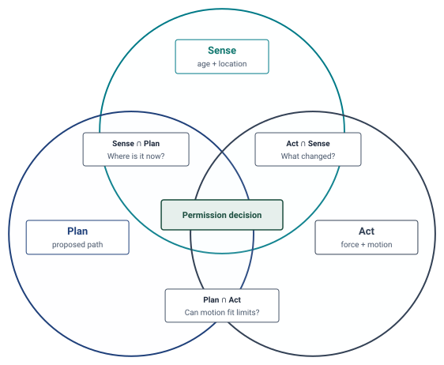

# The Sense–Plan–Act Paradigm {#sec-appendix-spa}

This appendix uses Sense–Plan–Act to locate failures in sensing, motion proposals, and physical execution. Its reference tables connect observable symptoms to timing, state, and force budgets, then identify the evidence needed to test a remedy. The framework also separates a policy's ability to propose useful behavior from the permission path's responsibility to admit motion and preserve a feasible fallback.

## How to Use This Appendix

Use @tbl-spa-navigation when architecting cyber-physical boundaries, evaluating the feasibility of end-to-end learned policies on hardware, or diagnosing operational failures across perception, planning, and control:

| When you encounter this architectural or diagnostic symptom                        | Consult                           | For this physical contract or diagnostic framework                                                     |
|:-----------------------------------------------------------------------------------|:----------------------------------|:-------------------------------------------------------------------------------------------------------|
| Evaluating classical S·P·A vs. end-to-end VLA vs. hierarchical physical AI         | @sec-appendix-spa-evolution       | Representation, timing, and authority contracts across architectural choices                           |
| Triaging single-axis failures in evidence age, proposal validity, or torque limits | @sec-appendix-spa-summary         | Three-axis taxonomy and constraint budgets across Sense, Plan, and Act                                 |
| Spatial memory retains phantom obstacles or misclassifies unobserved space         | @sec-appendix-spa-belief          | $\Glyph{S} \cap \Glyph{P}$ epistemic handoffs, evidence epochs, and raycast eviction                   |
| Action-chunk seams command violent torque spikes or exhaust braking margin         | @sec-appendix-spa-motion          | $\Glyph{P} \cap \Glyph{A}$ kinetic handoffs, $\Glyph{C}^2$ quintic blending, and stopping suffixes     |
| End-effector oscillations or limit-cycle chatter occur during rigid contact        | @sec-appendix-spa-feedback        | $\Glyph{A} \cap \Glyph{S}$ contact passivity, contact-specific response budgets, and impedance control |
| Safety thread overruns, SoC memory contention, or brownout during inference bursts | @sec-appendix-spa-permission      | $\Glyph{S} \cap \Glyph{P} \cap \Glyph{A}$ permission decisions, CBF-QP filters, and silicon isolation  |
| Tracing cyber-physical custody and typed contracts across the machine levels       | @sec-appendix-spa-lineage         | The record chain from physical plant limits to the release manifest                                    |
| Matching observable production symptoms to physical telemetry and remedies         | @sec-appendix-spa-troubleshooting | Production troubleshooting matrix with measured diagnostic discriminators                              |
| Establishing verification gates and acceptance criteria before physical release    | @sec-appendix-spa-scorecard       | S·P·A systems scorecard across all axes and intersection handoffs                                      |

: **S·P·A architectural and diagnostic navigation**: Symptom-to-section index mapping operational failures and design trade-offs to their governing physical contracts. {#tbl-spa-navigation tbl-colwidths="[34,26,40]"}

### Four-pass diagnostic protocol

When an embodied system violates a safety envelope, misses an execution deadline, chatters during contact, or trips hardware interlocks, work through the diagnosis in four systematic passes:

1. **State the physical symptom and binding budget**: Record the observed stopping-distance breach, contact-force transient, thermal trip, or enforcer deadline overrun, including physical units, payload, operating state, and the threshold declared in the machine's limit record (@sec-body).
2. **Localize the candidate axis or intersection**: Use @tbl-spa-components-ref for a preliminary triage across the three core axes. When the symptom involves interface timing, state representations, or actuation authority, move directly to the intersection landscape in @tbl-spa-intersections.
3. **Test the quantitative hypothesis**: Measure the candidate constraint or budget using the instruments in @tbl-spa-troubleshooting, such as timestamp skew, bus queue time, phase current, or tracking error.
4. **Intervene and remeasure across the causal boundary**: Apply a principled remedy and rerun the test over the declared load, timing, and fault envelope.

The symptom selects a candidate entry point, not a diagnosis. Contact oscillations motivate an Act–Sense ($\Glyph{A} \cap \Glyph{S}$) feedback test; a torque transient motivates a Plan–Act ($\Glyph{P} \cap \Glyph{A}$) seam test. Phantom obstacles motivate a Sense–Plan ($\Glyph{S} \cap \Glyph{P}$) evidence test. Deadline jitter under concurrent inference motivates a shared-resource test at the permission decision ($\Glyph{S} \cap \Glyph{P} \cap \Glyph{A}$). Measurements must distinguish these hypotheses from mechanical faults, sensor noise, and other causes.

## Architectural Choices and Their Contracts {#sec-appendix-spa-evolution}

A stalled planner and an unstable contact loop require different repairs even when both belong to the same robot. Sense–Plan–Act names functional responsibilities; it does not require that every component wait for the preceding component to finish. Classical estimators, learned policies, and feedback controllers can all participate in concurrent, multirate systems. The useful architectural comparison concerns which representation crosses each interface, how old it is, and which component can authorize motion.

### Modularity, reactive control, and learned proposals

Early robotics systems such as Shakey combined perception, symbolic planning, and physical execution.[^fn-spa-shakey-cycle] Brooks' subsumption architecture demonstrated a different decomposition into asynchronous behavior layers [@brooks1986robust; @brooks1991intelligence].[^fn-spa-brooks-subsumption] These approaches motivate a durable distinction between deliberation and rapid feedback. They do not establish that modular robotics must be synchronous, stateless, or unable to handle uncertainty. A modular interface can carry covariance, observation history, and explicit failure status; a reactive controller can retain state.

Learned policies expand the behaviors that can be proposed from images, language, and demonstrations. Vision-language-action models, including RT-2, demonstrate generalization to novel objects and commands [@brohan2023rt2], while diffusion policies represent multimodal action choices [@chi2024diffusionpolicy]. These capabilities can reduce the need to specify every recognition rule or manipulation strategy by hand. Their success depends on the training distribution, feedback, and deployment conditions. Neither an end-to-end training objective nor a modular software boundary determines actuator authority; the deployed system must establish that contract separately.

### Timing and representation tests

For a blocking sensor-to-actuation path, the latency of one observation's response is
$$\ObservationResponseLatency = \SensingStageLatency + \PlanningStageLatency + \ActuatorResponseTime.$$
Each term must include the relevant queueing, transport, and execution delay. Pipelining can overlap work on successive observations and improve throughput, but it does not remove the age of the observation used for the current command. Batching independent cameras, candidate trajectories, or robots is possible when their deadlines permit it. Future observations from one robot remain conditional on its intervening actions and cannot be treated as already available independent samples.

For approximately constant speed during an uncorrected delay, the distance traveled is
$$\DelayTravelDistance = \int_0^{\ObservationResponseLatency} \BodySpeed(\TimeInstant)\,d\TimeInstant \approx \BodySpeed \ObservationResponseLatency.$$
A local controller may continue to stabilize the plant during that interval; the distance is therefore not necessarily blind travel. It is the motion that the delayed observation cannot yet correct. @Sec-enforcement-composite-budget combines delay travel with the selected braking profile and clearance margins. In a linearized loop, a pure delay also adds phase $-\AngularFrequency \ObservationResponseLatency$ radians at angular frequency $\AngularFrequency$; the allowable delay depends on the loop's crossover frequency and available phase margin.

Representations impose a separate test. If a geometric state $\GeometricStateRepresentation$ is computed solely from sensory data $\RawSensoryData$, the data processing inequality gives
$$\MutualInformation(\RawSensoryData;\TaskRelevantOutcome) \ge \MutualInformation(\GeometricStateRepresentation;\TaskRelevantOutcome),$$
where $\TaskRelevantOutcome$ is a task-relevant variable. The inequality supplies no percentage of lost information; equality is possible when the representation retains all information needed for that task. A bounding box can support clearance reasoning while omitting latch state or material compliance. A learned representation may retain useful task cues, but metric clearance checks still need quantities with calibrated units and uncertainty bounds. Even raw images may not identify friction or hidden mass, so learning does not remove the need for additional sensing or physical qualification.

Runtime choices affect both tests. Shared memory, direct memory access (DMA), and preallocated inference buffers can reduce copies and allocation overhead. They also require buffer ownership, coherent snapshots, and measured contention bounds. A sequence lock can require retries; static allocation alone does not bound execution time. @Sec-placement develops the isolation evidence needed when inference and permission checks share hardware.

### Architectural comparison

@Tbl-spa-architectural-comparison separates capabilities from obligations. The permission architecture can accompany either a classical or a learned proposer.

| Architectural dimension     | Modular proposer                                    | Learned proposer                                         | Independent permission path                               |
|:----------------------------|:----------------------------------------------------|:---------------------------------------------------------|:----------------------------------------------------------|
| **Useful capability**       | Explicit geometry, dynamics, and search constraints | Recognition and action strategies learned from data      | Admit motion against declared physical limits             |
| **Representation**          | Metric state, maps, uncertainty, and task symbols   | Images, latent features, language, and action candidates | Timed state estimates, limits, and executable commands    |
| **Timing obligation**       | Bound the age of inputs and arrival of plans        | Measure proposal latency and handle missing updates      | Meet the configured response deadline under admitted load |
| **Failure to test**         | Model mismatch, omitted uncertainty, stale state    | Distribution shift, invalid targets, late proposals      | Missing premises, infeasible filtering, deadline failure  |
| **Fallback responsibility** | Propose recovery or a replacement plan              | Propose recovery or a replacement plan                   | Own a validated response without waiting for the proposer |

: **Architectural comparison across proposal and permission roles**: Classical and learned components offer different ways to construct behavior; neither earns physical authority from its implementation alone. {#tbl-spa-architectural-comparison tbl-colwidths="[18,27,27,28]"}

### The proposal boundary and rate hierarchy

The five-level machine separates the Brain's proposals from permission to execute them (@sec-boundary-machine-model).[^fn-spa-proposal-boundary] Intent generation, trajectory proposals, permission checks, and motor-current control can run at different rates. Those rates follow the plant, contact conditions, and measured computation budget; they are not universal properties of model classes. A sufficiently fast learned controller can participate in a feedback loop, but its timing and stability still require qualification.

Action chunks let a slower proposer supply multiple execution steps. They also increase the interval over which a proposal can become stale. The permission path therefore checks the measured entry state, current evidence, dynamic limits, and the available fallback before commitment. Rejecting a successor leaves still-valid active authority intact. If no successor is admitted by the earlier admission cutoff, the permission path schedules transfer to the resident or state-matched fallback at the commitment deadline; expired evidence, state bounds, or leases can require an earlier transfer. A stopping suffix is the book's recurring example; some loads and contacts require a validated hold or release instead of an unconstrained stop.

The proposal boundary is an authority boundary inside the machine. The causal boundary is where an admitted command produces physical work. Deterministic execution below the proposal boundary helps make timing inspectable, but it does not certify the sensors, model assumptions, or entire machine by itself.

[^fn-spa-shakey-cycle]: **Shakey and deliberative robotics**\index{Shakey (robot)!Sense-Plan-Act cycle}: Shakey is an early example of integrating perception, symbolic planning, and mobile execution; Moravec [@moravec1988mind] discusses this period of robotics. The diagnostic use of Sense–Plan–Act here does not require reproducing its execution schedule.

[^fn-spa-brooks-subsumption]: **Brooks' subsumption architecture**\index{Subsumption architecture!reactive robotics}: Brooks [@brooks1986robust; @brooks1991intelligence] organized behavior into asynchronous layers with suppression and inhibition. The finite-state modules could retain internal state, so subsumption should not be equated with a memoryless sensor-to-action map.

[^fn-spa-proposal-boundary]: **The proposal boundary**\index{Proposal boundary!cyber-physical demarcation}: The authority boundary separating candidate behavior from permission to execute it. A learned proposal acquires actuation authority only through the qualified permission path; qualification remains conditional on the machine's stated assumptions.

## Diagnostic Summary of the S·P·A Axes {#sec-appendix-spa-summary}

The S·P·A taxonomy groups diagnosis by three responsibilities: capturing evidence, proposing behavior, and applying force. The groups overlap because a physical failure often crosses an interface. @Tbl-spa-components-ref identifies the constraint to measure before selecting a remedy.

\Needspace{28\baselineskip}

| Axis          | Operational role                    | Constraint or budget to test                                                     | Diagnostic action                                                                              | Book locus                                |
|:--------------|:------------------------------------|:---------------------------------------------------------------------------------|:-----------------------------------------------------------------------------------------------|:------------------------------------------|
| **Sense (S)** | Capture and estimate physical state | Evidence age, field of view, clock conversion, uncertainty, and sensor transport | Compare capture and per-cell evidence epochs with a measured state and the permission deadline | @sec-perception, @sec-memory              |
| **Plan (P)**  | Propose a target and trajectory     | Intent validity, compute latency, dynamics, and stopping-suffix admission        | Compare proposed targets and future states with independently checked limits                   | @sec-training, @sec-intent, @sec-planning |
| **Act (A)**   | Apply and measure force             | Current, torque, thermal headroom, brake response, and kinetic clearance         | Measure command-to-force response and achieved stop under the declared load                    | @sec-body, @sec-nervous, @sec-enforcement |

: **S·P·A axis reference**: The axes organize diagnosis around measured constraints and budgets, with the chapter that develops each contract. {#tbl-spa-components-ref tbl-colwidths="[12,18,30,27,13]"}

### The sense axis: Evidence age and temporal registration

A fresh map publication can contain old observations. Sense diagnosis therefore follows the capture epoch through clock conversion, transport, and estimation rather than treating message arrival as the observation time. Exposure duration and rolling-shutter readout can also spread one image across several physical states. @Sec-perception develops this distinction; @sec-appendix-systems-ptp supplies the clock-conversion model.

Let $\CaptureTimestamp$ be the capture epoch converted to the permission clock and $\ClockConversionBound$ a bound on conversion error. A conservative age check is
$$\ObservationAge = \AgeCheckInstant - \CaptureTimestamp + \ClockConversionBound \le \BeliefInvalidationHorizon.$$
The validity limit must follow the task's motion and uncertainty bounds. For an obstacle whose speed is bounded by $\SpeedBound$, an initial position uncertainty radius $\PositionUncertaintyRadius_0$ expands conservatively as
$$\ObstacleRiskRadius(\ObservationAge) = \PositionUncertaintyRadius_0 + \SpeedBound \ObservationAge.$$
This bound assumes the stated speed limit holds and does not account for an obstacle that was never observed. Expired evidence cannot renew a clearance claim merely because the map was republished.

### The plan axis: Proposal quality and admitted horizon

A useful plan must specify an achievable task and arrive in time to be executed. Learned intent models and policies can supply semantic targets and dexterous action candidates, while search and optimization can construct trajectories from explicit models. Both need closed-loop evaluation. Low prediction error on demonstrations does not characterize the states induced by the deployed policy. The $\mathcal{O}(\BehaviorCloningHorizon^2\SingleStepImitationError)$ behavioral-cloning bound concerns worst-case cumulative task cost under stated assumptions, not a universal distance-drift law (@sec-appendix-ml-compounding; @ross2011reduction).

For a chunk of $\ActionChunkHorizon$ waypoints separated by $\FiniteChange \TimeInstant$, the proposed horizon is $\ActionChunkHorizon\FiniteChange \TimeInstant$. Only the portion supported by current evidence, timing, and fallback authority may be admitted. Chunking reduces proposal frequency but can delay correction; single-step control remains viable when the model and runtime satisfy the required feedback budget. @Sec-planning develops the seam and stopping checks that turn either proposal form into executable motion.

### The act axis: Electromechanical dynamics and thermal ceilings

A normalized policy output must eventually map to a physical setpoint. For a motor with torque constant $\MotorTorqueConstant$, the motor-side torque is approximately $\MotorTorque = \MotorTorqueConstant \TorqueProducingCurrent$ under the applicable field-oriented-control convention. Current response depends on winding inductance, resistance, back-EMF, and available voltage; it cannot follow an arbitrary instantaneous command. @Sec-body develops these actuator limits and their measurement.

Gear reduction also changes the inertia seen at the joint. For an ideal rigid reducer with speed ratio $\GearReductionRatio = \RotorAngularSpeed/\JointAngularSpeed_j$, rotor inertia $\RotorInertia$ contributes $\GearReductionRatio^2 \RotorInertia$ on the joint side. In a single-joint model,
$$\JointOutputTorque = \GearReductionRatio^2 \RotorInertia\JointAcceleration + \JointLoadTorque, \qquad \MotorTorque = \JointOutputTorque/\GearReductionRatio,$$
where $\JointLoadTorque$ includes the other joint-side inertial and load torques and losses are neglected. A step in acceleration produces a step in required torque; its magnitude depends on inertia and the step size. Infinite ideal jerk does not imply infinite torque or a particular current spike.

A lumped winding thermal model gives another diagnostic budget:
$$\StatorThermalCapacitance\frac{d\WindingTemperature}{d\TimeInstant} = \MotorPhaseRmsCurrent^2 \ElectricalResistance(\WindingTemperature) - \frac{\WindingTemperature-\AmbientTemperature}{\ThermalResistance}.$$
Here the current and resistance must use a consistent equivalent-winding convention. Continuous and peak current limits, duty cycle, cooling, and measured temperature determine admissible torque. Permanent-magnet demagnetization can occur below the Curie temperature; the relevant limit is the motor's qualified operating envelope.

Single-axis tests narrow the candidate cause. Interface tests then determine whether the failure arose from a stale estimate, an infeasible trajectory seam, or interference with the permission path.

## The Intersection Landscape {#sec-appendix-spa-intersections}

When a mobile manipulator clips a cart that just rolled out of a cross-aisle, the fault often spans more than one subsystem: a voxel layer that held a stale free-space timestamp, a trajectory handoff that delayed braking, or a shared memory bus that stalled the safety check. @Fig-spa-triad diagrams the Sense, Plan, and Act (S·P·A) triad as three intersecting functional domains, isolating their three pairwise interfaces—$\Glyph{S} \cap \Glyph{P}$ (locating object position in current time), $\Glyph{P} \cap \Glyph{A}$ (verifying that proposed trajectories satisfy dynamic limits), and $\Glyph{A} \cap \Glyph{S}$ (measuring physical state evolution after actuation)—and locating the independent permission decision at their central three-way intersection ($\Glyph{S} \cap \Glyph{P} \cap \Glyph{A}$), where a qualified permission path gates all motor commands against physical budgets before actuation. Each intersection below pairs its physical handoff contract with a discriminating measurement.

::: {#fig-spa-triad fig-env="figure" fig-pos="t" fig-cap="**The S·P·A intersection landscape**: Sense, Plan, and Act meet pairwise in three physical decisions, locating the object now, checking that proposed motion fits limits, and measuring what changed after acting. Their center is the permission decision, where an independent permission path checks the shared physical budget before actuation." fig-alt="Three overlapping circles labeled Sense, Plan, and Act. Sense and Plan ask where an object is now. Plan and Act ask whether motion fits physical limits. Act and Sense ask what changed. The center, where all three overlap, is the independent permission decision."}
{width="95%"}
:::

Each intersection is a testable handoff. @Tbl-spa-intersections names the failure mode and the evidence needed before a proposed fix earns permission.

| Intersection                                             | Handoff contract                                           | Failure to test                                                                | Evidence and candidate remedy                                                                                                                    |
|:---------------------------------------------------------|:-----------------------------------------------------------|:-------------------------------------------------------------------------------|:-------------------------------------------------------------------------------------------------------------------------------------------------|
| **$\Glyph{S}\cap \Glyph{P}$** — belief                   | Observations become timed, framed state estimates          | A fresh map publication hides an old voxel or an unseen object remains unknown | Check per-cell evidence epochs, free vs. occupied rays, and frame transforms; use a separately validated collision layer                         |
| **$\Glyph{P}\cap \Glyph{A}$** — motion                   | A proposal becomes an admitted, state-matched trajectory   | A seam requests a torque transient or the stop suffix no longer fits clearance | Check entry state, derivatives, lease, and clearance; reject an infeasible seam; retain valid active authority until its fallback-start deadline |
| **$\Glyph{A}\cap \Glyph{S}$** — feedback                 | Actuation changes the state that sensors report            | Contact force rises before the next useful sample or an actuator saturates     | Measure command-to-force and sensor-return delay; choose a local reflex and passive limit where justified                                        |
| **$\Glyph{S}\cap \Glyph{P}\cap \Glyph{A}$** — permission | The independent gate turns a proposal into physical action | Compute, memory, power, or clock interference delays refusal                   | Measure response under contention; revoke tracking and qualify isolation or relocate the path if its bound fails                                 |

: **The S·P·A intersection taxonomy**: Four handoffs locate the earliest broken physical contract and the evidence required to repair it; the axis reference in @tbl-spa-components-ref links to the underlying chapters. {#tbl-spa-intersections tbl-colwidths="[16,23,27,34]"}

### $\Glyph{S} \cap \Glyph{P}$ spatial belief and epistemic handoffs {#sec-appendix-spa-belief}

A planner that treats an unmapped blind corner behind a stacked pallet as traversable free space can accelerate into an obstacle before the range sensor ever clears the corner. The Sense--Plan ($\Glyph{S} \cap \Glyph{P}$) intersection formalizes the **epistemic handoff**: translating raw, asynchronous, multimodal sensor observations into a metric spatial belief state with bounded age and uncertainty that planning algorithms and affordance models can query without executing ungrounded actions. This handoff bridges Part II and Part III of the book, taking sensor calibration and domain bounds from the provenance record (@sec-data) and observation streams from the observation contract (@sec-perception) to populate the belief record (@sec-memory).

In an embodied machine, the primary handoff contract requires that every spatial cell or bounding volume $\CartesianPosition \in \mathbb{R}^3$ in the volumetric occupancy representation $\SpatialMemoryMap$ carries an explicit evidence epoch $\EvidenceEpoch$ and a tri-state classification:
$$\SpatialMemoryMap(\CartesianPosition) \in \{\text{Observed Free } (\ObservedFreeSpace), \text{Observed Occupied } (\ObservedOccupiedSpace), \text{Unobserved Unknown } (\UnobservedUnknownSpace)\}$$

For an occupancy grid, let $\ProbabilityFunction_t(\CartesianPosition)$ denote the probability that cell $\CartesianPosition$ is occupied and $\OccupancyLogOdds_t(\CartesianPosition)=\log[\ProbabilityFunction_t(\CartesianPosition)/(1-\ProbabilityFunction_t(\CartesianPosition))]$. With the usual conditional-independence approximation, the update from range measurement $\RangeObservation_t$ is
$$\OccupancyLogOdds_t(\CartesianPosition)=\OccupancyLogOdds_{t-1}(\CartesianPosition)+\log\frac{\ProbabilityFunction(\text{occupied at }\CartesianPosition\mid \RangeObservation_t)}{1-\ProbabilityFunction(\text{occupied at }\CartesianPosition\mid \RangeObservation_t)}-\OccupancyLogOdds_0(\CartesianPosition),$$
where $\OccupancyLogOdds_0$ is the prior log-odds. Raycasting identifies the cells traversed before a surface return and the cell containing the hit (@sec-appendix-ml-voxels).
A valid range return supplies free-space evidence along the ray before its surface hit, subject to the sensor model. A missing return alone does not establish free space. The permission path enforces a strict epistemic invariant before any trajectory planner may claim clearance through a spatial volume:
$$\ObservationAge = \AgeCheckInstant - \EvidenceEpoch + \ClockConversionBound \le \BeliefInvalidationHorizon$$
where $\ClockConversionBound$ bounds clock-conversion uncertainty (@sec-appendix-systems-ptp). If $\ObservationAge > \BeliefInvalidationHorizon$, the cell's status degrades from currently supported free space ($\ObservedFreeSpace$) to unknown space ($\UnobservedUnknownSpace$).

Unknown space supplies no clearance evidence for ordinary motion admission. Planning algorithms must never equate unobserved space with traversable free space. The age-based expansion in the Sense-axis test applies to previously localized obstacles under a speed bound; it does not locate an obstacle hidden in never-observed space. Failures to preserve these distinctions have three characteristic forms:

1. *Epistemic blindness*: The planner plans aggressive trajectories through unobserved space, treating unmapped blind spots behind occluding pallets or walls as empty. If an obstacle or human steps from behind a blind corner, the machine cannot stop within its remaining sensing margin.
2. *Phantom obstacles and stale log-odds*: When dynamic obstacles vacate a region, failure to project negative evidence along sensor optical rays (due to beam divergence, dark surface absorption, or missed returns) leaves elevated occupancy log-odds in voxel memory (@sec-appendix-ml-voxels). The permission path can stop the machine even though a separate view shows a clear aisle.
3. *Extrinsic calibration drift and spatial skew*: Mechanical vibration or thermal warping alters the coordinate frame transform $\CameraExtrinsicTransform \in \SpecialEuclideanGroup$ between sensors and the mobile base. A pitch error $\SmallChange\SensorPitchAngle$ produces a height error of approximately $\ObservedPointRange\SmallChange\SensorPitchAngle$ at range $\ObservedPointRange$ for small angles in radians, potentially turning the floor into an apparent obstacle and corrupting affordance preconditions (@sec-intent).

Diagnostic testing for $\Glyph{S} \cap \Glyph{P}$ failures begins by inspecting raw sensor-to-map latency, comparing the per-voxel evidence epoch against ground-truth measurements, and validating raycast eviction queues.

### $\Glyph{P} \cap \Glyph{A}$ admitted motion and kinetic seam feasibility {#sec-appendix-spa-motion}

Splicing a newly decoded action chunk directly onto an active joint trajectory can command an instantaneous velocity or acceleration jump that rings the drivetrain or overruns the remaining stopping distance. The Plan--Act ($\Glyph{P} \cap \Glyph{A}$) intersection governs the **kinetic handoff**: admitting candidate trajectory setpoints proposed by statistical neural policies (Brain) and converting them into continuous, dynamically feasible joint commands executed by motor drives (Body). This interface bridges the intent lease (@sec-intent), policy manifest (@sec-training), and trajectory record (@sec-planning) against the physical plant ceilings recorded in the limit record (@sec-body).

Modern generative policies---such as diffusion decoders and vision-language-action (VLA) models---propose actions in discrete horizons or chunks ($\ActionChunkHorizon$ waypoints spanning duration $\ActionChunkHorizon \FiniteChange \TimeInstant$). The permission path cannot admit a raw chunk as an open-loop actuator reference. Instead, the seam connecting the currently executing trajectory to the incoming proposal must preserve the required reference continuity and remain compatible with the measured entry-state bounds. For a $\Glyph{C}^2$ reference handover:
$$\GeneralizedCoordinates(\TimeInstant_0^+) = \GeneralizedCoordinates(\TimeInstant_0^-), \quad \GeneralizedVelocities(\TimeInstant_0^+) = \GeneralizedVelocities(\TimeInstant_0^-), \quad \GeneralizedAccelerations(\TimeInstant_0^+) = \GeneralizedAccelerations(\TimeInstant_0^-)$$
where $\TimeInstant_0$ is the handover epoch. A quintic polynomial can match the endpoint position, velocity, and acceleration constraints (@sec-appendix-control-splines) over blend interval $\BlendingTransitionWindow$:
$$\SeamBlendReference(\BumplessTransferProgress) = \QuinticBlendCoefficient_0 + \QuinticBlendCoefficient_1 \BumplessTransferProgress + \QuinticBlendCoefficient_2 \BumplessTransferProgress^2 + \QuinticBlendCoefficient_3 \BumplessTransferProgress^3 + \QuinticBlendCoefficient_4 \BumplessTransferProgress^4 + \QuinticBlendCoefficient_5 \BumplessTransferProgress^5, \quad \BumplessTransferProgress = \frac{\TimeInstant - \TimeInstant_0}{\BlendingTransitionWindow}$$
The entire admitted chunk must also satisfy componentwise limits $|\JointVelocity_i| \le \SingleJointVelocityLimit$, $|\JointAcceleration_i| \le \SingleJointAccelerationLimit$, and $|\dddot{\JointCoordinate}_i| \le \JerkLimit$ for every joint $\JointIndex$. Derivatives of the normalized polynomial require factors of $1/\BlendingTransitionWindow$, $1/\BlendingTransitionWindow^2$, and $1/\BlendingTransitionWindow^3$, respectively. Endpoint continuity alone does not establish those bounds.

A further admission condition is an executable stopping suffix (@sec-planning). For straight-line motion toward a stationary obstacle, constant speed $\SpeedAtDetection$ during response delay $\PrebrakeDelay$, and constant braking deceleration $\CredibleBrakingDeceleration > 0$ afterward, a screening calculation is
$$\StoppingDistance(\SpeedAtDetection) = \SpeedAtDetection\,\PrebrakeDelay + \frac{\SpeedAtDetection^2}{2\CredibleBrakingDeceleration} \le \ClearDistance(\TimeInstant).$$
This expression is not generally equivalent to a jerk-limited or $\Glyph{C}^2$ stop. Admission must use the actual profile, uncertainty margins, and load-dependent braking limits; @sec-enforcement-stopping-envelopes develops that budget. A multidimensional path also needs collision checks over its swept volume, not only a scalar endpoint distance.

At a chunk seam, compare the requested acceleration change with the joint-side inertia and measured current response. A discontinuity can exceed torque limits or excite flexible modes, but the failure magnitude is machine-specific. Along the chunk, check whether a fallback remains feasible from each admitted state. Rejecting a late or invalid successor does not itself revoke the active command. The executor preserves valid active authority and starts its fallback by the commitment deadline, allowing for the earlier admission and response cutoff. A measured latency percentile helps size proposal service; it does not guarantee that the next update will arrive before the admission cutoff.

Diagnostic action therefore combines synchronized current and encoder traces at chunk boundaries, lease-expiration telemetry, and an explicit check of the stopping profile from the measured transfer state.

### $\Glyph{A} \cap \Glyph{S}$ physical feedback, contact dynamics, and reflex latency {#sec-appendix-spa-feedback}

When a stiff gripper strikes a steel fixture at $0.2\text{ m/s}$, contact force can climb past the wrist sensor's overload rating in a few milliseconds, long before the next $30\text{ Hz}$ camera frame finishes exposure. The Act--Sense ($\Glyph{A} \cap \Glyph{S}$) intersection closes the causal loop across the **causal boundary**: actuator forces move joints and exert contact forces against the environment, altering physical reality, which is then captured by sensors and fed back into the control loop. Governed by the limit record (@sec-body), handoff record (@sec-nervous), and evaluation record (@sec-evaluation), this boundary embodies the first law, irreversibility (@sec-boundary-bedrock-laws). Energy delivered into a physical contact cannot be recalled.

Passivity and phase margin provide two ways to assess contact feedback [@hogan1985impedance]. With force and velocity signs chosen so that $\InteractionPortForce \InteractionPortVelocity$ is power entering the system, a passive interaction port satisfies
$$\int_0^\TimeInstant \InteractionPortForce(\IntegrationDummyTime)\InteractionPortVelocity(\IntegrationDummyTime)\,d\IntegrationDummyTime \ge -\PortStoredEnergy(0),$$
where $\PortStoredEnergy(0)$ is the initially stored energy. This energy bound is not a force limit; a passive system can still deliver a damaging impact.

For a simple mass–spring contact model, effective mass $\EffectiveImpactMass$ and stiffness $\ContactStiffness$ define the natural time scale
$$\ContactNaturalTimescale=\sqrt{\frac{\EffectiveImpactMass}{\ContactStiffness}}.$$
It indicates how quickly contact dynamics can evolve, not a universal maximum stable delay. Stability also depends on damping, controller gains, sampling, actuator dynamics, and saturation. In a linearized single-crossover loop, an added pure delay consumes approximately $\CrossoverFrequency \PureTransportDelay$ radians of phase margin at crossover $\CrossoverFrequency$. @Sec-appendix-control-passivity develops energy-based checks, while @sec-appendix-control-zoh treats sampling delay.

Contact hunting can result from delayed feedback, excessive gain, friction, or mechanical backlash. Measuring force rise against command-to-force and sensor-return delay distinguishes these causes. For a locally linear contact, $\ContactForce\approx \ContactStiffness\FiniteChange \ContactNormalPosition$ relates penetration to force; approach speed and effective mass determine how much motion and energy accumulate before correction. A low-rate planner may set a contact goal, but the feedback path that regulates force must meet the contact-specific response budget.

Local impedance or admittance control and passive compliance can reduce contact sensitivity. A target impedance can take the form
$$\TargetImpedanceInertiaMatrix (\EndEffectorTaskAcceleration-\DesiredTaskAcceleration)+\TargetImpedanceDampingMatrix(\EndEffectorTaskVelocity-\DesiredTaskVelocity)+\TargetImpedanceStiffnessMatrix(\EndEffectorTaskPosition-\DesiredTaskPosition)=\ExternalWrench,$$
where the desired inertia, damping, and stiffness shape the response to external force. Realizing this relation requires adequate sensing and actuator authority; it does not establish stability for arbitrary delay or contact. Qualify the combined controller, tooling, and surface over the admitted operating conditions.

### $\Glyph{S} \cap \Glyph{P} \cap \Glyph{A}$ independent permission decisions and silicon isolation {#sec-appendix-spa-permission}

If a vision-backbone DMA burst stalls the shared memory fabric or droops the supply rail while the safety filter is evaluating a braking barrier, the motor drives continue executing the prior velocity command toward the obstacle. At the center of the triad sits the tripartite intersection where Sense, Plan, and Act converge: the **independent permission decision**. This is the physical realization of the third law, *proposal is not permission* (@sec-boundary-bedrock-laws). The statistical Brain proposes candidate trajectories; the Nervous System arbitrates permission against hard physical invariants; the Body actuates only what is admitted.

The permission path needs bounded response time under the admitted workload. Isolation can use dedicated hardware or a qualified partition; a processor label alone proves neither timing nor independence. One possible filter is a control barrier function quadratic program (CBF-QP, @sec-enforcement, @sec-appendix-control-cbf):
$$\min_{\ControlInput} \frac{1}{2}\lVert\ControlInput-\NominalControlCommand\rVert^2 \quad \text{s.t.}\quad \LieDerivativeAlongDrift(\MechanicalPlantState) + \LieDerivativeAlongControl(\MechanicalPlantState)\ControlInput + \ClassKFunction(\BarrierFunction(\MechanicalPlantState)) \ge 0, \quad \ControlInput \in \AdmissibleControlSet.$$
Here $\PlantStateRate = \ControlAffineDriftField(\MechanicalPlantState) + \ControlAffineInputField(\MechanicalPlantState)\ControlInput$ is the modeled dynamics, $\BarrierFunction$ defines the candidate safe set $\ForwardInvariantSafeSet = \{\MechanicalPlantState : \BarrierFunction(\MechanicalPlantState) \ge 0\}$, $\DriftLieDerivativeOperator \BarrierFunction = \nabla \BarrierFunction \cdot \ControlAffineDriftField$ and $\InputLieDerivativeOperator \BarrierFunction = \nabla \BarrierFunction \cdot \ControlAffineInputField$, and $\ClassKFunction$ is an extended class $\ClassKFunctionSet$ function. This first-order form applies when the chosen barrier has the required control dependence and regularity. Position constraints on acceleration-controlled systems may require a higher-order or kinetic barrier.

A feasible QP result is one admission condition. Forward invariance additionally depends on the model, initial state, feasible inputs, state-estimation margins, and implementation timing. Sampled execution must account for behavior between checks. If evidence is missing or the solver misses its deadline, the permission path must invoke a validated fallback without waiting for the Brain. If no feasible safety-preserving action remains, solver failure does not create one; emergency response can limit harm without restoring the lost invariant claim.

Three measurements distinguish common failures at this intersection:

* **Shared-memory interference**: Measure acquisition, validation, and dispatch under the worst admitted DMA and inference traffic. A compute-only WCET excludes delays on the path to the actuator.
* **Electrical interference**: Measure supply voltage during accelerator load changes. Parasitic inductance contributes droop with magnitude $|\FiniteChange \SupplyVoltage|\approx \ParasiticLoopInductance|d\ConductorCurrent/d\TimeInstant|$, while capacitance, resistance, and regulator response also shape the transient. Compare the waveform and duration with the supervisor's operating limits.
* **Premise invalidation**: Compare the assumed braking or contact bound with achieved response. A filter based on dry-floor friction can remain feasible in its model while an unobserved oil spill makes its command physically unrealizable.

Candidate repairs include local memory, bounded bus arbitration, separate power domains, and narrower operating limits. Each repair needs remeasurement; no single isolation technique resolves all interference or model errors. @Sec-frontier records premises that the deployed machine cannot establish from its current evidence.

## Architectural Record Chain {#sec-appendix-spa-lineage}

The records from @sec-body through @sec-frontier connect plant limits, proposed behavior, runtime decisions, and release evidence (@sec-boundary-book-architecture). @Tbl-spa-lineage maps each record to its main S·P·A responsibility; @tbl-appendix-systems-record-register gives what each record binds. A record makes assumptions and evidence inspectable; its presence alone does not enforce an invariant or certify a machine. The table groups records by their teaching role, not by wire-message order. Configuration and qualification records constrain runtime decisions; an emitted admitted command records a particular permission decision.

| Chapter and title                            | Record                                     | S·P·A locus                               | Constraint or evidence recorded                                                                                                                                                 | Primary failure mode diagnosed                                                                                                      |
|:---------------------------------------------|:-------------------------------------------|:------------------------------------------|:--------------------------------------------------------------------------------------------------------------------------------------------------------------------------------|:------------------------------------------------------------------------------------------------------------------------------------|
| @sec-body: The Physical Body                 | Limit record                               | Act, $\Glyph{A} \cap \Glyph{S}$           | Motor torque $\MotorTorque \le \JointTorqueLimit$, thermal dissipation $\MotorPhaseRmsCurrent \le \ContinuousCurrent$, stopping distance $\StoppingDistance(\SpeedAtDetection)$ | Inverter thermal trip, rotor resonance, structural yield                                                                            |
| @sec-brain: The Cognitive Brain              | Proposer limits (enter the handoff record) | Plan                                      | Chunk horizon $\ActionChunkHorizon$, candidate setpoint bounds, proposer lease request                                                                                          | Unbounded candidate setpoints, unconstrained sampling cadence                                                                       |
| @sec-nervous: The Nervous System             | Handoff record                             | $\Glyph{S} \cap \Glyph{P} \cap \Glyph{A}$ | Bus cycle time $\CommandTransportTime$, qualified jitter bound, chunk lease ceiling $\ChunkLease$                                                                               | Fieldbus priority inversion, seqlock torn read, lease expiration overrun                                                            |
| @sec-data: Physical Data                     | Provenance record                          | Sense, $\Glyph{S} \cap \Glyph{P}$         | Dataset calibration bounds, ODD operational envelope limits                                                                                                                     | Covariate shift, out-of-distribution actuation commands                                                                             |
| @sec-training: Policy Training               | Policy manifest                            | Plan                                      | Denoising evaluation count $\DecoderEvaluationCount$, chunk horizon $\ActionChunkHorizon$, Lipschitz bound $\PolicyLipschitzBound$ if established                               | Multimodal mode-averaging collapse, explosive policy Lipschitz constant                                                             |
| @sec-evaluation: Closed-Loop Evaluation      | Evaluation record                          | $\Glyph{A} \cap \Glyph{S}$                | Closed-loop task performance, intervention outcomes, collision evidence, and test-domain coverage                                                                               | Open-loop loss deception, unmodeled closed-loop yaw drift                                                                           |
| @sec-perception: Sensor Perception           | Observation contract                       | Sense                                     | Observation age $\ObservationAge$, bounded clock-conversion error $\ClockConversionBound$, bounding covariance $\BodyFramePointCovariance$                                      | Rolling shutter distortion, timestamp skew, camera extrinsic calibration drift                                                      |
| @sec-memory: Spatial Memory                  | Belief record                              | $\Glyph{S} \cap \Glyph{P}$                | Per-cell evidence epoch $\EvidenceEpoch$, tri-state classification (free/occupied/unknown), raycasting eviction                                                                 | Phantom obstacle emergency stops, stale voxel retention, unobserved space mistaken for free space                                   |
| @sec-intent: Grounded Intent                 | Intent lease                               | Plan                                      | Task tolerance bounds $\TaskToleranceSemiAxes$, affordance predicate validity, terminal mode admissibility                                                                      | Affordance hallucination, ungrounded task goal selection                                                                            |
| @sec-planning: Trajectory Planning           | Trajectory record                          | $\Glyph{P} \cap \Glyph{A}$                | $\Glyph{C}^2$ quintic polynomial seam continuity, componentwise jerk ceilings, stopping suffix guarantee                                                                        | Seam velocity/acceleration discontinuity, reflected rotor inertia shock, stop suffix exhaustion                                     |
| @sec-enforcement: Safety Enforcement         | Enforcement record                         | $\Glyph{S} \cap \Glyph{P} \cap \Glyph{A}$ | Admission checks and their premises, response-time budget, resident state-matched fallback ownership                                                                            | Infeasible QP projection, enforcer deadline overrun, unsafe command leakage to motor registers                                      |
| @sec-placement: Workload Placement           | Placement record                           | $\Glyph{S} \cap \Glyph{P} \cap \Glyph{A}$ | Silicon partitioning, dedicated TCM memory, AXI QoS priorities, qualified supply-voltage envelope                                                                               | Shared memory bus contention, DRAM bank conflict, power rail brownout during NPU bursts                                             |
| @sec-intervention: Supervisory Intervention  | Authority record                           | $\Glyph{S} \cap \Glyph{P} \cap \Glyph{A}$ | Four-phase bumpless transfer, supervisory token state machine, contact-force relaxation                                                                                         | Intervention takeover jerk, operator authority lock-out, transfer state discontinuity                                               |
| @sec-verification: Adversarial Verification  | Fault record                               | $\Glyph{S} \cap \Glyph{P} \cap \Glyph{A}$ | Tail-risk estimates and their assumptions, hardware fault injection coverage, sim-to-real gap                                                                                   | Rare-event tail collision, undetected hardware bit-flip, unmodeled contact compliance gap                                           |
| @sec-release: Deployment Release             | Release manifest                           | $\Glyph{S} \cap \Glyph{P} \cap \Glyph{A}$ | Goal Structuring Notation (GSN) warrant validity, applicable assurance requirements, signed operational envelope                                                                | Operating outside qualified ODD, unsupported claim warrants, sign-off on unvalidated assumptions                                    |
| @sec-responsibility: Responsible Physical AI | Approval record                            | System-wide                               | A named owner for each decision behind an admitted action, the feasibility of each human role, per-group detection and exposure, declared records about people                  | An unowned decision, a human role no person can perform, an unmeasured group of people, records used outside their declared purpose |
| @sec-frontier: Engineering Physical AI       | Residual-claims register                   | System-wide                               | Explicit uncertified premise register (such as friction floor $\CoulombFrictionCoefficient \ge \FrictionCoefficientFloor$), epistemic ceiling recognition                       | Premise invalidation (such as uninspected floor oil slick), catastrophic failure beyond epistemic ceiling                           |

: **The S·P·A architectural record chain**: Named records link physical limits, proposals, permission decisions, and release evidence. The record contents require validation against the deployed machine. {#tbl-spa-lineage tbl-colwidths="[15,18,11,30,26]"}

The four governing laws organize this evidence chain: irreversibility requires budgets for delay, force, and fallback; endogenous data requires evaluating the states that the policy itself induces; proposal is not permission assigns admission authority independently of proposal quality; and permission must be earned requires the release case to state where those checks apply and which premises remain unresolved. Together, the chain helps locate missing evidence when a symptom crosses several chapters.

## Physical AI Production Troubleshooting Matrix {#sec-appendix-spa-troubleshooting}

When an operational machine violates physical limits or software invariants, @tbl-spa-troubleshooting links the symptom to a discriminating measurement. Software traces can carry physical telemetry, but a CPU profile alone cannot establish a force or current transient. The records need a common time basis so that a physical event can be aligned with the command and evidence that preceded it.

Current probes and encoder traces help resolve chunk-seam events. Motor phase measurements require the rotor angle and the appropriate coordinate transform to recover $\TorqueProducingCurrent$ and $\DirectAxisCurrent$; a probe does not measure those rotating-frame components directly. Protocol analyzers reveal frame timing, while available system-on-chip (SoC) performance counters and controlled contention tests help attribute delays. Solver telemetry should include status, residuals, constraint margins, and fallback selection. Those fields can expose numerical or modeled infeasibility, but identifying a friction-premise failure also requires measured physical response.

| Observable symptom                                                  | Candidate boundary                      | Discriminating measurement                                                                                | Candidate response                                                                                                           |
|:--------------------------------------------------------------------|:----------------------------------------|:----------------------------------------------------------------------------------------------------------|:-----------------------------------------------------------------------------------------------------------------------------|
| Contact hunting while the arm opens the spring-latched cage door    | $\Glyph{A}\cap \Glyph{S}$               | Measure phase margin and force rise against the sensor-to-torque delay under the actual contact stiffness | Qualify a local impedance loop, approach-speed limit, and passive compliance for that contact                                |
| Torque or current transient at an action-chunk seam                 | $\Glyph{P}\cap \Glyph{A}$               | Compare encoder, phase-current, and requested acceleration traces at the measured entry state             | Admit a state-matched $\Glyph{C}^2$ bridge and reserve a stopping suffix; the reduction in @sec-planning is profile-specific |
| Phantom obstacle stop in an aisle                                   | $\Glyph{S}\cap \Glyph{P}$               | Distinguish observed free, occupied, and unknown rays; inspect per-voxel evidence age                     | Clear only observed free space and retest the occupancy-to-permission conversion                                             |
| Enforcer misses its configured deadline during camera ingress       | $\Glyph{S}\cap \Glyph{P}\cap \Glyph{A}$ | Correlate response-time misses with bus queue, bank switches, cache misses, and DMA ownership             | Qualify QoS bypass or a coherent local safety snapshot; remeasure under contention                                           |
| Link or workpiece yields during contact                             | $\Glyph{A}$                             | Compare measured force and displacement with the tested material and tooling limits                       | Reduce admitted speed or force and qualify a compliant load path                                                             |
| Policy update arrives after its admitted chunk horizon              | $\Glyph{P}\cap \Glyph{A}$               | Measure the update tail, lease expiry, and fallback transfer state                                        | Shorten the admitted action or use a stop the permission path owns; do not extend permission from a percentile alone         |
| Safety microcontroller (MCU) rail droops during accelerator bursts  | $\Glyph{S}\cap \Glyph{P}\cap \Glyph{A}$ | Measure rail waveform, path slack, supervisor threshold, and resulting response time                      | Characterize decoupling, current slew, or physical power isolation                                                           |
| Base drifts toward a rack face despite low offline prediction error | $\Glyph{A}\cap \Glyph{S}$               | Compare closed-loop yaw bias, lateral clearance, and surface-dependent braking                            | Test closed-loop rollouts and impose a feasible corridor and stop bound                                                      |

: **Physical AI production troubleshooting matrix**: Each row is a hypothesis, measurement, and candidate remedy; acceptance depends on the machine's declared limits. {#tbl-spa-troubleshooting tbl-colwidths="[22,13,33,32]"}

\Needspace{0.72\textheight}

## The S·P·A Systems Scorecard {#sec-appendix-spa-scorecard}

Before physical release, use @tbl-spa-scorecard to connect verification gates to declared acceptance criteria across the three axes and their handoffs. Aggregate task success is useful evidence, but it can conceal rare severe outcomes and does not by itself justify a release. Each check needs the actual limits, operating envelope, confidence or hard-bound semantics, and validated fallback for the machine.

Hardware-in-the-loop tests can exercise these checks in continuous integration. Passing the suite supports the tested claims; it does not turn sampled observations into a deterministic guarantee over untested conditions.

| Boundary                                                     | Example acceptance check for a declared machine                                                                                                                        | Response if the check fails                                                                                                                                            |
|:-------------------------------------------------------------|:-----------------------------------------------------------------------------------------------------------------------------------------------------------------------|:-----------------------------------------------------------------------------------------------------------------------------------------------------------------------|
| **Sense** — capture clock                                    | Bound capture-to-MCU conversion error and include it in evidence age                                                                                                   | Resynchronize or withhold motion when the bound expires                                                                                                                |
| **Sense** — ingestion                                        | Measure worst admitted sensor/DMA queue occupancy, drop rate, and transfer time under concurrent load                                                                  | Reserve capacity or reduce sensing load; dropped frames do not renew belief                                                                                            |
| **Plan** — chunk horizon                                     | Admit a successor before the admission/response cutoff so fallback can start by the commitment deadline                                                                | Retain still-valid active authority and start the owned fallback by the commitment deadline or earlier validity expiry; measured update tails do not extend permission |
| **Plan** — dynamics                                          | Check position, velocity, acceleration, torque, and stopping suffix against the actual joint and path limits                                                           | Reject or replan an infeasible chunk                                                                                                                                   |
| **Act** — brake and contact                                  | Validate achieved deceleration and force response for load, wear, surface, and temperature                                                                             | Derate speed, change tooling, or refuse the untested state                                                                                                             |
| **Act** — thermal                                            | Keep measured winding and drive temperature inside device ratings under the duty cycle                                                                                 | Reduce duty or enter the validated stop/hold mode                                                                                                                      |
| **$\Glyph{S}\cap \Glyph{P}$** — spatial evidence             | Preserve each cell's evidence epoch and distinguish observed free, occupied, and unknown                                                                               | Refuse unknown clearance or obtain a new observation                                                                                                                   |
| **$\Glyph{P}\cap \Glyph{A}$** — seam                         | Check the matched entry state, derivative limits, and full stopping clearance before commit                                                                            | Retain still-valid active authority; start the owned fallback by its commitment deadline or earlier if evidence, state, or lease validity expires                      |
| **$\Glyph{A}\cap \Glyph{S}$** — reflex                       | Bound sensing-to-force response against a contact-specific harm deadline                                                                                               | Reduce approach energy or add a validated passive limit                                                                                                                |
| **$\Glyph{S}\cap \Glyph{P}\cap \Glyph{A}$** — compute        | Qualify the permission path's WCET against its deadline in the cycle budget of @sec-enforcement, with acquisition, validation, write, and dispatch budgeted separately | Revoke tracking permission before the cycle overrun consumes stopping margin                                                                                           |
| **$\Glyph{S}\cap \Glyph{P}\cap \Glyph{A}$** — shared silicon | Measure enforcer response under worst admitted bus, rail, and thermal contention                                                                                       | Qualify QoS/local snapshots or relocate the path if isolation cannot be shown                                                                                          |
| **$\Glyph{S}\cap \Glyph{P}\cap \Glyph{A}$** — permission     | Verify model/state assumptions, feasible CBF input, clock and estimate margins, and a state-matched fallback                                                           | Refuse the proposal when a premise is missing; a QP result alone proves no path safety                                                                                 |

: **The S·P·A physical AI systems scorecard**: Example release checks across the three axes and their handoffs. Each row requires a case-specific threshold and evidence. {#tbl-spa-scorecard tbl-colwidths="[19,48,33]"}
