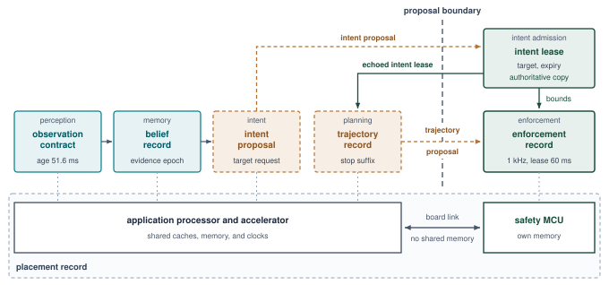

---
format:
  html:
    number-sections: false
---

# Running the Machine {.unnumbered}

Part II ended with an evaluation record that bounds what the learned proposer has shown it can do inside its target operational design domain and names the runtime monitors the machine must supply. Now, as the warehouse mobile manipulator drives down an aisle, its navigation camera catches a person stepping out from the rack end ahead. The chunk policy's next proposal still carries the base forward, and the permission path must decide whether the observation behind it is still fresh and whether the remaining clearance permits that motion or only a stop. The decision has a deadline, and no better proposal helps once the machine has crossed its braking margin. Running a physical AI machine means reconciling the timescales of sensing, planning, and actuation with that physical deadline. Human goals may change over seconds and trajectories over tens of milliseconds, while the permission loop, in one implementation, runs every millisecond. The required rates and response times come from the plant and its measured delays, not from the names of the levels. Separating speculative proposals from the checks that must meet those deadlines is the third bedrock law of @sec-boundary-bedrock-laws, an architectural design principle rather than a physical law.

::: {#pri-vol4-proposal-permission .callout-principle title="Proposal is not permission"}

**Policy**: A learned model may propose motion; only an independent permission path may admit it. The path decides each action on state whose age is known, within a deadline set by observation age, computation, transport, actuator response, and the clearance the delay leaves. It owns a fallback that is feasible from the current state without the proposer.

**Implication**: Every runtime stage serves one decision, whether this proposal can cross the causal boundary before the margin runs out. Stages ahead of the permission path deliver evidence with its age and uncertainty attached. The permission path runs on resources that learned workloads cannot delay. Any guarantee the path offers, such as one from a runtime safety filter that keeps motion inside a stopping envelope (@sec-enforcement-invariance-conditions), holds only while its model, state estimate, actuator authority, and deadline hold.

:::

Part III develops the runtime that uses the proposer's evaluated capability without assuming it is correct on every occasion, and that supplies the runtime monitors the evaluation record names. It builds the record chain's second strand, the live observations and proposals that meet the first at the permission decision. Perception qualifies each measurement, stating when it was captured, where it was measured from, and how far it can be trusted. Memory develops the state estimator that fuses those measurements into the current scene and decides how long that estimate may stand. Intent bounds the requested task, and planning constructs candidate motion. Enforcement admits feasible motion, makes a least-change correction when possible, or initiates a qualified response when continued motion cannot be supported. Placement supplies the resources needed to make those decisions on time. These are dependencies in the engineering argument, not a claim that the running machine executes every stage serially. The base's run to the rack end and the arm's reach for the mug share one whole-body proposal stream and its time-limited permission. Tracing that stream shows which stage owns each physical constraint and how a failure upstream changes the action permitted downstream.

* **Sensor Perception (@sec-perception):** Decides whether a measurement is current and calibrated enough to use, and produces the observation contract, which dates each measurement in a clock the permission path can convert to its own. It stops at the qualified measurement.
* **Spatial Memory (@sec-memory):** Teaches state estimation, fusing dated measurements into a tracked state whose covariance is tested against its actual error. It then decides how long that estimate may stand without fresh evidence and produces the belief record, which keeps the age of the evidence separate from the age of the estimate.
* **Grounded Intent (@sec-intent):** Decides how a human goal becomes a bounded, expiring request, and produces the intent lease, which grants a target and effort ceilings but never a path.
* **Trajectory Planning (@sec-planning):** Decides when a trajectory may commit, and produces the trajectory record, which carries its deadlines and a matched stop suffix.
* **Safety Enforcement (@sec-enforcement):** Decides on every tick whether a proposal is admitted, projected, or refused. The first projection on the machine slows the arm's fast latch approach to the guarded speed that Part II's target ODD covers. The chapter produces the enforcement record, where the two strands of records meet.
* **Workload Placement (@sec-placement):** Decides where the permission path runs so that learned workloads cannot delay it. It treats the two-processor split that @sec-nervous-silicon-partitioning states as a hypothesis to put to a loaded test, and produces the placement record, which names the test that would support it.

Across this six-stage chain, perception, memory, intent proposal, and trajectory planning run on the application processor, while the safety microcontroller validates and latches the authoritative intent lease—granting a bounded target and effort ceilings, never a path—and echoes the admitted lease and clamped expiry back to the planner. Only the enforcement record executes per-tick motion permission to the drives, evaluating each trajectory proposal against its physical lease and the latched intent bounds, and the placement record tests whether the hardware provides the isolation that boundary assumes (@fig-part3-record-chain).

::: {#fig-part3-record-chain fig-env="figure" fig-pos="htb" fig-cap="**The Part III record chain and its placement**: Each stage hands the next a record with its age or expiry attached. On the proposal side, perception, memory, intent proposal, and trajectory planning share caches, memory, and clocks with learned workloads on the application processor. The intent proposal crosses the proposal boundary to the separate safety MCU, which validates and latches the authoritative intent lease (target and expiry, never a path) and echoes the admitted lease back across the bidirectional board link to planning. Only the enforcement record executes per-tick motion permission to the drives, checking each trajectory proposal against its physical lease and the latched intent bounds. The placement record specifies that hardware split, which remains a hypothesis until the loaded test of hardware separation supports it." fig-alt="Runtime record chain and hardware placement diagram divided by a vertical dashed line labeled proposal boundary. To the left, four cards sit in a horizontal row: observation contract under perception with age 51.6 ms, belief record under memory with evidence epoch, intent proposal under intent with target request in a dashed bronze border, and trajectory record under planning with stop suffix in a dashed bronze border. Arrows connect observation contract to belief record and belief record to intent proposal. From intent proposal, a dashed arrow labeled intent proposal crosses the proposal boundary to an upper green card on the right labeled intent lease under intent admission, showing target, expiry, and authoritative copy. A solid green arrow labeled echoed intent lease returns across the boundary from intent lease into trajectory record, and a downward arrow labeled bounds connects intent lease to a lower green card labeled enforcement record under enforcement with 1 kHz and lease 60 ms. From trajectory record, a dashed arrow labeled trajectory proposal crosses the proposal boundary into enforcement record. Below, a dashed container labeled placement record encloses two hardware boxes linked by a bidirectional arrow labeled board link and no shared memory: application processor and accelerator with shared caches, memory, and clocks beneath the four proposal-side stages, and safety MCU with own memory beneath the enforcement and intent-admission stages."}
{width="100%"}
:::

Part III hands forward the runtime evidence that Part IV must judge. Observation contracts date every measurement, belief records expire, intent leases and trajectory records name their parents and their deadlines, and the enforcement record states the stopping envelope and the premises of each guarantee. Its worked stopping budget selects a candidate aisle speed under declared timing and physical assumptions (@sec-enforcement-stopping-envelopes). Remaining clearance is conditional on those assumptions, including the still-unqualified dispatch-to-admission interval. A dispatch timestamp does not stop evidence from aging, and the chunk lease (@sec-nervous-lease-sizing) begins at admission. The placement record names the loaded test that can refute the isolation claim and, if it passes, support the declared timing bound under the tested workloads (@sec-placement-testing-separation); on this machine, its loaded field is still empty. Each record is a claim with conditions, and none is yet a license to operate. Part IV must assess both useful service and containment, preserving the distinction between a permitted correction and failure to complete the task.
