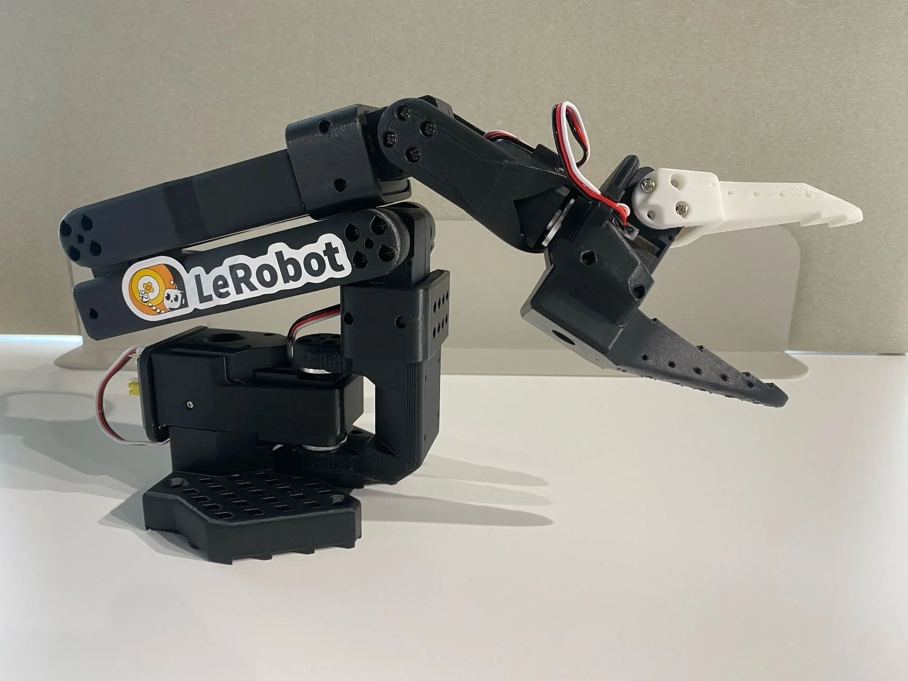

```{=html}
<div class="crs">
  <header class="crs-head directory-hero">
    <p class="opening-eyebrow">LEARN · BUILD · TEACH</p>
    <h1 id="directory-heading">Learn and teach with MLSysBook.</h1>
    <p id="directory-description">Explore readings, experiments, and teaching plans for machine learning systems. Follow a learning path or adapt the materials for a course.</p>
    <a class="directory-adopt" href="https://mlsysbook.ai/instructors/">Teaching your own course? Visit the Instructor Hub <span aria-hidden="true">↗</span></a>
  </header>
  <section class="hosted-courses" id="hosted-courses" aria-labelledby="hosted-title">
    <div class="directory-section-head"><h2 id="hosted-title">Course models and teaching materials</h2></div>
    <p class="directory-model-intro">These materials show how to organize MLSysBook readings and experiments into a course. Use a model as a starting point, adapt an existing offering, or contribute materials from your own teaching.</p>
    <div class="course-features">
      <article class="course-feature course-feature--core" data-kind="course" data-search="introduction to machine learning systems volume i foundations blueprint semester syllabus">
        <div class="course-feature-meta"><span>MLSysBook · Volume I</span><span class="course-status">Semester plan</span></div>
        <div class="course-feature-body course-feature-body--text"><div><p class="course-feature-kicker">SINGLE-MACHINE SYSTEMS</p><h3><a href="intro/">Introduction to Machine Learning Systems</a></h3><p>Data pipelines, training, optimization, and deployment, with a semester syllabus and implementation work.</p></div></div>
        <nav class="course-feature-footer course-family-links" aria-label="Foundations teaching resources">
          <a href="intro/">Course <span aria-hidden="true">→</span></a>
          <a href="https://mlsysbook.ai/instructors/foundations-syllabus.html">Syllabus <span aria-hidden="true">→</span></a>
          <a href="https://mlsysbook.ai/instructors/">For instructors <span aria-hidden="true">→</span></a>
        </nav>
      </article>
      <article class="course-feature course-feature--core" data-kind="course" data-search="scaling machine learning systems volume ii foundations blueprint semester syllabus">
        <div class="course-feature-meta"><span>MLSysBook · Volume II</span><span class="course-status">Semester plan</span></div>
        <div class="course-feature-body course-feature-body--text"><div><p class="course-feature-kicker">DISTRIBUTED SYSTEMS</p><h3><a href="scaling/">Scaling Machine Learning Systems</a></h3><p>Distributed training, communication, fault recovery, and serving, with systems labs and a capstone.</p></div></div>
        <nav class="course-feature-footer course-family-links" aria-label="Scaling teaching resources">
          <a href="scaling/">Course <span aria-hidden="true">→</span></a>
          <a href="https://mlsysbook.ai/instructors/scale-syllabus.html">Syllabus <span aria-hidden="true">→</span></a>
          <a href="https://mlsysbook.ai/instructors/">For instructors <span aria-hidden="true">→</span></a>
        </nav>
      </article>
      <article class="course-feature course-feature--tiny" data-kind="archive" data-search="tinyml tiny machine learning harvard cs249r cambridge united states 2020 2022 2023 archive embedded">
        <div class="course-feature-meta"><span>Microcontrollers · Volume I</span><span class="course-status">Historical materials</span></div>
        <div class="course-feature-body"><div><p class="course-feature-kicker">EMBEDDED MACHINE LEARNING</p><h3><a href="tinyml/">TinyML</a></h3><p>Model training and deployment on embedded devices, with syllabi, assignments, and example projects.</p></div><div class="tiny-course-mark" aria-hidden="true"><span>EMBEDDED</span><b>TinyML</b><small>Microcontrollers</small></div></div>
        <nav class="course-feature-footer course-family-links" aria-label="TinyML course resources">
          <a href="tinyml/">Course <span aria-hidden="true">→</span></a>
          <a href="tinyml/#syllabus">Syllabus <span aria-hidden="true">→</span></a>
          <a href="tinyml/#offerings">Selected projects <span aria-hidden="true">→</span></a>
          <a href="tinyml/#for-instructors">For instructors <span aria-hidden="true">→</span></a>
        </nav>
      </article>
      <article class="course-feature course-feature--edge" data-kind="course" data-search="edge ai linux raspberry pi deployment accelerator learning path">
        <div class="course-feature-meta"><span>MLSysBook · Volume I</span><span class="course-status">Learning path</span></div>
        <div class="course-feature-body"><div><p class="course-feature-kicker">INFERENCE NEAR THE DATA</p><h3><a href="edge-ai/">Edge AI</a></h3><p>Deployment on Linux edge devices, with hardware guides and companion teaching materials.</p></div><div class="tiny-course-mark" aria-hidden="true"><span>DEPLOYMENT</span><b>Edge AI</b><small>Linux · accelerators</small></div></div>
        <nav class="course-feature-footer course-family-links" aria-label="Edge AI learning resources">
          <a href="edge-ai/">Learning path <span aria-hidden="true">→</span></a>
          <a href="edge-ai/#materials">Materials <span aria-hidden="true">→</span></a>
          <a href="edge-ai/#for-instructors">For instructors <span aria-hidden="true">→</span></a>
        </nav>
      </article>
      <article class="course-feature course-feature--eth" data-kind="course" data-search="physical ai eth zurich zürich switzerland spring 2027 robot studio">
        <div class="course-feature-meta"><span>MLSysBook · Volume IV</span><span class="course-status">Draft course plan</span></div>
        <div class="course-feature-body"><div><p class="course-feature-kicker">ROBOTICS &amp; LEARNED CONTROL</p><h3><a href="physical-ai/">Physical AI</a></h3><p>Robot policies, physical limits, and release decisions supported by measurements.</p></div></div>
        <nav class="course-feature-footer course-family-links" aria-label="Physical AI course resources">
          <a href="physical-ai/">Course <span aria-hidden="true">→</span></a>
          <a href="physical-ai/#offerings">Offerings <span aria-hidden="true">→</span></a>
          <a href="physical-ai/eth-spring-2027/syllabus.html">Syllabus <span aria-hidden="true">→</span></a>
          <a href="https://mlsysbook.ai/instructors/vol4/">For instructors <span aria-hidden="true">→</span></a>
        </nav>
      </article>
    </div>
  </section>
  <div class="crs-tabs" id="community-courses" role="tablist" aria-label="View">
    <button type="button" role="tab" class="crs-tab" data-view="courses" aria-selected="true">Courses</button>
    <button type="button" role="tab" class="crs-tab" data-view="schools" aria-selected="false">Schools</button>
  </div>

  <div class="crs-tools">
    <label class="crs-search"><span class="visually-hidden">Search courses and schools</span>
      <input id="crs-q" type="search" placeholder="Find your school, a course, or a country" autocomplete="off"></label>
    <div class="crs-chips" id="crs-chips" role="group" aria-label="Filter by type">
      <button type="button" class="crs-chip" data-kind="all" aria-pressed="true">All</button>
      <button type="button" class="crs-chip" data-kind="course" aria-pressed="false">Courses</button>
      <button type="button" class="crs-chip" data-kind="workshop" aria-pressed="false">Workshops</button>
      <button type="button" class="crs-chip" data-kind="archive" aria-pressed="false">Archives</button>
    </div>
  </div>

  <div class="directory-section-head"><h2 id="directory-title">Community courses and workshops</h2><span>Instructor-maintained offerings</span></div>
  <p class="crs-intro" id="crs-intro" hidden></p>
  <div class="crs-list" id="crs-list" aria-live="polite"></div>
  <section class="crs-readers" id="crs-readers" hidden aria-live="polite">
    <h2 id="crs-readers-title"></h2>
    <p id="crs-readers-note"></p>
    <ul id="crs-readers-list"></ul>
  </section>
  <p class="crs-empty" id="crs-empty" hidden></p>

  <section class="crs-early" id="crs-early" hidden>
    <h2>Also teaching with it</h2>
    <p>Instructors named in the Vol.&nbsp;I acknowledgments as early adopters, whose course pages are not public.</p>
    <ul id="crs-early-list"></ul>
  </section>

  <figure class="crs-mapwrap">
    <!-- adopters:courses -->
    <figcaption>Schools in the community directory. Select a pin to filter courses.</figcaption>
  </figure>

  <div class="crs-exits" id="crs-add">
    <a class="crs-exit crs-exit--primary" href="https://github.com/harvard-edge/cs249r_book/issues/new?template=add_course.yml" target="_blank" rel="noopener">
      <strong>Teaching with the book?</strong>
      <span>Share your syllabus or course website with the community.</span>
    </a>
    <a class="crs-exit" href="https://mlsysbook.ai/instructors/">
      <strong>Thinking of teaching it?</strong>
      <span>The Instructor Hub has syllabi, slides, labs, and a course map.</span>
    </a>
  </div>

  <p class="crs-note">Listed courses were added by their instructors, or have a public page, syllabus, or repository that assigns or links the book. Most courses never publish a reading list, so this is a partial list. If yours is listed and you would rather it were not, <a href="https://github.com/harvard-edge/cs249r_book/issues/new?template=add_course.yml" target="_blank" rel="noopener">open an issue</a>.</p>
</div>


```
