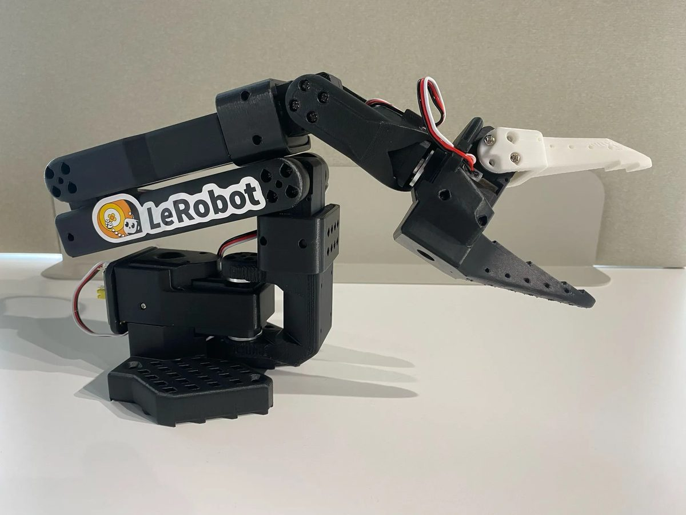

```{=html}
<div class="eth-page">
  <nav class="eth-breadcrumb" aria-label="Breadcrumb"><a href="../../">Courses</a><span aria-hidden="true">/</span><a href="../">Physical AI</a><span aria-hidden="true">/</span><span>ETH Zurich · Spring 2027</span></nav>
  <header class="eth-hero">
    <div class="eth-hero-copy">
      <p class="eth-eyebrow">ETH ZURICH · SPRING 2027</p>
      <h1>Physical AI<br>Systems</h1>
      <p class="eth-subtitle">Machine learning systems that sense and act.</p>
      <p class="eth-lead">Students train and evaluate a robot policy, constrain its actions with an independent governor, and measure how the physical system responds.</p>
      <div class="eth-actions"><a class="eth-button" href="syllabus.html">Syllabus &amp; weekly schedule <span aria-hidden="true">→</span></a><a class="eth-button eth-button--outline" href="https://mlsysbook.ai/labs/vol4/labs/week-01-getting-started.html">Getting started</a></div>
      <p class="eth-course-status"><span>In preparation</span> Meeting times, enrollment, and station qualification are pending.</p>
    </div>
    <div class="eth-station">
      <div class="eth-station-heading"><span>THE HARDWARE STUDIO</span><span>Volume IV</span></div>
      
      <div class="eth-station-caption"><strong>A learned policy proposes motion, and an independent governor checks each command.</strong><span>Proposed station: SO-101 arm · Arduino UNO Q · camera</span></div>
    </div>
  </header>
  <div class="eth-facts" aria-label="Course at a glance">
    <div><span>FORMAT</span><strong>Seminar + hardware studio</strong><small>Weekly readings, seminar, and experiments</small></div>
    <div><span>DURATION</span><strong>14 teaching weeks</strong><small>Six labs and a capstone</small></div>
    <div><span>TEAM</span><strong>Vijay Janapa Reddi</strong><small>Teaching assistant: Andrea Mattia Garavagno</small></div>
  </div>
  <nav class="eth-local-nav" aria-label="On this page"><a href="#build">The system</a><a href="#studio">The studio</a><a href="#labs">Labs</a><a href="#tools">Tools</a><a href="#prepare">Before week one</a></nav>
</div>
```

::: {.eth-page}

## The system {#build}

The robot operates through a **sense → propose → permit → act → observe → revise** loop. Camera observations inform a learned policy, which proposes the next move. An independent microcontroller checks whether to permit that move before the arm executes it. A new observation records the result and informs the next decision.

The proposed station combines a Seeed SO-101 arm, an overhead camera, and an Arduino UNO Q. The UNO Q runs the policy on its Linux processor and checks motor commands on its STM32 microcontroller. Staff qualify the station and provide the baseline firmware before student use.

::: {.eth-loop}


[Open the control-loop diagram](../../assets/images/vol4-control-loop.svg)
:::

The final deliverable is a **Physical Release Dossier**: the operating envelope, baseline comparisons, raw traces, failure evidence, and a defended release decision. A rigorous decision to withhold release can earn full marks. The [competency card](https://mlsysbook.ai/labs/vol4/curriculum/student-competencies.html) defines the skills assessed during the labs.

## The semester {#studio}

Each week pairs a systems seminar with a supervised hardware studio. Students read the assigned chapter before the seminar and predict the outcome of the lab experiment. During the lab, teams compare that prediction with measured behavior and record the results in a shared notebook. The notebook accumulates evidence for the lab assessments and the final release decision.

```{=html}
<div class="eth-phases">
  <section><span>01 · WEEKS 1–4</span><h3>Physical limits and kinematics</h3><p>Teams measure the arm, derive its kinematics, and compare the digital twin with the hardware.</p></section>
  <section><span>02 · WEEKS 5–9</span><h3>Policy training and evaluation</h3><p>Teams evaluate a learned policy, adapt it with recorded demonstrations, and test recovery from disturbances.</p></section>
  <section><span>03 · WEEKS 10–14</span><h3>Command checks and release</h3><p>Teams build the governor and test its response to declared faults. Each student defends a bounded release decision in the capstone.</p></section>
</div>
```

The [syllabus](syllabus.qmd#schedule) is the canonical source for weekly readings, checkpoints, assessment, and policies. Meeting times, rooms, credits, and enrollment details will be confirmed by course staff.

## The lab sequence {#labs}

The [Getting Started lab](https://mlsysbook.ai/labs/vol4/labs/week-01-getting-started.html) introduces the station. The six labs then develop and evaluate the same physical system:

```{=html}
<div class="eth-labs">
<a href="https://mlsysbook.ai/labs/vol4/labs/lab-01-digital-twin.html"><span>LAB 01</span><div><h3>The digital twin</h3><p>Teams measure the arm and test its kinematic model.</p></div><b aria-hidden="true">↗</b></a>
<a href="https://mlsysbook.ai/labs/vol4/labs/lab-02-sim-to-real.html"><span>LAB 02</span><div><h3>Simulation to real hardware</h3><p>Teams compare predicted motion with measured motion and explain the differences.</p></div><b aria-hidden="true">↗</b></a>
<a href="https://mlsysbook.ai/labs/vol4/labs/lab-03-learned-control.html"><span>LAB 03</span><div><h3>Learned control</h3><p>Teams compare a learned policy with the nonlearned baseline.</p></div><b aria-hidden="true">↗</b></a>
<a href="https://mlsysbook.ai/labs/vol4/labs/lab-04-real-data-and-fine-tuning.html"><span>LAB 04</span><div><h3>Real data and fine-tuning</h3><p>Teams collect demonstrations and measure the effect of policy adaptation.</p></div><b aria-hidden="true">↗</b></a>
<a href="https://mlsysbook.ai/labs/vol4/labs/lab-05-stress-testing.html"><span>LAB 05</span><div><h3>Stress-test the loop</h3><p>Experiments measure the effects of action horizons and disturbances on recovery.</p></div><b aria-hidden="true">↗</b></a>
<a href="https://mlsysbook.ai/labs/vol4/labs/lab-06-safety-governor.html"><span>LAB 06</span><div><h3>Build and attack the governor</h3><p>Fault trials test command permission, freshness, refusal, and governor response.</p></div><b aria-hidden="true">↗</b></a>
</div>
<div class="eth-capstone"><div><p>CAPSTONE · PHYSICAL RELEASE DEFENSE</p><h3>A release decision supported by measurements</h3><span>Teams build a bounded task and exchange approved faults with a peer team. Each student defends the resulting release decision.</span></div><a class="eth-button" href="https://mlsysbook.ai/labs/vol4/labs/lab-capstone-studio.html">Capstone brief <span aria-hidden="true">→</span></a></div>
```

## Tools {#tools}

The proposed tools support data collection, policy training, and experiments on the reference station. Staff select tested versions and supply starter assets. Qualification of the station determines the required policy and export path.

- **LeRobot + PyTorch:** These tools support demonstration datasets, training, and policy evaluation. Training runs on a workstation, and deployment is evaluated on the edge station.
- **ACT and SmolVLA:** These are candidate learned policies. ACT provides action chunking from images and robot state; SmolVLA adds language conditioning. Their station performance must be qualified.
- **MuJoCo or PyBullet:** Staff have not yet selected the simulator. The twin models the same arm and supports matched simulation and hardware trials.
- **OpenCV + V4L2:** These tools support camera calibration, image acquisition, and camera configuration.
- **ONNX Runtime / INT8:** The proposed edge deployment path requires checks of model export, numerical parity, memory use, and timing.
- **STM32 C + the qualified Arduino/STM32 toolchain:** The governor uses this toolchain to implement deterministic command permission, bounds, and watchdog behavior.

The [station reference](https://mlsysbook.ai/labs/vol4/labs/station-reference.html) defines the hardware, wiring, and four action taps. Isaac Sim and Cosmos may support research extensions if staff qualify a suitable experiment.

## Before week one {#prepare}

The course assumes working Python skills, introductory machine learning, basic linear algebra and probability, and first-year Newtonian physics. Prior experience with robot arms or microcontrollers is helpful. Staff provide the baseline firmware and support its extension.

1. Read the Volume IV [reader guide](https://mlsysbook.ai/vol4/frontmatter/prerequisites.html) and [The Causal Boundary](https://mlsysbook.ai/vol4/01_boundary/01_boundary.html).
2. Review the [course syllabus](syllabus.qmd), including the assessment and teamwork expectations.
3. Follow the [Getting Started lab](https://mlsysbook.ai/labs/vol4/labs/week-01-getting-started.html) when the teaching team releases the qualified station instructions.

::: {.eth-closing}
**Release decisions require measured evidence.** Each team must show which actions its system permits, which limits it enforces, and how it responds when those limits are tested.
:::

:::
