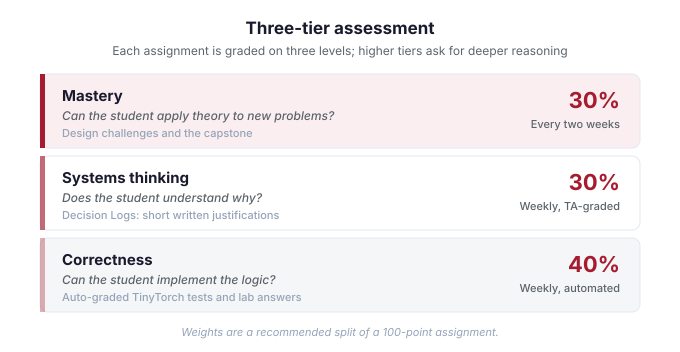

This guide provides everything you need to evaluate student mastery: weighted grade structures, detailed rubrics, sample student work, and the AI Olympics capstone specification.

---

## 1. The Three-Tier Assessment Model

We recommend a 100-point scale per assignment, distributed across three tiers:

| Tier | Method | Weight | What It Tests |
|:---|:---|:---|:---|
| **Correctness** | Auto-graded tests (TinyTorch, Lab answers) | 40% | Can the student implement the logic? |
| **Systems Thinking** | Decision Logs (200-word justifications) | 30% | Does the student understand *why*? |
| **Mastery** | Design Challenges (open-ended optimization) | 30% | Can the student apply theory to new problems? |

### Grading Load Estimates

Plan your TA staffing based on these estimates:

| Task | Time per Student | Frequency | 30-Student Section | 60-Student Class |
|:---|:---|:---|:---|:---|
| Decision Log grading | 3–5 min | Weekly | ~2 hrs/week | ~4 hrs/week |
| TinyTorch systems questions | 5–8 min | Weekly | ~3 hrs/week | ~6 hrs/week |
| Design Challenges | 10–15 min | Bi-weekly | ~4 hrs bi-weekly | ~8 hrs bi-weekly |
| TinyTorch auto-grading | Automated | Weekly | ~10 min (review flags) | ~20 min |

::: {.callout-tip}
## Efficiency Tip
Use the [3-question speed rubric](ta-guide.qmd) for Decision Logs — it cuts grading time by ~40% while maintaining consistency. Grade all logs for one week in a single sitting.
:::

### Semester-Level Grade Breakdown

**Semester 1 (Foundations):**

| Component | Weight | Count |
|:---|:---|:---|
| TinyTorch Modules | 35% | 8 modules |
| Lab Decision Logs | 25% | 15 labs |
| Design Challenges (Part C) | 20% | 4 major (one per Part) |
| Capstone (AI Olympics) | 20% | 1 |

**Semester 2 (Scale):**

| Component | Weight | Count |
|:---|:---|:---|
| Lab Decision Logs | 40% | 16 labs (01–16) |
| Design Challenges | 30% | 4 major (one per Part) |
| Capstone (Fleet Synthesis) | 30% | 1 |

---

## 2. Decision Log Rubric (30 Points)

The Decision Log is the most important metacognitive artifact in the course. Use this rubric for consistent grading:

| Criterion | Excellent (10) | Adequate (6) | Insufficient (2) |
|:---|:---|:---|:---|
| **Quantitative Evidence** | Cites 3+ specific numbers from instruments (latency, memory, throughput, accuracy). | Cites 1–2 numbers. | No numbers; vague assertions ("it was faster"). |
| **Causal Reasoning** | Explains *why* using Iron Law terms or Roofline terminology. Maps the optimization to a specific equation term. | Describes *what* happened but misses the "why." | Lists observations without explanation. |
| **Constraint Awareness** | Explicitly addresses tradeoffs (e.g., "Trading 1.2% accuracy for 4$\times$ throughput to meet the 50 ms SLA"). | Mentions constraints but doesn't quantify the tradeoff. | Ignores constraints entirely. |

### Sample Decision Log: Excellent (30/30)

> **Lab 10: Compression — Part C Decision Log**
>
> I recommend deploying the MobileNetV2 model with INT8 post-training quantization for the Seeed XIAO target.
>
> **Evidence:** INT8 quantization reduced model size from 14.2 MB to 3.6 MB (3.9$\times$ compression), meeting the 4 MB flash constraint. Inference latency dropped from 48.3 ms to 12.1 ms (3.99$\times$ speedup), well under the 50 ms SLA. Accuracy decreased from 91.4% to 90.2% (1.2% drop).
>
> **Reasoning:** The supplied size, latency, and quality results support this INT8 candidate against the stated flash, latency, and accuracy limits. They do not identify the dominant runtime bottleneck: a capacity limit is not evidence that bandwidth is saturated, and smaller stored weights do not establish a fourfold reduction in executed memory traffic. A target-device trace with working-state, traffic, and stall evidence would distinguish those explanations. The observed accuracy remains above the project threshold; the architecture alone does not guarantee that another dataset or calibration recipe preserves it.
>
> **Tradeoff:** I rejected INT4 quantization despite its additional 2$\times$ memory savings because accuracy dropped to 84.7% (6.7% loss) — below the 88% project threshold. The marginal memory gain (3.6 MB → 1.8 MB) was not worth the accuracy cliff.

### Sample Decision Log: Insufficient (6/30)

> The quantized model was smaller and faster. I used INT8 because it seemed like a good balance. The model still worked after quantization.

*Why insufficient:* No specific numbers. No Iron Law mapping. No tradeoff analysis. No evidence of understanding *why* it worked.

---

## 3. TinyTorch Grading (100 Points per Module)

TinyTorch modules test both implementation correctness and systems understanding:

### Auto-Graded (70 Points)

- Standard unit test pass/fail via `pytest` or `nbgrader`
- Tests cover: correctness, edge cases, numerical stability
- All-or-nothing per test (no partial credit for failing tests)

### Systems Thinking Questions (30 Points)

Each module includes 3 manually-graded questions (10 points each). These ask students to reason about the systems implications of their code.

**Example questions by module:**

| Module | Sample Question |
|:---|:---|
| 01: Tensor | "Your tensor stores data in row-major order. How would inference latency change if you switched to column-major? For which operations would it matter?" |
| 06: Autograd | "Your `backward()` builds a full computation graph in memory. At what model size (number of parameters) would this become the memory bottleneck on a 16 GB GPU? Show your calculation." |
| 08: Training | "Your training loop processes one batch at a time. Describe two concrete changes that would improve GPU utilization, and estimate the speedup for each." |

### Grading Scale for Systems Thinking Questions

| Score | Criteria |
|:---|:---|
| **10** | Correct reasoning with quantitative estimate. References specific hardware constraints. |
| **7** | Correct direction of reasoning but missing quantitative support or hardware specifics. |
| **4** | Partially correct but with significant conceptual errors. |
| **1** | Attempted but fundamentally misunderstands the systems implication. |

---

## 4. Design Challenge Rubric (50 Points)

Design Challenges are the Part C of labs — open-ended optimization problems with real constraints.

| Criterion | Excellent (12–13) | Adequate (7–9) | Insufficient (1–4) |
|:---|:---|:---|:---|
| **Solution Quality** | Meets all constraints (latency, memory, accuracy). Near-optimal configuration. | Meets most constraints. Reasonable but suboptimal. | Fails to meet one or more constraints. |
| **Methodology** | Systematic exploration: tried multiple approaches, justified final choice. | Tried 2–3 approaches but justification is weak. | Trial-and-error with no systematic approach. |
| **Iron Law Mapping** | Every optimization traced to a specific Iron Law term. | Some optimizations mapped, others missing. | No Iron Law references. |
| **Documentation** | Decision Log meets Excellent criteria (see above). | Decision Log meets Adequate criteria. | No meaningful documentation. |

---

## 5. The AI Olympics — Capstone Specification (Semester 1)

The course culminates in a competition: deploy the "Smart Doorbell" application across multiple hardware tracks.

### The Challenge

Design and optimize an image classification pipeline (person detection + recognition) that meets strict deployment constraints:

| Track | Device | Latency Budget | Memory Budget | Target Accuracy |
|:---|:---|:---|:---|:---|
| **Cloud** | A100 GPU | < 10 ms P99 | 16 GB | > 95% |
| **Edge** | Raspberry Pi + Coral | < 50 ms P99 | 1 GB | > 90% |
| **Mobile** | Simulated phone SoC | < 30 ms P99 | 256 MB | > 88% |
| **Tiny** | Seeed XIAO ESP32S3 | < 100 ms P99 | 256 KB | > 80% |

### Scoring (100 Points)

| Component | Points | Description |
|:---|:---|:---|
| **Metric Achievement** | 40 | Credit for documented achievement of the track's accuracy, latency, and memory requirements; report throughput and energy separately with their measurement boundaries. |
| **Engineering Report** | 40 | 1,000-word design document. Every decision mapped to Iron Law. Rubric: 10 pts quantitative evidence, 10 pts causal reasoning, 10 pts constraint awareness, 10 pts clarity. |
| **Robustness** | 20 | System is tested with distribution shift (brightness, noise, rotation). Graceful degradation > catastrophic failure. |

### Deliverables

1. **Code submission**: Model, optimization scripts, deployment configuration
2. **Design report**: 1,000 words, structured as Problem → Approach → Results → Tradeoffs
3. **Live demo**: 5-minute presentation showing deployment on target hardware (or simulation)

---

## 6. Semester 2 Assessment: Scale-Specific Criteria

As the course moves to distributed systems, assessment evaluates useful progress, service quality, reliability, economics, and accountable operating decisions. The Scale criteria below govern Semester 2 when the generic rubrics favor a feasible configuration or a particular vocabulary.

### Evidence and Credit

Grade the Decision Logs from Labs 01–16 within their 40% course component. Grade the four design challenges within their 30% component; the fleet-governance challenge may develop the Lab 16 release record. Lab 17 supplies the remaining 30% capstone component with its evidence packet, design report, and presentation. Reuse earlier evidence with its assumptions and limitations rather than requiring another experiment for each outcome.

| Student Judgment | Existing Evidence to Assess |
|:---|:---|
| Expansion and valid distributed execution | Lab 05's matched-quality comparison and update/schedule reasoning; supporting infrastructure and collective analyses |
| Physical feasibility, recovery, and shared capacity | Infrastructure, storage, recovery, and orchestration Decision Logs; relevant Part I–II design challenges |
| Performance diagnosis and serving design | Lab 09's matched path comparisons, Lab 10's serving analysis, and the serving design challenge |
| Production regression and release | Operations and robustness Decision Logs, including delayed outcome evidence and the limits of drift alerts |
| Useful and representative edge adaptation | Lab 11's resource contrasts, cohort participation evidence, and defended architecture |
| Bounded security and privacy | Security/privacy Decision Log with the protected unit, accounting assumptions, utility costs, and incomplete-claim response |
| Lifecycle resource choice | Lab 15's common-horizon alternatives and cost/carbon design analyses |
| Accountable deployment or restriction | Lab 16's subgroup, review-capacity, audit, and data-obligation evidence; release record with owner, remedy, and trigger; fleet-governance challenge |
| Cross-layer synthesis | Lab 17's inherited evidence, equal-budget repairs, and held-out replay, linked to the separately assessed governance record |

For Scale Decision Logs, the three criteria remain worth 10 points each. Award quantitative-evidence credit for relevant values with units, denominators, accounting boundaries, and a matched baseline; distinguish measurements from analytical estimates and supplied fixtures. Award causal-reasoning credit for the model appropriate to the decision, including C³, queueing, recovery, or evidence-selection reasoning. A proposed discriminating observation earns credit when attribution remains unresolved. Award constraint-awareness credit for quality and service requirements, rejected alternatives, uncertainty, and a justified operating decision. Counting numbers or naming an Iron Law term alone does not establish mastery.

Apply the same principles to the four design-challenge criteria. Excellent solution quality can be a demonstrated no-feasible conclusion or a justified HOLD, restriction, or deferral when the supplied evidence cannot support release. Methodology requires comparable alternatives and explicit assumptions; reasoning must support the claimed effect without turning correlation into diagnosis. Documentation must retain material limitations and reevaluation conditions, plus authority and remedy where the decision affects people. A fast configuration that violates a quality or governance requirement cannot earn excellent solution-quality credit.

### Fleet Synthesis Capstone Rubric (100 Points)

| Criterion | Points | Full-Credit Evidence |
|:---|:---|:---|
| Evidence and accounting | 25 | Current contrasting records; inherited evidence and fallback distinguished; units, boundaries, and illustrative assumptions retained |
| Repair comparison | 25 | Equal-budget alternatives compared against relevant physical, service, recovery, and resource requirements; rejected repair quantified |
| Deployment judgment | 25 | Release, restriction, or deferral follows from the evidence; linked Lab 16/governance record supplies affected-population limits, owner, and remedy |
| Transfer and explanation | 25 | Held-out replay interpreted within its scope; remaining uncertainty and measurable reevaluation condition explained in the report and presentation |

A lab completion or export gate establishes that a record is present and current. Instructors still judge whether its reasoning supports the decision. Lab 17 does not independently establish privacy, subgroup fairness, or robustness; assess those claims from the named earlier artifacts. A justified no-feasible result can earn full credit under this rubric.

### TCO Audit (Design Challenge)

*Can the student calculate the 3-year Total Cost of Ownership of their cluster design?*

Students must account for: hardware acquisition, power consumption (including PUE), network equipment, cooling, maintenance, and opportunity cost of downtime.

### Failure Recovery Analysis (Design Challenge)

*Can the student explain which valid state is restored after a node failure and quantify the retained and lost work?*

Students must specify checkpoint contents and consistency, checkpoint frequency, recovery time, wasted computation per failure, and the assumptions behind the chosen interval. Include a nonideal failure or incomplete-evidence condition that changes the recovery decision.

### Carbon Budget (Design Challenge)

*Can the student justify their datacenter location based on carbon footprint?*

Students must compare supplied location or scheduling alternatives over a common useful-work horizon using grid carbon intensity, PUE, and relevant lifecycle costs. Check capacity and deadline feasibility before ranking carbon savings, and state the demand or grid assumption that could reverse the choice.
