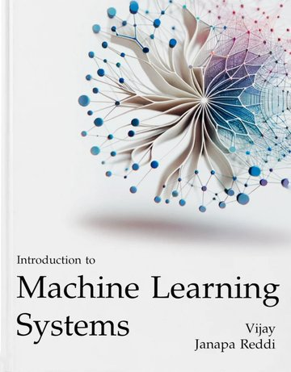
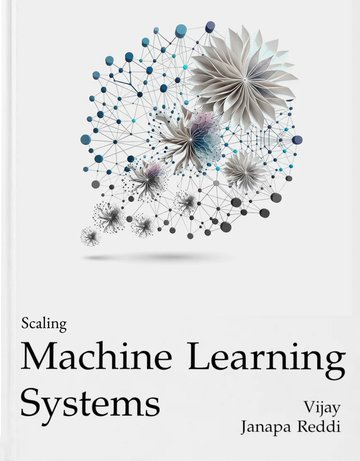
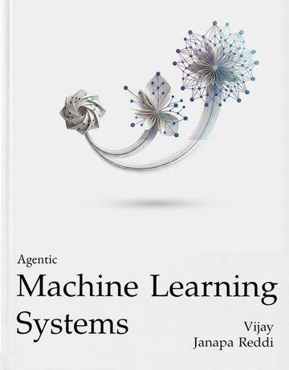
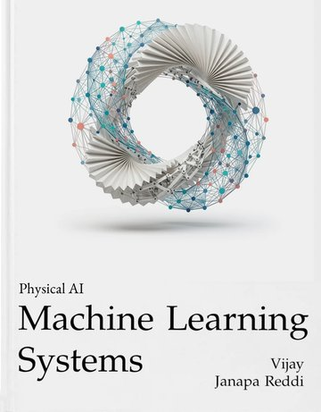
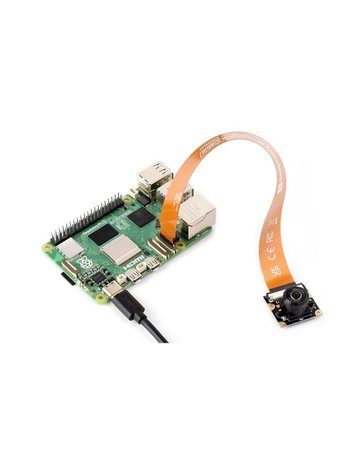
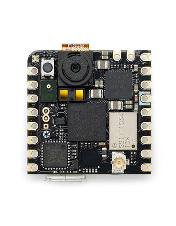

## Getting started {#getting-started}

Each course below states what it requires and links to its syllabus, slides,
and hands-on materials. All of the materials are free to use, and the
[license page](https://mlsysbook.ai/about/license.html) lists the license for each.

## How the materials fit together {#materials}

Each course combines the same open materials. The textbook supplies the weekly
readings, and the other materials turn each reading into a lecture, an
experiment, or a build.

| Material | Role in a course | Used in |
|:---|:---|:---|
| [Textbook](https://mlsysbook.ai/) | The weekly readings | Every course |
| [Slides](https://mlsysbook.ai/slides/) | A lecture deck for each chapter | Every course |
| [Labs](https://mlsysbook.ai/labs/) | Browser-based experiments that pair with the chapters | Introduction, Scaling, Physical AI |
| [TinyTorch](https://mlsysbook.ai/tinytorch/) | A framework that students build one module at a time | Introduction |
| [Hardware kits](https://mlsysbook.ai/kits/) | Deployment on real boards | TinyML, Edge AI |
| [MLSys·im](https://mlsysbook.ai/mlsysim/) | The simulator that runs the labs | Introduction, Scaling |
| [StaffML](https://mlsysbook.ai/staffml/) | Practice questions tagged by chapter | Any course |
| [ML Systems Taxonomy](https://mlsysbook.ai/taxonomy/) | A map of the field for checking what a course covers and what it leaves out | Course planning |

Each syllabus below shows one way to arrange these materials week by week.

## Courses {#courses}

### Introduction to Machine Learning Systems

::: {layout="[18,82]" layout-valign="top"}
{width="130px" fig-alt="Cover of Volume I, Introduction to Machine Learning Systems"}

::: {}
*Volume I · Semester plan*

Students study data pipelines, training, optimization, and deployment on a single
machine, and they build their own framework with TinyTorch.

**Requires:** a laptop. The labs run in a browser, so no GPU is needed.

[Course](https://mlsysbook.ai/courses/intro/) ·
[Syllabus](foundations-syllabus.qmd) ·
[Slides](https://mlsysbook.ai/slides/vol1.html) ·
[Labs](https://mlsysbook.ai/labs/) ·
[TinyTorch](https://mlsysbook.ai/tinytorch/)
:::
:::

### Scaling Machine Learning Systems

::: {layout="[18,82]" layout-valign="top"}
{width="130px" fig-alt="Cover of Volume II, Scaling Machine Learning Systems"}

::: {}
*Volume II · Semester plan*

Students study distributed training, communication, fault recovery, and serving
across many machines, and they finish with a design project.

**Requires:** a laptop. The labs simulate the cluster, so no GPU is needed.

[Course](https://mlsysbook.ai/courses/scaling/) ·
[Syllabus](scale-syllabus.qmd) ·
[Slides](https://mlsysbook.ai/slides/vol2.html) ·
[Labs](https://mlsysbook.ai/labs/)
:::
:::

<!-- unreleased:start (Volumes III and IV, staging only) -->
### Agentic Machine Learning Systems

::: {layout="[18,82]" layout-valign="top"}
{width="130px" fig-alt="Cover of Volume III, Agentic Machine Learning Systems"}

::: {}
*Volume III · In preparation*

Students study the systems that run AI agents: models that plan over many steps,
keep memory, call tools, and recover from failures. These materials are still in preparation for teaching in the next semester or year, so they will change as the course takes shape.

**Requires:** not yet specified.

[Syllabus](agentic-syllabus.qmd) ·
[Slides](https://mlsysbook.ai/slides/vol3.html)
:::
:::

### Physical AI

::: {layout="[18,82]" layout-valign="top"}
{width="130px" fig-alt="Cover of Volume IV, Physical AI"}

::: {}
*Volume IV · Draft course plan*

Students train a robot policy and test it against physical limits in a proposed
hardware studio, and the syllabus lists what staff must check before teaching
it. These materials are still in preparation for teaching in the next semester or year, so they will change as the course takes shape.

**Requires:** one robot station per team. The syllabus lists the parts.

[Course](https://mlsysbook.ai/courses/physical-ai/) ·
[Syllabus](vol4/index.qmd) ·
[Slides](https://mlsysbook.ai/slides/vol4.html) ·
[Studio labs](https://mlsysbook.ai/courses/physical-ai/eth-spring-2027/#labs)
:::
:::
<!-- unreleased:end -->

### Edge AI

::: {layout="[18,82]" layout-valign="top"}
{width="130px" fig-alt="Raspberry Pi 5 with a camera module"}

::: {}
*Volume I · Learning path*

Students deploy models on Linux edge devices, reading Volume I alongside the
Raspberry Pi kit and its companion book.

**Requires:** one Raspberry Pi per student or team, from about $60 for a Raspberry Pi 5. The reading list gives the options.

[Course](https://mlsysbook.ai/courses/edge-ai/) ·
[Reading list](edge-ai-syllabus.qmd) ·
[Slides](https://mlsysbook.ai/slides/vol1.html) ·
[Hardware kits](https://mlsysbook.ai/kits/)
:::
:::

### TinyML

::: {layout="[18,82]" layout-valign="top"}
{width="130px" fig-alt="Arduino Nicla Vision microcontroller board"}

::: {}
*Volume I · Historical materials*

Students train models and deploy them on microcontrollers. The materials come
from earlier Harvard offerings, with their assignments and example projects.

**Requires:** one microcontroller board per student or team, from about $25. The syllabus lists the options and prices.

[Course](https://mlsysbook.ai/courses/tinyml/) ·
[Syllabus](tinyml-syllabus.qmd) ·
[Slides](https://mlsysbook.ai/slides/tinyml.html) ·
[Hardware kits](https://mlsysbook.ai/kits/)
:::
:::

## Sequences and other courses {#more}

The introductory and scaling courses can run back to back as a two-semester
sequence. The [course catalog](https://mlsysbook.ai/courses/) lists courses at
other schools, and the
[community forum](https://github.com/harvard-edge/cs249r_book/discussions)
answers questions about teaching with the book.
