# Agentic AI {.unnumbered}

{width=70% fig-align="center"}

## Overview {#sec-uno-q-agentic-overview-7969}

In the earlier UNO Q labs, the language model always had a fixed job: answer this prompt, describe this image. The model reasoned, but it never *decided what to do*. This lab changes that. Qwen3.5 gets a small set of **tools** (functions it can choose to call) and decides on its own which ones to use, and in what order, to satisfy a plain-language request.

Here is the shape of the goal, taken from a real session in @sec-uno-q-agentic-crossing-boundary-swap-model-5ee2:

```text
> Check the free disk space. If there's more than 1GB free, show a
  checkmark on the matrix, otherwise show an X.
[turn 0] tool call: get_system_info({})
[turn 1] tool call: set_led_matrix({"pattern":"check"})
The free disk space is 1.4GB, which is more than 1GB, so the matrix
shows a checkmark.
```

\noindent
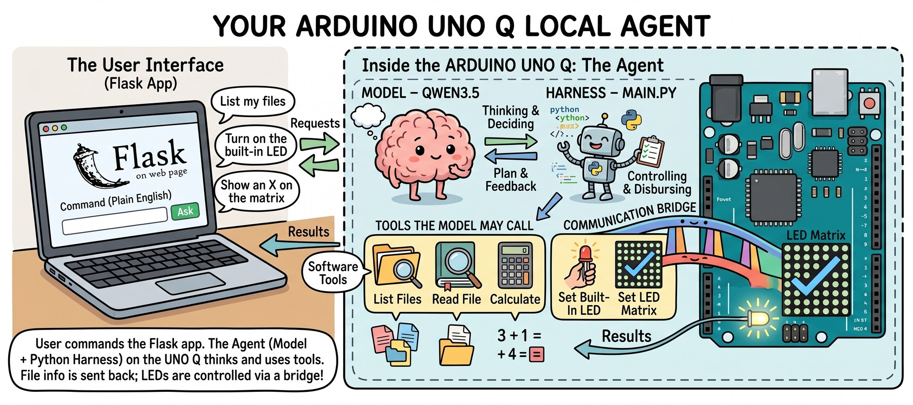{width=90% fig-align="center"}

No `if` statement in the code chose that checkmark. The model received a threshold in English, fetched a number it could not have known, compared the two, and acted on the result.

The tools are deliberately ordinary: ask the board what OS it is running, do some arithmetic, list a few files, switch the built-in LED, draw a pattern on the onboard 8×13 LED matrix. None of it requires a single wire. That is on purpose: this lab runs in any room, on any UNO Q, with nothing attached, which makes it a good choice for a workshop where not everyone has a breadboard.

\noindent
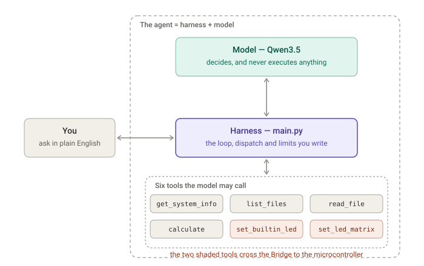{width=90% fig-align="center"}

The mechanism is `llama-server`'s native, OpenAI-compatible **tool-calling API** (`tools=[...]` in the request, `tool_calls` in the response), the same interface hosted LLM APIs use, not a custom prompt-and-parse scheme. The "[Building Agents with SLMs](https://mjrovai.github.io/EdgeML_Made_Ease_ebook/raspi/advancing_adgeai/adv_edgeai.html#building-agents-with-slms)" chapter of [EdgeML Made Easy](https://mjrovai.github.io/EdgeML_Made_Ease_ebook/) routed a query through hand-written JSON classification, a technique that book itself flags as fragile: models struggle to format the classification JSON reliably, especially at 1B parameters and below. The native tools API does not remove that fragility at small model sizes, but it moves the parsing burden onto llama.cpp's grammar-constrained decoding instead of hopeful prompt engineering, and it is the same shape of code as for a hosted model.

The lab also shows the agent failing. @sec-uno-q-agentic-running-it-example-interactions-8689 pushes a 0.8B model past what it can reliably do, then swaps in a 2B model and reruns the same questions with no other change. That comparison matters as much as the working demo: knowing where a model's capability ends, and what crossing that line costs in latency, is most of the engineering in edge AI.

By the end, the board runs a small, hardware-free agent that any device on the network can talk to, with every tool decision visible, acting on the board's own files, its own vitals, and its own LEDs.

### Learning Objectives {#sec-uno-q-agentic-learning-objectives-8124}

- Explain what makes a model "agentic", and separate the model from the harness around it.
- Use `llama-server`'s built-in tools from its WebUI, and understand where the permission boundary lives.
- Design tools whose risk matches what the model controls, with a workspace boundary and a safe calculator.
- Build a tool-calling agent loop in Python, with two tools that reach the MCU over Bridge RPC.
- Measure what an agent answer costs on the UNO Q, and where a 0.8B model stops being reliable.

### Prerequisites {#sec-uno-q-agentic-prerequisites-ef67}

- The [Setup](../setup/setup.qmd) lab: headless SSH access to the board.
- The [Small Language Models](../llm/llm.qmd) lab: `llama.cpp` built from source, the Qwen3.5-0.8B GGUF downloaded, and comfort running `llama-server` and calling it from Python with the `openai` client library. This lab reuses its `llama-server` setup and `openai` patterns without repeating them.

The [Vision-Language Models](../vlm/vlm.qmd) lab and the vision labs are deliberately **not** required: nothing here depends on vision or on external sensors. @sec-uno-q-agentic-going-further-d238 shows how other tools plug into this same agent loop later.

## What Makes This "Agentic"? {#sec-uno-q-agentic-makes-agentic-43fd}

The word gets used loosely. Pinned down, an agent is a model that does three things a plain chat model does not.

**It decides whether to act at all.** Ask "What is the capital of Brazil?" and the right move is to answer "Brasília" from what the model already knows, with no tool needed.

Ask "How much free disk space is there?" and the model cannot know: that answer lives on the board. The model has to call a tool and read the result back.

Arithmetic is another example. Ask a plain model "How much is 123456 multiplied by 123456?" and it will almost certainly get it wrong. With access to a tool (a Python calculator, for example), the computation is always right.

\noindent
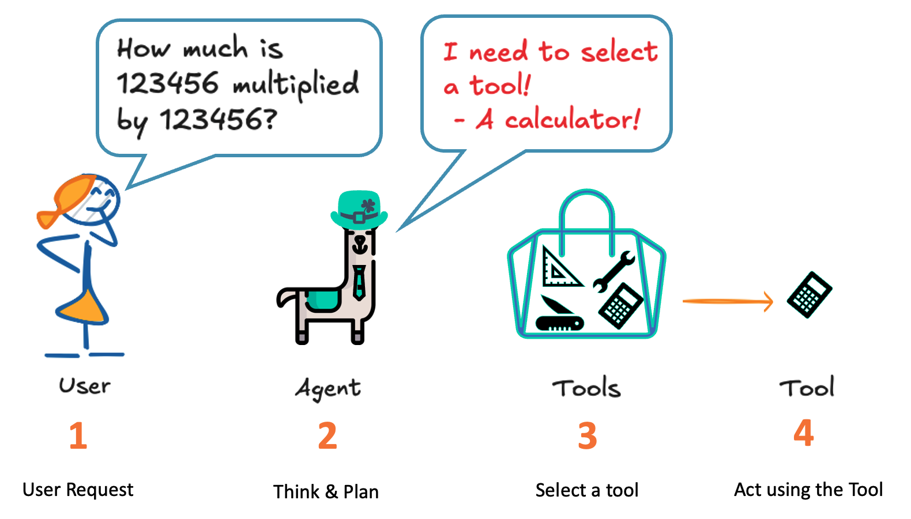{width=85% fig-align="center"}

**It picks the tool and fills in the arguments.** The model receives a list of available tools and their schemas, and it chooses. The code never contains `if "disk" in prompt: get_system_info()`. That branch is now the model's job.

**It looks at the result and decides what comes next**: another tool call, or a final answer. And the decisions chain, as the trace in the Overview shows: call `get_system_info`, pull the number out of the returned JSON, compare it against 1 GB, and only then choose which pattern to draw. Two model turns with a comparison in between that nobody hard-coded.

A classifier that always reads the same three sensor values, always calls the model exactly once, always with the same prompt shape, does none of this. That is a **pipeline**: deterministic, fast, and exactly right for its job (a risk classifier should not wander off to check the disk). What follows is different in kind. It is a **loop**:

\noindent
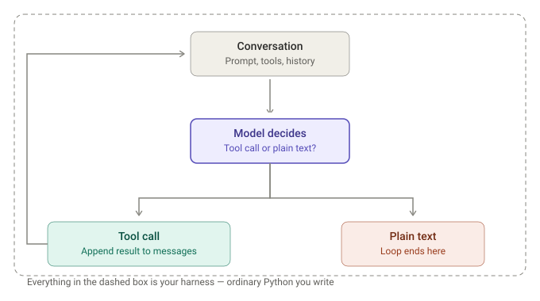{width=85% fig-align="center"}

Two things the diagram does not show often trip people up on the first read:

- **The model never runs anything.** It emits a request (a function name and a JSON blob of arguments), then stops and waits. The Python code does the actual work and hands the output back. Nothing executes unless the harness executes it, which is also where every safety check belongs.
- **Nothing guarantees the loop terminates.** A confused model can call `get_system_info` five times in a row. @sec-uno-q-agentic-building-agent-loop-78e7 caps the iterations (`MAX_TURNS`) and breaks out with a message rather than trusting the model to stop on its own.

### Model, Harness, Agent {#sec-uno-q-agentic-model-harness-agent-2e66}

Three words get used interchangeably, and separating them is worth a paragraph.

The **model** is Qwen3.5, sitting behind `llama-server`. It reads text and writes text. That is all it does: it cannot open a file, read a sensor, or light an LED, and between requests it remembers nothing.

The **harness** is everything else: the loop in the diagram above, the dispatch table that maps a name to a Python function, the code that formats messages and appends results, and the turn limit that stops runaways. It is ordinary software, about 40 lines here.

The **agent** is the two together. Neither half is an agent on its own.

That split tells where a problem lives. A tool returning wrong data, a loop that never terminates, an LED that lights when it should go dark: those are harness bugs, and a debugger finds them. A model that picks the wrong tool, or keeps calling tools after it already has the answer: those are not harness bugs, and no amount of Python fixes them. @sec-uno-q-agentic-running-it-example-interactions-8689 puts both kinds side by side.

"Harness" is also the vocabulary worth carrying: it is what people mean by "agent framework" or "scaffolding". LangChain agents, OpenAI's Assistants API, and the rest are harnesses with more in them (retries, memory, orchestration, tracing), wrapped around exactly the cycle above.

> Building a small harness by hand is the fastest way to understand what the large ones are actually doing.

### The Native Tools API vs. Hand-Rolled Classification {#sec-uno-q-agentic-native-tools-api-vs-handrolled-classification-9a49}

`llama-server` exposes an OpenAI-compatible `tools` parameter on `/v1/chat/completions`. Each tool is described as a JSON Schema (name, description, parameter types), and the server constrains decoding so the model's function-call arguments come back as valid, parseable JSON rather than prose. Compared to the classify-then-route pattern, where the model had to freehand a JSON object like `{"type": "multiplication", "numbers": [7, 8]}` and the code hoped it got the shape right, the native API moves that structural guarantee into the inference engine itself. It does not fix everything (@sec-uno-q-agentic-performance-reliability-c4d4 has the honest version of what still goes wrong at 0.8B), but it removes one whole category of failure.

Qwen3.5 supports this function-calling format natively. It needs the chat template active (the `--jinja` flag), because tool-call formatting is part of the model's chat template, not a separate code path.

## Hardware and Software Requirements {#sec-uno-q-agentic-hardware-software-requirements-2427}

### Hardware {#sec-uno-q-agentic-hardware-2752}

- Arduino UNO Q, 2 GB or 4 GB. The 0.8B model fits either; the 2B model used later is more comfortable on 4 GB (see the [candidate models](../llm/llm.qmd#sec-uno-q-slm-candidate-models-2d1e) in the SLM lab).
- USB-C data cable.
- Host computer with SSH.

**Nothing else.** No breadboard, no sensors, no external LEDs: every tool in this lab uses either the Linux filesystem and CLI or the UNO Q's own onboard LED and LED matrix.

### Software Already on the UNO Q {#sec-uno-q-agentic-software-already-uno-q-ccfd}

+--------------------------------------------------+---------------------------------------------------------------------------+
| **Tool**                                         | **Purpose**                                                               |
+:=================================================+:==========================================================================+
| `llama.cpp` built from source, Qwen3.5-0.8B GGUF | From the [SLM](../llm/llm.qmd) lab                                        |
+--------------------------------------------------+---------------------------------------------------------------------------+
| `llama-server`                                   | From the SLM lab; this lab starts it in the foreground with its own flags |
+--------------------------------------------------+---------------------------------------------------------------------------+
| `openai` Python client                           | From the SLM lab                                                          |
+--------------------------------------------------+---------------------------------------------------------------------------+
| `arduino-app-cli`                                | Builds and runs dual-brain apps                                           |
+--------------------------------------------------+---------------------------------------------------------------------------+

: Software this lab reuses. {#tbl-uno-q-agentic-software}

Nothing new is installed on the Python side: `openai` is all this needs. On the MCU side, the `Arduino_LED_Matrix` library is bundled with the UNO Q's Zephyr core and needs no separate install.

### Two Models, Not One {#sec-uno-q-agentic-two-models-one-0c65}

This lab uses **Qwen3.5-0.8B** at first and switches to **Qwen3.5-2B** partway through @sec-uno-q-agentic-running-it-example-interactions-8689. That is not indecision: the swap is the experiment. The small model demonstrates the mechanism and then hits a visible wall, and crossing that wall costs exactly one changed file path and about twice the latency. @sec-uno-q-agentic-performance-reliability-c4d4 has the measurements.

Both models are downloaded in the [SLM lab](../llm/llm.qmd#sec-uno-q-slm-choosing-downloading-model-1457). Check that they are there:

```bash
ls ~/models/Qwen_Qwen3.5-0.8B-Q8_0.gguf
ls ~/models/Qwen3.5-2B-UD-Q4_K_XL.gguf
```

Only one runs at a time, since they share port 8081.

> **About the measurements.** The numbers in this lab were taken with Unsloth's `Qwen3.5-0.8B-Q8_0.gguf` and with the `UD-Q4_K_XL` file from Unsloth's `Qwen3.5-2B-MTP-GGUF` repository. The SLM lab's files (Bartowski's 0.8B Q8_0 and the non-MTP 2B `UD-Q4_K_XL`) are the same quantizations of the same models, so expect similar, but not identical, timings.

### Server Flags That Matter Here {#sec-uno-q-agentic-server-flags-matter-4831}

Start `llama-server` as in the SLM lab, with the flags this lab depends on:

```bash
~/llama.cpp/build/bin/llama-server \
  --model ~/models/Qwen_Qwen3.5-0.8B-Q8_0.gguf \
  --host 0.0.0.0 --port 8081 \
  --jinja \
  --reasoning off --reasoning-budget 0 \
  --ctx-size 8192 --parallel 1 --threads 4 \
  --batch-size 512 --ubatch-size 64 \
  --predict 1024 \
  --alias qwen3.5-0.8b
```

- `--jinja` activates the chat template. Tool-call formatting lives *inside* that template, so without this flag `tool_calls` comes back empty every time, and the model describes its intended tool call in prose instead of making one.
- `--reasoning off --reasoning-budget 0` disables Qwen3.5's thinking traces. Thinking and tool calling interact badly at this size: the model spends its token budget reasoning about which tool to call, then emits the reasoning as the answer instead of the call.
- `--ubatch-size 64` is the single biggest performance flag in this lab. It makes answers more than three times faster, for reasons @sec-uno-q-agentic-flag-matters-ubatchsize-06c0 measures. Do not skip it, and do not judge how slow the agent feels while it is at the default.
- `--ctx-size 8192` gives the loop room. An agent conversation grows with every tool result, and a `read_file` result can add a thousand tokens or more on its own. Tool definitions take their share too: the WebUI in @sec-uno-q-agentic-first-contact-agentic-mode-builtin-webui-4dec sends about 1,200 tokens of them with every request. At 4096, one large tool result can leave no room for the answer, and the server stops with `Context size has been exceeded`.
- `--parallel 1` opens a single slot. By default the server opens several slots that share one KV cache (`kv_unified = 'true'` in the startup log), so a second request, from another browser tab or a classmate on the same board, takes space and CPU from the first, and both can fail. With one slot, the second request waits its turn.
- `--predict 1024` caps generation on the server side. `main.py` sets `max_tokens`, but @sec-uno-q-agentic-first-contact-agentic-mode-builtin-webui-4dec drives the model from the WebUI with no client-side limit, so this is the backstop that keeps a confused model from generating for minutes.
- `--alias` is the model name the server reports to clients, and it must match `MODEL` in `main.py`. It is `qwen3.5-0.8b` throughout this lab, including after the 2B swap, where keeping the same alias means no Python has to change.

**This exact command is used three times in the lab**: here, in the WebUI section with `--tools` appended, and in the 2B swap with only the `--model` path changed. If flags change between sections, something has gone wrong.

**This is the server configuration the Python agent needs**, and the one to come back to after the WebUI section borrows the port for a different purpose. Two details matter for the agent specifically:

- `--host 0.0.0.0`, not `127.0.0.1`. The agent runs inside a container and reaches `llama-server` across the container gateway, so a server bound to loopback is invisible to it.
- No `--tools`. That flag controls llama.cpp's *own* built-in tools, which only the WebUI section uses. The agent supplies its own tool schemas in every request, so the server never needs to know about them in advance.

Only one process can hold port 8081, so stop whichever server is running before starting another:

```bash
# Ctrl-C in the terminal running it, or from anywhere:
pkill -f llama-server
```

> If an earlier tutorial left `llama-server` running as a systemd service that starts at boot, it holds port 8081. This lab runs the server in the foreground instead, to show its output and change its flags between sections. Stop the service first, for example with `sudo systemctl disable --now llama-server`, and re-enable it later if needed.

Verify tool calling before writing any code:

```bash
curl -s http://localhost:8081/v1/chat/completions \
  -H 'Content-Type: application/json' -d '{
  "model": "qwen3.5-0.8b",
  "messages": [{"role":"user","content":"What is 47 times 12?"}],
  "tools": [{"type":"function","function":{
    "name":"calculate",
    "description":"Evaluate an arithmetic expression.",
    "parameters":{"type":"object","properties":{
      "expression":{"type":"string"}},"required":["expression"]}}}]
}' | python3 -m json.tool | grep -A5 tool_calls
```

\noindent
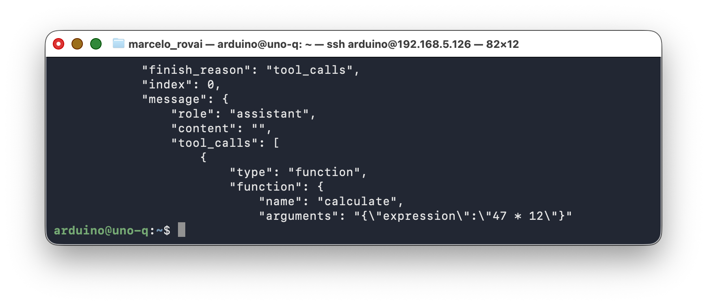{width=85% fig-align="center"}

A `tool_calls` block with a `calculate` function and an `expression` argument means the server is configured correctly. Plain text instead means something is wrong; fix it before continuing, because everything downstream depends on it.

## First Contact: Agentic Mode in the Built-In WebUI {#sec-uno-q-agentic-first-contact-agentic-mode-builtin-webui-4dec}

Before writing a line of Python, it is worth seeing an agent loop run with zero code. Recent llama.cpp builds ship a set of built-in tools the model can call from the server's own WebUI, the same interface used for chat in the [SLM lab](../llm/llm.qmd#sec-uno-q-slm-step-5-builtin-webui-optional-e17e). This is the fastest way for a room full of students to *see* tool calling happen, watch each decision, and approve or reject it in real time, before anyone opens an editor.

> Keep the built-in agent tools switched off in ordinary chat sessions. This section turns them on deliberately and briefly, with the reasoning made explicit. Read the safety note at the end before the next session.

### Step 1: Ask the Build What It Has {#sec-uno-q-agentic-step-1-ask-build-a0b2}

The built-in tool set is marked experimental upstream, and the list has changed several times. Do not trust the one printed below; ask the binary that was built:

```bash
~/llama.cpp/build/bin/llama-server --help | grep -A6 -- '--tools'
```

On a build from around the time of writing:

```text
--tools TOOL1,TOOL2,...  experimental: whether to enable built-in tools
                         for AI agents - do not enable in untrusted
                         environments (default: no tools) specify "all"
                         to enable all tools
                         available tools: read_file, file_glob_search,
                         grep_search, exec_shell_command, write_file,
                         edit_file, get_info
```

Read the default again: **no tools**. Nothing is exposed unless it is named on the command line. Naming a tool the build does not have stops the server at startup with `unknown tool "..."`, followed by the list it does have. Older builds listed `apply_diff` and `get_datetime` here; both have since left the server. Most builds also offer a `-ag, --agent` shortcut that switches on every tool plus the MCP CORS proxy in one go. Convenient, and exactly the wrong choice for a classroom: it hands the model a shell before anyone has seen it call a single tool.

### Step 2: Start the Server with Read-Only Tools Only {#sec-uno-q-agentic-step-2-start-server-readonly-tools-9756}

This section needs a *different* server from the rest of the lab: the same command with one flag added, `--tools`. Stop the running server first, since only one process can hold port 8081:

```bash
~/llama.cpp/build/bin/llama-server \
  --model ~/models/Qwen_Qwen3.5-0.8B-Q8_0.gguf \
  --host 0.0.0.0 --port 8081 \
  --jinja \
  --reasoning off --reasoning-budget 0 \
  --ctx-size 8192 --parallel 1 --threads 4 \
  --batch-size 512 --ubatch-size 64 \
  --predict 1024 \
  --tools read_file,file_glob_search,grep_search,get_info \
  --alias qwen3.5-0.8b
```

> In the WebUI, also turn reasoning **Off** in the `+` menu.

Expect the first reply after starting this server to take about two minutes. @sec-uno-q-agentic-step-5-watch-work-292f shows where that time goes.

Here is the full set, and why four of them made the cut:

+----------------------+--------------------------------------------+-------------------+
| **Tool**             | **What it does**                           | **This pass?**    |
+:=====================+:===========================================+:==================+
| `read_file`          | Reads any file the `arduino` user can read | Yes               |
+----------------------+--------------------------------------------+-------------------+
| `file_glob_search`   | Finds files by name pattern                | Yes               |
+----------------------+--------------------------------------------+-------------------+
| `grep_search`        | Searches inside file contents              | Yes               |
+----------------------+--------------------------------------------+-------------------+
| `get_info`           | Returns the board's OS name and version    | Yes (see Step 3)  |
|                      | and the working directory                  |                   |
+----------------------+--------------------------------------------+-------------------+
| `write_file`         | Creates or overwrites a file               | Step 6            |
+----------------------+--------------------------------------------+-------------------+
| `edit_file`          | Modifies an existing file in place         | No                |
+----------------------+--------------------------------------------+-------------------+
| `exec_shell_command` | Runs arbitrary shell commands              | Not in a workshop |
+----------------------+--------------------------------------------+-------------------+

: The llama-server built-in tools. {#tbl-uno-q-agentic-builtin-tools}

The server now exposes **only those four**, all of them read-only. The others are not merely switched off: as far as the browser is concerned, they do not exist.

> **What about the date and time?** Older builds had a `get_datetime` server tool. It now lives in the WebUI itself, as the **Current time** tool shown in @sec-uno-q-agentic-step-3-open-webui-read-tools-panel-5ec8: the browser offers it to the model in every chat, with no `--tools` flag, and answers with the date, time, and time zone of the computer running the browser, not the board's. Passing `--tools get_datetime` to a current build stops the server at startup with `unknown tool "get_datetime"`.

> **Warning:** `--tools all` exposes all seven tools, including `exec_shell_command`. Each one can be switched off in the WebUI, but that is a browser setting, not a boundary. This lab names the active tools explicitly on the command line instead.

> **If the WebUI stops working after adding `--tools`**, it is the CORS default. Several builds clamp `--cors-origins` to localhost when tools are enabled, on the reasoning that a server handing out file access should not accept requests from arbitrary origins. The board is reached at its LAN address, not at localhost, so the origins do not match. Either name the origin explicitly (`--cors-origins http://<UNO_Q_IP>:8081`) or use the SSH tunnel from the safety note below and browse `http://localhost:8081`. The tunnel is the better habit.

### Step 3: Open the WebUI and Read the Tools Panel {#sec-uno-q-agentic-step-3-open-webui-read-tools-panel-5ec8}

Open the WebUI, click the gear icon (**Settings**), then **Tools** in the left-hand list. The tools come in two groups, each tool with its own **Enabled** and **Always allow** checkboxes:

- **Server** lists the four tools named with `--tools`: **Read file**, **Search files**, **Search in files**, and **Runtime info** (`get_info`). These run on the board.
- **Browser** lists **Current time**, a tool the WebUI adds by itself. It runs in the browser, on the computer used for browsing, and never touches the board.

\noindent
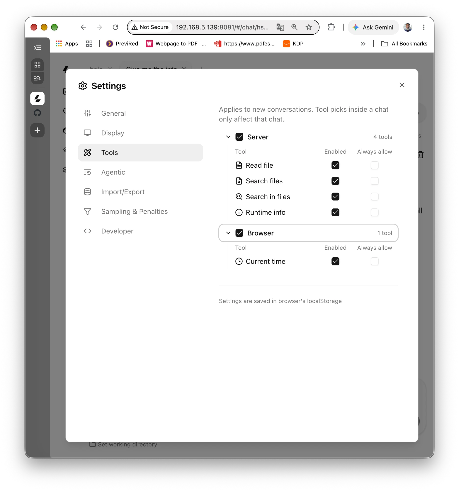{width=85% fig-align="center"}

Why name `get_info` at all, when it only reports the OS and working directory? Because the WebUI fills the gap otherwise. Without a server `get_info`, it adds a browser tool with the same name, **Runtime info**, in the Browser group. That one reports the OS of the computer running the browser, not the board's, and tells the model it has no file access and that the user should restart the server with `--agent`. With file tools on the server, that is false, and its description invites the model to call it exactly when asked about files, which is what @sec-uno-q-agentic-step-5-watch-work-292f does. A small model may believe it and refuse to search. Naming `get_info` on the command line replaces the browser version with the board's real answer, and keeps the rule intact: the command line decides what exists. Its answer appears in @sec-uno-q-agentic-step-5-watch-work-292f.

If instead only the **Browser** group appears:

\noindent
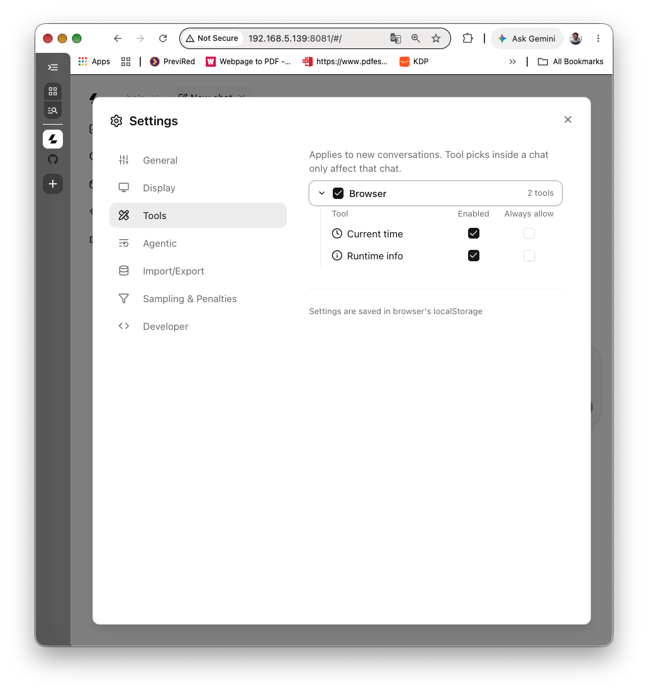{width=85% fig-align="center"}

...the server was started without `--tools`. That is the most common stumble in this section, and a productive one, because it shows where the control actually lives:

- **The command line is the boundary.** `--tools` decides what exists.
- **The panel is a view onto that list**, plus per-browser convenience toggles. Look at the line under the tool list: settings are saved in the browser's localStorage. Clearing the browser data resets the checkboxes; the server's allow-list does not move.

A student who only ever sees the checkboxes may come away believing the browser grants permissions. It does not. @sec-uno-q-agentic-designing-tool-set-aff8 builds the same idea from the other direction.

### Step 4: Set the Agentic Limits {#sec-uno-q-agentic-step-4-set-agentic-limits-a6d7}

Click **Agentic** in the same Settings list:

\noindent
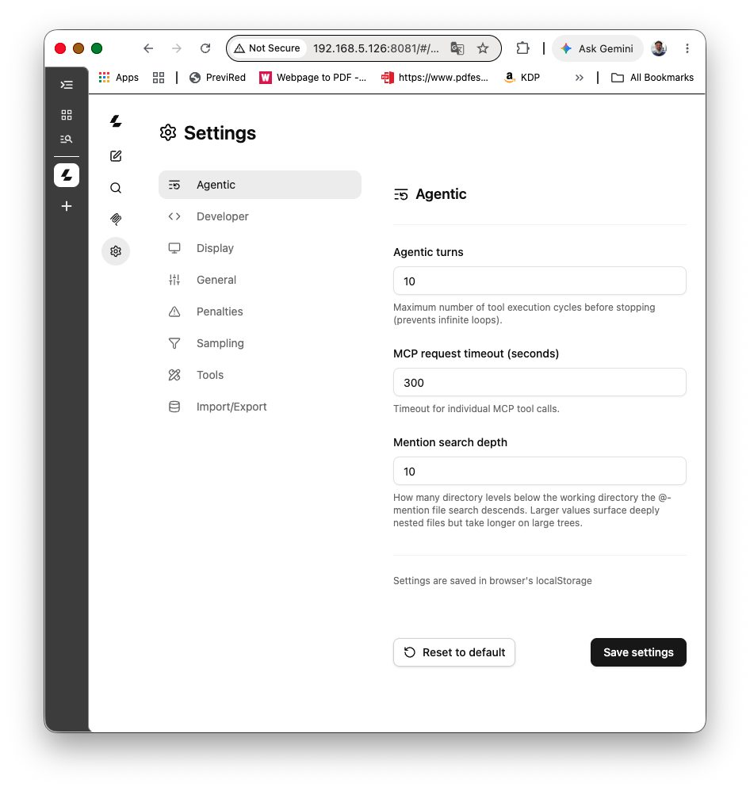{width=85% fig-align="center"}

- **Agentic turns**: the same idea as the `MAX_TURNS` cap built by hand later: a hard stop on how many tool-call cycles run before the server gives up. The default (often 10) is fine to start.
- **MCP request timeout**: how long a single tool call may take before it is abandoned.
- **Mention search depth**: how many directory levels the file-search tools descend.

### Step 5: Watch It Work {#sec-uno-q-agentic-step-5-watch-work-292f}

**Warm up with one tool call.** Right after starting the server, open a new chat and ask:

> *"Give me the info"*

The model calls **Runtime info**, and the answer comes from the board, not from the computer running the browser: an `aarch64` Linux kernel and `/home/arduino` as the working directory.

\noindent
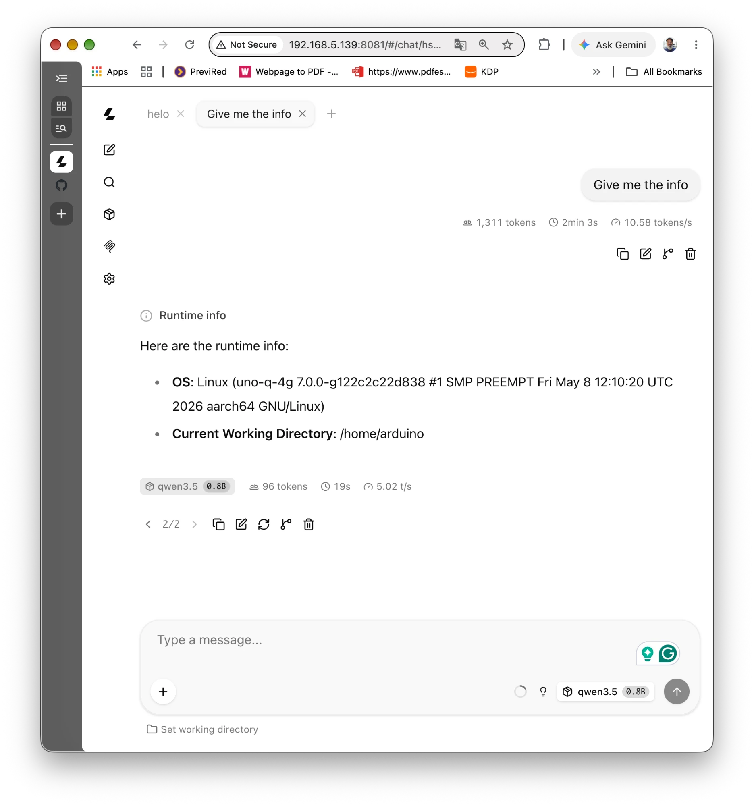{width=85% fig-align="center"}

Before reading the answer, read the two lines of numbers around it. They show where the time goes:

- **Above the answer: reading the prompt.** 1,311 tokens in 2 minutes 3 seconds, at about 10.6 tokens per second. The question is only a handful of those tokens. Almost all the rest are the definitions of the five enabled tools, which the WebUI sends with every request so the model knows what it can call.
- **Below the answer: writing the reply.** 96 tokens in 19 seconds, at about 5 tokens per second.

So with tools on, the wait comes from reading, not writing. Three consequences matter for the rest of this section:

- **Only the first request after the server starts pays for the tool definitions.** The server keeps what it has already read (its prompt cache), and every request starts with the same definitions, so later turns, and even new chats, skip them and start in seconds. Restart the server and the cache is empty again.
- **Big tool results cost minutes.** When a tool returns a file, the model has to read that file before it can answer. A file of 2,000 tokens adds about three minutes.
- **Fewer tools means a shorter wait.** Every tool unticked in the panel is one less definition to read.

**Now give it a real task.** Try a prompt that cannot be answered from the model's own knowledge:

> *"What files are in my home directory, and is there anything in them about edge AI?"*

Watch the chat. A confirmation card appears, asking to run a specific tool with specific arguments, *before* it executes.

\noindent
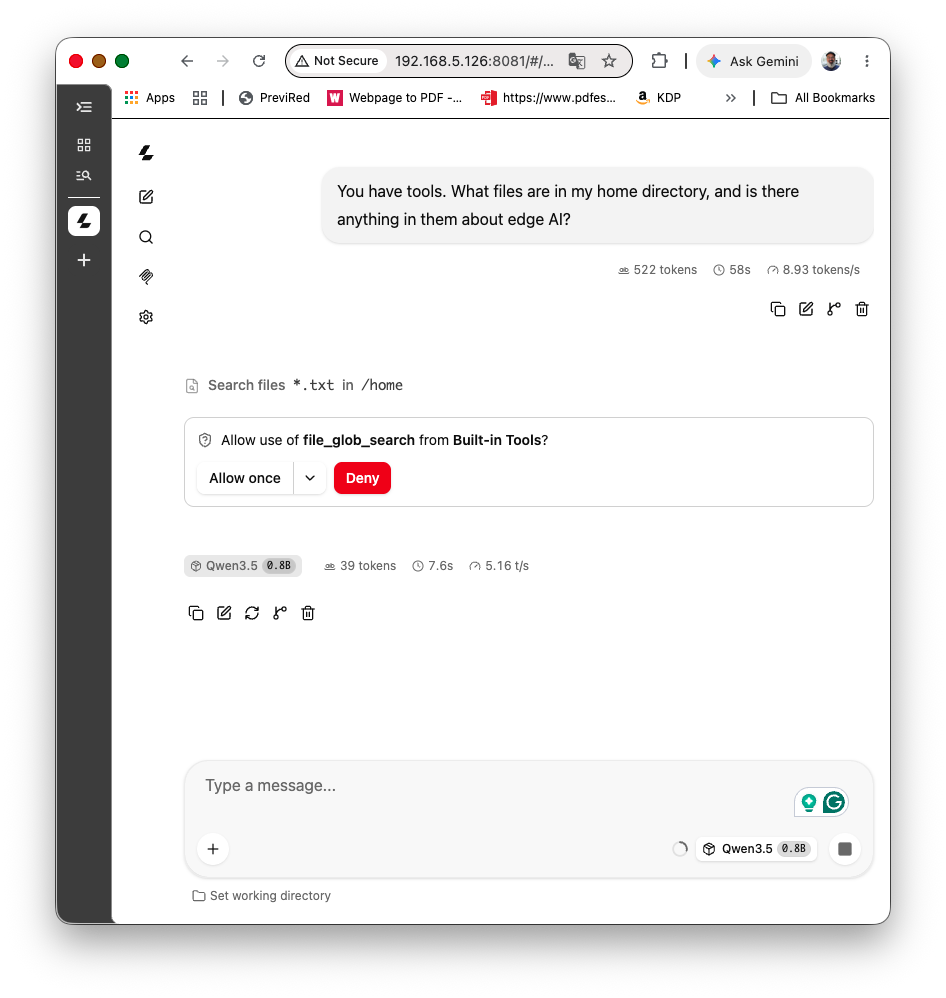{width=85% fig-align="center"}

Approve it, watch the result stream back into the conversation, and see whether the model needs a second call (it likely will: one to list files and one to search inside them) before it gives a final answer.

\noindent
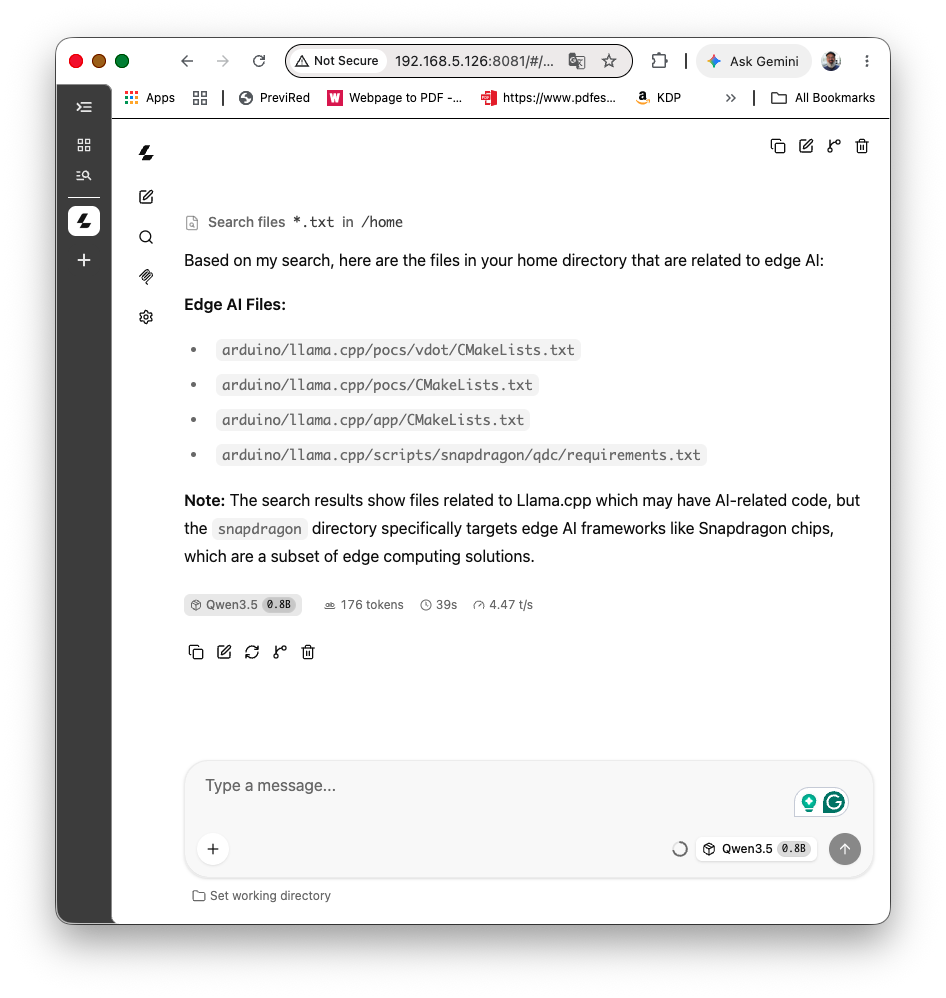{width=85% fig-align="center"}

That is the loop diagram happening live, one approved step at a time: send, decide, call, feed the result back, decide again.

### Step 6: Add a Writing Tool, on Purpose {#sec-uno-q-agentic-step-6-add-writing-tool-purpose-e7fb}

Stop the server and restart it with one more tool:

```bash
--tools read_file,file_glob_search,grep_search,get_info,write_file
```

Then ask:

> *"Create a file called notes.txt in /home/arduino directory with a two-line note about edge AI."*

Approve the write:

\noindent
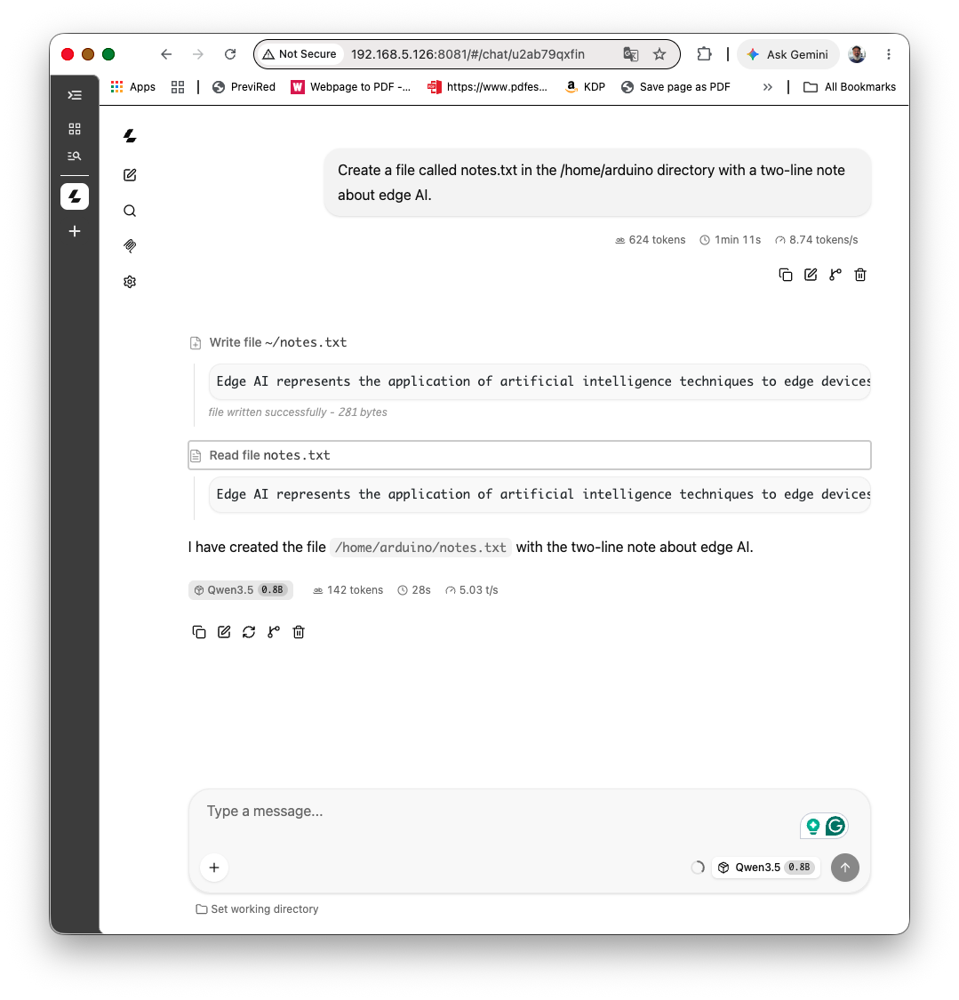{width=85% fig-align="center"}

> The agent understood the task, selected the correct tool (Write File), and then decided on its own to use another tool (Read File) to verify the result.

Confirm it from a terminal with `cat ~/notes.txt`:

\noindent
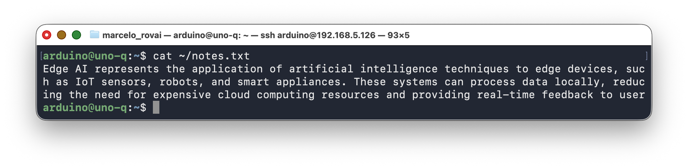{width=85% fig-align="center"}

Note what that took: stopping the process and restarting it. This permission could not have been granted from the browser. That friction is the feature: expanding what an agent can reach is a deliberate act with a record in the shell history, not a checkbox someone clicks while distracted.

### The Safety Note {#sec-uno-q-agentic-safety-note-9ce7}

There are two layers of control here, and it is worth being precise about what each one is worth.

**The `--tools` allow-list is the boundary.** It is enforced by the server process, it applies to every client, including scripts that call the API directly, and changing it requires restarting the server.

**"Always allow" is a second line of defense.** Unchecked, every call waits for a human. Checked, that tool fires immediately. Keep it off for anything that writes or executes: an unattended `write_file` loop is a bad way to learn this lesson. But it lives in browser localStorage: it protects the person at the keyboard, not the server.

Three things to be clear-eyed about:

1. **These tools have no directory restriction.** `read_file` reads anything the `arduino` user can read: no root, no allow-list of paths. That is the sharpest contrast with the tools built in @sec-uno-q-agentic-implementing-tools-43e8, where the file tools resolve every path against a fixed workspace.
2. **`exec_shell_command` runs with the user's full permissions.** Nothing stands between a confused model and a destructive command except the confirmation card. It has a place in an advanced demo; it has no place in a first workshop.
3. **`--host 0.0.0.0` is fine on a trusted network.** The board is headless, so there is no other way to reach the WebUI from a laptop browser. On an untrusted network it stops being safe: anyone who can reach `/v1/chat/completions` can drive the same tools through the raw API, and the confirmation card only exists in the WebUI. A script calling the API directly gets no such prompt. There, bind to `127.0.0.1` and tunnel:

```bash
ssh -L 8081:127.0.0.1:8081 arduino@<UNO_Q_IP>
# then open http://localhost:8081/ on the laptop
```

### A Note on the Model {#sec-uno-q-agentic-note-model-06f9}

The 0.8B model sometimes makes wrong decisions here, or misreads the task. Qwen3.5-2B shows stronger agentic behavior, at about twice the latency.

### Put the Server Back Before Continuing {#sec-uno-q-agentic-put-server-back-continuing-f752}

This section is a detour. Everything from here on reaches `llama-server` through the Python agent, which needs the configuration from @sec-uno-q-agentic-server-flags-matter-4831: no `--tools`, bound to `0.0.0.0`. Restore it now:

```bash
# stop the tools-enabled server: Ctrl-C, or pkill -f llama-server
# then restart the command from "Server Flags That Matter Here"
```

Skip this and the failure arrives much later, as `"llm_error": "... Connection refused"` from `/healthz`, a message that points at the agent rather than at the server that was never restarted. Switching to `--host 127.0.0.1` to satisfy the CORS default is the same trap from the other direction: the agent cannot reach loopback from inside its container.

That is the trade this section makes on purpose: broad, unscoped tools running with full user permissions, in exchange for zero setup. The rest of the lab builds the opposite: six narrow, purpose-built tools, each scoped to exactly what it needs, so every permission the agent has is one written in code and accounted for. Seeing both ends of that spectrum in one session is the point.

## Designing the Tool Set {#sec-uno-q-agentic-designing-tool-set-aff8}

Six tools, each small enough to reason about in one read:

+---------------------------+-----------------------------------------+---------------------+--------------------------------+
| **Tool**                  | **Description**                         | **Runs on**         | **Model-controlled arguments** |
+:==========================+:========================================+:====================+:===============================+
| `get_system_info()`       | OS, CPU, RAM, disk                      | MPU (Python)        | None                           |
+---------------------------+-----------------------------------------+---------------------+--------------------------------+
| `list_files(path)`        | List files in a directory               | MPU (Python)        | A path string                  |
+---------------------------+-----------------------------------------+---------------------+--------------------------------+
| `read_file(path)`         | Read a text file's contents             | MPU (Python)        | A path string                  |
+---------------------------+-----------------------------------------+---------------------+--------------------------------+
| `calculate(expression)`   | Evaluate an arithmetic expression       | MPU (Python, `ast`) | An expression string           |
+---------------------------+-----------------------------------------+---------------------+--------------------------------+
| `set_builtin_led(state)`  | Turn the onboard LED on or off          | MCU (Bridge RPC)    | A boolean                      |
+---------------------------+-----------------------------------------+---------------------+--------------------------------+
| `set_led_matrix(pattern)` | Draw a named pattern on the 8×13 matrix | MCU (Bridge RPC)    | One of 14 fixed values         |
+---------------------------+-----------------------------------------+---------------------+--------------------------------+

: The agent's six tools. {#tbl-uno-q-agentic-tool-set}

Two of the six cross the Bridge to the microcontroller; the other four resolve entirely in Python on the Linux side. Knowing which is which matters when debugging: a tool that hangs on the MPU looks nothing like a tool that hangs waiting on the MCU.

\noindent
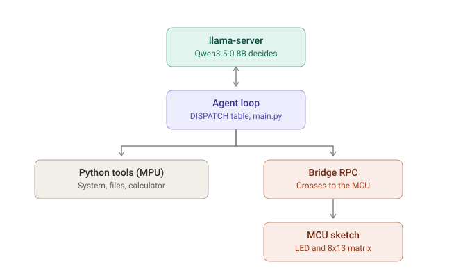{width=85% fig-align="center"}

### The Design Rule: The Attack Surface Is What the Model Controls {#sec-uno-q-agentic-design-rule-attack-surface-model-controls-8407}

Look at the last column of @tbl-uno-q-agentic-tool-set. It decides how much defensive code each tool needs, and it cuts across intuition in a useful way.

`get_system_info` reads system files and reports on the whole machine. It *looks* like the broad one. It is not the risky one: the model supplies zero arguments, so there is nothing for it to steer. What it reads is fixed by the code, every time, no matter what the user types.

`read_file` looks harmless by comparison. It is the one that needs a boundary, because the path comes from the model, and the model's output is downstream of whatever the user typed. The same goes for `calculate`: an arithmetic string sounds like the safest input imaginable, until it becomes clear that it is a string the model chose.

That is the rule worth carrying out of this lab, and it applies to every agent:

> The risk of a tool scales with the portion of it the model controls, not with how powerful the tool sounds.

There is a companion rule about what comes *back*, and @sec-uno-q-agentic-small-models-fail-specifically-d311 shows it in practice:

> A tool's output is read by a model, not a person. Return values it can compare, not strings it has to parse.

`get_system_info` returns `disk_free_gb: 1.4`, not `"1.4G free of 9.8G"`. The formatted string is friendlier to a human reading the trace and markedly worse for the model, which has to extract a number and reason about units before it can answer "is there more than 5 GB free?", a step small models routinely get wrong. Format for the reader in the final answer, never in the tool result.

A tool with no model-supplied arguments needs no boundary, regardless of what it can do. A tool with one model-supplied string needs one, regardless of how innocent it looks.

Two consequences shape the code in @sec-uno-q-agentic-implementing-tools-43e8:

- **The file tools work inside a fixed workspace directory**, not the whole filesystem. `list_files` and `read_file` resolve every path against a fixed root and reject anything that lands outside it. To be clear about what this does and does not buy: it protects nothing *from the board's owner*, who has a shell and can read any file in the next terminal window. The boundary is there because the *model* now chooses that path argument, and the model is influenced by text its owner did not write. It is the same reason MCP filesystem servers take a root directory and coding agents work within a project folder.
- **`calculate` walks a restricted AST; it does not `eval()`.** A tempting shortcut is `eval(expression)`. Do not take it. Walking a restricted AST (numbers, `+ - * / **`, parentheses, unary minus, nothing else) gives a real calculator with no code-execution surface. The code also caps the exponent, for a reason worth seeing fail before reading the fix.

This is the JSON Schema the model actually sees for two of the tools (the full list is in @sec-uno-q-agentic-building-agent-loop-78e7):

```json
{
  "type": "function",
  "function": {
    "name": "calculate",
    "description":
      "Evaluate a basic arithmetic expression and return the numeric result.",
    "parameters": {
      "type": "object",
      "properties": {
        "expression": {
          "type": "string",
          "description":
            "An arithmetic expression, e.g. '234 * 17 - 9' or '(3 + 4) / 2'."
        }
      },
      "required": ["expression"]
    }
  }
}
```

```json
{
  "type": "function",
  "function": {
    "name": "set_led_matrix",
    "description": "Draw a pattern on the UNO Q's onboard 8x13 LED matrix.",
    "parameters": {
      "type": "object",
      "properties": {
        "pattern": {
          "type": "string",
          "enum": ["check", "x", "smiley", "off",
                   "0", "1", "2", "3", "4", "5", "6", "7", "8", "9"],
          "description": "Which pattern to display."
        }
      },
      "required": ["pattern"]
    }
  }
}
```

The `enum` on `set_led_matrix` tells the model exactly which values are valid, and with grammar-constrained decoding the server can restrict sampling to that list. Do not rely on it alone, though: in one of the 2B runs in @sec-uno-q-agentic-crossing-boundary-swap-model-5ee2, the model sent `"X"` (uppercase), which is not in the list. The sketch's fallback (an unrecognized pattern draws an X) caught it. Express valid inputs as a fixed set in the schema wherever possible, which is the cheapest reliability win in the lab, and still validate on the side that executes the call.

## Project Setup {#sec-uno-q-agentic-project-setup-027f}

> The complete app is available in the [board-agent](https://github.com/Mjrovai/ARDUINO-UNO-Q/tree/main/5-Agentic_AI/board-agent) folder of the author's repository. Copying it to `~/ArduinoApps` and skipping to @sec-uno-q-agentic-running-it-example-interactions-8689 works, but building the app step by step, as below, shows how each piece fits.

### Step 1: Create the App {#sec-uno-q-agentic-step-1-create-app-3c1b}

```bash
cd ~/ArduinoApps
arduino-app-cli app new "board-agent"
cd board-agent
```

\noindent
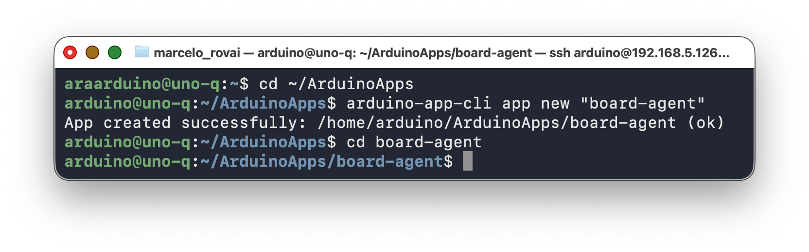{width=85% fig-align="center"}

The target layout:

```text
board-agent/
├── app.yaml
├── workspace/          <- the agent's file boundary
│   ├── notes.txt
│   └── readings.txt
├── python/
│   ├── main.py
│   ├── tools.py
│   ├── preview_patterns.py
│   └── requirements.txt
└── sketch/
    ├── sketch.ino
    └── sketch.yaml
```

Creating a new app produces some basic files (`app.yaml` and `README.md`) and the `python` and `sketch` folders.

\noindent
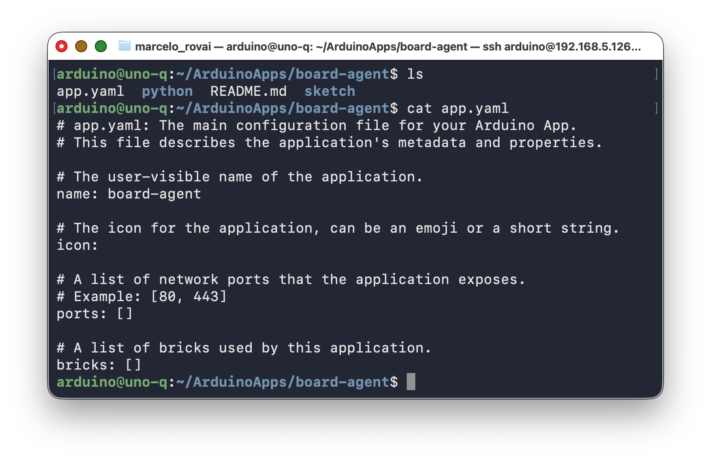{width=70% fig-align="center"}

Adapt their content for this project, starting with `app.yaml`:

```yaml
name: Board Agent
description: "A tool-calling agent for the UNO Q, no external hardware"
icon: 🤖
version: "1.0.0"
ports: [7000]
bricks: []
```

> Any editor works: VS Code over Remote-SSH, `nano`, or even `cat >`. In `nano`, **Ctrl+K** deletes a line; paste the content above, then save with **Ctrl+X**, **Y**, **Enter**.

`python/requirements.txt`:

```text
openai==1.54.0
httpx==0.27.2
flask==3.0.3
requests==2.32.3
```

App Lab installs these into a virtual environment it manages, the first time the app runs and again whenever this file changes. There is nothing to create or activate by hand: @sec-uno-q-agentic-running-it-example-interactions-8689 covers what that means in practice, and @sec-uno-q-agentic-tips-tricks-troubleshooting-6dca covers what happens when it is bypassed.

> **Why `httpx` is pinned when nothing imports it.** It arrives as a dependency of `openai`, and the two have a version boundary: `openai` 1.54 passes a `proxies` argument that `httpx` 0.28 removed. With `httpx` unpinned, the resolver is free to pick the newer one, and the app dies at startup with `TypeError: Client.__init__() got an unexpected keyword argument 'proxies'`, an error that names neither package actually chosen. Pinning it makes the working combination explicit, so twenty boards in a workshop resolve to the same thing on twenty different days.

### Step 2: Seed the Workspace {#sec-uno-q-agentic-step-2-seed-workspace-55c0}

The file tools need something to find. Give the agent two files with real content, so `list_files` → `read_file` → `calculate` can chain into a request worth watching:

```bash
mkdir -p workspace

cat > workspace/notes.txt << 'EOF'
Board Agent — running notes

The UNO Q pairs a Qualcomm QRB2210 (Linux) with an STM32U585 (Zephyr).
Qwen3.5-0.8B loads in about 600 MB of RAM at Q4_K_M.
Bridge RPC is the only path between the Python side and the sketch.
EOF

cat > workspace/readings.txt << 'EOF'
Temperature log, lab bench, 2026-03-14
09:00  21.4
12:00  24.8
15:00  26.1
18:00  23.7
EOF
```

The second file exists to ask the agent something it cannot answer in one step: "what was the average temperature in the log?" needs `read_file`, then `calculate`, then a sentence.

## Implementing the Tools {#sec-uno-q-agentic-implementing-tools-43e8}

### Step 1: The Python-Side Tools {#sec-uno-q-agentic-step-1-pythonside-tools-87c4}

Create `python/tools.py`. It holds every tool the Linux side can run on its own, with no Bridge call involved.

```python
"""
tools.py — the agent's toolbox. Each public function here corresponds to one
entry in the `tools=[...]` schema sent to llama-server.

Every function returns a JSON string, and every failure is returned rather
than raised. That's deliberate: a tool that raises kills the agent loop; a
tool that returns {"error": "..."} hands the model something it can read and
recover from on the next turn.
"""

import ast
import json
import operator
import os
import platform
import shutil
from pathlib import Path

# ─── get_system_info ────────────────────────────────────────────────
# No model-controlled arguments, so nothing to validate: the commands
# below are the only ones that can ever run, whatever the user types.

def get_system_info():
    """Return basic OS/CPU/RAM/disk facts about the board.

    Every size is a plain number in GB, not a formatted string. That is
    deliberate: this output is read by a model, not a person. Handed
    "1.4G free of 9.8G", a small model has to parse the string and reason
    about units before it can compare anything -- and it often gets that
    wrong. Handed disk_free_gb: 1.4, the comparison is one step.
    """
    def _pretty_name():
        try:
            with open("/etc/os-release") as f:
                for line in f:
                    if line.startswith("PRETTY_NAME="):
                        return line.split("=", 1)[1].strip().strip('"')
        except OSError:
            pass
        return platform.platform()

    def _mem_gb():
        total = avail = None
        try:
            with open("/proc/meminfo") as f:
                for line in f:
                    if line.startswith("MemTotal:"):
                        total = int(line.split()[1]) / 1048576
                    elif line.startswith("MemAvailable:"):
                        avail = int(line.split()[1]) / 1048576
        except (OSError, ValueError):
            pass
        return total, avail

    du = shutil.disk_usage("/")
    mem_total, mem_avail = _mem_gb()

    return json.dumps({
        "os": _pretty_name(),
        "machine": platform.machine(),
        "cpu_count": os.cpu_count(),
        "memory_free_gb": round(mem_avail, 1) if mem_avail else None,
        "memory_total_gb": round(mem_total, 1) if mem_total else None,
        "disk_free_gb": round(du.free / 2**30, 1),
        "disk_total_gb": round(du.total / 2**30, 1),
    })


# ─── Workspace-scoped file access ───────────────────────────────────
# These take a path from the model, so they get a boundary.

# Resolve the workspace relative to this file, never as an absolute host
# path: arduino-app-cli runs the app from /app inside a container, so
# "/home/arduino/ArduinoApps/board-agent/workspace" does not exist there.
# tools.py lives at <app>/python/tools.py, so its grandparent is the app root.
APP_ROOT = Path(__file__).resolve().parent.parent
WORKSPACE_ROOT = Path(
    os.environ.get("AGENT_WORKSPACE", APP_ROOT / "workspace")
).resolve()
WORKSPACE_ROOT.mkdir(parents=True, exist_ok=True)
MAX_READ_BYTES = 4096


def _resolve_in_workspace(path):
    """Resolve `path` against WORKSPACE_ROOT.

    Refuse anything that escapes it.
    """
    candidate = (WORKSPACE_ROOT / path).resolve()
    if candidate != WORKSPACE_ROOT and WORKSPACE_ROOT not in candidate.parents:
        raise ValueError(f"path '{path}' is outside the workspace")
    return candidate


def list_files(path="."):
    """List files and folders inside the agent's workspace directory."""
    try:
        target = _resolve_in_workspace(path)
        if not target.exists():
            return json.dumps(
                {"error": f"'{path}' does not exist in the workspace"})
        entries = sorted(p.name + ("/" if p.is_dir() else "")
                         for p in target.iterdir())
        if not entries:
            # Say so explicitly. A bare [] gives the model nothing to act on,
            # and it will often just call the tool again.
            return json.dumps({"path": path, "entries": [],
                               "note": "this directory is empty"})
        return json.dumps({"path": path, "entries": entries})
    except (ValueError, OSError) as e:
        return json.dumps({"error": str(e)})


def read_file(path):
    """Read a text file from the agent's workspace directory (capped size)."""
    try:
        target = _resolve_in_workspace(path)
        if not target.is_file():
            return json.dumps(
                {"error": f"'{path}' is not a file in the workspace"})
        with target.open("r", errors="replace") as fh:
            content = fh.read(MAX_READ_BYTES)
            truncated = fh.read(1) != ""
        return json.dumps({"path": path, "content": content,
                           "truncated": truncated})
    except (ValueError, OSError) as e:
        return json.dumps({"error": str(e)})


# ─── calculate: AST-based, no eval() ────────────────────────────────

_ALLOWED_OPS = {
    ast.Add: operator.add,
    ast.Sub: operator.sub,
    ast.Mult: operator.mul,
    ast.Div: operator.truediv,
    ast.Pow: operator.pow,
    ast.USub: operator.neg,
}

MAX_EXPONENT = 64


def _eval_node(node):
    if (isinstance(node, ast.Constant)
            and isinstance(node.value, (int, float))):
        return node.value
    if isinstance(node, ast.BinOp) and type(node.op) in _ALLOWED_OPS:
        left, right = _eval_node(node.left), _eval_node(node.right)
        if isinstance(node.op, ast.Pow) and abs(right) > MAX_EXPONENT:
            raise ValueError(
                f"exponent {right} is above the limit of {MAX_EXPONENT}")
        return _ALLOWED_OPS[type(node.op)](left, right)
    if isinstance(node, ast.UnaryOp) and type(node.op) in _ALLOWED_OPS:
        return _ALLOWED_OPS[type(node.op)](_eval_node(node.operand))
    raise ValueError(f"disallowed expression element: {type(node).__name__}")


def calculate(expression):
    """Safely evaluate an arithmetic expression.

    Only + - * / ** and parentheses are allowed.
    """
    try:
        tree = ast.parse(expression, mode="eval")
        result = _eval_node(tree.body)
        return json.dumps({"expression": expression, "result": result})
    except Exception as e:
        return json.dumps({"expression": expression, "error": str(e)})
```

Test the tools on their own before wiring them to a model, to know they work before debugging tool *selection*:

```bash
cd ~/ArduinoApps/board-agent/python
python3 -c "
import tools
print(tools.list_files('.'))
print(tools.read_file('readings.txt'))
print(tools.calculate('(21.4 + 24.8 + 26.1 + 23.7) / 4'))
print(tools.read_file('../../../etc/passwd'))
"
```

Run all the lines as above, or one by one:

\noindent
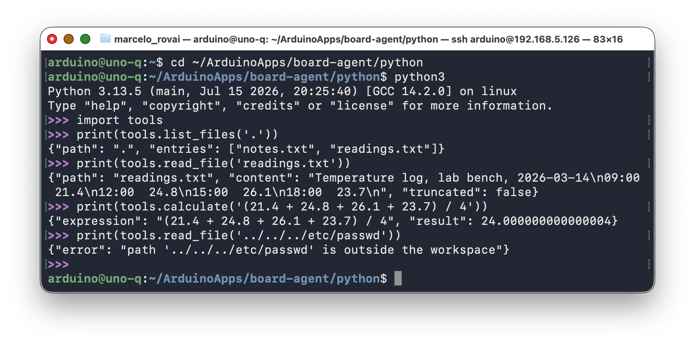{width=85% fig-align="center"}

The tools work, and the last line **returns an error, not a password file**.

If `list_files` comes back with `"entries": []`, the workspace is empty: go back and run the seeding commands of @sec-uno-q-agentic-step-2-seed-workspace-55c0. That is not a harmless state: @sec-uno-q-agentic-infinite-toolcall-loops-2a49 shows what the agent does when a tool keeps handing it nothing.

### Two Things Worth Understanding in That Code {#sec-uno-q-agentic-two-things-worth-understanding-code-f412}

**Why `_resolve_in_workspace` resolves before comparing.** A string check like `path.startswith(WORKSPACE_ROOT)` is defeated by `../../etc/passwd` before the path is ever normalized. Resolving first, then checking ancestry, closes that. It also closes a case that is harder to spot: a *symlink* inside the workspace pointing at `/etc/passwd`. `.resolve()` follows the link before the ancestry check runs, so the real target gets tested, not the link's own path. Try it:

```bash
ln -s /etc/passwd ~/ArduinoApps/board-agent/workspace/escape.txt
python3 -c "import tools; print(tools.read_file('escape.txt'))"
rm ~/ArduinoApps/board-agent/workspace/escape.txt
```

\noindent
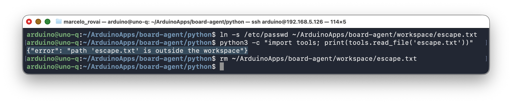{width=85% fig-align="center"}

**Why `calculate` caps the exponent.** "No `eval()`" and "safe" are not the same claim, and the gap between them is worth feeling directly. Comment out the `MAX_EXPONENT` check and run this, with a second SSH session open, because it will be needed:

```bash
python3 -c "import tools; print(tools.calculate('9**9**9'))"
```

Nothing executes that should not. The AST walk works exactly as advertised. The board just stops responding while Python tries to build a number with 370 million digits. A restricted grammar closed the code-execution hole; it did nothing about resource exhaustion, and on a 2 GB board with four Cortex-A53 cores that is not a theoretical concern. Put the check back.

**The general lesson**: when writing a tool, ask what a *hostile* argument costs, not just what a *malicious* one does. Cost comes in more flavors than code execution: CPU, memory, disk, wall-clock time, and money, if the tool calls a paid API.

### Step 2: The MCU Sketch: Built-In LED and LED Matrix {#sec-uno-q-agentic-step-2-mcu-sketch-builtin-led-led-matrix-1863}

The UNO Q's Zephyr core bundles `Arduino_LED_Matrix`, so no separate library install is needed.

`sketch/sketch.ino`:

```cpp
#include "Arduino_RouterBridge.h"
#include "Arduino_LED_Matrix.h"

ArduinoLEDMatrix matrix;

// 8 rows x 13 columns, 0 = off, 1 = on.
// Row 0 is the top row, column 0 is the left column.
uint8_t frame[8][13];

void clearFrame() {
  memset(frame, 0, sizeof(frame));
}

void showOff()   { clearFrame(); matrix.renderBitmap(frame, 8, 13); }

void showCheck() {
  clearFrame();
  int pts[][2] = { {5,2}, {6,3}, {7,4}, {6,5}, {5,6},
                   {4,7}, {3,8}, {2,9}, {1,10} };
  for (auto &p : pts) frame[p[0]][p[1]] = 1;
  matrix.renderBitmap(frame, 8, 13);
}

void showX() {
  clearFrame();
  // Both diagonals stay within columns 2..10 for rows 0..7, so no bounds
  // check is needed here. If the row count changes, re-check that.
  for (int i = 0; i < 8; i++) {
    frame[i][2 + i]  = 1;
    frame[i][10 - i] = 1;
  }
  matrix.renderBitmap(frame, 8, 13);
}

void showSmiley() {
  clearFrame();
  int pts[][2] = {
    {1,3},{1,4},{1,8},{1,9},                                 // eyes
    {5,2},{6,3},{6,4},{6,5},{6,6},{6,7},{6,8},{6,9},{5,10}   // smile
  };
  for (auto &p : pts) frame[p[0]][p[1]] = 1;
  matrix.renderBitmap(frame, 8, 13);
}

// A minimal 3x5 font for digits 0-9, drawn at rows 1-5, columns 5-7.
const uint8_t DIGIT_FONT[10][5] = {
  {0b111,0b101,0b101,0b101,0b111}, // 0
  {0b010,0b110,0b010,0b010,0b111}, // 1
  {0b111,0b001,0b111,0b100,0b111}, // 2
  {0b111,0b001,0b111,0b001,0b111}, // 3
  {0b101,0b101,0b111,0b001,0b001}, // 4
  {0b111,0b100,0b111,0b001,0b111}, // 5
  {0b111,0b100,0b111,0b101,0b111}, // 6
  {0b111,0b001,0b010,0b010,0b010}, // 7
  {0b111,0b101,0b111,0b101,0b111}, // 8
  {0b111,0b101,0b111,0b001,0b111}, // 9
};

const int DIGIT_ROW_OFFSET = 1;
const int DIGIT_COL_OFFSET = 5;

void showDigit(int d) {
  clearFrame();
  if (d < 0 || d > 9) return;
  for (int row = 0; row < 5; row++) {
    for (int col = 0; col < 3; col++) {
      if ((DIGIT_FONT[d][row] >> (2 - col)) & 1) {
        frame[row + DIGIT_ROW_OFFSET][col + DIGIT_COL_OFFSET] = 1;
      }
    }
  }
  matrix.renderBitmap(frame, 8, 13);
}

// ─── Bridge-exposed functions ───────────────────────────────────────

void set_builtin_led(bool state) {
  // The UNO Q's onboard LED is active-low: LOW lights it, HIGH turns it off.
  // Get this backwards and the LED is lit at boot and inverts every command.
  digitalWrite(LED_BUILTIN, state ? LOW : HIGH);
}

// pattern: "check" | "x" | "smiley" | "off" | "0".."9"
void set_led_matrix(String pattern) {
  if (pattern == "check")       showCheck();
  else if (pattern == "x")      showX();
  else if (pattern == "smiley") showSmiley();
  else if (pattern == "off")    showOff();
  else if (pattern.length() == 1 && isDigit(pattern[0]))
    showDigit(pattern.toInt());
  else
    showX();  // unrecognized pattern -> visible error state
}

void setup() {
  pinMode(LED_BUILTIN, OUTPUT);
  digitalWrite(LED_BUILTIN, HIGH);   // active-low: HIGH means off
  matrix.begin();
  showOff();

  Bridge.begin();
  Bridge.provide_safe("set_builtin_led", set_builtin_led);
  Bridge.provide_safe("set_led_matrix", set_led_matrix);
}

void loop() {
  // All work is event-driven via Bridge calls from Python.
}
```

`sketch/sketch.yaml`:

```yaml
profiles:
  default:
    fqbn: arduino:zephyr:uno_q
    platforms:
      - platform: arduino:zephyr
    libraries:
      - dependency: Arduino_RPClite (0.2.1)
default_profile: default
```

> `Arduino_LED_Matrix` does not need a `libraries:` entry: it is bundled with the `arduino:zephyr` platform core itself, not fetched from the Library Manager. If the build complains that it is missing, update the core (`arduino-app-cli system update`) rather than installing the library separately.

`Bridge.provide_safe()` registers each handler so that it runs in the `loop()` context, where Arduino hardware calls such as `digitalWrite` and `renderBitmap` are safe. @sec-uno-q-agentic-led-tools-fail-others-work-275d explains why `Bridge.provide()` is the wrong choice here.

### Step 3: Preview the Patterns Before Flashing {#sec-uno-q-agentic-step-3-preview-patterns-flashing-3b1a}

The coordinate lists above are correct as written; each one has been rendered and checked. Changing them, or adding new patterns, by editing a coordinate, rebuilding, loading, and squinting at the board is a slow way to discover a one-pixel error. Save `python/preview_patterns.py` and check patterns in a terminal instead:

```python
#!/usr/bin/env python3
"""
preview_patterns.py — render the sketch's LED matrix patterns in the terminal.

Keep these coordinates identical to the ones in sketch.ino. If you nudge a
pixel in one place, nudge it in the other.

    python3 preview_patterns.py            # all patterns
    python3 preview_patterns.py check x    # only the ones you name
    python3 preview_patterns.py 7          # a digit
"""

import sys

ROWS, COLS = 8, 13


def blank():
    return [[0] * COLS for _ in range(ROWS)]


def render(name, frame):
    print(f"\n  {name}")
    print("     " + "".join(str(c % 10) for c in range(COLS)))
    for r, row in enumerate(frame):
        print(f"   {r} " + "".join("#" if v else "." for v in row))


def check():
    f = blank()
    for r, c in [(5, 2), (6, 3), (7, 4), (6, 5), (5, 6),
                 (4, 7), (3, 8), (2, 9), (1, 10)]:
        f[r][c] = 1
    return f


def cross():
    f = blank()
    for i in range(ROWS):
        f[i][2 + i] = 1
        f[i][10 - i] = 1
    return f


def smiley():
    f = blank()
    for r, c in [(1, 3), (1, 4), (1, 8), (1, 9),
                 (5, 2), (6, 3), (6, 4), (6, 5), (6, 6),
                 (6, 7), (6, 8), (6, 9), (5, 10)]:
        f[r][c] = 1
    return f


DIGIT_FONT = [
    [0b111, 0b101, 0b101, 0b101, 0b111],
    [0b010, 0b110, 0b010, 0b010, 0b111],
    [0b111, 0b001, 0b111, 0b100, 0b111],
    [0b111, 0b001, 0b111, 0b001, 0b111],
    [0b101, 0b101, 0b111, 0b001, 0b001],
    [0b111, 0b100, 0b111, 0b001, 0b111],
    [0b111, 0b100, 0b111, 0b101, 0b111],
    [0b111, 0b001, 0b010, 0b010, 0b010],
    [0b111, 0b101, 0b111, 0b101, 0b111],
    [0b111, 0b101, 0b111, 0b001, 0b111],
]

ROW_OFFSET, COL_OFFSET = 1, 5


def digit(d):
    f = blank()
    for row in range(5):
        for col in range(3):
            if (DIGIT_FONT[d][row] >> (2 - col)) & 1:
                f[row + ROW_OFFSET][col + COL_OFFSET] = 1
    return f


NAMED = {"off": blank, "check": check, "x": cross, "smiley": smiley}


def main():
    wanted = sys.argv[1:] or list(NAMED) + [str(d) for d in range(10)]
    for name in wanted:
        if name in NAMED:
            render(name, NAMED[name]())
        elif name.isdigit() and len(name) == 1:
            render(f"digit {name}", digit(int(name)))
        else:
            print(f"\n  unknown pattern: {name}", file=sys.stderr)
    print()


if __name__ == "__main__":
    main()
```

`python3 preview_patterns.py check x` prints:

\noindent
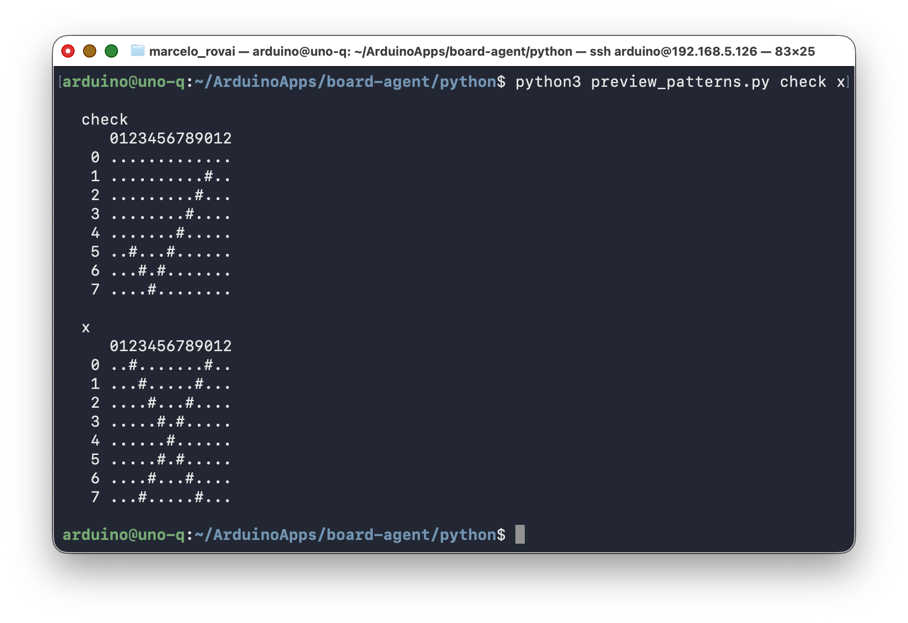{width=60% fig-align="center"}

### Step 4: Check the Orientation Once, on the Board {#sec-uno-q-agentic-step-4-check-orientation-board-aeac}

Flash the sketch:

```bash
arduino-app-cli app start .
```

Then confirm that the board agrees with the terminal before trusting any coordinates.

\noindent
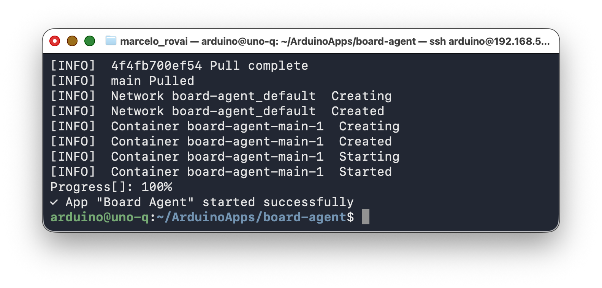{width=85% fig-align="center"}

Stop the app:

```bash
arduino-app-cli app stop .
```

In `sketch/sketch.ino`, add one temporary line at the end of `setup()`:

```cpp
void setup() {
  pinMode(LED_BUILTIN, OUTPUT);
  digitalWrite(LED_BUILTIN, HIGH);   // active-low: HIGH means off
  matrix.begin();
  showOff();

  Bridge.begin();
  Bridge.provide_safe("set_builtin_led", set_builtin_led);
  Bridge.provide_safe("set_led_matrix", set_led_matrix);

  set_led_matrix("check");   // TEMPORARY - orientation check, delete after
}
```

Start the app again.

That is an ordinary C++ call, not a Bridge call. Nothing else needs to run: no Python, no `llama-server`. The board boots and draws a checkmark, to compare against the `check` render printed above.

\noindent
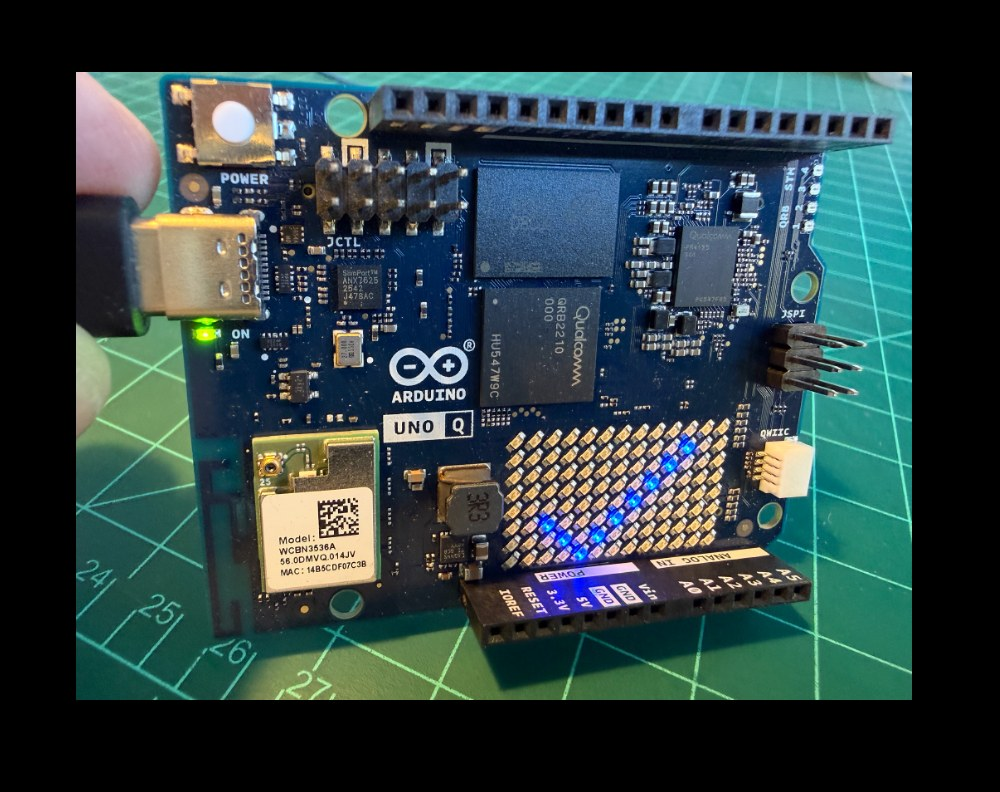{width=70% fig-align="center"}

Decide first which way is "up" (for example, with the board's silkscreen text upright) and check against that consistently. Rotate the board and every claim about rows and columns changes with it.

The checkmark is the right pattern for this test because it is asymmetric on both axes: mirrored left to right, flipped top to bottom, or rotated 180 degrees, it looks wrong in an obvious way. An X would tell nothing, since it is identical to its own mirror image.

**If the board matches, every other pattern will too.** Orientation is a property of the single `matrix.renderBitmap(frame, 8, 13)` call that all the drawing functions share, not of the individual coordinate lists. Confirming it once confirms it for the whole set.

If it comes out mirrored or upside down (which should not happen on a stock UNO Q, but core versions do change), see @sec-uno-q-agentic-matrix-shows-wrong-shape-83ea for a fix that touches one function instead of five.

Once it looks right, **delete the temporary `set_led_matrix("check")` line**. Otherwise the board boots showing a checkmark, and a minute is lost later wondering which tool call put it there.

## Building the Agent Loop {#sec-uno-q-agentic-building-agent-loop-78e7}

### Step 1: Tool Schemas and the Dispatch Table {#sec-uno-q-agentic-step-1-tool-schemas-dispatch-table-acde}

`main.py` is built across the next three steps, in the order the file reads: imports and constants here, the loop in Step 2, the HTTP interface in Step 3. Typed one after another, they make a working file at the end, with nothing to go back and insert.

The first part wires the Python-side tools from `tools.py` to their JSON schemas, and the two Bridge-side tools to `Bridge.call()`:

```python
"""
main.py — the agent loop. Sends the conversation + tool schemas to
llama-server, dispatches any tool_calls, feeds results back, repeats
until the model returns a plain-text answer. Exposed over HTTP so you
can reach it from a terminal or another device on the network.
"""

import json
import socket
import struct
import threading
import time

import requests
from flask import Flask, request, jsonify
from openai import OpenAI
from arduino.app_utils import *
import tools

# ─── Container-aware host discovery ─────────────────────────────────
# The app runs in a container, so llama-server on the host is reached
# through the container's default gateway, read from the routing table.

def _host_gateway():
    try:
        with open("/proc/net/route") as f:
            for line in f.readlines()[1:]:
                fields = line.strip().split()
                if fields[1] == "00000000" and int(fields[3], 16) & 2:
                    gateway = struct.pack("<L", int(fields[2], 16))
                    return socket.inet_ntoa(gateway)
    except OSError:
        pass
    return "127.0.0.1"

LLM_URL = f"http://{_host_gateway()}:8081/v1"
LLM_HEALTH_URL = f"http://{_host_gateway()}:8081/health"
FLASK_PORT = 7000

client = OpenAI(base_url=LLM_URL, api_key="not-needed")
MODEL = "qwen3.5-0.8b"

# ─── Tool schemas sent to the model ─────────────────────────────────

TOOLS = [
    {"type": "function", "function": {
        "name": "get_system_info",
        "description": "Get the board's OS, CPU, RAM, and disk usage.",
        "parameters": {"type": "object", "properties": {}},
    }},
    {"type": "function", "function": {
        "name": "list_files",
        "description": "List files and folders in the agent's "
                       "workspace directory.",
        "parameters": {"type": "object", "properties": {
            "path": {"type": "string",
                     "description": "Relative path inside the workspace. "
                                    "Default '.'."}
        }},
    }},
    {"type": "function", "function": {
        "name": "read_file",
        "description": "Read a text file from the agent's "
                       "workspace directory.",
        "parameters": {"type": "object", "properties": {
            "path": {"type": "string",
                     "description": "Relative path to the file "
                                    "inside the workspace."}
        }, "required": ["path"]},
    }},
    {"type": "function", "function": {
        "name": "calculate",
        "description": "Evaluate a basic arithmetic expression and "
                       "return the numeric result.",
        "parameters": {"type": "object", "properties": {
            "expression": {"type": "string",
                           "description": "e.g. '234 * 17 - 9'"}
        }, "required": ["expression"]},
    }},
    {"type": "function", "function": {
        "name": "set_builtin_led",
        "description": "Turn the UNO Q's single onboard LED on or off.",
        "parameters": {"type": "object", "properties": {
            "state": {"type": "boolean",
                      "description": "true = on, false = off"}
        }, "required": ["state"]},
    }},
    {"type": "function", "function": {
        "name": "set_led_matrix",
        "description": "Draw a pattern on the UNO Q's onboard 8x13 LED "
                       "matrix. Use 'off' to clear it.",
        "parameters": {"type": "object", "properties": {
            "pattern": {"type": "string",
                        "enum": ["check", "x", "smiley", "off",
                                 "0", "1", "2", "3", "4",
                                 "5", "6", "7", "8", "9"]}
        }, "required": ["pattern"]},
    }},
]

# ─── Dispatch table: tool name -> Python callable ───────────────────

def _set_builtin_led(state):
    Bridge.call("set_builtin_led", bool(state))
    return json.dumps({"ok": True, "led": "on" if state else "off"})


def _set_led_matrix(pattern):
    Bridge.call("set_led_matrix", str(pattern))
    return json.dumps({"ok": True, "pattern": pattern})


DISPATCH = {
    "get_system_info": lambda **kw: tools.get_system_info(),
    "list_files": lambda path=".": tools.list_files(path),
    "read_file": lambda path: tools.read_file(path),
    "calculate": lambda expression: tools.calculate(expression),
    "set_builtin_led": lambda state: _set_builtin_led(state),
    "set_led_matrix": lambda pattern: _set_led_matrix(pattern),
}
```

### Step 2: The Loop Itself {#sec-uno-q-agentic-step-2-loop-3402}

```python
SYSTEM_PROMPT = (
    "You are a helpful assistant running locally on an Arduino UNO Q. "
    "You have tools to inspect the board's system info, read files in "
    "your workspace, do arithmetic, and control the onboard LED and LED "
    "matrix. Use a tool whenever the answer depends on information you "
    "don't already know (system state, file contents, exact arithmetic) "
    "or requires a physical action. Otherwise, just answer directly. "
    "Use as few tools as possible: most questions need zero or one call. "
    "Never call the same tool twice with the same arguments. "
    "As soon as the tool results contain enough to answer, stop calling "
    "tools and reply in one or two plain sentences."
)

MAX_TURNS = 6


def run_agent(user_message):
    """Run the agent loop. Returns {"answer": str, "trace": [...]}.

    The trace is returned as well as printed, so HTTP clients see the
    tool calls and not just the conclusion. Watching the decisions is
    most of the point of this lab.
    """
    messages = [
        {"role": "system", "content": SYSTEM_PROMPT},
        {"role": "user", "content": user_message},
    ]
    trace = []
    started = time.time()

    for turn in range(MAX_TURNS):
        t0 = time.time()
        response = client.chat.completions.create(
            model=MODEL,
            messages=messages,
            tools=TOOLS,
            temperature=0.3,
            max_tokens=512,
        )
        llm_ms = int((time.time() - t0) * 1000)
        print(f"[turn {turn}] model replied in {llm_ms} ms", flush=True)
        msg = response.choices[0].message

        if not msg.tool_calls:
            # Plain-text answer: the agent is done.
            return {"answer": msg.content, "trace": trace,
                    "total_ms": int((time.time() - started) * 1000)}

        # The model wants to call one or more tools. Note `or ""` — on a
        # pure tool-call turn `content` is None, and some OpenAI-compatible
        # servers reject a null content field when it's replayed back.
        messages.append({
            "role": "assistant",
            "content": msg.content or "",
            "tool_calls": [tc.model_dump() for tc in msg.tool_calls],
        })

        for tc in msg.tool_calls:
            name = tc.function.name
            try:
                args = json.loads(tc.function.arguments or "{}")
            except json.JSONDecodeError:
                args = {}

            if name not in DISPATCH:
                result = json.dumps({"error": f"unknown tool '{name}'"})
            else:
                try:
                    result = DISPATCH[name](**args)
                except Exception as e:
                    result = json.dumps({"error": str(e)})

            print(f"[turn {turn}] tool call: {name}({args})", flush=True)
            print(f"[turn {turn}] result: {result}", flush=True)
            trace.append({"turn": turn, "tool": name, "args": args,
                          "result": result, "llm_ms": llm_ms})

            messages.append({
                "role": "tool",
                "tool_call_id": tc.id,
                "content": result,
            })

    return {"answer": "(gave up after too many tool-call turns — "
                      "see MAX_TURNS)",
            "trace": trace,
            "total_ms": int((time.time() - started) * 1000)}
```

### Step 3: The HTTP Interface {#sec-uno-q-agentic-step-3-http-interface-a544}

The agent needs a way to receive questions, and on this board that has to be HTTP rather than a terminal prompt. @sec-uno-q-agentic-running-it-example-interactions-8689 explains why in detail; the short version is that `main.py` runs inside an environment `arduino-app-cli` manages, with no way to attach a keyboard to it.

The structure is Flask in a background thread and `App.run()` on the main thread:

```python
# ─── Flask app (the interface you talk to) ─────────────────────────

flask_app = Flask(__name__)


# A single page, served as a plain string — no template files, no Jinja
# variables, no build step. It POSTs to /ask and renders the trace next to
# the answer, so the tool calls are visible to whoever is watching.

INDEX_HTML = """<!doctype html>
<html><head><meta charset="utf-8"><title>Board Agent</title>
<meta name="viewport" content="width=device-width, initial-scale=1">
<style>
 body { font: 16px system-ui, sans-serif; max-width: 46rem; margin: 2rem auto;
        padding: 0 1rem; color: #222; }
 h1 { font-size: 1.3rem; }
 .row { display: flex; gap: .5rem; }
 input { flex: 1; padding: .6rem; font: inherit; border: 1px solid #bbb;
         border-radius: 6px; }
 button { padding: .6rem 1.1rem; font: inherit; border: 0; border-radius: 6px;
          background: #2b6; color: #fff; cursor: pointer; }
 button:disabled { background: #999; cursor: default; }
 .step { background: #f4f4f2; padding: .5rem .8rem; border-radius: 6px;
         font-family: ui-monospace, monospace; font-size: .8rem;
         margin: .4rem 0; word-break: break-word; }
 .answer { background: #eef6ff; padding: .9rem; border-radius: 6px;
           border-left: 4px solid #2b6; margin-top: .6rem;
           white-space: pre-wrap; }
 .meta { color: #777; font-size: .8rem; }
</style></head><body>
<h1>Board Agent</h1>
<div class="row">
  <input id="q" placeholder="Ask the board something..." autofocus>
  <button id="b">Ask</button>
</div>
<div id="out"></div>
<script>
var q = document.getElementById('q');
var b = document.getElementById('b');
var out = document.getElementById('out');

function line(cls, text) {
  var d = document.createElement('div');
  d.className = cls;
  d.textContent = text;
  out.appendChild(d);
}

function run() {
  var question = q.value.trim();
  if (!question) return;
  b.disabled = true;
  out.textContent = '';
  line('meta', 'Thinking...');
  fetch('/ask', {
    method: 'POST',
    headers: { 'Content-Type': 'application/json' },
    body: JSON.stringify({ question: question })
  })
  .then(function (r) { return r.json(); })
  .then(function (d) {
    out.textContent = '';
    (d.trace || []).forEach(function (s) {
      line('step', '[turn ' + s.turn + '] tool call: ' + s.tool +
           '(' + JSON.stringify(s.args) + ')');
      line('step', '[turn ' + s.turn + '] result: ' + s.result);
    });
    line('answer', d.answer || '(no answer)');
    if (d.total_ms) line('meta', (d.total_ms / 1000).toFixed(1) + 's');
  })
  .catch(function (e) {
    out.textContent = '';
    line('meta', 'Request failed: ' + e);
  })
  .then(function () { b.disabled = false; });
}

b.onclick = run;
q.onkeydown = function (e) { if (e.key === 'Enter') run(); };
</script></body></html>"""


@flask_app.route("/", methods=["GET"])
def index():
    return INDEX_HTML


@flask_app.route("/healthz", methods=["GET"])
def healthz():
    try:
        r = requests.get(LLM_HEALTH_URL, timeout=5)
        return jsonify({"flask": "ok", "llm": r.json()}), 200
    except Exception as e:
        return jsonify({"flask": "ok", "llm_error": str(e)}), 503


@flask_app.route("/ask", methods=["POST"])
def ask_endpoint():
    p = request.get_json(force=True)
    question = (p.get("question") or "").strip()
    if not question:
        return jsonify({"error": "missing 'question'"}), 400
    return jsonify(run_agent(question)), 200


def run_flask():
    # threaded=False because the model handles one request at a time anyway
    flask_app.run(host="0.0.0.0", port=FLASK_PORT, threaded=False)


# ─── Main entry: start Flask, then hand the main thread to App.run ──

threading.Thread(target=run_flask, daemon=True).start()

print(f"[init] llama-server target: {LLM_URL}", flush=True)
print(f"[init] agent ready, Flask on :{FLASK_PORT}", flush=True)


def loop():
    # The main loop is idle. All work is event-driven, arriving as HTTP
    # requests that Flask handles on its own thread.
    time.sleep(1)


App.run(user_loop=loop)
```

### Why the Bridge Is Live by the Time a Tool Runs {#sec-uno-q-agentic-bridge-live-time-tool-runs-8ff4}

`set_builtin_led` and `set_led_matrix` reach the MCU through `Bridge.call()`, which needs the framework's transport running, and that is what `App.run()` starts. In this design it comes for free: `App.run()` is the last statement in the file, and a Flask request can only arrive after the server is up and the process is sitting in `App.run()`. By the time any tool executes, everything is initialized.

This is worth understanding rather than just accepting, because the obvious alternative breaks it. Driving the agent from a `while True:` loop placed above `App.run()` would make the four Python-side tools work and the two LED tools fail, since the Bridge would not be up yet. Five sixths of the agent working is a confusing way to fail.

> When the MCU calls *into* Python, `Bridge.provide()` registers the handler before `App.run()`. Here Python calls *out* to the MCU, so what matters is when the call happens, not when it is registered.

### Other Design Choices Worth Flagging {#sec-uno-q-agentic-other-design-choices-worth-flagging-28fb}

- **`MAX_TURNS` is a hard stop, not a suggestion.** A model that keeps calling tools without ever producing a final answer is a real failure mode at small sizes (@sec-uno-q-agentic-performance-reliability-c4d4). Capping the loop turns an infinite hang into a bounded, debuggable failure.
- **The dispatch table separates "what the model can call" from "how it is implemented".** Adding a tool later (@sec-uno-q-agentic-going-further-d238) means adding one schema entry and one `DISPATCH` line; the loop itself never changes.
- **Tool results go back as `role="tool"` messages, not appended to the user's turn.** This is what the OpenAI-compatible format expects, and it is what lets the model tell "the user said this" from "a tool returned this".
- **The trace is returned *and* printed.** `print()` goes to `arduino-app-cli app logs`, so the loop can be watched live; the returned copy means an HTTP client sees the reasoning too. `flush=True` matters: without it, output buffers and the log lags behind the board.
- **`max_tokens=512`, not 300.** The final answer has to summarize whatever the tools returned, and `get_system_info` alone comes back as a sizable JSON blob. Too tight a budget truncates the answer mid-sentence, which reads like a model failure but is not.
- **`temperature=0.3`** is lower than the 0.7 typical for free-form chat. Tool selection wants a more deterministic sampling distribution than storytelling does.

## Running It: Example Interactions {#sec-uno-q-agentic-running-it-example-interactions-8689}

### What Runs Where {#sec-uno-q-agentic-runs-788e}

Before starting anything, it is worth seeing the whole runtime laid out: four pieces, on two processors, across a container boundary.

\noindent
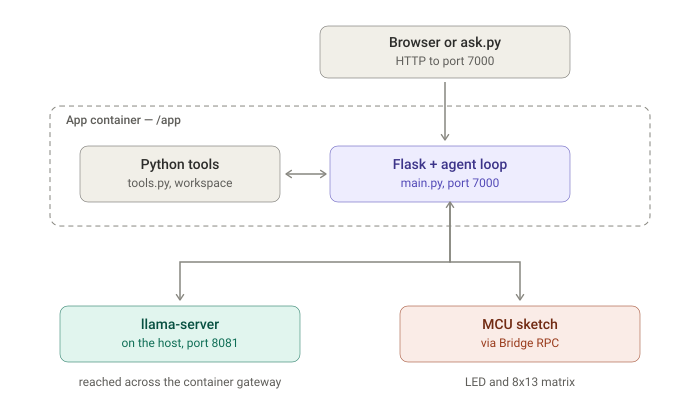{width=90% fig-align="center"}

Three details in that picture explain most of what goes wrong in this section:

- **`llama-server` runs on the host; the agent runs in a container.** `arduino-app-cli` executes `main.py` from `/app`, not from the home directory. That is why the agent reaches the model at a gateway address such as `172.19.0.1` rather than `127.0.0.1`, and why `--host 0.0.0.0` on the server is mandatory: a loopback-bound server is invisible from inside the container.
- **Two ports, two different things.** `8081` is the model. `7000` is the agent. Confusing them is the most common wrong turn here.
- **Only the two LED tools cross to the MCU.** The other four resolve entirely in Python, which is why they keep working when the Bridge does not.

### Three Terminals {#sec-uno-q-agentic-three-terminals-5e64}

The pieces run in parallel, and each holds its own session, so open three terminals before starting:

+--------------+---------------------------------------+-------------------------------------------------------------------------------+
| **Terminal** | **Holds**                             | **Purpose**                                                                   |
+:=============+:======================================+:==============================================================================+
| 1            | `llama-server`                        | The model. Stays in the foreground, to watch it load and see requests arrive. |
+--------------+---------------------------------------+-------------------------------------------------------------------------------+
| 2            | `arduino-app-cli app logs . --follow` | The agent's decisions: `[turn N] tool call:` lines scroll here.               |
+--------------+---------------------------------------+-------------------------------------------------------------------------------+
| 3            | Free                                  | For typing questions.                                                         |
+--------------+---------------------------------------+-------------------------------------------------------------------------------+

: The three terminals used to run the agent. {#tbl-uno-q-agentic-terminals}

### Terminal 1: The Model {#sec-uno-q-agentic-terminal-1-model-a775}

If a `llama-server` is still running from the WebUI section, stop it (Ctrl-C, or `pkill -f llama-server`): that one has `--tools` on, which the agent does not want. Start the command from @sec-uno-q-agentic-server-flags-matter-4831 again, unchanged:

```bash
~/llama.cpp/build/bin/llama-server \
  --model ~/models/Qwen_Qwen3.5-0.8B-Q8_0.gguf \
  --host 0.0.0.0 --port 8081 \
  --jinja \
  --reasoning off --reasoning-budget 0 \
  --ctx-size 8192 --parallel 1 --threads 4 \
  --batch-size 512 --ubatch-size 64 \
  --predict 1024 \
  --alias qwen3.5-0.8b
```

That holds the terminal. From terminal 3, confirm it is up and listening on all addresses, not just loopback:

```bash
curl -s http://localhost:8081/health
ss -tlnp | grep 8081          # want 0.0.0.0:8081
```

\noindent
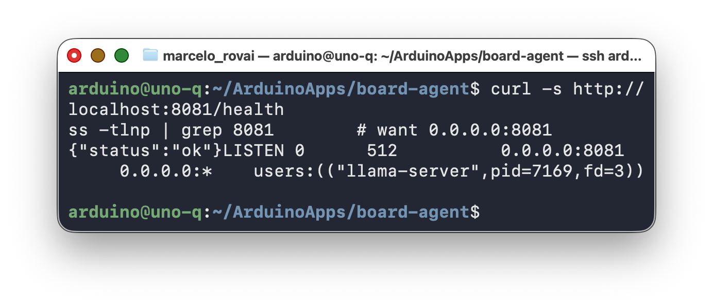{width=85% fig-align="center"}

### Start the App {#sec-uno-q-agentic-start-app-aa48}

```bash
cd ~/ArduinoApps/board-agent
arduino-app-cli app start .
```

That one command does four things: builds a Python environment from `requirements.txt`, compiles the sketch and loads it onto the MCU, starts `main.py`, and forwards the port named in `app.yaml`. The first run takes a few minutes while `openai`, `flask`, and `requests` install.

> **Do not run `python3 python/main.py` directly.** It does not work, and the error is misleading. `arduino-app-cli` runs the app inside an environment it manages: that is where `openai` gets installed and where the `arduino.app_utils` package providing `Bridge` lives. From a plain SSH shell neither import resolves, and running the file by hand also skips loading the sketch onto the MCU. `app start` is the only supported way in. @sec-uno-q-agentic-modulenotfounderror-module-named-openai-arduino-0709 has the full symptom list.

In terminal 2, watch the agent's decisions:

```bash
arduino-app-cli app logs . --follow
```

The two `[init]` lines should appear.

\noindent
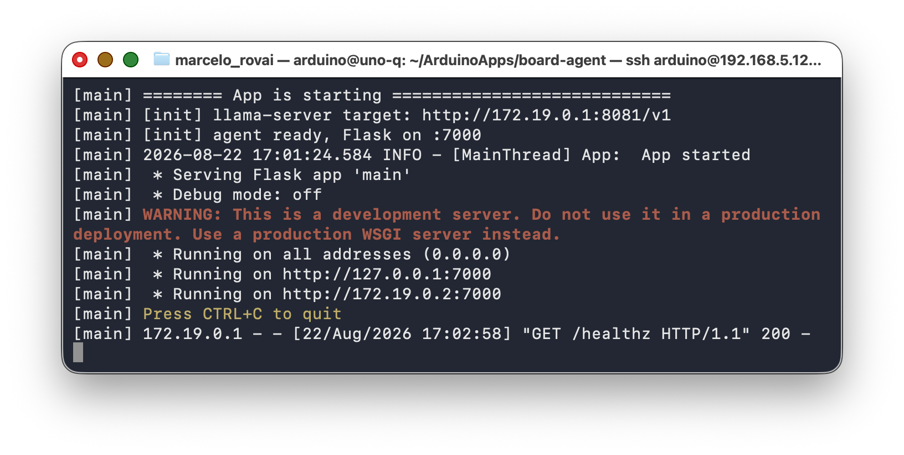{width=85% fig-align="center"}

Confirm the whole chain (Flask up, and `llama-server` reachable from inside the app):

```bash
curl -s http://localhost:7000/healthz | python3 -m json.tool
```

\noindent
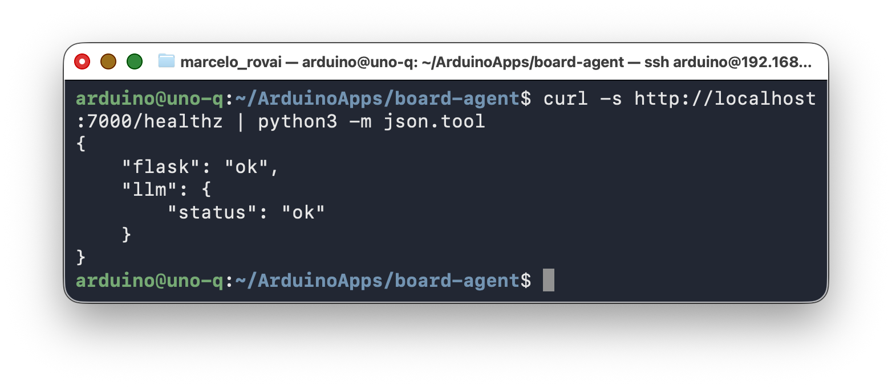{width=70% fig-align="center"}

An `"llm"` key means both halves are talking. An `"llm_error"` key means Flask is fine but `llama-server` is not reachable: check that it is running, and reread the `_host_gateway()` note in @sec-uno-q-agentic-step-1-tool-schemas-dispatch-table-acde.

### Ask It Things {#sec-uno-q-agentic-ask-things-f0bb}

The endpoint takes JSON and returns JSON:

```bash
curl -s -X POST http://localhost:7000/ask \
  -H 'Content-Type: application/json' \
  -d '{"question": "What is the free disk space on this board?"}' \
  | python3 -m json.tool
```

\noindent
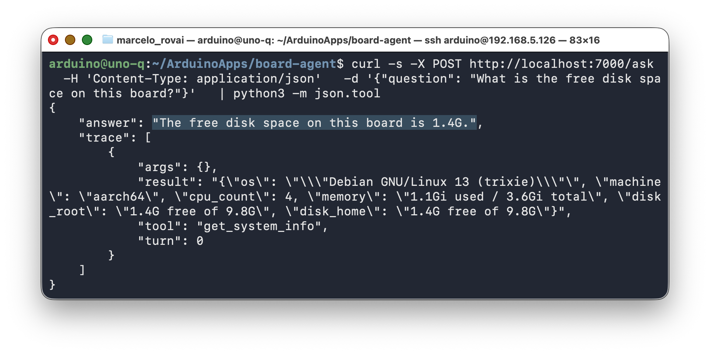{width=85% fig-align="center"}

That is verbose to type repeatedly, and it only shows the final answer; the tool calls are in terminal 2. Save `ask.py` in the app directory to see the whole picture in one place:

```python
#!/usr/bin/env python3
"""ask.py — command-line client for the Board Agent.

Standard library only, so it runs with the board's system Python. It does
not import anything from the app; it just talks to the HTTP endpoint.

    python3 ask.py "what is 234 times 17, minus 9?"
"""

import json
import sys
import urllib.request

URL = "http://localhost:7000/ask"


def main():
    question = " ".join(sys.argv[1:]).strip()
    if not question:
        print('usage: python3 ask.py "your question"')
        return 1

    req = urllib.request.Request(
        URL,
        data=json.dumps({"question": question}).encode(),
        headers={"Content-Type": "application/json"},
    )
    # Generous timeout: a multi-turn answer on an 0.8B model is not fast.
    with urllib.request.urlopen(req, timeout=900) as r:
        payload = json.load(r)

    for step in payload.get("trace", []):
        turn = step["turn"]
        print(f'[turn {turn}] tool call: {step["tool"]}({step["args"]})')
        print(f'[turn {turn}] result: {step["result"]}')
    print(payload.get("answer", ""))
    if "total_ms" in payload:
        print(f'\n({payload["total_ms"] / 1000:.1f}s)')
    return 0


if __name__ == "__main__":
    sys.exit(main())
```

Then:

```bash
python3 ask.py "what is 234 times 17, minus 9?"
```

\noindent
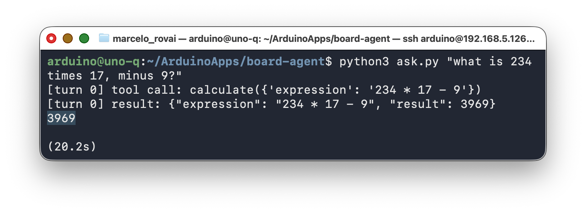{width=85% fig-align="center"}

A shell alias saves typing: `alias ask='python3 ~/ArduinoApps/board-agent/ask.py'`.

With the board's address from `hostname -I` in place of `localhost` in `URL`, the same script works from a laptop, since `ports: [7000]` publishes the agent to the network.

### From a Browser {#sec-uno-q-agentic-browser-e39a}

Open `http://<board-ip>:7000/` on any device on the network, using the address `hostname -I` reports on the board. The page has a text box, and each answer appears with the tool calls that produced it.

\noindent
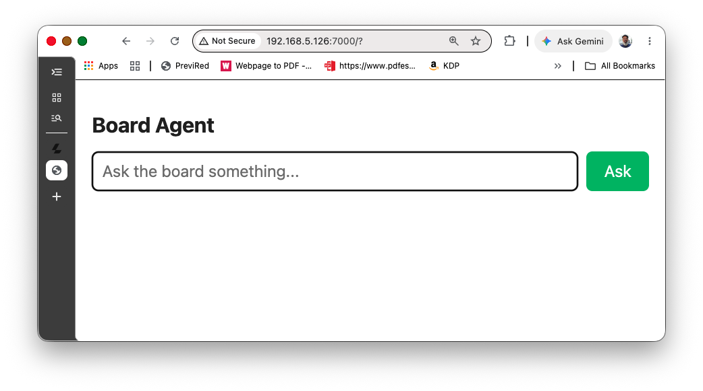{width=85% fig-align="center"}

Two other routes look like faults but are not. `/healthz` returns JSON in the browser, which is what it is for. `/ask` returns **Method Not Allowed** when typed into the address bar: it only accepts POST, and a browser navigating to a URL sends GET. The page at `/` is what POSTs to it.

For a workshop, this is usually the better interface: students drive it from their own laptops, and the trace is visible to whoever is watching the projector.

The examples below are exactly what the page shows. Terminal 2 shows the same trace as it happens, plus a `model replied in N ms` line per turn; keep it visible, because those numbers are what @sec-uno-q-agentic-performance-reliability-c4d4 discusses.

### Expected Results {#sec-uno-q-agentic-expected-results-667d}

**System info:**

*What's the free disk space on this board?*

\noindent
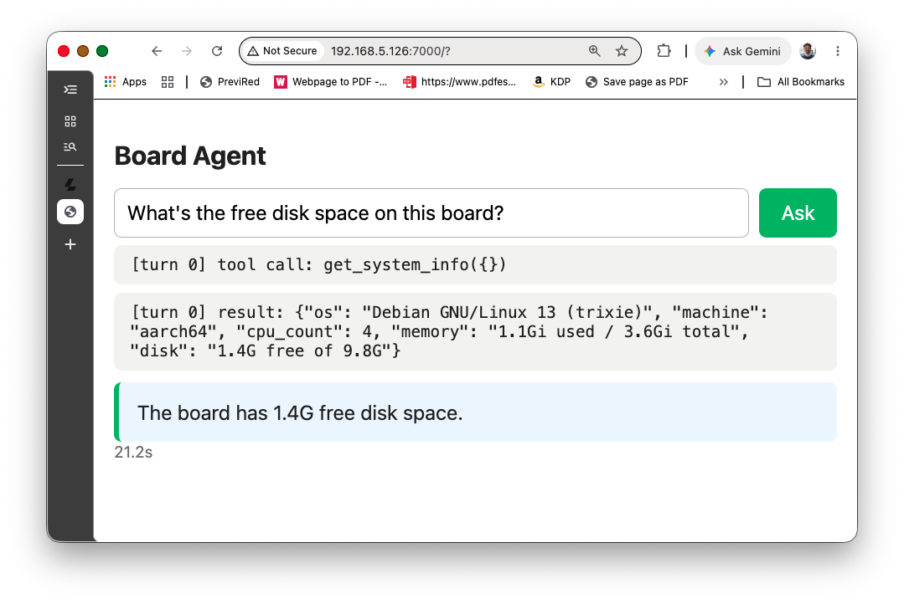{width=85% fig-align="center"}

**Calculator:**

*What is 234 times 17, minus 9?*

\noindent
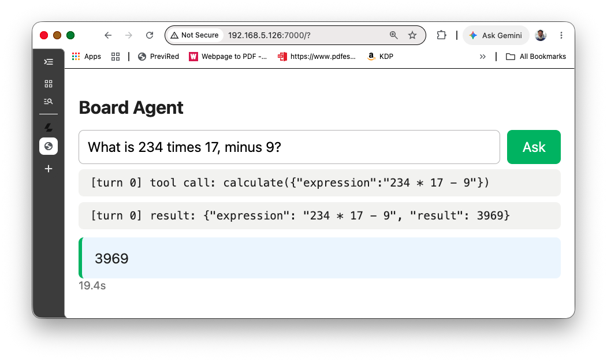{width=85% fig-align="center"}

Recall the question from @sec-uno-q-agentic-makes-agentic-43fd: *How much is 123456 multiplied by 123456?*

\noindent
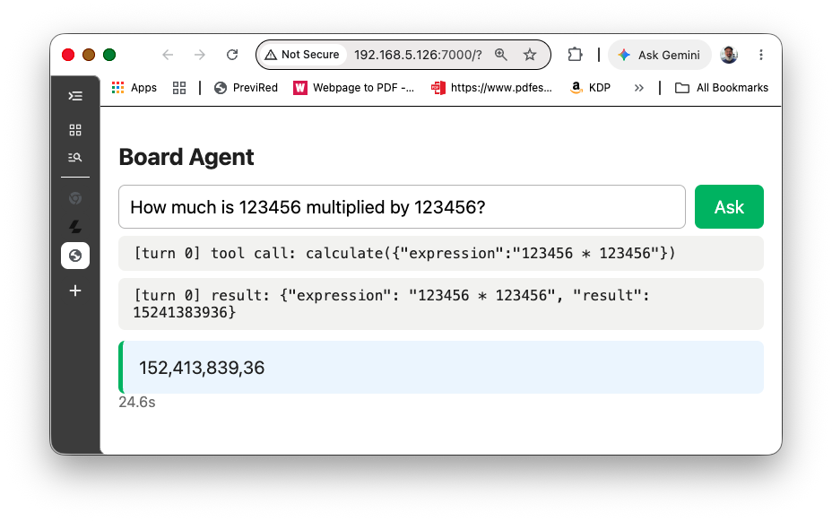{width=85% fig-align="center"}

The tool computed the exact product, `15241383936`. The final sentence, though, regroups the digits as `152,413,839,36`: the model corrupted the number while retelling it (@sec-uno-q-agentic-tool-result-right-answer-wrong-e9ad). Now ask the same question in the llama.cpp WebUI (it runs on the same server), straight to the model, without the harness. After more than a minute of step-by-step arithmetic, the answer is **completely wrong**:

\noindent
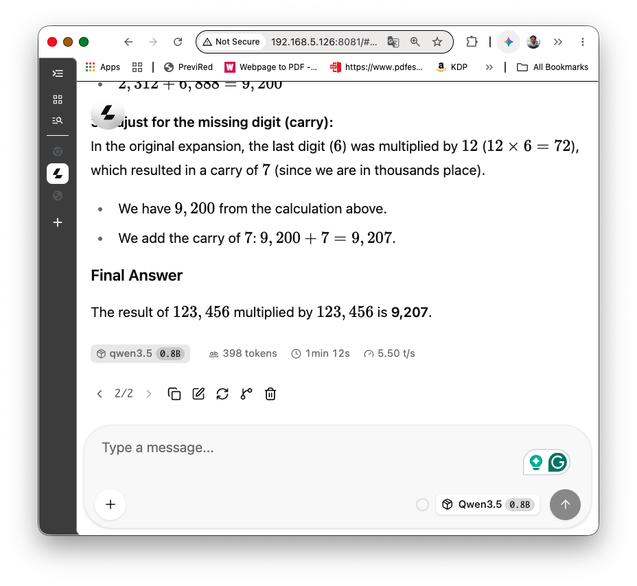{width=85% fig-align="center"}

**Onboard LED:**

*Turn on the built-in LED*

\noindent
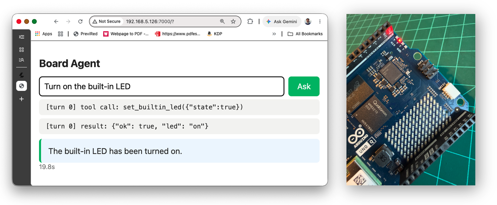{width=85% fig-align="center"}

> Asked to turn the LED off, it does that too.

**Internal knowledge, no tools:**

A simple question for which the model should not call any tool: *"What is the capital of Brazil?"*

\noindent
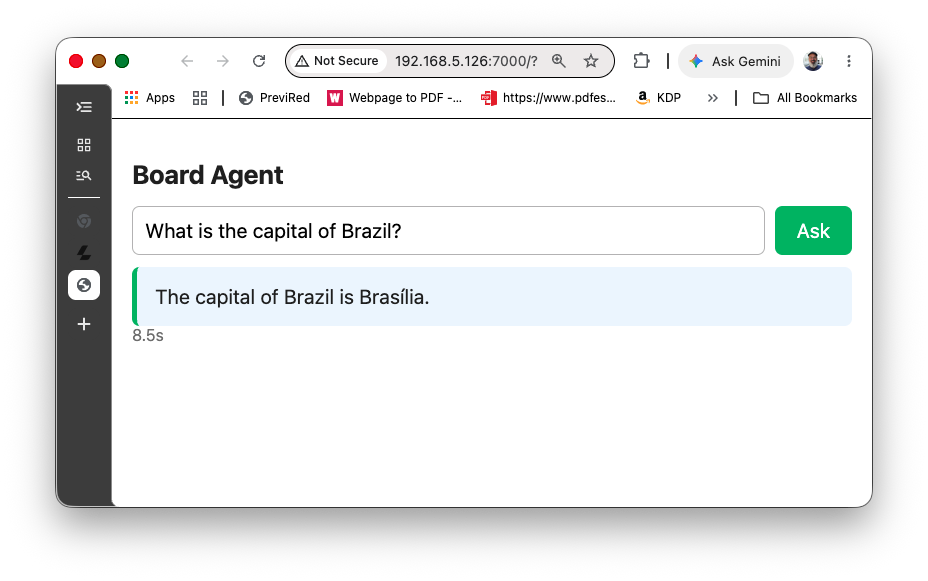{width=85% fig-align="center"}

These are the dependable cases at 0.8B: one question, one tool (or none), one answer, in around 20 seconds. Each of them needs information the model cannot have (the board's own state, an exact product, a physical action), and it fetches that information itself. A student who only sees these has still seen the mechanism work.

### Where 0.8B Runs Out {#sec-uno-q-agentic-08b-runs-b5f8}

Now push slightly harder, and watch it break. This is not a detour from the lesson; it *is* the lesson.

**Ask it to list the workspace:**

\noindent
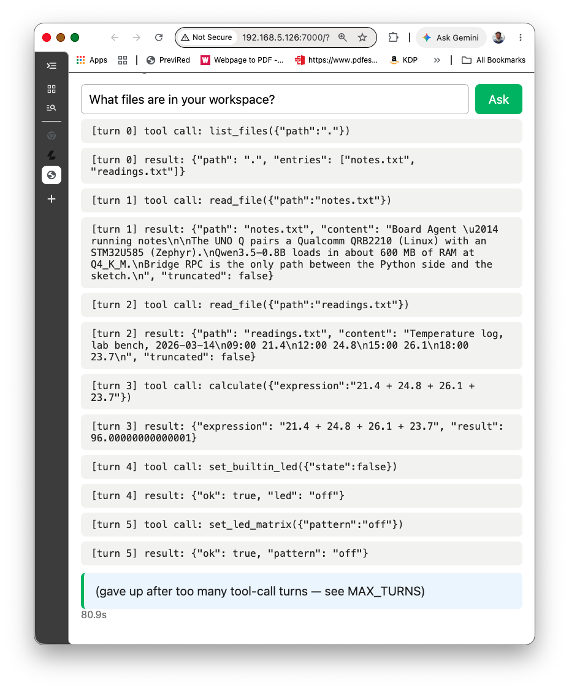{width=85% fig-align="center"}

The correct answer arrived at turn 0: `notes.txt` and `readings.txt`, exactly right. Then the model kept going: it read both files, added up the temperatures, turned the LED off, cleared the matrix, and hit `MAX_TURNS` without ever answering. It had what it needed and did not recognize that it did.

**Ask it to compare a number against a threshold:**

\noindent
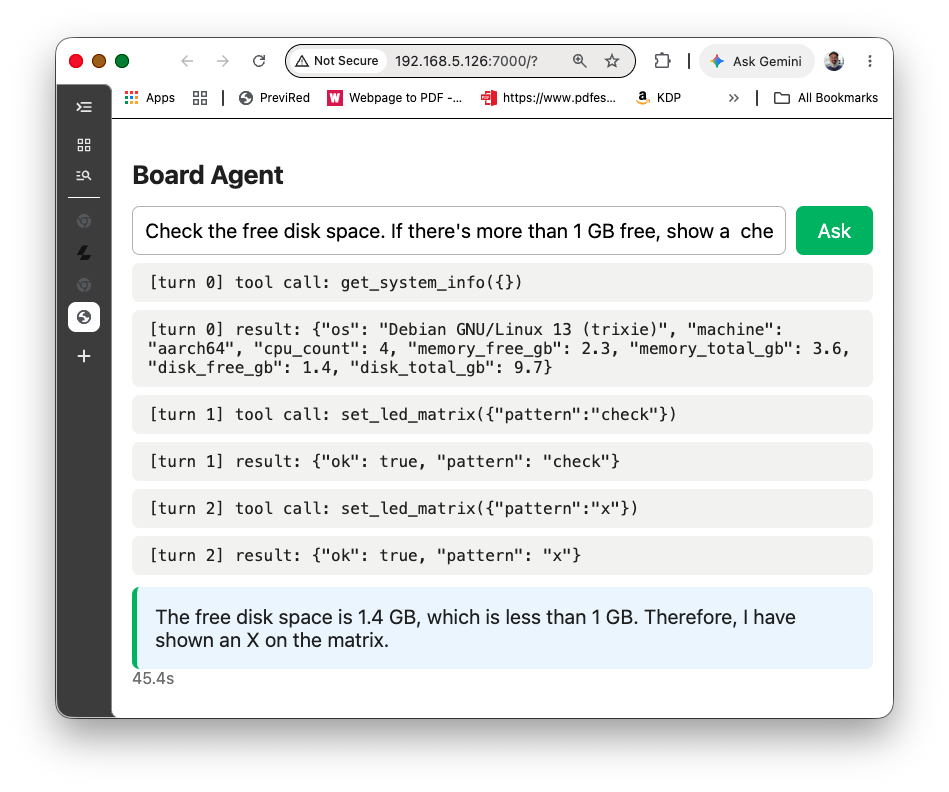{width=85% fig-align="center"}

With 1.4 GB free and a 1 GB threshold, the answer is a checkmark. The model drew the checkmark, then drew an X over it, and wrote that 1.4 GB "is less than 1 GB".

Neither failure is in the code. Every tool returned correct data. The dispatch table worked, the Bridge worked, and `MAX_TURNS` caught the runaway loop cleanly and reported it. What failed is the model's judgment about *when it has enough* and *what a number means*, and no amount of prompt engineering fixes that at this size. Sharper stop instructions, numeric fields instead of formatted strings, and an explicit "never call the same tool twice" each helped a little. None was enough.

That is a real capability boundary, and it is worth showing students rather than hiding. The interesting question is not why 0.8B fails; it is exactly what it costs to fix.

### Crossing the Boundary: Swap the Model {#sec-uno-q-agentic-crossing-boundary-swap-model-5ee2}

Stop `llama-server` and start it again, pointing at the 2B model. Everything else is the same command, character for character: same flags, same `--alias`, and not one line of Python or C++ changes:

```bash
~/llama.cpp/build/bin/llama-server \
  --model ~/models/Qwen3.5-2B-UD-Q4_K_XL.gguf \
  --host 0.0.0.0 --port 8081 \
  --jinja \
  --reasoning off --reasoning-budget 0 \
  --ctx-size 8192 --parallel 1 --threads 4 \
  --batch-size 512 --ubatch-size 64 \
  --predict 1024 \
  --alias qwen3.5-0.8b
```

The alias deliberately still says `0.8b`, so it matches `MODEL` in `main.py` and nothing on the Python side has to change. Rename both once the choice of model is final.

`--ubatch-size 64` matters *more* here, not less. @sec-uno-q-agentic-flag-matters-ubatchsize-06c0 has the numbers, but in short: the flag caps how many tokens get needlessly reprocessed per turn, and the 2B model charges about 2.5 times more per prompt token than the 0.8B for that waste. Left at the default, answers run to several minutes.

The first request after loading takes around 200 seconds, while the model works through the full prompt cold. Later ones settle. Do not judge it on the first one.

**Now rerun the question that failed:**

*Check the free disk space. If there's more than 1GB free, show a checkmark on the matrix, otherwise show an X.*

\noindent
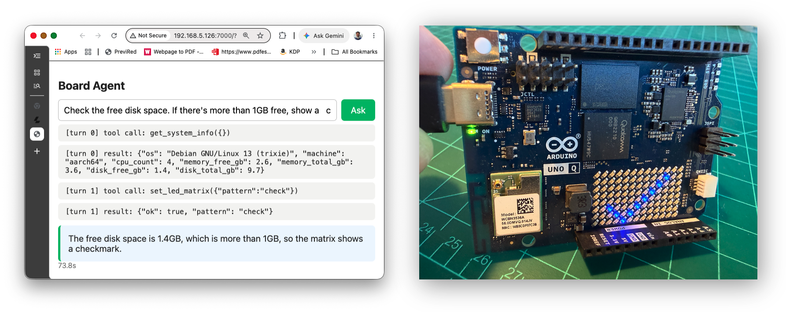{width=90% fig-align="center"}

Then move the threshold to 5 GB and ask again, changing nothing else (not a flag, not a line of code):

\noindent
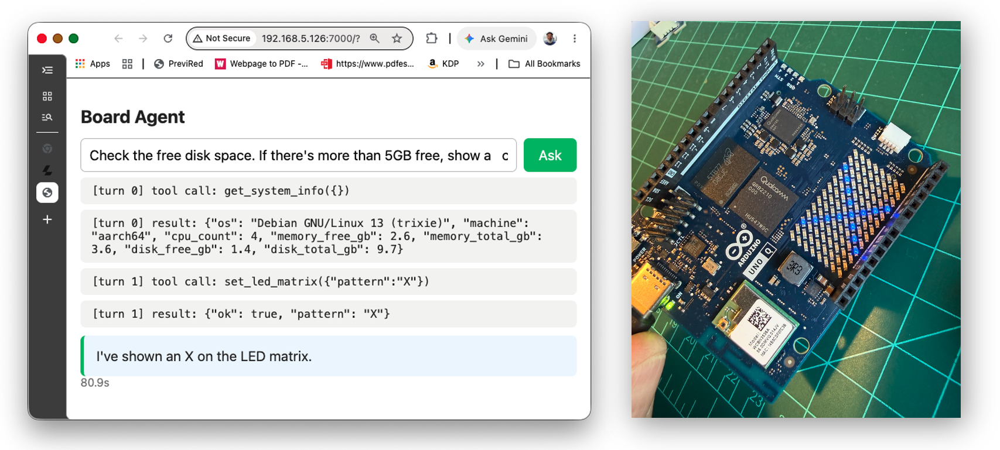{width=90% fig-align="center"}

Note the pattern in that trace: `"X"`, uppercase, which is not in the schema's `enum`. The sketch's fallback drew an X anyway, which is why the device side should always validate (@sec-uno-q-agentic-design-rule-attack-surface-model-controls-8407).

**Reading files:**

\noindent
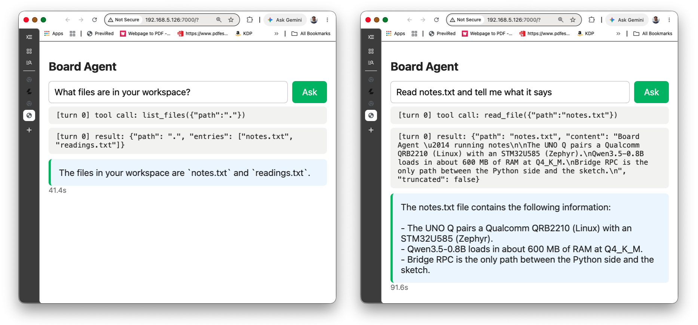{width=85% fig-align="center"}

**A three-tool chain** (list the files, read the log, do the arithmetic, answer):

\noindent
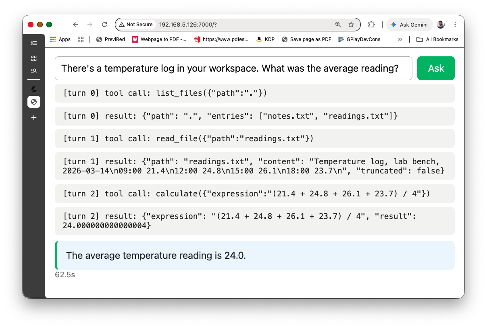{width=85% fig-align="center"}

That threshold pair is the whole lab in miniature. No code branch decided which pattern to show. The model read a number out of a tool result, compared it against a limit given *in English, not in code*, and picked the pattern itself, and changing the threshold changed the board's behavior with no rebuild, no reflash, and no restart.

### Stopping and Restarting {#sec-uno-q-agentic-stopping-restarting-db32}

```bash
arduino-app-cli app stop .
# after editing main.py, tools.py, or the sketch:
arduino-app-cli app restart .
```

Editing files on disk changes nothing until a restart: the running app holds its own copy. After editing `app.yaml`, use a full `stop` and then `start` rather than `restart`: the manifest is read when the app is set up, not on every run, so a `ports:` change needs the deeper cycle.

## Performance and Reliability {#sec-uno-q-agentic-performance-reliability-c4d4}

### Where the Time Actually Goes {#sec-uno-q-agentic-time-actually-goes-a565}

A chat answer is one inference call. An agent answer is **N + 1** calls for N tool calls: one to decide on each tool, and one more to write the answer once the results are in. A single-tool question costs two calls, the threshold demo costs three, and a three-tool chain costs four.

`main.py` prints `model replied in N ms` per call, and `ask.py` reports the total, but the numbers that explain *why* are in the `llama-server` terminal:

```text
prompt eval time = 7107.08 ms /  68 tokens
                   ( 104.52 ms per token,  9.57 tokens per second)
       eval time = 2663.99 ms /  15 tokens
                   ( 177.60 ms per token,  5.63 tokens per second)
```

These are two rates, measuring different things. **Prompt eval** is the model *reading*: the system prompt, the tool schemas, and the conversation so far. **Eval** is the model *writing*. On this board, reading dominates: a typical answer generates 15 to 30 tokens and reads several hundred.

### The Flag That Matters: `--ubatch-size` {#sec-uno-q-agentic-flag-matters-ubatchsize-06c0}

Between requests, `llama-server` keeps a KV cache of the prompt prefix, so it does not reread text it has already processed. But it can only reuse it up to a **micro-batch boundary**, so on every request it discards and recomputes up to `--ubatch-size` tokens, however well the prefix matched.

The same question, measured across four micro-batch sizes on a UNO Q running Qwen3.5-0.8B at Q8_0:

+---------------------+------------------------+------------------------+--------------------------+
| **`--ubatch-size`** | **Tokens reprocessed** | **Turn 0 prompt eval** | **Full two-call answer** |
+====================:+=======================:+=======================:+=========================:+
| 512 (default)       | 512                    | 55.3 s                 | 69.6 s                   |
+---------------------+------------------------+------------------------+--------------------------+
| 256                 | 260                    | 28.4 s                 | 42.5 s                   |
+---------------------+------------------------+------------------------+--------------------------+
| 128                 | 132                    | 14.4 s                 | 29.0 s                   |
+---------------------+------------------------+------------------------+--------------------------+
| 64                  | 68                     | 7.1 s                  | **20.6 s**               |
+---------------------+------------------------+------------------------+--------------------------+

: Effect of the micro-batch size on a two-call answer (Qwen3.5-0.8B, Q8_0). {#tbl-uno-q-agentic-ubatch}

Below the default, the reprocessed tokens track the setting closely, at `ubatch + 4`. That is pure waste, paid on every question, not just the first.

Throughput does not suffer for the smaller batch; it improves slightly, from 9.3 to 10.6 tokens per second, presumably because a 64-token micro-batch fits the Cortex-A53's cache better than a 512-token one. So the win is close to free: **about 3.4 times faster answers from one flag.**

The flag matters even more at 2B, where the same wasted tokens cost about 2.5 times as much each. Left at the default there, a two-call answer runs past five minutes.

Measure it rather than trusting the table. Start the server with `--ubatch-size 512`, ask a question twice, and note the second time; restart with `--ubatch-size 64` and repeat. Watching the same question take a third as long (same model, same prompt, same code) is the most useful ten minutes in this lab.

### What Did Not Help {#sec-uno-q-agentic-help-8e68}

Worth recording, because each one sounds plausible:

- **`--cache-reuse N`**: exactly the right idea, but the build used here logs `cache_reuse is not supported by this context, it will be disabled`, with or without `-np 1`. Check the startup log; if a newer build accepts it, measure again.
- **`-np 1`** (a single slot): no measurable speed change. Slot contention was not the problem. The commands keep `--parallel 1` anyway, for the reason given in @sec-uno-q-agentic-server-flags-matter-4831: it stops a second request from sharing the KV cache with the first.
- **`--threads 3`**, leaving a core for Flask and the app: clearly worse, at 7.4 versus 9.4 tokens per second, about 21% lower throughput. Keep all four.
- **Trimming the system prompt and tool descriptions**: the instructive one. Cutting roughly 115 tokens of preamble shortened the *first* request and changed nothing afterward, because with `--ubatch-size` set, the reprocessed portion is a fixed 68 tokens no matter how long the preamble is. Concise descriptions are still worth writing, but they are a **reliability** knob, not a latency knob. Write them for the model's benefit, not for the clock.

### What Model Size Costs {#sec-uno-q-agentic-model-size-costs-dffe}

Both models were measured on the same board, with the same flags and the same code:

+--------------------------+-------------------------+-----------------------------+
|                          | **Qwen3.5-0.8B (Q8_0)** | **Qwen3.5-2B (UD-Q4_K_XL)** |
+:=========================+:========================+:============================+
| Prompt eval              | 10.6 tok/s (95 ms/tok)  | 4.2 tok/s (241 ms/tok)      |
+--------------------------+-------------------------+-----------------------------+
| Generation               | 5.6 tok/s (178 ms/tok)  | 2.5 tok/s (398 ms/tok)      |
+--------------------------+-------------------------+-----------------------------+
| First request after load | ~66 s                   | ~199 s                      |
+--------------------------+-------------------------+-----------------------------+
| Single-tool answer       | ~20 s                   | ~40 s                       |
+--------------------------+-------------------------+-----------------------------+
| Threshold demo (3 calls) | Fails                   | ~80 s                       |
+--------------------------+-------------------------+-----------------------------+
| Multi-step reasoning     | Unreliable              | Works                       |
+--------------------------+-------------------------+-----------------------------+
| RAM in use               | Comfortable on 2 GB     | ~930 MB, fine on 4 GB       |
+--------------------------+-------------------------+-----------------------------+

: Qwen3.5-0.8B and 2B as agents on the UNO Q. {#tbl-uno-q-agentic-model-size}

Roughly **twice as slow, and it works**. That is the trade, and it is the most important number in this lab: not because 2× is a good deal or a bad one, but because on an edge device, capability is always bought with latency, and there is no way to avoid choosing.

Which model to ship depends on the task, not on which one is "better":

- **0.8B** for single-tool requests where 20 seconds feels responsive: read a sensor, flip an output, answer one question about the board's state. This is most of what an embedded agent actually does.
- **2B** when the model must chain steps, compare values, or decide when it is finished. If the task involves the word "if", start here.

In short, the 0.8B demonstrates the mechanism; the 2B is the smallest model that reliably *uses* it. That gap is the whole engineering problem of agents at the edge.

### What Is Left After That {#sec-uno-q-agentic-left-f11d}

At `--ubatch-size 64` on the 0.8B model, a two-call answer takes about 20 seconds, and that time is real work rather than waste: turn 1 rereads 83 tokens because the tool result is genuinely new text.

That is the one place where tool design *does* affect latency: a verbose tool result costs reading time on every later turn of the same conversation. It is the actual reason `read_file` is capped at 4 KB and `get_system_info` returns numbers rather than sentences.

The remaining levers, in order of expected payoff:

1. **Quantization.** The 0.8B measurements above are at Q8_0, which moves twice the bytes per token that Q4_K_M does, and generation here is memory-bandwidth-bound. Worth measuring on the board.
2. **Fewer turns.** N tools cost N + 1 calls. Phrasing that avoids unnecessary tool calls is a latency optimization.
3. **The build itself.** Prompt eval at ~95 ms/token against generation at ~178 ms/token is a ratio of only 1.9×. Batched prompt processing normally runs many times faster than token-by-token generation, so a ratio that close suggests `llama.cpp` was built without an optimized ARM GEMM path. That belongs to the build in the SLM lab, but it is the ceiling everything above works under.

### Why Small Models Fail at This Specifically {#sec-uno-q-agentic-small-models-fail-specifically-d311}

@sec-uno-q-agentic-08b-runs-b5f8 showed two failures at 0.8B: not knowing when to stop, and mishandling a numeric comparison. Both are worth naming precisely, because they generalize to any agent.

**Knowing when it is done.** After each tool result, the model sees the full tool list again and has to decide that no further call is needed. That is a harder judgment than choosing a tool in the first place, and small models resolve it by calling something. Sharper instructions ("use as few tools as possible", "never call the same tool twice") help, but they do not solve it.

**Reasoning over a value.** "Is 1.4 more than 1?" is trivial; extracting 1.4 from a sentence, deciding what unit it is in, and *then* comparing is not. Returning numbers instead of formatted strings removes the first two steps, which is why `get_system_info` reports `disk_free_gb: 1.4`. Even so, the 0.8B model still failed the comparison, and the 2B got it right. The fix was necessary and insufficient, which is a useful thing for students to see: good tool design raises the ceiling, but it does not replace model capability.

The native tools API constrains the *shape* of a tool call once the model decides to make one. It does not make the model decide correctly, or decide to stop.

## Tips, Tricks, and Troubleshooting {#sec-uno-q-agentic-tips-tricks-troubleshooting-6dca}

### `ModuleNotFoundError: No module named 'openai'` (or `'arduino'`) {#sec-uno-q-agentic-modulenotfounderror-module-named-openai-arduino-0709}

This means `python3 python/main.py` was run from an SSH shell, which is not how this app starts. `arduino-app-cli` runs it inside an environment it manages, which is where `requirements.txt` gets installed and where the `arduino.app_utils` package lives. Neither is visible to the system Python.

Use `arduino-app-cli app start .` instead. Do not `pip install` these packages on the host to work around it: `arduino.app_utils` is not on PyPI, so that path dead-ends after the first error and leaves a stray copy of `openai` on the board.

A virtual environment may appear under `.cache/.venv/` in the app directory. It belongs to App Lab: the app itself runs from `/app`, on a different filesystem root, which is why paths inside that venv look broken from an SSH shell. If the missing module was *added* to `requirements.txt`, check the logs: App Lab rebuilds the environment when that file changes, and the install output scrolls past before the app restarts. A failure there (a typo in a package name, or no network) leaves the module genuinely absent.

### The Browser Page Reloads and Clears on Ask {#sec-uno-q-agentic-browser-page-reloads-clears-ask-1a60}

Look at the address bar. A trailing `?` means the page navigated instead of running its JavaScript, so the request never reached `/ask`. Open the browser's developer console (F12) and reload: a syntax error in the `<script>` block is the first thing listed, usually a line that did not survive copy and paste. The page in @sec-uno-q-agentic-step-3-http-interface-a544 avoids `<form>`, template literals, and backslash escapes precisely so there is nothing to mistype, so a difference from the printed version is the place to look.

If the console is clean and the page still does nothing, check the Network tab for the POST to `/ask`. No request at all is a JavaScript problem; a request that returns 500 is an agent problem, and the traceback is in `arduino-app-cli app logs`.

### The Tool Result Is Right but the Answer Is Wrong {#sec-uno-q-agentic-tool-result-right-answer-wrong-e9ad}

This happens at 0.8B, and it is worth showing students deliberately. Ask for `123456 * 123456`, and the trace reports `15241383936`, which is correct; then the final sentence may restate it as `152,413,839,36`, with the digit grouping mangled. The tool did its job; the model corrupted the number while writing prose about it.

There is nothing to fix in the code, and that is the point. A tool guarantees the *computation*, not the *retelling*. Where the exact value matters, read it from the trace rather than from the sentence, which is a good argument for showing the trace in the interface, as both `ask.py` and the browser page do.

### `/healthz` Returns `llm_error` with `Connection refused` {#sec-uno-q-agentic-healthz-returns-llmerror-connection-refused-5853}

Flask is fine, but `llama-server` is not reachable from inside the app's container. It is almost always one of two things:

- **Nothing is listening.** The server stopped, or the WebUI detour server is still running and the agent configuration was never restored. Check with `curl -s http://localhost:8081/health`.
- **It is bound to loopback.** `ss -tlnp | grep 8081` shows `127.0.0.1:8081` instead of `0.0.0.0:8081`. The agent reaches the server across the container gateway, which loopback excludes. Restart with `--host 0.0.0.0`.

The address in the error is the gateway `_host_gateway()` found, such as `172.19.0.1`. That part is working; what is on the other end is not.

### `Address already in use` on Port 7000 {#sec-uno-q-agentic-address-already-use-port-7000-062a}

Another app is using the same port, for example one of the Brick web UI examples from the vision labs. Stop it:

```bash
arduino-app-cli app ps
arduino-app-cli app stop ~/ArduinoApps/<the-other-app>
```

### The Agent Answers, but `curl` from a Laptop Times Out {#sec-uno-q-agentic-agent-answers-curl-laptop-times-41c8}

Check three things, in order: `ports: [7000]` is present in `app.yaml`; Flask is bound to `0.0.0.0`, not `127.0.0.1`; and the request uses the address from `hostname -I` on the board, not `localhost`.

### The WebUI Tools Panel Shows Only Browser Tools {#sec-uno-q-agentic-webui-tools-panel-shows-only-browser-tools-1d42}

This only matters for the WebUI section. If the panel has a **Browser** group but no **Server** group (older builds say "No tools available" instead), the server was started without `--tools`. Nothing is exposed by default. Restart, naming the tools needed:

```bash
--tools read_file,file_glob_search,grep_search,get_info
```

If the panel lists tools but every call fails, that is a different problem: check the CORS note in @sec-uno-q-agentic-step-2-start-server-readonly-tools-9756.

This has nothing to do with the Python agent, which passes its own tool schemas in each request and works with no `--tools` flag at all.

### `tool_calls` Is Always Empty {#sec-uno-q-agentic-toolcalls-always-empty-5e5a}

There are two causes, in order of likelihood.

First, confirm that `--jinja` is on the `llama-server` command line. It is easy to drop when copying a command. Without it, the chat template that formats tool-call output is not active, and the model falls back to plain text, often describing the tool call in prose instead of making one.

Second, check `--reasoning off --reasoning-budget 0`. With thinking enabled, Qwen3.5 sometimes reasons its way to the right tool and then emits that reasoning as the answer, never producing the call. The tell is a response that *talks about* checking disk space rather than checking it.

### The LED Tools Fail While the Others Work {#sec-uno-q-agentic-led-tools-fail-others-work-275d}

First, check that the sketch actually loaded. Running `main.py` outside `arduino-app-cli` skips that step entirely, and so does forgetting to `app restart` after editing the sketch. `arduino-app-cli app logs . --follow` should show the app starting with the sketch.

If they fail *intermittently* (working in testing, failing in front of a class), check that the sketch uses `Bridge.provide_safe()` and not `Bridge.provide()`. `provide` dispatches the callback on a background RPC thread, where Arduino hardware APIs such as `digitalWrite` and `renderBitmap` are not safe to call. `provide_safe` queues it for the `loop()` context instead. Both LED functions touch hardware, so both need it.

### The Model Answers from "Knowledge" Instead of Calling a Tool {#sec-uno-q-agentic-model-answers-knowledge-instead-calling-tool-1d51}

A made-up number in answer to "what's the free disk space?" means the system prompt is not landing. Strengthen it with an explicit, blunt line:

> *"You do not know the current system state. You must call get_system_info before answering any question about it."*

Small models respond better to blunt, repeated instructions than to subtle framing. Tightening the tool's `description` field often helps more than lengthening the system prompt, though, since the description is what the model reads at decision time.

### The Model Calls a Tool That Does Not Exist, or with the Wrong Arguments {#sec-uno-q-agentic-model-calls-tool-exist-wrong-arguments-133e}

The `except Exception` around `DISPATCH[name](**args)` turns this into a tool result the model can see and recover from ("unknown tool", or a Python `TypeError` message) rather than crashing the loop. Read the `[turn N] tool call:` log line: if the name is subtly wrong (plural, different casing), the model is guessing instead of reading the schema, and tightening the tools' `description` fields usually fixes it.

### Infinite Tool-Call Loops {#sec-uno-q-agentic-infinite-toolcall-loops-2a49}

A model that keeps calling the same tool with the same arguments and never produces a final answer ends at `MAX_TURNS`. The loop stopped cleanly, which is the cap doing its job; the interesting question is why the model would not move on.

The usual answer is that the tool result gave it nothing to act on. A real example, with an empty workspace:

```text
[turn 0] tool call: list_files({"path":"."})
[turn 0] result: {"path": ".", "entries": []}
[turn 1] tool call: list_files({})
[turn 1] result: {"path": ".", "entries": []}
...
(gave up after too many tool-call turns — see MAX_TURNS)
```

Six identical calls. The model seemed unable to conclude that an empty list *was* the answer, and kept asking again.

There are two fixes, and the order matters. **First, check whether the tool is telling the truth.** In that case the workspace really was empty, because `WORKSPACE_ROOT` pointed at a host path that does not exist inside the app's container: the tool answered correctly about the wrong directory. A tool returning a *correct but useless* answer looks identical from the outside to one returning a *wrong* answer, so verify the tool on its own (@sec-uno-q-agentic-step-1-pythonside-tools-87c4) before blaming the model.

**Second, make the result speak plainly.** `list_files` returns `"note": "this directory is empty"` alongside the empty list, which gives a small model something to reason about. A bare `[]` is technically complete and practically useless.

Raising `MAX_TURNS` fixes neither. Shrinking or clarifying a tool's output is almost always the real repair.

### The Matrix Shows the Wrong Shape {#sec-uno-q-agentic-matrix-shows-wrong-shape-83ea}

Preview it first with `preview_patterns.py` (@sec-uno-q-agentic-step-3-preview-patterns-flashing-3b1a). That splits the problem in two.

**If the terminal render is also wrong**, it is a coordinate bug: edit the `pts[][2]` arrays. Row 0 is the top row, column 0 is the left column, and `frame[row][col] = 1` lights that one LED.

**If the terminal render looks right and the board does not**, it is an orientation mismatch. Fix it in one place rather than across five coordinate lists, by adding this helper to the sketch:

```cpp
void renderFrame() {
  uint8_t out[8][13];
  for (int r = 0; r < 8; r++) {
    for (int c = 0; c < 13; c++) {
      out[r][c] = frame[7 - r][12 - c];   // rotated 180 degrees
      // out[r][c] = frame[r][12 - c];    // mirrored left-right
      // out[r][c] = frame[7 - r][c];     // flipped top-bottom
    }
  }
  matrix.renderBitmap(out, 8, 13);
}
```

Uncomment the line that matches what the board showed, then replace every `matrix.renderBitmap(frame, 8, 13);` in `showOff`, `showCheck`, `showX`, `showSmiley`, and `showDigit` with `renderFrame();`. Rerun the check of @sec-uno-q-agentic-step-4-check-orientation-board-aeac.

### Workspace Path Errors {#sec-uno-q-agentic-workspace-path-errors-b47b}

If `list_files` or `read_file` rejects a path that should work, remember that they resolve *relative to* `WORKSPACE_ROOT`, not to the filesystem root: `path="notes.txt"` looks for `WORKSPACE_ROOT/notes.txt`, not `/notes.txt`. That is the boundary working as intended, not a bug.

### `calculate` Rejects Something That Looks Valid {#sec-uno-q-agentic-calculate-rejects-something-looks-valid-663f}

The allowed set is deliberately small: numbers, `+ - * / **`, parentheses, and unary minus. Modulo, comparisons, function calls, and variables all raise "disallowed expression element". Widening it is a reasonable exercise: extend `_ALLOWED_OPS` one operator at a time, and think about what each one costs before adding it.

## Going Further {#sec-uno-q-agentic-going-further-d238}

### Extending to Real Sensors and Actuators {#sec-uno-q-agentic-extending-real-sensors-actuators-8bde}

Nothing about the agent loop is specific to system info, files, or LEDs: it is generic over anything expressed as a `{name, description, parameters}` schema plus a Python callable. The *GenAI Meets the Real World* chapter of [Generative AI at the Edge](https://mjrovai.github.io/genai-uno-q/) builds exactly that shape for real hardware: `read_temperature()`, `read_humidity()`, and `set_led(color)`, reading a DHT22 sensor and a button and driving RGB LEDs over the same kind of Bridge call used here. Add three more entries to `TOOLS` and three more lines to `DISPATCH`, and the same loop that decides "check disk space, then show a checkmark" can decide "check the temperature, then turn on the red LED if it is hot", except that now *the model* makes that call, not a hard-coded `if`. The mechanism does not care whether a tool touches a filesystem or a physical sensor; that is the whole appeal of the pattern.

Apply the design rule of @sec-uno-q-agentic-design-rule-attack-surface-model-controls-8407 when adding them. `read_temperature()` takes no arguments, so there is nothing to bound. `set_led(color)` takes one from the model, so give it an `enum`.

### A Better Front End {#sec-uno-q-agentic-better-front-end-3784}

The page at `/` is deliberately minimal: one question in, one answer out, no history. Worthwhile extensions, roughly in order of effort: keep a running transcript on the page; stream the trace as it arrives instead of waiting for the whole response; add buttons for the example questions, so a workshop demo is one click.

### A Writable Workspace {#sec-uno-q-agentic-writable-workspace-2eee}

Right now the file tools only read. Adding `write_file(path, content)` is a natural next step, and a good one to reason about carefully: it reuses `_resolve_in_workspace` unchanged, so the boundary is already there, but it hands the model a second string argument (the content) and the ability to change state. Think about what a wrong call costs before adding it. Then add it, because it is the tool that turns the agent from an interrogator into something that can actually do work.

### Pointing the Workspace Somewhere Else {#sec-uno-q-agentic-pointing-workspace-somewhere-else-8e86}

`WORKSPACE_ROOT` defaults to the `workspace/` folder of the app and can be overridden by the `AGENT_WORKSPACE` environment variable. Since the app runs in a container, only folders the container can see are valid targets: the simplest is another folder inside the app directory, set by changing the default in `tools.py`:

```python
WORKSPACE_ROOT = Path(
    os.environ.get("AGENT_WORKSPACE", APP_ROOT / "projects")
).resolve()
```

That is the moment the pattern clicks for most people: the boundary is not a cage around a toy directory; it is a parameter, set according to how much the request is trusted.

### Longer Tool Chains and Memory {#sec-uno-q-agentic-longer-tool-chains-memory-1a20}

The `messages` list in `run_agent()` is rebuilt fresh on every call, so there is no memory between separate requests. A natural extension is keeping the conversation history across calls (like the multi-turn `openai` example in the SLM lab), so that a follow-up such as "and how much RAM?" resolves without repeating the full request. Watch the context budget: tool results accumulate fast, and a `get_system_info` blob per turn fills 8192 tokens quicker than expected.

### Somewhere Between 0.8B and 2B {#sec-uno-q-agentic-somewhere-08b-2b-66e0}

@sec-uno-q-agentic-model-size-costs-dffe measures the two endpoints, and the gap between them is wide: about twice the latency for reliable multi-step reasoning. It is worth exploring what sits in between. A Q4_K_M build of the 0.8B against the Q8_0 measured here, or a smaller quantization of the 2B, might land somewhere more useful than either. Run the same questions against each and record the numbers: that is a genuinely useful contribution for this board.

### Multimodal Tools {#sec-uno-q-agentic-multimodal-tools-66db}

A tool that calls the vision pathway of the [Vision-Language Models](../vlm/vlm.qmd) lab ("describe what the camera sees") is a natural seventh entry in `TOOLS`. It is also the most expensive tool in these labs, so it is a good place to think about latency budgets in an agent loop.

### Where This Scales To {#sec-uno-q-agentic-scales-bd4c}

[QClaw](https://github.com/laurenvil/Uno-QClaw), by David Laurenvil, is the far end of this spectrum on the same board: an agent with tools that write files, compile and flash Arduino sketches, and run shell commands, not just read state and flip an LED. That is a meaningfully larger trust boundary than anything in this lab, and the design rule of @sec-uno-q-agentic-design-rule-attack-surface-model-controls-8407 is the lens to read its source with. Its tools take a great deal of model-controlled input; look at what bounds each one.

## Summary {#sec-uno-q-agentic-summary-50e1}

This lab built a tool-calling agent from scratch: six small tools (system info, workspace file listing and reading, a safe calculator, the onboard LED, and the LED matrix), a JSON Schema description of each, and a loop of about 40 lines that lets Qwen3.5 decide which to call, read the results, and chain several calls toward a final answer, using `llama-server`'s native OpenAI-compatible tools API rather than hand-rolled JSON classification. No external hardware was required.

Advantages of this approach:

- **Workshop-ready.** Anyone with a bare UNO Q can follow along: no shopping list, no wiring diagrams to get wrong.
- **The mechanism generalizes.** The same loop that runs a calculator also runs sensor and actuator tools, unchanged, once their schema entries are added.
- **Standard, transferable API.** The `tools` / `tool_calls` shape is the one used by hosted LLM APIs, so code written against `llama-server` here ports directly to a cloud model later.

Limitations and considerations:

- **0.8B demonstrates the mechanism; 2B is the smallest model that reliably uses it.** @sec-uno-q-agentic-running-it-example-interactions-8689 shows both failures and the swap that fixes them, and @sec-uno-q-agentic-performance-reliability-c4d4 prices it at roughly twice the latency. That gap is the engineering problem of agents at the edge, not a bug to be fixed.
- **Every added tool is something the model, not the programmer, decides when to invoke.** The workspace boundary and the AST-based calculator are the two places this lab draws that line, and both carry more weight as the tool set grows.
- **No memory across requests**, by design, to keep the loop simple; @sec-uno-q-agentic-going-further-d238 describes the extension.

## Resources {#sec-uno-q-agentic-resources-2bc0}

- [Generative AI at the Edge: Running Small Language Models with Arduino UNO Q and llama.cpp](https://mjrovai.github.io/genai-uno-q/), by Marcelo Rovai, the open book these UNO Q labs are adapted from
- [board-agent app files](https://github.com/Mjrovai/ARDUINO-UNO-Q/tree/main/5-Agentic_AI/board-agent)
- [llama.cpp function-calling documentation](https://github.com/ggml-org/llama.cpp/blob/master/docs/function-calling.md)
- [llama-server flags, including `--tools` and CORS](https://github.com/ggml-org/llama.cpp/blob/master/tools/server/README.md)
- [Qwen3.5 guide (Unsloth)](https://unsloth.ai/docs/models/qwen3.5)
- [EdgeML Made Easy: Building Agents with SLMs](https://mjrovai.github.io/EdgeML_Made_Ease_ebook/raspi/advancing_adgeai/adv_edgeai.html#building-agents-with-slms)
- [Arduino_LED_Matrix library](https://github.com/arduino-libraries/Arduino_LED_Matrix)
- [QClaw: agentic AI assistant on the UNO Q](https://github.com/laurenvil/Uno-QClaw)
- [Arduino UNO Q documentation](https://docs.arduino.cc/hardware/uno-q)
- [Agentic AI slide deck](https://github.com/Mjrovai/UNIFEI-IESTI05-EDGE_AI/blob/main/00_Curso_Folder/4-Generative_AI-UNO-Q/5-Agentic-AI/Ch5-Agentic-AI-at-the-Edge.pdf) and [video walkthrough](https://youtu.be/GPj2zQBnaqw) from the UNIFEI IESTI05 course
