# Image Classification {.unnumbered}

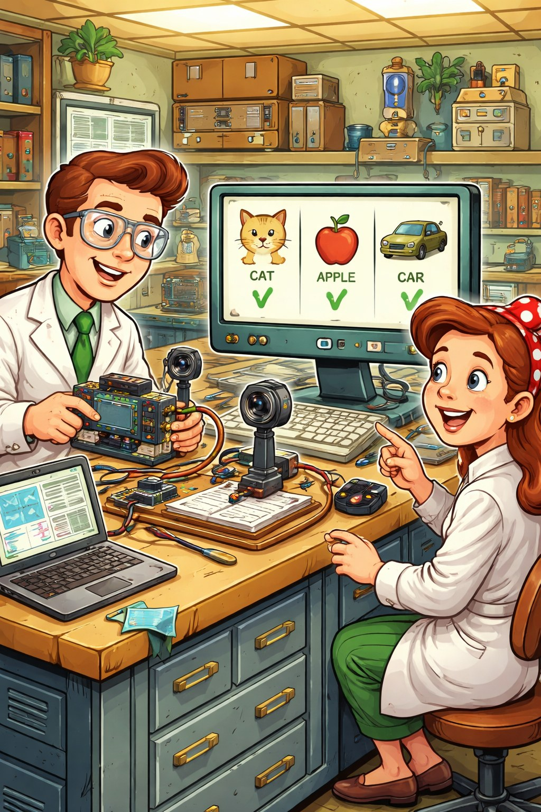{width=60% fig-align="center"}

## Overview {#sec-uno-q-image-classification-overview-cf0c}

With the UNO Q set up for headless development in the [Setup](../setup/setup.qmd) lab, this lab builds the first classic vision application: **image classification**.

Image classification is the "Hello World" of computer vision and machine learning: given an image, the model assigns it to one of several predefined categories. It is one of the most widely deployed ML tasks at the edge, with applications from quality inspection in factories to wildlife monitoring in the field.

This lab has two parts:

- **Part 1** runs the UNO Q's pre-installed image classification example, a **static image classifier** that receives a photo uploaded through a web browser and returns the classification result.
- **Part 2** builds a **custom image classifier** from scratch with Edge Impulse Studio, trained to tell a toy robot from a small Brazilian parakeet toy (*periquito*), and deploys it to the UNO Q with App Lab Bricks, first for static images and then for live webcam inference.

Along the way, the lab uses the UNO Q's dual-brain architecture: **Python on the MPU** for AI inference and an **Arduino sketch on the MCU** for physical feedback on the LED matrix, connected through Bridge RPC.

\noindent
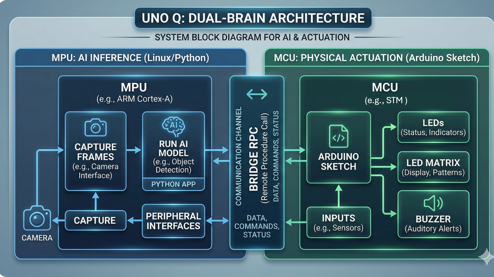{width=85% fig-align="center"}

### Learning Objectives {#sec-uno-q-image-classification-learning-objectives-0eec}

- Understand how the pre-installed image classification Brick works (static image to web UI).
- Collect image data and train a custom classifier with Edge Impulse Studio.
- Deploy a custom model through **App Lab Bricks**.
- Move from static classification to **live webcam inference**.
- Send inference results to the MCU over Bridge for real-time physical feedback.

## Prerequisites {#sec-uno-q-image-classification-prerequisites-b6f4}

- The [Setup](../setup/setup.qmd) lab, with the UNO Q reachable over SSH.
- An [Edge Impulse](https://edgeimpulse.com) account (free).
- A USB webcam (most models work, for example a Logitech C270).
- A USB hub with power delivery, to connect both the webcam and power to the UNO Q.

\noindent
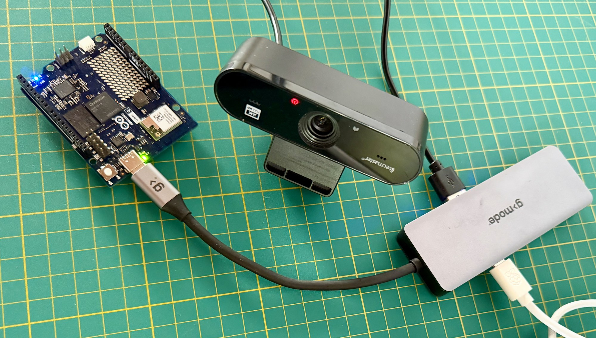{width=70% fig-align="center"}

### Hardware {#sec-uno-q-image-classification-hardware-ee37}

+-----------------------------------+----------------------------------------------------+
| **Item**                          | **Purpose**                                        |
+:==================================+:===================================================+
| Arduino UNO Q (2 GB or 4 GB)      | Edge AI inference and MCU actuation                |
+-----------------------------------+----------------------------------------------------+
| USB webcam                        | Image capture for live inference (Part 2)          |
+-----------------------------------+----------------------------------------------------+
| USB hub with PD                   | Connects the webcam and power to the single USB-C  |
|                                   | port                                               |
+-----------------------------------+----------------------------------------------------+
| Toy robot and periquito, optional | Classification targets for the custom model        |
+-----------------------------------+----------------------------------------------------+

: Hardware for this lab. {#tbl-uno-q-image-classification-hardware}

### Software {#sec-uno-q-image-classification-software-3f8a}

+---------------------+-----------------------------------------------------------------------+
| **Tool**            | **Where**                                                             |
+:====================+:======================================================================+
| Edge Impulse Studio | Browser: [studio.edgeimpulse.com](https://studio.edgeimpulse.com)     |
+---------------------+-----------------------------------------------------------------------+
| Arduino App Lab     | Host computer, to deploy the Edge Impulse model to the board          |
+---------------------+-----------------------------------------------------------------------+
| `arduino-app-cli`   | Pre-installed on the UNO Q                                            |
+---------------------+-----------------------------------------------------------------------+

: Software for this lab. {#tbl-uno-q-image-classification-software}

> No editor is required: every step works from an SSH terminal. For a full IDE, see the VS Code Remote-SSH section of the [Setup](../setup/setup.qmd) lab.

## Computer Vision and Image Classification {#sec-uno-q-image-classification-computer-vision-image-classification-604b}

Computer vision lets machines interpret and make decisions from visual data, imitating what the human visual system does. Machine learning greatly extends a system's ability to understand, interpret, and react to visual input.

\noindent
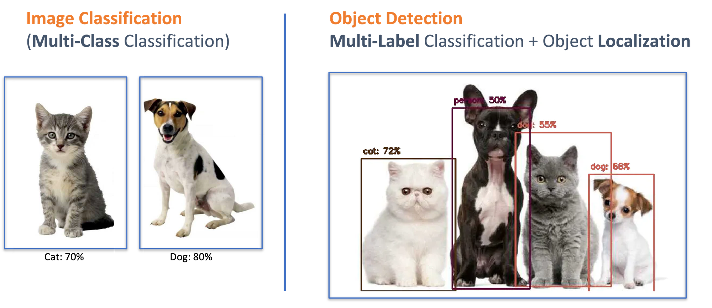{width=85% fig-align="center"}

On embedded devices, the most common computer vision applications are **image classification** and **object detection**:

- **Image classification** assigns a single label to the whole image ("This is a robot" or "This is a periquito").
- **Object detection** locates objects in the image, drawing a bounding box around each one and assigning it a label.

This lab covers image classification; object detection is the topic of the next UNO Q lab.

### From the Nicla Vision to the UNO Q {#sec-uno-q-image-classification-nicla-vision-uno-q-bcc5}

The [Nicla Vision Image Classification](../../nicla_vision/image_classification/image_classification.qmd) lab builds the same kind of classifier on a microcontroller. The UNO Q approach differs in several ways:

+----------------------+-------------------------------------+---------------------------------------+
| **Aspect**           | **Nicla Vision**                    | **Arduino UNO Q**                     |
+:=====================+:====================================+:======================================+
| **Camera**           | Built-in GC2145 (320×240)           | External USB webcam (up to 1080p)     |
+----------------------+-------------------------------------+---------------------------------------+
| **Data collection**  | OpenMV IDE and built-in camera      | Edge Impulse Studio (smartphone,      |
|                      |                                     | webcam, or upload)                    |
+----------------------+-------------------------------------+---------------------------------------+
| **Model size**       | MobileNetV2 0.05/0.1 (96×96, INT8)  | MobileNetV2 0.35 or larger (96×96 to  |
|                      |                                     | 320×320)                              |
+----------------------+-------------------------------------+---------------------------------------+
| **Inference engine** | TFLite for Microcontrollers (C++)   | App Lab Bricks (Python)               |
+----------------------+-------------------------------------+---------------------------------------+
| **RAM for the        | ~256 KB SRAM                        | 2–4 GB LPDDR4X                        |
| model**              |                                     |                                       |
+----------------------+-------------------------------------+---------------------------------------+
| **Actuation**        | Direct GPIO from the MCU            | MCU via Bridge RPC                    |
+----------------------+-------------------------------------+---------------------------------------+
| **Development**      | OpenMV IDE / Arduino IDE            | SSH terminal, `arduino-app-cli`, and  |
|                      |                                     | App Lab (VS Code optional)            |
+----------------------+-------------------------------------+---------------------------------------+

: Image classification on the Nicla Vision and the UNO Q. {#tbl-uno-q-image-classification-nicla-vs-uno-q}

The UNO Q can run **larger, more accurate models** on **higher-resolution input**, because inference runs on the Linux MPU with gigabytes of RAM. The Nicla Vision wins on **power consumption** (milliwatts instead of watts) and on **latency** for very small models.

## Part 1: The Pre-Installed Image Classifier {#sec-uno-q-image-classification-part-1-preinstalled-image-classifier-0e5a}

The UNO Q ships with an image classification example. It combines an **ImageClassification Brick** and a **WebUI Brick** into a browser-based interface that uploads an image and shows the classification result.

> **This step does not need a webcam.**

### The Architecture {#sec-uno-q-image-classification-architecture-018d}

The pre-installed `examples:inspirational/image-classification` app works as follows:

```text
Browser (your PC)                   UNO Q (MPU / Python)
+-------------------+               +-------------------------+
|                   |  Upload image |                         |
|  Web UI (port     | ------------> |  ImageClassification    |
|  7000)            |  (base64 via  |  Brick                  |
|                   |   WebSocket)  |                         |
|  Shows results    | <------------ |  Returns labels +       |
|  (labels +        |  Classifi-    |  confidence scores      |
|  confidence)      |  cation       |                         |
+-------------------+               +-------------------------+
```

Key points:

- Classification runs on **static images** uploaded through the browser; there is no live camera feed.
- Results appear in the browser, not in the terminal logs.
- The example does not communicate with the MCU over Bridge.
- The ImageClassification Brick handles model loading, image preprocessing, and inference internally.

### Step 1: Start the Example {#sec-uno-q-image-classification-step-1-start-example-8847}

SSH into the UNO Q (or use the VS Code integrated terminal) and run:

```bash
arduino-app-cli app start examples:inspirational/image-classification
```

Wait for the app to build and start.

\noindent
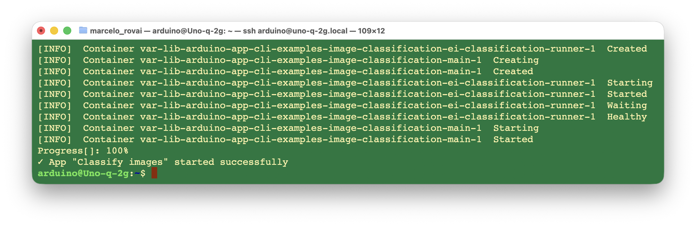{width=85% fig-align="center"}

### Step 2: Open the Web UI {#sec-uno-q-image-classification-step-2-open-web-ui-2887}

On the host computer, open a web browser and go to:

```text
http://<UNO_Q_IP_ADDRESS>:7000
```

The web interface has an **upload button** for selecting an image file on the computer.

\noindent
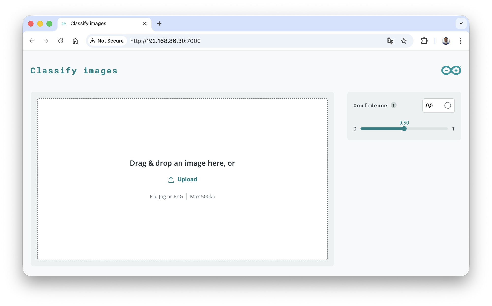{width=85% fig-align="center"}

### Step 3: Classify an Image {#sec-uno-q-image-classification-step-3-classify-image-76f5}

1. Click the upload button and select a photo (for example, an animal, a car, or a household object).
2. The image is sent to the UNO Q, where the ImageClassification Brick processes it.
3. After a moment, the browser shows the detected labels and their confidence scores.

\noindent
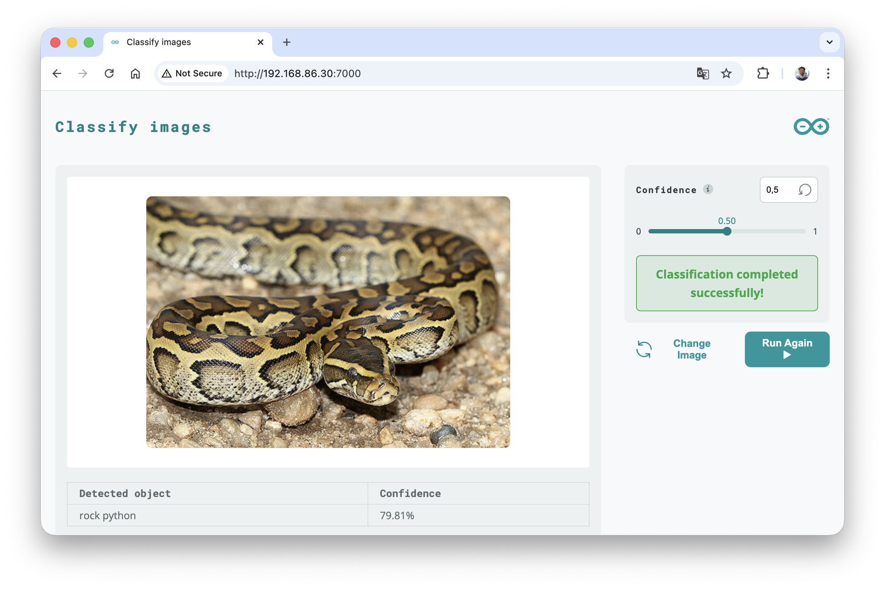{width=85% fig-align="center"}

Try different images and observe how the model classifies them.

> The terminal logs (`arduino-app-cli app logs examples:inspirational/image-classification`) show the app's startup messages but **not the classification results**, which go directly to the browser over WebSocket.

\noindent
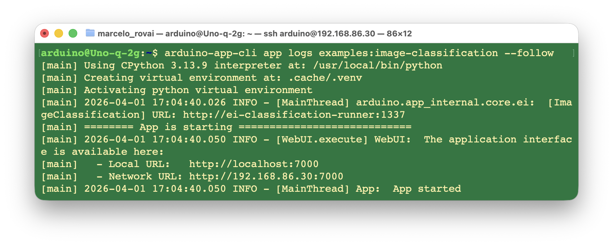{width=85% fig-align="center"}

### Step 4: Study the Source Code {#sec-uno-q-image-classification-step-4-study-source-code-05fb}

Read the example's source to understand how it works. From an SSH terminal:

```bash
cat /var/lib/arduino-app-cli/examples/inspirational/common/\
image-classification/python/main.py
```

With VS Code Remote-SSH, open the folder and browse `python/main.py` directly:

1. **File > Open Folder...**
2. Navigate to `/var/lib/arduino-app-cli/examples/inspirational/common/image-classification/`.
3. Open `python/main.py`.

The key components, in a simplified excerpt:

```python
# The Bricks handle all the heavy lifting
from arduino.app_bricks.web_ui import WebUI
from arduino.app_bricks.image_classification import (
    ImageClassification,
)

# Initialize the classification Brick (loads the model internally)
image_classification = ImageClassification()

# Callback: when the browser sends an image, classify it and
# return the result
def on_classify_image(client_id, data):
    image_data = data.get('image')     # Base64 image from browser
    image_bytes = base64.b64decode(image_data)
    pil_image = Image.open(io.BytesIO(image_bytes))
    results = image_classification.classify(pil_image)  # Inference
    response = {'success': True, 'results': results}
    ui.send_message('classification_result', response)  # To browser

# Set up the WebUI and register the callback
ui = WebUI()
ui.on_message('classify_image', on_classify_image)
App.run()
```

Note that:

- `ImageClassification()` is a **Brick**, a prebuilt module that encapsulates the model and the inference logic.
- `WebUI()` provides the web server and the WebSocket communication.
- `App.run()` starts the app **without a `user_loop`**: it is event-driven, triggered by browser uploads.
- There is **no `Bridge.call()`**, so the MCU is not involved.

### Step 5: Stop the Example {#sec-uno-q-image-classification-step-5-stop-example-74dd}

```bash
arduino-app-cli app stop examples:inspirational/image-classification
```

### Running the Example from Arduino App Lab {#sec-uno-q-image-classification-running-example-arduino-app-lab-4858}

Arduino's documentation covers App Lab in detail, so here are just the main steps:

1. Open Arduino App Lab on the host computer and connect to the UNO Q over Wi-Fi.
2. Enter the board's password.
3. Under `Examples`, open `Classify Images`.

\noindent
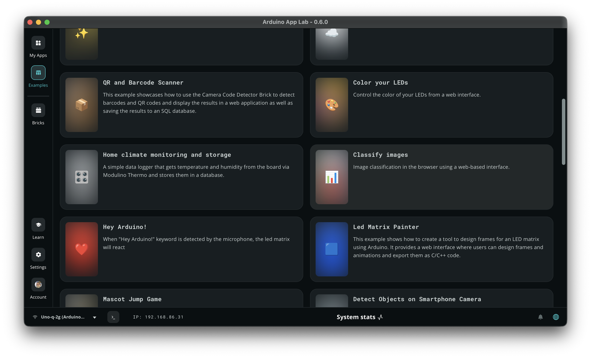{width=85% fig-align="center"}

4. Run it. The web UI opens automatically, as before.

### What Part 1 Shows {#sec-uno-q-image-classification-part-1-shows-731d}

The pre-installed example demonstrates the **Brick-based approach**: high-level components that hide model loading, image processing, and web communication. That is convenient for quick demos, but it has limitations:

- Static images only (no live camera feed).
- Results stay in the browser (no MCU actuation).
- A generic, pre-trained model.

Part 2 removes all three limitations.

## Part 2: Building a Custom Image Classifier {#sec-uno-q-image-classification-part-2-building-custom-image-classifier-146d}

Part 2 builds a custom classifier from scratch. Following the same project as the [Nicla Vision Image Classification](../../nicla_vision/image_classification/image_classification.qmd) lab, the model learns three categories:

- **Robot**: a small toy robot.
- **Periquito**: a small toy of a Brazilian parakeet.
- **Background**: no object present.

\noindent
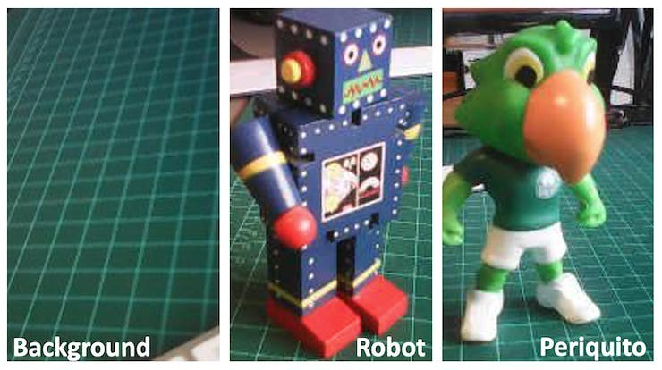{width=60% fig-align="center"}

### Project Goal {#sec-uno-q-image-classification-project-goal-fb8a}

The goal is a system that **continuously** captures frames from a USB webcam, classifies what it sees, and gives physical feedback through the MCU:

```text
USB webcam -> Python (MPU) -> EI model -> robot / periquito / background
                                                    |
                                  Bridge.call("show_result", label)
                                                    |
                                          MCU (Arduino sketch)
                                          -> LED matrix (icon per class)
```

This differs fundamentally from Part 1: **live inference** instead of static uploads, **MCU actuation** instead of a browser display, and a **custom model** instead of a generic pre-trained one.

The custom model is deployed in two steps:

- **Path A** (@sec-uno-q-image-classification-deploying-uno-q-path-app-lab-bricks-6f1b) uses the same ImageClassification Brick as the pre-installed example, with the custom Edge Impulse model. It is quick to set up but limited to static uploads.
- **Path B** (@sec-uno-q-image-classification-deploying-uno-q-path-b-live-camera-7572) uses the **VideoImageClassification Brick** for live webcam inference, and @sec-uno-q-image-classification-postprocessing-mcu-actuation-via-bridge-82c6 adds Bridge communication with the MCU. **This is the path for real projects.**

## Data Collection {#sec-uno-q-image-classification-data-collection-11cf}

Collecting a high-quality dataset is the most important step in any ML project.

### Option A: Edge Impulse Studio with a Smartphone (Recommended) {#sec-uno-q-image-classification-option-edge-impulse-studio-smartphone-recommended-0bc0}

1. Go to [Edge Impulse Studio](https://studio.edgeimpulse.com) and create a new project (for example, "UNO-Q Image Classification").
2. Go to **Devices** and click **Connect a new device**.
3. Select **Use your mobile phone**; a QR code appears.
4. Scan the QR code with the smartphone.
5. Once connected, go to **Data acquisition**.
6. Set the **Label** (for example, "periquito"), select **Camera**, and click **Start sampling**.
7. Capture **about 50 to 60 images** from different angles, distances, and lighting conditions.
8. Repeat for "robot" and "background".

\noindent
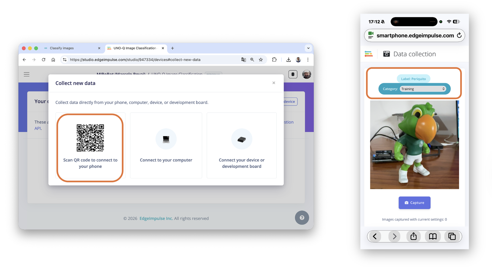{width=85% fig-align="center"}

### Option B: Capturing Images on the UNO Q {#sec-uno-q-image-classification-option-b-capturing-images-uno-q-09dc}

Images can also be captured directly from the USB webcam on the UNO Q, with a script such as `capture_images.py`:

```python
import cv2
import os
import time

label = "robot"  # Change for each class
output_dir = f"/home/arduino/dataset/{label}"
os.makedirs(output_dir, exist_ok=True)

cap = cv2.VideoCapture(0)
cap.set(cv2.CAP_PROP_FRAME_WIDTH, 320)
cap.set(cv2.CAP_PROP_FRAME_HEIGHT, 240)

count = 0
print(f"Capturing images for class '{label}'. Press Ctrl+C to stop.")
try:
    while count < 60:
        ret, frame = cap.read()
        if ret:
            filename = f"{output_dir}/{label}_{count:03d}.jpg"
            cv2.imwrite(filename, frame)
            print(f"Saved: {filename}")
            count += 1
            time.sleep(0.5)
except KeyboardInterrupt:
    pass
cap.release()
print(f"Captured {count} images for '{label}'.")
```

Install OpenCV in a virtual environment and run the script:

```bash
# Debian needs the python3-venv package to create environments
sudo apt install python3.13-venv

# 1) Create the environment
python3.13 -m venv ~/envs/cv2-env

# 2) Activate it
source ~/envs/cv2-env/bin/activate

# 3) Install OpenCV (the headless version is enough)
pip install --upgrade pip
pip install opencv-python-headless

# 4) Run the script
python3 capture_images.py
```

> The images are stored on the UNO Q under `~/dataset/<label>/`. Copy them to the host with `scp` (`scp -r arduino@<UNO_Q_IP>:~/dataset ./dataset`) or by dragging them in VS Code's file explorer, then upload them to Edge Impulse Studio under **Data acquisition > Upload data**.

### Option C: Reusing Images from the Nicla Vision Lab {#sec-uno-q-image-classification-option-c-reusing-images-nicla-vision-lab-49af}

Images collected for the Nicla Vision lab can be uploaded to Edge Impulse Studio under **Data acquisition > Upload data**, with the correct label for each batch.

### Dataset Guidelines {#sec-uno-q-image-classification-dataset-guidelines-5d2b}

- **About 50 to 60 images per class**, at minimum.
- **Varied angles, lighting, and backgrounds.**
- **A "background" class** with images that contain no target object.

> More diverse training data produces more robust models.

## Training the Model with Edge Impulse Studio {#sec-uno-q-image-classification-training-model-edge-impulse-studio-d93a}

### Step 1: Verify the Dataset {#sec-uno-q-image-classification-step-1-verify-dataset-3042}

In Edge Impulse Studio, go to **Data acquisition** and check that the data is correctly labeled and balanced.

\noindent
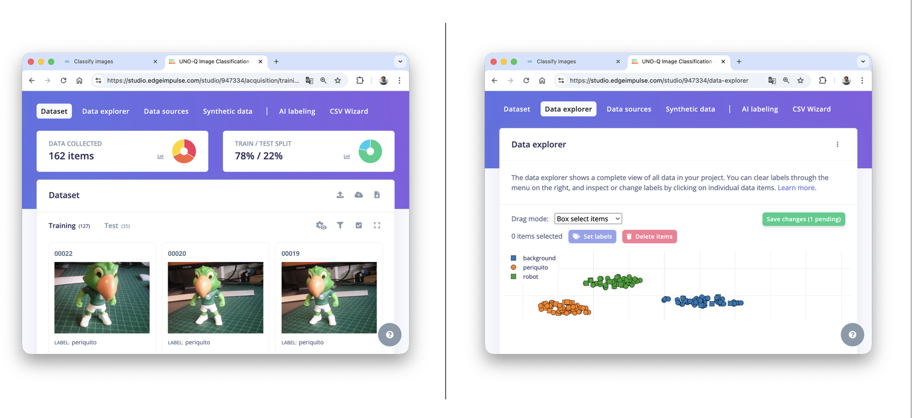{width=85% fig-align="center"}

> The project is public and can be cloned: [UNO-Q Image Classification](https://studio.edgeimpulse.com/public/947334/latest).

### Step 2: Create the Impulse {#sec-uno-q-image-classification-step-2-create-impulse-3613}

1. Go to **Create impulse**.
2. Set the input size to **160×160** for higher accuracy on the UNO Q.
3. Add **Image** as the processing block.
4. Add **Transfer Learning (Images)** as the learning block.
5. Check the output features: `robot`, `periquito`, and `background`.
6. Click **Save Impulse**.

\noindent
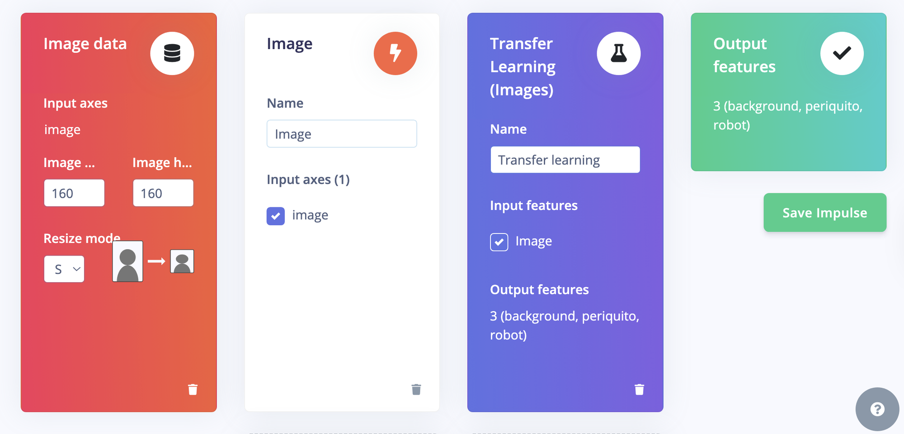{width=85% fig-align="center"}

### Step 3: Generate Features {#sec-uno-q-image-classification-step-3-generate-features-35c3}

1. Go to the **Image** tab.
2. Set the color depth to **RGB**.
3. Click **Save parameters**, then **Generate features**.

### Step 4: Train the Model {#sec-uno-q-image-classification-step-4-train-model-71b8}

1. Go to the **Transfer Learning** tab.
2. Select **MobileNetV2 160x160 1.0** (recommended for the UNO Q).
3. Set the training cycles to **20**.
4. Enable **Data augmentation**.
5. Click **Start training**.

Review the accuracy, the confusion matrix, and the estimated on-device performance.

\noindent
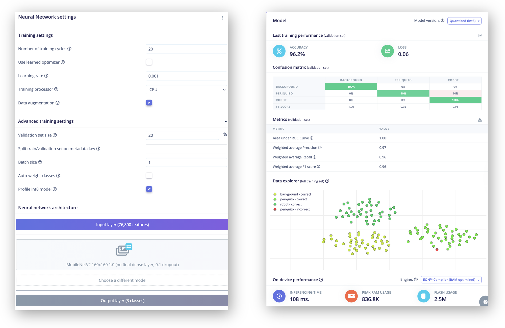{width=85% fig-align="center"}

The model reached high accuracy in training, with an estimated latency of 100 ms. Models with a smaller width multiplier (alpha), such as 0.35, run faster with similar accuracy, so it is worth testing which parameters suit each project.

### Step 5: Test the Model {#sec-uno-q-image-classification-step-5-test-model-d7e6}

Go to **Model testing**. In the settings, **enable Int8**, then click **Classify all** to validate the model on the test set.

\noindent
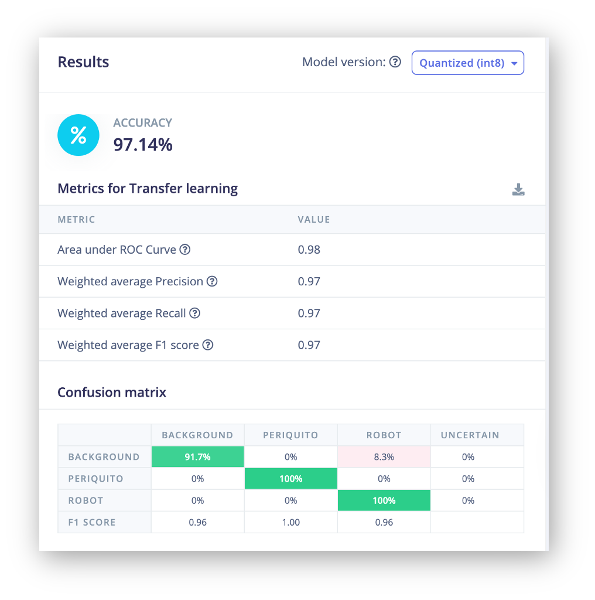{width=70% fig-align="center"}

## Deploying to the UNO Q, Path A: App Lab Bricks {#sec-uno-q-image-classification-deploying-uno-q-path-app-lab-bricks-6f1b}

This path uses the Brick architecture with the custom model. It is quick to set up but limited to **static image uploads** through the browser.

### Step 1: Copy the Pre-Installed Example {#sec-uno-q-image-classification-step-1-copy-preinstalled-example-3f97}

Copy the example from the command line:

```bash
cp -r /var/lib/arduino-app-cli/examples/inspirational/common/\
image-classification/ ~/ArduinoApps/my-classifier-bricks
```

Or copy it in Arduino App Lab, giving it a new name; the copy appears in the `My Apps` area.

\noindent
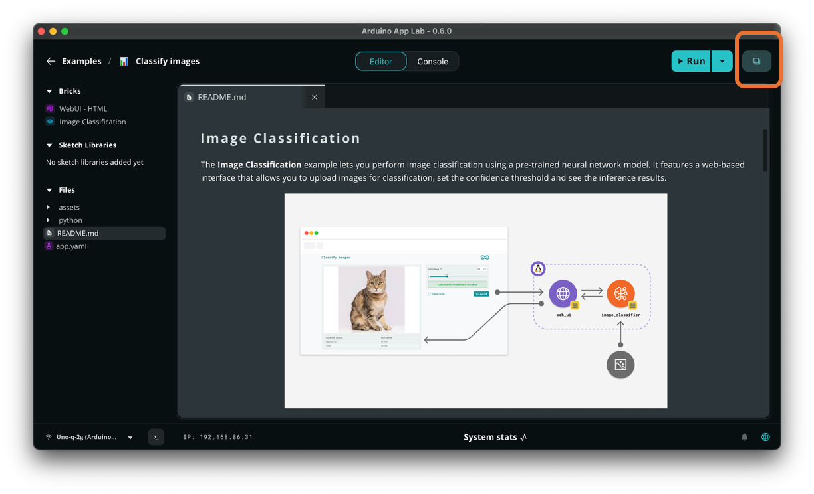{width=80% fig-align="center"}

### Step 2: Export the Model from Edge Impulse to Arduino App Lab {#sec-uno-q-image-classification-step-2-export-model-edge-impulse-arduino-app-lab-c482}

1. In the copied example in `My Apps`, go to `Bricks/Image Classification`, select `AI models`, and click `Train new AI model`.

\noindent
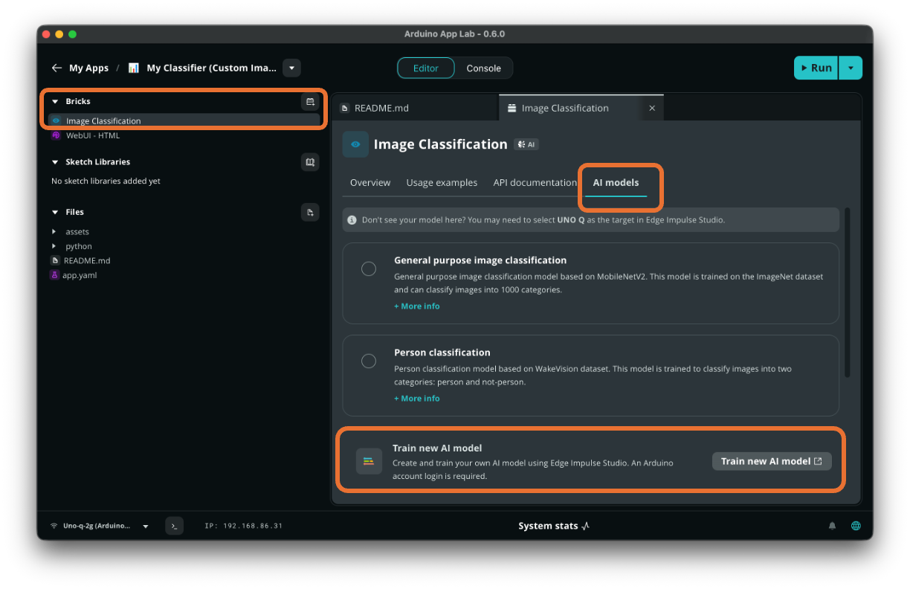{width=80% fig-align="center"}

2. A window asks for the Arduino/Edge Impulse account login, then opens the list of Edge Impulse Studio projects. Open the project (here, "UNO-Q Image Classification").
3. In the project, go to **Deployment**.
4. Select **Arduino UNO Q** as the target (or **Linux AARCH64**).
5. Click **Build**.

\noindent
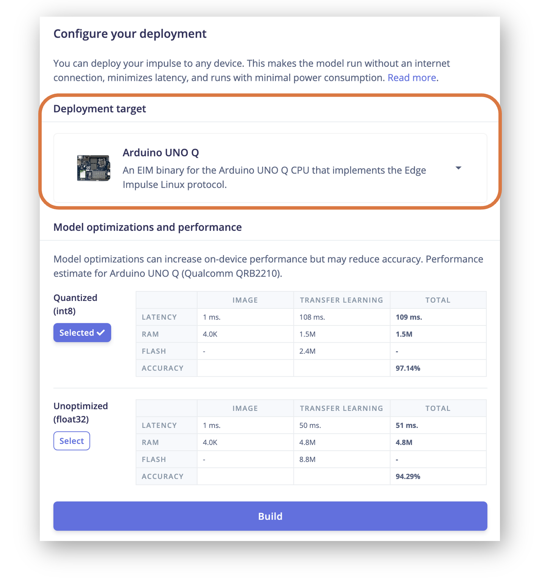{width=80% fig-align="center"}

When the build finishes, the `.eim` file downloads to the computer, and a pop-up window with a `Go to Arduino` button appears. Clicking it sends the model to App Lab.

\noindent
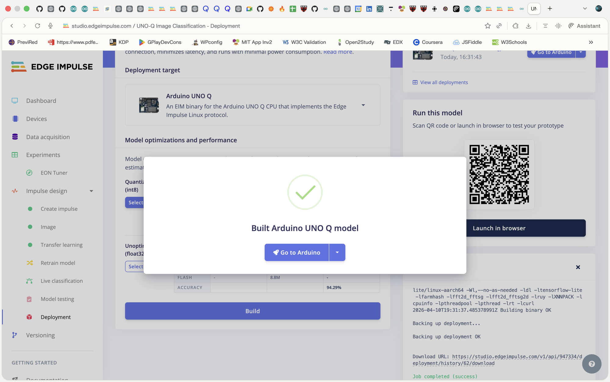{width=85% fig-align="center"}

> The model can also be tested on a phone or computer with the QR code on the deployment page.

### Step 3: Replace the Model on the UNO Q {#sec-uno-q-image-classification-step-3-replace-model-uno-q-ebeb}

The model now appears in the project's `AI Models` area. Download it to the UNO Q and select it.

\noindent
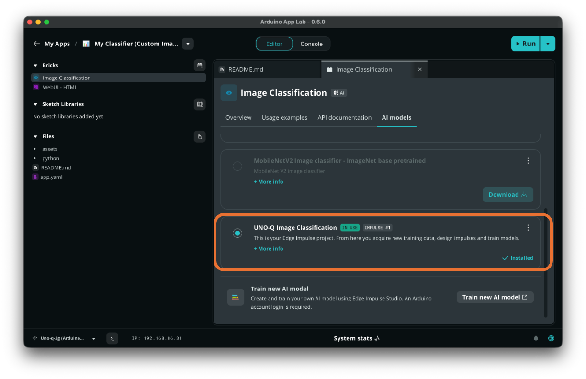{width=80% fig-align="center"}

In the project folder (`~/ArduinoApps/my-classifier-bricks`), the Brick configuration in `app.yaml` is updated automatically to point to the custom model:

```yaml
name: My Classifier (Custom Images)
description: Custom Image classification in the browser using a
  web-based interface.
ports: []
bricks:
- arduino:image_classification:
    model: ei-model-947334-1
- arduino:web_ui: {}
icon: 📊
```

The model (`model.eim`) is saved in `/home/arduino/.arduino-bricks/models/custom-ei/ei-model-947334-1`.

### Step 4: Run the App {#sec-uno-q-image-classification-step-4-run-app-0c8e}

```bash
cd ~/ArduinoApps/my-classifier-bricks
arduino-app-cli app start .
```

Open `http://<UNO_Q_IP>:7000` in a browser and upload images of the robot, the periquito, or the background. The classifier now uses **the custom model**.

\noindent
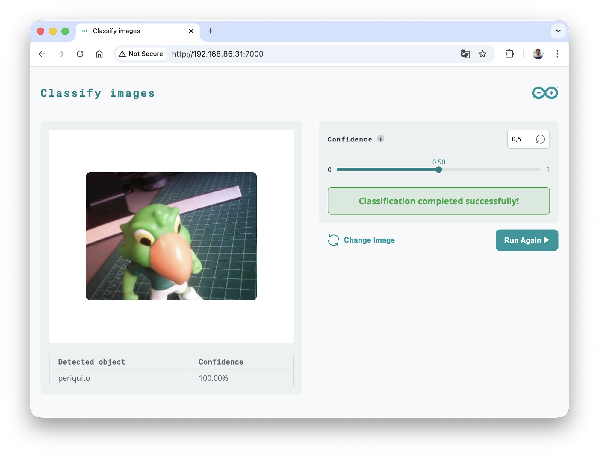{width=85% fig-align="center"}

> **Limitation**: this approach still relies on **static image uploads** through the browser. Path B adds **live webcam inference**.

Before moving on, modify `python/main.py` to print information about the new model and each inference result. First, stop the app:

```bash
arduino-app-cli app stop .
```

Then replace `python/main.py` with:

```python
from arduino.app_utils import App
from arduino.app_bricks.web_ui import WebUI
from arduino.app_bricks.image_classification import (
    ImageClassification,
)
from PIL import Image
import io
import base64
import time

image_classification = ImageClassification()


def print_model_info(image_classification):
    info = image_classification.get_model_info()
    if info is not None:
        print("Model info:")
        for attr in dir(info):
            value = getattr(info, attr)
            if not attr.startswith("_") and not callable(value):
                print(f"  {attr}: {value}")
    else:
        print("Failed to retrieve model info.")


def on_classify_image(client_id, data):
    """Callback function to handle image classification requests."""
    try:
        image_data = data.get('image')
        image_type_raw = data.get('image_type')
        if image_type_raw:
            image_type = image_type_raw.split('/')[-1]
        else:
            image_type = 'jpeg'
        confidence = data.get('confidence', 0.25)
        if not image_data:
            ui.send_message('classification_error',
                            {'error': 'No image data'})
            return

        image_bytes = base64.b64decode(image_data)
        pil_image = Image.open(io.BytesIO(image_bytes))

        start_time = time.time() * 1000
        results = image_classification.classify(
            pil_image, image_type=image_type, confidence=confidence
        )
        print(f"\nInference: {results}")
        diff = time.time() * 1000 - start_time
        print(f"Latency: {diff:.2f} ms")
        if results is None:
            ui.send_message('classification_error',
                            {'error': 'No results returned'})
            return

        response = {
            'success': True,
            'results': results,
            'processing_time': f"{diff:.2f} ms"
        }
        ui.send_message('classification_result', response)

    except Exception as e:
        ui.send_message('classification_error', {'error': str(e)})


print_model_info(image_classification)
ui = WebUI()
ui.on_message('classify_image', on_classify_image)

App.run()
```

Run the app:

```bash
arduino-app-cli app start .
```

In a second terminal, go to the project folder and follow the logs:

```bash
cd ~/ArduinoApps/my-classifier-bricks
arduino-app-cli app logs . --follow
```

\noindent
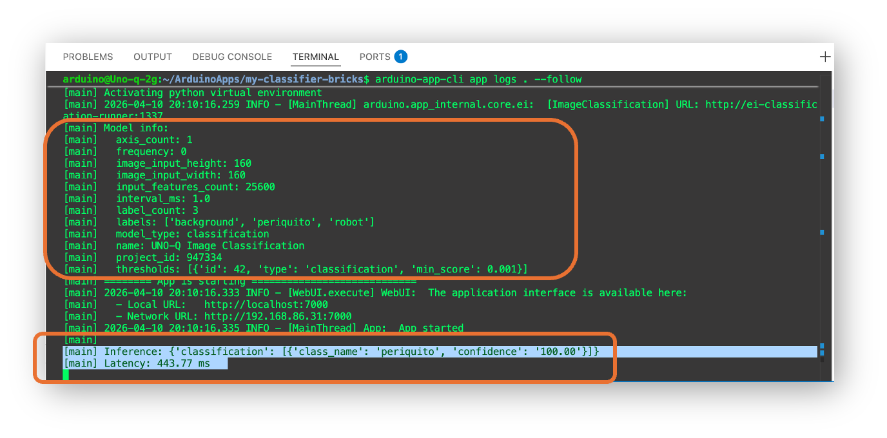{width=85% fig-align="center"}

The logs show that the custom model takes 160×160 images and that its labels are:

`labels: ['background', 'periquito', 'robot']`

The latency of this model is around 444 ms, a little over 2 FPS.

> For a faster model, train with smaller images (such as 96×96) or a smaller network, for example with an alpha of 0.35.

## Deploying to the UNO Q, Path B: Live Camera {#sec-uno-q-image-classification-deploying-uno-q-path-b-live-camera-7572}

This path runs live webcam capture and continuous classification, and the next section adds Bridge communication with the MCU.

### Step 1: Create a New App in Arduino App Lab {#sec-uno-q-image-classification-step-1-create-new-app-arduino-app-lab-25ae}

In Arduino App Lab's `My Apps`, click the `Create new app` button in the upper right.

\noindent
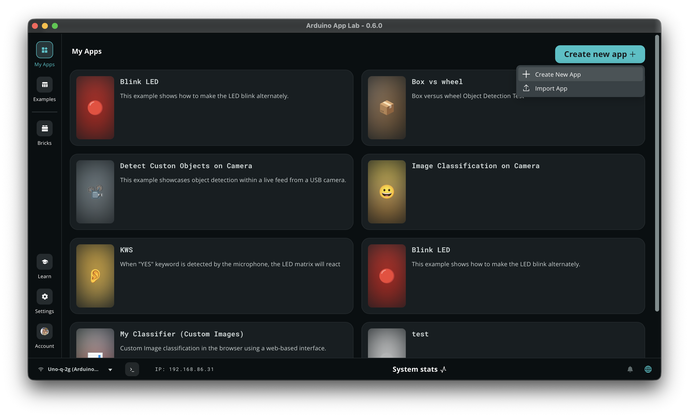{width=85% fig-align="center"}

Name it, for example, `Image Classification on Camera`.

### Step 2: Add a Brick and Select the Model {#sec-uno-q-image-classification-step-2-add-brick-select-model-300c}

Go to `Bricks` and click `Add Brick`.

\noindent
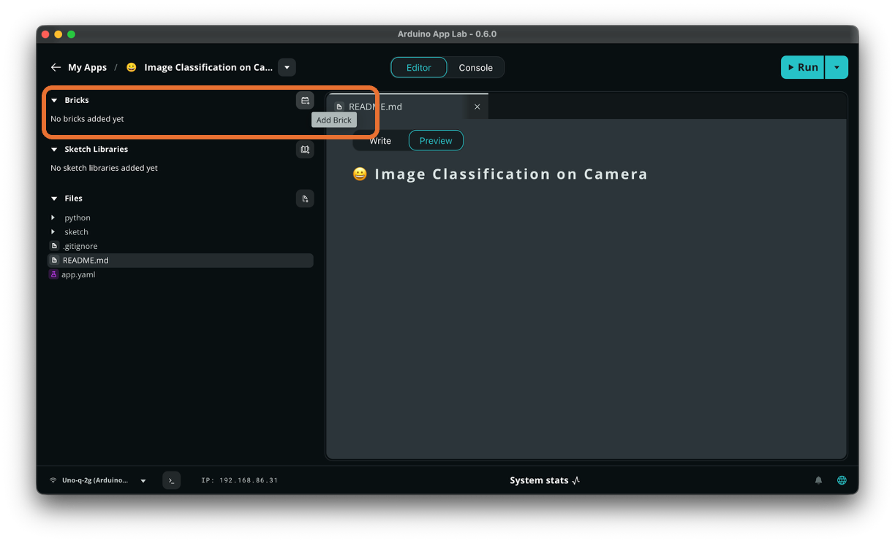{width=80% fig-align="center"}

In the list of available Bricks, scroll down to `Video Image Classification` and click `Add brick`.

\noindent
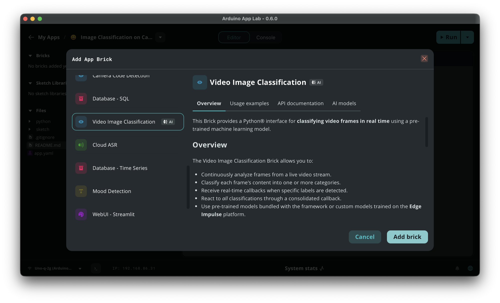{width=85% fig-align="center"}

As in Path A, once the Brick is installed, go to the `AI Models` tab and select the `UNO-Q Image Classification` model deployed earlier.

\noindent
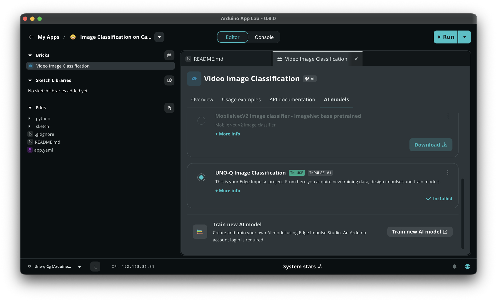{width=85% fig-align="center"}

Selecting the model creates `app.yaml` automatically, pointing to the custom model:

```yaml
name: Image Classification on Camera
description: ""
ports: []
bricks:
- arduino:video_image_classification:
    model: ei-model-947334-1
icon: 😀
```

### Step 3: Write `python/main.py` {#sec-uno-q-image-classification-step-3-write-pythonmainpy-b83b}

The new app's `python/main.py` is a generic template that must be written for this model. The key piece is the `VideoImageClassification` class:

```python
class VideoImageClassification(camera: BaseCamera | None,
                               confidence: float,
                               debounce_sec: float)
```

This module classifies images on a **live video stream** with the selected model, and it calls registered actions in real time when classes are detected. Its parameters are:

- **camera** (*BaseCamera*): the camera that captures the video. If `None`, a default camera is initialized.
- **confidence** (*float*): the minimum confidence for a classification to count. The default is 0.3.
- **debounce_sec** (*float*): the minimum time, in seconds, between consecutive detections of the same class, to avoid repeated triggers. The default is 0.

The complete code:

```python
from arduino.app_utils import App
from arduino.app_bricks.video_imageclassification import (
    VideoImageClassification,
)

# Create a classification stream with a confidence threshold of 0.5
classification_stream = VideoImageClassification(confidence=0.5)

# Callback when "periquito" is detected
def periquito_detected():
    print("Detected periquito!")

# Callback when "robot" is detected
def robot_detected():
    print("Detected robot!")

# Subscribe to specific labels
classification_stream.on_detect("periquito", periquito_detected)
classification_stream.on_detect("robot", robot_detected)

# Optional: callback for all classifications (useful for debugging)
def all_detected(results):
    # results maps each label to its confidence,
    # for example {"periquito": 0.85}
    print("Classification results:", results)

classification_stream.on_detect_all(all_detected)

# Run the app
App.run()
```

Run the app:

```bash
cd ~/ArduinoApps/image-classification-on-camera
arduino-app-cli app start .
```

In a second terminal, go to the project folder and follow the logs:

```bash
cd ~/ArduinoApps/image-classification-on-camera
arduino-app-cli app logs . --follow
```

\noindent
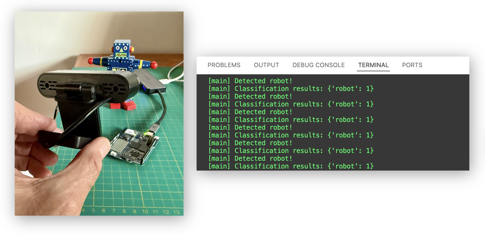{width=85% fig-align="center"}

## Post-Processing: MCU Actuation via Bridge {#sec-uno-q-image-classification-postprocessing-mcu-actuation-via-bridge-82c6}

Live classification now runs through the `VideoImageClassification` Brick, with callbacks printing results to the log. This section adds the **MCU side**, using Bridge RPC to drive the LED matrix according to what the camera sees.

### Architecture {#sec-uno-q-image-classification-bridge-architecture-dd95}

```text
USB webcam -> VideoImageClassification Brick -> on_detect_all(callback)
                                                       |
                                       Bridge.call("show_result", label)
                                                       |
                                              MCU (Arduino sketch)
                                              -> LED matrix: face = robot
                                              -> LED matrix: bird = periquito
                                              -> LED matrix: empty = background
```

### Step 1: Add a Sketch to the Project {#sec-uno-q-image-classification-step-1-add-sketch-project-9bc7}

The `image-classification-on-camera` project has no `sketch/` folder yet, since the MCU is not involved. Create one (in VS Code or in a terminal), unless it already exists:

```bash
cd ~/ArduinoApps/image-classification-on-camera
mkdir -p sketch
```

### Step 2: Write the Arduino Sketch {#sec-uno-q-image-classification-step-2-write-arduino-sketch-b71d}

The sketch includes the `Arduino_LED_Matrix.h` library and calls `matrix.renderBitmap(frame, 8, 13)` to draw on the 8×13 matrix. The patterns are simple pixel art that can be refined later with the [Arduino LED Matrix Editor](https://ledmatrix-editor.arduino.cc/) (adjusted to 13 columns instead of 12).

Create (or modify) `sketch/sketch.ino`:

```cpp
#include "Arduino_RouterBridge.h"
#include "Arduino_LED_Matrix.h"

ArduinoLEDMatrix matrix;

// 8x13 patterns for each class
// Robot icon (simple face)
uint8_t robot_frame[8][13] = {
    {0,0,1,1,1,1,1,1,1,1,1,0,0},
    {0,1,0,0,0,0,0,0,0,0,0,1,0},
    {0,1,0,1,1,0,0,0,1,1,0,1,0},
    {0,1,0,1,1,0,0,0,1,1,0,1,0},
    {0,1,0,0,0,0,0,0,0,0,0,1,0},
    {0,1,0,0,1,1,1,1,1,0,0,1,0},
    {0,1,0,0,0,0,0,0,0,0,0,1,0},
    {0,0,1,1,1,1,1,1,1,1,1,0,0}
};

// Bird icon (simple periquito)
uint8_t bird_frame[8][13] = {
    {0,0,0,0,0,1,1,0,0,0,0,0,0},
    {0,0,0,0,1,1,1,1,0,0,0,0,0},
    {0,0,0,1,1,0,1,1,1,0,0,0,0},
    {0,1,1,1,1,1,1,1,0,0,0,0,0},
    {0,0,0,1,1,1,1,1,1,1,1,0,0},
    {0,0,0,0,1,1,1,1,1,0,0,0,0},
    {0,0,0,0,0,1,0,1,0,0,0,0,0},
    {0,0,0,0,0,1,0,1,0,0,0,0,0}
};

// Empty frame (background / nothing detected)
uint8_t empty_frame[8][13] = {
    {0,0,0,0,0,0,0,0,0,0,0,0,0},
    {0,0,0,0,0,0,0,0,0,0,0,0,0},
    {0,0,0,0,0,0,0,0,0,0,0,0,0},
    {0,0,0,0,0,0,0,0,0,0,0,0,0},
    {0,0,0,0,0,0,0,0,0,0,0,0,0},
    {0,0,0,0,0,0,0,0,0,0,0,0,0},
    {0,0,0,0,0,0,0,0,0,0,0,0,0},
    {0,0,0,0,0,0,0,0,0,0,0,0,0}
};

void setup() {
    matrix.begin();
    matrix.renderBitmap(empty_frame, 8, 13);

    Bridge.begin();
    Bridge.provide("show_result", show_result);
}

void loop() {
}

void show_result(String label) {
    if (label == "robot") {
        matrix.renderBitmap(robot_frame, 8, 13);
    } else if (label == "periquito") {
        matrix.renderBitmap(bird_frame, 8, 13);
    } else {
        matrix.renderBitmap(empty_frame, 8, 13);
    }
}
```

Create (or modify) `sketch/sketch.yaml`:

```yaml
profiles:
  default:
    platforms:
      - platform: arduino:zephyr
    libraries:
      - Arduino_RouterBridge (0.3.0)
      - dependency: Arduino_RPClite (0.2.1)
      - dependency: ArxContainer (0.7.0)
      - dependency: ArxTypeTraits (0.3.2)
      - dependency: DebugLog (0.8.4)
      - dependency: MsgPack (0.4.2)
default_profile: default
```

### Step 3: Update the Python Script to Call Bridge {#sec-uno-q-image-classification-step-3-update-python-script-call-bridge-debe}

Modify `python/main.py` to send the classification results to the MCU over Bridge. Instead of separate `on_detect` callbacks per class, this version uses **only** `on_detect_all` and picks the top class from its results. The `current_label` check sends a Bridge call only when the result actually changes.

The confidence threshold is also lowered to `0.3`, so that "background" detections, which sometimes have lower confidence, still come through. Tune it after testing.

```python
from arduino.app_utils import App, Bridge
from arduino.app_bricks.video_imageclassification import (
    VideoImageClassification,
)

classification_stream = VideoImageClassification(confidence=0.3)

current_label = ""

# Priority order: robot and periquito take precedence over background
PRIORITY = {"robot": 2, "periquito": 1, "background": 0}

def all_detected(results):
    global current_label
    print(f"Raw results: {results}")

    if results:
        # Pick the highest-priority label from the results
        label = max(results, key=lambda r: PRIORITY.get(r, -1))
    else:
        label = "background"

    if label != current_label:
        current_label = label
        Bridge.call("show_result", label)
        print(f"==> {label}")

classification_stream.on_detect_all(all_detected)
App.run()
```

> The `current_label` variable avoids redundant Bridge calls on every frame: the LED matrix changes only when the detected class changes.

### Step 4: Verify the Project Structure {#sec-uno-q-image-classification-step-4-verify-project-structure-8505}

The project should now look like this:

```text
image-classification-on-camera/
├── app.yaml
├── python/
│   └── main.py
└── sketch/
    ├── sketch.ino
    └── sketch.yaml
```

The `app.yaml` still points to the custom model from Path B:

```yaml
name: Image Classification on Camera
description: ""
ports: []
bricks:
- arduino:video_image_classification:
    model: ei-model-947334-1
icon: 😀
```

### Step 5: Run the Complete System {#sec-uno-q-image-classification-step-5-run-complete-system-f345}

Stop any running app first:

```bash
arduino-app-cli app stop .
```

Start the updated project:

```bash
arduino-app-cli app start .
```

> The first run after adding the sketch takes longer, because the system compiles the Arduino code for the MCU.

### Step 6: Test the System {#sec-uno-q-image-classification-step-6-test-system-88fe}

Follow the logs:

```bash
arduino-app-cli app logs . --follow
```

Place objects in front of the camera and observe:

- **Robot** in front of the webcam: **a face** lights up, and the log shows `Raw results: {'robot': 1}`.
- **Periquito** in front of the webcam: **a bird** lights up, and the log shows `Raw results: {'periquito': 1}`.
- **No object** (or an unknown object): the matrix is **empty**, and the log shows `Raw results: {'background': 1}`.

\noindent
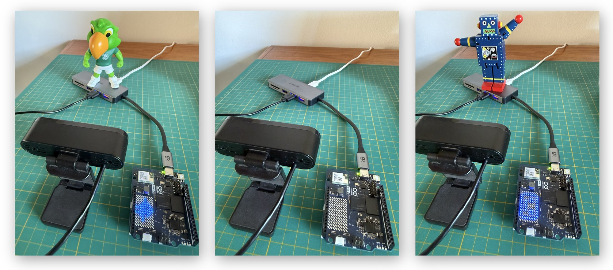{width=80% fig-align="center"}

### Step 7: Stop the App {#sec-uno-q-image-classification-step-7-stop-app-4b87}

```bash
arduino-app-cli app stop .
```

### Extending the MCU Actuation {#sec-uno-q-image-classification-extending-mcu-actuation-d70c}

The Arduino sketch can be extended with other kinds of feedback.

**External LEDs:**

```cpp
#include "Arduino_RouterBridge.h"

// Digital pins for external LEDs
#define MY_LED_BLUE   2
#define MY_LED_GREEN  3
#define MY_LED_RED    4

void setup() {
    pinMode(MY_LED_RED, OUTPUT);
    pinMode(MY_LED_GREEN, OUTPUT);
    pinMode(MY_LED_BLUE, OUTPUT);
    pinMode(LED_BUILTIN, OUTPUT);

    digitalWrite(MY_LED_RED, LOW);
    digitalWrite(MY_LED_GREEN, LOW);
    digitalWrite(MY_LED_BLUE, LOW);
    digitalWrite(LED_BUILTIN, HIGH);

    Bridge.begin();
    Bridge.provide("show_result", show_result);
}

void loop() {}

void show_result(String label) {
    digitalWrite(MY_LED_RED, LOW);
    digitalWrite(MY_LED_GREEN, LOW);
    digitalWrite(MY_LED_BLUE, LOW);

    if (label == "robot") {
        digitalWrite(MY_LED_BLUE, HIGH);
    } else if (label == "periquito") {
        digitalWrite(MY_LED_GREEN, HIGH);
    } else {
        digitalWrite(MY_LED_RED, HIGH);
    }
}
```

**Buzzer feedback:**

```cpp
#define BUZZER_PIN 5   // a pin not used by the LEDs above

void show_result(String label) {
    // LEDs as before...

    if (label == "robot")     tone(BUZZER_PIN, 1000, 200);
    if (label == "periquito") tone(BUZZER_PIN, 2000, 200);
}
```

**Servo motor:**

```cpp
#include <Servo.h>
Servo myServo;   // call myServo.attach(pin) in setup()

void show_result(String label) {
    if (label == "robot")          myServo.write(0);
    else if (label == "periquito") myServo.write(180);
    else                           myServo.write(90);
}
```

## Performance Analysis {#sec-uno-q-image-classification-performance-analysis-0a62}

### Inference Latency {#sec-uno-q-image-classification-inference-latency-072f}

The logs from the previous sections show the inference performance:

- **Path A** (ImageClassification Brick, 160×160, MobileNetV2 1.0): about 444 ms per image (about 2 FPS).
- **Path B** (VideoImageClassification Brick, live camera): depends on the model, typically faster thanks to the continuous pipeline.

### Model Size vs. Speed {#sec-uno-q-image-classification-model-size-vs-speed-165b}

+------------------+----------------+-------------------------+---------------+
| **Model**        | **Input Size** | **Inference (approx.)** | **Rel. acc.** |
+:=================+:===============+:========================+:==============+
| MobileNetV2 0.1  | 96×96          | ~30–50 ms               | Good          |
+------------------+----------------+-------------------------+---------------+
| MobileNetV2 0.35 | 96×96          | ~60–100 ms              | Better        |
+------------------+----------------+-------------------------+---------------+
| MobileNetV2 0.35 | 160×160        | ~100–200 ms             | Very good     |
+------------------+----------------+-------------------------+---------------+
| MobileNetV2 1.0  | 160×160        | ~400–500 ms             | Best          |
+------------------+----------------+-------------------------+---------------+

: Expected model size vs. speed trade-off on the UNO Q. Only the MobileNetV2 1.0 row was measured in this lab; the other rows are rough expectations, not measurements. {#tbl-uno-q-image-classification-model-speed}

The ~444 ms for MobileNetV2 1.0 at 160×160 is the Path A measurement above. The other latencies and the relative accuracy labels are starting points for the trade-off, not results from this board: measure each candidate with the Path A script before choosing one.

> For faster inference (for example, for more responsive LED feedback), retrain with a smaller model such as MobileNetV2 0.35 at 96×96, and test several configurations to find the best balance for the project.

### Path A vs. Path B {#sec-uno-q-image-classification-path-vs-path-b-4a31}

+-------------------+---------------------------------------+-------------------------------------------+
| **Aspect**        | **Path A (ImageClassification         | **Path B (VideoImageClassification        |
|                   | Brick)**                              | Brick)**                                  |
+:==================+:======================================+:==========================================+
| **Input**         | Static images (browser upload)        | Live webcam (continuous)                  |
+-------------------+---------------------------------------+-------------------------------------------+
| **Latency**       | Per upload (user-triggered)           | Continuous (model-dependent FPS)          |
+-------------------+---------------------------------------+-------------------------------------------+
| **MCU actuation** | Not included (browser only)           | Yes, via Bridge RPC                       |
+-------------------+---------------------------------------+-------------------------------------------+
| **Web UI**        | Built in (upload and results)         | No built-in UI (add separately)           |
+-------------------+---------------------------------------+-------------------------------------------+
| **Best for**      | Quick tests, demos                    | Real-time applications                    |
+-------------------+---------------------------------------+-------------------------------------------+

: The two deployment paths compared. {#tbl-uno-q-image-classification-paths}

### Comparison with the Nicla Vision {#sec-uno-q-image-classification-comparison-nicla-vision-5e86}

+------------------------+--------------------------------+-----------------------------------------+
| **Metric**             | **Nicla Vision (MCU)**         | **UNO Q (MPU)**                         |
+:=======================+:===============================+:========================================+
| Model                  | MobileNetV2 0.1 (96×96, INT8)  | MobileNetV2 0.35–1.0 (96×96 to 160×160) |
+------------------------+--------------------------------+-----------------------------------------+
| Inference time         | 86 ms measured (MobileNetV2    | 444 ms measured (MobileNetV2 1.0,       |
|                        | 0.1, 96×96, Nicla Vision lab)  | 160×160, Path A); smaller models faster |
+------------------------+--------------------------------+-----------------------------------------+
| Power during inference | ~100 mW (estimate)             | ~3–6 W (estimate, see below)            |
+------------------------+--------------------------------+-----------------------------------------+
| Framework              | TFLite Micro (C++)             | App Lab Bricks (Python)                 |
+------------------------+--------------------------------+-----------------------------------------+
| Camera                 | Built-in                       | External USB webcam                     |
+------------------------+--------------------------------+-----------------------------------------+
| MCU actuation          | Direct GPIO                    | Bridge RPC                              |
+------------------------+--------------------------------+-----------------------------------------+

: Measured and estimated metrics on the Nicla Vision and the UNO Q. {#tbl-uno-q-image-classification-nicla-metrics}

The two latencies come from very different models and input sizes (MobileNetV2 0.1 at 96×96 is far smaller than MobileNetV2 1.0 at 160×160), so they show the range of each platform, not a head-to-head result. Accuracy is left out on purpose: the two labs used different datasets and splits, so their accuracy figures are not comparable. Exercise 5 below sets up a fair comparison.

The UNO Q power figure is a practical estimate of the total for live classification with the USB camera and hub:

- UNO Q board: about 2 to 3.5 W while the CPU is busy.
- USB camera: about 0.5 to 1.25 W.
- Powered hub: about 0.5 to 1 W.
- Total: about 3 to 6 W from the wall (5 V, about 0.6 to 1.2 A) for a typical setup with one camera and one hub.

> The UNO Q runs larger, more accurate models but uses much more power. The Nicla Vision suits battery-powered, always-on applications; the UNO Q excels when accuracy matters and the AI result must drive real-time hardware actions.

## Exercises {#sec-uno-q-image-classification-exercises-e852}

1. **Add a fourth class.** Collect images of a new object, retrain the model in Edge Impulse, redeploy it to the UNO Q, and update the Python code and the Arduino sketch. How does adding more classes affect accuracy?

2. **Experiment with model size.** Train the same dataset with MobileNetV2 0.1 (96×96) and MobileNetV2 1.0 (160×160). Deploy both to the UNO Q and compare inference time, accuracy, and LED responsiveness in a table.

3. **Log to CSV.** Modify `main.py` to log each detection event (timestamp and label) to a CSV file on the UNO Q. After 5 minutes, download the CSV and plot the detection frequency per class.

4. **Design new LED matrix icons.** Draw your own 8×13 patterns for each class with the Arduino LED Matrix Editor and display them on the UNO Q's matrix.

5. **Cross-platform comparison.** With a Nicla Vision, deploy a 96×96 MobileNetV2 0.1 model to both platforms. Compare inference time, accuracy, power consumption, and development workflow.

6. **Debounce tuning.** Experiment with the `debounce_sec` parameter in `VideoImageClassification(confidence=0.5, debounce_sec=1.0)`. How does a longer debounce time affect the responsiveness and stability of the LED feedback?

## Summary {#sec-uno-q-image-classification-summary-e77b}

This lab went through three levels of image classification on the Arduino UNO Q:

1. **Part 1**: the pre-installed static image classifier (ImageClassification Brick and WebUI), with images uploaded through a browser and results shown in the web interface.
2. **Path A**: the custom model deployed through the same Brick, still with static uploads, but classifying the lab's own robot, periquito, and background classes.
3. **Path B**: live camera classification with the VideoImageClassification Brick, with detection callbacks driving the LED matrix on the MCU over Bridge RPC.

Key takeaways:

- **The Edge Impulse → App Lab → UNO Q pipeline works.** Collect data, train in Edge Impulse Studio, deploy to App Lab, and run, all guided through the UI.
- **Two Bricks, two modes.** The `ImageClassification` Brick handles static images (good for testing), and the `VideoImageClassification` Brick handles live camera streams (essential for real applications).
- **The dual-brain architecture adds value.** Python handles the camera and ML inference on the MPU, while the Arduino sketch on the MCU provides real-time control of the LED matrix, LEDs, servos, or buzzers. Bridge RPC connects the two.
- **Model selection matters.** The UNO Q runs larger, more accurate models than any MCU, but there is always a trade-off between accuracy and inference speed. Test several configurations to find the best balance for each project.

The next UNO Q lab extends these skills to **object detection**, which finds not just *what* is in the image but also *where* it is, opening the door to tracking, counting, and spatial awareness.

## Resources {#sec-uno-q-image-classification-resources-ddbf}

- [Generative AI at the Edge: Running Small Language Models with Arduino UNO Q and llama.cpp](https://mjrovai.github.io/genai-uno-q/), by Marcelo Rovai, the open book these UNO Q labs are adapted from
- [UNO-Q Image Classification (public Edge Impulse project)](https://studio.edgeimpulse.com/public/947334/latest)
- [Edge Impulse Studio](https://studio.edgeimpulse.com)
- [Edge Impulse: Arduino UNO Q documentation](https://docs.edgeimpulse.com/hardware/boards/arduino-uno-q)
- [Edge Impulse: Arduino App Lab deployment](https://docs.edgeimpulse.com/hardware/deployments/run-arduino-app-lab)
- [App Lab Bricks documentation](https://docs.arduino.cc/software/app-lab/tutorials/bricks)
- [Arduino App Lab CLI](https://docs.arduino.cc/software/app-lab/tutorials/cli)
- [Arduino LED Matrix Editor](https://ledmatrix-editor.arduino.cc/)
- [Image classification slide deck](https://github.com/Mjrovai/UNIFEI-IESTI05-EDGE_AI/blob/main/00_Curso_Folder/4-Generative_AI-UNO-Q/7-Image-Classification/Ch7-Image-Classification.pdf) and [video walkthrough](https://youtu.be/BsRHIfeZH-0) from the UNIFEI IESTI05 course
