# Small Language Models (SLM) {.unnumbered}

![*Cover image prompt: A clean, colorful vector-style digital illustration of an electronics development board on a green cutting mat. In the exact center of the blue board is a large, prominent Qualcomm QRB2210 processor chip glowing with a bright cyan light, while a smaller STM32U585 chip sits to its right. The board is connected via colorful jumper wires to a variety of components scattered around it, including a servo motor, a small breadboard with a sensor, a row of vertical LEDs, and tactile push-buttons. The scene features crisp line art, smooth gradients, and a textbook-illustration style, softly lit by an overhead light source.*](images/jpeg/cover.jpg)

## Overview {#sec-uno-q-slm-overview-6e9f}

This lab runs a Small Language Model (SLM) directly on the Arduino UNO Q, with no internet connection and no cloud API calls. The inference engine is [llama.cpp](https://github.com/ggml-org/llama.cpp), running entirely on the Linux (MPU) side. The lab uses three ways to talk to it:

1. **The command line** (`llama-cli`): one-shot prompts with no server, the fastest way to sanity-check a model.
2. **A local HTTP server** (`llama-server`): an OpenAI-compatible API, started by hand and queried with `curl` or Python.
3. **Python**: first with the standard `openai` client library, then with raw HTTP calls, to show what the library does underneath.

The lab is self-contained and focuses on the tools: no Bridge RPC, no MCU sketch, and no systemd service. The later UNO Q labs build on it.

This approach has several advantages:

- **Fully local inference.** No API keys and no rate limits, and prompts never leave the device.
- **Fine-grained memory control.** llama.cpp exposes KV cache quantization, context length, and thread count, which matters when RAM is shared with the operating system.
- **A portable API.** `llama-server` speaks an OpenAI-compatible HTTP API, so client code written for a local SLM can point at a cloud LLM with a one-line URL change.

By the end of this lab, you will be able to build llama.cpp from source, run a quantized SLM from the terminal, serve it over HTTP, and call it from Python with both a client library and raw requests.

### Prerequisites {#sec-uno-q-slm-prerequisites-1594}

This lab assumes that the [Setup](../setup/setup.qmd) lab is complete and that you can connect to the UNO Q over SSH (or VS Code Remote-SSH) and use basic Linux commands.

## Small Language Models on the UNO Q {#sec-uno-q-slm-small-language-models-uno-q-5c2d}

In this lab, a Small Language Model is a transformer-based language model with roughly 100 million to 7 billion parameters, optimized (pruned, distilled, and quantized) to run on CPU-only hardware with a few GB of RAM. "Small" is relative, since frontier models have well over a trillion parameters, but these models are large enough for classification, summarization, structured output, and short conversations.

### Why SLMs Matter for Edge AI {#sec-uno-q-slm-slms-matter-edge-ai-e836}

Early TinyML models were single-purpose: a wake-word detector, an image classifier, or a vibration anomaly detector. One model did one task. SLMs change that. A single sub-1B-parameter model can classify, summarize, reformat, translate, and reason about structured inputs at the edge, without a network call. The cost is latency (seconds, not milliseconds) and the need for a Linux-capable platform with at least 2 GB of RAM. The UNO Q sits right at that threshold.

The A53 is an efficiency core, slower than the Raspberry Pi 5's A76, and the 4 GB of RAM is shared with the whole operating system. A 0.8B model generates about 5 to 6 tokens per second on the UNO Q, a "slow reader" pace. Speed is not the point here: language understanding and hardware control live on the same board with no network dependency. The right use case is "summarize the last hour of sensor logs into one status sentence," not a chatbot.

### The Memory Budget on a 4 GB UNO Q {#sec-uno-q-slm-memory-budget-4-gb-uno-q-543a}

The 4 GB variant shares its LPDDR4X RAM among the operating system, system services, the App Lab runtime, and the application. After boot, with no user app running, `free -h` typically shows about 2.8 to 3.0 GB available and 600 to 900 MB in use.

\noindent
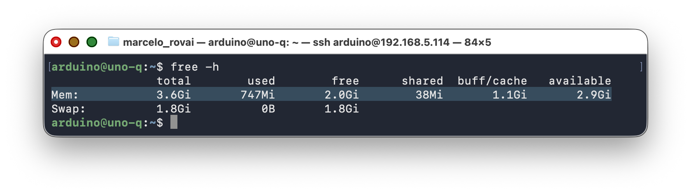{width=85% fig-align="center"}

Below, `htop` shows the 4 GB UNO Q running a 0.8B-parameter SLM with 8-bit quantization:

\noindent
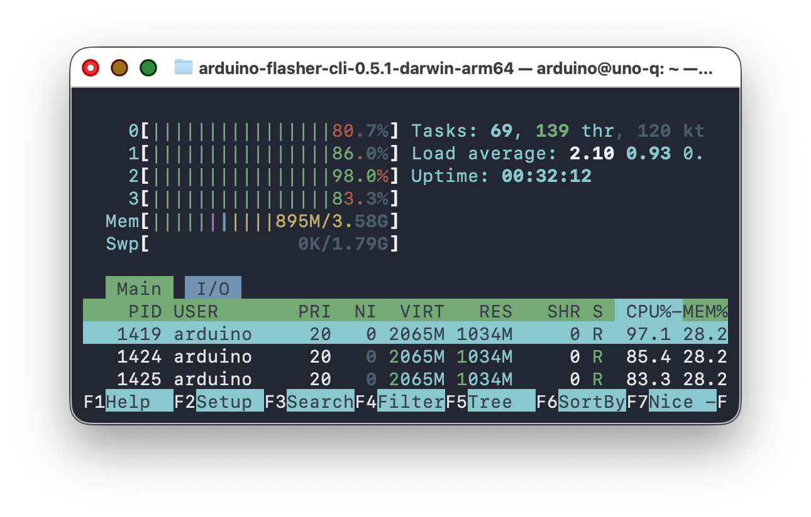{width=85% fig-align="center"}

Debian and its services take 1 to 1.5 GB, which leaves roughly 2.5 GB for a model, its KV cache, and the application:

+---------------------------+----------------+-----------------+-------------------------------------------------+
| **Model**                 | **Quant**      | **RAM Need**    | **On the UNO Q**                                |
+:==========================+:===============+:================+:================================================+
| SmolLM2-135M / 360M       | Q8_0           | 0.2–0.5 GB      | Comfortable and fast                            |
+---------------------------+----------------+-----------------+-------------------------------------------------+
| Qwen3.5 0.8B              | Q8_0           | ~1 GB           | Comfortable; best quality per MB in its class   |
+---------------------------+----------------+-----------------+-------------------------------------------------+
| Llama 3.2 1B / Gemma 3 1B | Q4_K_M         | ~1 GB           | Works well                                      |
+---------------------------+----------------+-----------------+-------------------------------------------------+
| LFM2.5-1.2B               | Q5_K_M         | ~1 GB           | Works well; the lean KV cache helps with longer |
|                           |                |                 | contexts                                        |
+---------------------------+----------------+-----------------+-------------------------------------------------+
| Qwen3.5 2B                | UD-Q4_K_XL     | ~1.6–1.8 GB     | The practical ceiling; keep the context short   |
|                           |                |                 | and the system lean                             |
+---------------------------+----------------+-----------------+-------------------------------------------------+
| Standard 3B models        | Q4_K_M         | 2+ GB           | Marginal; expect out-of-memory errors under     |
|                           |                |                 | load                                            |
+---------------------------+----------------+-----------------+-------------------------------------------------+

: What fits in the 4 GB UNO Q. {#tbl-uno-q-slm-fits}

The 2B entry is where Unsloth's dynamic quantization pays off. A plain 3B model at Q4 does not reliably fit next to Debian, but a 2B with UD-Q4_K_XL does, and it is a meaningfully smarter model than anything in the 1B tier. Keep the context at 512 to 1024 tokens regardless: on this board, KV cache growth is expensive.

> The 2 GB variant can run the smallest models (SmolLM2-135M and SmolLM2-360M) but cannot comfortably fit 0.8B-parameter models. Those are enough to prove the idea, not to build on. This lab targets the 4 GB board.

### Storage Layout {#sec-uno-q-slm-storage-layout-e830}

The storage layout depends on the factory image. Run `df -h` to check which of the two layouts the board has:

- **Older images:** `/` and `/home` share a single ~9.8 GB partition with ~830 MB free after boot. Disk management matters, so follow the cleanup steps in this lab.
- **Newer images:** `/home/arduino` is on a separate ~18 GB partition, where the llama.cpp source, the models, and any project land. The 9.8 GB root partition stays mostly untouched, and the shallow-clone and build-tree-deletion steps can be skipped.

Check the available space before starting:

```bash
df -h /home/arduino
```

The build and model download need at least **5 GB of free space**. With less, see @sec-uno-q-slm-disk-space-running-low-136b for cleanup tips.

### Why Qwen 3.5 {#sec-uno-q-slm-qwen-35-d790}

[Qwen3.5-0.8B](https://qwen.ai/blog?id=qwen3.5), released in February 2026 by Alibaba's Qwen team, is the recommended SLM for the UNO Q:

- **Designed for edge devices.** The Qwen3.5 Small series (0.8B, 2B, 4B, and 9B) uses a hybrid architecture that combines Gated Delta Networks with sparse attention, tuned for low-latency inference on constrained hardware.
- **Hybrid thinking and non-thinking modes.** In non-thinking mode the model answers directly, without an internal chain of thought, which keeps latency low and avoids the reasoning loops that plague thinking models on slow hardware.
- **201 languages.** Useful for multilingual teaching and for deployments in the Global South.
- **Newer than Llama 3.2 and Gemma 3.** Better quality per parameter than earlier models of this size on most benchmarks.
- **Apache 2.0 license.** No restrictions on academic or commercial deployment.

\noindent
{width=85% fig-align="center"}

### Candidate Models {#sec-uno-q-slm-candidate-models-2d1e}

+--------------------------------+------------+--------------+------------------------------------------------+
| **Model**                      | **Params** | **Size**     | **Notes**                                      |
+:===============================+===========:+=============:+:===============================================+
| `SmolLM2-135M-Instruct Q4_K_M` | 135 M      | ~95 MB       | Very fast, limited reasoning. Good for routing |
|                                |            |              | and classification only.                       |
+--------------------------------+------------+--------------+------------------------------------------------+
| `SmolLM2-360M-Instruct Q4_K_M` | 360 M      | ~230 MB      | Balanced. The fallback if 0.8B is too tight on |
|                                |            |              | space.                                         |
+--------------------------------+------------+--------------+------------------------------------------------+
| `Qwen3.5-0.8B Q8_0`            | 800 M      | ~800 MB      | **The primary choice.** Best quality per       |
|                                |            |              | parameter for the edge.                        |
+--------------------------------+------------+--------------+------------------------------------------------+
| `Qwen3.5-2B UD-Q4_K_XL`        | 2 B        | ~1.34 GB     | Excellent, but about half the speed of the     |
|                                |            |              | 0.8B.                                          |
+--------------------------------+------------+--------------+------------------------------------------------+

: Candidate SLMs for the UNO Q. {#tbl-uno-q-slm-candidates}

### Quantization: Q4 vs. Q8 for Sub-1B Models {#sec-uno-q-slm-quantization-q4-vs-q8-sub1b-models-6e93}

In tests on the UNO Q, Q4_K_M quantization produced noticeably weaker output than Q8_0 for sub-1B models. Aggressive 4-bit compression loses too much information when the model has only 800 million parameters to begin with, because smaller models have less redundancy to exploit.

> At sub-1B scale, Q4 is aggressive, and the quantization error compounds. Q6 or Q8 helps a lot.
>
> Also, prefer `min_p` over `top_p` for sampling. A setting such as `min_p=0.05` with `temp=0.7` works better for small models, because it adjusts the candidate pool to the probability distribution instead of using a fixed cutoff. `top_p` at low temperatures produces a very narrow beam, and repetition becomes almost inevitable at these model sizes.

Recommendations:

- **Use Q8_0 for the 0.8B** (~800 MB). Its quality is meaningfully better than Q4, and on newer images with a separate 18 GB `/home` partition, space is no longer a concern. This lab uses it.
- **Use Q4 for the 2B**, preferably the Unsloth Dynamic quant (`UD-Q4_K_XL`), which upcasts critical layers to 8 or 16 bits while keeping the overall size close to Q4.
- **When using Q4 in production, combine it with strong few-shot prompting** and `response_format: json_object` to compensate for quantization noise.

> **Unsloth Dynamic 8-bit for the 0.8B?** Unsloth also publishes a `UD-Q8_K_XL` version of the 0.8B (1.19 GB, about 50% larger than Q8_0). On the UNO Q it was *slower* than plain Q8_0 (4.75 vs. 5.6 tokens/s) and used about 360 MB more RAM, with no visible quality difference on short prompts. At 8 bits, plain Q8_0 is the better trade-off on this board.

> The [Qwen3.5-2B UD-Q4_K_XL](https://huggingface.co/unsloth/Qwen3.5-2B-GGUF/blob/main/Qwen3.5-2B-UD-Q4_K_XL.gguf) model is a good choice when latency is not an issue. It generates at about half the speed of the 0.8B Q8_0 (2.5 vs. 5.6 tokens/s), but its answers are noticeably better.

## Hardware and Software Requirements {#sec-uno-q-slm-hardware-software-requirements-603c}

### Hardware {#sec-uno-q-slm-hardware-4a40}

- Arduino UNO Q **4 GB** variant (the 2 GB variant works only with SmolLM2-360M or smaller).
- USB-C data cable.
- Host computer with SSH (see the [Setup](../setup/setup.qmd) lab).

### Software Already on the UNO Q {#sec-uno-q-slm-software-already-uno-q-8227}

+-----------------------------+---------------------------+
| **Tool**                    | **Purpose**               |
+:============================+:==========================+
| Debian Linux (latest image) | Base OS on the MPU        |
+-----------------------------+---------------------------+
| Python 3.13                 | Application code          |
+-----------------------------+---------------------------+
| SSH server                  | Remote access             |
+-----------------------------+---------------------------+

### Software Installed in This Lab {#sec-uno-q-slm-software-installed-lab-6ecb}

+-----------------------------------+------------------------------------------------------+
| **Tool**                          | **Purpose**                                          |
+:==================================+:=====================================================+
| `build-essential`, `cmake`, `git` | Build llama.cpp from source                          |
+-----------------------------------+------------------------------------------------------+
| `libssl-dev`                      | Enables HTTPS model downloads inside the binaries    |
+-----------------------------------+------------------------------------------------------+
| `openai`, `requests` (Python)     | Talking to `llama-server` from Python                |
+-----------------------------------+------------------------------------------------------+

## Preparing the Linux Side {#sec-uno-q-slm-preparing-linux-side-f39f}

SSH into the board and check the architecture, memory, and disk:

```bash
uname -m            # aarch64
free -h             # ~3.6 Gi total, ~3.0 Gi available
df -h /             # root partition: check available space
```

### Step 1: Verify that Swap Is Present {#sec-uno-q-slm-step-1-verify-swap-present-5881}

The current factory image includes **1.8 GB of swap**. Verify it:

```bash
free -h
```

The `Swap:` line should show about 1.8 Gi in total.

\noindent
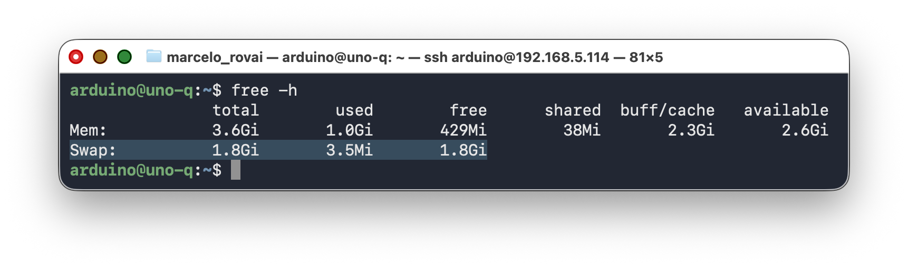{width=85% fig-align="center"}

If swap is missing (older images), add it:

```bash
sudo fallocate -l 2G /home/swapfile
sudo chmod 600 /home/swapfile
sudo mkswap /home/swapfile
sudo swapon /home/swapfile
echo '/home/swapfile none swap sw 0 0' | sudo tee -a /etc/fstab
```

> Swap is a safety net during the brief model-loading phase. Inference should not touch it, since that would collapse throughput, but it keeps the out-of-memory (OOM) killer from ending processes during the load spike.

### Step 2: Install the Build Tools {#sec-uno-q-slm-step-2-install-build-tools-ac35}

```bash
sudo apt update
sudo apt install -y build-essential cmake git pkg-config \
                    libssl-dev
```

> Older tutorials install `libcurl4-openssl-dev`. Current llama.cpp no longer uses libcurl: downloads go through OpenSSL, so `libssl-dev` is the package needed.

## Building llama.cpp from Source {#sec-uno-q-slm-building-llamacpp-source-1fdc}

llama.cpp's Makefile-based build is deprecated, and CMake is the supported path. The old `LLAMA_CURL=1 make` recipe found in older tutorials fails with `make: command not found` on the UNO Q's factory image, which does not include `make` by default.

### Step 1: Clone the Repository {#sec-uno-q-slm-step-1-clone-repository-2a14}

A full clone of the llama.cpp repository pulls ~400 MB of Git history that is not needed. A shallow clone saves disk space:

```bash
cd /home/arduino
git clone --depth 1 https://github.com/ggml-org/llama.cpp
cd llama.cpp
```

The shallow clone takes about 220 MB on disk (October 2026).

### Step 2: Configure and Build {#sec-uno-q-slm-step-2-configure-build-7982}

From the llama.cpp folder, run:

```bash
cmake -B build \
  -DGGML_NATIVE=ON \
  -DCMAKE_BUILD_TYPE=Release
cmake --build build --config Release -j4 \
  --target llama-cli llama-server
```

The flags:

- `GGML_NATIVE=ON` detects the A53's NEON SIMD capabilities and emits the right CPU intrinsics.
- `--target llama-cli llama-server` builds only the two tools used in the UNO Q labs. Without it, CMake compiles more than 100 binaries, including all the test programs. On the UNO Q, the targeted build took **29 minutes**; a full build took 46 minutes.
- `-j4` uses all four cores.

> **`-DLLAMA_CURL=ON` is deprecated.** Older recipes pass it to enable model downloads. Current builds print a deprecation warning and use OpenSSL instead (`LLAMA_OPENSSL`, on by default), so the flag can be dropped.

> **If the build runs out of memory** (the board freezes or the build dies), drop to `-j2`. The build takes longer but stays under the OOM threshold. With the factory swap in place, `-j4` normally works.

### Step 3: Verify the Binaries {#sec-uno-q-slm-step-3-verify-binaries-488e}

```bash
ls build/bin/llama-cli build/bin/llama-server
./build/bin/llama-cli --version
```

\noindent
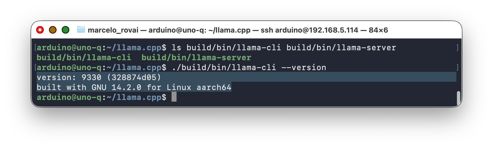{width=85% fig-align="center"}

### Step 4: Reclaim Disk Space (Optional) {#sec-uno-q-slm-step-4-reclaim-disk-space-optional-a341}

The build tree adds about 120 MB of intermediate files, while the two binaries and their shared libraries need only about 22 MB. On a board with limited storage, copy the runtime files to a slim directory and delete the rest:

```bash
cd /home/arduino
mkdir -p llama-runtime
cp llama.cpp/build/bin/llama-server llama-runtime/
cp llama.cpp/build/bin/llama-cli    llama-runtime/
cp llama.cpp/build/bin/*.so*        llama-runtime/ 2>/dev/null

# Verify standalone operation
cd llama-runtime
LD_LIBRARY_PATH=. ./llama-cli --version

# Delete the source + build tree (saves ~340 MB)
rm -rf /home/arduino/llama.cpp
df -h /
```

After cleanup, roughly 1.5 GB should be free, enough for the model and normal system operation. The rest of this lab assumes the build tree is still in `~/llama.cpp`; after this step, run the binaries from `~/llama-runtime` instead (with `LD_LIBRARY_PATH=.`).

> **Pre-built binaries.** llama.cpp publishes pre-built aarch64 Linux binaries on its [GitHub Releases page](https://github.com/ggml-org/llama.cpp/releases). Downloading the tarball and extracting `llama-server` and `llama-cli` turns this section into a two-minute download instead of a 30-minute build, which helps in classrooms where the build process is not the topic.

## Choosing and Downloading a Model {#sec-uno-q-slm-choosing-downloading-model-1457}

### Step 1: Create the Models Directory {#sec-uno-q-slm-step-1-create-models-directory-c59b}

```bash
mkdir -p /home/arduino/models
cd /home/arduino/models
```

### Step 2: Download Qwen3.5-0.8B {#sec-uno-q-slm-step-2-download-qwen3508b-eda1}

Two of the best quantizations come from [Bartowski](https://huggingface.co/bartowski/Qwen_Qwen3.5-0.8B-GGUF/tree/main) and [Unsloth](https://huggingface.co/unsloth/Qwen3.5-0.8B-GGUF/tree/main).

This lab uses the [Q8_0 version](https://huggingface.co/bartowski/Qwen_Qwen3.5-0.8B-GGUF/blob/main/Qwen_Qwen3.5-0.8B-Q8_0.gguf) from Bartowski (about 835 MB). The later UNO Q labs use the same filename:

```bash
cd ~/models
wget https://huggingface.co/bartowski/Qwen_Qwen3.5-0.8B-GGUF/\
resolve/main/Qwen_Qwen3.5-0.8B-Q8_0.gguf
```

Unsloth's [Q8_0](https://huggingface.co/unsloth/Qwen3.5-0.8B-GGUF/blob/main/Qwen3.5-0.8B-Q8_0.gguf) (812 MB) is an equivalent choice. In an October 2026 test on the UNO Q, the Unsloth file was about 2% faster (5.6 vs. 5.5 tokens/s generation), a difference that is not noticeable in practice. The measurements in @sec-uno-q-slm-performance-expect-0f8f were taken with the Unsloth file. To use it, adjust the model path in the commands below:

```bash
wget -c https://huggingface.co/unsloth/Qwen3.5-0.8B-GGUF/\
resolve/main/Qwen3.5-0.8B-Q8_0.gguf
```

For 4-bit quantization (about 553 MB), if storage is tight:

```bash
wget https://huggingface.co/bartowski/Qwen_Qwen3.5-0.8B-GGUF/\
resolve/main/Qwen_Qwen3.5-0.8B-Q4_K_M.gguf
ls -lh Qwen_Qwen3.5-0.8B-Q4_K_M.gguf
```

### Step 3: Download Qwen3.5-2B (Optional) {#sec-uno-q-slm-step-3-download-qwen352b-optional-c3e6}

For the larger model, use the Unsloth Dynamic 4-bit quant (1.34 GB):

```bash
wget -c https://huggingface.co/unsloth/Qwen3.5-2B-GGUF/\
resolve/main/Qwen3.5-2B-UD-Q4_K_XL.gguf
```

@sec-uno-q-slm-alternative-model-qwen-35-2b-3183 compares it with the 0.8B.

> **What about the `-MTP` repositories?** Unsloth also publishes `Qwen3.5-0.8B-MTP-GGUF` and `Qwen3.5-2B-MTP-GGUF`, which include an extra multi-token prediction head for speculative decoding. They do not help on the UNO Q; see @sec-uno-q-slm-mtp-speculative-decoding-uno-q-a3b9.

**For the 2 GB UNO Q or extremely tight storage:**

```bash
wget https://huggingface.co/bartowski/SmolLM2-360M-Instruct-GGUF/\
resolve/main/SmolLM2-360M-Instruct-Q4_K_M.gguf
```

> Adjust the model path in the sections below accordingly.

### Quantization Quality for Sub-1B Models {#sec-uno-q-slm-quantization-quality-sub1b-models-e154}

In testing, the Q4_K_M quantization of Qwen3.5-0.8B produced noticeably weaker structured outputs than larger models at the same quantization level. That is expected: aggressive 4-bit quantization removes information that a 0.8B model cannot afford to lose, because smaller models have less redundancy.

These measures helped in the tests:

- **Strong few-shot prompting** (two examples in the system prompt), the most effective single fix.
- **`response_format: json_object`** to constrain decoding to valid JSON.
- **`presence_penalty=1.5`** to prevent repetition loops.
- **A low `max_tokens`** (60 to 80) to keep answers short and focused.
- **The Unsloth `UD-Q4_K_XL` quant**, which upcasts sensitive layers automatically.

## Using `llama-cli` {#sec-uno-q-slm-using-llamacli-11c9}

`llama-cli` is a self-contained, one-shot tool: no HTTP and no extra process, just "run a prompt, see the text, exit." It is the fastest way to sanity-check a model before building anything on top of it. Anything persistent, multi-client, or called from a program needs `llama-server` (@sec-uno-q-slm-using-llamaserver-a881).

### Qwen 3.5 and Thinking Mode {#sec-uno-q-slm-qwen-35-thinking-mode-42cc}

Qwen3.5 is a hybrid reasoning model, and by default it runs in "thinking mode." For edge use, disable it. `llama-cli` must be told so explicitly with the `--reasoning` flags. Without them, the model can enter thinking mode and produce long internal reasoning chains that burn minutes of CPU time and often loop without reaching a conclusion.

> Some model cards say that the small Qwen3.5 models start in non-thinking mode. With llama.cpp, that is not what happens: in a test without the flags, the 0.8B spent its entire 400-token budget reasoning about "What is the capital of Brazil?" and never produced an answer. It took 88 seconds and pushed the board to 70 °C.

In current llama.cpp builds, use `--reasoning off` and `--reasoning-budget 0` on the command line. The older `--chat-template-kwargs '{"enable_thinking":false}'` flag is **deprecated** and produces a warning. Replace it with the newer flags wherever it appears in other tutorials.

The recommended inference parameters for non-thinking mode come from the [Unsloth Qwen3.5 guide](https://unsloth.ai/docs/models/qwen3.5):

+----------------------+------------+------------------------------------------------------+
| **Parameter**        | **Value**  | **Purpose**                                          |
+:=====================+:===========+:=====================================================+
| `temperature`        | 0.7 to 1.0 | Moderate creativity for general tasks                |
+----------------------+------------+------------------------------------------------------+
| `top_p`              | 0.8        | Nucleus sampling                                     |
+----------------------+------------+------------------------------------------------------+
| `top_k`              | 20         | Limit the token pool                                 |
+----------------------+------------+------------------------------------------------------+
| `min_p`              | 0.0        | Disabled                                             |
+----------------------+------------+------------------------------------------------------+
| `presence_penalty`   | 1.5        | Prevent repetition loops (critical for small models) |
+----------------------+------------+------------------------------------------------------+
| `repetition_penalty` | 1.0        | Disabled (`presence_penalty` handles it)             |
+----------------------+------------+------------------------------------------------------+

: Qwen3.5 sampling parameters for non-thinking mode. {#tbl-uno-q-slm-sampling}

Call `llama-cli` with those settings:

```bash
cd ~/llama.cpp

./build/bin/llama-cli \
  --model ~/models/Qwen_Qwen3.5-0.8B-Q8_0.gguf \
  --threads 4 \
  --ctx-size 1024 \
  --temperature 0.7 \
  --top-p 0.8 \
  --top-k 20 \
  --min-p 0.0 \
  --presence-penalty 1.5 \
  --repeat-penalty 1.0 \
  --reasoning off \
  --reasoning-budget 0
```

At the `>` prompt, type a question, for example:

> `> What is the capital of Brazil. Answer with one word.`

\noindent
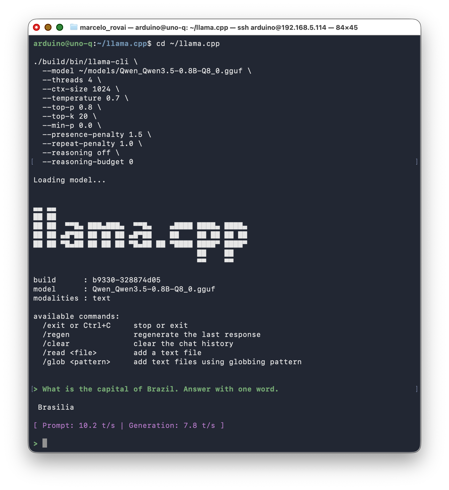{width=85% fig-align="center"}

The latency is usable: about 11 tokens/s for prompt processing and 5.7 tokens/s for generation with the October 2026 build.

While inference runs, monitor CPU use and temperature:

\noindent
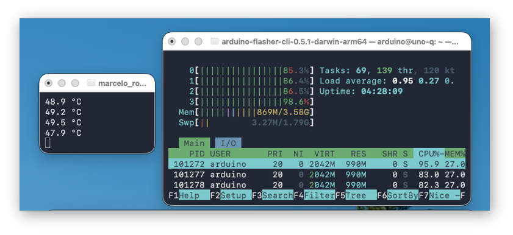{width=70% fig-align="center"}

The UNO Q handles SLMs well. These inferences ran without any heatsink or fan. The internal temperature rose by about 20 °C (from ~30 °C to ~50 °C), and long answers reached ~60 °C, lower than a Raspberry Pi 5 with an active cooler. @sec-uno-q-slm-step-4-thermal-monitoring-optional-9904 shows a script that measures the temperature.

### Create a Helper Script {#sec-uno-q-slm-create-helper-script-afcd}

A small shell script can wrap the full `llama-cli` command so that the flags do not have to be typed every time.

On the UNO Q:

```bash
nano ~/qwen_cli_llama.sh
```

Paste:

```bash
#!/usr/bin/env bash
# Simple Qwen3.5 0.8B 8-bit CLI on UNO-Q without thinking

MODEL=~/models/Qwen_Qwen3.5-0.8B-Q8_0.gguf
LLAMA=~/llama.cpp/build/bin/llama-cli

"$LLAMA" \
  --model "$MODEL" \
  --threads 4 \
  --ctx-size 1024 \
  --temperature 0.7 \
  --top-p 0.8 \
  --top-k 20 \
  --min-p 0.0 \
  --presence-penalty 1.5 \
  --repeat-penalty 1.0 \
  --reasoning off \
  --reasoning-budget 0 \
  --single-turn \
  -p "$*"
```

> **`--single-turn` (`-st`) makes the script exit after one answer.** Current `llama-cli` is conversational: with `-p` alone, it answers the prompt and then waits at `>` for the next message.

Save the file and make it executable:

```bash
chmod +x ~/qwen_cli_llama.sh
```

> Optionally, add `~/` to the `PATH` in `~/.bashrc` or `~/.profile` to call the script without its full path.

### Run the Script {#sec-uno-q-slm-run-script-6eee}

Now run:

```bash
~/qwen_cli_llama.sh "Explain edge AI in two sentences."
```

\noindent
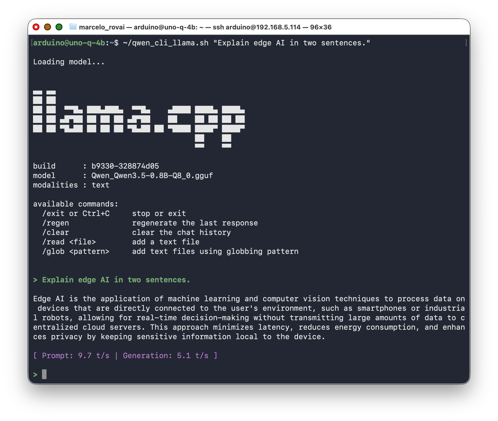{width=85% fig-align="center"}

Or, after adding `~/` to the `PATH` and reloading the shell:

```bash
qwen_cli_llama.sh "Explain edge AI in two sentences."
```

## Using `llama-server` {#sec-uno-q-slm-using-llamaserver-a881}

The UNO Q can host a small language model on its Linux side, and the easiest way to expose that model to other programs (Python scripts, `curl`, or a browser) is `llama-server`. Instead of calling the model through a one-shot CLI, `llama-server` loads the GGUF file into RAM once and exposes a simple HTTP API on localhost, so any client can send prompts and receive completions as JSON.

This lab runs `llama-server` **interactively, in the foreground**, with no systemd service. That is enough to learn the API and build client code against it.

Two SSH sessions to the UNO Q must be open at the same time:

- **Terminal 1** runs `llama-server` in the foreground and shows its logs.
- **Terminal 2** sends queries with `curl` and Python.

### Step 1: Start `llama-server` (Terminal 1) {#sec-uno-q-slm-step-1-start-llamaserver-terminal-1-ebf2}

In the first terminal:

```bash
cd ~/llama.cpp

./build/bin/llama-server \
  --model ~/models/Qwen_Qwen3.5-0.8B-Q8_0.gguf \
  --threads 4 \
  --ctx-size 1024 \
  --port 8081 \
  --reasoning off \
  --reasoning-budget 0 \
  --alias qwen3.5-0.8b
```

> **`--alias` gives the server a stable name**, independent of the GGUF filename. Client code (curl, Python, or the WebUI) can always ask for `"model": "qwen3.5-0.8b"`, whichever file is loaded behind it, which matters as soon as models are swapped. Use it every time `llama-server` starts.

The log output should show:

- The model loading (file path, parameter count, and quantization type).
- `thinking = 0`, which confirms that reasoning mode is disabled.
- `HTTP server listening` on the chosen port.

\noindent
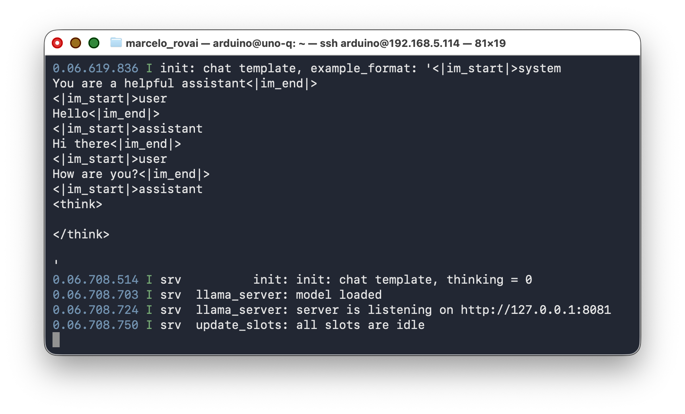{width=85% fig-align="center"}

If port 8081 is busy, check what is using it and choose another port:

```bash
sudo ss -ltnp | grep 8081
```

> **Keep this terminal open.** The server runs as long as this process is alive. Press `Ctrl+C` to stop it after testing.

### Step 2: Quick Test with `curl` (Terminal 2) {#sec-uno-q-slm-step-2-quick-test-curl-terminal-2-9211}

Open a second SSH session to the UNO Q. First, check that the server is alive:

```bash
curl -s http://127.0.0.1:8081/health | python3 -m json.tool
```

\noindent
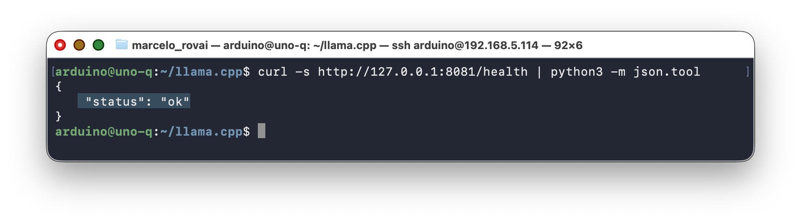{width=85% fig-align="center"}

The response should be `"status": "ok"`. Now send a prompt to the `/completion` endpoint:

```bash
curl http://127.0.0.1:8081/completion \
  -H "Content-Type: application/json" \
  -d '{
    "prompt": "In 2 sentences, what is the Olympic Games?",
    "n_predict": 128
  }'
```

\noindent
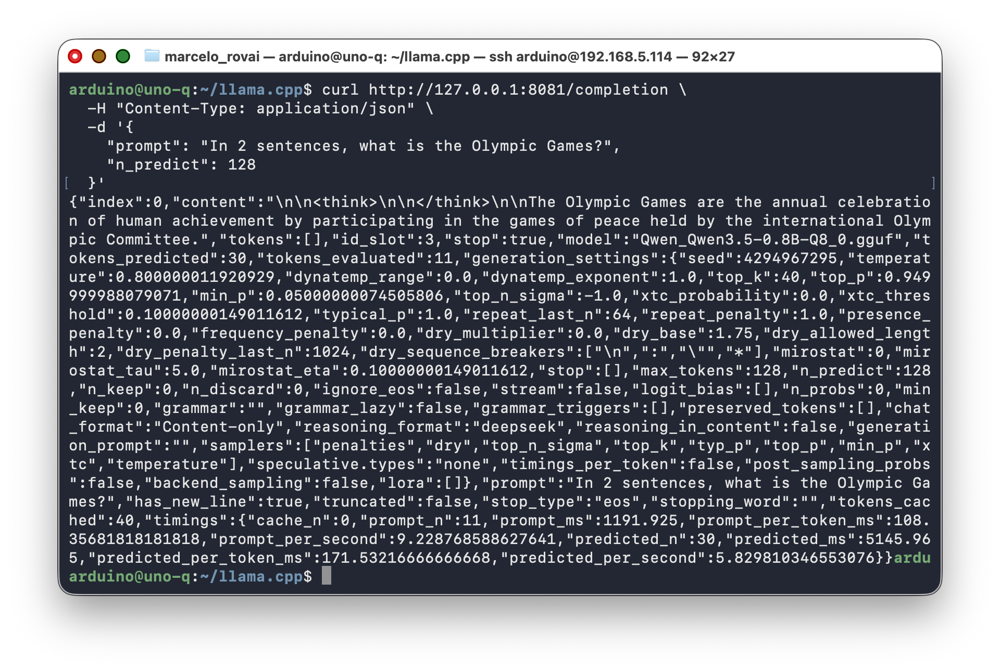{width=85% fig-align="center"}

Switch back to **Terminal 1** while the request runs. The server logs each generated token, plus timing information. That is the main advantage of running in the foreground: the log shows exactly what the model is doing.

\noindent
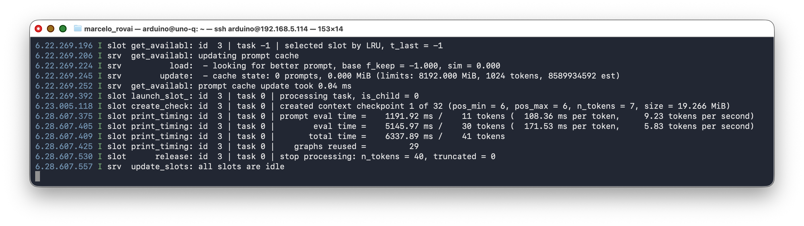{width=85% fig-align="center"}

Now try the OpenAI-compatible `/v1/chat/completions` endpoint, which the Python clients in @sec-uno-q-slm-talking-llamaserver-python-855b use:

```bash
curl http://127.0.0.1:8081/v1/chat/completions \
  -H "Content-Type: application/json" \
  -d '{
    "model": "qwen3.5-0.8b",
    "messages": [
      {"role": "system",
       "content": "You are concise. Answer in one sentence."},
      {"role": "user", "content": "What is TinyML?"}
    ],
    "max_tokens": 80,
    "temperature": 0.7,
    "top_p": 0.8,
    "presence_penalty": 1.5
  }'
```

The response arrives as a JSON object, with the model's answer in `choices[0].message.content`.

\noindent
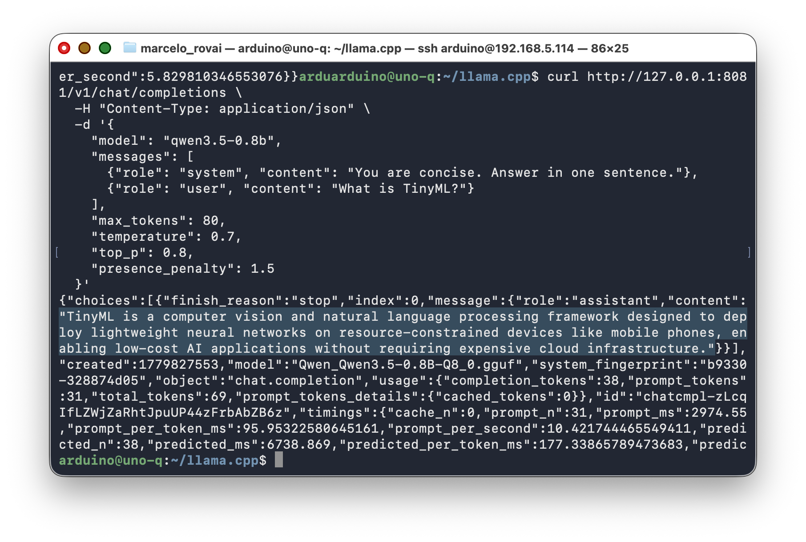{width=85% fig-align="center"}

### Step 3: Stop the Server {#sec-uno-q-slm-step-3-stop-server-6d72}

To stop the server, go back to **Terminal 1** and press `Ctrl+C`. The model unloads and the port is freed. Keep the server running for now, though: the Python examples need it.

### Step 4: Thermal Monitoring (Optional) {#sec-uno-q-slm-step-4-thermal-monitoring-optional-9904}

The UNO Q exposes Qualcomm thermal data through the Linux thermal and hwmon interfaces. To monitor the MPU temperature in real time during inference:

```bash
# Check thermal zone type
cat /sys/class/thermal/thermal_zone0/type

# Read current temperature (in millidegrees Celsius)
cat /sys/class/thermal/thermal_zone0/temp

# Live monitor (updates every second)
watch -n 1 "cat /sys/class/hwmon/hwmon0/temp1_input"
```

For a friendlier readout, save a small Python script as `~/q_temp_monitor.py`:

```python
#!/usr/bin/env python3
import time
from pathlib import Path

# The mapss_thermal zone exposes the QRB2210 SoC temperature
TEMP_PATH = Path("/sys/class/hwmon/hwmon0/temp1_input")

def read_temp_c():
    raw = int(TEMP_PATH.read_text().strip())
    return raw / 1000.0

if __name__ == "__main__":
    try:
        while True:
            print(f"{read_temp_c():.1f} °C")
            time.sleep(1.0)
    except KeyboardInterrupt:
        pass
```

Make it executable and run it in a side terminal while the SLM works:

```bash
chmod +x ~/q_temp_monitor.py
~/q_temp_monitor.py
```

\noindent
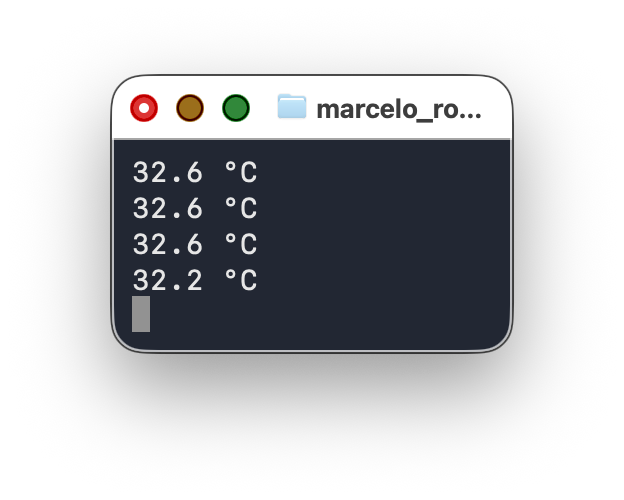{width=40% fig-align="center"}

The reading climbs from ~32 °C at idle to whatever the workload pushes it to during inference.

#### Measured Thermal Behavior {#sec-uno-q-slm-measured-thermal-behavior-7767}

In tests on a 4 GB UNO Q **without any heatsink or fan**:

+------------------------------------+------------------------------+
| **Condition**                      | **Internal CPU Temperature** |
+:===================================+:=============================+
| Idle (no inference)                | ~34 °C                       |
+------------------------------------+------------------------------+
| Normal inference (short prompts)   | ~54 °C (+20 °C above idle)   |
+------------------------------------+------------------------------+
| Sustained inference (long answers) | ~62 °C                       |
+------------------------------------+------------------------------+

All of these are well below the 70 to 80 °C range where Arm cores begin to throttle. The UNO Q runs cooler than a Raspberry Pi 5 under comparable loads, and **no heatsink or fan is required** for normal SLM workloads, even in sustained use.

### Step 5: The Built-In WebUI (Optional) {#sec-uno-q-slm-step-5-builtin-webui-optional-e17e}

Recent llama.cpp builds embed a SvelteKit-based chat interface in the `llama-server` binary, with no extra install and no extra flag. With a recent enough build, the UI already runs on the same port as the API.

> The build may print `UI: download dist.tar.gz.sha256 ... failed`. It is harmless: the UI built into the binary is still served. Testing it with plain `curl http://127.0.0.1:8081/` returns `Error: gzip is not supported by this browser`, because the page is stored compressed; `curl --compressed` or any web browser gets the page normally.

From the UNO Q itself, use `http://127.0.0.1:8081/`. From a laptop, tunnel the port with `ssh -L 8081:127.0.0.1:8081 arduino@<UNO_Q_IP>` and open `http://localhost:8081/` in the host browser.

Alternatively, add `--host 0.0.0.0` to the `llama-server` command to open the WebUI from a desktop browser with the UNO Q's IP address:

```bash
cd ~/llama.cpp

./build/bin/llama-server \
  --model ~/models/Qwen_Qwen3.5-0.8B-Q8_0.gguf \
  --threads 4 \
  --ctx-size 1024 \
  --port 8081 \
  --host 0.0.0.0 \
  --reasoning off \
  --reasoning-budget 0 \
  --alias qwen3.5-0.8b
```

Then, from any device on the same Wi-Fi network, open `http://<UNO_Q_IP>:8081/` (for example, `http://192.168.5.114:8081/`).

\noindent
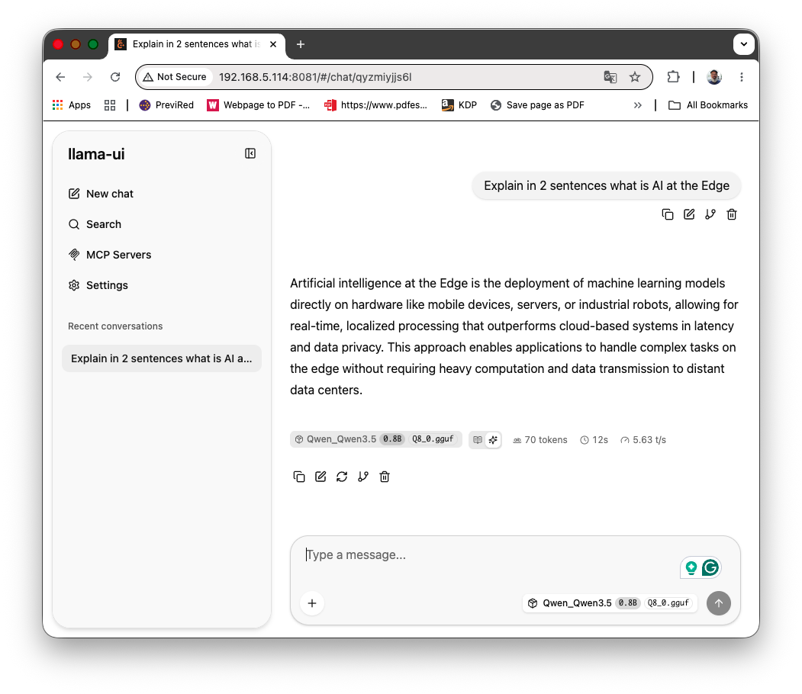{width=85% fig-align="center"}

The WebUI offers:

- Streaming chat with the local Qwen3.5-0.8B, with no extra app.
- A live sampling panel for `temperature`, `top_p`, `presence_penalty`, and related settings, useful for tuning before fixing the values in Python code.
- A collapsible section for reasoning (thinking) blocks. With `--reasoning off --reasoning-budget 0` the section stays empty, a quick visual confirmation that the flags worked.
- More details in the [guide to `llama-ui`, the new WebUI of llama.cpp](https://github.com/ggml-org/llama.cpp/discussions/16938).

Some features are not worth using on a 4 GB UNO Q:

- **File uploads.** The UI accepts images and PDFs, but Qwen3.5-0.8B is text-only, so an image is either ignored or produces a hallucination. Images need a vision-language model and its projector file.
- **MCP tool calling and built-in agent tools.** They are available in the UI, but enabling filesystem or shell tools on a server bound to `0.0.0.0` is a security risk. Keep them off in this setup.

> If the URL returns a bare JSON error instead of a UI, the `llama-server` build predates the embedded WebUI. Rebuild from the latest llama.cpp `master`, or use a recent pre-built aarch64 binary from the GitHub Releases page.

## Talking to `llama-server` from Python {#sec-uno-q-slm-talking-llamaserver-python-855b}

`llama-server` speaks the same API as OpenAI's Chat Completions endpoint, so Python can call it in two ways: the official `openai` client library (recommended, since it is the standard interface and the same code works against a cloud model later), or raw HTTP requests (useful to understand what the library does underneath, or when a dependency cannot be added).

With **Terminal 1** still running `llama-server`, use **Terminal 2** for the examples below.

### Using the `openai` Client Library {#sec-uno-q-slm-using-openai-client-library-27fe}

Install the library:

```bash
pip install --user openai
```

Create `~/qwen_client.py`:

```bash
nano ~/qwen_client.py
```

Paste:

```python
#!/usr/bin/env python3
"""
Chat with the local Qwen3.5 SLM served by llama-server,
using the standard OpenAI-compatible client library.
Run llama-server in another terminal first, then call this script.
"""
import re
import sys
from openai import OpenAI

# llama-server doesn't check the API key, but the client requires one.
client = OpenAI(
    base_url="http://127.0.0.1:8081/v1", api_key="not-needed"
)

MODEL = "qwen3.5-0.8b"

def strip_think(text):
    """Remove residual <think>...</think> tags from Qwen3.5 output."""
    return re.sub(
        r"<think>.*?</think>", "", text, flags=re.DOTALL
    ).strip()

def ask(messages, max_tokens=128, stream=True):
    """Send a chat completion request and return the cleaned reply."""
    response = client.chat.completions.create(
        model=MODEL,
        messages=messages,
        max_tokens=max_tokens,
        temperature=0.7,
        top_p=0.8,
        presence_penalty=1.5,
        stream=stream,
    )
    if not stream:
        return strip_think(response.choices[0].message.content)

    chunks = []
    for chunk in response:
        delta = chunk.choices[0].delta.content or ""
        print(delta, end="", flush=True)
        chunks.append(delta)
    print()
    return strip_think("".join(chunks))

if __name__ == "__main__":
    system = "You are concise."
    history = [{"role": "system", "content": system}]

    if len(sys.argv) > 1:
        # One-shot mode: pass the prompt as arguments
        prompt = " ".join(sys.argv[1:])
        history.append({"role": "user", "content": prompt})
        ask(history)
    else:
        # Interactive REPL with conversation memory
        print("Qwen3.5 on UNO Q (llama-server + openai). "
              "Ctrl+C to exit.\n")
        try:
            while True:
                prompt = input("> ").strip()
                if not prompt:
                    continue
                history.append({"role": "user", "content": prompt})
                print()
                reply = ask(history)
                history.append(
                    {"role": "assistant", "content": reply}
                )
                print()
        except (KeyboardInterrupt, EOFError):
            print("\nBye!")
```

Make it executable and test it:

```bash
chmod +x ~/qwen_client.py

# One-shot test
~/qwen_client.py "In one sentence, what causes dengue fever?"
```

\noindent
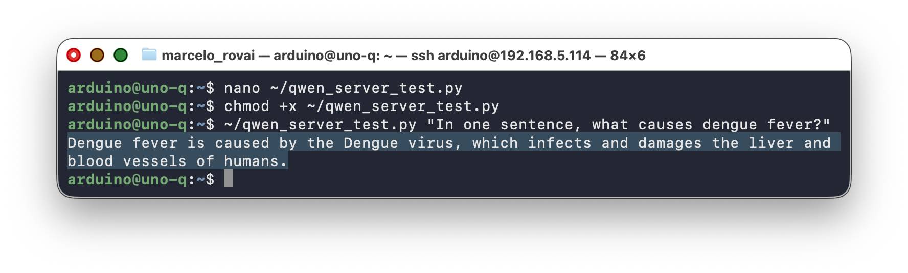{width=85% fig-align="center"}

```bash
# Interactive REPL, with memory across turns
~/qwen_client.py
```

\noindent
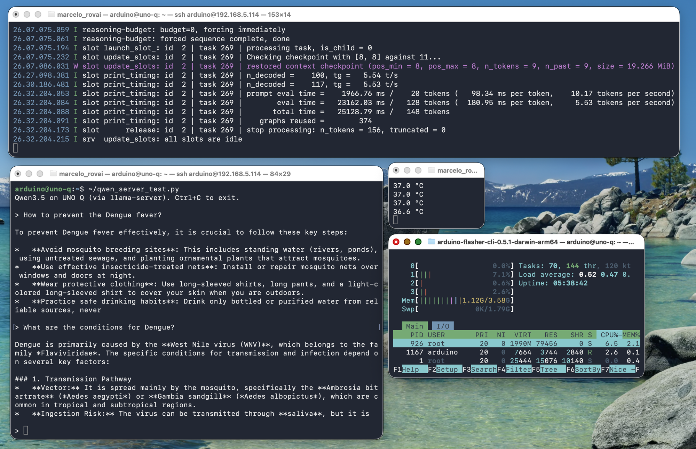{width=85% fig-align="center"}

Two details in this script are worth noting:

- **`stream=True` by default.** Tokens print as they are generated instead of after the full response, the same experience as in the WebUI or `llama-cli`.
- **`history` is a plain Python list.** Each turn appends both the user prompt and the assistant's reply, so the model sees the whole conversation on the next call. That is how multi-turn "memory" works with any OpenAI-compatible API: there is no hidden server-side state.

#### Structured JSON Output {#sec-uno-q-slm-structured-json-output-04f3}

The same client handles structured tasks, not just chat. Ask the model to produce JSON:

```bash
~/qwen_client.py "Given: temp=30.2C, humidity=85%, \
standing water=yes. Classify dengue risk as low/medium/high. \
Reply ONLY with JSON: {\"risk\":\"...\", \"reason\":\"...\"}"
```

\noindent
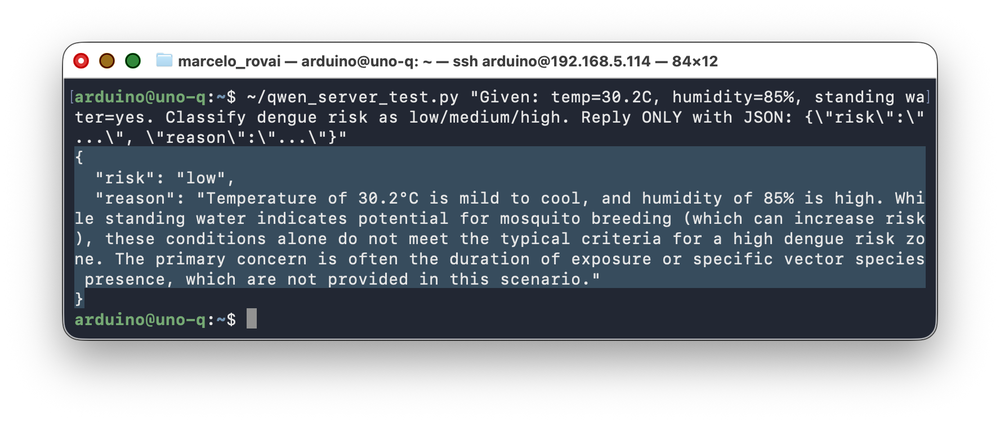{width=85% fig-align="center"}

At Q8 quantization, the model returns valid JSON most of the time. This pattern, sensor-like input in and a structured verdict out, is the basis of real applications built on an SLM.

### Raw HTTP with `requests` {#sec-uno-q-slm-raw-http-requests-51fd}

Sometimes the `openai` dependency is unwanted: in an embedded script, in a minimal container image, or simply to see the wire format. `llama-server`'s API is plain JSON over HTTP, so `requests` works as well:

```python
import requests

resp = requests.post(
    "http://127.0.0.1:8081/v1/chat/completions",
    json={
        "model": "qwen3.5-0.8b",
        "messages": [
            {"role": "system", "content": "You are concise."},
            {"role": "user", "content": "What is TinyML?"},
        ],
        "max_tokens": 80,
        "temperature": 0.7,
        "top_p": 0.8,
        "presence_penalty": 1.5,
    },
    timeout=120,
)
resp.raise_for_status()
print(resp.json()["choices"][0]["message"]["content"])
```

### Library vs. Direct HTTP {#sec-uno-q-slm-library-vs-direct-http-e9d5}

+----------------------+----------------------------------+--------------------------------------------+
|                      | **`openai` Library**             | **Raw `requests`**                         |
+:=====================+:=================================+:===========================================+
| **Code**             | Shorter, typed response objects  | More verbose, manual JSON parsing          |
+----------------------+----------------------------------+--------------------------------------------+
| **Streaming**        | Built-in iterator over chunks    | Manual SSE line parsing                    |
+----------------------+----------------------------------+--------------------------------------------+
| **Switching to a**   | Change `base_url` and `api_key`  | Change the URL and headers by hand         |
| **cloud provider**   |                                  |                                            |
+----------------------+----------------------------------+--------------------------------------------+
| **Dependencies**     | Adds the `openai` package        | Only `requests` (often already installed)  |
+----------------------+----------------------------------+--------------------------------------------+
| **Error handling**   | Raises typed exceptions          | Inspect `status_code` and `response.text`  |
|                      |                                  | manually                                   |
+----------------------+----------------------------------+--------------------------------------------+
| **Best for**         | Application code, anything       | Quick scripts, debugging, constrained      |
|                      | long-lived                       | environments                               |
+----------------------+----------------------------------+--------------------------------------------+

: Calling llama-server with the openai library or with raw HTTP. {#tbl-uno-q-slm-library-vs-http}

For anything beyond a one-off test, prefer the library. It is the same code used against OpenAI, Groq, or any other hosted endpoint, which is the point of `llama-server` implementing that API.

## Performance: What to Expect {#sec-uno-q-slm-performance-expect-0f8f}

The measurements below were taken on a 4 GB UNO Q with the factory image, Qwen3.5-0.8B Q8_0, four threads, and no heatsink or fan. The first column comes from the original tests (an early 2026 llama.cpp build); the second was measured in October 2026 with llama.cpp commit `5220213` and a 2048-token context:

+--------------------------------------+-----------------------+---------------------------+
| **Metric**                           | **Early 2026 Build**  | **October 2026 Build**    |
+:=====================================+:======================+:==========================+
| Cold model load                      | ~4 s                  | ~4.5 s                    |
+--------------------------------------+-----------------------+---------------------------+
| Idle RAM (llama-server running)      | ~700–800 MB           | ~950 MB (process RSS)     |
+--------------------------------------+-----------------------+---------------------------+
| Model + context memory               | ~1,122 MiB            | ~1.0–1.05 GB (process     |
|                                      |                       | RSS)                      |
+--------------------------------------+-----------------------+---------------------------+
| Prompt processing throughput         | ~9.9 tokens/s         | **~11.1 tokens/s**        |
+--------------------------------------+-----------------------+---------------------------+
| Generation throughput                | ~4.75 tokens/s        | **~5.6 tokens/s**         |
+--------------------------------------+-----------------------+---------------------------+
| CPU usage during decoding            | 4 cores at 100%       | 4 cores at 100%           |
+--------------------------------------+-----------------------+---------------------------+
| Idle board temperature               | ~34 °C                | ~45 °C (`thermal_zone0`)  |
+--------------------------------------+-----------------------+---------------------------+
| Temperature, normal inference        | ~54 °C                | ~55 °C                    |
+--------------------------------------+-----------------------+---------------------------+
| Temperature, sustained long answers  | ~62 °C                | ~59–61 °C                 |
+--------------------------------------+-----------------------+---------------------------+
| Thermal throttle threshold           | 70–80 °C (never       | Not reached               |
|                                      | reached)              |                           |
+--------------------------------------+-----------------------+---------------------------+
| Power consumption (max.)             | 3.1 W                 | 3.5 W peak, ~2.7 W while  |
|                                      |                       | generating                |
+--------------------------------------+-----------------------+---------------------------+

: Qwen3.5-0.8B Q8_0 performance on the 4 GB UNO Q. {#tbl-uno-q-slm-performance}

The newer build is about 15 to 20% faster on the same model and board, with no change to the command line, so keeping llama.cpp up to date pays off.

Takeaways:

- **Usable, but not desktop-class.** Prompt processing at ~11 tokens/s and generation at ~5.6 tokens/s suit periodic queries, but responses take a few seconds, depending on their length. The ~1 GB footprint (model and context) leaves about 2.5 GB for the OS and the application: tight but viable on the 4 GB board.
- **Q4 quantization shows quality trade-offs.** A 0.8B model has less redundancy than a 7B model, so Q4 compression removes information that matters. Strong few-shot prompting and `presence_penalty=1.5` compensate for most of it. **Use Q8_0**, or the Unsloth Dynamic quant if storage allows.
- **Thermal behavior is not a concern.** The 20 °C rise from idle to inference is modest, and even sustained workloads reach only ~62 °C, well below the 70 to 80 °C throttle threshold. No heatsink is required for normal lab use.
- **Thinking mode overwhelms the board.** With thinking enabled, the model spends 30 to 60 seconds or more on internal reasoning before any output, and often loops without reaching a conclusion. In the October 2026 test, all three prompts used up a 400-token budget on reasoning alone (about 88 s each) with no answer, and the board reached 70 °C. Always run Qwen3.5 Small with `--reasoning off --reasoning-budget 0`.
- **Repetition loops.** Without `presence_penalty=1.5`, the model tends to repeat phrases or produce circular responses, a known and well-documented behavior of the small Qwen3.5 variants.

> **Token throughput vs. wall-clock latency.** Optimizing for tokens per second is common, but wall-clock latency is what users feel. A 30-token answer at 10 tokens/s (3 s) feels about three times as responsive as a 100-token answer at the same rate (10 s). Cap `max_tokens` aggressively and design prompts to keep responses short.

### What a Token Costs in Energy {#sec-uno-q-slm-token-costs-energy-92e7}

Speed is only half the story on a board that may run from a battery. In October 2026, the whole UNO Q was measured with a FNIRSI FNB58 USB meter between the charger and the board's USB-C port, logging 100 samples per second while `llama-server` answered requests (no streaming, thinking off, and the CPU cooled below 45 °C before each request). For text, each model answered a short prompt (256 tokens out) and a long one (1,641 tokens in), twice each:

+--------------------------------+--------------------------+--------------------------+
|                                | **Qwen3.5-0.8B Q8_0**    | **Qwen3.5-2B             |
|                                |                          | UD-Q4_K_XL**             |
+:===============================+:=========================+:=========================+
| Idle board (no request)        | 0.5 W                    | 0.5 W                    |
+--------------------------------+--------------------------+--------------------------+
| Power while reading the prompt | 1.9 W                    | 1.9 W                    |
+--------------------------------+--------------------------+--------------------------+
| Power while generating         | 2.7 W                    | 2.4 W                    |
+--------------------------------+--------------------------+--------------------------+
| Generation speed               | 5.7 tokens/s             | 2.5 tokens/s             |
+--------------------------------+--------------------------+--------------------------+
| **Energy per generated token** | **0.47 J** (0.38 J above | **0.97 J** (0.76 J above |
|                                | idle)                    | idle)                    |
+--------------------------------+--------------------------+--------------------------+
| Short prompt, 256-token answer | 47 s, 125 J              | 108 s, 259 J             |
+--------------------------------+--------------------------+--------------------------+
| Reading a 1,641-token prompt   | 149 s, 290 J             | 368 s, 700 J             |
+--------------------------------+--------------------------+--------------------------+

: Energy cost of text generation on the UNO Q. {#tbl-uno-q-slm-energy}

\noindent
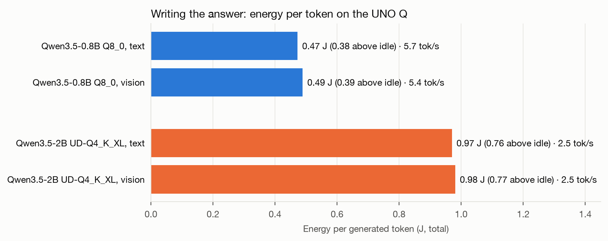{width=85% fig-align="center"}

Three points stand out:

- **The 2B costs twice the energy per token**, and not because it draws more power (it draws slightly less). It generates at half the speed, so the same four cores run twice as long for every token.
- **Long prompts are expensive.** Reading 1,641 tokens costs the 0.8B more than writing 600 tokens would, and the 2B takes six minutes. Keep system prompts and retrieved context short, especially on the 2B.
- **The whole board uses little power.** Even at full load it stays under 3.5 W, and it idles at 0.5 W. A 10 Wh power bank (36,000 J) covers about 290 short answers with the 0.8B, or about 140 with the 2B, if the board does nothing else.

> These runs used Bartowski's `Qwen_Qwen3.5-0.8B-Q8_0.gguf` with a 4096-token context, so the speed differs slightly from the performance table (5.7 vs. 5.6 tokens/s). The energy figures include everything on the board, not just the CPU.

### MTP Speculative Decoding: Not on the UNO Q {#sec-uno-q-slm-mtp-speculative-decoding-uno-q-a3b9}

Qwen3.5 models were trained with a **multi-token prediction (MTP)** head: a small extra layer that guesses the next few tokens in one step. llama.cpp can use it for speculative decoding. The MTP head drafts several tokens, the main model checks them all in a single pass, and every accepted draft token is one the main model did not have to generate on its own. Unsloth publishes MTP versions of the GGUFs (for example, [unsloth/Qwen3.5-0.8B-MTP-GGUF](https://huggingface.co/unsloth/Qwen3.5-0.8B-MTP-GGUF)) and reports roughly 1.5 to 2 times faster generation. They are enabled like this:

```bash
./build/bin/llama-server \
  --model ~/models/Qwen3.5-0.8B-UD-Q8_K_XL-MTP.gguf \
  --spec-type draft-mtp --spec-draft-n-max 6 \
  -np 1 \
  ...
```

On the UNO Q, MTP made generation **slower** in every configuration tested:

+-----------------+-------------+-------------------+-------------------+-------------------+
| **Model**       | **No MTP**  | **MTP, 6-Token    | **MTP, 2-Token    | **MTP, 1-Token    |
|                 |             | Drafts**          | Drafts**          | Drafts**          |
+:================+:============+:==================+:==================+:==================+
| 0.8B UD-Q8_K_XL | 4.75 tok/s  | 1.0–1.3 tok/s     | 2.1–2.6 tok/s     | 2.7–3.3 tok/s     |
+-----------------+-------------+-------------------+-------------------+-------------------+
| 2B UD-Q4_K_XL   | 2.47 tok/s  | 0.7 tok/s         | 1.2–1.4 tok/s     | 1.6 tok/s         |
+-----------------+-------------+-------------------+-------------------+-------------------+

: Generation speed with and without MTP speculative decoding. {#tbl-uno-q-slm-mtp}

With 6-token drafts, only 9 to 22% of the drafted tokens were accepted; shorter drafts raised that to 20 to 58%, but never enough to beat plain decoding. The MTP models also used 100 to 200 MB more RAM. The speedup depends on checking several draft tokens almost as cheaply as one, which holds on a GPU. On four Cortex-A53 cores there is no spare compute, so verifying the drafts costs more than the tokens they save.

> Keep the regular (non-MTP) GGUFs on the UNO Q. An MTP file loaded *without* `--spec-type` runs at the same speed as the regular one, so a downloaded MTP model is not wasted, but it gains nothing.

## Tips, Tricks, and Troubleshooting {#sec-uno-q-slm-tips-tricks-troubleshooting-af88}

### The Model Loops or Produces Very Long Responses {#sec-uno-q-slm-model-loops-produces-very-long-responses-a4e6}

This almost always means that thinking mode is active. Check that the `--reasoning off --reasoning-budget 0` flags are on the `llama-server` or `llama-cli` command line, and that `presence_penalty` is set to 1.5 in the API calls.

Even with `--reasoning off`, Qwen3.5 may still emit an empty `<think></think>` tag. That is cosmetic, and the `strip_think()` function in the Python examples removes it. The tags are empty, so no actual reasoning happens.

A deprecation warning about `--chat-template-kwargs` means the command line should use `--reasoning off --reasoning-budget 0` instead.

### `llama-cli` Shows Reasoning Even with the Flags {#sec-uno-q-slm-llamacli-shows-reasoning-even-flags-73f6}

This is a known issue: `llama-cli` is less reliable than `llama-server` at suppressing Qwen 3.5 reasoning traces. Prefer `llama-server` for anything built on top, and keep the CLI for quick experiments.

### Out-of-Memory Crashes {#sec-uno-q-slm-outofmemory-crashes-5e87}

If the kernel OOM killer ends `llama-server` during model load:

- Confirm that swap is enabled: `free -h` should show a non-zero swap size.
- Reduce `--ctx-size` (try 1024 or lower).

### JSON Parse Failures {#sec-uno-q-slm-json-parse-failures-5642}

Even when asked for JSON explicitly, the model occasionally adds stray text. A simple, robust pattern:

```python
import json

def parse_verdict(content):
    try:
        return json.loads(content)
    except json.JSONDecodeError:
        cleaned = content.strip().strip("`")
        if cleaned.startswith("json"):
            cleaned = cleaned[4:].lstrip()
        return json.loads(cleaned)
```

If failures persist, strengthen the system prompt (`"Output MUST start with { and end with }"`), or use llama.cpp's grammar-based decoding (GBNF) for a hard constraint instead of a prompt hint.

### Disk Space Running Low {#sec-uno-q-slm-disk-space-running-low-136b}

```bash
df -h /
```

The root partition is ~9.8 GB in total on older images. If space is running low:

```bash
# Check what is using space
sudo du -sh /home/arduino/* | sort -h

# Clean apt cache
sudo apt clean
sudo apt autoremove -y
```

If the llama.cpp source tree was deleted and a rebuild is needed later, use a shallow clone: `git clone --depth 1 https://github.com/ggml-org/llama.cpp`.

## Going Further {#sec-uno-q-slm-going-further-d8bb}

This lab stopped at "the tools work and can be called from Python." From here, an SLM on the UNO Q becomes part of a larger system. A typical design keeps deterministic control on the microcontroller and uses the model as an occasional reasoning layer: the MCU streams sensor readings over Bridge, a Python app on Linux accumulates them, every few minutes it asks `llama-server` for a one-line status, and the MCU shows that line on a display. The following UNO Q labs give the model eyes (vision-language models) and the ability to act on the board (agentic AI).

### Alternative Model: Qwen 3.5 2B {#sec-uno-q-slm-alternative-model-qwen-35-2b-3183}

Empirical work on Qwen3.5 suggests a general rule: parameter count beats quantization. A 4-bit version of a larger Qwen3.5 model can be substantially stronger than a smaller one at higher precision while using nearly the same memory. The jump from 0.8B to 2B matters most for agent tasks and long contexts.

On the UNO Q (measured in October 2026 with a 2048-token context; the quality rows come from the original tests):

+-------------------------------------------+-----------------------------+------------------------+
| **Dimension**                             | **0.8B Q8_0**               | **2B UD-Q4_K_XL**      |
+:==========================================+:============================+:=======================+
| Model file size                           | ~800 MB                     | ~1.34 GB               |
+-------------------------------------------+-----------------------------+------------------------+
| Model load time                           | ~4.5–7 s                    | ~13 s                  |
+-------------------------------------------+-----------------------------+------------------------+
| RAM footprint (process RSS, generating)   | ~1.0 GB                     | ~1.5 GB                |
+-------------------------------------------+-----------------------------+------------------------+
| Free RAM after load (of ~3 GB usable)     | ~2.0 GB                     | ~1.5 GB                |
+-------------------------------------------+-----------------------------+------------------------+
| Prompt processing                         | ~11 tokens/s                | ~4.4 tokens/s          |
+-------------------------------------------+-----------------------------+------------------------+
| Generation speed                          | ~5.6 tokens/s               | ~2.5 tokens/s          |
+-------------------------------------------+-----------------------------+------------------------+
| Quality on structured JSON                | Good with a strong few-shot | Noticeably more robust |
|                                           | prompt                      |                        |
+-------------------------------------------+-----------------------------+------------------------+
| Quality on free-form chat                 | Adequate                    | Meaningfully better    |
+-------------------------------------------+-----------------------------+------------------------+
| Temperature during inference              | ~55–59 °C                   | ~58–61 °C              |
+-------------------------------------------+-----------------------------+------------------------+

: Qwen3.5 0.8B vs. 2B on the UNO Q. {#tbl-uno-q-slm-08b-vs-2b}

In practice, the 0.8B Q8 stays responsive for chat and interactive demos, and the 2B is worth the extra latency when quality matters more than quick responses (for example, an infrequent classification call rather than a live chat).

> **Worth trying first:** the Unsloth `UD-Q4_K_XL` variant of the 2B rather than vanilla Q4_K_M. It upcasts sensitive tensors automatically, giving most of Q6's quality at close to Q4's size.

### Alternative SLM Backends {#sec-uno-q-slm-alternative-slm-backends-9f8e}

This lab uses llama.cpp because it is the lowest-overhead path on a CPU-only ARM64 board. Other backends are worth knowing:

- **Ollama**: easier to use, with slightly higher overhead, but its standard installer fails on the UNO Q (see below).
- **LiteRT-LM**: Google's `.litertlm` format, with built-in function calling and Python presets. It officially supports the Raspberry Pi, and therefore the UNO Q's aarch64 Debian, but it is limited to the Gemma family of models.
- **yzma**: a Go wrapper around llama.cpp that uses `purego` instead of CGo. It builds a single Go binary with no daemon, which helps when everything should ship as one executable. Its [UNO Q workflow](https://projecthub.arduino.cc/marc-edgeimpulse/running-local-llms-and-vlms-on-the-arduino-uno-q-with-yzma-74e288) also covers vision models.
- **LM Studio**: not an option on the board, since there is no build for this platform. It is still useful on a PC to *choose* a model, which then runs on the UNO Q as the same GGUF file with llama.cpp.

#### Ollama on the UNO Q {#sec-uno-q-slm-ollama-uno-q-d0fd}

Ollama's install script unpacks a bundle of several hundred MB into `/usr`, and the UNO Q's root partition does not have the space. The workaround is to install the tarball on the larger data partition, symlink the binary, and keep the model storage there too:

```bash
# Install location with space (adjust to your partition layout)
sudo mkdir -p /home/arduino/ollama
curl -L https://ollama.com/download/ollama-linux-arm64.tgz | \
    sudo tar -xz -C /home/arduino/ollama
sudo ln -s /home/arduino/ollama/bin/ollama /usr/local/bin/ollama

# Keep models off the root partition as well
export OLLAMA_MODELS=/home/arduino/ollama/models
ollama serve &
ollama run qwen3.5:0.8b
```

Alessandro Tinivelli's write-up "[Installing Ollama on Arduino Uno Q](https://blog.tinivelli.com/installing-ollama-on-arduino-uno-q/)" covers this in detail, including a systemd setup. Once it runs, Ollama offers the same registry convenience and API as on any other machine. It uses a few hundred MB more RAM than bare llama.cpp, which is why llama.cpp remains the recommendation, especially for the 2B model.

### Function Calling and Multimodal Models {#sec-uno-q-slm-function-calling-multimodal-models-4baa}

Qwen3.5 supports function calling, which lets the model decide when to call external tools (to read a sensor or drive an actuator) instead of only answering a prompt. It also has native multimodal variants, which handle text and images in a unified latent space; the text-only 0.8B used here is one point on a spectrum that includes vision-capable siblings. Both topics come up in the later UNO Q labs: [Vision-Language Models](../vlm/vlm.qmd) and [Agentic AI](../agentic_ai/agentic_ai.qmd).

### An Agentic AI Assistant {#sec-uno-q-slm-agentic-ai-assistant-9563}

[QClaw](https://github.com/laurenvil/Uno-QClaw), developed by David Laurenvil, is an on-device agentic AI assistant for the UNO Q. It writes, compiles, and uploads Arduino sketches, captures camera frames, drives Linux-side LEDs, reports the network state, and scans I²C buses, all on the board, with no internet, API keys, or cloud.

## Summary {#sec-uno-q-slm-summary-6d7c}

This lab ran a Small Language Model locally on the Arduino UNO Q, entirely offline. It built llama.cpp from source, downloaded and compared quantized Qwen3.5 models, ran one-shot prompts with `llama-cli`, served the model over HTTP with `llama-server`, and called it from Python, first with the standard `openai` client library and then with raw `requests`. It also measured what is realistic on this hardware: throughput, memory footprint, thermal behavior, and energy per token.

### Advantages of This Approach {#sec-uno-q-slm-advantages-approach-8bfa}

- **Local generative AI on Arduino hardware.** Before the UNO Q, "running an LLM on an Arduino" was a contradiction. Now the same board used for Blink answers questions without an internet connection.
- **Standard, transferable tools.** An OpenAI-compatible HTTP API and the official `openai` client library are the same tools used with hosted models. Nothing here is specific to the UNO Q except the hardware constraints.
- **Local and cloud models are interchangeable.** Thanks to the OpenAI-compatible API, application code can switch from a local SLM to a cloud LLM, and back, with a one-line URL change.

### Limitations and Considerations {#sec-uno-q-slm-limitations-considerations-5125}

- **Storage is tight.** On older images, the factory image leaves ~830 MB free on a single 9.8 GB partition, and building llama.cpp and downloading a model compete for that space.
- **Q4 quantization degrades sub-1B models noticeably.** A 0.8B model at Q4 loses more quality than a larger model at Q4, because it has less redundancy.
- **No NPU acceleration.** The QRB2210's Adreno 702 GPU is not a reliable llama.cpp target, so the CPU does all the work: four A53 cores at 2 GHz.
- **Thinking mode is unusable on this hardware.** Qwen3.5's reasoning mode leads to multi-minute inference times and frequent loops on the UNO Q. Always use `--reasoning off --reasoning-budget 0`.
- **SLM quality at this size is still uneven.** A 0.8B model sometimes produces malformed JSON, refuses benign prompts, or hallucinates reasons. Keep a human in the loop for any safety-critical decision.

### Where Generative AI Fits in Edge AI {#sec-uno-q-slm-generative-ai-fits-edge-ai-5887}

\noindent
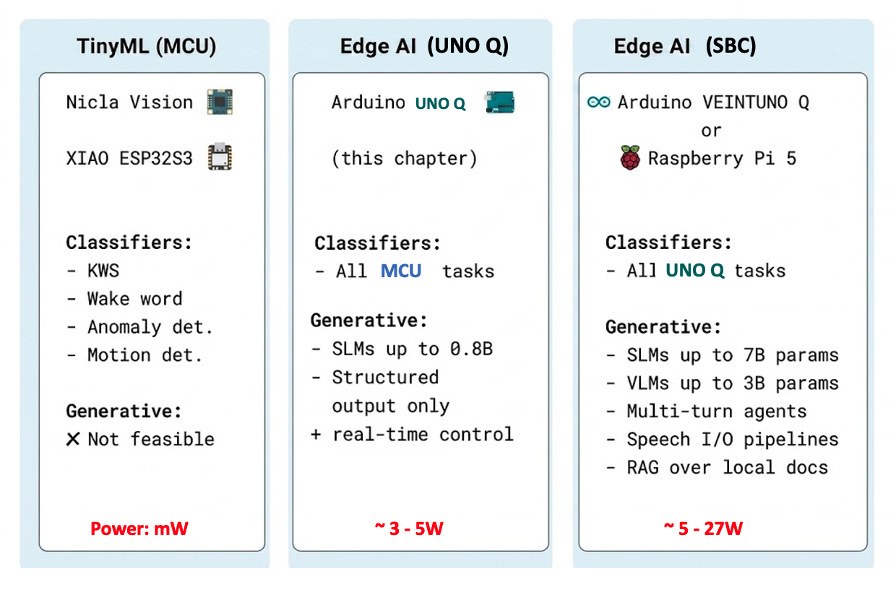{width=80% fig-align="center"}

The UNO Q is where generative AI becomes possible at the edge but stays bounded: small models, short outputs, and batch-rate inference. Students who understand these constraints will recognize them in real production deployments.

The Arduino VENTUNO Q, with a 40 TOPS Dragonwing IQ8 NPU and 16 GB of RAM, changes what is realistic. SLMs with several billion parameters become interactive, multimodal models such as Qwen3.5-4B become practical, and multi-turn agents with tool use run in real time. The patterns from this lab (llama.cpp and an OpenAI-compatible HTTP API) carry over directly; only the model sizes and latency numbers change.

## Resources {#sec-uno-q-slm-resources-55c2}

- [Generative AI at the Edge: Running Small Language Models with Arduino UNO Q and llama.cpp](https://mjrovai.github.io/genai-uno-q/), by Marcelo Rovai, the open book these UNO Q labs are adapted from
- [llama.cpp repository](https://github.com/ggml-org/llama.cpp)
- [llama.cpp HTTP server documentation](https://github.com/ggml-org/llama.cpp/blob/master/tools/server/README.md)
- [OpenAI Python library](https://github.com/openai/openai-python)
- [Qwen3.5-0.8B GGUF (Bartowski)](https://huggingface.co/bartowski/Qwen_Qwen3.5-0.8B-GGUF)
- [Qwen3.5-0.8B GGUF (Unsloth Dynamic)](https://huggingface.co/unsloth/Qwen3.5-0.8B-GGUF)
- [Unsloth Qwen3.5 inference guide](https://unsloth.ai/docs/models/qwen3.5)
- [Qwen3.5 reasoning control discussion (llama.cpp)](https://github.com/ggml-org/llama.cpp/discussions/20476)
- ["enable_thinking param cannot turn off thinking for qwen3.5" (llama.cpp issue)](https://github.com/ggml-org/llama.cpp/issues/20182)
- [SmolLM2 GGUF family (Bartowski)](https://huggingface.co/bartowski?search=SmolLM2)
- [Running local LLMs and VLMs on the Arduino UNO Q with yzma](https://projecthub.arduino.cc/marc-edgeimpulse/running-local-llms-and-vlms-on-the-arduino-uno-q-with-yzma-74e288)
- [yzma (Go wrapper for llama.cpp)](https://github.com/hybridgroup/yzma)
- [LiteRT-LM](https://github.com/google-ai-edge/LiteRT-LM)
- [Installing Ollama on Arduino Uno Q (Alessandro Tinivelli)](https://blog.tinivelli.com/installing-ollama-on-arduino-uno-q/)
- [QClaw](https://github.com/laurenvil/Uno-QClaw)
- [SLM slide deck](https://github.com/Mjrovai/UNIFEI-IESTI05-EDGE_AI/blob/main/00_Curso_Folder/4-Generative_AI-UNO-Q/2-Generative-AI/Ch2-Generative-AI-at-the-Edge.pdf) and [video walkthrough](https://youtu.be/4qsv8_FRwwM) from the UNIFEI IESTI05 course
