# Setup {.unnumbered}

{width=60% fig-align="center"}

This chapter sets up the Arduino UNO Q with **terminal tools** (ADB and SSH). It skips the graphical Arduino App Lab wherever possible and follows a command-line workflow instead. The same setup supports every other UNO Q lab.

## Overview {#sec-uno-q-setup-overview-1fa0}

A terminal-first workflow has several advantages:

- Full control over the board's Debian Linux environment.
- Code lives on the host machine under Git, not locked inside the board.
- Linux, SSH, and SCP skills transfer directly to real embedded and edge AI deployments.
- Build and deployment steps can be scripted and automated.
- It works with any editor (VS Code, Vim, or any other), since nothing depends on a specific tool.

By the end of this chapter, you will be able to connect to the UNO Q headlessly, configure its network, run dual-brain applications (Python plus an Arduino sketch) over SSH, and, optionally, edit code on the board from VS Code.

## What Is the Arduino UNO Q? {#sec-uno-q-setup-arduino-uno-q-cf5b}

\noindent
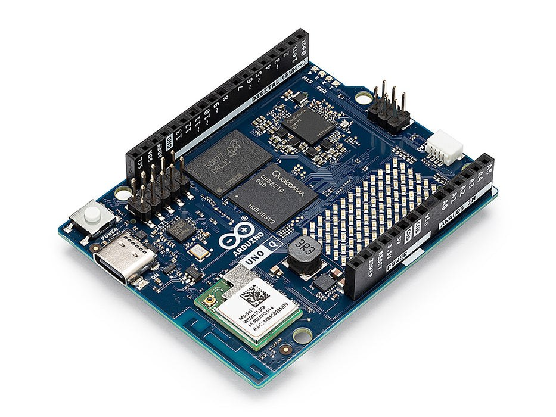{width=70% fig-align="center"}

The Arduino UNO Q is a **hybrid single-board computer** that combines two processors on one board with the classic UNO form factor:

+------------------------+---------------------------+------------------------------------------------------------+
| **Component**          | **Role**                  | **Details**                                                |
+:=======================+:==========================+:===========================================================+
| **MPU**                | High-level computing, AI, | Qualcomm Dragonwing QRB2210: quad-core Arm Cortex-A53 at   |
| (Microprocessor Unit)  | and networking            | 2.0 GHz, Adreno 702 GPU, dual ISP. Runs **Debian Linux**.  |
+------------------------+---------------------------+------------------------------------------------------------+
| **MCU**                | Real-time hardware        | STMicroelectronics STM32U585: Arm Cortex-M33 at 160 MHz.   |
| (Microcontroller Unit) | control                   | Runs the **Arduino Core on Zephyr OS**.                    |
+------------------------+---------------------------+------------------------------------------------------------+

The two processors communicate through **Bridge**, Arduino's RPC (Remote Procedure Call) library. Python code on the MPU can call functions running in an Arduino sketch on the MCU, and vice versa.

\noindent
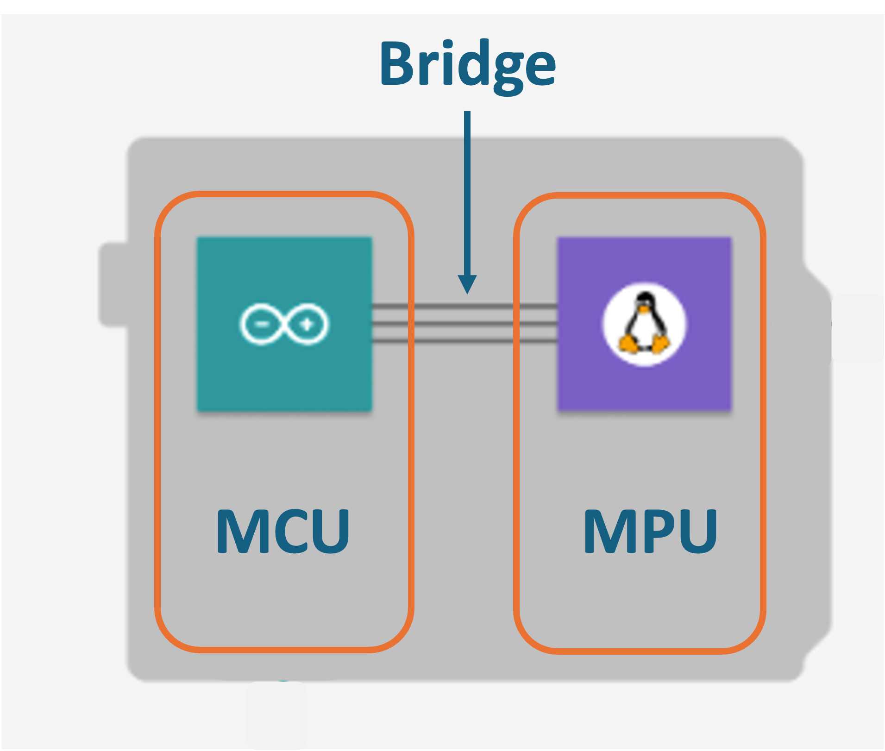{width=75% fig-align="center"}

### Available Variants {#sec-uno-q-setup-available-variants-aafe}

+-------------+------------------+--------------------+-----------------------------------------------------------+
| **Variant** | **RAM**          | **Storage (eMMC)** | **Best For**                                              |
+:============+:=================+:===================+:==========================================================+
| **2 GB**    | 2 GB LPDDR4X     | 16 GB              | Headless SSH development, lightweight edge AI, and TinyML |
+-------------+------------------+--------------------+-----------------------------------------------------------+
| **4 GB**    | 4 GB LPDDR4X     | 32 GB              | Desktop (SBC) mode with a display, larger AI models, and  |
|             |                  |                    | multitasking                                              |
+-------------+------------------+--------------------+-----------------------------------------------------------+

Both variants share the same processors, connectivity (dual-band Wi-Fi 5 and Bluetooth 5.1), USB-C port, UNO-compatible headers, Qwiic connector, 8×13 LED matrix, and four RGB LEDs.

### Key Connectivity {#sec-uno-q-setup-key-connectivity-7d4a}

- **USB-C**: A single multi-function port for power, data (ADB), and DisplayPort video output.
- **Wi-Fi**: Dual-band 802.11ac (2.4 GHz and 5 GHz).
- **Bluetooth**: 5.1.

> The UNO Q uses its single USB-C port for everything, so use a **data-capable USB-C cable**, not a charge-only one. Some USB hubs and Apple USB-C adapters are not recognized.

More details are in the [Arduino UNO Q User Manual](https://docs.arduino.cc/resources/datasheets/ABX00162-datasheet.pdf).

## Hardware and Software Requirements {#sec-uno-q-setup-hardware-software-requirements-d34c}

### Hardware {#sec-uno-q-setup-hardware-0d74}

- Arduino UNO Q (2 GB or 4 GB variant)
- USB-C data cable (verify that it is not charge-only)
- Host computer (Linux, macOS, or Windows)
- Wi-Fi network (the UNO Q and the host must be on the same network for SSH)

### Software on the Host Computer {#sec-uno-q-setup-software-host-computer-e40b}

+--------------------------------+----------------------------------------------------------------------+
| **Tool**                       | **Purpose**                                                          |
+:===============================+:=====================================================================+
| **ADB** (Android Debug Bridge) | Initial headless connection over USB-C                               |
+--------------------------------+----------------------------------------------------------------------+
| **SSH client**                 | Remote access over Wi-Fi (built into Linux and macOS; available      |
|                                | on Windows)                                                          |
+--------------------------------+----------------------------------------------------------------------+
| **SCP**                        | Secure file transfer to the board                                    |
+--------------------------------+----------------------------------------------------------------------+
| **VS Code** (optional)         | Full editor on the board's filesystem through Remote-SSH             |
+--------------------------------+----------------------------------------------------------------------+

## Installing ADB on the Host Computer {#sec-uno-q-setup-installing-adb-host-computer-b51b}

ADB (Android Debug Bridge) opens a shell on the UNO Q over the USB-C cable, with no network or monitor required. It is the entry point for the initial setup.

### Linux (Ubuntu/Debian) {#sec-uno-q-setup-linux-ubuntudebian-c8be}

```bash
sudo apt update
sudo apt install android-tools-adb
```

### macOS {#sec-uno-q-setup-macos-db85}

With [Homebrew](https://brew.sh/):

```bash
brew install android-platform-tools
```

### Windows {#sec-uno-q-setup-windows-8c50}

1. Download **SDK Platform-Tools** from the [Android developer site](https://developer.android.com/studio/releases/platform-tools).
2. Extract the ZIP file to a folder (for example, `C:\platform-tools`).
3. Add that folder to the system `PATH` environment variable, or open a terminal (PowerShell or Command Prompt) in that folder.

> For a more Unix-like experience on Windows, with native `ssh` and `scp` commands, install [WSL (Windows Subsystem for Linux)](https://learn.microsoft.com/en-us/windows/wsl/install). Inside WSL, ADB installs the same way as on Ubuntu.

### Verify the Installation {#sec-uno-q-setup-verify-installation-07d6}

With the UNO Q **disconnected**, run:

```bash
adb version
```

The output should look like `Android Debug Bridge version X.X.X`. If it does not, revisit the installation steps.

\noindent
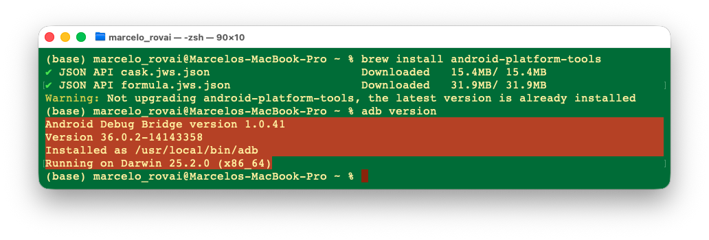{width=75% fig-align="center"}

## Flashing the Latest Linux Image {#sec-uno-q-setup-flashing-latest-linux-image-72c8}

::: {.callout-tip title="Optional but recommended"}
This step is optional but strongly recommended, especially for boards fresh out of the box. The first batches of the UNO Q shipped with an older Debian image that can cause random desktop and application restarts (no ZRAM memory compression), ADB defaulting to root (a security concern), and missing HDMI audio. Flashing the latest image fixes all of these and gives every board in a classroom the same starting point.

If the board is already up to date (for example, it was purchased recently and boots correctly), skip to @sec-uno-q-setup-first-connection-headless-setup-via-adb-947d.
:::

Flashing uses Arduino's `arduino-flasher-cli` tool, which runs entirely from a terminal on the host computer. It downloads the latest Debian image and writes it to the UNO Q's eMMC storage.

> **Warning**: Flashing erases everything on the board and restores it to its factory state. Back up any existing projects on the UNO Q first.

### Step 1: Download the Flasher CLI {#sec-uno-q-setup-step-1-download-flasher-cli-756e}

Download the version for your operating system from the [Arduino Software page](https://www.arduino.cc/en/software/) or the [Flasher CLI releases page](https://github.com/arduino/arduino-flasher-cli/releases).

+-------------+---------------------------------------------------+
| **OS**      | **File to Download**                              |
+:============+:==================================================+
| **Linux**   | `arduino-flasher-cli_X.X.X_Linux_64bit.tar.gz`    |
+-------------+---------------------------------------------------+
| **macOS**   | `arduino-flasher-cli_X.X.X_macOS_64bit.tar.gz`    |
+-------------+---------------------------------------------------+
| **Windows** | `arduino-flasher-cli_X.X.X_Windows_64bit.zip`     |
+-------------+---------------------------------------------------+

Extract the archive to a convenient location.

### Step 2: Put the Board into Flash (EDL) Mode {#sec-uno-q-setup-step-2-put-board-flash-edl-mode-0480}

With the board **powered off** (USB cable disconnected):

1. Locate the **JCTL** header on the UNO Q (a small 10-pin header).
2. With a jumper wire or shunt, **short the two pins furthest from the USB-C connector**.
3. With the jumper in place, connect the USB-C cable to the computer.

The board boots into EDL (Emergency Download) mode, and the LED matrix shows the Arduino logo continuously.

\noindent
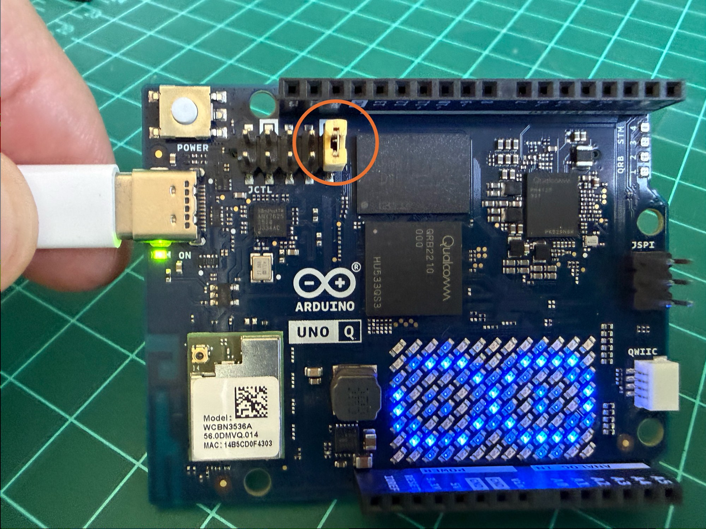{width=60% fig-align="center"}

### Step 3: Flash the Latest Image {#sec-uno-q-setup-step-3-flash-latest-image-15f3}

Open a terminal on the host computer, go to the folder where the flasher CLI was extracted, and run:

**Linux / macOS:**

```bash
./arduino-flasher-cli flash latest
```

**Windows (PowerShell):**

```powershell
.\arduino-flasher-cli.exe flash latest
```

> The `latest` keyword is deprecated and will be removed; newer versions of the flasher use `unoq` instead.

The tool then:

1. Asks whether to download the latest Debian image. Type `yes` and press Enter.
2. Downloads the image (about 2.3 GB), which can take several minutes.
3. Extracts the image.
4. Flashes it to the UNO Q's eMMC.

**Do not disconnect the USB cable or interrupt the process.** Wait for the message confirming that the partition is now bootable.

\noindent
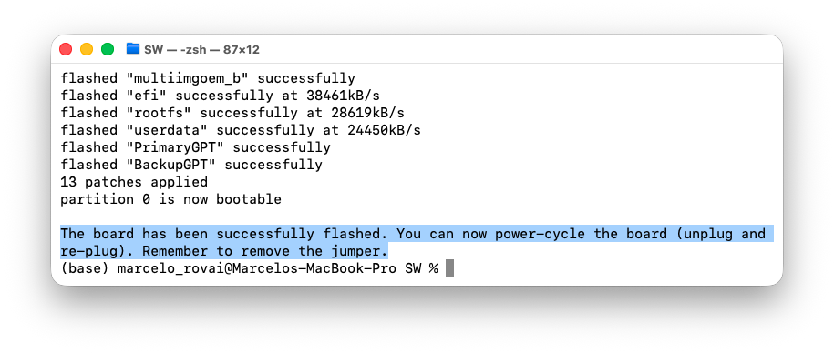{width=75% fig-align="center"}

> On Linux, if the flasher cannot access the device, run it with `sudo` or add a udev rule for the Qualcomm EDL device.

### Step 4: Remove the Jumper and Reboot {#sec-uno-q-setup-step-4-remove-jumper-reboot-303e}

1. Disconnect the USB cable.
2. **Remove the jumper** from the JCTL header.
3. Reconnect the USB cable.

The board boots from the fresh image. The LED matrix plays the Arduino logo animation and briefly ends with a heart, which indicates a successful flash; one of the blue LEDs also turns on. The board is now in a factory-fresh state.

\noindent
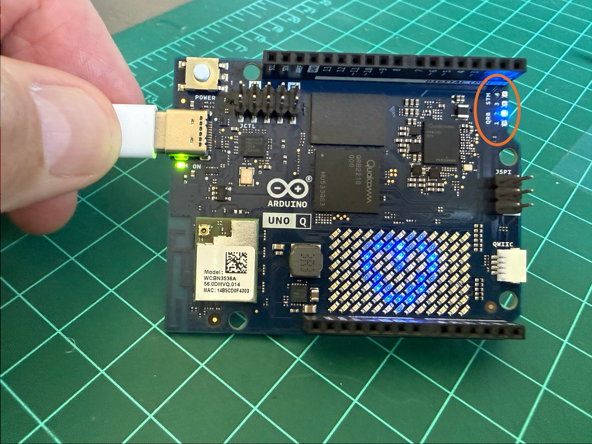{width=60% fig-align="center"}

### Flashing a Local Image {#sec-uno-q-setup-flashing-local-image-9ac2}

If the Debian image file is already on the host, flash it directly without downloading it again:

```bash
./arduino-flasher-cli flash path/to/downloaded/image
```

> This is useful in a classroom: download the image once and distribute it on a shared drive or USB stick.

## First Connection: Headless Setup via ADB {#sec-uno-q-setup-first-connection-headless-setup-via-adb-947d}

### Step 1: Connect the Board {#sec-uno-q-setup-step-1-connect-board-0538}

1. Plug the USB-C data cable into the UNO Q and into the computer.
2. Wait about 30 seconds for the board to boot. The LED matrix shows an animated Arduino logo that briefly ends with a heart, and the blue QRB LED 2 turns on.

### Step 2: Verify that ADB Sees the Device {#sec-uno-q-setup-step-2-verify-adb-sees-device-84b1}

```bash
adb devices
```

Expected output:

```
List of devices attached
XXXXXXXX    device
```

\noindent
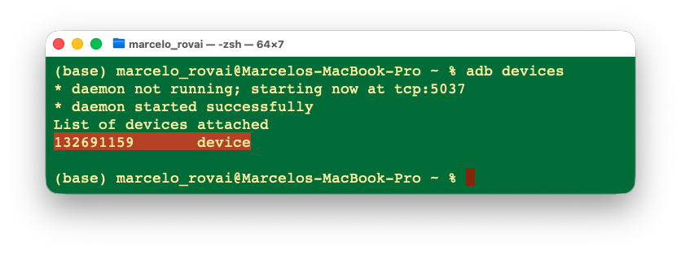{width=65% fig-align="center"}

If the list is empty:

- Confirm that the USB-C cable carries data.
- Try a different USB port, preferably a USB-C or USB 3.0 port directly on the computer rather than through a hub.
- On Linux, configure udev rules for the device.

### Step 3: Open a Shell on the Board {#sec-uno-q-setup-step-3-open-shell-board-1c30}

```bash
adb shell
```

This opens a shell in the UNO Q's Debian Linux environment. The default credentials are:

+--------------+-------------+
| **Field**    | **Value**   |
+:=============+:============+
| Username     | `arduino`   |
+--------------+-------------+
| Password     | `arduino`   |
+--------------+-------------+

### Step 4: Change the Default Password {#sec-uno-q-setup-step-4-change-default-password-cad3}

The default password `arduino` must be changed; the system keeps reminding you until it is.

```bash
sudo passwd arduino
```

Enter and confirm the new password. SSH uses the same password, so keep it at hand.

### Step 5: Check the Board Information {#sec-uno-q-setup-step-5-check-board-information-04eb}

From the ADB shell, inspect the system:

```bash
# Check OS version
cat /etc/os-release

# Check available storage
df -h

# Check RAM
free -h

# Check CPU info
lscpu
```

> Type `exit` to leave the ADB shell and return to the host terminal.

## Configuring Wi-Fi from the Terminal {#sec-uno-q-setup-configuring-wifi-terminal-496f}

SSH needs Wi-Fi, and the whole configuration can be done from the ADB shell.

### Step 1: Enter the ADB Shell {#sec-uno-q-setup-step-1-enter-adb-shell-b53a}

```bash
adb shell
```

### Step 2: Scan for Available Networks {#sec-uno-q-setup-step-2-scan-available-networks-be09}

```bash
nmcli dev wifi list
```

The command lists every visible Wi-Fi network with its SSID, signal strength, and security type.

### Step 3: Connect to the Wi-Fi Network {#sec-uno-q-setup-step-3-connect-wifi-network-9057}

```bash
sudo nmcli dev wifi connect "YOUR_WIFI_SSID" password "YOUR_WIFI_PASSWORD"
```

Replace `YOUR_WIFI_SSID` and `YOUR_WIFI_PASSWORD` with the network credentials. Keep the quotes if the SSID contains spaces.

### Step 4: Verify the Connection {#sec-uno-q-setup-step-4-verify-connection-73c3}

```bash
nmcli device status
```

\noindent
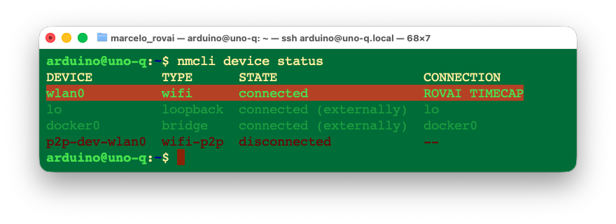{width=70% fig-align="center"}

The `wlan0` interface should show `connected`. Then get the board's IP address:

```bash
hostname -I
```

\noindent
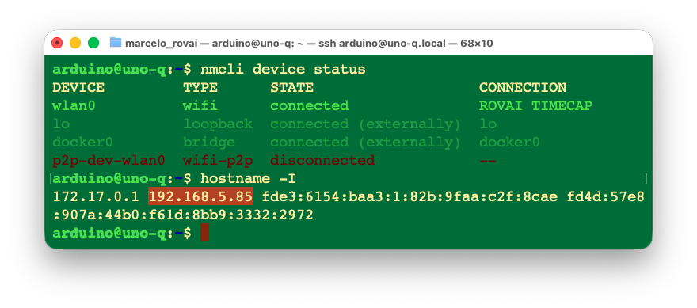{width=70% fig-align="center"}

For more detail, use:

```bash
ip addr show wlan0
```

The `inet` line shows an address such as `192.168.1.XXX/YY`. **Note this IP address**; SSH needs it.

> If the router supports it, assign a **static IP** to the UNO Q using its MAC address (shown under `link/ether` in the output of `ip addr show wlan0`). The IP then stays the same across reboots, which helps in classrooms with many boards.

### Switching Networks Later {#sec-uno-q-setup-switching-networks-later-0473}

To change Wi-Fi networks later, over SSH or ADB:

```bash
# Disconnect from current network
nmcli device disconnect wlan0

# Connect to a different network
sudo nmcli dev wifi connect "NEW_SSID" password "NEW_PASSWORD"
```

## Enabling and Using SSH {#sec-uno-q-setup-enabling-using-ssh-361c}

### Step 1: Enable the SSH Server {#sec-uno-q-setup-step-1-enable-ssh-server-84a4}

When Wi-Fi credentials are entered during the first setup, the board enables SSH automatically, but network mode still has to be activated manually. Run this command in the board's shell:

```bash
arduino-app-cli system network-mode enable
```

\noindent
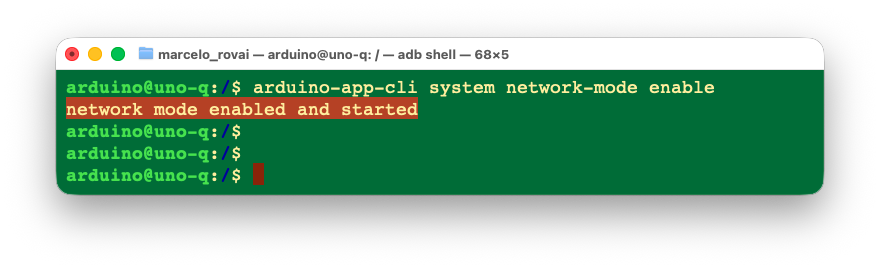{width=70% fig-align="center"}

### Step 2: Exit ADB and Connect via SSH {#sec-uno-q-setup-step-2-exit-adb-connect-via-ssh-9eaf}

Exit the ADB shell:

```bash
exit
```

Then, from the host computer's terminal, connect via SSH:

```bash
ssh arduino@<UNO_Q_IP_ADDRESS>
```

Replace `<UNO_Q_IP_ADDRESS>` with the IP noted earlier (for example, `192.168.1.42`).

- On the first connection, SSH asks you to accept the host fingerprint. Type `yes`.
- Enter the password set earlier.

The host now has a remote Debian shell on the UNO Q over Wi-Fi.

#### Connecting by Hostname {#sec-uno-q-setup-connecting-hostname-c407}

On networks that support mDNS, the hostname also works:

```bash
ssh arduino@uno-q.local
```

If the board was given a custom name during setup, use that name instead:

```bash
ssh arduino@<boardname>.local
```

\noindent
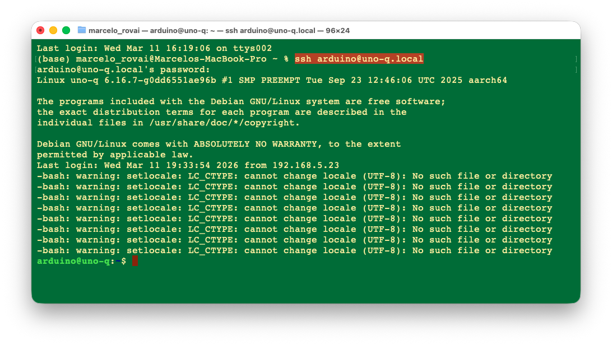{width=75% fig-align="center"}

#### If the SSH Password Is Rejected {#sec-uno-q-setup-ssh-password-rejected-f91b}

Reset the password through ADB:

```bash
adb shell
sudo passwd arduino
```

Set a new password, exit, and try SSH again.

### Step 3: Check the CPU and Memory with `htop` {#sec-uno-q-setup-step-3-check-cpu-memory-htop-01e8}

In the SSH terminal, run:

```bash
htop
```

The 2 GB UNO Q shows something like this:

\noindent
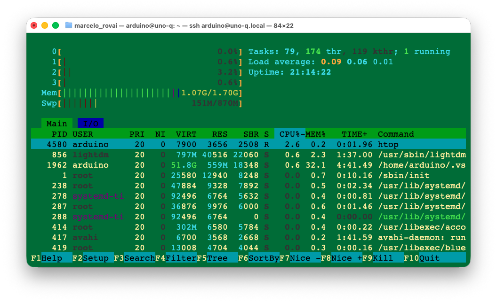{width=75% fig-align="center"}

And the 4 GB version:

\noindent
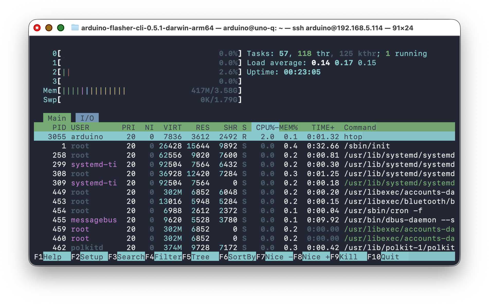{width=85% fig-align="center"}

> Both the RAM and the swap are twice as large on the 4 GB variant.

### Step 4: Update and Upgrade the System {#sec-uno-q-setup-step-4-update-upgrade-system-086b}

```bash
sudo apt update
sudo apt upgrade
sudo reboot
```

### Step 5: Transfer Files {#sec-uno-q-setup-step-5-transfer-files-b5d4}

#### Using SFTP (FileZilla) {#sec-uno-q-setup-using-sftp-filezilla-d7df}

A graphical SFTP client such as the [FileZilla FTP Client](https://filezilla-project.org/download.php?type=client) is the easiest way to move files. Install it on the host and use the UNO Q's IP address as the `Host`, for example:

```bash
sftp://192.168.5.85
```

Enter the UNO Q username and password and press `Quickconnect`. Two panes open: one for the host computer and one for the UNO Q.

\noindent
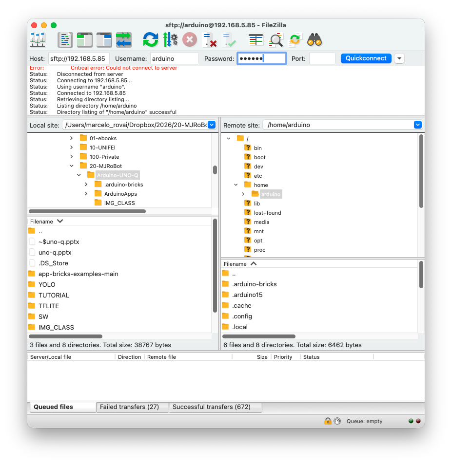{width=65% fig-align="center"}

#### Using `scp` {#sec-uno-q-setup-using-scp-71c9}

On the host, go to the directory with the files to transfer. For example, to copy all of its files to the board:

```bash
cd <folder>
scp -r * arduino@<UNO_Q_IP_ADDRESS>:~/ArduinoApps/<folder>/
```

Enter the password when prompted, and the transfer starts.

## Setting Up VS Code with Remote-SSH {#sec-uno-q-setup-setting-vs-code-remotessh-9f04}

Visual Studio Code with the Remote-SSH extension gives a full IDE (file browser, integrated terminal, IntelliSense, and extensions) that works directly on the UNO Q's filesystem. It is optional, since every lab also works with `nano` and `scp` or `rsync`, but it makes projects that span Python and an Arduino sketch much easier to manage.

### Step 1: Install VS Code {#sec-uno-q-setup-step-1-install-vs-code-5455}

Download and install [VS Code](https://code.visualstudio.com/) for your operating system.

### Step 2: Install the Remote-SSH Extension {#sec-uno-q-setup-step-2-install-remotessh-extension-f240}

1. Open VS Code.
2. Open the **Extensions** view (`Ctrl+Shift+X` or `Cmd+Shift+X`).
3. Search for **Remote - SSH** (by Microsoft).
4. Click **Install**.

### Step 3: Connect to the UNO Q {#sec-uno-q-setup-step-3-connect-uno-q-1080}

1. Click the **Remote Connection** icon (`><`) in the bottom-left corner or in the left menu.
2. Select `+` or **Connect to Host…**
3. Enter `arduino@<UNO_Q_IP_ADDRESS>`.

\noindent
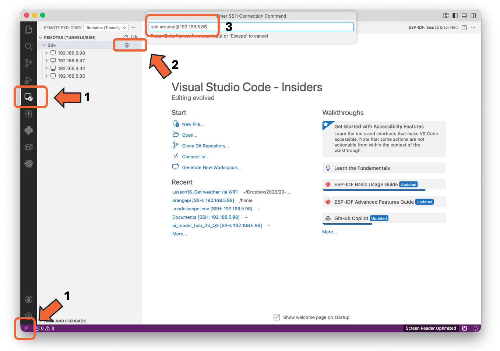{width=75% fig-align="center"}

4. Press `Enter` when prompted. The UNO Q's IP address appears under `SSH`.
5. Click the `terminal +` icon.

\noindent
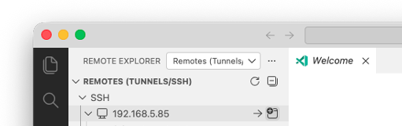{width=40% fig-align="center"}

6. Enter the password (or let VS Code authenticate automatically if SSH keys are set up).

VS Code installs a lightweight server component on the UNO Q, which can take a minute on the first connection.

### Step 4: Open the Projects Folder {#sec-uno-q-setup-step-4-open-projects-folder-2dd6}

Once connected:

1. Go to **File → Open Folder…**
2. Navigate to `/home/arduino/ArduinoApps/`.

\noindent
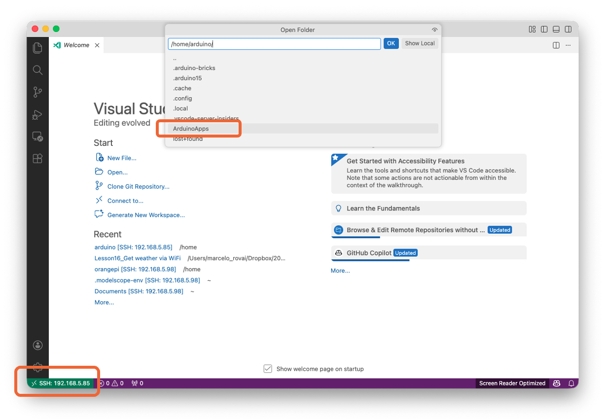{width=75% fig-align="center"}

3. Click **OK**.

VS Code now browses, edits, and runs terminals directly on the UNO Q.

\noindent
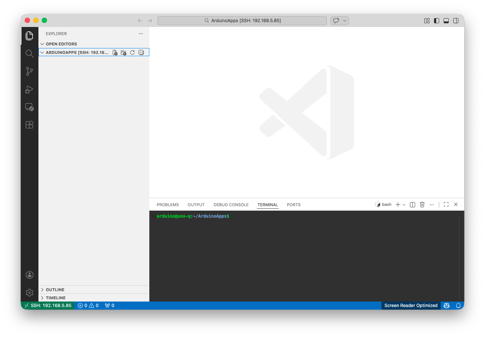{width=80% fig-align="center"}

### Step 5: Open the Integrated Terminal {#sec-uno-q-setup-step-5-open-integrated-terminal-9a56}

If no terminal is open, press `` Ctrl+` `` (backtick). This terminal runs on the UNO Q, so `arduino-app-cli` commands, package installs, and project management all work from inside VS Code. Any terminal command in the UNO Q labs can run here instead of in a separate SSH session.

### Disable Heavy Extensions on the Remote {#sec-uno-q-setup-disable-heavy-extensions-remote-f4ff}

The UNO Q has limited RAM, especially the 2 GB variant. To avoid memory problems while a language model is also running:

- **Disable** GitHub Copilot and other AI assistants on the remote connection.
- **Disable** any extension not strictly needed for Python or C++ editing.
- Keep the remote extensions to a minimum: **Python**, **C/C++**, and **Pylance** are usually enough.

Extensions can be disabled for the SSH connection alone, without affecting the local setup: right-click the extension and choose *Disable (SSH: arduino@...)*.

## Exploring the Pre-Installed Examples {#sec-uno-q-setup-exploring-preinstalled-examples-47d3}

### Listing the Examples and AI Models {#sec-uno-q-setup-listing-examples-ai-models-f52b}

The UNO Q ships with a set of pre-installed example applications, from basic LED control to AI-powered computer vision. All of them can be discovered, run, studied, and customized from an SSH terminal, with no App Lab GUI required.

> To make sure the board has the latest pre-loaded models, update the system with `arduino-app-cli system update`. The update can take a long time.

From an SSH terminal, run:

```bash
arduino-app-cli app list --examples
```

The command lists every installed app, including user-created ones:

\noindent
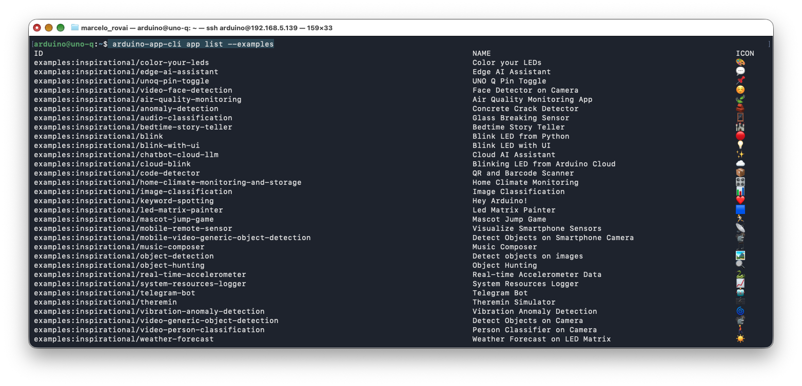{width=85% fig-align="center"}

The `examples:` apps are **not** stored in `~/ArduinoApps/`. Only user-created apps (such as `Blink`) live there; the examples are managed internally by the CLI elsewhere on the board's filesystem. The UNO Q therefore has two classes of apps:

- **`examples:*`**: read-only, managed by the CLI.
- **`user:*`**: your apps in `~/ArduinoApps/`, the only ones visible with `ls`.

### Running an Example from the Terminal {#sec-uno-q-setup-running-example-terminal-b5d7}

Any example can run directly from an SSH terminal:

```bash
arduino-app-cli app start examples:inspirational/blink
```

> Check the app names listed on your board and adapt the commands if needed.

\noindent
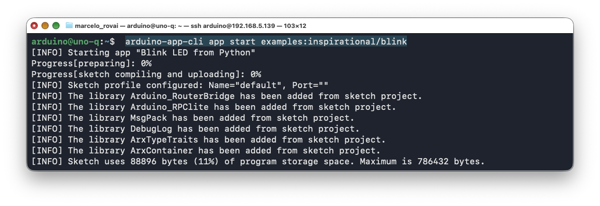{width=85% fig-align="center"}

> The first run can take several minutes while the system downloads and installs the Arduino libraries and sets up the Python container.

At the end, the output shows:

```bash
Progress[]: 100%
✓ App "Blink LED from Python" started successfully
```

On the board, the built-in LED blinks on and off every second.

\noindent
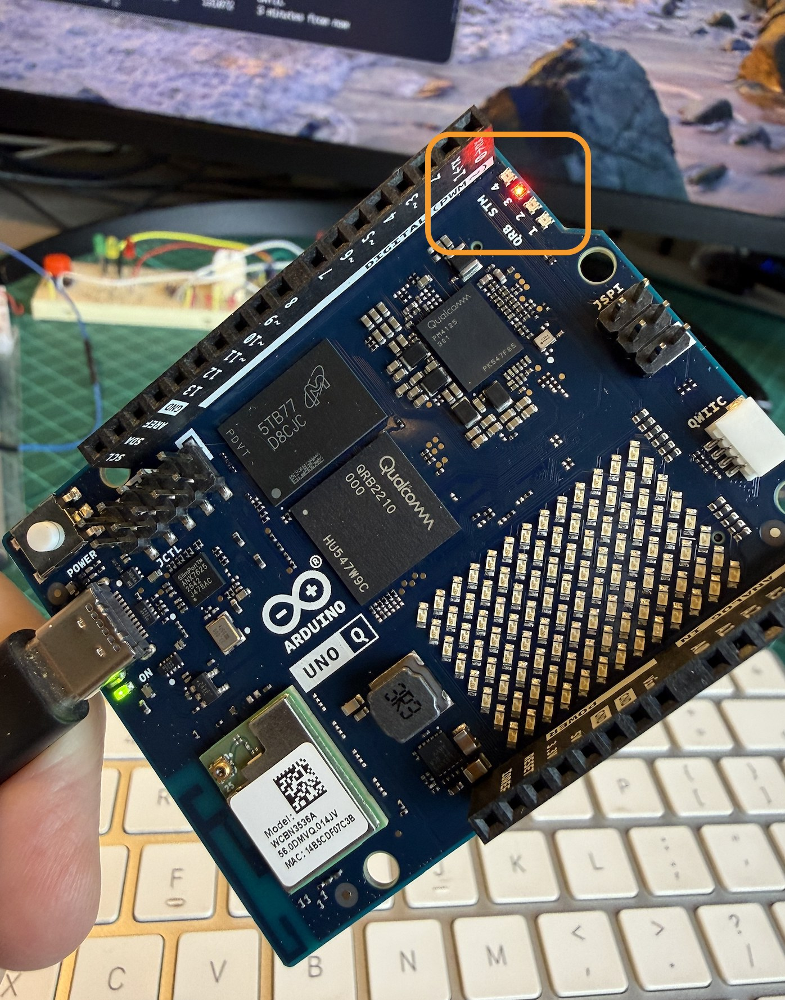{width=45% fig-align="center"}

To inspect the logs:

```bash
arduino-app-cli app logs examples:inspirational/blink
```

\noindent
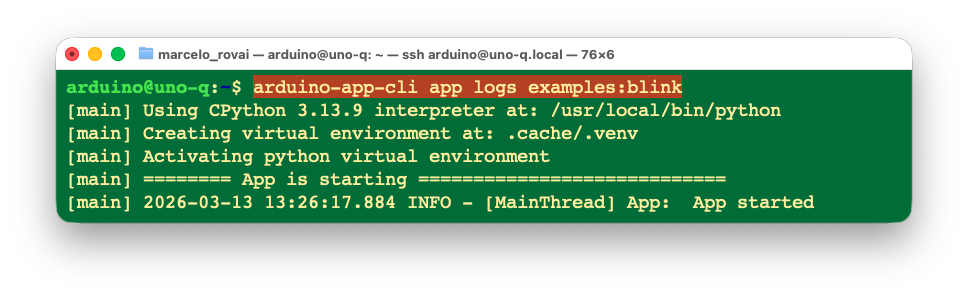{width=75% fig-align="center"}

And to stop the app:

```bash
arduino-app-cli app stop examples:inspirational/blink
```

\noindent
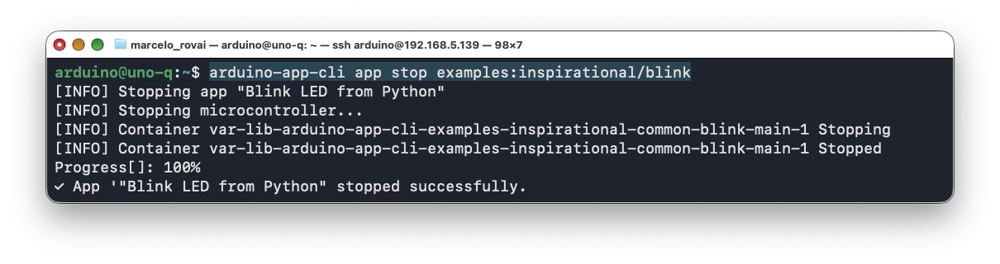{width=85% fig-align="center"}

## The `arduino-app-cli` Command Reference {#sec-uno-q-setup-arduinoappcli-command-reference-22b4}

The `arduino-app-cli` tool comes pre-installed on the UNO Q and manages the whole lifecycle of dual-brain applications: Apps, Bricks, AI models, and system settings. The tables below list the commands used most often in the UNO Q labs, based on Arduino App CLI 0.14. Check the version on the board with:

```bash
arduino-app-cli version
```

The full list of commands and options is in the [Arduino App CLI Command Reference](https://docs.arduino.cc/software/app-lab/cli/commands/).

> **App paths and App IDs.** Every command that takes an `<app_path>` also accepts an App ID, such as `user:my-app` for your own Apps or `examples:inspirational/blink` for the built-in examples.

### Managing Apps {#sec-uno-q-setup-managing-apps-24e4}

+-------------------------------------------+--------------------------------------------------------------+
| **Command**                               | **Description**                                              |
+:==========================================+:=============================================================+
| `arduino-app-cli app new <name>`          | Create a new App (`--from-app` copies an existing App or     |
|                                           | example; `-b` adds Bricks)                                   |
+-------------------------------------------+--------------------------------------------------------------+
| `arduino-app-cli app list`                | List your Apps; add `--examples` for the examples or `--all` |
|                                           | for everything                                               |
+-------------------------------------------+--------------------------------------------------------------+
| `arduino-app-cli app ps`                  | Show the live status of Apps that are starting, running,     |
|                                           | stopping, or failed (`--all` includes stopped ones)          |
+-------------------------------------------+--------------------------------------------------------------+
| `arduino-app-cli app details <app_path>`  | Show an App's details                                        |
+-------------------------------------------+--------------------------------------------------------------+
| `arduino-app-cli app start <app_path>`    | Start an App (`-v` for verbose output)                       |
+-------------------------------------------+--------------------------------------------------------------+
| `arduino-app-cli app stop <app_path>`     | Stop a running App                                           |
+-------------------------------------------+--------------------------------------------------------------+
| `arduino-app-cli app restart <app_path>`  | Restart an App, or start it if it is stopped                 |
+-------------------------------------------+--------------------------------------------------------------+
| `arduino-app-cli app logs <app_path>`     | Show the Python-side logs (`--follow` to stream, `--tail N`  |
|                                           | for the last N lines)                                        |
+-------------------------------------------+--------------------------------------------------------------+
| `arduino-app-cli app ports <app_path>`    | Show the network ports an App and its Bricks expose          |
+-------------------------------------------+--------------------------------------------------------------+
| `arduino-app-cli app export <app_path>`   | Export an App to a zip file (an optional second argument     |
|                                           | names the file)                                              |
+-------------------------------------------+--------------------------------------------------------------+
| `arduino-app-cli app import <file.zip>`   | Import an App from a zip file                                |
+-------------------------------------------+--------------------------------------------------------------+
| `arduino-app-cli app destroy <app_path>`  | Delete an App                                                |
+-------------------------------------------+--------------------------------------------------------------+

Note that `app list` shows the catalog, not what is running. To see which Apps are active on the board, use `app ps`.

### Bricks and AI Models {#sec-uno-q-setup-bricks-ai-models-2f88}

+---------------------------------------------+------------------------------------------------------------+
| **Command**                                 | **Description**                                            |
+:============================================+:===========================================================+
| `arduino-app-cli brick list`                | List all available Bricks                                  |
+---------------------------------------------+------------------------------------------------------------+
| `arduino-app-cli brick details <brick_id>`  | Show the details of a Brick                                |
+---------------------------------------------+------------------------------------------------------------+
| `arduino-app-cli app brick config`          | Set a Brick variable in an App: add `<app_path>`,          |
|                                             | `<brick_id>`, and `name=value` (`--model` selects the AI   |
|                                             | model the Brick runs)                                      |
+---------------------------------------------+------------------------------------------------------------+
| `arduino-app-cli model list`                | List the installed models (`--exclude-builtin` hides       |
|                                             | Arduino's own)                                             |
+---------------------------------------------+------------------------------------------------------------+
| `arduino-app-cli model install <model>`     | Install a model from the catalog, from Hugging Face, or    |
|                                             | from a URL                                                 |
+---------------------------------------------+------------------------------------------------------------+
| `arduino-app-cli model delete <model_id>`   | Delete a custom model                                      |
+---------------------------------------------+------------------------------------------------------------+

The `model install` command accepts a llama.cpp Hugging Face ID in the form `llamacpp:owner/repo:quant`, for example:

```bash
arduino-app-cli model install \
  llamacpp:unsloth/Qwen3.5-0.8B-GGUF:Q4_K_M
```

In version 0.14 the quantization is required: `llamacpp:owner/repo` alone fails. For vision models, `--mmproj-url` points to the companion projector file.

### System and Board {#sec-uno-q-setup-system-board-97c2}

+------------------------------------------------+---------------------------------------------------------+
| **Command**                                    | **Description**                                         |
+:===============================================+:========================================================+
| `arduino-app-cli system check`                 | Verify that the board provides what the Apps need       |
+------------------------------------------------+---------------------------------------------------------+
| `arduino-app-cli system update`                | Update the upgradable system packages (`--only-arduino` |
|                                                | limits it to Arduino packages; `--yes` skips prompts)   |
+------------------------------------------------+---------------------------------------------------------+
| `arduino-app-cli system cleanup`               | Remove unused and obsolete App images to free disk      |
|                                                | space                                                   |
+------------------------------------------------+---------------------------------------------------------+
| `arduino-app-cli system set-name <name>`       | Set a custom name for the board                         |
+------------------------------------------------+---------------------------------------------------------+
| `arduino-app-cli system keyboard [layout]`     | Show or change the keyboard layout                      |
+------------------------------------------------+---------------------------------------------------------+
| `arduino-app-cli system network-mode <mode>`   | Manage the board's network mode (`enable`, `disable`,   |
|                                                | or `status`)                                            |
+------------------------------------------------+---------------------------------------------------------+
| `arduino-app-cli properties set default <app>` | Set the App that starts at boot (`none` unsets it)      |
+------------------------------------------------+---------------------------------------------------------+
| `arduino-app-cli properties get default`       | Show the default App                                    |
+------------------------------------------------+---------------------------------------------------------+
| `arduino-app-cli monitor`                      | Attach to the microcontroller's serial monitor          |
+------------------------------------------------+---------------------------------------------------------+

All commands accept `--format json` for machine-readable output and `--log-level debug` for troubleshooting.

## Essential Linux Commands for the UNO Q {#sec-uno-q-setup-essential-linux-commands-uno-q-0484}

The UNO Q runs Debian Linux, so these commands come up often:

### System Information {#sec-uno-q-setup-system-information-cfd9}

```bash
# OS version
cat /etc/os-release

# CPU information
lscpu

# Memory usage
free -h

# Disk usage
df -h

# Running processes (install with: sudo apt install htop)
htop
```

### Network Management {#sec-uno-q-setup-network-management-0edd}

```bash
# Show network interfaces and IPs
ip addr show

# Show Wi-Fi connection status
nmcli device status

# Show current Wi-Fi connection details
nmcli connection show

# List available Wi-Fi networks
nmcli dev wifi list

# Connect to a Wi-Fi network
sudo nmcli dev wifi connect "SSID" password "PASSWORD"

# Get board IP address (short form)
hostname -I
```

### Package Management {#sec-uno-q-setup-package-management-49bc}

```bash
# Update package lists
sudo apt update

# Upgrade installed packages
sudo apt upgrade -y

# Install a package
sudo apt install <package-name> -y

# Remove a package
sudo apt remove <package-name>

# Clean up unused packages and cache
sudo apt autoremove -y
sudo apt clean
```

### File Operations {#sec-uno-q-setup-file-operations-e175}

```bash
# List files (detailed)
ls -la

# Navigate directories
cd ~/ArduinoApps

# Create a directory
mkdir -p my_project/python my_project/sketch

# Copy files
cp source.txt destination.txt

# Move/rename files
mv old_name.py new_name.py

# Remove a file
rm filename.txt

# Remove a directory and its contents
rm -rf directory_name

# View file contents
cat filename.txt

# Edit a file (nano is pre-installed)
nano filename.txt
```

### Service Management {#sec-uno-q-setup-service-management-f59a}

```bash
# Check SSH service status
sudo systemctl status sshd

# Restart SSH
sudo systemctl restart sshd

# Reboot the board
sudo reboot

# Shut down the board
sudo shutdown -h now
```

## Tips, Tricks, and Troubleshooting {#sec-uno-q-setup-tips-tricks-troubleshooting-3c20}

### ADB Does Not Detect the Board {#sec-uno-q-setup-adb-detect-board-d7ea}

- Use a **data-capable** USB-C cable, not a charge-only one.
- Use a USB-C or USB 3.0 port **directly** on the computer, and avoid USB hubs when possible.
- Some **Apple USB-C hubs** are not compatible.
- The board takes about **30 seconds to boot**, so wait before running `adb devices`.
- On Linux, udev rules may be needed. The [Android developer documentation](https://developer.android.com/studio/run/device) explains how to set them up.

### SSH Connection Refused {#sec-uno-q-setup-ssh-connection-refused-5997}

Check that the SSH server is running:

```bash
adb shell
sudo systemctl status sshd
```

If it is not running:

```bash
sudo apt install openssh-server -y
sudo systemctl enable ssh
sudo ssh-keygen -A
sudo systemctl start sshd
```

### Wi-Fi Does Not Connect {#sec-uno-q-setup-wifi-connect-97a1}

- Check that the SSID and password are correct (both are case-sensitive).
- Try the 2.4 GHz band if 5 GHz fails; some access points have issues.
- Check that the router is not blocking new devices (MAC filtering).

### "App.run() Missing" Error {#sec-uno-q-setup-apprun-missing-error-7e6e}

If an app fails to start with errors such as `Stopped decode loop: EOF`, make sure its Python code includes:

```python
App.run(user_loop=loop)
```

This line is **mandatory**: the runtime needs it to start the application.

### Memory Issues on the 2 GB Variant {#sec-uno-q-setup-memory-issues-2-gb-variant-4edd}

- Avoid large AI models and prefer models optimized for the edge.
- Monitor memory usage with `free -h` or `htop`.
- Close unused applications and services.
- With VS Code Remote-SSH (@sec-uno-q-setup-setting-vs-code-remotessh-9f04), disable unnecessary extensions on the remote host, since its server process adds its own RAM footprint.

### Storage Cleanup {#sec-uno-q-setup-storage-cleanup-0c2f}

Over time, Docker images, logs, and cached packages can fill the eMMC:

```bash
# Check available space
df -h

# Clean apt cache
sudo apt clean
sudo apt autoremove -y

# Remove unused App images
arduino-app-cli system cleanup

# If using Docker directly
docker system prune -a
```

### Using Git for Version Control {#sec-uno-q-setup-using-git-version-control-0cdb}

Git can sync code with the board instead of SCP:

```bash
sudo apt install git -y
```

Repositories can then be cloned directly on the board or kept in sync with the host, which helps in team projects and keeps code backed up.

### Faster File Transfer with `rsync` {#sec-uno-q-setup-faster-file-transfer-rsync-9186}

For iterative development, `rsync` is faster than `scp` because it transfers only the files that changed:

```bash
# On the host, from inside the project directory:
rsync -avz --progress ./ \
  arduino@<UNO_Q_IP_ADDRESS>:~/ArduinoApps/uno_q_blink/
```

Install `rsync` on the UNO Q if it is not present:

```bash
sudo apt install rsync -y
```

## Going Further {#sec-uno-q-setup-going-further-8515}

With a working command-line environment in place, several paths are open.

### Edge AI on the UNO Q {#sec-uno-q-setup-edge-ai-uno-q-bb99}

- **Pre-loaded AI models**: The UNO Q comes with models for object detection, image classification, sound recognition, and keyword spotting. List them with `arduino-app-cli model list`, and the example Apps that use them with `arduino-app-cli app list --examples`.
- **Edge Impulse integration**: Train custom models in Edge Impulse Studio and deploy them to the UNO Q. See the [Edge Impulse Arduino UNO Q documentation](https://docs.edgeimpulse.com/hardware/boards/arduino-uno-q).
- **TinyML with Python**: Run LiteRT (TensorFlow Lite) or ONNX Runtime inference on the Linux side.
- **Generative AI at the edge**: Run small language and vision-language models with llama.cpp.

### Hardware Expansion {#sec-uno-q-setup-hardware-expansion-ca28}

- **Camera modules**: Connect a USB camera through a USB hub, or a MIPI-CSI camera, for computer vision projects.
- **Modulino nodes**: Use the Qwiic connector for plug-and-play sensors and actuators.
- **Arduino shields**: Traditional UNO shields fit the header layout.

## Summary {#sec-uno-q-setup-summary-9d5a}

This chapter covered a complete terminal-first workflow for the Arduino UNO Q: headless setup via ADB, Wi-Fi and SSH configuration, an optional VS Code Remote-SSH editor, and running dual-brain apps such as Blink with `arduino-app-cli`.

### Why the UNO Q for ML Systems {#sec-uno-q-setup-why-uno-q-ml-systems-f918}

- **One board, two worlds**: The dual-brain architecture shows the boundary between high-level AI inference (Python on Linux) and real-time physical control (C++ on an RTOS). That boundary is central to real edge AI systems but hard to convey with a single-processor board.
- **Professional development workflow**: Working over SSH, transferring files with SCP or `rsync`, and using CLI tools mirrors how edge AI systems are developed and maintained in industry, which is very different from the "click upload" experience of a traditional Arduino.
- **Gradual complexity**: Simple LED examples introduce the Bridge architecture, and the same hardware then runs language models, vision-language models, image classification, and object detection.
- **Ecosystem continuity**: Skills learned on the UNO Q (Linux administration, Python ML frameworks, and Arduino sketches) transfer to both simpler MCU boards and more powerful SBCs.

Technical strengths include:

- The Adreno 702 GPU can accelerate some vision workloads through LiteRT delegates, although the gains depend heavily on the model and runtime. It is not a usable target for llama.cpp, so the language models in these labs run entirely on the CPU.
- Pre-loaded Edge Impulse models give immediate hands-on experience with production ML pipelines.
- `arduino-app-cli` orchestrates the build, deploy, and run cycle for both processors from a single command.
- Standard Debian Linux gives full access to `pip`, `apt`, Docker, Git, and any Python ML library that fits in memory.

### Limitations and Considerations {#sec-uno-q-setup-limitations-considerations-b0bc}

The UNO Q's constraints matter when choosing it over the other platforms in these labs:

- **Compute power**: The Cortex-A53 cores perform at roughly the level of a Raspberry Pi 3. Language models beyond about 2B parameters are impractical. For heavy inference, a Raspberry Pi 5 or an accelerator (such as a MemryX MX3 or Google Coral) is the better choice.
- **RAM**: The 2 GB variant can feel tight when it runs a remote editor server, a Python container, and an AI model at the same time. The 4 GB variant is recommended for demanding workloads, particularly generative AI.
- **Single USB-C port**: Power, data, and video all go through one port, so desktop (SBC) mode needs a hub. Cable compatibility problems are a recurring frustration.
- **Maturing software ecosystem**: Arduino App Lab and `arduino-app-cli` are still evolving (pre-1.0), and the documentation is catching up. Rough edges are both a limitation and a learning opportunity, since early-stage tooling is a reality of edge AI development.
- **No dedicated NPU**: Unlike the Arduino VENTUNO Q (40 TOPS through its Dragonwing IQ8 NPU), the UNO Q relies on the CPU and GPU for inference, which is a bottleneck for compute-intensive models.
- **External camera**: Unlike the Nicla Vision or the XIAO ESP32S3 Sense, which have built-in cameras, the UNO Q needs a USB webcam or a MIPI-CSI camera with a carrier board.

## Resources {#sec-uno-q-setup-resources-c1ed}

- [Generative AI at the Edge: Running Small Language Models with Arduino UNO Q and llama.cpp](https://mjrovai.github.io/genai-uno-q/), by Marcelo Rovai, the open book these UNO Q labs are adapted from
- [Arduino UNO Q Documentation](https://docs.arduino.cc/hardware/uno-q)
- [Arduino UNO Q Datasheet (PDF)](https://docs.arduino.cc/resources/datasheets/ABX00162-datasheet.pdf)
- [Arduino App CLI Tutorial](https://docs.arduino.cc/software/app-lab/tutorials/cli)
- [Arduino App CLI on GitHub](https://github.com/arduino/arduino-app-cli)
- [Bricks Documentation](https://docs.arduino.cc/software/app-lab/tutorials/bricks)
- [Blink CLI Example (Shawn Hymel)](https://github.com/ShawnHymel/arduino_uno_q_blink_cli)
- [How to Use the Command Line (CLI) with the Arduino UNO Q (Shawn Hymel)](https://shawnhymel.com/3074/how-to-use-the-command-line-cli-with-the-arduino-uno-q/)
- [Edge Impulse: Arduino UNO Q](https://docs.edgeimpulse.com/hardware/boards/arduino-uno-q)
- [How to Set Up WiFi on the Arduino Uno Q (Kevin McAleer)](https://www.kevsrobots.com/blog/arduino-uno-q-wifi-setup.html)
- [5 Tips for Managing Your Arduino Uno Q (Kevin McAleer)](https://www.kevsrobots.com/blog/uno-q-tips.html)
- [Arduino UNO Q Elf Detector Series, Part 0 (Foundries.io)](https://www.foundries.io/insights/blog/arduino-uno-q-elf-detector/)
- [Setup slide deck](https://github.com/Mjrovai/UNIFEI-IESTI05-EDGE_AI/blob/main/00_Curso_Folder/4-Generative_AI-UNO-Q/1-Setup/Ch1-Setup-Arduino-UNO-Q.pdf) and [video walkthrough](https://youtu.be/V-sRd1l-x8s) from the UNIFEI IESTI05 course
