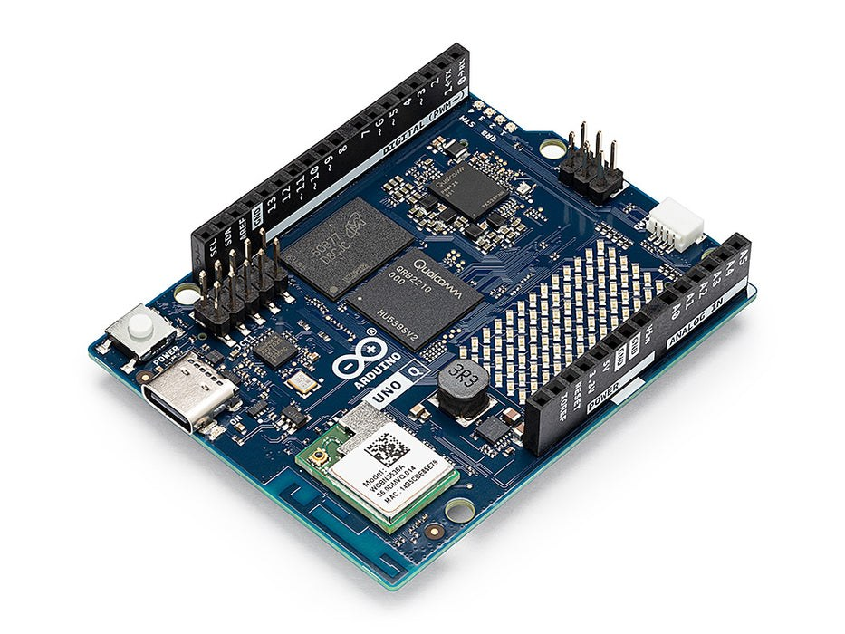

# Overview {.unnumbered}

These labs explore machine learning systems on the Arduino UNO Q, a hybrid board that pairs a Linux microprocessor with a real-time microcontroller. The Qualcomm QRB2210 MPU runs Debian Linux, Python, and inference engines such as llama.cpp, while the STM32U585 MCU drives LEDs, sensors, and actuators. The two talk through Bridge, an RPC layer that lets Python code call functions in an Arduino sketch. This split mirrors many real edge AI products, where a capable processor runs the model and a microcontroller handles timing-critical I/O.

The UNO Q has about the compute of a Raspberry Pi 3, so it runs small language and vision-language models as well as classic vision models. Those limits make the trade-offs of edge deployment easy to see: model size, quantization, memory, and latency all show up directly in what the board can and cannot do.

\noindent
{width=70% fig-align="center"}

## Where to Buy {#sec-uno-q-overview-where-buy-5b1e}

The UNO Q is available from the [Arduino Store](https://store.arduino.cc/products/uno-q) and its authorized distributors:

- Arduino UNO Q 2 GB (ABX00162): ~$59
- Arduino UNO Q 4 GB (ABX00173): ~$79

The 2 GB variant is enough for setup and the vision labs. The 4 GB variant is recommended for the generative AI labs.

## Pre-requisites {#sec-uno-q-overview-prerequisites-a3c7}

- **Arduino UNO Q**: The 2 GB or 4 GB variant.
- **USB-C data cable**: A cable that carries data, not a charge-only one.
- **Host computer**: Linux, macOS, or Windows, with an SSH client.
- **Network**: Wi-Fi with internet access, shared by the board and the host.
- **USB webcam and USB-C hub**: For the vision labs, since the UNO Q has no built-in camera.

## Setup {#sec-uno-q-overview-setup-e94d}

- [Setup Arduino UNO Q](setup/setup.qmd)

## Exercises {#sec-uno-q-overview-exercises-7f20}

+--------------+------------------------+---------------------------------------------+-------------------------------------------------------+
| **Modality** | **Task**               | **Description**                             | **Link**                                              |
+:=============+:=======================+:============================================+======================================================:+
| **GenAI**    | Small Language Models  | Run SLMs with llama.cpp on the MPU          | [Link](llm/llm.qmd)                                   |
+--------------+------------------------+---------------------------------------------+-------------------------------------------------------+
| **GenAI**    | Vision-Language Models | Describe and reason about images            | [Link](vlm/vlm.qmd)                                   |
+--------------+------------------------+---------------------------------------------+-------------------------------------------------------+
| **Vision**   | Image Classification   | Train a custom classifier with Edge Impulse | [Link](image_classification/image_classification.qmd) |
+--------------+------------------------+---------------------------------------------+-------------------------------------------------------+

More UNO Q labs are on the way: object detection and agentic AI.
