# Vision-Language Models (VLM) {.unnumbered}

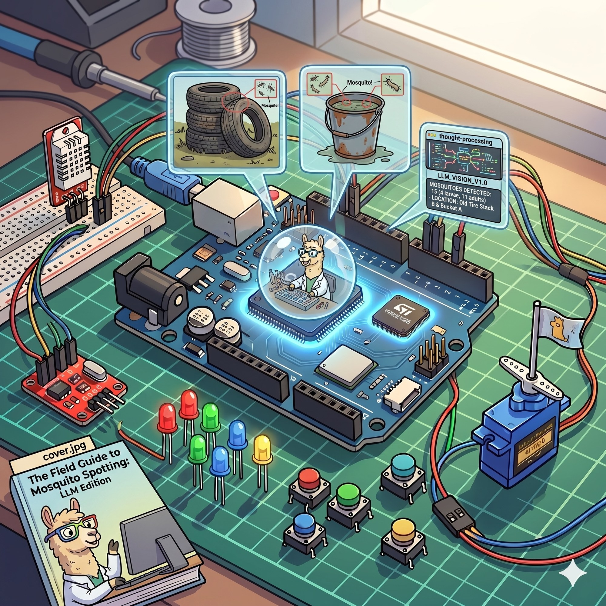

## Overview {#sec-uno-q-vlm-overview-fde7}

The [Small Language Models](../llm/llm.qmd) lab ran a text model on the UNO Q: `llama-cli` and `llama-server` loaded a single GGUF file (`Qwen_Qwen3.5-0.8B-Q8_0.gguf`), Python called it, and every answer came from the board, with no cloud call.

Text is an awkward interface for many real problems, though. Consider a mosquito breeding-site inspection: what matters is *visual*, such as water sitting in an old tire, a plant saucer that never drains, or a bucket left open after the rain. A health agent walking through a neighborhood does not type numbers into a form; they look.

This lab gives the same board eyes. By the end, the UNO Q looks at a photo (or a frame from a webcam) and answers a question like **"Is this a potential mosquito breeding site, and why?"**, and the lab shows exactly what it costs to run that on four small CPU cores.

\noindent
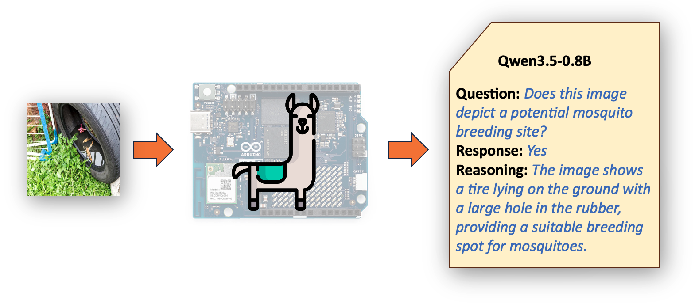{width=85% fig-align="center"}

The costs get as much attention as the results. Vision on this hardware works, but it is slow, and the slowness reveals something real about how these models work.

### Prerequisites {#sec-uno-q-vlm-prerequisites-3dde}

This lab builds on the [Small Language Models](../llm/llm.qmd) lab. It assumes that llama.cpp is already built from source, that the Qwen3.5-0.8B GGUF is downloaded, and that you are comfortable running `llama-server` by hand and calling it from Python.

## Giving a Small Model Eyes: The Projector {#sec-uno-q-vlm-giving-small-model-eyes-projector-9216}

A text-only Qwen runs from a single GGUF file. To make it describe an image, add one more file, the `mmproj`, and the same model can suddenly talk about a photo. That second file holds the vision machinery, and what is inside it explains both how the model "sees" and why some of the serving flags matter.

### One Model Trained to See {#sec-uno-q-vlm-one-model-trained-see-b4ab}

Qwen3.5 is not a text model with vision bolted on. Qwen describes it as a **unified vision-language foundation**: the model was trained on text and image tokens together from the start, an approach called **early fusion**. That matters because the older mental model (a frozen language model with a separately trained adapter attached to a frozen image encoder) is the LLaVA or Moondream recipe, and this model was not built that way. Its vision and language sides were trained together.

> This is also why Qwen3.5 beats the earlier Qwen3-VL models on visual benchmarks rather than inheriting from them: it is a different family.

At inference, there is still a clear pipeline, and llama.cpp makes it visible by splitting the weights across two files. The `-m` file holds the language model. The `mmproj` file holds the vision encoder and the small connector that links it to the language side. The split is a packaging convenience, not a sign that the base is text-only: the model runs without the `mmproj` to skip the vision pathway and save memory, as in the SLM lab.

```text
image -> vision encoder -> projector / connector -> language model -> text
         |------------ mmproj GGUF ------------|   |-- -m GGUF --|
            (inference path; weights split across two files)
```

### What Happens to the Image at Inference {#sec-uno-q-vlm-happens-image-inference-9573}

\noindent
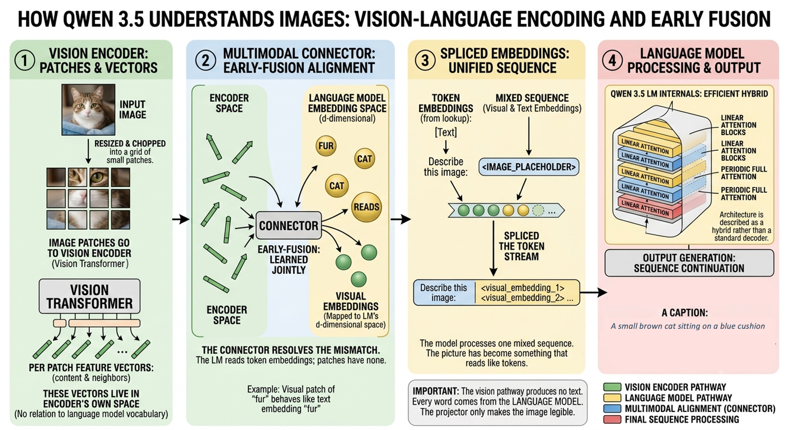{width=90% fig-align="center"}

1. **Vision encoder.** The image is resized and cut into a grid of small patches. The patches go into the vision encoder, a Vision Transformer (ViT), which returns one feature vector per patch, describing what is in that region and how it relates to its neighbors. These vectors live in the encoder's own space and have nothing to do with the language model's vocabulary or embedding dimensions.

2. **Multimodal connector (early fusion).** The connector resolves that mismatch. The language model reads token embeddings in its own d-dimensional space. Text gets there through a lookup table, but image patches have no such table. The connector reshapes the visual vectors to the model's embedding dimension and places them in the region of that space the model already understands, so that a patch of fur in the image behaves the way the text embedding for "fur" would. In an early-fusion model, this alignment is learned jointly with the rest of the network rather than trained afterward as an add-on.

3. **Spliced embeddings (input stream).** Once mapped, the visual vectors are spliced into the token stream where an image placeholder sits, and the model processes one mixed sequence of text and image embeddings. From the model's point of view, there is no special "image mode": the picture has become something that reads like tokens.

4. **Language model.** Internally, Qwen3.5 is not a vanilla transformer. It is an efficient hybrid of linear-attention blocks, with full attention only on periodic layers. Sparse mixture-of-experts appears in the Qwen3.5 family highlights, but the 0.8B's own specification lists a plain feed-forward network (intermediate dimension 3584) with no experts and no router. That detail does not change the picture here, but it is why the architecture is described as a hybrid rather than a standard decoder.

That is why "describe this image" produces a caption: the model continues the sequence conditioned on the visual embeddings it can read.

> The vision pathway produces no text. It emits embeddings and nothing else. Every word in the answer comes from the language model; the projector's only job is to make the image *legible*.

### The Context Window {#sec-uno-q-vlm-context-window-e196}

Each image becomes a real block of embeddings that occupies a specific stretch of the context window: not one token, but many. A single image alone takes hundreds to low thousands of tokens. Qwen3.5 uses dynamic resolution, so a larger or busier image produces more visual tokens. The `--image-min-tokens` and `--image-max-tokens` flags cap that number (they apply only to dynamic-resolution models, which is why they matter here), and @sec-uno-q-vlm-speed-levers-order-payoff-e6f4 returns to them.

The immediate consequence is that the `-c 1024` context used for text overflows before a prompt is even added. Use `4096`.

## Loading the Model and Its Projector {#sec-uno-q-vlm-loading-model-projector-e4e1}

If `llama-server` is still running from the SLM lab, stop it first (`Ctrl+C` in its terminal). It holds port 8081 and some RAM, and this lab needs both.

```bash
# Confirm the port is free
sudo ss -ltnp | grep 8081      # should print nothing
free -h
```

Vision needs two files: the model and its `mmproj`. One warning can save an afternoon: the two must come from the *same* model, because their embedding dimensions must match. Pair a projector with the wrong base model, and the load fails outright with an `n_embd` mismatch. The base model is already on the board: the same 0.8B GGUF used for text works here, with the vision pathway switched on or off depending on whether `--mmproj` is passed. There is no separate "text-only" and "VL" download to keep track of, just the model plus its matching projector.

The [Unsloth Qwen3.5-0.8B page on Hugging Face](https://huggingface.co/unsloth/Qwen3.5-0.8B-GGUF/tree/main), for example, lists all the available files and versions:

\noindent
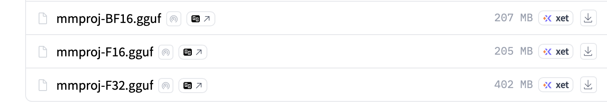{width=85% fig-align="center"}

The SLM lab downloaded the model from Bartowski, so download the matching projector from the same repository. Saving it as `mmproj-F16_0.8B.gguf` keeps it apart from the 2B projector downloaded later:

```bash
cd ~/models
wget -c -O mmproj-F16_0.8B.gguf \
  "https://huggingface.co/bartowski/Qwen_Qwen3.5-0.8B-GGUF/\
resolve/main/mmproj-Qwen_Qwen3.5-0.8B-f16.gguf"
```

> If the model came from [Unsloth](https://huggingface.co/unsloth/Qwen3.5-0.8B-GGUF/tree/main) instead, download its projector (`mmproj-F16.gguf`) from that repository and save it under the same name.

### The Projector's Format {#sec-uno-q-vlm-projectors-format-8b85}

The `mmproj` usually comes in BF16, F16, and F32 versions. On the UNO Q, prefer F16. The board's Cortex-A53 cores have no native BF16 path, so BF16 weights are converted on the fly, which wastes memory bandwidth the board cannot spare.

> Switching the 0.8B's projector from BF16 to F16 cut the description time for a 640×640 image from 4 minutes to about 1 minute: same model, same image, just a friendlier weight format.

## Running the Vision Server {#sec-uno-q-vlm-running-vision-server-60df}

This is the command for the 0.8B model. Run it in the foreground the first time to read the startup log:

```bash
cd ~/llama.cpp

./build/bin/llama-server \
  -m       /home/arduino/models/Qwen_Qwen3.5-0.8B-Q8_0.gguf \
  --mmproj /home/arduino/models/mmproj-F16_0.8B.gguf \
  --host 0.0.0.0 --port 8081 \
  -c 4096 -t 4 \
  -n 256 \
  --jinja \
  --image-max-tokens 256 \
  --reasoning off \
  --reasoning-budget 0 \
  --alias qwen3.5-0.8b
```

Four flags deserve a comment:

- **`--host 0.0.0.0`** makes the WebUI reachable from a desktop or phone, not only from the board itself. Without it, the server binds to localhost, and a laptop cannot see it.
- **`--jinja`** turns on the model's own chat template. Without it, generation can fail to stop, because the generic fallback template does not register Qwen's end-of-turn token as a stop string, and the model keeps going until it fills the context. In the first test without `--jinja`, the endless generation looked exactly like a frozen board.
- **`-n 256`** caps the output length as a safety net. @sec-uno-q-vlm-reasoning-mode-token-budget-5486 revisits it, because it interacts with the thinking trace in a surprising way.
- **`--alias qwen3.5-0.8b`** gives the server a stable name that does not depend on the GGUF filename or on which model is loaded. Client code can always ask for `"model": "qwen3.5-0.8b"`, which keeps the model-swapping pattern in @sec-uno-q-vlm-swapping-models-08b-speed-2b-depth-2c6e simple.

On startup, look for a `clip` / `mtmd` block confirming that the projector loaded, a line reporting that image support is enabled, and `HTTP server listening` on `0.0.0.0:8081`.

\noindent
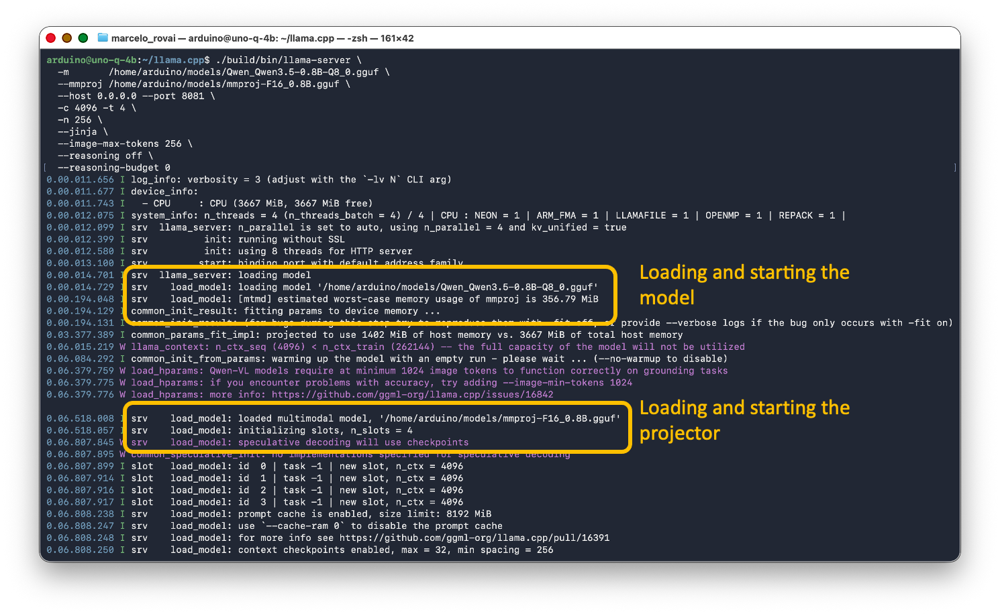{width=85% fig-align="center"}

If a request later returns "image processing requires a vision model," the `mmproj` did not load. Check that `--mmproj` was passed and that the file path is correct.

Then open `http://<UNO_Q_IP>:8081/` on a desktop or phone and drop in an image.

> **Use images no larger than 640×640.**

\noindent
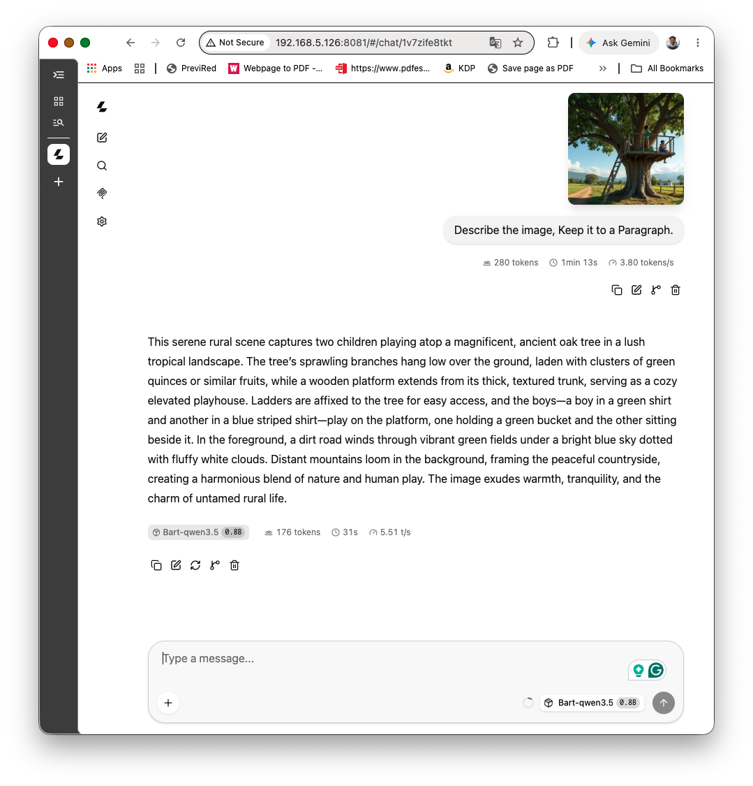{width=85% fig-align="center"}

> The whole request took about a minute and a half, which is good for such a small model. Power peaked at 2.3 W during this request, and the temperature rose by about 20 °C (to 56 °C).

### What the Small Model Gets Right and Wrong {#sec-uno-q-vlm-small-model-gets-right-wrong-bd28}

On this generated scene, the 0.8B's description of the whole scene was good. It named the platform, the children, the ladder, the path, the clouds, and the mountains. Then it called the hanging papayas "quinces or similar fruits."

That is the signature of a small VLM: the gist is solid, and the specifics are unreliable. For a breeding-site screen, this matters. The model can reliably say "there is a container with standing water," but it should not be trusted to identify the container as a specific 200-liter drum. Design the question around what the model is actually good at.

## First Contact with the API {#sec-uno-q-vlm-first-contact-api-8cce}

The embedded WebUI is the quickest smoke test, but repeatable work needs the API. The server speaks the OpenAI-compatible format, so the image goes as a base64 data URI inside an `image_url` content block.

Create a directory for test images and copy a few images there, for example:

`/home/arduino/ArduinoApps/images/test-papaya.png`

> **A trap to avoid:** do not paste the base64 string directly into a `curl -d '...'` argument. A base64 image is large enough to exceed the shell's argument-size limit, and `curl` fails with `Argument list too long` before the request is sent. Write the body to a file (or pipe it on stdin) so that it never goes through the command line.

With the server running, go to the image directory:

```bash
cd ~/ArduinoApps/images
```

Encode the image:

```bash
IMG=$(base64 -w 0 test-papaya.png)
```

Then ask the model to describe it:

```bash
cat > /tmp/req.json <<EOF
{
  "max_tokens": 256,
  "messages": [{
    "role": "user",
    "content": [
      {"type": "image_url",
       "image_url": {"url": "data:image/png;base64,$IMG"}},
      {"type": "text", "text": "Describe this image."}
    ]
  }]
}
EOF

curl -s http://127.0.0.1:8081/v1/chat/completions \
  -H "Content-Type: application/json" \
  --data @/tmp/req.json
```

> Match the media type to the file (`image/png` for a `.png`, `image/jpeg` for a `.jpg`). A single-model `llama-server` ignores the `model` field, so it can be left out.

\noindent
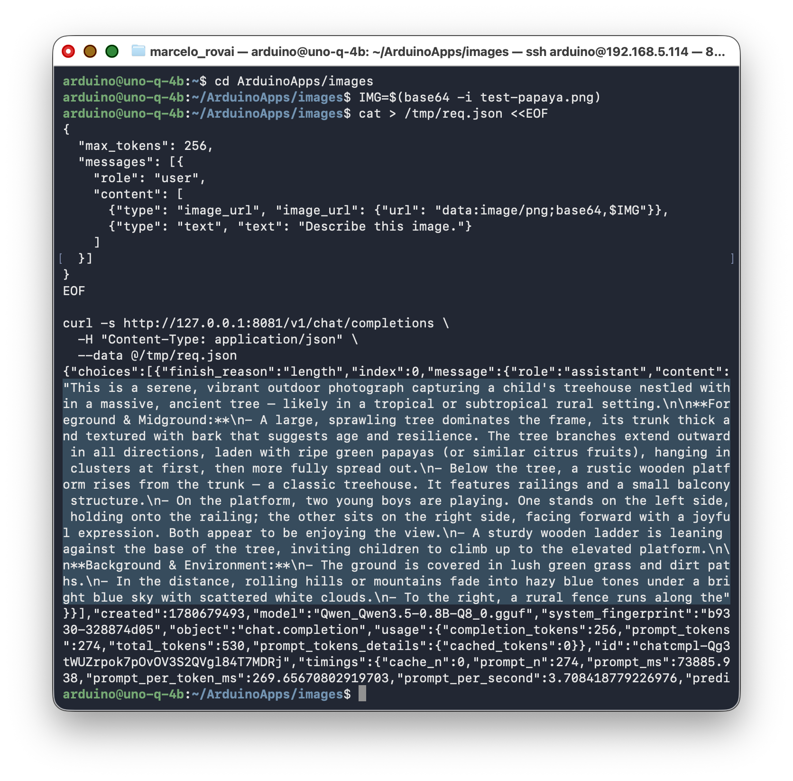{width=85% fig-align="center"}

It works. For real work, though, Python is cleaner, and it avoids the argument-length trap entirely by putting the image in the request body rather than on the command line.

Create a Python script in the terminal (App Lab or VS Code also work):

```bash
cd ~/ArduinoApps
nano image_caption.py
```

Enter the script, then save it with `Ctrl+X` and `y`:

```python
import base64
import mimetypes
import requests

SERVER = "http://127.0.0.1:8081/v1/chat/completions"


def encode_image(path):
    with open(path, "rb") as f:
        return base64.b64encode(f.read()).decode("utf-8")


def describe_image(
    path,
    prompt="Describe this image. Keep it to a paragraph.",
    max_tokens=256,
):
    mime = mimetypes.guess_type(path)[0] or "image/jpeg"
    data_uri = f"data:{mime};base64,{encode_image(path)}"
    payload = {
        "messages": [{
            "role": "user",
            "content": [
                {"type": "image_url", "image_url": {"url": data_uri}},
                {"type": "text", "text": prompt},
            ],
        }],
        "temperature": 0.7,
        "max_tokens": max_tokens,
    }
    r = requests.post(SERVER, json=payload, timeout=300)
    r.raise_for_status()
    return r.json()["choices"][0]["message"]["content"]


if __name__ == "__main__":
    print(describe_image("images/test-papaya.png"))
```

> Note the `timeout=300`. On this board, a vision request can take 1 to 2 minutes, and a default request timeout would give up long before the model does.

Now try an image from the dataset used later in this lab (@sec-uno-q-vlm-vistextmosquito-ebd0). Change the path in the script to point at it:

\noindent
{width=50% fig-align="center"}

Run the script:

```bash
python3 image_caption.py
```

\noindent
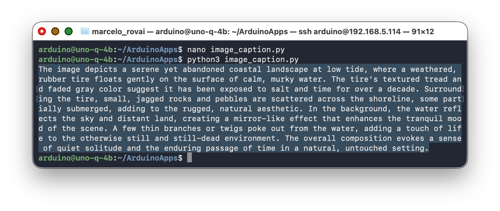{width=85% fig-align="center"}

## When It "Never Stops," and Other CPU Realities {#sec-uno-q-vlm-never-stops-other-cpu-realities-2884}

The tests surfaced a few lessons:

**Symptom one: it runs forever.** The fix is `--jinja` plus the `-n` cap. If both are set and generation still runs away, the WebUI's own "max tokens" setting is overriding the server's `-n`; lower it in the sampler panel too.

**Symptom two: it freezes at 2%.** A tall two-panel collage uploaded at full resolution left the progress bar parked at 2% with an ETA of 113 seconds. Ten minutes later it was still at 2%. The natural suspicion was memory, with swap thrashing as the model spilled past 4 GB, but `free -h` showed swap at zero. The board was not out of memory; it was out of time. A large, busy image makes the dynamic-resolution encoder produce many patches, and the ViT must process every one of them on four CPU cores. The encoder was not stuck; it was facing tens of minutes of computation.

The lesson is clear: on this board, **vision is compute-bound by image size, not memory-bound at reasonable sizes.** Resolution is the single biggest lever available.

**Reading `free -h` correctly.** Checking memory in the middle of a 2B description showed this:

```text
          total    used    free  shared  buff/cache  available
Mem:      3.6Gi   1.5Gi    83Mi    36Mi       2.2Gi      2.1Gi
Swap:     1.8Gi    20Mi   1.8Gi
```

The `free` column says 83 MiB, which looks alarming but is not. `llama-server` memory-maps the GGUF, so the model weights appear under `buff/cache` (the 2.2 GiB), not under `used`. The number that matters is `available`: 2.1 GiB, with swap almost untouched at 20 MiB. The 2B fits comfortably; it is just slow.

### The Speed Levers, in Order of Payoff {#sec-uno-q-vlm-speed-levers-order-payoff-e6f4}

Once it is clear that the work is compute-bound, the fixes follow. The most direct one targets the encoder's token budget. Because Qwen3.5 uses dynamic resolution, `llama-server` can cap how many tokens an image may become:

```bash
--image-max-tokens 256
```

Encoding time scales with that count, so capping it directly reduces the work, and the model often describes a scene well with far fewer image tokens than the default. Start at 256 and tune.

After that:

- **Downscale the input** to about 448 to 512 pixels, which complements the token cap.
- **Keep the output short**, since every generated token costs real time on this CPU.
- **Rebuild llama.cpp with OpenBLAS** (`-DGGML_BLAS=ON -DGGML_BLAS_VENDOR=OpenBLAS`) for a one-time gain, since encoding and prefill are dominated by matrix multiplication. Measure before and after, because the gain on Arm varies.

One more setting, unrelated to speed but worth including: for image workloads, drop `--cache-prompt`. In a known issue, each image adds 1,000+ KV tokens to the prompt cache, the cache grows without bound across repeated requests, and the process is eventually killed for running out of memory. The in-slot cache still works within a session, so a single-slot setup loses nothing meaningful by turning it off. On a 4 GB board, that is cheap insurance.

## Which Model: 0.8B or 2B? {#sec-uno-q-vlm-model-08b-2b-7fca}

Both models described the same 640×640 image, so this comparison is measured, not estimated:

+--------------------------------------+-----------------------------+---------------------------+
|                                      | **Qwen3.5-0.8B (Q8_0)**     | **Qwen3.5-2B              |
|                                      |                             | (UD-Q4_K_XL)**            |
+:=====================================+:============================+:==========================+
| Projector (F16)                      | ~205–220 MB                 | 668 MB                    |
+--------------------------------------+-----------------------------+---------------------------+
| Time to first token (image + prompt) | ~66 s                       | ~254 s                    |
+--------------------------------------+-----------------------------+---------------------------+
| Decode speed                         | 5.4 tokens/s                | 2.5 tokens/s              |
+--------------------------------------+-----------------------------+---------------------------+
| Full 256-token description           | ~1.9 min                    | ~6 min                    |
+--------------------------------------+-----------------------------+---------------------------+
| Peak RAM (`llama-server` RSS)        | ~1.4 GB                     | ~2.3 GB, swap ~0          |
+--------------------------------------+-----------------------------+---------------------------+
| Energy per image (total)             | ~240 J                      | ~674 J                    |
+--------------------------------------+-----------------------------+---------------------------+
| Description quality                  | Good gist, shaky specifics  | Noticeably better         |
+--------------------------------------+-----------------------------+---------------------------+

: Qwen3.5 0.8B vs. 2B for vision on the UNO Q. {#tbl-uno-q-vlm-08b-vs-2b}

The timing, RAM, and energy rows were measured in October 2026 with `--image-max-tokens 256`; the next subsection explains how.

The bigger projector is not optional: the 2B needs its own 668 MB projector, because the small one does not match. The file is three times larger because the vision encoder inside it is bigger, which is also why encoding is slower: every patch passes through a heavier tower.

So the 2B is a real trade-off, not a free upgrade. It writes clearer answers and stays within the RAM budget, but four minutes before the first word, and six for a full description, rule out anything interactive. The two models are best treated as two tiers. The 0.8B is the fast screen when an answer is needed in about a minute. The 2B is the quality pass when correctness matters more than latency and the device can take its time. `--image-max-tokens` is the dial between them, and tuning it on the 2B is the most useful experiment to run.

### What a Description Costs: Time and Energy {#sec-uno-q-vlm-description-costs-time-energy-01c6}

To put real numbers on that trade-off, the whole board was measured while it worked. A [FNIRSI FNB58](https://www.fnirsi.com/products/fnb58) USB meter sat between the charger and the UNO Q's USB-C port, logging voltage and current 100 times per second to a computer. On the board, a script started `llama-server` with the same flags as in @sec-uno-q-vlm-running-vision-server-60df, waited for the CPU to cool below 45 °C, recorded 15 seconds of idle, and then sent each request, noting when it was sent, when the first token arrived, and when the answer ended. Aligning the two clocks gives the power in every phase. Each model described two 640×640 images (the bucket and the tire from this lab) twice, after an uncounted warm-up request. The board used Wi-Fi only, with no display and nothing on its USB port except the meter; a Modulino Thermo and an idle expansion carrier were attached and are part of the idle power.

The same session also ran text-only prompts on both models (the [SLM lab](../llm/llm.qmd#sec-uno-q-slm-token-costs-energy-92e7) reports those numbers), so the whole test run fits in one picture:

\noindent
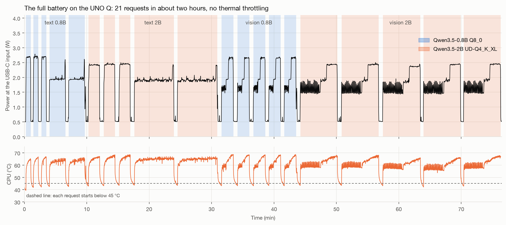{width=95% fig-align="center"}

Two things stand out before looking at any single request. Across the whole run, with both models and including brief spikes, the board never draws more than about 3.5 W, and it idles at only 0.5 W. Single requests peak lower: about 2.3 W for the 0.8B in the WebUI test above, and a mean of 2.4 to 2.7 W while answering (@tbl-uno-q-vlm-08b-vs-2b). And the CPU peaked at 68.7 °C with no heatsink or fan, while the clock stayed at 2.0 GHz on every core for the whole run: no thermal throttling, even during six-minute requests.

Zooming in on one description per model shows where the time and energy go:

\noindent
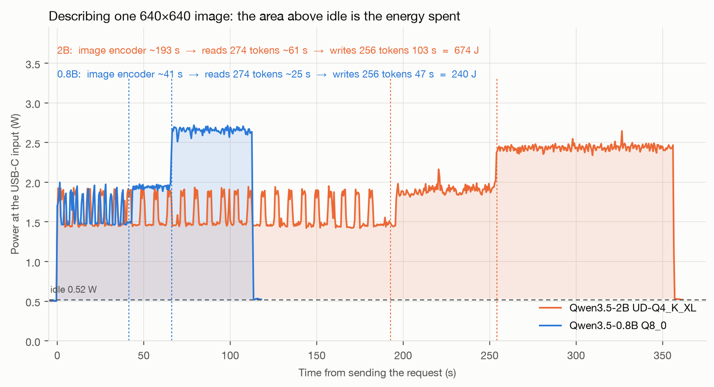{width=90% fig-align="center"}

Each request has three phases, visible in the power line:

1. **The image encoder** (spiky line, about 1.5 to 1.9 W). The vision tower in the projector turns the picture into 256 image tokens. The power jumps up and down because the encoder does not keep all four cores busy. `llama-server` does not report this phase separately, so its length is estimated as the time to first token minus the time the language model needs to read the same number of tokens as text. That puts it at about 41 s on the 0.8B and about 193 s on the 2B, the heavier tower described above.
2. **The language model reads the prompt** (flat line, about 1.9 W). The 274 tokens (256 from the image, the rest from the text and the chat template) pass through the model in batches: about 25 s on the 0.8B and 61 s on the 2B.
3. **The answer** (flat line, about 2.4 to 2.7 W). One token at a time: 47 s for 256 tokens on the 0.8B and 103 s on the 2B.

Writing is the phase with the highest power, but not the most expensive one. The energy per request, split into reading and writing:

\noindent
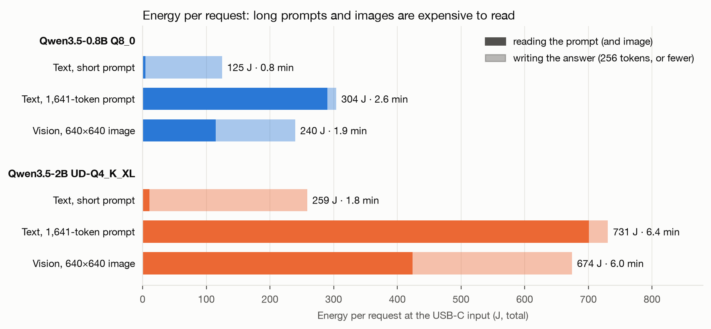{width=85% fig-align="center"}

+--------------------------------------+--------------------------+--------------------------+
| **Per Image, Averaged over 4 Runs**  | **Qwen3.5-0.8B**         | **Qwen3.5-2B**           |
+:=====================================+:=========================+:=========================+
| Image + prompt (time to first token) | 66 s, 115 J              | 254 s, 424 J             |
+--------------------------------------+--------------------------+--------------------------+
| Answer (256 tokens)                  | 47 s, 125 J              | 103 s, 250 J             |
+--------------------------------------+--------------------------+--------------------------+
| Whole request                        | **~1.9 min, 240 J**      | **~6 min, 674 J**        |
+--------------------------------------+--------------------------+--------------------------+
| Mean power while answering           | 2.7 W                    | 2.4 W                    |
+--------------------------------------+--------------------------+--------------------------+
| Energy per generated token           | 0.49 J                   | 0.98 J                   |
+--------------------------------------+--------------------------+--------------------------+

: Time and energy per image description on the UNO Q. {#tbl-uno-q-vlm-energy}

The four runs of each case agreed within 1%. The numbers show three things:

- **Reading the image is half the bill.** On the 0.8B, reaching the first word costs about as much as writing 256 tokens; on the 2B, it costs more. Shorter answers save less than expected, while fewer image tokens (`--image-max-tokens`) or a smaller input image save more.
- **The 2B costs about 2.8 times the energy per image**, while drawing slightly *less* power. It is not hungrier, just slower: four cores working for six minutes instead of two.
- **In battery terms**, a 10 Wh power bank holds 36,000 J, enough for about 150 descriptions with the 0.8B, or about 50 with the 2B, if the board did nothing else. Between requests, the 0.5 W idle power adds up too: about 30 J per minute of waiting.

> The total in the table includes the board's idle power. Subtracting idle (0.5 W) gives the extra energy the inference itself costs: about 180 J per image on the 0.8B and about 490 J on the 2B.

## Swapping Models: 0.8B for Speed, 2B for Depth {#sec-uno-q-vlm-swapping-models-08b-speed-2b-depth-2c6e}

The previous section established the trade-off. In practice, the right approach is not to pick one model and keep it, but to swap. A camera pointed at a yard all day sees mostly frames that are obviously nothing: dry ground, a wall, a parked car. A handful are ambiguous and deserve a second, slower opinion. The natural pattern is a fast **screen** on the 0.8B and a slower **deep read** on the 2B, only for the frames that need it. The board cannot comfortably run both at once (see the RAM numbers in @tbl-uno-q-vlm-08b-vs-2b), so "swap" here means *one server at a time on the same port*, not two processes in parallel.

### Get the 2B Model and Its Projector {#sec-uno-q-vlm-get-2b-model-projector-a614}

Use the same models directory as before. The 2B model may already be there from the SLM lab:

```bash
cd /home/arduino/models

# 2B language model: UD-Q4_K_XL, the quality/size sweet spot
wget -c https://huggingface.co/unsloth/Qwen3.5-2B-GGUF/\
resolve/main/Qwen3.5-2B-UD-Q4_K_XL.gguf

# Its matching projector. Do NOT reuse the 0.8B's mmproj
# (n_embd mismatch).
wget -c https://huggingface.co/unsloth/Qwen3.5-2B-GGUF/\
resolve/main/mmproj-F16.gguf -O mmproj-F16_2B.gguf
```

### Two Startup Scripts {#sec-uno-q-vlm-two-startup-scripts-33cf}

Wrap each model's launch command in its own script, so that switching takes one command instead of retyping the flags:

```bash
nano ~/run-qwen-0.8b-vision.sh
```

```bash
#!/usr/bin/env bash
set -e
exec /home/arduino/llama.cpp/build/bin/llama-server \
  -m       /home/arduino/models/Qwen_Qwen3.5-0.8B-Q8_0.gguf \
  --mmproj /home/arduino/models/mmproj-F16_0.8B.gguf \
  --host 0.0.0.0 --port 8081 \
  -c 4096 -t 4 \
  -n 256 \
  --jinja \
  --image-max-tokens 256 \
  --reasoning off \
  --reasoning-budget 0 \
  --alias qwen3.5-0.8b
```

```bash
nano ~/run-qwen-2b-vision.sh
```

```bash
#!/usr/bin/env bash
set -e
exec /home/arduino/llama.cpp/build/bin/llama-server \
  -m       /home/arduino/models/Qwen3.5-2B-UD-Q4_K_XL.gguf \
  --mmproj /home/arduino/models/mmproj-F16_2B.gguf \
  --host 0.0.0.0 --port 8081 \
  -c 4096 -t 4 \
  -n 512 \
  --jinja \
  --image-max-tokens 256 \
  --reasoning off \
  --reasoning-budget 0 \
  --alias qwen3.5-2b
```

```bash
chmod +x ~/run-qwen-0.8b-vision.sh ~/run-qwen-2b-vision.sh
```

The distinct aliases (`qwen3.5-0.8b` and `qwen3.5-2b`) are deliberate. Since only one server runs on port 8081 at a time, the alias echoed back in the response confirms that the swap actually took effect. Client code does not need to hard-code either name: a single-model `llama-server` ignores the `"model"` string in a request, so the Python script from @sec-uno-q-vlm-first-contact-api-8cce works unmodified with either server. Reading the alias back is just a sanity check of which model answered.

### Running One, then the Other {#sec-uno-q-vlm-running-one-other-e4ff}

Stop whichever server is running (`Ctrl+C`), then start one of them:

```bash
~/run-qwen-0.8b-vision.sh     # fast screen, ~1-2 min/image
# ...or...
~/run-qwen-2b-vision.sh       # deep read, ~4-6 min/image
```

To keep the server running after the SSH session disconnects (useful when a request takes several minutes and a dropped connection would kill it), run it inside `tmux`:

```bash
sudo apt install -y tmux
tmux new -s vlm
~/run-qwen-0.8b-vision.sh
# Ctrl+B then D to detach; the server keeps running
```

Reattach later with `tmux attach -t vlm`, and stop the server with `Ctrl+C` inside that session.

### A Rule of Thumb {#sec-uno-q-vlm-rule-thumb-ded2}

Use the smallest model that meets the task. The 0.8B is the right default for anything interactive or run over many frames, such as a live camera loop or a first-pass filter over a folder of field photos. Use the 2B only when a specific case needs its better reasoning and the extra minutes are acceptable: a second opinion on an ambiguous frame, or a final quality pass before a labeled dataset ships. In a real deployment, the natural design is a two-stage pipeline in which the 0.8B screens everything and only the frames it flags as uncertain go to the 2B.

## VisText-Mosquito {#sec-uno-q-vlm-vistextmosquito-ebd0}

\noindent
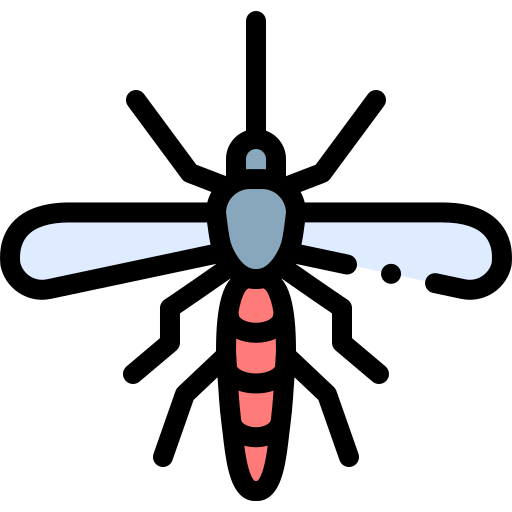{width=30% fig-align="center"}

The images in this section come from [VisText-Mosquito](https://arxiv.org/abs/2506.14629), a multimodal dataset that combines visual and textual data to support automated detection, segmentation, and reasoning about mosquito breeding sites.

The project's fine-tuned **Mosquito-LLaMA3-8B** model achieved the best results, with a final loss of 0.0028, a BLEU score of 54.7, a BERTScore of 0.91, and a ROUGE-L of 0.85. The [dataset](https://data.mendeley.com/datasets/rtsfh7jh7p/3) is publicly available.

The question here is whether the UNO Q running the small **Qwen3.5-0.8B**, without any fine-tuning, can also reason about an image and decide whether it shows a potential mosquito breeding site.

Take one of the dataset's images, with the prompt described in the VisText-Mosquito paper:

\noindent
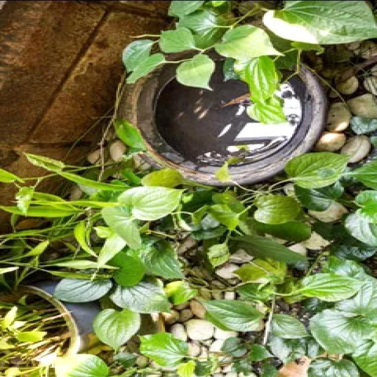{width=50% fig-align="center"}

The prompt:

```text
You are creating a dataset for an image analysis model designed
to identify potential mosquito breeding sites. The dataset will
consist of image-question-answer pairs. For the provided image,
generate a question asking whether it depicts a potential
mosquito breeding site. Then, provide a detailed answer
explaining why or why not. Don't give extra text.

Output format:

Question: [Your generated question]

Response: [Yes/No]

Reasoning(Why): [Your detailed reasoning]
```

Running it in the WebUI gives:

\noindent
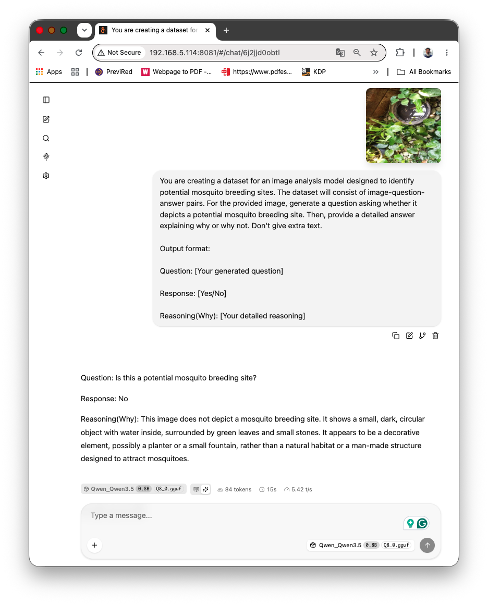{width=80% fig-align="center"}

The model understood the question, grasped the content of the image, and followed the output structure correctly, but its analysis was wrong: the image *is* a potential breeding site.

One possible fix is to turn on the model's reasoning mode and let it think more before answering.

## Reasoning Mode and the Token Budget {#sec-uno-q-vlm-reasoning-mode-token-budget-5486}

To see whether reasoning leads to a better verdict, the server was restarted without `--reasoning off`. The output came back cut off mid-sentence, right before the conclusion, and the token counter read exactly 256.

One thing to know before turning thinking on: Qwen3.5-0.8B's own model card notes that this size is more prone to thinking loops than the larger ones, sometimes failing to stop on its own. The runaway generation from earlier, the "it never stops" problem, was partly this. In thinking mode, the small model genuinely struggles to terminate, which is one of several reasons to keep it in non-thinking mode by default.

The cut-off had a simpler cause, though. With reasoning on, the model writes a long internal `<think>` trace *before* the real answer. The `-n 256` cap was used up by the thinking, so the model never reached the structured output. The fix is to leave room for both, and to remember that the WebUI's max-tokens setting overrides the server flag. This is the new server command, with reasoning left on:

```bash
./build/bin/llama-server \
  -m       /home/arduino/models/Qwen_Qwen3.5-0.8B-Q8_0.gguf \
  --mmproj /home/arduino/models/mmproj-F16_0.8B.gguf \
  --host 0.0.0.0 --port 8081 \
  -c 4096 -t 4 \
  -n 1024 \
  --jinja \
  --image-max-tokens 256 \
  --alias qwen3.5-0.8b
```

The answer took longer:

- 1 min 20 s to start and process the image.
- 1 min for reasoning.
- 20 s to write the answer, at 5.3 tokens/s.

\noindent
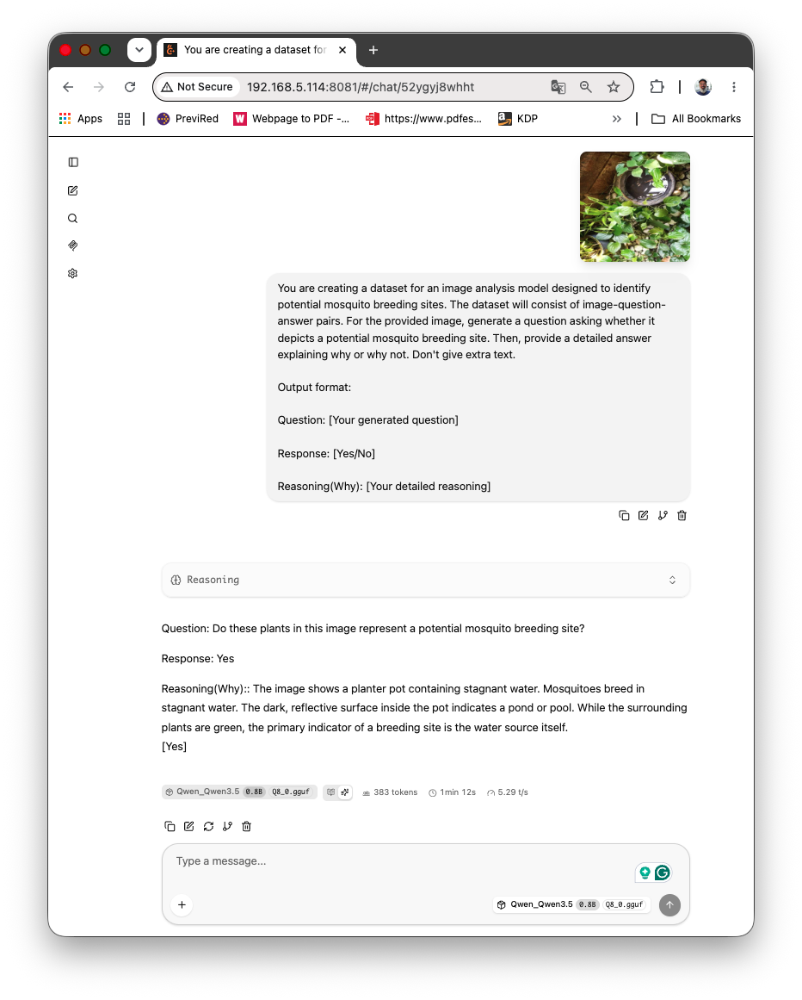{width=80% fig-align="center"}

**This time the answer was correct.**

The WebUI's reasoning tab shows the model's thinking process:

```text
The user wants me to analyze the provided image and generate a
dataset entry for an image analysis model.
The image shows a garden scene with a planter pot sitting on
pebbles.
Inside the pot, there is a dark, reflective surface that looks
like water.
Above the pot, there is green leafy plant.
The surface in the pot is dark and glossy, reflecting light.
The surrounding area has pebbles and other greenery.
The question is: "Do these plants in this image represent a
potential mosquito breeding site?"

Reasoning:
1. **Water Source:** The pot contains water. Mosquitoes breed
   in stagnant water.
2. **Vegetation:** While the leaves are green, they are somewhat
   dry and sparse, not in a dense, lush overgrowth typical of a
   breeding zone (though they can be in a pond).
3. **Texture:** The surface inside the pot is clearly dark,
   reflective, and glossy. This looks like a pond or a pool of
   water.
4. **Context:** A planter pot is a very common container for
   ponds or pools in gardens.
5. **Conclusion:** The presence of a water source in a pot
   strongly suggests a potential breeding site.

So, the output should be:
Question: Do these plants in this image represent a potential
mosquito breeding site?
Response: Yes
Reasoning: [Detailed explanation]
```

During this request, power stayed at or below 3.1 W (with brief peaks), and the temperature rose by 24 °C.

> During idle periods, for example while the server waits for the next question, the board draws less than 500 mW.

Next, an image of an old tire:

\noindent
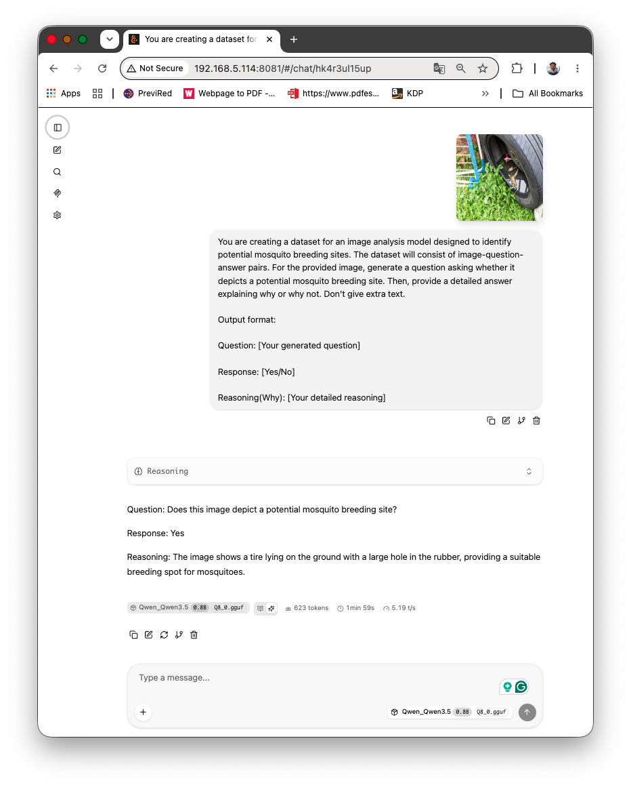{width=80% fig-align="center"}

Again the answer is correct. Even without fine-tuning, these tests are promising.

On the garden photo of a dark ceramic bowl holding still water, with plants growing around the rim, the model gave a clean **Yes** with sound reasoning: "*The image shows a planter pot containing stagnant water. Mosquitoes breed in stagnant water. The dark, reflective surface inside the pot indicates a pond or pool. While the surrounding plants are green, the primary indicator of a breeding site is the water source itself*".

On the abandoned tire in the garden, it answered: "*The image shows a tire lying on the ground with a large hole in the rubber, providing a suitable breeding spot for mosquitoes*."

Both are usable labeled rows.

A real comparison with the VisText-Mosquito results would need many more images. Running the model over a folder of field photos with an adapted Python helper, and writing each result to disk, gives the start of a real dataset, generated on a device that costs less than the camera that took the photos. For this small experiment, the UNO Q and Qwen3.5-0.8B already show promising results.

Two cautions apply before trusting the labels. The model is sometimes confidently wrong, especially on visual specifics, so a human should spot-check (curate) the set before it trains anything that matters. And keep `max_tokens` generous here, since the structured answer plus any reasoning is longer than a one-line caption.

## Going Further {#sec-uno-q-vlm-going-further-72b4}

The classifier can now see. Four directions each turn this experiment into something closer to a deployment.

### Feed It a Live Camera {#sec-uno-q-vlm-feed-live-camera-3146}

So far, the lab has worked from files copied into a folder. A field deployment has a camera pointed at a yard instead.

First, shut down the UNO Q:

```bash
sudo halt
```

#### Hardware {#sec-uno-q-vlm-hardware-b140}

+----------------------+--------------------------------------------------+
| **Item**             | **Purpose**                                      |
+:=====================+:=================================================+
| Arduino UNO Q (4 GB) | Edge AI inference and MCU actuation              |
+----------------------+--------------------------------------------------+
| USB webcam           | Image capture                                    |
+----------------------+--------------------------------------------------+
| USB hub with PD      | Connects the webcam and power to the single      |
|                      | USB-C port                                       |
+----------------------+--------------------------------------------------+

Connect the parts in this order:

1. Connect the hub to the power supply.
2. Connect the webcam to the hub.
3. Connect the UNO Q to the hub.

\noindent
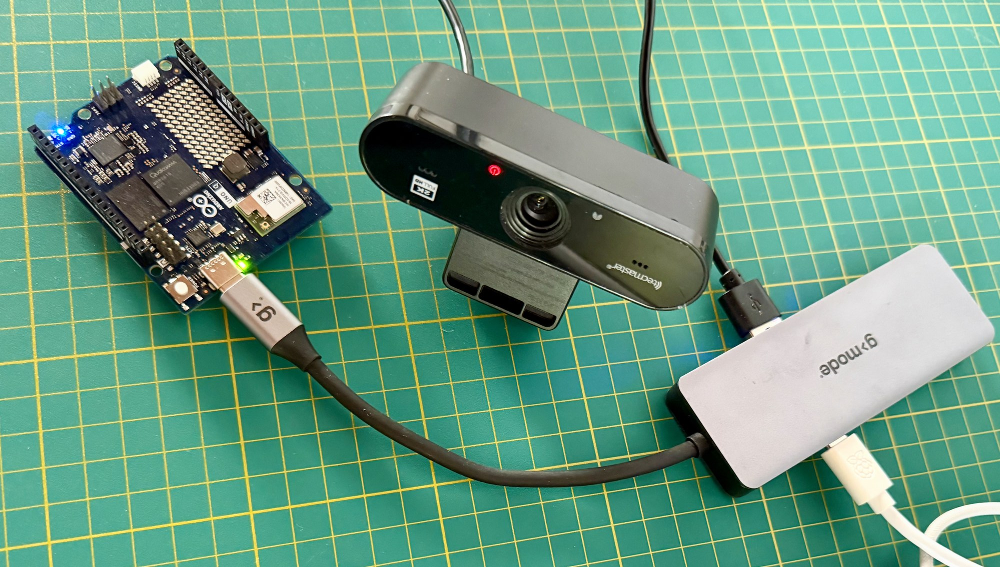{width=70% fig-align="center"}

Once the board is back up, SSH in as usual. Nothing starts automatically, so `llama-server` must be started by hand again.

The change from the earlier sections is small: grab a frame, save it to disk at a reasonable resolution, and pass its path to the same `describe_image()` function. Start by capturing a frame:

```bash
sudo apt install -y fswebcam
fswebcam -r 640x480 --skip 20 --no-banner \
  /home/arduino/ArduinoApps/images/frame.jpg
```

The `--skip 20` option discards the first 20 frames, giving the camera time to adjust its exposure.

Keep the capture small (here, `640x480`, near the 512-pixel guideline). A 1080p frame from a cheap webcam gives the encoder a few thousand patches, and the 2% progress bar is back. Downscale at capture time, not afterward: that is the lesson of @sec-uno-q-vlm-never-stops-other-cpu-realities-2884, applied at the source.

This is a frame captured on a desk:

\noindent
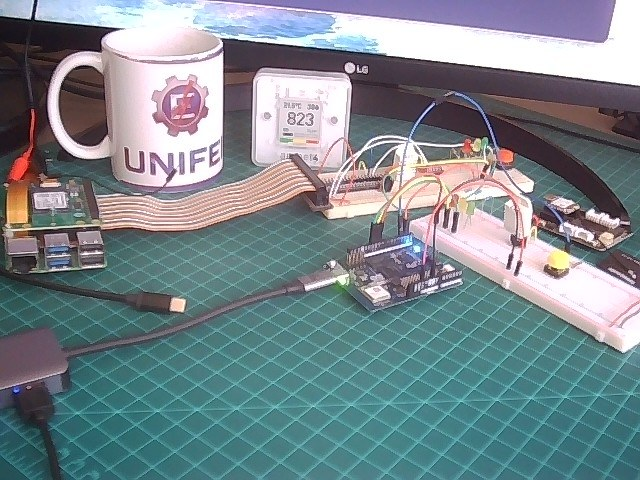{width=60% fig-align="center"}

A simple description prompt runs faster without reasoning. Start the server and open the WebUI:

```bash
cd ~/llama.cpp
./build/bin/llama-server \
  -m       /home/arduino/models/Qwen_Qwen3.5-0.8B-Q8_0.gguf \
  --mmproj /home/arduino/models/mmproj-F16_0.8B.gguf \
  --host 0.0.0.0 --port 8081 \
  -c 4096 -t 4 \
  -n 256 \
  --jinja \
  --image-max-tokens 256 \
  --reasoning off \
  --reasoning-budget 0 \
  --alias qwen3.5-0.8b
```

\noindent
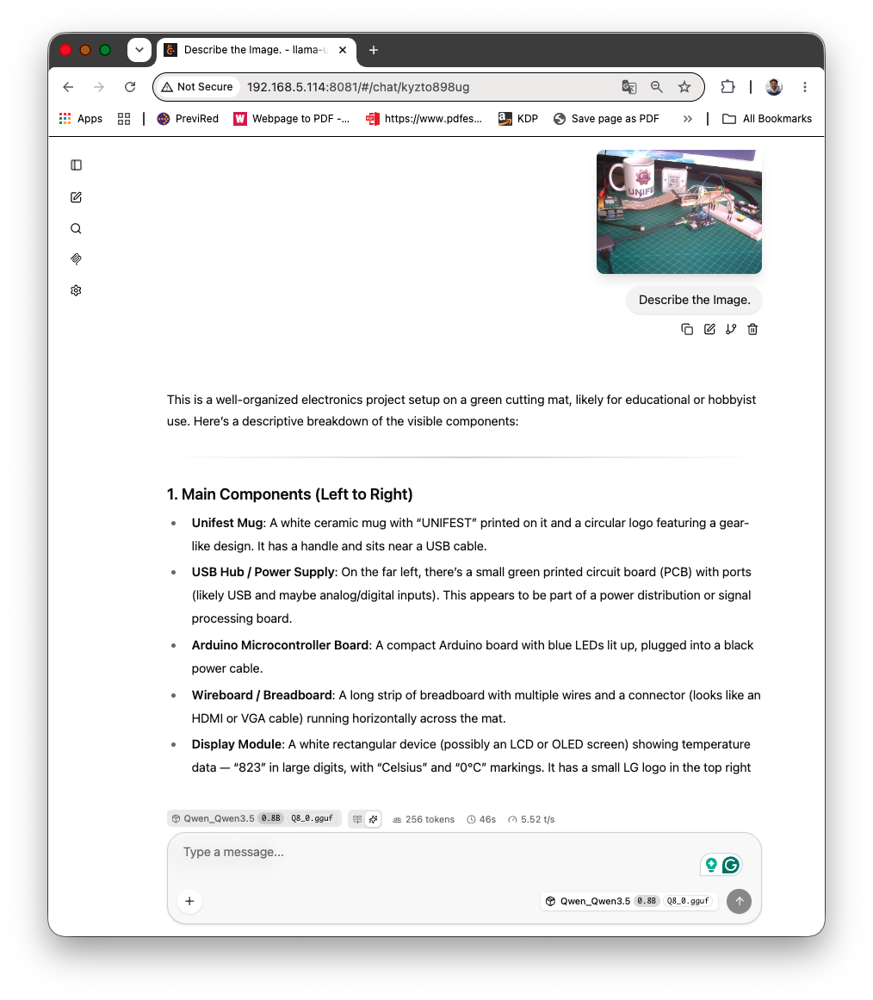{width=85% fig-align="center"}

The description is good: the model captured all the main components of the image.

Now stop the server, restart it with reasoning on, and enter the VisText-Mosquito prompt as before:

```bash
./build/bin/llama-server \
  -m       /home/arduino/models/Qwen_Qwen3.5-0.8B-Q8_0.gguf \
  --mmproj /home/arduino/models/mmproj-F16_0.8B.gguf \
  --host 0.0.0.0 --port 8081 \
  -c 4096 -t 4 \
  -n 1024 \
  --jinja \
  --image-max-tokens 256 \
  --alias qwen3.5-0.8b
```

\noindent
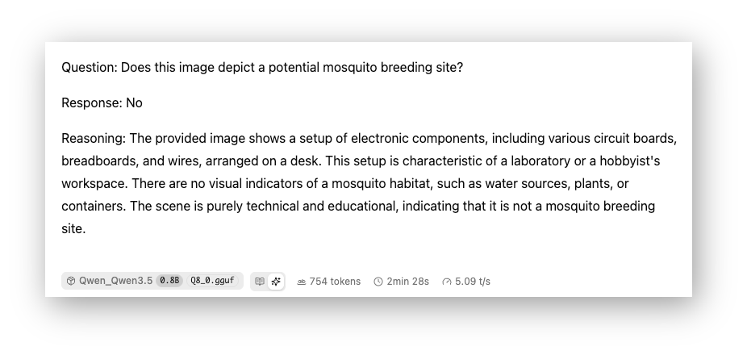{width=80% fig-align="center"}

It works, and the desk is correctly judged not to be a mosquito breeding site.

Next, adapt the earlier `image_caption.py` script to use the VisText-Mosquito prompt on `frame.jpg`:

```python
import base64
import mimetypes
import requests

SERVER = "http://127.0.0.1:8081/v1/chat/completions"

PROMPT = """
You are creating a dataset for an image analysis model designed to
identify potential mosquito breeding sites. The dataset will consist
of image-question-answer pairs.

For the provided image:
1. Generate a question asking whether it depicts a potential
   mosquito breeding site
2. Provide a detailed answer explaining why or why not

Output ONLY in this exact format (no extra text, no explanations):

Question: Does this image depict a potential mosquito breeding site?

Response: [Yes/No]

Reasoning(Why): [Your detailed reasoning here]
"""


def encode_image(path):
    with open(path, "rb") as f:
        return base64.b64encode(f.read()).decode("utf-8")


def describe_image(path, prompt=PROMPT, max_tokens=1024):
    mime = mimetypes.guess_type(path)[0] or "image/jpeg"
    data_uri = f"data:{mime};base64,{encode_image(path)}"
    payload = {
        "messages": [{
            "role": "user",
            "content": [
                {"type": "image_url", "image_url": {"url": data_uri}},
                {"type": "text", "text": prompt},
            ],
        }],
        "temperature": 0.3,
        "max_tokens": max_tokens,
    }
    r = requests.post(SERVER, json=payload, timeout=300)
    r.raise_for_status()

    msg = r.json()["choices"][0]["message"]

    # With reasoning on, the thinking trace is in reasoning_content
    # and the final answer in content.
    reasoning = msg.get("reasoning_content", "")
    content = msg.get("content", "")

    # Prefer the final answer; fall back to the reasoning if the
    # answer is empty (for example, when max_tokens ran out).
    return content if content.strip() else reasoning


if __name__ == "__main__":
    print(describe_image("images/frame.jpg"))
```

The result:

\noindent
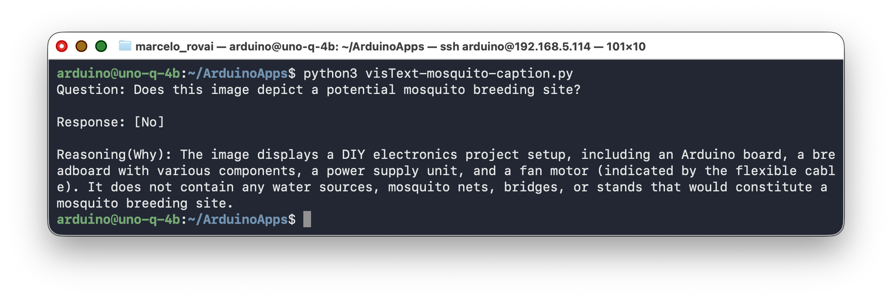{width=85% fig-align="center"}

### Build a Labeled Dataset, One Frame at a Time {#sec-uno-q-vlm-build-labeled-dataset-one-frame-time-6e58}

@sec-uno-q-vlm-reasoning-mode-token-budget-5486 showed the board producing a clean Question/Response/Reasoning row from a single image. Point the same code at a folder of field photos instead of one file, append each verdict to a JSONL file, and the result is the start of a labeled dataset, generated offline and overnight on a device that costs less than the camera that took the photos:

```python
import glob
import json

with open("labels.jsonl", "w") as out:
    for path in sorted(glob.glob("images/field/*.jpg")):
        verdict = describe_image(path, prompt=PROMPT, max_tokens=1024)
        out.write(json.dumps({"image": path, "verdict": verdict}) + "\n")
        print(f"done: {path}")
```

The catch is the recurring one: the model is confidently wrong often enough that the labels cannot ship unread. Treat the output as a first draft for a human to curate, not as ground truth. Even so, pre-labeling beats labeling from scratch: the reviewer corrects instead of authoring, which removes most of the cost.

### Zero-Shot Now, Fine-Tuned Later {#sec-uno-q-vlm-zeroshot-now-finetuned-later-9314}

What this lab built is zero-shot: a general model reasoning about a task it was never trained for. The VisText-Mosquito authors went the other way and fine-tuned Mosquito-LLaMA3-8B on their dataset, reaching a BLEU score of 54.7 and a final loss near 0.003. That is the quality ceiling for this task, well above what an untuned 0.8B reaches.

The two approaches are not rivals. Zero-shot is how to bootstrap the dataset cheaply, and fine-tuning is how to turn that dataset into a specialist. The UNO Q does the first job; training happens on a workstation, and a small fine-tuned model can come back to the board for inference.

### Toward a Dual-Brain Application {#sec-uno-q-vlm-toward-dualbrain-application-e54e}

Everything in this lab ran on the Linux side alone: a camera or a file in, a description and a verdict printed to a terminal. The other half of the UNO Q, the microcontroller, can close the loop. The MCU triggers a capture on a timer or from a motion sensor, the Linux side runs the describe-and-classify step built here, and Bridge RPC sends the verdict back to the sketch, which drives an LED or the LED matrix. The MCU senses, the MPU reasons, and the reasoning can include sight.

## Summary {#sec-uno-q-vlm-summary-bc48}

This lab took the UNO Q from the SLM lab and had it look at photos, or a live camera frame, and judge mosquito habitat, with a clear picture of the cost: about one to two minutes per image on the 0.8B, a couple more with reasoning on, and about six on the 2B, all on four CPU cores with no cloud. It showed why `--jinja` and the context size matter, why a frozen progress bar is usually the encoder doing real work rather than a crash, and how to read `free -h` correctly.

### What Works {#sec-uno-q-vlm-works-3b88}

- **Vision runs on this board.** A small CPU describes a scene and reasons about it offline, which would have been hard to believe a few years ago.
- **The gist is reliable.** "There is a container holding standing water" is the kind of judgment the 0.8B gets right consistently, and it is exactly the judgment a breeding-site screen needs.
- **One model, two modes.** The same weights that answered text prompts in the SLM lab run the vision describer here. The `mmproj` is the only addition, with no separate VL download to manage.

### Limitations and Considerations {#sec-uno-q-vlm-limitations-considerations-674f}

- **It is slow.** One to a few minutes per image rules out anything interactive. This is a batch tool, not a chat.
- **It is confidently wrong on specifics.** The model called papayas "quinces." It can name the wrong container, invent a detail, or occasionally flip a verdict. Trust it for the gist, never for the specifics, and keep a human curating anything that feeds a downstream model.
- **It is compute-bound by image size, not memory-bound.** A too-large image does not crash the board; it just means waiting ten minutes for an answer that could have taken one. Resolution is the lever.
- **Thinking mode cuts both ways.** It fixed the verdict that non-thinking mode got wrong, but the 0.8B struggles to end its own reasoning, so it costs a generous `max_tokens` and the occasional cut-off answer.

### Where This Fits {#sec-uno-q-vlm-fits-f678}

The interesting use here is not real-time vision, which the latency rules out. It is dataset bootstrapping. A cheap board that generates first-draft labels offline turns the expensive part of a supervised pipeline, the labeling, into something a single field device can do overnight. The 0.8B is the fast screen, the 2B is the quality pass when correctness outweighs latency, and `--image-max-tokens` is the dial between them.

The Arduino VENTUNO Q, with 16 GB of RAM and a Dragonwing NPU, changes the math: the 2B becomes interactive instead of a six-minute wait, the 4B's native vision fits with room to spare, and encoding stops being the bottleneck. The patterns here carry over directly (the same `mmproj` split, the same flags, and the same dual-brain wiring); only the timing changes.

## Resources {#sec-uno-q-vlm-resources-8db7}

- [Generative AI at the Edge: Running Small Language Models with Arduino UNO Q and llama.cpp](https://mjrovai.github.io/genai-uno-q/), by Marcelo Rovai, the open book these UNO Q labs are adapted from
- [Project repository](https://github.com/Mjrovai/ARDUINO-UNO-Q/tree/main/3-Multimodal_AI_Edge)
- [llama.cpp repository](https://github.com/ggml-org/llama.cpp)
- [llama.cpp multimodal (mtmd) documentation](https://github.com/ggml-org/llama.cpp/blob/master/docs/multimodal.md)
- [llama.cpp mtmd / libmtmd README](https://github.com/ggml-org/llama.cpp/blob/master/tools/mtmd/README.md)
- [llama.cpp HTTP server documentation](https://github.com/ggml-org/llama.cpp/blob/master/tools/server/README.md)
- [Qwen3.5-0.8B GGUF and mmproj (Unsloth)](https://huggingface.co/unsloth/Qwen3.5-0.8B-GGUF)
- [Qwen3.5-0.8B GGUF and mmproj (Bartowski)](https://huggingface.co/bartowski/Qwen_Qwen3.5-0.8B-GGUF)
- [Unsloth Qwen3.5 inference guide](https://unsloth.ai/docs/models/qwen3.5)
- [ggml-org multimodal GGUF collection](https://huggingface.co/collections/ggml-org/multimodal-ggufs-68244e01ff1f39e5bebeeedc)
- [VisText-Mosquito paper (arXiv:2506.14629)](https://arxiv.org/abs/2506.14629): Islam, M. A., Sayeedi, M. F. A., Shuvo, M. A., Bappy, S. R., Islam, M. A., and Shatabda, S., "VisText-Mosquito: A Unified Multimodal Benchmark Dataset for Visual Detection, Segmentation, and Textual Reasoning on Mosquito Breeding Sites," 2025.
- [VisText-Mosquito dataset (Mendeley)](https://data.mendeley.com/datasets/rtsfh7jh7p/3)
- [VisText-Mosquito code repository](https://github.com/adnanul-islam-jisun/VisText-Mosquito)
- [VLM slide deck](https://github.com/Mjrovai/UNIFEI-IESTI05-EDGE_AI/blob/main/00_Curso_Folder/4-Generative_AI-UNO-Q/3-Multimodal-AI/Ch3-Multimodal-AI-at-the-Edge.pdf) and [video walkthrough](https://youtu.be/6EwdZ_JCP0Q) from the UNIFEI IESTI05 course
