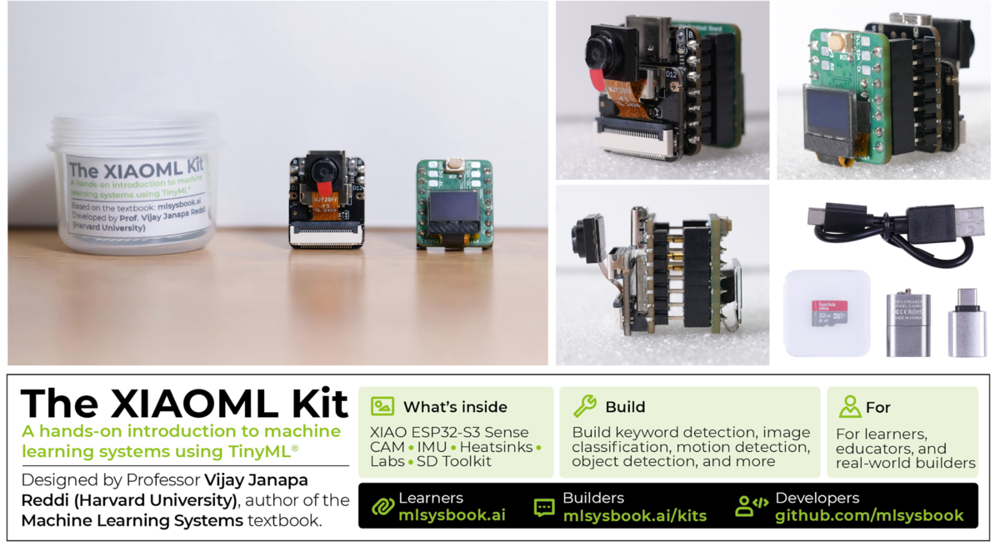
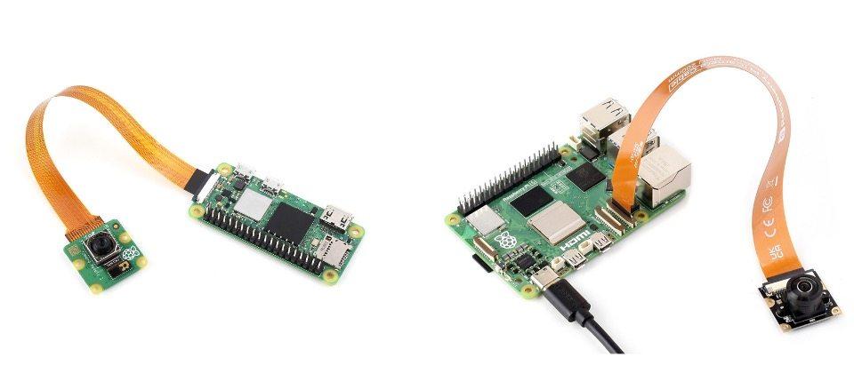

# Hardware Platforms {.unnumbered}

This chapter provides detailed technical specifications for the four hardware platforms used in these laboratories. Each platform represents a different point along the spectrum of embedded computing capabilities, from ultra-low-power microcontrollers to full-featured edge computers.

These platforms were selected because they illustrate distinct engineering trade-offs in power consumption, computational capability, and development complexity. All are widely used in commercial applications, ensuring that skills developed here transfer directly to professional embedded systems work.

## Featured Platform {#sec-hardware-kits-featured-platform-73d8}

{fig-align="center"}

The [XIAOML Kit](https://www.seeedstudio.com/blog/2025/08/05/introducing-the-xiaoml-kit-your-tinyml-journey-starts-here/) was released on July 31, 2025. It is a complete TinyML development environment with wireless connectivity, a camera, several sensors, and extensive documentation, and its compact board shows that a low-cost embedded system can run useful machine learning models.

## Platform Overview {#sec-hardware-kits-hardware-platform-overview-9f77}

The labs use four platforms that range from ultra-low-power microcontrollers to a full Linux computer. Each platform shown in @tbl-platform-selection has been chosen to illustrate specific engineering trade-offs and learning objectives.

+---------------------+----------------------------+----------+-------------------+----------------------------+
| **Platform**        | **Primary Learning Focus** | **Cost** | **Power Profile** | **Best For**               |
+:====================+:===========================+=========:+:==================+:===========================+
| **XIAOML Kit**      | IoT & Wireless ML          | ~$40     | Low Power         | Cost-sensitive deployments |
+---------------------+----------------------------+----------+-------------------+----------------------------+
| **Arduino Nicla**   | Ultra-low Power Design     | ~$95     | Ultra-low         | Battery-powered devices    |
+---------------------+----------------------------+----------+-------------------+----------------------------+
| **Grove Vision AI** | Hardware Acceleration      | ~$25     | Medium            | Industrial applications    |
+---------------------+----------------------------+----------+-------------------+----------------------------+
| **Raspberry Pi**    | Full ML Frameworks         | $60-145  | High              | Advanced edge computing    |
+---------------------+----------------------------+----------+-------------------+----------------------------+

: Platform selection strategy table. {#tbl-platform-selection}

## Platform Comparison {#sec-hardware-kits-platform-comparison-2ad7}

@tbl-platform-comparison compares the four platforms side by side.

+-----------------------+----------------+------------------+-------------------+------------------------+
| **Characteristic**    | **XIAOML Kit** | **Raspberry Pi** | **Arduino Nicla** | **Grove Vision AI V2** |
+:======================+:===============+:=================+:==================+:=======================+
| **Cost Range (USD)**  | ~$40           | $60-145          | ~$95              | ~$25                   |
+-----------------------+----------------+------------------+-------------------+------------------------+
| **Power Consumption** | Low            | High             | Ultra-low         | Medium                 |
+-----------------------+----------------+------------------+-------------------+------------------------+
| **Processing Power**  | Medium         | Very High        | Low               | High (NPU)             |
+-----------------------+----------------+------------------+-------------------+------------------------+
| **Memory Capacity**   | 8MB            | 1-16GB           | 2MB               | 16MB                   |
+-----------------------+----------------+------------------+-------------------+------------------------+
| **Primary Use Case**  | IoT networks   | Edge computing   | Battery devices   | Industrial AI          |
+-----------------------+----------------+------------------+-------------------+------------------------+
| **ML Framework**      | TF Lite        | TensorFlow,      | TensorFlow Lite   | SenseCraft AI          |
|                       |                | PyTorch          |                   |                        |
+-----------------------+----------------+------------------+-------------------+------------------------+
| **Development Env.**  | Arduino/       | Python/Linux     | Arduino IDE       | Visual/Code            |
|                       | PlatformIO     |                  |                   |                        |
+-----------------------+----------------+------------------+-------------------+------------------------+

: Platform comparison matrix. {#tbl-platform-comparison}

## Platform Selection Guidelines {#sec-hardware-kits-platform-selection-guidelines-325e}

The right platform depends on what you want to learn and build. @tbl-platform-capabilities maps each learning objective to the platforms that support it.

+------------------------------------+----------------+------------+-------------------+------------------------+
| **Learning Objective/Application** | **XIAOML Kit** | **Ras Pi** | **Arduino Nicla** | **Grove Vision AI V2** |
+:===================================+:===============+:===========+:==================+:=======================+
| **Embedded Systems Basics**        | ✓              | Limited    | ✓                 | ✓                      |
+------------------------------------+----------------+------------+-------------------+------------------------+
| **Wireless Connectivity**          | ✓              | ✓          |                   | ✓                      |
+------------------------------------+----------------+------------+-------------------+------------------------+
| **Ultra-Low Power Design**         |                |            | ✓                 |                        |
+------------------------------------+----------------+------------+-------------------+------------------------+
| **Full ML Frameworks**             |                | ✓          |                   |                        |
+------------------------------------+----------------+------------+-------------------+------------------------+
| **Hardware Acceleration**          |                |            |                   | ✓                      |
+------------------------------------+----------------+------------+-------------------+------------------------+
| **Real-time Vision**               | Limited        | ✓          | ✓                 | ✓                      |
+------------------------------------+----------------+------------+-------------------+------------------------+
| **Edge-Cloud Integration**         | ✓              | ✓          |                   | ✓                      |
+------------------------------------+----------------+------------+-------------------+------------------------+
| **Production Deployment**          | ✓              |            | ✓                 | ✓                      |
+------------------------------------+----------------+------------+-------------------+------------------------+

: Platform capabilities matrix. {#tbl-platform-capabilities}

## Hardware Platform Specifications {#sec-hardware-kits-hardware-platform-specifications-01ae}

This section provides detailed technical specifications for each platform, including processor architecture, memory hierarchy, sensor capabilities, and development toolchain requirements.

### XIAOML Kit (Seeed Studio) {#sec-hardware-kits-xiaoml-kit-seeed-studio-572a}

::: {.callout-tip title="Best For: IoT & Wireless ML"}
The XIAOML Kit excels at wireless connectivity and cost-sensitive deployments. It suits IoT sensor networks, remote monitoring systems, and wireless ML inference, where a device needs reliable connectivity in a compact, low-cost package.
:::

The XIAOML Kit bundles the XIAO ESP32S3 Sense board with an expansion board, providing a complete TinyML development environment. The XIAO ESP32S3 Sense alone provides camera and microphone capabilities (vision and sound), while the kit's expansion board adds a 6-axis IMU for motion classification. The name "XIAO" (小) translates to "tiny" in Chinese, reflecting the board's $21{\times}17.5$ mm form factor.

{width=400}

**Processor Architecture:**
ESP32-S3 dual-core Xtensa LX7 running at 240MHz

**Memory Hierarchy:**
8MB PSRAM and 8MB Flash storage

**Connectivity:**
WiFi 802.11 b/g/n and Bluetooth 5.0

**Included Sensors:**

- *XIAO ESP32S3 Sense:* OV2640 camera sensor, digital microphone
- *Expansion Board:* 6-axis inertial measurement unit (IMU), 0.42" OLED display

**Power Characteristics:**
3.3V operation with multiple low-power modes

**Development Environment:**
Arduino IDE and PlatformIO support with extensive library ecosystem. Supports C/C++ programming with Arduino-style abstractions and direct ESP-IDF for advanced users.

**Application Focus:**
IoT sensor networks, remote monitoring systems, wireless ML inference, cost-sensitive deployments

### Arduino Nicla Vision {#sec-hardware-kits-arduino-nicla-vision-4fc9}

::: {.callout-tip title="Best For: Ultra-Low Power Design"}
The Arduino Nicla Vision is optimized for battery-powered devices and always-on sensing applications. It suits ultra-low-power design, image classification, and object detection, where battery life is measured in months, not hours.
:::

The Nicla Vision is a professional-grade embedded vision board built around the STM32H7 microcontroller. It runs ML inference within tight memory and power limits.

{width=400}

**Processor Architecture:**
STM32H747 dual-core ARM Cortex-M7/M4 running at 480MHz

**Memory Hierarchy:**
1MB integrated SRAM and 2MB Flash storage, plus 16MB external QSPI Flash

**Integrated Sensors:**
GC2145 camera sensor, MP34DT05 digital microphone, 6-axis IMU

**Power Characteristics:**
3.3V operation optimized for battery-powered deployment

**Development Environment:**
Arduino IDE and OpenMV IDE support with specialized computer vision libraries. MicroPython support for rapid prototyping alongside C/C++ for production deployments.

**Application Focus:**
Battery-powered devices, image classification systems, object detection applications, always-on sensing

### Grove Vision AI V2 {#sec-hardware-kits-grove-vision-ai-v2-5525}

::: {.callout-tip title="Best For: Hardware Acceleration"}
The Grove Vision AI V2 has a dedicated neural processing unit (NPU) that runs inference much faster than software alone. It suits industrial inspection, real-time video analytics, and object detection that needs NPU-accelerated inference.
:::

The Grove Vision AI V2 includes a neural processing unit (NPU) for hardware-accelerated inference. This platform shows how a specialized AI processor runs inference much faster than a software-only implementation.

{width=400}

**Processor Architecture:**
ARM Cortex-M55 with integrated Ethos-U55 NPU

**Memory Hierarchy:**
16MB external memory for model and data storage

**Neural Processing Unit:**
Dedicated hardware accelerator for ML inference

**Camera Interface:**
Standard CSI connector supporting various camera modules

**Audio Input:**
Onboard digital microphone

**Development Environment:**
SenseCraft AI visual programming platform for no-code development, with Arduino IDE support for custom applications. Supports both graphical programming and traditional C/C++ development workflows.

**Application Focus:**
Industrial inspection systems, real-time video analytics, advanced object detection, NPU-accelerated inference

### Raspberry Pi (Models 4/5 and Zero 2W) {#sec-hardware-kits-raspberry-pi-models-45-zero-2w-f209}

::: {.callout-tip title="Best For: Full ML Frameworks"}
The Raspberry Pi bridges embedded systems and traditional computing, providing a complete Linux environment for advanced ML applications. It suits edge AI gateways, advanced computer vision, language model deployment, and multi-modal applications that need a full computer.
:::

The Raspberry Pi family bridges embedded systems and traditional computing, providing a full Linux environment at a price students can afford. Its extra compute and memory allow more demanding ML applications.

{width=400}

**Processor Architecture:**
ARM Cortex-A76 (Pi 5) or Cortex-A53 (Zero 2W)

**Memory Hierarchy:**
1-16GB DDR4 RAM depending on model

**Storage:**
MicroSD card primary storage with USB 3.0 expansion

**Connectivity:**
Gigabit Ethernet, WiFi, Bluetooth, multiple USB ports

**Camera Interface:**
Dedicated CSI connector plus USB camera support

**Operating System:**
Debian-based Raspberry Pi OS (full Linux distribution)

**Development Environment:**
Full Linux development environment with native Python, C/C++, and JavaScript support. Package managers (apt, pip) provide access to extensive ML libraries including TensorFlow, PyTorch, and OpenCV.

**Application Focus:**
Edge AI gateways, advanced computer vision systems, language model deployment, multi-modal AI applications

## Getting Started {#sec-hardware-kits-getting-started-b984}

To get started with the hardware kits used in this course, you can purchase them directly from the following official sources:

* [Seeed Studio – XIAOML Kit](https://www.seeedstudio.com/The-XIAOML-Kit.html) and [Grove Vision AI V2 Module](https://wiki.seeedstudio.com/grove_vision_ai_v2/)
* [Arduino Store – Nicla Vision](https://store.arduino.cc/products/nicla-vision)
* [Raspberry Pi Foundation – Boards and Kits](https://www.raspberrypi.com/products/)
* [DigiKey](https://www.digikey.com/), [Mouser](https://www.mouser.com/), [SparkFun](https://www.sparkfun.com/) — Alternative distributors for a variety of components and kits

Check each site for educational discounts, bundles, and regional availability. Most kits are available as starter packages that include the board and basic accessories.
