# Image Classification {.unnumbered}

![*DALL·E prompt - A cover image for an 'Image Classification' chapter in a Raspberry Pi tutorial, designed in the same vintage 1950s electronics lab style as previous covers. The scene should feature a Raspberry Pi connected to a camera module, with the camera capturing a photo of the small blue robot provided by the user. The robot should be placed on a workbench, surrounded by classic lab tools like soldering irons, resistors, and wires. The lab background should include vintage equipment like oscilloscopes and tube radios, maintaining the detailed and nostalgic feel of the era. No text or logos should be included.*](images/jpeg/img_class_cover.jpg)

## Overview {#sec-image-classification-overview-3e02}

Image classification is a core task in computer vision that assigns an image to one of several predefined classes. It lets machines interpret visual information in a way that mimics human perception.

Image classification assigns a label or category to an entire image based on its visual content. It has numerous applications across industries because it automates visual understanding tasks that would otherwise require human intervention.

### Applications in Real-World Scenarios {#sec-image-classification-applications-realworld-scenarios-712e}

Image classification is used in many real-world applications:

- Healthcare: Assisting in medical image analysis, such as identifying abnormalities in X-rays or MRIs.
- Agriculture: Monitoring crop health and detecting plant diseases through aerial imagery.
- Automotive: Enabling advanced driver assistance systems and autonomous vehicles to recognize road signs, pedestrians, and other vehicles.
- Retail: Supporting visual search and automated inventory management systems.
- Security and Surveillance: Enhancing threat detection and facial recognition systems.
- Environmental Monitoring: Analyzing satellite imagery for deforestation, urban planning, and climate change studies.

### Advantages of Running Classification on Edge Devices like Raspberry Pi {#sec-image-classification-advantages-running-classification-edge-devices-like-raspberry-pi-fb5f}

Running image classification on edge devices such as the Raspberry Pi has several advantages:

1. Low Latency: Processing images locally eliminates the need to send data to cloud servers, substantially reducing response times.

2. Offline Functionality: Classification can be performed without an internet connection, making it suitable for remote or connectivity-challenged environments.

3. Privacy and Security: Sensitive image data remains on the local device, addressing data privacy concerns and compliance requirements.

4. Cost-Effectiveness: Removes the need for expensive cloud computing resources, especially for continuous or high-volume classification tasks.

5. Scalability: Enables distributed computing architectures where multiple devices can work independently or in a network.

6. Energy Efficiency: Optimized models on dedicated hardware can be more energy-efficient than cloud-based solutions, which matters for battery-powered or remote applications.

7. Customization: Deploying specialized or frequently updated models tailored to specific use cases is more manageable.

Edge devices like the Raspberry Pi can run image classification in computer vision solutions that are more responsive, more secure, and more efficient. This approach allows visual processing to be built into a wider range of applications and environments.

The following sections implement and optimize image classification on the Raspberry Pi, using these advantages to build efficient computer vision systems.

## Setting Up the Environment {#sec-image-classification-setting-environment-fc34}

### Updating the Raspberry Pi {#sec-image-classification-updating-raspberry-pi-dead}

First, ensure your Raspberry Pi is up to date:

```bash
sudo apt update
sudo apt upgrade -y
sudo reboot # Reboot to ensure all updates take effect
```

### Installing Required System-Level Libraries {#sec-image-classification-installing-required-libraries-a0de}

Install the Python tools and camera libraries:

```bash
sudo apt install -y python3-pip python3-venv python3-picamera2
sudo apt install -y libcamera-dev libcamera-tools libcamera-apps
```

[Picamera2](https://github.com/raspberrypi/picamera2), a Python library for interacting with the Raspberry Pi's camera, is based on the *libcamera* camera stack and is maintained by the Raspberry Pi Foundation. It is supported on all Raspberry Pi models, from the Pi Zero to the Pi 5.

To test the Picamera2 installation, import it in Python and print its version:

\noindent
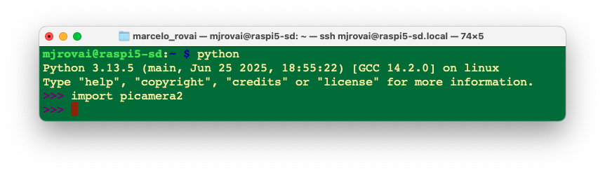{width=85% fig-align="center"}

### Setting up a Virtual Environment {#sec-image-classification-setting-virtual-environment-optional-recommended-e585}

Create a virtual environment with access to the system packages to manage dependencies:

```bash
python3 -m venv ~/tflite_env --system-site-packages
```

Activate the environment:

```bash
source ~/tflite_env/bin/activate
```

To exit the virtual environment, use:

```bash
deactivate
```

### Installing Python Packages {#sec-image-classification-installing-additional-python-libraries-7fbd}

Inside the virtual environment, install the Python packages:

```bash
pip install numpy pillow  # Image processing
pip install matplotlib  # For displaying images
pip install opencv-python  # Computer vision
```

Verify the installation:

```bash
pip list | grep -E "(numpy|pillow|opencv|picamera)"
```

\noindent
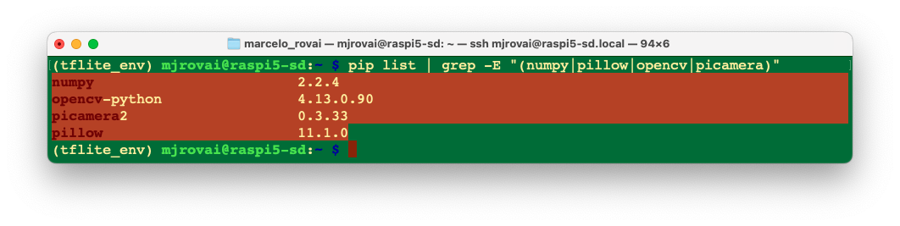{width=70% fig-align="center"}

#### System vs. pip Package Installation {#sec-image-classification-system-vs-pip-package-installation-0c58}

**Use `sudo apt install` (outside of the venv) for:**

- System-level dependencies and libraries
- Hardware interface libraries (such as the camera)
- Development headers and build tools
- Anything that needs to interface directly with hardware

**Use `pip install` (inside the venv) for:**

- Pure Python packages
- Application-specific libraries
- Packages that do not need system-level access

> **Rule of thumb:** Use `sudo apt install` only for system dependencies and hardware interfaces. Use `pip install` (without `sudo`) inside an activated virtual environment for everything else. Inside the venv, `pip` and `pip3` are the same.
>
> Thanks to the `--system-site-packages` flag, the virtual environment includes both the system packages (such as Picamera2) and the packages installed with pip.

### Setting up Jupyter Notebook {#sec-image-classification-setting-jupyter-notebook-optional-7d66}

Set up Jupyter Notebook for headless camera work and development on the Raspberry Pi:

```bash
pip install jupyter jupyterlab notebook
jupyter notebook --generate-config
```

To run Jupyter Notebook, use the following command (with your own IP address):

```bash
jupyter notebook --ip=192.168.4.210 --no-browser
```

The terminal shows the local URL address to open the notebook:

\noindent
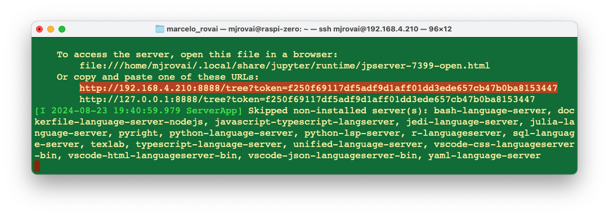{width=85% fig-align="center"}

To access it from another device, enter the Raspberry Pi's IP address and the provided token in a web browser (the token can be copied from the terminal).

\noindent
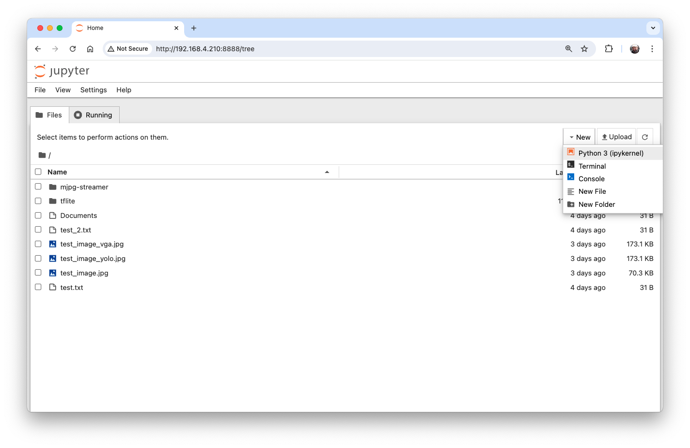{width=85% fig-align="center"}

Define the working directory on the Raspi and create a new Python 3 notebook. For example:

```bash
cd Documents
mkdir Python
```

> Folders can also be created directly in Jupyter Notebook.

In a new notebook, test the code below. First, import the libraries:

```python
import time
import numpy as np
from PIL import Image
import matplotlib.pyplot as plt
from picamera2 import Picamera2
```

Download an image from the internet. A command line can be run from the notebook by prefixing it with `!`:

```python
!wget https://upload.wikimedia.org/wikipedia/commons/3/3a/Cat03.jpg
```

The image (`Cat03.jpg`) is downloaded to the current directory. Load and show it:

```python
img_path = "Cat03.jpg"
img = Image.open(img_path)

# Display the image
plt.figure(figsize=(6, 6))
plt.imshow(img)
plt.title("Original Image")
plt.show()
```

The image is displayed in the notebook:

\noindent
{width=60% fig-align="center"}

Next, use the camera to capture a local image:

```python
from picamera2 import Picamera2
import time

# Initialize camera
picam2 = Picamera2()
picam2.start()

# Wait for camera to warm up
time.sleep(2)

# Capture image
picam2.capture_file("class3_test.jpg")
print("Image captured: class3_test.jpg")

# Stop camera
picam2.stop()
picam2.close()
```

Code similar to the previous cell (with a different `img_path` and `title`) shows the captured image:

\noindent
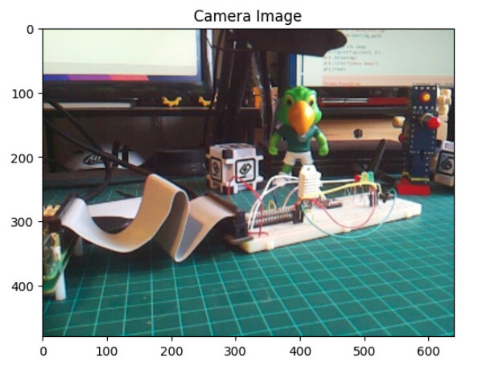{width=60% fig-align="center"}

## Installing LiteRT {#sec-image-classification-installing-tensorflow-lite-c6ee}

This lab focuses on inference: running a trained model on a device to make predictions from input data. To perform inference, the model runs through an **interpreter**. The interpreter used here is [LiteRT](https://github.com/google-ai-edge/LiteRT), Google's on-device framework for high-performance ML and GenAI deployment on edge platforms.

> LiteRT is the successor of TensorFlow Lite. The standalone `tflite_runtime` package used in earlier versions of this lab is no longer maintained and does not install on the Python version shipped with current Raspberry Pi OS.

Install it on the Raspi with:

```bash
pip install ai-edge-litert
```

Verify the installation:

```bash
pip show ai-edge-litert
```

\noindent
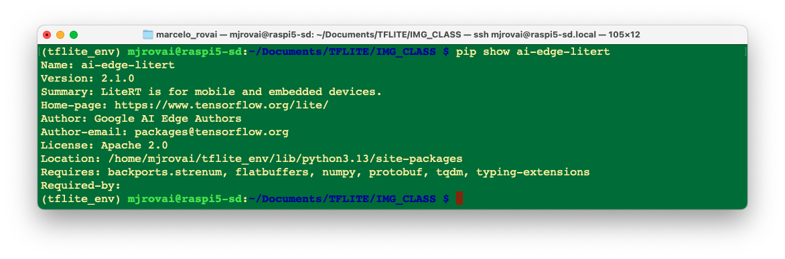{width=85% fig-align="center"}

### Creating a Working Directory {#sec-image-classification-creating-working-directory-9584}

On the Raspi-Zero with the minimal OS (no desktop), there is no predefined user directory tree (check it with `ls`). Create one:

```bash
mkdir Documents
cd Documents/
mkdir TFLITE
cd TFLITE/
mkdir IMG_CLASS
cd IMG_CLASS
mkdir models
cd models
```

> On the Raspi-5, the `/Documents` folder should already exist.

**Get a pre-trained image classification model**:

An appropriate pre-trained model is crucial for image classification on resource-constrained devices like the Raspberry Pi. **MobileNet** is designed for mobile and embedded vision applications and balances accuracy and speed. It exists in several versions (MobileNetV1, MobileNetV2, and MobileNetV3). Download the V2:

```bash
wget https://storage.googleapis.com/download.tensorflow.org/\
models/tflite_11_05_08/mobilenet_v2_1.0_224_quant.tgz

tar xzf mobilenet_v2_1.0_224_quant.tgz
```

Get its [labels](https://github.com/Mjrovai/EdgeML-with-Raspberry-Pi/blob/main/IMG_CLASS/models/labels.txt):

```bash
wget https://raw.githubusercontent.com/Mjrovai/EdgeML-with-Raspberry-Pi/\
refs/heads/main/IMG_CLASS/models/labels.txt
```

The `models` directory should now contain:

\noindent
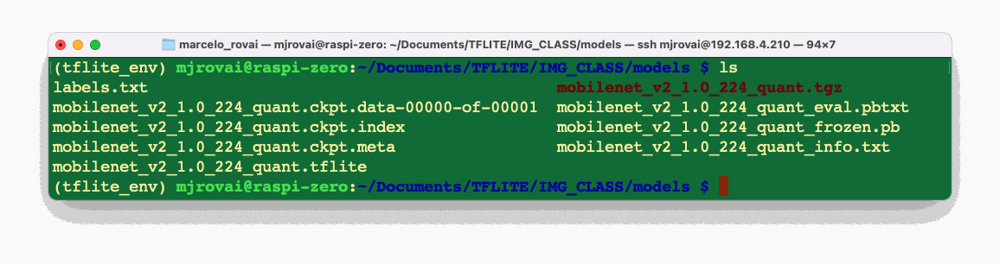{width=85% fig-align="center"}

> Only the `mobilenet_v2_1.0_224_quant.tflite` model and `labels.txt` are needed. The other files can be deleted.

### Verifying the Setup {#sec-image-classification-verifying-setup-9103}

Test the setup by running a simple Python script in the `TFLITE/IMG_CLASS` folder:

```python
from ai_edge_litert.interpreter import Interpreter
import numpy as np
from PIL import Image

print("NumPy:", np.__version__)
print("Pillow:", Image.__version__)

# Try to create a LiteRT Interpreter
model_path = "./models/mobilenet_v2_1.0_224_quant.tflite"
interpreter = Interpreter(model_path=model_path)
interpreter.allocate_tensors()
print("LiteRT Interpreter created successfully!")
```

Create the script with nano in the terminal and save it with `CTRL+O` + `ENTER` + `CTRL+X`:

\noindent
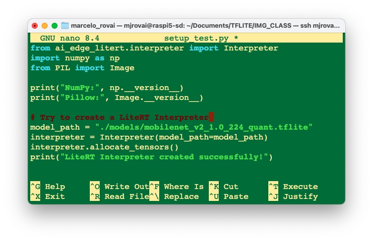{width=80% fig-align="center"}

Run it with:

```bash
python setup_test.py
```

\noindent
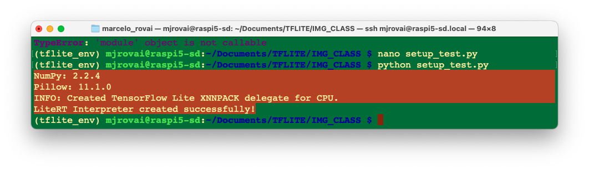{width=85% fig-align="center"}

Or run it directly in the [notebook](https://github.com/Mjrovai/EdgeML-with-Raspberry-Pi/blob/main/IMG_CLASS/notebooks/setup_test.ipynb):

\noindent
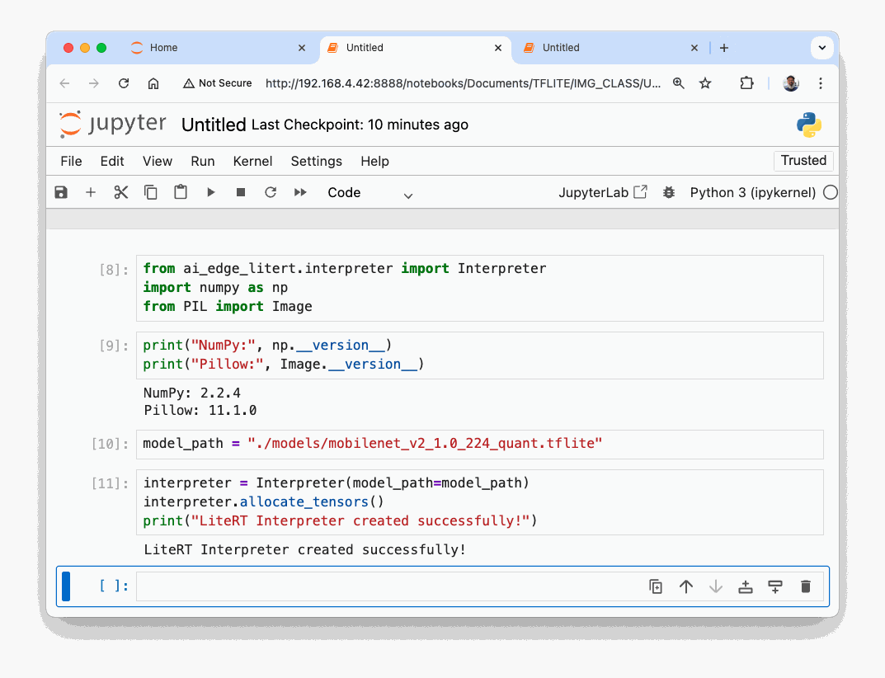{width=85% fig-align="center"}

## Making inferences with Mobilenet V2 {#sec-image-classification-making-inferences-mobilenet-v2-d635}

The previous section set up the environment, including a popular pre-trained model, MobileNet V2, trained on ImageNet's 1.2 million $224{\times}224$ images for 1,001 classes (1,000 object categories plus 1 background). The model was converted to a compact 3.5 MB tflite format, which suits the limited storage and memory of a Raspberry Pi.

\noindent
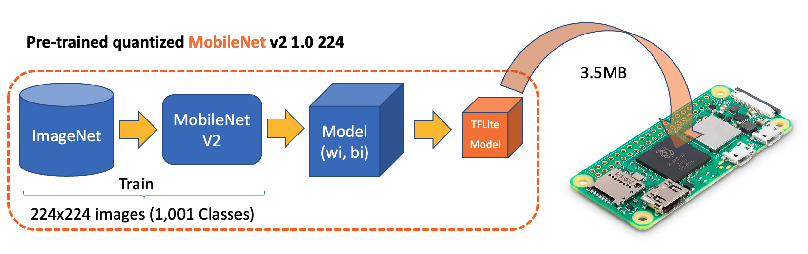{width=85% fig-align="center"}

In the `IMG_CLASS` working directory, start a new [notebook](https://github.com/Mjrovai/EdgeML-with-Raspberry-Pi/blob/main/IMG_CLASS/notebooks/10_Image_Classification.ipynb) and follow the steps to classify one image.

Import the needed libraries:

```python
import time
import numpy as np
import matplotlib.pyplot as plt
from PIL import Image
from ai_edge_litert.interpreter import Interpreter
```

Load the model and allocate tensors:

```python
model_path = "./models/mobilenet_v2_1.0_224_quant.tflite"
interpreter = Interpreter(model_path=model_path)
interpreter.allocate_tensors()
```

> ```bash
> INFO: Created TensorFlow Lite XNNPACK delegate for CPU.
> ```

This message means that LiteRT enabled an optimized CPU backend (XNNPACK) for the model, which is expected:

- XNNPACK is a library of highly optimized operators (convolution, fully connected, and others) for running neural networks on CPUs, especially ARM and x86.
- LiteRT *delegates* the supported operations to XNNPACK, so they run with these faster kernels instead of the default reference CPU implementation.
- On devices like the Raspberry Pi, this usually lowers inference latency, at the cost of a slightly longer initialization and a bit more RAM for packed weights.
- The model runs on the CPU, not the GPU, which is the standard path for TFLite/LiteRT models on Pi-class hardware.

Get the input and output tensors:

```python
input_details = interpreter.get_input_details()
output_details = interpreter.get_output_details()
```

The **input details** describe how the model should be fed an image. The shape (1, 224, 224, 3) indicates that an image with dimensions $224{\times}224{\times}3$ should be input one at a time (batch dimension: 1).

\noindent
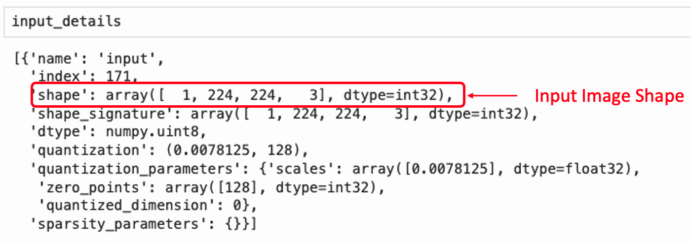{width=85% fig-align="center"}

The **output details** indicate that inference produces an array of 1,001 integer values. Each value is the score for the corresponding label.

\noindent
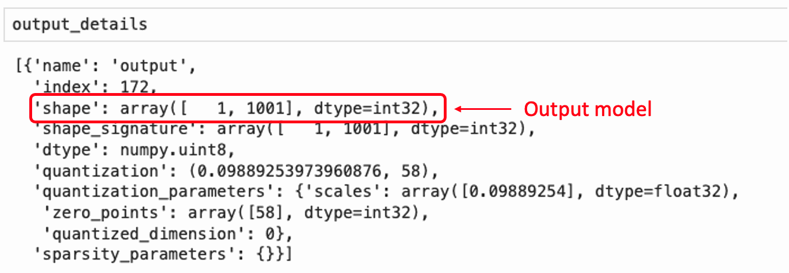{width=85% fig-align="center"}

Inspect the dtype of the model's input:

```python
input_dtype = input_details[0]['dtype']
input_dtype
```

```
dtype('uint8')
```

This shows that the input image should be represented as raw pixels (0–255).

Get a test image, either by transferring it from your computer or by downloading one as before. First, create a folder in the working directory:

```bash
mkdir images
cd images
wget https://upload.wikimedia.org/wikipedia/commons/3/3a/Cat03.jpg
```

Load and display the image:

```python
# Load the image
img_path = "./images/Cat03.jpg"
img = Image.open(img_path)

# Display the image
plt.figure(figsize=(8, 8))
plt.imshow(img)
plt.title("Original Image")
plt.show()
```

\noindent
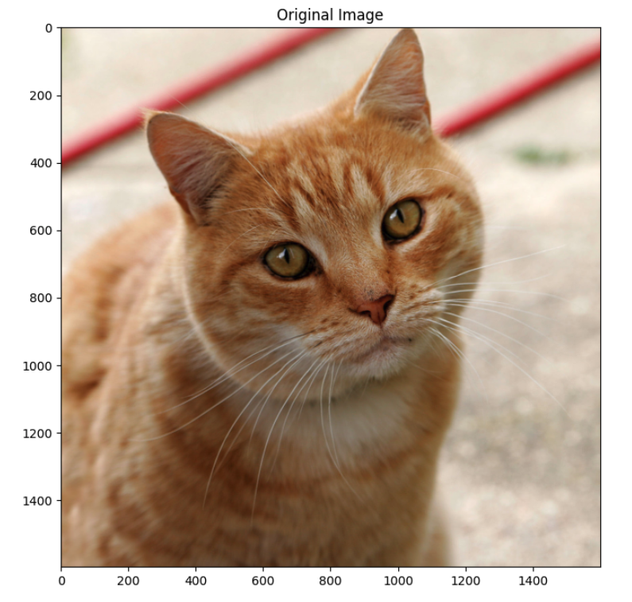{width=70% fig-align="center"}

Check the image size:

```python
width, height = img.size
```

The image is RGB, with a width and height of 1,600 pixels each. To use the model, reshape it to (224, 224, 3) and add a batch dimension of 1, as defined in the input details: (1, 224, 224, 3). As the output details show, the inference result is an array of size 1,001:

\noindent
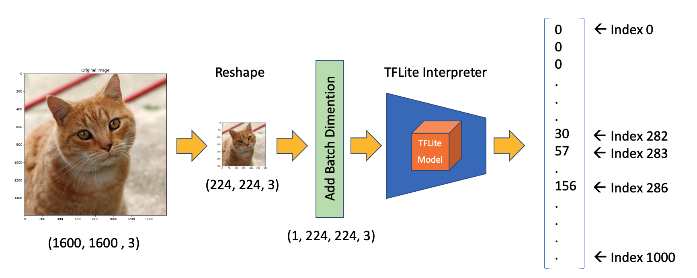{width=90% fig-align="center"}

Reshape the image and add the batch dimension:

```python
img = img.resize(
    (input_details[0]['shape'][1], input_details[0]['shape'][2])
)
input_data = np.expand_dims(img, axis=0)
input_data.shape
```

The `input_data` shape is as expected: (1, 224, 224, 3).

Confirm the dtype of the input data:

```python
input_data.dtype
```

`dtype('uint8')`

The input data dtype is `uint8`, which matches the dtype expected by the model.

Run the interpreter on `input_data` and get the predictions (output):

```python
interpreter.set_tensor(input_details[0]['index'], input_data)
interpreter.invoke()
predictions = interpreter.get_tensor(output_details[0]['index'])[0]
```

The prediction is an array with 1,001 elements. Get the top-5 indices with the highest values:

```python
top_k_results = 5
top_k_indices = np.argsort(predictions)[::-1][:top_k_results]
top_k_indices
```

`top_k_indices` is an array with 5 elements: `array([283, 286, 282, 288, 479])`

So 283, 286, 282, 288, and 479 are the image's most probable classes. The next step is to find which class each index belongs to (such as car, cat, or dog). The text file downloaded with the model has a label for each index from 0 to 1,000. A function loads the .txt file as a list:

```python
def load_labels(filename):
    with open(filename, 'r') as f:
        return [line.strip() for line in f.readlines()]
```

Get the list and print the labels associated with the indexes:

```python
labels_path = "./models/labels.txt"
labels = load_labels(labels_path)

print(labels[286])
print(labels[283])
print(labels[282])
print(labels[288])
print(labels[479])
```

The result is:

```bash
Egyptian cat
tiger cat
tabby
lynx
carton
```

At least four of the top indices are felines. The **prediction** content is the score associated with each label. As the `output details` showed, those values are quantized and must be dequantized:

```python
scale, zero_point = output_details[0]['quantization']
dequantized_output = (
    predictions.astype(np.float32) - zero_point
) * scale
dequantized_output
```

```bash
array([1.8662813e-06, 3.0599874e-06, 1.8146475e-05, ...,
       6.9421253e-07, 2.0032754e-05, 4.2967865e-04],
      shape=(1001,), dtype=float32)
```

The [model documentation](https://arxiv.org/abs/1801.04381v4) shows that MobileNet V2 typically does not include a softmax layer at the output: it usually ends with a $1{\times}1$ convolution followed by average pooling and a fully connected layer. To get probabilities (0 to 1), apply softmax:

```python
exp_output = np.exp(dequantized_output - np.max(dequantized_output))
probabilities = exp_output / np.sum(exp_output)
```

Print the top-5 probabilities:

```python
print (probabilities[286])
print (probabilities[283])
print (probabilities[282])
print (probabilities[288])
print (probabilities[479])
```

```bash
0.265947
0.39499295
0.17906114
0.08961108
0.022443123
```

For clarity, print the labels next to their probabilities:

```python
for i in range(top_k_results):
    print("\t{:20}: {}%".format(
        labels[top_k_indices[i]],
        (int(probabilities[top_k_indices[i]]*100))))
```

```bash
tiger cat           : 39%
Egyptian cat        : 26%
tabby               : 17%
lynx                : 8%
carton              : 2%
```

### Define a general Image Classification function {#sec-image-classification-define-general-image-classification-function-6af6}

A general function takes an image as input and returns the top-5 possible classes:

```python
def image_classification(img_path, model_path, labels,
                         top_k_results=5):
    # load the image
    img = Image.open(img_path)
    plt.figure(figsize=(4, 4))
    plt.imshow(img)
    plt.axis('off')

    # Load the LiteRT model
    interpreter = Interpreter(model_path=model_path)
    interpreter.allocate_tensors()

    # Get input and output tensors
    input_details = interpreter.get_input_details()
    output_details = interpreter.get_output_details()

    # Preprocess
    img = img.resize((input_details[0]['shape'][1],
                      input_details[0]['shape'][2]))
    input_data = np.expand_dims(img, axis=0)

    # Inference on Raspi
    interpreter.set_tensor(input_details[0]['index'], input_data)
    interpreter.invoke()

    # Obtain results and map them to the classes
    predictions = interpreter.get_tensor(
        output_details[0]['index'])[0]

    # Get indices of the top k results
    top_k_indices = np.argsort(predictions)[::-1][:top_k_results]

    # Get quantization parameters
    scale, zero_point = output_details[0]['quantization']

    # Dequantize the output and apply softmax
    dequantized_output = (
        predictions.astype(np.float32) - zero_point
    ) * scale
    exp_output = np.exp(
        dequantized_output - np.max(dequantized_output))
    probabilities = exp_output / np.sum(exp_output)

    print("\n\t[PREDICTION]        [Prob]\n")
    for i in range(top_k_results):
        print("\t{:20}: {}%".format(
            labels[top_k_indices[i]],
            (int(probabilities[top_k_indices[i]]*100))))
```

Loading some images for testing gives:

\noindent
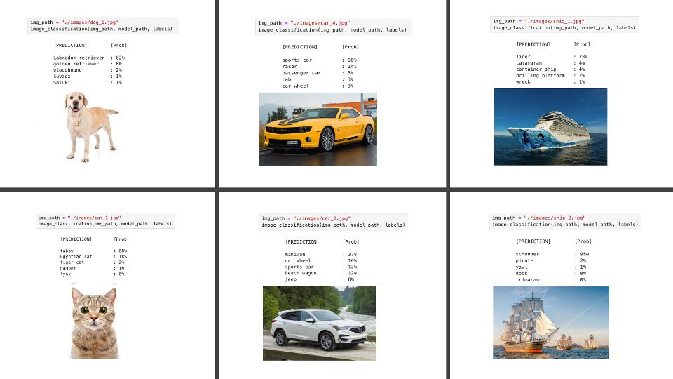

### Testing the Classification with the Camera {#sec-image-classification-installing-picamera2-4ac5}

Adapt the earlier camera code into a function that captures a $224{\times}224$ image and saves it in the `images` folder:

```python
from picamera2 import Picamera2
import time

def capture_image(image_path):
    # Initialize camera
    picam2 = Picamera2() # default is index 0

    # Configure the camera
    config = picam2.create_still_configuration(
        main={"size": (224, 224)})
    picam2.configure(config)
    picam2.start()

    # Wait for camera to warm up
    time.sleep(2)

    # Capture image
    picam2.capture_file(image_path)
    print("Image captured: " + image_path)

    # Stop camera
    picam2.stop()
    picam2.close()
```

Capture an image and send it for inference:

```python
img_path = './images/cam_img_test.jpg'
model_path = "./models/mobilenet_v2_1.0_224_quant.tflite"
labels = load_labels("./models/labels.txt")
capture_image(img_path)
image_classification(img_path, model_path, labels, top_k_results=5)
```

\noindent
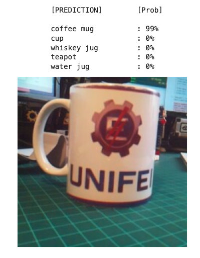{width=85% fig-align="center"}

### Exploring a Model Trained from Scratch {#sec-image-classification-testing-model-trained-scratch-4cb8}

A TFLite model trained from scratch can be obtained with the notebook [CNN to classify Cifar-10 dataset](https://colab.research.google.com/github/Mjrovai/UNIFEI-IESTI01-TinyML-2022.1/blob/main/00_Curse_Folder/2_Applications_Deploy/Class_16/cifar_10/CNN_Cifar_10_TFLite.ipynb#scrollTo=iiVBUpuHXEtw).

The notebook trains a model on the CIFAR-10 dataset, which contains 60,000 images from 10 classes (*airplane, automobile, bird, cat, deer, dog, frog, horse, ship, and truck*). CIFAR images are $32{\times}32$ color images (3 channels) in which the objects are not centered and may have a background, such as airplanes against a cloudy sky. In short, they are small but real images.

The trained CNN model (*cifar10_model.keras*) has a size of 2.0 MB. The *TFLite Converter* shrinks it to 674 KB (*cifar10.tflite*), around one-third of the original size.

\noindent
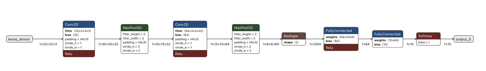{width=85% fig-align="center"}

Running the notebook [20_Cifar_10_Image_Classification.ipynb](https://github.com/Mjrovai/EdgeML-with-Raspberry-Pi/blob/main/IMG_CLASS/notebooks/20_Cifar_10_Image_Classification.ipynb) with `cifar10.tflite`, following the same steps as with MobileNet, shows that the inference probabilities are lower than those of MobileNet V2.

The images below were classified with the general image classification function on a Raspberry Pi Zero:

\noindent
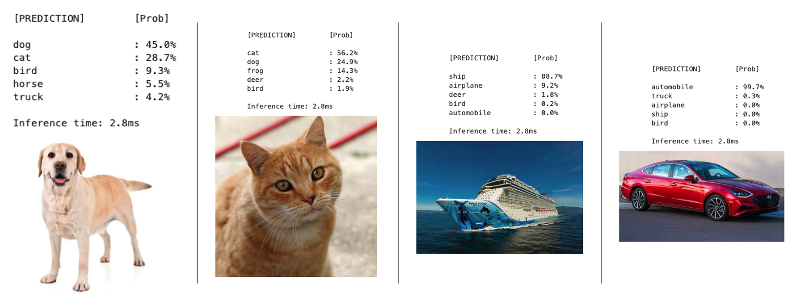{width=90% fig-align="center"}

## Image Classification Project {#sec-image-classification-image-classification-project-2617}

Now, we will develop a complete Image Classification project using the Edge Impulse Studio. As with MobileNet V2, the trained and converted TFLite model is used for inference with a Python script. The project follows a typical ML workflow:

\noindent
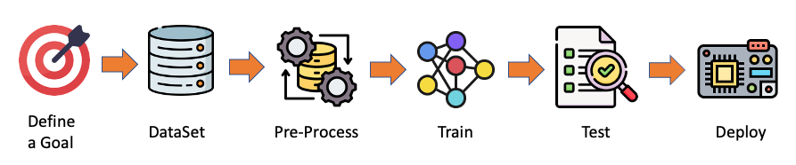{width=85% fig-align="center"}

### The Goal {#sec-image-classification-goal-dd93}

The first step in any ML project is to define its goal. In this case, it is to detect and classify two specific objects present in one image. For this project, we will use two small toys: a robot and a small Brazilian parrot (named Periquito). We will also collect images of a *background* where those two objects are absent.

\noindent
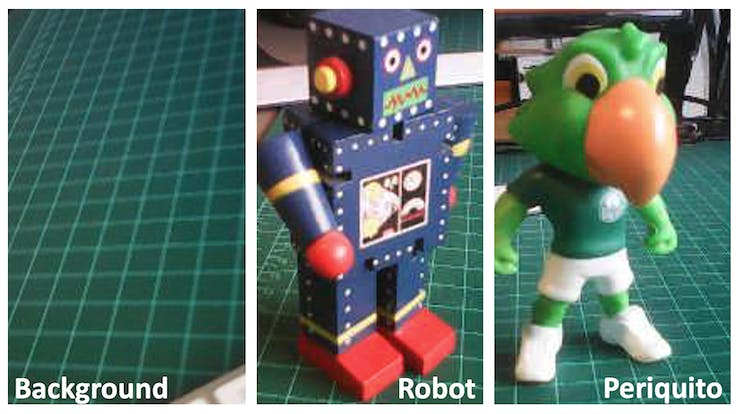{width=65% fig-align="center"}

### Data Collection {#sec-image-classification-data-collection-bdf5}

Once the machine learning project goal is defined, the next step is collecting the dataset. You can use a phone for the image capture, but this tutorial uses the Raspi. Set up a simple web server on the Raspberry Pi to view the captured `QVGA (320 x 240)` images in a browser.

1. First, install Flask, a lightweight web framework for Python:

    ```bash
    pip3 install flask
    ```

2. Create a new Python script combining image capture with a web server. Call it `get_img_data.py`:

<div class="scroll-code-block">

```python
from flask import Flask, Response, render_template_string,
                  request, redirect, url_for
from picamera2 import Picamera2
import io
import threading
import time
import os
import signal

app = Flask(__name__)

# Global variables
base_dir = "dataset"
picam2 = None
frame = None
frame_lock = threading.Lock()
capture_counts = {}
current_label = None
shutdown_event = threading.Event()

def initialize_camera():
    global picam2
    picam2 = Picamera2()
    config = picam2.create_preview_configuration(
             main={"size": (320, 240)}
    )
    picam2.configure(config)
    picam2.start()
    time.sleep(2)  # Wait for camera to warm up

def get_frame():
    global frame
    while not shutdown_event.is_set():
        stream = io.BytesIO()
        picam2.capture_file(stream, format='jpeg')
        with frame_lock:
            frame = stream.getvalue()
        time.sleep(0.1)  # Adjust as needed for smooth preview

def generate_frames():
    while not shutdown_event.is_set():
        with frame_lock:
            if frame is not None:
                yield (b'--frame\r\n'
                       b'Content-Type: image/jpeg\r\n\r\n' +
                                       frame + b'\r\n')
        time.sleep(0.1)  # Adjust as needed for smooth streaming

def shutdown_server():
    shutdown_event.set()
    if picam2:
        picam2.stop()
    # Give some time for other threads to finish
    time.sleep(2)
    # Send SIGINT to the main process
    os.kill(os.getpid(), signal.SIGINT)

@app.route('/', methods=['GET', 'POST'])
def index():
    global current_label
    if request.method == 'POST':
        current_label = request.form['label']
        if current_label not in capture_counts:
            capture_counts[current_label] = 0
        os.makedirs(os.path.join(base_dir, current_label),
                                 exist_ok=True)
        return redirect(url_for('capture_page'))
    return render_template_string('''
        <!DOCTYPE html>
        <html>
        <head>
            <title>Dataset Capture - Label Entry</title>
        </head>
        <body>
            <h1>Enter Label for Dataset</h1>
            <form method="post">
                <input type="text" name="label" required>
                <input type="submit" value="Start Capture">
            </form>
        </body>
        </html>
    ''')

@app.route('/capture')
def capture_page():
    return render_template_string('''
        <!DOCTYPE html>
        <html>
        <head>
            <title>Dataset Capture</title>
            <script>
                var shutdownInitiated = false;
                function checkShutdown() {
                    if (!shutdownInitiated) {
                        fetch('/check_shutdown')
                            .then(response => response.json())
                            .then(data => {
                                if (data.shutdown) {
                                    shutdownInitiated = true;
                                    document.getElementById(
                                          'video-feed').src = '';
                                    document.getElementById(
                                          'shutdown-message')
                                    .style.display = 'block';
                                }
                            });
                    }
                }
                setInterval(checkShutdown, 1000); // Check
                                                     every second
            </script>
        </head>
        <body>
            <h1>Dataset Capture</h1>
            <p>Current Label: {{ label }}</p>
            <p>Images captured for this label: {{ capture_count
                                                  }}</p>
            
            <div id="shutdown-message" style="display: none;
                                              color: red;">
                Capture process has been stopped.
                You can close this window.
            </div>
            <form action="/capture_image" method="post">
                <input type="submit" value="Capture Image">
            </form>
            <form action="/stop" method="post">
                <input type="submit" value="Stop Capture"
                style="background-color: #ff6666;">
            </form>
            <form action="/" method="get">
                <input type="submit" value="Change Label"
                style="background-color: #ffff66;">
            </form>
        </body>
        </html>
    ''', label=current_label, capture_count=capture_counts.get(
                                            current_label, 0))

@app.route('/video_feed')
def video_feed():
    return Response(generate_frames(),
                    mimetype='multipart/x-mixed-replace;
                    boundary=frame')

@app.route('/capture_image', methods=['POST'])
def capture_image():
    global capture_counts
    if current_label and not shutdown_event.is_set():
        capture_counts[current_label] += 1
        timestamp = time.strftime("%Y%m%d-%H%M%S")
        filename = f"image_{timestamp}.jpg"
        full_path = os.path.join(base_dir, current_label,
                                 filename)

        picam2.capture_file(full_path)

    return redirect(url_for('capture_page'))

@app.route('/stop', methods=['POST'])
def stop():
    summary = render_template_string('''
        <!DOCTYPE html>
        <html>
        <head>
            <title>Dataset Capture - Stopped</title>
        </head>
        <body>
            <h1>Dataset Capture Stopped</h1>
            <p>The capture process has been stopped.
               You can close this window.</p>
            <p>Summary of captures:</p>
            <ul>
            
                <li>{{ label }}: {{ count }} images</li>
            
            </ul>
        </body>
        </html>
    ''', capture_counts=capture_counts)

    # Start a new thread to shutdown the server
    threading.Thread(target=shutdown_server).start()

    return summary

@app.route('/check_shutdown')
def check_shutdown():
    return {'shutdown': shutdown_event.is_set()}

if __name__ == '__main__':
    initialize_camera()
    threading.Thread(target=get_frame, daemon=True).start()
    app.run(host='0.0.0.0', port=5000, threaded=True)
```
</div>

3. Run this script:

```bash
    python3 get_img_data.py
```

4. Access the web interface:

    - On the Raspberry Pi itself (if you have a GUI): Open a web browser and go to `http://localhost:5000`
    - From another device on the same network: Open a web browser and go to `http://<raspberry_pi_ip>:5000` (Replace `<raspberry_pi_ip>` with your Raspberry Pi's IP address). For example: `http://192.168.4.210:5000/`

This Python script creates a web-based interface for capturing and organizing image datasets using a Raspberry Pi and its camera. It is useful for machine learning projects that require labeled image data.

#### Key Features: {#sec-image-classification-key-features-5739}

1. **Web Interface**: Accessible from any device on the same network as the Raspberry Pi.
2. **Live Camera Preview**: Shows a real-time feed from the camera.
3. **Labeling System**: Allows users to input labels for different categories of images.
4. **Organized Storage**: Automatically saves images in label-specific subdirectories.
5. **Per-Label Counters**: Keeps track of how many images are captured for each label.
6. **Summary Statistics**: Provides a summary of captured images when stopping the capture process.

#### Main Components: {#sec-image-classification-main-components-4d92}

1. **Flask Web Application**: Handles routing and serves the web interface.
2. **Picamera2 Integration**: Controls the Raspberry Pi camera.
3. **Threaded Frame Capture**: Keeps the live preview smooth.
4. **File Management**: Organizes captured images into labeled directories.

#### Key Functions: {#sec-image-classification-key-functions-b1b8}

- `initialize_camera()`: Sets up the Picamera2 instance.
- `get_frame()`: Continuously captures frames for the live preview.
- `generate_frames()`: Yields frames for the live video feed.
- `shutdown_server()`: Sets the shutdown event, stops the camera, and shuts down the Flask server
- `index()`: Handles the label input page.
- `capture_page()`: Displays the main capture interface.
- `video_feed()`: Shows a live preview to position the camera
- `capture_image()`: Saves an image with the current label.
- `stop()`: Stops the capture process and displays a summary.

#### Usage Flow: {#sec-image-classification-usage-flow-4238}

1. Start the script on your Raspberry Pi.
2. Access the web interface from a browser.
3. Enter a label for the images you want to capture and press `Start Capture`.

\noindent
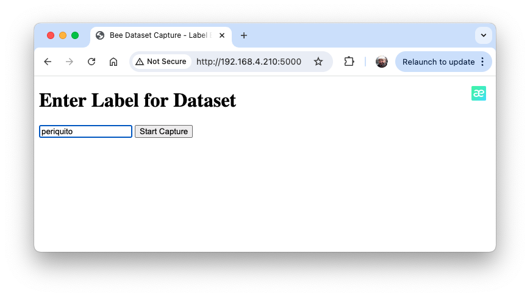{width=55% fig-align="center"}

4. Use the live preview to position the camera.
5. Click `Capture Image` to save images under the current label.

\noindent
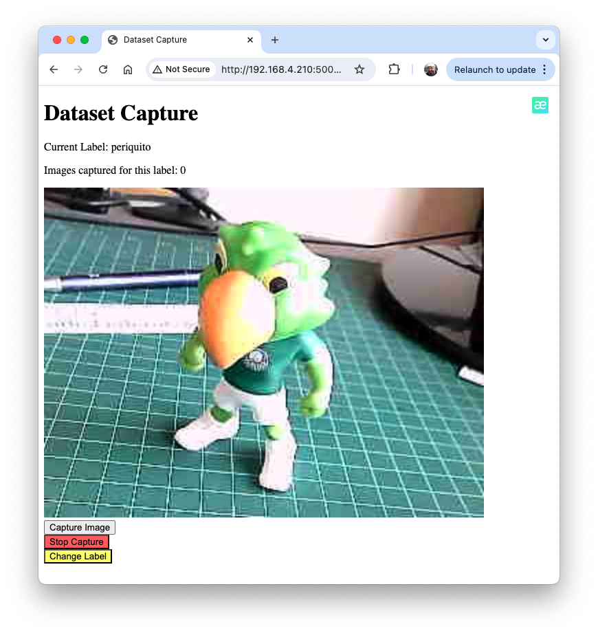{width=55% fig-align="center"}

6. Change labels as needed for different categories, selecting `Change Label`.
7. Click `Stop Capture` when finished to see a summary.

\noindent
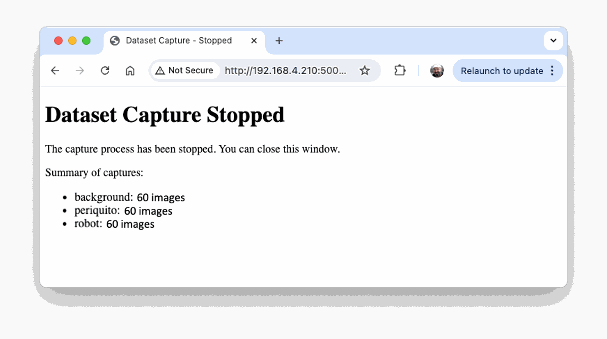{width=55% fig-align="center"}

#### Technical Notes: {#sec-image-classification-technical-notes-fcc7}

- The script uses threading to handle concurrent frame capture and web serving.
- Images are saved with timestamps in their filenames for uniqueness.
- The web interface is responsive and can be accessed from mobile devices.

#### Customization Possibilities: {#sec-image-classification-customization-possibilities-cc72}

- Adjust image resolution in the `initialize_camera()` function. Here we used QVGA $(320\times 240)$.
- Modify the HTML templates for a different look and feel.
- Add additional image processing or analysis steps in the `capture_image()` function.

#### Number of samples on Dataset: {#sec-image-classification-number-samples-dataset-baa4}

Get around 60 images from each category (`periquito`, `robot` and `background`). Try to capture different angles, backgrounds, and light conditions. On the Raspi, we will end with a folder named `dataset`, which contains three subfolders (*periquito*, *robot*, and *background*), one for each class of images.

You can use `Filezilla` to transfer the created dataset to your main computer.

## Training the model with Edge Impulse Studio {#sec-image-classification-training-model-edge-impulse-studio-bbff}

We will use the Edge Impulse Studio to train our model. Go to the  [Edge Impulse Page](https://edgeimpulse.com/), enter your account credentials, and create a new project:

\noindent
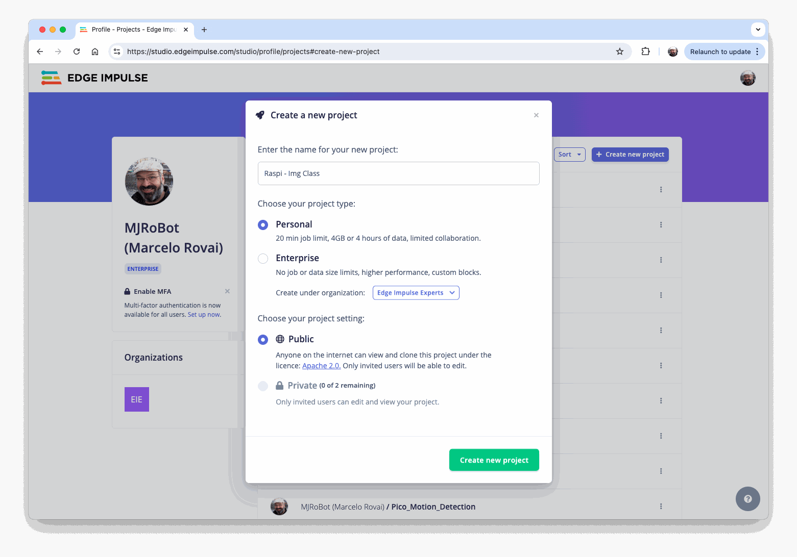{width=65% fig-align="center"}

> Here, you can clone a similar project: [Raspi - Img Class](https://studio.edgeimpulse.com/public/510251/live).

### Dataset {#sec-image-classification-dataset-4d5a}

We will walk through four main steps using the EI Studio (or Studio). These steps prepare the model for use on the Raspi: Dataset, Impulse, Tests, and Deploy (on the Edge Device, in this case, the Raspi).

> Regarding the Dataset, it is essential to point out that our Original Dataset, captured with the Raspi, will be split into *Training*, *Validation*, and *Test*. The Test Set will be separated from the beginning and reserved for use only in the Test phase after training. The Validation Set will be used during training.

On Studio, follow the steps to upload the captured data:

1. Go to the `Data acquisition` tab, and in the `UPLOAD DATA` section, upload the files from your computer in the chosen categories.
2. Leave to the Studio the splitting of the original dataset into *train and test* and choose the label about
3. Repeat the procedure for all three classes. At the end, you should see your "raw data" in the Studio:

\noindent
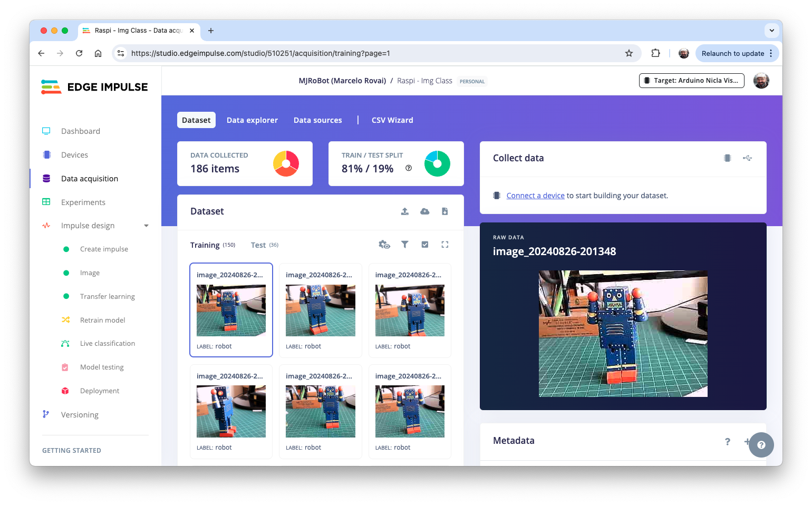{width=70% fig-align="center"}

The Studio allows you to explore your data, showing a complete view of all the data in your project. You can clear, inspect, or change labels by clicking on individual data items. In our case, a straightforward project, the data seems OK.

\noindent
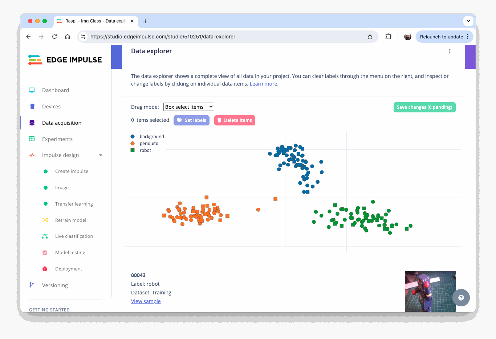{width=70% fig-align="center"}

## The Impulse Design {#sec-image-classification-impulse-design-0ca2}

In this phase, define how to:

- Pre-process our data, which consists of resizing the individual images and determining the `color depth` to use (be it RGB or Grayscale) and

- Specify a Model. In this case, it will be the `Transfer Learning (Images)` to fine-tune a pre-trained MobileNet V2 image classification model on our data. This method performs well even with relatively small image datasets (around 180 images in our case).

Transfer learning with MobileNet simplifies model training, which helps in resource-constrained environments and in projects with limited labeled data. MobileNet, known for its lightweight architecture, is a pre-trained model that has already learned useful features from a large dataset (ImageNet).

\noindent
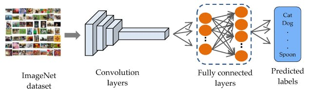{width=103% fig-align="center"}

By reusing these learned features, we can train a new model for a specific task with less data and fewer computational resources and still reach competitive accuracy.

\noindent
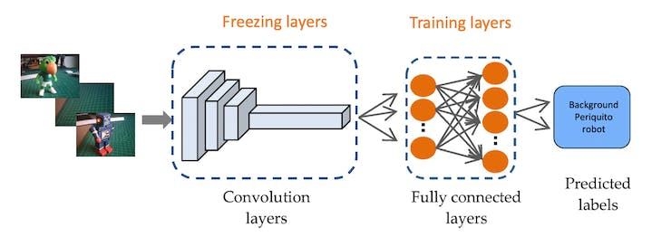{width=103% fig-align="center"}

This approach reduces training time and computational cost, which suits quick prototyping and deployment on embedded devices, where efficiency matters most.

Go to the Impulse Design Tab and create the *impulse*, defining an image size of $160\times 160$ and squashing them (squared form, without cropping). Select Image and Transfer Learning blocks. Save the Impulse.

\noindent
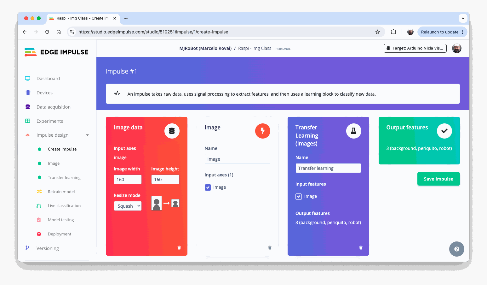{width=85% fig-align="center"}

### Image Pre-Processing {#sec-image-classification-image-preprocessing-e94b}

All the input QVGA/RGB565 images will be converted to 76,800 features $(160\times 160\times 3)$.

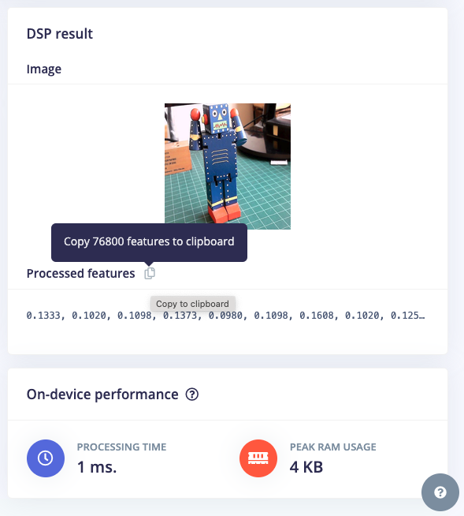{width=85% fig-align="center"}

Press `Save parameters` and select `Generate features` in the next tab.

### Model Design {#sec-image-classification-model-design-d81c}

MobileNet is a family of efficient convolutional neural networks designed for mobile and embedded vision applications. The key features of MobileNet are:

1. Lightweight: Optimized for mobile devices and embedded systems with limited computational resources.
2. Speed: Fast inference times, suitable for real-time applications.
3. Accuracy: Maintains good accuracy despite its compact size.

[MobileNetV2](https://arxiv.org/abs/1801.04381), introduced in 2018, improves the original MobileNet architecture. Key features include:

1. Inverted Residuals: Inverted residual structures are used where shortcut connections are made between thin bottleneck layers.
2. Linear Bottlenecks: Removes non-linearities in the narrow layers to prevent the destruction of information.
3. Depth-wise Separable Convolutions: Continues to use this efficient operation from MobileNetV1.

In our project, we will do a `Transfer Learning` with the `MobileNetV2 160x160 1.0`,  which means that the images used for training (and future inference) should have an *input Size* of $160{\times}160$ pixels and a *Width Multiplier* of 1.0 (full width, not reduced). This configuration balances between model size, speed, and accuracy.

### Model Training {#sec-image-classification-model-training-4953}

**Data augmentation** is another useful deep learning technique. Data augmentation improves the accuracy of machine learning models by creating additional artificial data. A data augmentation system makes small, random changes to the training data during the training process (such as flipping, cropping, or rotating the images).

Looking under the hood, here you can see how Edge Impulse implements a data Augmentation policy on your data:

```python
# Implements the data augmentation policy
def augment_image(image, label):
    # Flips the image randomly
    image = tf.image.random_flip_left_right(image)

    # Increase the image size, then randomly crop it down to
    # the original dimensions
    resize_factor = random.uniform(1, 1.2)
    new_height = math.floor(resize_factor * INPUT_SHAPE[0])
    new_width = math.floor(resize_factor * INPUT_SHAPE[1])
    image = tf.image.resize_with_crop_or_pad(
        image, new_height, new_width
    )
    image = tf.image.random_crop(image, size=INPUT_SHAPE)

    # Vary the brightness of the image
    image = tf.image.random_brightness(image, max_delta=0.2)

    return image, label
```

Exposure to these variations during training can help prevent your model from taking shortcuts by "memorizing" superficial clues in your training data, meaning it may better reflect the deep underlying patterns in your dataset.

The final dense layer of our model will have 0 neurons with a 10% dropout for overfitting prevention. Here is the Training result:

\noindent
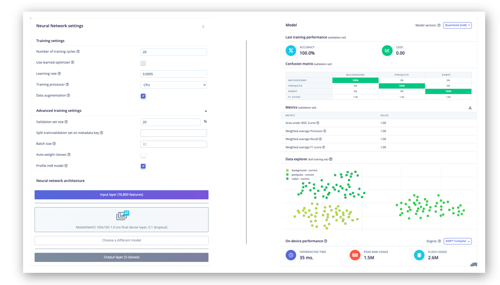

The result is good, with a reasonable 35 ms of latency (for a Raspi-4), which should result in around 30 fps (frames per second) during inference. A Raspi-Zero should be slower, and the Raspi-5, faster.

### Trading off: Accuracy versus speed {#sec-image-classification-trading-accuracy-versus-speed-a6a5}

If faster inference is needed, we should train the model using smaller alphas (0.35, 0.5, and 0.75) or even reduce the image input size, trading with accuracy. However, reducing the input image size and decreasing the alpha (width multiplier) can speed up inference for MobileNet V2, but they have different trade-offs. The two compare as follows:

1. Reducing Image Input Size:

Pros:

- Substantially reduces the computational cost across all layers.
- Decreases memory usage.
- It often gives a substantial speed gain.

Cons:

- It may reduce the model's ability to detect small features or fine details.
- It can substantially reduce accuracy, especially for tasks requiring fine-grained recognition.

2. Reducing Alpha (Width Multiplier):

Pros:

- Reduces the number of parameters and computations in the model.
- Maintains the original input resolution, potentially preserving more detail.
- It can provide a good balance between speed and accuracy.

Cons:

- It may not speed up inference as dramatically as reducing input size.
- It can reduce the model's capacity to learn complex features.

Comparison:

1. Speed Impact:
    - Reducing input size often provides a more substantial speed boost because it reduces computations quadratically (halving both width and height reduces computations by about 75%).
    - Reducing alpha provides a more linear reduction in computations.

2. Accuracy Impact:
    - Reducing input size can severely impact accuracy, especially when detecting small objects or fine details.
    - Reducing alpha tends to have a more gradual impact on accuracy.

3. Model Architecture:
    - Changing input size does not alter the model's architecture.
    - Changing alpha modifies the model's structure by reducing the number of channels in each layer.

Recommendation:

1. If the application does not require detecting tiny details and can tolerate some loss in accuracy, reducing the input size is often the most effective way to speed up inference.
2. Reducing alpha might be preferable if maintaining the ability to detect fine details is important or if you need a more balanced trade-off between speed and accuracy.
3. For best results, experiment with both:
    - Try MobileNet V2 with input sizes like $160\times 160$ or $92\times 92$
    - Experiment with alpha values like 1.0, 0.75, 0.5 or 0.35.
4. Always benchmark the different configurations on your specific hardware and with your particular dataset to find the optimal balance for your use case.

> The best choice depends on your requirements for accuracy, speed, and the nature of the images you are working with. It is often worth experimenting with combinations to find the best configuration for your use case.

### Model Testing {#sec-image-classification-model-testing-ce54}

Now take the data set aside at the start of the project and run the trained model on it. Again, the result is good (92.22%).

### Deploying the model {#sec-image-classification-deploying-model-9858}

As we did in the previous section, we can deploy the trained model as .tflite and use Raspi to run it using Python.

On the `Dashboard` tab, go to Transfer learning model (int8 quantized) and click on the download icon:

\noindent
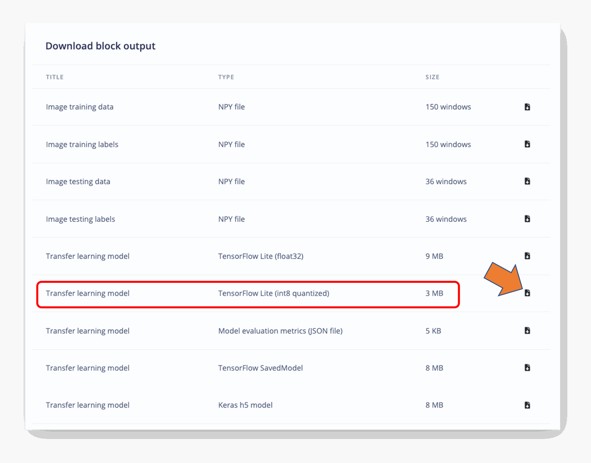{width=75% fig-align="center"}

> Also download the float32 version for comparison.

Transfer the model from your computer to the Raspi (./models), for example, using FileZilla. Also, capture some images for inference (./images), or use the images in the `./dataset` folder.

As in the first part of this lab, activate the environment:

```bash
source ~/tflite_env/bin/activate
```

Run Jupyter Notebook (with your own IP address):

```bash
jupyter notebook --ip=192.168.4.210 --no-browser
```

Open a new [notebook](https://github.com/Mjrovai/EdgeML-with-Raspberry-Pi/blob/main/IMG_CLASS/notebooks/30_Image_Classification_edge_impulse.ipynb) and import the needed libraries:

```python
import time
import numpy as np
import matplotlib.pyplot as plt
from PIL import Image
from ai_edge_litert.interpreter import Interpreter
```

Define the paths and labels:

```python
img_path = "./images/robot.jpg"
model_path = "./models/ei-raspi-img-class-int8-quantized-\
                model.tflite"
labels = ["background", "periquito", "robot"]
```

> Note that the models trained on the Edge Impulse Studio will output values with index 0, 1, 2, etc., where the actual labels will follow an alphabetic order.

Load the model, allocate the tensors, and get the input and output tensor details:

```python
# Load the LiteRT model
interpreter = Interpreter(model_path=model_path)
interpreter.allocate_tensors()

# Get input and output tensors
input_details = interpreter.get_input_details()
output_details = interpreter.get_output_details()
```

One important difference to note is that the `dtype` of the input details of the model is now `int8`, which means that the input values go from –128 to +127, while each pixel of our image goes from 0 to 255. This means that we should pre-process the image to match it. We can check here:

```python
input_dtype = input_details[0]["dtype"]
input_dtype
```

```
numpy.int8
```

Open the image and show it:

```python
img = Image.open(img_path)
plt.figure(figsize=(4, 4))
plt.imshow(img)
plt.axis("off")
plt.show()
```

\noindent
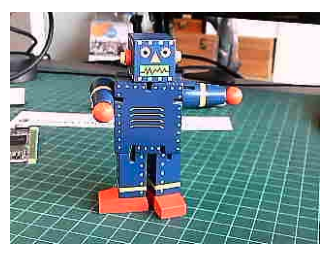{width=60% fig-align="center"}

And perform the pre-processing:

```python
scale, zero_point = input_details[0]["quantization"]
img = img.resize(
    (input_details[0]["shape"][1], input_details[0]["shape"][2])
)
img_array = np.array(img, dtype=np.float32) / 255.0
img_array = (
    (img_array / scale + zero_point).clip(-128, 127).astype(np.int8)
)
input_data = np.expand_dims(img_array, axis=0)
```

Checking the input data, we can verify that the input tensor is compatible with what is expected by the model:

```python
input_data.shape, input_data.dtype
```

```
((1, 160, 160, 3), dtype('int8'))
```

Now perform the inference and calculate the latency of the model:

```python
# Inference on Raspi-Zero
start_time = time.time()
interpreter.set_tensor(input_details[0]["index"], input_data)
interpreter.invoke()
end_time = time.time()
inference_time = (end_time - start_time) * 1000  # Convert
# to milliseconds
print("Inference time: {:.1f}ms".format(inference_time))
```

The model will take around 125 ms to perform the inference in the Raspi-Zero, which is 3 to 4 times longer than a Raspi-5.

Now, we can get the output labels and probabilities. It is also important to note that the model trained on the Edge Impulse Studio has a softmax in its output (different from the original Movilenet V2), and we should use the model's raw output as the “probabilities."

```python
# Obtain results and map them to the classes
predictions = interpreter.get_tensor(output_details[0]["index"])[0]

# Get indices of the top k results
top_k_results = 3
top_k_indices = np.argsort(predictions)[::-1][:top_k_results]

# Get quantization parameters
scale, zero_point = output_details[0]["quantization"]

# Dequantize the output
dequantized_output = (
    predictions.astype(np.float32) - zero_point
) * scale
probabilities = dequantized_output

print("\n\t[PREDICTION]        [Prob]\n")
for i in range(top_k_results):
    print(
        "\t{:20}: {:.2f}%".format(
            labels[top_k_indices[i]],
            probabilities[top_k_indices[i]] * 100,
        )
    )
```

\noindent
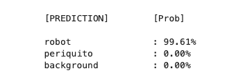{width=65% fig-align="center"}

Modify the function created before so that it handles different types of models:

<div class="scroll-code-block">
```python
def image_classification(
    img_path, model_path, labels, top_k_results=3, apply_softmax=False
):
    # Load the image
    img = Image.open(img_path)
    plt.figure(figsize=(4, 4))
    plt.imshow(img)
    plt.axis("off")

    # Load the LiteRT model
    interpreter = Interpreter(model_path=model_path)
    interpreter.allocate_tensors()

    # Get input and output tensors
    input_details = interpreter.get_input_details()
    output_details = interpreter.get_output_details()

    # Preprocess
    img = img.resize(
        (input_details[0]["shape"][1], input_details[0]["shape"][2])
    )

    input_dtype = input_details[0]["dtype"]

    if input_dtype == np.uint8:
        input_data = np.expand_dims(np.array(img), axis=0)
    elif input_dtype == np.int8:
        scale, zero_point = input_details[0]["quantization"]
        img_array = np.array(img, dtype=np.float32) / 255.0
        img_array = (
            (img_array / scale + zero_point)
            .clip(-128, 127)
            .astype(np.int8)
        )
        input_data = np.expand_dims(img_array, axis=0)
    else:  # float32
        input_data = (
            np.expand_dims(np.array(img, dtype=np.float32), axis=0)
            / 255.0
        )

    # Inference on Raspi-Zero
    start_time = time.time()
    interpreter.set_tensor(input_details[0]["index"], input_data)
    interpreter.invoke()
    end_time = time.time()
    inference_time = (
        end_time - start_time
    ) * 1000  # Convert to milliseconds

    # Obtain results
    predictions = interpreter.get_tensor(output_details[0]["index"])[
        0
    ]

    # Get indices of the top k results
    top_k_indices = np.argsort(predictions)[::-1][:top_k_results]

    # Handle output based on type
    output_dtype = output_details[0]["dtype"]
    if output_dtype in [np.int8, np.uint8]:
        # Dequantize the output
        scale, zero_point = output_details[0]["quantization"]
        predictions = (
            predictions.astype(np.float32) - zero_point
        ) * scale

    if apply_softmax:
        # Apply softmax
        exp_preds = np.exp(predictions - np.max(predictions))
        probabilities = exp_preds / np.sum(exp_preds)
    else:
        probabilities = predictions

    print("\n\t[PREDICTION]        [Prob]\n")
    for i in range(top_k_results):
        print(
            "\t{:20}: {:.1f}%".format(
                labels[top_k_indices[i]],
                probabilities[top_k_indices[i]] * 100,
            )
        )
    print("\n\tInference time: {:.1f}ms".format(inference_time))
```
</div>

And test it with different images and the int8 quantized model (**160x160 alpha = 1.0**).

\noindent
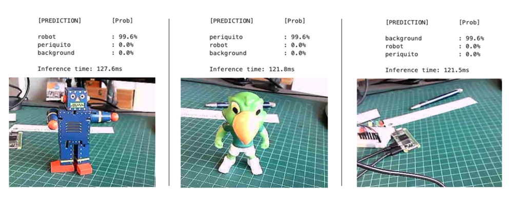

Download a smaller model, such as the one trained for the [Nicla Vision Lab](https://studio.edgeimpulse.com/public/353482/live) (int8 quantized model, $96{\times}96$, alpha = 0.1), as a test. We can use the same function:

\noindent
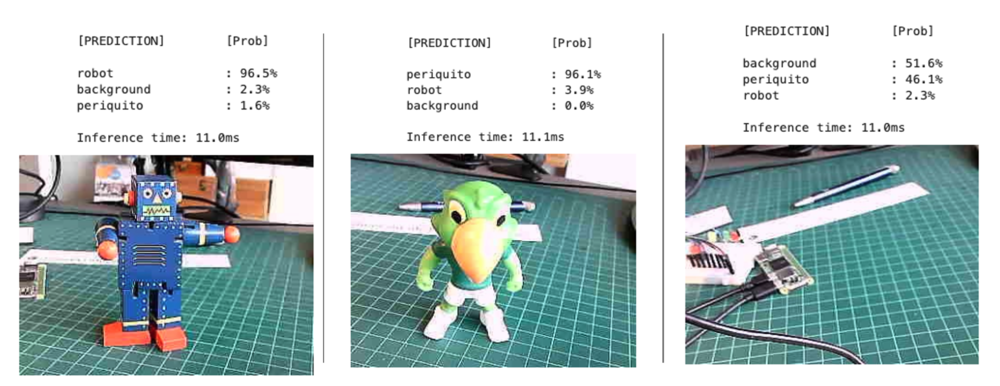

The model lost some accuracy, but it is still acceptable because the task does not require many details. Regarding latency, we are around **ten times faster** on the Raspi-Zero.

> With the Raspberry Pi 5, the latencies are 8 ms and 0.8 ms, respectively.

## Live Image Classification {#sec-image-classification-live-image-classification-aa5d}

Next, build an app that captures images with the USB camera in real time and shows their classification.

Using the nano on the terminal, save the code below, such as `img_class_live_infer.py`.

<div class="scroll-code-block">
```python
from flask import Flask, Response, render_template_string,
                  request, jsonify
from picamera2 import Picamera2
import io
import threading
import time
import numpy as np
from PIL import Image
from ai_edge_litert.interpreter import Interpreter
from queue import Queue

app = Flask(__name__)

# Global variables
picam2 = None
frame = None
frame_lock = threading.Lock()
is_classifying = False
confidence_threshold = 0.8
model_path = "./models/ei-raspi-img-class-int8-quantized-\
                model.tflite"
labels = ['background', 'periquito', 'robot']
interpreter = None
classification_queue = Queue(maxsize=1)

def initialize_camera():
    global picam2
    picam2 = Picamera2()
    config = picam2.create_preview_configuration(
        main={"size": (320, 240)}
    )
    picam2.configure(config)
    picam2.start()
    time.sleep(2)  # Wait for camera to warm up

def get_frame():
    global frame
    while True:
        stream = io.BytesIO()
        picam2.capture_file(stream, format='jpeg')
        with frame_lock:
            frame = stream.getvalue()
        time.sleep(0.1)  # Capture frames more frequently

def generate_frames():
    while True:
        with frame_lock:
            if frame is not None:
                yield (
                   b'--frame\r\n'
                   b'Content-Type: image/jpeg\r\n\r\n'
                   + frame + b'\r\n'
                )
        time.sleep(0.1)

def load_model():
    global interpreter
    if interpreter is None:
        interpreter = Interpreter(model_path=model_path)
        interpreter.allocate_tensors()
    return interpreter

def classify_image(img, interpreter):
    input_details = interpreter.get_input_details()
    output_details = interpreter.get_output_details()

    img = img.resize((input_details[0]['shape'][1],
                      input_details[0]['shape'][2]))
    input_data = np.expand_dims(np.array(img), axis=0)\
    						 .astype(input_details[0]['dtype'])

    interpreter.set_tensor(input_details[0]['index'], input_data)
    interpreter.invoke()

    predictions = interpreter.get_tensor(output_details[0]
                                         ['index'])[0]
    # Handle output based on type
    output_dtype = output_details[0]['dtype']
    if output_dtype in [np.int8, np.uint8]:
        # Dequantize the output
        scale, zero_point = output_details[0]['quantization']
        predictions = (predictions.astype(np.float32) -
                       zero_point) * scale
    return predictions

def classification_worker():
    interpreter = load_model()
    while True:
        if is_classifying:
            with frame_lock:
                if frame is not None:
                    img = Image.open(io.BytesIO(frame))
            predictions = classify_image(img, interpreter)
            max_prob = np.max(predictions)
            if max_prob >= confidence_threshold:
                label = labels[np.argmax(predictions)]
            else:
                label = 'Uncertain'
            classification_queue.put({
                 'label': label,
                 'probability': float(max_prob)
            })
        time.sleep(0.1)  # Adjust based on your needs

@app.route('/')
def index():
   return render_template_string('''
      <!DOCTYPE html>
      <html>
      <head>
          <title>Image Classification</title>
          <script
          	src="https://code.jquery.com/jquery-3.6.0.min.js">
          </script>
          <script>
              function startClassification() {
                  $.post('/start');
                  $('#startBtn').prop('disabled', true);
                  $('#stopBtn').prop('disabled', false);
              }
              function stopClassification() {
                  $.post('/stop');
                  $('#startBtn').prop('disabled', false);
                  $('#stopBtn').prop('disabled', true);
              }
              function updateConfidence() {
                  var confidence = $('#confidence').val();
                  $.post('/update_confidence',
                         {confidence: confidence}
                        );
              }
              function updateClassification() {
                  $.get('/get_classification', function(data) {
                    $('#classification').text(data.label + ': '
                    + data.probability.toFixed(2));
                  });
              }
              $(document).ready(function() {
                  setInterval(updateClassification, 100);
                  // Update every 100ms
              });
          </script>
      </head>
      <body>
          <h1>Image Classification</h1>
          

          <br>
          <button id="startBtn"
                  onclick="startClassification()">
            Start Classification
          </button>

          <button id="stopBtn"
                  onclick="stopClassification()"
                  disabled>
            Stop Classification
          </button>

          <br>
          <label for="confidence">Confidence Threshold:</label>
          <input type="number"
                 id="confidence"
                 name="confidence"
                 min="0" max="1"
                 step="0.1"
                 value="0.8"
                 onchange="updateConfidence()" />

          <br>
          <div id="classification">
             Waiting for classification...
          </div>

      </body>
      </html>
   ''')

@app.route('/video_feed')
def video_feed():
    return Response(
       generate_frames(),
       mimetype='multipart/x-mixed-replace; boundary=frame'
    )

@app.route('/start', methods=['POST'])
def start_classification():
    global is_classifying
    is_classifying = True
    return '', 204

@app.route('/stop', methods=['POST'])
def stop_classification():
    global is_classifying
    is_classifying = False
    return '', 204

@app.route('/update_confidence', methods=['POST'])
def update_confidence():
    global confidence_threshold
    confidence_threshold = float(request.form['confidence'])
    return '', 204

@app.route('/get_classification')
def get_classification():
    if not is_classifying:
        return jsonify({'label': 'Not classifying',
                       'probability': 0})
    try:
        result = classification_queue.get_nowait()
    except Queue.Empty:
        result = {'label': 'Processing', 'probability': 0}
    return jsonify(result)

if __name__ == '__main__':
    initialize_camera()
    threading.Thread(target=get_frame, daemon=True).start()
    threading.Thread(target=classification_worker,
                     daemon=True).start()
    app.run(host='0.0.0.0', port=5000, threaded=True)

```
</div>

On the terminal, run:

```bash
python3 img_class_live_infer.py
```

And access the web interface:

- On the Raspberry Pi itself (if you have a GUI): Open a web browser and go to `http://localhost:5000`
- From another device on the same network: Open a web browser and go to `http://<raspberry_pi_ip>:5000` (Replace `<raspberry_pi_ip>` with your Raspberry Pi's IP address). For example: `http://192.168.4.210:5000/`

Here are some screenshots of the app running on an external desktop

\noindent
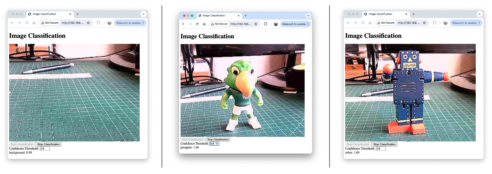

Here, you can see the app running on the YouTube:



The code creates a web application for real-time image classification using a Raspberry Pi, its camera module, and a LiteRT model. The application uses Flask to serve a web interface where you can view the camera feed and see live classification results.

#### Key Components: {#sec-image-classification-key-components-5c7f}

1. **Flask Web Application**: Serves the user interface and handles requests.
2. **PiCamera2**: Captures images from the Raspberry Pi camera module.
3. **LiteRT**: Runs the image classification model.
4. **Threading**: Manages concurrent operations to keep performance smooth.

#### Main Features: {#sec-image-classification-main-features-d78f}

- Live camera feed display
- Real-time image classification
- Adjustable confidence threshold
- Start/Stop classification on demand

#### Code Structure: {#sec-image-classification-code-structure-cf45}

1. **Imports and Setup**:
    - Flask for web application
    - PiCamera2 for camera control
    - LiteRT for inference
    - Threading and Queue for concurrent operations

2. **Global Variables**:
    - Camera and frame management
    - Classification control
    - Model and label information

3. **Camera Functions**:
    - `initialize_camera()`: Sets up the PiCamera2
    - `get_frame()`: Continuously captures frames
    - `generate_frames()`: Yields frames for the web feed

4. **Model Functions**:
    - `load_model()`: Loads the TFLite model
    - `classify_image()`: Performs inference on a single image

5. **Classification Worker**:
    - Runs in a separate thread
    - Continuously classifies frames when active
    - Updates a queue with the latest results

6. **Flask Routes**:
    - `/`: Serves the main HTML page
    - `/video_feed`: Streams the camera feed
    - `/start` and `/stop`: Controls classification
    - `/update_confidence`: Adjusts the confidence threshold
    - `/get_classification`: Returns the latest classification result

7. **HTML Template**:
    - Displays camera feed and classification results
    - Provides controls for starting/stopping and adjusting settings

8. **Main Execution**:
    - Initializes camera and starts necessary threads
    - Runs the Flask application

#### Key Concepts: {#sec-image-classification-key-concepts-d688}

1. **Concurrent Operations**: Using threads to handle camera capture and classification separately from the web server.
2. **Real-time Updates**: Frequent updates to the classification results without page reloads.
3. **Model Reuse**: Loading the TFLite model once and reusing it for efficiency.
4. **Flexible Configuration**: Allowing users to adjust the confidence threshold on the fly.

#### Usage: {#sec-image-classification-usage-6ab4}

1. Ensure all dependencies are installed.
2. Run the script on a Raspberry Pi with a camera module.
3. Access the web interface from a browser using the Raspberry Pi's IP address.
4. Start classification and adjust settings as needed.

## Summary: {#sec-image-classification-summary-084d}

Image classification is a widely used application of machine learning, from healthcare to environmental monitoring. This chapter implemented an image classification system on edge devices like the Raspi-Zero and Raspi-5 and showed that real-time, on-device inference is practical.

The chapter covered the entire pipeline of an image classification project, from data collection and model training with Edge Impulse Studio to deploying the model and running inference on a Raspi. Several points stand out:

1. Proper data collection and preprocessing are needed to train effective models.
2. Transfer learning allows pre-trained models like MobileNet V2 to be reused for efficient training with limited data.
3. Model accuracy trades off against inference speed, which matters most on edge devices.
4. Real-time classification can be served through a web-based interface.

Running these models on edge devices like the Raspi supports IoT applications, autonomous systems, and real-time monitoring. It reduces latency, improves privacy, and allows operation in environments with limited connectivity.

Even with the computational constraints of edge devices, accuracy and speed can both be good. Adjusting model parameters, such as input size and alpha values, allows fine-tuning to meet specific project requirements.

The field of edge AI and image classification continues to evolve rapidly. Advances in model compression, hardware acceleration, and more efficient neural network architectures should further expand what edge devices can do in computer vision.

This project is a foundation for more complex computer vision applications. Whether the goal is industrial automation, smart home applications, or environmental monitoring, the skills and concepts covered here are a starting point for a wide range of projects.

## Resources {#sec-image-classification-resources-e552}

- [Dataset Example](https://github.com/Mjrovai/EdgeML-with-Raspberry-Pi/tree/main/IMG_CLASS/dataset)

- [Setup Test Notebook on a Raspi](https://github.com/Mjrovai/EdgeML-with-Raspberry-Pi/blob/main/IMG_CLASS/notebooks/setup_test.ipynb)

- [Image Classification Notebook on a Raspi](https://github.com/Mjrovai/EdgeML-with-Raspberry-Pi/blob/main/IMG_CLASS/notebooks/10_Image_Classification.ipynb)

- [CNN to classify Cifar-10 dataset at CoLab](https://colab.research.google.com/github/Mjrovai/UNIFEI-IESTI01-TinyML-2022.1/blob/main/00_Curse_Folder/2_Applications_Deploy/Class_16/cifar_10/CNN_Cifar_10_TFLite.ipynb#scrollTo=iiVBUpuHXEtw)

- [Cifar 10 - Image Classification on a Raspi](https://github.com/Mjrovai/EdgeML-with-Raspberry-Pi/blob/main/IMG_CLASS/notebooks/20_Cifar_10_Image_Classification.ipynb)

- [Python Scripts](https://github.com/Mjrovai/EdgeML-with-Raspberry-Pi/tree/main/IMG_CLASS/python_scripts)

- [Edge Impulse Project](https://studio.edgeimpulse.com/public/510251/live)
