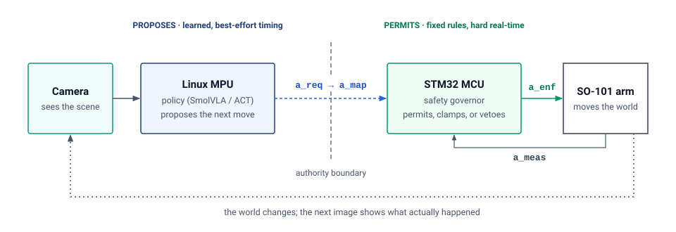
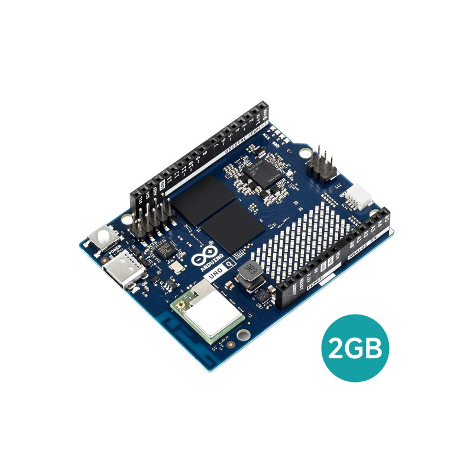
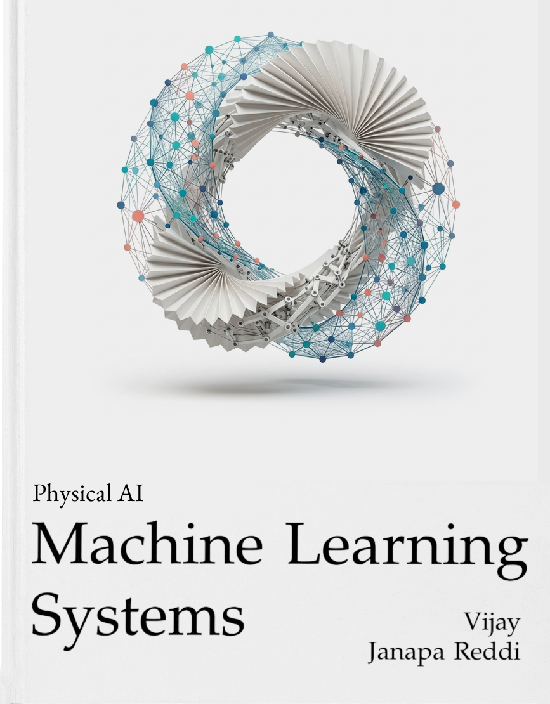
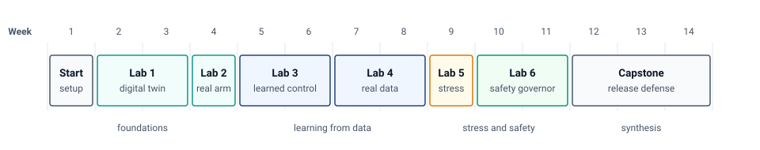

# Volume IV: Physical AI Studio & Hardware Kit (iKit)

**Status:** Official curriculum, hardware architecture, and laboratory studio guide for the [Volume IV Physical AI Seminar](https://mlsysbook.ai/vol4/). Companion to the [MLSysBook Hardware Kits](../../kits/index.qmd) and [Master Course Syllabus](curriculum/syllabus.md).

---

## 1. What This Course Is About

> **"Physical AI begins where computation stops being symbolic and becomes physical force."**

When a chatbot makes a mistake, you retype the prompt. When a robot makes a mistake, something collides, tears, or breaks. **You cannot `Ctrl+Z` physics.** This studio teaches the systems engineering of machines that sense and act, built around one split of responsibility:

1. **A learned brain proposes.** A Vision-Language-Action policy (Hugging Face **SmolVLA** or **ACT**) runs on the UNO Q's Qualcomm Linux processor and proposes the next move.
2. **A deterministic governor permits.** The UNO Q's **STM32** microcontroller checks every proposal against joint limits, speed limits, and a table geofence before it reaches a motor.
3. **A physical body acts.** A 6-DoF **Seeed SO-101** arm moves, and an overhead webcam shows what actually happened.

The four logged actions (`a_req`, `a_map`, `a_enf`, `a_meas`) and the bench wiring are defined once, in the [Station Reference Card](labs/station-reference.md). The pass standard for every lab is the scope test in the [Competency Card](curriculum/student-competencies.md).

---

## 2. The Kit

| Board | Arm | Software | Textbook |
| :---: | :---: | :---: | :---: |
|  |  |  |  |
| **Arduino UNO Q** Linux MPU + STM32 MCU | **Seeed SO-101** 6 smart serial servos | **Hugging Face LeRobot** SmolVLA and ACT | **MLSysBook Volume IV** 17 chapters, 4 parts |

Specifications, wiring, and the three bench rules are on the [Station Reference Card](labs/station-reference.md).

---

## 3. The 14-Week Lab Schedule

Six labs follow the textbook's four parts in order, building from pen-and-paper math through simulation, real hardware, learned control, and finally safety governance. The final three weeks are an open capstone.

| | Lab | Weeks | Book Part & Chapters | What You Will Do |
|:---:|:---|:---:|:---|:---|
| 1 | **[Robot Kinematics & Digital Twin](labs/lab-01-machine-anatomy.md)** | 1–2 | Part I — Ch 1 *Causal Boundary*, Ch 2 *Physical Body* | Understand the math that makes a robot move. Derive inverse kinematics by hand, then build a simulated digital twin and command it with your own equations. |
| 2 | **[From Simulation to Real Hardware](labs/lab-02-teleoperation-and-datasets.md)** | 3–4 | Part I — Ch 3 *Cognitive Brain*, Ch 4 *Nervous System* | Discover what simulation gets wrong. Wire the physical bench, port your IK to the microcontroller, control the real robot via CLI, and measure the gap between sim and reality. |
| 3 | **[Learned Control with Vision-Language-Action Models](labs/lab-03-baseline-and-training.md)** | 5–6 | Part II — Ch 5 *Physical Data*, Ch 6 *Policy Training* | Replace hand-coded equations with a neural policy that learns from data. Run a pre-trained VLA in simulation, then deploy it to the real robot and measure the sim2real performance drop. |
| 4 | **[Real-World Data Collection & Fine-Tuning](labs/lab-04-autonomous-reach.md)** | 7–8 | Part II–III — Ch 7 *Evaluation*, Ch 8 *Perception*, Ch 9 *Spatial Memory* | Bridge the sim2real gap with real data. Teleoperate the robot to collect demonstrations, fine-tune the sim-trained model, and deploy it untethered for fully autonomous operation. |
| 5 | **[Stress-Testing: Prediction, Language & Recovery](labs/lab-05-horizons-and-disturbances.md)** | 9 | Part III — Ch 10 *Grounded Intent*, Ch 11 *Trajectory Planning* | Push the system until it breaks. Test how far ahead the model can predict, whether language changes its behavior, and what happens when you move the target mid-reach. |
| 6 | **[Safety Governor — Build It, Then Break It](labs/lab-06-safety-governor.md)** | 10–11 | Part III–IV — Ch 12 *Safety Enforcement*, Ch 13 *Silicon Placement*, Ch 14 *Intervention*, Ch 15 *Verification*, Ch 16 *Release* | Prove the robot is trustworthy. Program safety barriers on the microcontroller, then try to defeat them by freezing the brain, corrupting packets, and cutting power. |
| | **[Capstone: Physical Release Defense](labs/lab-capstone-studio.md)** | 12–14 | Synthesis — Ch 17 *Epistemic Frontier* | Put it all together. Design your own task, survive a peer team's adversarial attacks, defend your Physical Release Dossier, and generalize the pipeline to a new robot. |

---

## 4. Reference Documents

| Document | Description |
|:---|:---|
| 📋 **[Master Course Syllabus](curriculum/syllabus.md)** | Grading weights, milestones, team roles, and safety contract. |
| 🏷️ **[Physical AI Competency Card](curriculum/student-competencies.md)** | The scope test and the 12-skill rubric signed off at the bench. |
| 🔧 **[Station Reference Card](labs/station-reference.md)** | Bench hardware, software stack, wiring, engineering rules, and telemetry schema. |
