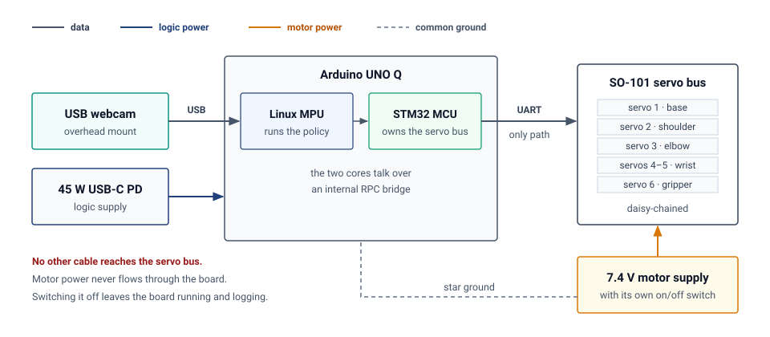

# Physical AI Station Reference Card

**Status:** `draft`. The components are chosen; the specifications below come from vendor pages and still need to be measured on the delivered kit.

This page describes the standard bench station used across all Volume IV labs. Individual labs link here rather than repeating this information.

<!-- STAFF: confirm every spec (rates, resolutions, voltages, limits) on the
     reference station and mark this page bench-verified. -->

---

## The Bench Station



| Component | Role | Key Specs |
|:---|:---|:---|
| **Arduino UNO Q** | Dual-brain compute platform | Qualcomm QRB2210 Linux MPU (4 GB LPDDR4, ARM Cortex-A53) + STM32U585 MCU (160 MHz Cortex-M33); inter-core RPC via `/dev/ttyRPMSG` at 50 Hz |
| **Seeed SO-101 Arm** | 6-DoF robotic manipulator | 6× Feetech STS3215 serial bus smart servos; 3D-printed rigid structure; 19 kg·cm stall torque per joint; 12-bit magnetic contactless encoders (±1.5° repeatability) |
| **Logitech C270 Webcam** | Overhead visual sensor | 720p USB UVC camera; rigid mount at 45° oblique perspective; 30 Hz capture at 224 × 224 RGB via V4L2; locked auto-exposure and white balance |
| **7.4V / 5A DC Supply** | Dedicated servo motor power | Regulated DC bench supply with barrel jack to STS3215 daisy-chain bus; separate positive supply from the logic rail; common star-ground with UNO Q |
| **45W USB-C PD Adapter** | Logic and compute power | Powers QRB2210 Linux, STM32 MCU, and USB peripherals; separate from the motor supply; continued operation during motor cutoff requires qualification of the surviving supply, ground, and controllers |
| **Workbench Clamp** | Physical mount and safety boundary | Arm baseplate clamped rigidly to workbench edge with heavy-duty C-clamps; 300 × 200 mm taped workspace boundary; zero base rocking under max payload |
| **Foam Block Targets** | Manipulation task objects | Compliant colored foam blocks (red, blue, yellow) for safe pick-and-place demonstrations; placed within the marked workspace zone |

---

## The Software Stack

| Layer | Tool | Role |
|:---|:---|:---|
| **Robot learning** | Hugging Face LeRobot | Teleoperation capture, episode recording, training, and deployment loops |
| **Dataset format** | LeRobot Dataset v3 | Parquet + MP4 episodes that carry all four action taps |
| **Policies** | SmolVLA, ACT | SmolVLA conditions on camera, joint state, and a language prompt; ACT predicts multi-step action chunks |
| **Edge runtime** | ONNX Runtime, INT8 | Quantized policy inference on the Qualcomm Linux CPU |
| **Governor firmware** | STM32 C (Arduino App Lab / STM32Cube) | Limits, geofence, watchdog, and the only driver of the servo bus. A staff-written **baseline governor** runs from week 1; students replace it with their own in Lab 6. |

---

## Three Engineering Rules

These invariants apply to every lab and every experiment:

> **Rule 1 — Dual-Power Isolation.** Actuator bus power (7.4V DC) must never flow through the compute logic rails. The two supplies share only a common star ground. Staff must qualify transient coupling and continued logic operation under the declared motor and supply faults; separate positive rails do not eliminate common-ground coupling.

> **Rule 2 — Single Command Path.** The Linux host must NEVER have a physical, electrical, or software bypass directly to the servo bus. All motor commands flow exclusively through the STM32 MCU, which evaluates and permits each proposal before forwarding it to the STS3215 bus.

> **Rule 3 — Strict Separation of Concerns.** Linux proposes intent. The MCU governs physical reality. The independent motor cutoff must remain available under the declared faults. Continued telemetry and logging depend on the surviving logic supply, ground, and controllers. Motor cutoff alone does not establish safe rest for a gravity-loaded arm.

---

## The Four Action Taps

Every lab logs physical actions at four observation points along the authority chain. This multi-tap schema enables students to diagnose exactly where a failure, delay, or safety intervention occurred.

| Tap | Variable | Origin | What It Records |
|:---:|:---|:---|:---|
| **1** | `a_req` | Qualcomm Linux (policy output) | The raw action proposed by the neural policy or human teleoperator |
| **2** | `a_map` | Qualcomm Linux (bus adapter) | The mapped joint-space command after coordinate transformation, sent over inter-core RPC |
| **3** | `a_enf` | STM32 MCU (safety governor) | The enforced command after velocity clamping, geofence checking, and joint-limit evaluation |
| **4** | `a_meas` | STS3215 servo encoders | Encoder-reported joint angles, subject to calibration, quantization, backlash, and sample age |

**Diagnostic principle:** Compare `a_enf` with `a_map` in common coordinates, units, and matched timestamps to identify a governor change. Raw-to-mapped differences alone may reflect the adapter transformation. Compare `a_meas` with the corresponding enforced command at the appropriate sample time to assess tracking; a mismatch may reflect mechanical compliance, stall, disturbance, or measurement error.

---

## Standard Telemetry CSV Format

All labs log telemetry in a common CSV format:

```csv
timestamp_us, a_req_j1, ..., a_req_j6, a_map_j1, ..., a_map_j6, a_enf_j1, ..., a_enf_j6, a_meas_j1, ..., a_meas_j6, cam_frame_id, watchdog_ok
```

The common trace time is expressed in STM32 SysTick microseconds. Camera frame IDs identify the RGB frames; alignment also requires a recorded association between their acquisition timestamps and that clock. Retain sensor acquisition times and clock-alignment uncertainty alongside the trace so a row timestamp does not conceal observation age.
