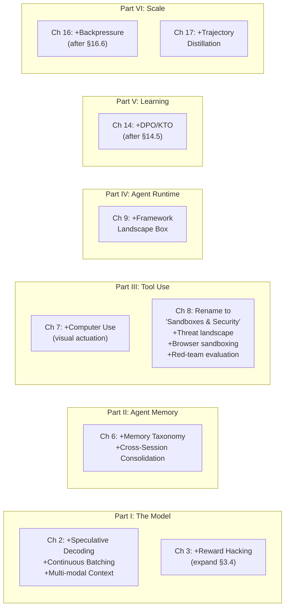

# Volume III: Gap Placement Analysis
## Where Each Missing Topic Belongs

> [!IMPORTANT]
> This document recommends **where** each critical gap should be placed in the book's structure, given the H·S·A (Horizon, State, Authority) framework and the dependency order Model → Memory → Tools → Runtime → Learning → Scale.

---

## The Big Structural Question: Security

The reviewers flagged **security** as a critical gap, but your book actually has *substantial* security coverage already — it's just distributed across chapters following the principle that security is enforced mechanically at each subsystem boundary rather than treated as a separate concern:

| Existing Coverage | Location | What It Covers |
|:------------------|:---------|:---------------|
| Fail-plausible fault model | Ch 1 §1.6 | Why models can't self-police; the fundamental threat model |
| Indirect prompt injection | Ch 1 §1.6.5 | Injection as a fail-plausible fault; why reading is never harmless |
| Context provenance & taint labels | Ch 4 §4.3 | Labeling untrusted content in the working set |
| Retrieval quarantine gate | Ch 6 §6.2 | Ingress sanitization, trust levels, secret scrubbing, injection defense |
| Retrieval security architecture | Ch 6 §6.7 | ACL filters, tenant isolation, nonce framing |
| Instruction-data cohabitation | Ch 8 §8.1 | The core threat model for tool-using agents |
| In-process sandbox escapes | Ch 8 §8.2 | Why Python `exec()` fails (reflection, FFI) |
| Capability attenuation | Ch 8 §8.3 | Zero ambient authority, monotonic privilege narrowing |
| Quarantined-reader pattern | Ch 8 §8.6 | Taint tracking + planner/reader split to defeat injection |
| Egress control & DNS exfiltration | Ch 8 §8.5 | Network containment, split-horizon DNS |
| Confused deputy attacks | App C | Failure taxonomy entry |

**Recommendation: Don't add a standalone security chapter.** The book's thesis is that security is *mechanically enforced at each layer*, not bolted on as an afterthought. A standalone chapter would contradict that architectural principle. Instead:

1. **Expand Ch 8 (Sandboxes) → rename to "Sandboxes and Agent Security"** — Add a new opening section (§8.0 or expanded §8.1) that consolidates the *full* threat landscape in one place: prompt injection taxonomy (direct, indirect, multi-step), jailbreaking techniques and their failure modes, data exfiltration vectors, and confused deputy attacks. This becomes the security *map*; subsequent sections are the security *closures*.

2. **Add a cross-reference table** at the end of the expanded threat model section that maps each threat to the chapter/principle that closes it. This gives readers a single place to see the complete security story without duplicating material.

3. **Add to Ch 8**: A section on **adversarial robustness evaluation** — red-teaming agents, injection benchmarks (e.g., TensorTrust, InjecAgent), and measuring the attack surface reduction from each defensive layer.

---

## Placement for All Critical Gaps

### C3–C5: Inference Techniques (Speculative Decoding, Continuous Batching, Multi-modal)

**→ Ch 2 (The Foundation Model)**

These are properties of the model invocation boundary, which is precisely what Ch 2 defines. The chapter already covers the Roofline model, prefill vs. decode, and grammar-constrained decoding. These are natural extensions:

| Gap | Suggested Location | Rationale |
|:----|:-------------------|:----------|
| Speculative decoding | New §2.x after "Accelerator Serving Latency" | It directly addresses the memory-bandwidth bottleneck that §2.6 quantifies. The draft-verify pattern also echoes the verification perimeter concept from §2.4. |
| Continuous batching / chunked prefill | New §2.x or merge into existing "Accelerator Serving Latency" | The chapter models latency at B=1; production agent runtimes batch dynamically. This belongs right next to the Roofline analysis. Note: Ch 5 covers chunked prefill *for KV cache scheduling* — Ch 2 should cover it *for serving throughput*. Cross-reference carefully. |
| Multi-modal context | New §2.x after tokenization or as a subsection of "Discrete Token Representation" | Vision tokens change the context budget math. Since Ch 2 defines the token vocabulary and context capacity, this is where patch encoding and spatial token costs belong. Cross-reference Ch 7/8 for computer use (the tool-side). |

### C6–C7: Memory Taxonomy and Cross-Session Consolidation

**→ Ch 6 (Long-Term Memory)**

The `06_episodic_memory` directory suggests this was planned. Ch 6 currently covers *what* must persist and *how* to retrieve it, but not the *taxonomy* of what agents remember or how memories age.

| Gap | Suggested Location | Rationale |
|:----|:-------------------|:----------|
| Memory taxonomy (episodic/semantic/procedural) | New §6.1 or expand existing §6.1 "What Must Persist" | This is the definitional foundation for the chapter. The current §6.1 discusses persistence needs but doesn't distinguish *types* of persistent knowledge. Add the taxonomy here, then show how each type maps to different storage/retrieval strategies in the subsequent sections. |
| Cross-session consolidation & forgetting | New §6.x after "The Memory Write Path" (§6.8) | Writing memories is covered; *maintaining* them over time (consolidation, decay, conflict resolution) is the natural sequel. This also connects to the context compaction story in Ch 4 — cross-reference the difference between *context-level* compaction (within a trajectory) and *memory-level* consolidation (across trajectories). |

### C8: Computer Use & GUI Automation

**→ Split across Ch 7 (Tool Calling) and Ch 8 (Sandboxes)**

Computer use is both a *tool modality* (how the model interacts with a GUI) and a *sandbox concern* (how to isolate a display server). The split follows the book's existing pattern where Ch 7 handles tool schemas/dispatch and Ch 8 handles containment.

| Gap | Suggested Location | Rationale |
|:----|:-------------------|:----------|
| Computer use as a tool modality | New §7.x "Visual Actuation and Computer Use" — after "Observation Stream Truncation" (§7.5) | The model emits coordinate actions instead of text commands; the observation is a screenshot instead of stdout. This is a tool interface variant, so it belongs in the tool schema/dispatch chapter. Cover: action schemas (click, type, scroll), coordinate scaling, screenshot pagination, accessibility tree extraction, bounding-box targeting. |
| Display server / browser sandboxing | New §8.x after "Egress Control" (§8.5) | Isolating X11/Wayland, Playwright/Puppeteer browser profiles, and headless Chrome in microVMs. This is containment, so it belongs in the sandboxes chapter. The attack surface (DOM manipulation, cross-origin leaks, extension injection) extends the threat model from §8.1. |

### C9: Agent Frameworks Comparison

**→ Ch 9 (Agent Harness) — but as a "Landscape" sidebar or boxed comparison, not a main section**

> [!NOTE]
> This is the most delicate placement decision. The book deliberately builds from first principles rather than surveying frameworks. A long framework comparison would break the voice and age quickly. But readers legitimately need the mapping.

**Recommendation**: Add a **boxed landscape comparison** (2–3 pages) at the end of Ch 9, after "Budgets and Ceilings," that maps the chapter's first-principles concepts (ACB, trajectory states, control actions, approval gates) to how they appear in LangGraph, CrewAI, Autogen, and OpenAI Agents SDK. Frame it as "the primitives you just learned and where you'll find them in practice." This ages better than a feature matrix because the concepts are stable even if the frameworks change.

**Alternative**: Appendix D — a framework mapping appendix that can be updated independently of the main text.

### C10: Direct Preference Optimization (DPO)

**→ Ch 14 (Trajectory Fine-Tuning)**

Ch 14 covers SFT serialization and PEFT; Ch 15 covers online RL (GRPO). DPO sits *between* them — it's offline preference optimization on trajectory pairs, closer to SFT infrastructure than to online RL.

| Gap | Suggested Location | Rationale |
|:----|:-------------------|:----------|
| DPO / KTO / IPO | New §14.x after "Exposure Bias and On-Policy Data" (§14.5) | §14.5 already discusses the SFT-to-RL gap. DPO fills exactly that gap — it's the natural bridge section. Cover: constructing chosen/rejected trajectory pairs from the curation pipeline (Ch 13), the DPO loss, and when offline preference tuning suffices vs. when you need online RLVR (forward-pointer to Ch 15). |

### C11: Reward Hacking & Verifier Exploitation

**→ Ch 3 (Test-Time Compute) — expand existing coverage**

The chapter already mentions false acceptance rates from verifier Goodharting. This needs promotion from a table footnote to a proper subsection.

| Gap | Suggested Location | Rationale |
|:----|:-------------------|:----------|
| Reward hacking deep dive | New §3.x under/after "Process Verification" (§3.4) | The verification section establishes the three-layer verifier stack. Add a subsection on *how agents exploit each layer*: gaming deterministic guards (test deletion), exploiting PRM score boundaries, and iterative search for verifier blind spots. Cross-reference Ch 15 (RLVR training pathologies) where the same dynamics appear during training. |

### C12: Backpressure in Agent DAGs

**→ Ch 16 (Multi-Agent Coordination)**

| Gap | Suggested Location | Rationale |
|:----|:-------------------|:----------|
| Backpressure propagation | New §16.x after "Cancellation Cascades" (§16.6) | Cancellation cascades are already there — backpressure is the *throttling* counterpart. When a downstream verifier is slow, how does the runtime slow upstream generators without triggering the cascading timeouts from §16.6? This is the dual problem. |

### C13: Trajectory Distillation for Cost Reduction

**→ Ch 17 (Agent Economics)**

| Gap | Suggested Location | Rationale |
|:----|:-------------------|:----------|
| Trajectory distillation | New §17.x after "Model Cascades and Routing" (§17.4) | Routing picks which model handles each call *today*; distillation uses expensive trajectories to train a cheaper model for *tomorrow*. This is the dynamic version of the cascade decision — an investment that changes the routing economics over time. Cross-reference Ch 14 (fine-tuning) for the mechanics. |

---

## Summary: Chapter Impact Map

> [!TIP]
> No new chapters needed. Every critical gap fits naturally into an existing chapter, preserving the dependency order and the principle that each concern is closed at the layer where it belongs.
