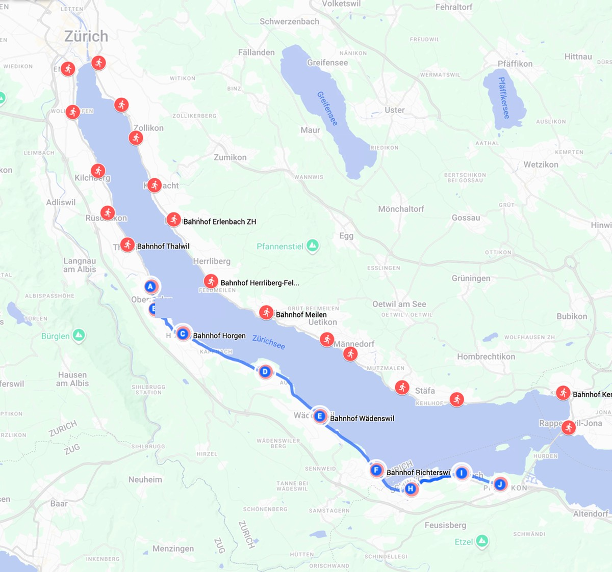
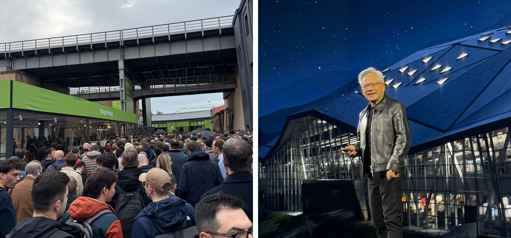
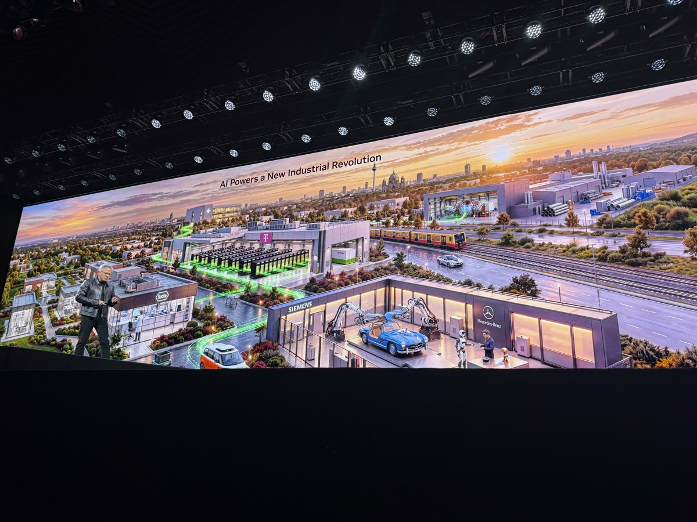
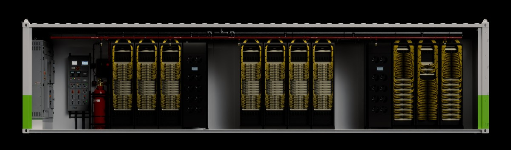
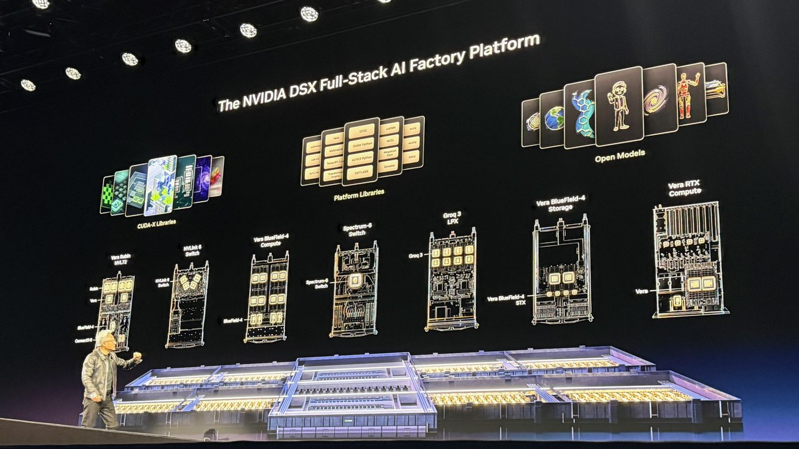
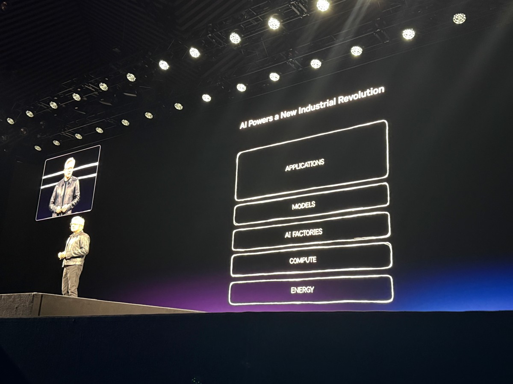
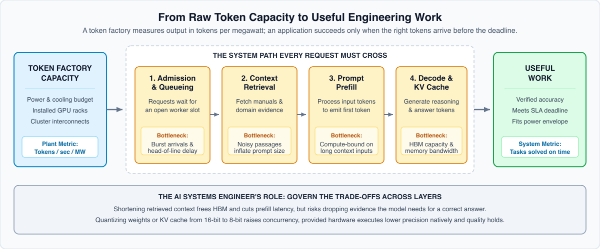

<!-- buttondown-editor-mode: plaintext -->

*From the Author's Desk at [MLSysBook.ai](https://mlsysbook.ai) · Field notes on building **AI Engineering** as a teachable discipline, connecting how modern AI systems are built and operated in industry to the first principles we teach the next generation.*

---

## Hello 👋 from Zürich

Let me get personal for a moment. It has been a while since my last newsletter. Earlier this year, my family and I moved from Boston to Zürich for my academic sabbatical from Harvard at ETH Zürich, and relocating a household across the Atlantic took time. Now that we are settled in, I am finally getting back into a regular rhythm at this desk.

Outside of work, I set myself a personal project for the sabbatical: running all the way around Lake Zürich before our year here ends. I am not a runner, which is the point. Our kids are 7 and 11, and I wanted to show them that we do hard things even when we start from scratch.

True to form for a systems person, I broke the loop into 28 train-station checkpoints. Every week or two I run the next leg along the shore, and the kids ride the S-Bahn down to meet me at the finish stop. As the blue line at the bottom of the map shows, I have reached the southern tip of the lake. My next leg crosses the causeway to Rapperswil on the other side, and I plan to send the next issue as soon as I make that crossing. Wish me luck!

**One station at a time around Lake Zürich.** My running map around the Zürichsee, broken into 28 train-station checkpoints (red pins) with the completed legs marked in blue along the southwest shore.

## NVIDIA GTC Berlin: From Steam Engines to Token Factories

Between runs around the lake, being based in Zürich makes it easy to reach the rest of Europe. Last week I traveled north to Berlin for NVIDIA GTC at STATION Berlin, a historic railway depot where a long morning line of engineers, researchers, and founders stretched beneath the elevated steel viaduct well before the keynote doors opened.

**On the ground in Berlin.** The morning line outside STATION Berlin (left), and Jensen Huang taking the keynote stage (right).

Walking the floor in Berlin brought me back to an observation from the first essay in this series, [The Shift Toward AI Engineering](https://mlsysbook.ai/newsletter/posts/2026/2026-01-27_the-shift-toward-ai-engineering.html). If AI is the new electricity, we have been training almost everyone to use the appliances, while very few people learn how to build and operate the power plants.

In Berlin, that comparison ceased to be a metaphor. Across the keynote and technical sessions, Jensen Huang framed the current moment as a new Industrial Revolution centered on the **AI factory**, a specialized manufacturing plant whose commodity output is **tokens**. A traditional cloud data center stores files and runs thousands of independent software services for different tenants. An AI factory takes electrical power and data as raw inputs and manufactures a continuous stream of tokens: floating-point representations of intelligence that translate into words, software code, molecular structures, video frames, or robot control actions.

Just as electrical utilities came to measure and price their output in kilowatt-hours, AI factories measure output in tokens generated per megawatt and per dollar. As reasoning models and agentic workflows generate hundreds or thousands of intermediate tokens before returning a single answer, token demand has surged. One keynote chart tracking agentic traffic across [OpenRouter](https://openrouter.ai/rankings) showed weekly token consumption rising 34-fold since the start of February, climbing from 3.9 trillion to 132.6 trillion tokens per week by early October. Token generation has become a heavy industrial production problem.

**The AI factory and the token surge behind it.** The GTC Berlin keynote framed AI infrastructure as a token factory for European industrial partners including Siemens, Mercedes-Benz, Roche, and Deutsche Telekom (left), driven by a 34-fold surge in weekly agentic token traffic on OpenRouter (right).

Listening to these announcements as an educator raises a practical question. If industry is building token factories at this scale, we need to train the AI engineers who can design and operate them, and we need to keep that training accessible to learners everywhere.

Every past industrial transition faced that same human bottleneck. In the first Industrial Revolution, James Watt's steam engine converted coal into mechanical force, yet early steam plants wasted most of their fuel or failed under pressure until thermodynamics and mechanical engineering emerged to govern boilers, heat transfer, and control governors. A century later, electrical power grids forced electrical engineering to split from physics, and Henry Ford's moving assembly lines required a new discipline of industrial systems engineering.

Before Ford, skilled artisans built one carriage at a time on a workbench. Once production moved to an integrated assembly line, a bottleneck or tolerance error at a single station stalled the entire plant. Machine learning today sits in that exact transition. Most courses and tutorials still train people like artisans at a workbench, tuning a single model inside a notebook, while industry is bolting down continuous token factories.

## What Arrives When a Token Factory Ships in a Container

In Berlin, NVIDIA [introduced DSX POD](https://nvidianews.nvidia.com/news/nvidia-introduces-dsx-pod-ai-factories-to-accelerate-europes-infrastructure-deployment), a reference design for complete Vera Rubin AI factories that ecosystem partners build and test inside modular containers before delivery. Inside each container, the compute racks, fiber-optic networking, power distribution busbars, fire suppression, and liquid cooling manifolds are wired, plumbed, and functionally tested on the manufacturing floor. Moving that integration out of the field reduces on-site installation at a prepared site from roughly six months to 14 days, with partner deliveries planned for early 2027.

**A token factory inside a shipping container.** The NVIDIA DSX POD reference design pre-integrates Vera Rubin racks, networking cabling, power distribution, and liquid cooling manifolds on the factory floor before transport. (Image: NVIDIA)

Pre-integrating those modules is an economic decision. A gigawatt-scale facility represents tens of billions of dollars in capital, and it earns a return only once it begins generating tokens. Every month spent pulling cables on site leaves that capital idle.

A single container is only one module inside a much larger machine. Across a full-scale warehouse under the DSX platform, seven distinct rack architectures drop into the facility together, spanning [Vera Rubin NVL72](https://www.nvidia.com/en-us/data-center/vera-rubin-nvl72/) compute nodes, [NVLink 6](https://www.nvidia.com/en-us/data-center/nvlink/) and [Spectrum-6](https://www.nvidia.com/en-us/networking/products/ethernet/) switches, [BlueField-4](https://developer.nvidia.com/blog/nvidia-bluefield-4-powers-new-scale-in-network-infrastructure-for-agentic-ai-factories/) compute and storage racks, and [Groq 3 LPX](https://www.nvidia.com/en-us/data-center/lpx/) inference racks, all paired with [CUDA-X libraries](https://www.nvidia.com/en-us/technologies/cuda-x/), platform runtimes, and open models.

**All the pieces dropping into the warehouse.** The full-stack AI factory combines seven specialized compute, switching, inference, and storage rack architectures with three layers of software libraries and models inside a single facility.

Compressing on-site installation from six months to two weeks removes construction as the bottleneck and exposes the systems engineering problem underneath. Once the racks are bolted into the warehouse and connected to site power, water, and networking, sustained output depends on the engineers operating the line. Hardware assembly can be containerized on a manufacturing floor, but the engineering judgment required to run changing workloads across that warehouse cannot.

## From Energy to Tokens: The Stack Expands Downward

Earlier essays in this series ([The Builder's Gap](https://mlsysbook.ai/newsletter/posts/2026/2026-04-21_the-builders-gap.html) and [From the Builder's Gap to a Builder's Stack](https://mlsysbook.ai/newsletter/posts/2026/2026-05-19_from-the-builders-gap-to-a-builders-stack.html)) traced how failures cross four layers inside a single machine, from hardware through the runtime and framework to the application. Scaling from a single machine to a fleet extends that stack downward into the physical plant. In Berlin, the fleet stack was presented on stage as five layers: **Energy**, **Compute**, **AI Factories**, **Models**, and **Applications**.

**The five-layer stack in Berlin.** Applications sit above Models, AI Factories, Compute, and Energy. Decisions at the application layer activate physical constraints all the way down to the power grid.

In most regions, electrical power sets the hard ceiling on how much compute an operator can deploy. Measurements released with the [NVIDIA DSX platform](https://nvidianews.nvidia.com/news/european-ecosystem-builds-worlds-most-efficient-ai-factories-with-nvidia-dsx) show how directly software scheduling now governs that ceiling. Dynamic power allocation (DSX MaxLPS) lets an operator generate the same number of tokens with up to 30 percent less power. In a proof of concept on HGX B200 systems, Lambda used that headroom to raise cluster token throughput by 24 percent and run 19 percent more GPUs within a fixed power budget.

Cooling and grid stability follow the same pattern. Because Vera Rubin infrastructure supports liquid cooling with inlet temperatures up to 45 degrees Celsius, dry coolers can reject heat into ambient air without evaporative towers, saving up to 54 million liters of water per day at 2-gigawatt scale. In a [trial with the U.K. National Grid, Nebius, Emerald AI, and EPRI](https://www.nvidia.com/en-us/case-studies/emerald-ai/), a Blackwell Ultra cluster reduced its power draw by up to 40 percent during simulated grid events while keeping critical workloads running.

Power provisioning, coolant temperatures, and grid demand response once belonged entirely to facilities staff. Inside a token factory, those physical limits interact directly with batch sizes, admission control, and cluster scheduling. The unit of computer architecture has expanded from the chip and the server to the entire energy-to-token conversion pipeline.

## Why Manufacturing Tokens Is Only Half the Problem

Measuring an AI factory in tokens per second per megawatt captures raw plant capacity, yet raw token volume does not tell us whether an application succeeds. An electrical power plant can measure its output in kilowatt-hours because every electron delivered to the grid performs the same physical work.

Tokens do not share that property. A thousand tokens generated from irrelevant retrieved documents, or a thousand reasoning tokens that arrive after an industrial control deadline has passed, consume the same electricity, memory bandwidth, and cooling capacity as a thousand tokens that solve a user's problem on time.

Consider an engineering assistant that retrieves maintenance manuals and answers diagnostic questions for field technicians. During a small demonstration, each query arrives alone, retrieves a brief passage, and returns an accurate answer within the deadline. When a shift begins and hundreds of technicians submit queries at once, response times degrade even though the model weights and the cluster hardware have not changed.

To diagnose that slowdown, an engineer has to look past aggregate token throughput and trace each request across four stages: waiting in an admission queue, retrieving documents, processing the prompt during prefill, and generating output tokens step by step during decoding. Longer retrieved passages and multi-step reasoning chains enlarge the key-value (KV) cache that each active request holds in high-bandwidth memory. Once high-bandwidth memory fills with KV-cache state, the serving runtime must restrict batch concurrency, which lowers arithmetic utilization on the accelerators and lengthens the queue of users waiting outside them.

**From raw token capacity to useful engineering work.** A token factory measures output in tokens per second per megawatt, whereas an application succeeds only when accurate answers clear admission, retrieval, prefill, and decoding within the response deadline.

Every candidate fix trades one system requirement against another. Shortening the retrieved context frees memory and reduces time to first token, but it can cut the passage the model needs to give a correct maintenance instruction. Quantizing weights or KV-cache entries from 16 bits to 8 bits fits more concurrent requests into memory, provided the hardware executes the lower-precision format natively and answer quality holds on edge cases. The factory manufactures raw tokens, while the AI systems engineer balances these competing effects across model, runtime, and hardware to turn token capacity into dependable work.

## The Builder's Gap Inside the Factory

In [The Builder's Gap](https://mlsysbook.ai/newsletter/posts/2026/2026-04-21_the-builders-gap.html), I described a core asymmetry of machine learning systems: failures propagate upward through the stack, whereas understanding must flow downward. At the scale of an AI factory, that asymmetry crosses organizational boundaries as well as technical layers.

As we saw in [The Model Is Not the Product](https://mlsysbook.ai/newsletter/posts/2026/2026-03-10_the-model-is-not-the-product.html), Meta [recorded 419 unexpected hardware interruptions](https://arxiv.org/abs/2407.21783) during the 54-day training run for Llama 3 across 16,384 H100 GPUs, or roughly one failure every three hours. In an installation of that size, application engineers track task accuracy, runtime engineers track batching and memory allocation, network engineers track collective communication and tail latency, and facility engineers track rack power and cooling loops. When a service misses its deadline or exceeds its power budget, the symptom appears at the top of the stack while the cause sits several layers below.

No individual engineer needs to design every subsystem from the transformer architecture down to the heat exchangers. A functioning engineering organization, however, needs a shared systems vocabulary so specialists can connect the evidence each role sees.

Historically, courses in this field have split between a compute-stack tradition and an operational MLOps tradition, leaving out data center infrastructure, energy, safety assurance, and physical AI. The [ML Systems Taxonomy](https://mlsysbook.ai/taxonomy/) brings those traditions together into an open map of 101 subjects and 735 concepts across foundations, the system stack, the lifecycle, system qualities, and system types.

## Teaching the Physics Behind the Factory

Training AI engineers for this environment does not require placing a shipping-container cluster on every campus or inside every company. The physical laws that govern a gigawatt token factory are the same laws that govern a laptop or a thirty-dollar microcontroller, scaled across orders of magnitude. Memory capacity still determines whether weights and working state fit on the device. Memory bandwidth relative to arithmetic throughput still determines whether a processor spends its cycles computing or waiting on data movement. Queueing and scheduling still determine how shared hardware translates into individual response times.

That continuity is the foundation of [Machine Learning Systems](https://mlsysbook.ai). Any student, developer, or practicing engineer can calculate analytical bottlenecks, build framework components from scratch, and deploy models onto constrained microcontroller kits without access to a billion-dollar cluster. Across all of those settings, the engineering habit is the same: predict the physical limit, measure the system at its boundaries, explain the gap between prediction and observation, and defend the resulting trade-off.

Over the next two essays, we will follow this thread from the factory floor into daily engineering practice and classroom design. The next essay traces a single request through an AI service to show where waiting and execution accumulate across the stack, and the third examines how we can teach and grade the decisions an AI systems engineer must defend.

## Continuing the Conversation

I want this newsletter to be a two-way exchange with the engineers, researchers, and educators who read it. Selecting one of the options in the quick poll below records your response in a single click, and the confirmation page includes an optional box if you would like to add a brief note.

{{ survey.gtc_berlin_ai_engineering_poll }}

If you have a minute, reply directly to this email with a concrete example from your work or classroom: a time when a model looked fine in isolation, but failed or slowed down once it was deployed as part of a larger system. I read every reply, and the cases you share will help shape the next issue once I cross to the other side of Lake Zürich.

Vijay

---

*P.S. If you found this essay useful, please feel free to share it with a colleague who is building AI infrastructure, moving models from notebooks into production, or designing an AI systems course around [MLSysBook](https://mlsysbook.ai), the [ML Systems Taxonomy](https://mlsysbook.ai/taxonomy/), and the [Instructor Hub](https://mlsysbook.ai/instructors/).*

[MLSysBook](https://mlsysbook.ai) · [Taxonomy](https://mlsysbook.ai/taxonomy/) · [TinyTorch](https://mlsysbook.ai/tinytorch/) · [MLSys·im](https://mlsysbook.ai/mlsysim/) · [StaffML](https://mlsysbook.ai/staffml/) · [Subscribe](https://mlsysbook.ai/newsletter/) · [GitHub](https://github.com/harvard-edge/cs249r_book)
