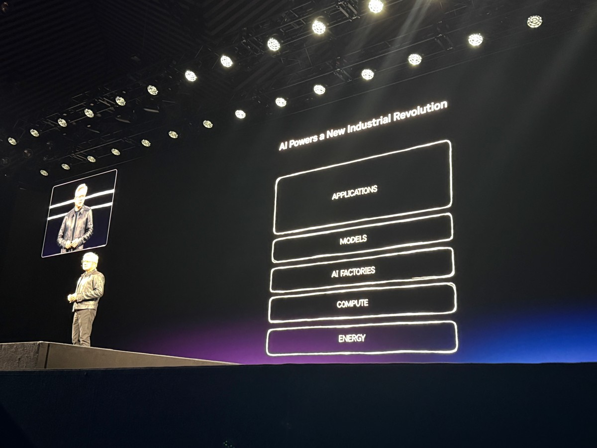
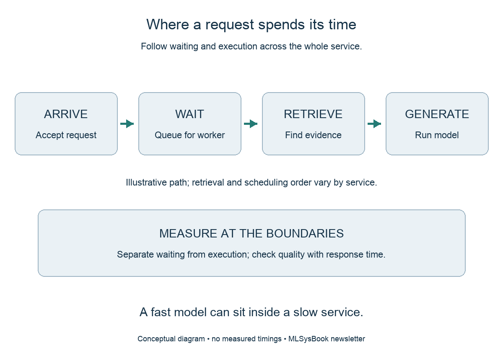

<!-- buttondown-editor-mode: plaintext -->

*From the Author's Desk at [MLSysBook.ai](https://mlsysbook.ai) · Field notes on building **AI Engineering** as a teachable discipline, connecting how modern AI systems are built and operated in industry to the first principles we teach the next generation.*

---

## From the Other Side of Lake Zürich

In the last issue, I promised to write again once I crossed Lake Zürich to Rapperswil. This past weekend I ran across the Seedamm causeway to reach the eastern shore, and the kids rode the S-Bahn out to meet me at the Rapperswil station at the end of the boardwalk. With the southern tip of the lake behind us, the next legs turn north along the eastern shore back toward Zürich.

## Following One Request Across the Stack

In the [previous essay](https://mlsysbook.ai/newsletter/), I wrote from NVIDIA GTC Berlin about the rise of the AI factory, an industrial installation designed to convert electrical power and data into a continuous stream of tokens. Operators measure the capacity of that facility in tokens generated per second per megawatt. A person using an application built on that facility, however, never experiences aggregate cluster throughput. The user experiences the wall-clock time of a single request from submission to completion.

As I argued in [The Model Is Not the Product](https://mlsysbook.ai/newsletter/posts/2026/2026-03-10_the-model-is-not-the-product.html), the model weights account for only a fraction of what determines whether a production system succeeds. The surrounding serving, retrieval, and orchestration infrastructure governs both cost and reliability across every layer of the stack.

**A single request crosses every layer of the stack.** The GTC Berlin keynote placed Applications above Models, AI Factories, Compute, and Energy. A live request traverses those boundaries on every call.

Following a single request gives an AI engineer a concrete diagnostic starting point across that surrounding system. Before an answer appears on a screen or actuates a machine, a request accepts network input, waits for an available worker, retrieves supporting context, processes the prompt to produce its first token, and decodes subsequent tokens one step at a time. A response deadline belongs to that entire path. Measuring the model in isolation leaves most of the deadline unexplained.

**Follow the complete request.** A request path separates time spent waiting in queues from time spent retrieving context and generating tokens.

## Where Time Accumulates Along the Path

Consider a production service whose responses slow down whenever traffic peaks at the start of a workday. The model itself may execute each batch in nearly the same time as it did during quiet hours. Individual requests still miss their deadlines because they spend longer waiting in an admission queue for an available worker. In that regime, the queue has grown even though model execution speed has remained steady.

Separating waiting time from execution time changes which intervention makes sense. Optimizing a matrix multiplication kernel inside the model helps the queue only to the extent that it frees workers sooner. Reducing unnecessary work before the model, adjusting batching and admission rules, or adding serving capacity addresses queueing delay directly, and each option carries a different cost.

Recording timestamps at the boundaries between stages allows an engineer to distinguish time spent waiting from time spent computing. Those boundary measurements also expose whether a small fraction of long-tail requests is being hidden by an acceptable average latency.

Even inside the model execution stage, token generation divides into two distinct physical regimes. During the **prefill** phase, the accelerator processes all input tokens from the user prompt and retrieved documents in parallel to produce the first output token, which makes prefill largely compute bound on long inputs. During the **decode** phase, the model generates one token at a time, reading the model weights and the growing key-value (KV) cache from high-bandwidth memory on every step, which makes decoding largely memory-bandwidth bound. A service that feels sluggish before the first word appears has a different bottleneck from a service that pauses between words once generation begins.

## An Improvement Must Survive the Whole Service

Because a request crosses multiple stages, an optimization that improves one component in isolation must still be evaluated across the complete service. Suppose an engineering team reduces model weight precision from 16 bits to 8 bits to conserve high-bandwidth memory, a trade-off we first examined on a single node in [The Builder's Gap](https://mlsysbook.ai/newsletter/posts/2026/2026-04-21_the-builders-gap.html). The smaller memory footprint frees capacity for larger KV caches and allows more concurrent requests to share an accelerator.

Whether end-to-end response time improves depends on the processor's native support for 8-bit arithmetic, the overhead of the runtime kernels, and how the scheduler uses the newly available memory. At the same time, the team must verify that the lower-precision representation preserves answer quality on the domain tasks the application actually performs.

The same end-to-end discipline governs retrieval and reasoning depth. Returning additional source documents from a vector index can help a model answer a complex technical question, but those extra passages lengthen the input prompt, increase prefill computation, and expand the KV cache held in memory throughout decoding. Allowing a reasoning model to generate hundreds of intermediate chain-of-thought tokens before answering can improve accuracy on hard problems, yet those hidden tokens consume decode bandwidth and occupy worker slots that other requests are waiting to use. An engineering change succeeds only when the gain in answer quality justifies the additional time, memory, and power consumed along the path.

## A Practical Investigation

Return to the maintenance assistant introduced in the Berlin essay, which helps field technicians diagnose equipment faults using technical manuals. Suppose response latency spikes whenever a shift begins and dozens of technicians submit questions simultaneously. A disciplined investigation starts by instrumenting four boundary timestamps for every request: when the request arrives at the gateway, when document retrieval starts and finishes, when model prefill begins and emits the first token, and when the final token is delivered.

Alongside those timestamps, the engineer records the work each request demands, including input token count, retrieved document count, generated output token count, and whether the request was retried or canceled. Without those measurements, two requests that perform very different amounts of work can be misread as unstable system performance.

Comparing busy periods against quiet periods for requests of similar length reveals where the additional delay enters. If the extra time accumulates before prefill begins, the investigation focuses on admission queues, worker concurrency, and KV-cache capacity. If execution time per token degrades during busy periods, the investigation turns to batch composition, memory bandwidth contention, and network traffic across nodes.

## Choosing an Intervention and Accounting for Its Cost

Once measurements identify the dominant source of delay, the engineer must select an intervention and account for its trade-offs across the whole user population. If queueing delay dominates because long-context requests monopolize workers, the team might cap maximum concurrency so that admitted requests receive predictable latency. That policy protects active users, but it also forces excess arrivals to wait outside the service or receive a retry message. A complete engineering evaluation must report those rejected or delayed arrivals alongside the latency of completed requests. Otherwise, the service appears faster merely because it stopped accepting hard work.

Alternatively, the team might separate short interactive queries from long diagnostic runs, routing each class to its own worker pool or scheduling queue. Isolating short requests prevents them from stalling behind multi-thousand-token generations, but it requires the team to provision enough capacity so that long requests still finish within an acceptable window. Every scheduling policy distributes waiting across users and workloads. The application's requirements determine which distribution is acceptable, and boundary measurements show whether the deployed policy achieves it.

## Practicing the Habit at Any Scale

Tracing a request from arrival to final token builds a core habit of AI engineering: connect the user-visible symptom to a physical mechanism before changing the system. A slow response is a symptom. KV-cache exhaustion or head-of-line queue blocking is a mechanism that an engineer can model, measure, and fix.

Inside an AI factory, this habit governs how megawatts of installed computing capacity translate into responsive applications. Any student, developer, or practicing engineer can practice the same reasoning on a laptop or a single workstation, using the analytical models in [MLSys·im](https://mlsysbook.ai/mlsysim/) to predict where the first wall will appear before running an experiment. Aggregate throughput tells an operator how busy the factory is; following a single request across the stack tells an AI engineer whether the factory is doing useful work. The final essay in this series examines how we build university courses and hands-on assignments around these decisions so that learners can defend a systems trade-off with evidence.

## Continuing the Conversation

I want this newsletter to be a two-way exchange with the engineers, researchers, students, and educators who read it. As we study how teams debug production services and what comes up in systems design interviews, selecting one of the options below records your experience in a single click:

{{ survey.essay_06_interview_poll }}

If you have a minute, reply directly to this email and share which stage boundary most often surprises your team (or trips up candidates in interviews) when an AI service is put under load. I read every reply, and your examples will help shape the next issue as I work my way up the eastern shore of Lake Zürich.

Vijay

---

*P.S. If you found this essay useful, please feel free to share it with a colleague who is debugging production inference latency, preparing for AI systems design interviews, or teaching with [MLSysBook](https://mlsysbook.ai), [MLSys·im](https://mlsysbook.ai/mlsysim/), and [StaffML](https://mlsysbook.ai/staffml/).*

[MLSysBook](https://mlsysbook.ai) · [Taxonomy](https://mlsysbook.ai/taxonomy/) · [TinyTorch](https://mlsysbook.ai/tinytorch/) · [MLSys·im](https://mlsysbook.ai/mlsysim/) · [StaffML](https://mlsysbook.ai/staffml/) · [Subscribe](https://mlsysbook.ai/newsletter/) · [GitHub](https://github.com/harvard-edge/cs249r_book)
