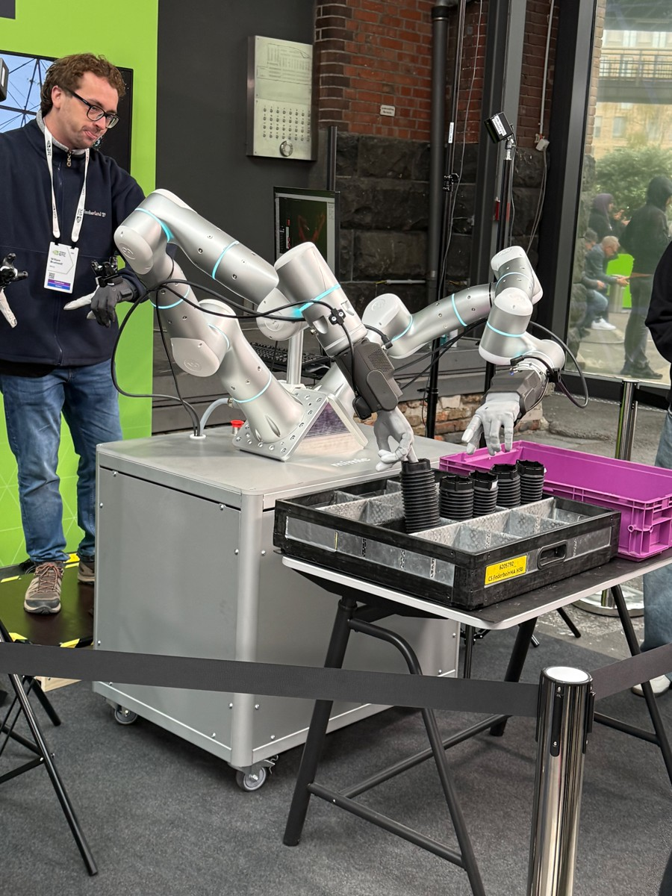
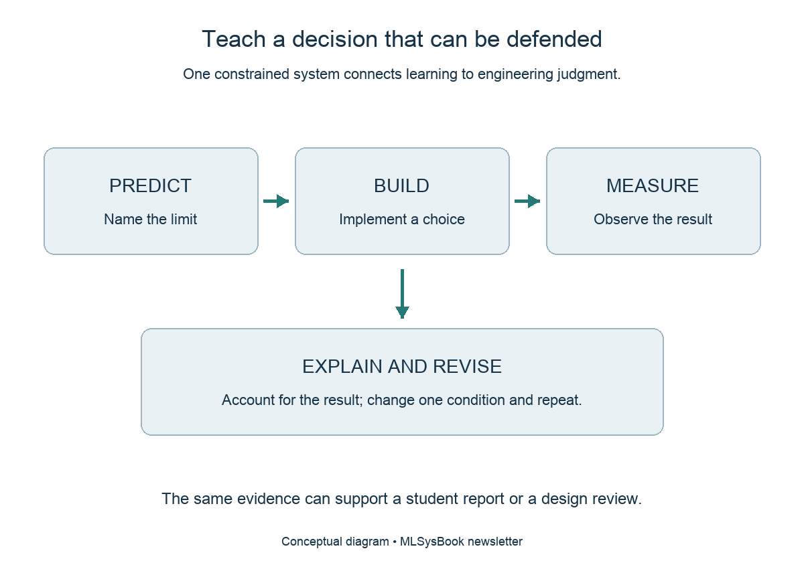

<!-- buttondown-editor-mode: plaintext -->

The [first essay](https://mlsysbook.ai/newsletter/) in this GTC Berlin series examined why containerized token factories still depend on human engineering judgment, and the [second essay](https://mlsysbook.ai/newsletter/) traced how an engineer diagnoses a single request across the layers of an AI service. Those two observations point to an immediate educational challenge: preparing students to make and defend those systems decisions before they ever step into a production facility.

As researchers from Universidad Autónoma de Occidente observed in an earlier community issue ([From Tool Training to Process Thinking](https://mlsysbook.ai/newsletter/posts/2026/2026-04-14_team-newsletter-from-tool-training-to-process-thinking-a-spiral-model-for-ai-in.html)), university training that stops at tool familiarity rarely changes how courses are designed or what students can build when the tools change. A traditional machine learning assignment starts with a dataset and grades the student on validation accuracy. An AI engineering assignment can instead begin with a model that already achieves acceptable accuracy, and then place that model inside a physical environment with a strict memory budget, a latency deadline, and a power envelope. Once those constraints are introduced, the student's job shifts from following a recipe to making an engineering decision that holds the system together.

**Physical applications make systems constraints visible.** A robotics demonstration on the floor at GTC Berlin, where model predictions must arrive within strict mechanical and real-time deadlines. Photograph from my visit.

**Make the reasoning visible.** Learners predict a physical limit, implement an intervention, measure the resulting system, and defend the trade-off with evidence.

## Give the Learner a Decision Rather Than a Recipe

A software tutorial supplies a fixed sequence of steps that leads every student to the same output. An engineering exercise supplies a constrained system and requires the student to use measurements to choose the next step.

Suppose an instructor asks students to deploy a working vision or language model onto a target device and record three baseline metrics: peak memory footprint, end-to-end latency, and task accuracy. Once the baseline works, the assignment changes one condition, such as doubling the input resolution, lengthening the prompt context, or cutting available device memory in half. Under the tighter constraint, the baseline configuration fails. Each student must identify which physical limit caused the failure, select an intervention, and demonstrate with measurements that the modified system satisfies the task requirements.

The exercise does not need a large cluster to teach genuine systems judgment. What matters is that the constraint is real and that every optimization carries a measurable cost.

## Designing an Assignment Around a Real Trade-Off

Consider a classroom lab built around visual defect inspection on a manufacturing line, using a camera-equipped edge board or a local workstation. Before touching the model configuration, the student must state what counts as a useful output for the task: which defect classes must be caught, what false-negative rate is acceptable, and how quickly each frame must be processed before the part moves down the line. Those requirements belong to the application before they become hyperparameters in code.

Next, the student deploys the baseline model, measures its memory use and frame latency, and documents the exact hardware, numerical precision, and batch size used during testing. Recording those conditions turns a one-off demonstration into an interpretable engineering baseline. The instructor then tightens the latency deadline or restricts available memory so that the baseline model either misses the deadline or fails to load.

To restore operation, a student might reduce image resolution, quantize weights from 32-bit floating point to 8-bit integers, or prune channels from the network. Each option resolves the hardware constraint in a different way while introducing a distinct risk to task quality. Lowering input resolution reduces arithmetic and memory traffic across every layer, yet may erase the fine surface detail needed to spot a hairline crack. Quantizing weights cuts model memory by a factor of four and accelerates integer execution, yet may degrade accuracy on low-contrast defects unless calibration data is chosen carefully. Because no single choice is free, the student has a genuine engineering decision to defend using evidence from both the hardware and the application.

## Assessing the Explanation Alongside the Result

Grading an engineering assignment requires evaluating how the student reasoned, not merely whether the final script ran without errors. A complete submission allows another engineer to reconstruct the decision chain: which physical limit the student predicted before running the test, what the boundary measurements showed, why a specific intervention was selected, and which secondary metric paid the price for that improvement.

Under this standard, an initial intervention that fails to meet the deadline can still earn high marks if the student diagnoses why it failed and uses that measurement to select the next experiment. Conversely, a configuration that happens to pass the latency check through trial and error, without an explanation of which bottleneck moved, shows that the student has not yet learned how to reason about the stack.

Industry engineering teams rely on this same distinction during design reviews. As educator Jeremy Ellis demonstrated in [Beyond the Spiral: TinyML Pedagogy at the Hardware Edge](https://mlsysbook.ai/newsletter/posts/2026/2026-05-22_team-newsletter-beyond-the-spiral-tinyml-pedagogy-at-the-hardware-edge.html), when an automated coding assistant can generate a working script in seconds, the classroom and the engineering lab alike must rely on explicit verification gates before physical resources are committed. The human engineer's value lies in verifying whether measurements support the design choice and identifying where the system will break next when traffic or hardware conditions change.

## Connecting First Principles to Hands-On Construction

Building this judgment across a curriculum requires pairing analytical models with hands-on construction so that students see the same constraint from multiple angles, climbing the six rungs we named in [From the Builder's Gap to a Builder's Stack](https://mlsysbook.ai/newsletter/posts/2026/2026-05-19_from-the-builders-gap-to-a-builders-stack.html). A textbook gives precise names and equations to memory hierarchies, arithmetic intensity, and queueing delay. Implementing part of a framework exposes the memory allocations and data movement that high-level library calls normally hide. Deploying onto physical hardware proves that memory ceilings and thermal limits do not negotiate.

The open artifacts in our curriculum are organized around this progression. Instructors and curriculum committees can use the [ML Systems Taxonomy](https://mlsysbook.ai/taxonomy/) to map course syllabi across 101 subjects and 735 concepts, spot curriculum gaps, and download ready-to-teach materials through the [Instructor Hub](https://mlsysbook.ai/instructors/). Students use the [Machine Learning Systems](https://mlsysbook.ai) textbook and its simulators to predict where compute, memory, or interconnect walls will bind before running an experiment, build framework components from scratch, and deploy onto constrained edge boards where physical limits refuse to negotiate.

The AI factories unveiled in Berlin will employ specialists across energy systems, silicon architecture, distributed runtimes, and machine learning models. Giving those specialists a common foundation in systems engineering begins in the classroom, with assignments where every learner must face a physical constraint, make a choice, and defend it with numbers.

## Continuing the Conversation

If you teach, study, or hire in this field, selecting one of the options in the quick poll below records your preference in a single click, and the confirmation page includes an optional box if you would like to add a brief note:

{{ survey.essay_07_pulse }}

You can also reply directly to this email to share the single systems trade-off you want every graduate or engineering candidate to be able to diagnose and defend with evidence.

Vijay

---

[MLSysBook](https://mlsysbook.ai) · [Taxonomy](https://mlsysbook.ai/taxonomy/) · [Playground](https://mlsysbook.ai/games/) · [TinyTorch](https://mlsysbook.ai/tinytorch/) · [MLSys·im](https://mlsysbook.ai/mlsysim/) · [StaffML](https://mlsysbook.ai/staffml/) · [Instructor Hub](https://mlsysbook.ai/instructors/) · [Subscribe](https://mlsysbook.ai/newsletter/) · [GitHub](https://github.com/harvard-edge/cs249r_book)
