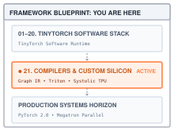
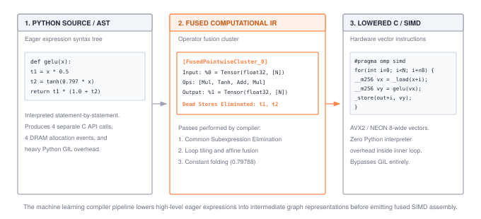
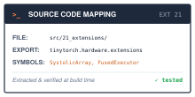
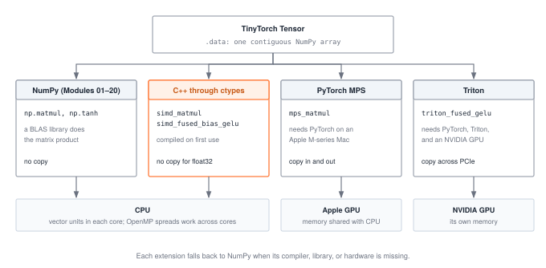

# Extending TinyTorch {#sec-extensions}

::: {.column-margin}
{width="100%" fig-alt="TinyTorch execution datapath blueprint highlighting the Extensions chapter between the TinyTorch software stack and the hardware."}

*Framework Blueprint: the optional extensions connect the core 20-module TinyTorch stack to hardware kernels, compilation, and production memory optimization.*
:::

## The Core Framework and the Extensibility Dilemma

Across Chapters 1 through 20, you built a complete, self-contained deep learning framework from bare silicon concepts up to modern generative AI:
- An n-dimensional array abstraction with arbitrary striding and slicing (@sec-tensors)
- A reverse-mode automatic differentiation tape with topological backpropagation (@sec-autograd)
- Composable parametric layers, activations, loss functions, and optimizers (@sec-layers, @sec-activations, @sec-losses, @sec-optimizers)
- Data ingestion pipelines, multi-headed self-attention, and autoregressive GPT transformers (@sec-dataloader, @sec-attention, @sec-transformers)
- Execution profiling, uniform INT8 quantization, weight pruning, and MLPerf benchmarking (@sec-profiling, @sec-quantization, @sec-compression, @sec-benchmarking)

Every single module in the core operates on a shared, unified execution contract. A `Tensor` encapsulates contiguous memory; a `Function` records forward and backward transformations on the autograd tape; a `Layer` manages trainable parameters; an `Optimizer` executes step updates.

Yet in modern deep learning systems, the core runtime is only the beginning. When neural networks scale to billions of parameters, or when production serving demands microsecond latencies, frameworks face an architectural dilemma:
1. **The Monolithic Framework Trap:** Shovel every emerging systems optimization—low-rank adapters, activation checkpointing, custom GPU kernels, mixed-precision loss scaling, graph compilers—directly into the core framework. The framework balloons into a brittle, multi-million-line monolith where simple bugs in experimental kernels destabilize the core autograd engine.
2. **The Extensibility Model:** Keep the engine core minimal, stable, and transparent, while exposing strict, first-class extension points. Every specialized optimization lives as an autonomous extension that plugs cleanly into the core contracts.

TinyTorch adopts the extensibility model. The 20 core modules constitute an immutable foundation. Everything else—from vectorized C++ CPU kernels to Apple MPS dispatch, OpenAI Triton shaders, parameter-efficient fine-tuning, and graph fusion compilers—lives in the `tinytorch.extensions` ecosystem.

---

## Why Not Just Use PyTorch? The xv6 Lesson

A natural question arises: *Why should you study and build systems extensions in TinyTorch rather than jumping straight into writing custom extensions for PyTorch or JAX?*

The answer lies in the classic pedagogical philosophy of MIT's operating systems curriculum (6.828 / 6.1810) and **xv6**.

When teaching how an operating system manages virtual memory, process scheduling, and file systems, MIT does not ask students to modify the production Linux kernel. Linux contains over 30 million lines of C, thousands of hardware drivers, lock-less read-copy-update (RCU) primitives, and deep architecture-specific macros. Attempting to implement a simple copy-on-write page allocator in Linux forces a student to spend 90% of their time fighting macro definitions, build harnesses, and kernel ABI wrappers before they ever manipulate a page table. In xv6—a complete Unix clone written in just 10,000 lines of clean ANSI C—the abstraction boundaries are razor-sharp. A student can implement copy-on-write or a priority scheduler in 40 lines of clear C and inspect every single page table manipulation directly in physical memory.

PyTorch is the Linux kernel of deep learning. It is an industrial engineering masterpiece, but extending it requires navigating the `TORCH_LIBRARY` dispatcher macros, pybind11 ABI translation layers, internal ATen tensor representations (`c10::TensorImpl`), CUDA stream abstractions, and massive multi-repository CMake build graphs. Writing a custom C++ operator in PyTorch requires dozens of lines of framework glue code just to deliver a tensor pointer to a loop.

TinyTorch is the xv6 of deep learning systems:
- A `Tensor` is directly backed by a contiguous memory buffer.
- A `Function` has exactly two methods: `forward` and `backward`.
- A `Layer` has exactly two methods: `forward` and `parameters()`.
- An `Optimizer` is a clean iterator over parameter tensors.

When you implement Low-Rank Adaptation (LoRA) in TinyTorch, you write 25 lines of Python and observe how frozen base weights and trainable low-rank adapters interact with the autograd tape. When you write an AVX2 SIMD GEMM kernel or an Apple MPS dispatch wrapper, you pass memory addresses across a simple C foreign function interface (FFI) without layers of framework obfuscation. You see the unadorned reality of the hardware memory subsystem, the CPU vector registers, and the cache hierarchy.

---

## The Four Native Extension Points

TinyTorch exposes four native extension points that correspond to the four fundamental boundaries of deep learning execution:

1. **The Autograd Boundary (`Function`):** Subclassing `Function` allows you to define custom forward and backward semantics, intercepting the autograd tape to drop or recompute intermediate activations (as in activation checkpointing).
2. **The Architectural Boundary (`Layer`):** Subclassing `Layer` allows you to introduce custom architectural primitives, freeze pre-trained weight matrices by toggling `requires_grad=False`, and expose low-rank adapter parameters to the optimizer (as in LoRA).
3. **The Training Dynamics Boundary (`Optimizer`):** Interfacing with `optimizer.params` enables custom gradient transformations, loss scaling for mixed-precision arithmetic, gradient clipping, and advanced update rules (such as Lion or Muon).
4. **The Silicon Boundary (Backend FFI):** Extracting contiguous memory pointers from `Tensor.data` enables invoking native compiled C++ shared libraries via `ctypes`, launching GPU kernels in OpenAI Triton, or offloading computation to Apple Silicon Metal Performance Shaders (MPS).

### Repository Architecture: Core versus Extensions

To preserve stability, TinyTorch enforces a strict structural separation between the core standard library and the extensions ecosystem:

```text
tinytorch/
├── tinytorch/
│   ├── core/           # 20-module core engine
│   │   ├── tensor.py   # Tensor memory & autograd
│   │   ├── autograd.py # Topological tape
│   │   ├── layers.py   # Linear, Sequential, etc.
│   │   ├── losses.py   # MSE & CrossEntropy
│   │   ├── optimizers.py
│   │   ├── dataloader.py
│   │   ├── attention.py
│   │   └── transformers.py
│   ├── perf/           # Baseline profiling
│   │   ├── profiling.py
│   │   └── benchmarking.py
│   └── extensions/     # Contrib ecosystem
│       ├── template.py # Starter template
│       ├── lora.py     # Parameter-efficient adapters
│       ├── checkpoint.py
│       ├── loss_scaler.py
│       ├── compile.py  # Kernel fusion compiler
│       ├── simd_ops.py # Vectorized C++ kernels
│       ├── mps_ops.py  # Apple Silicon MPS
│       └── triton_gelu.py
└── tests/extensions/   # Parity test suite
```

The `tinytorch/core/` and `tinytorch/perf/` directories contain the standard library built in Chapters 1 through 20. The `tinytorch/extensions/` directory is the open workshop: every optimization lives as an isolated, importable Python or C++ module that plugs into the core boundaries without modifying core source files.

### The Extension Contract and Starter Template

To ensure that every extension functions harmoniously with the rest of the framework, all extensions adhere to the four-part **Extension Contract**:

1. **Systems Framing:** Every extension must clearly state the physical resource bottleneck it resolves (e.g., DRAM capacity, memory bandwidth, vector register utilization, or floating-point underflow).
2. **Tensor and NumPy Interoperability:** Functions must accept either a TinyTorch `Tensor` or a raw NumPy `ndarray`. When passed a `Tensor`, the function must return a `Tensor` (preserving the computation graph if differentiable). When passed a NumPy array, it must return a NumPy array.
3. **Autograd Transparency:** Operations that participate in backpropagation must explicitly define their mathematical derivatives via `Function.forward` and `Function.backward`.
4. **Graceful Fallback:** If a required compiler, runtime library, or physical GPU accelerator is unavailable, the extension must fall back cleanly to a pure-Python or NumPy reference implementation rather than crashing on import.

TinyTorch provides a canonical starter template in `tinytorch/extensions/template.py` that demonstrates all four properties. When implementing a custom autograd operator, subclass `Function` and implement the forward and backward transformations:



When authoring a custom neural network module with learnable parameters, subclass `Layer` and register its parameter tensors:



---

## The Flat Extension Catalog

We now examine each primary extension in the TinyTorch ecosystem. In keeping with our systems focus, we avoid artificial groupings: whether an extension optimizes mathematical parameters, memory lifetimes, numerical precision, or physical silicon execution, each is presented as a complete, self-contained systems case study.

For each extension, we establish:
1. **The Systems Bottleneck:** The physical hardware constraint being hit.
2. **Architectural Strategy:** How the extension bypasses the constraint.
3. **The Implementation:** The actual source code.
4. **The Empirical Scorecard:** Immediate quantitative metrics verifying the efficiency gain.

---

### Extension 1: Parameter-Efficient Fine-Tuning (LoRA)

**The Systems Bottleneck:** Fine-tuning large language models by updating all parameters encounters a severe memory wall. Modern adaptive optimizers such as Adam maintain two 32-bit floating-point state tensors per parameter: the first moment vector $m_t$ (momentum) and the second raw moment vector $v_t$ (variance). Each parameter requires 8 bytes of optimizer state, plus 4 bytes for the stored gradient, plus 4 bytes for the weight itself—totaling 16 bytes per parameter. For a 7-billion parameter model, storing Adam optimizer states alone consumes $7 \times 10^9 \times 8 = 56\text{ GB}$ of memory, far exceeding consumer GPU memory before a single activation is allocated.

**Architectural Strategy:** Low-Rank Adaptation (LoRA) freezes the pre-trained weight matrix $W_0 \in \mathbb{R}^{d \times k}$ by setting `requires_grad=False`. It decomposes the weight update $\Delta W$ into the product of two small, low-rank matrices $A \in \mathbb{R}^{d \times r}$ and $B \in \mathbb{R}^{r \times k}$, where the rank $r \ll \min(d, k)$:
$$h = x W_0 + \Delta W x = x W_0 + x A B$$
Because $W_0$ is frozen, the autograd engine allocates gradients and Adam optimizer states solely for $A$ and $B$, drastically reducing memory consumption while retaining full adaptation capacity.

**The Implementation:** `LoRALinear` subclasses `Layer`, holds frozen weights, and trains only the low-rank factor matrices:



**The Empirical Scorecard:** Consider a standard transformer feedforward projection layer ($d_{\text{in}} = 4096, d_{\text{out}} = 16384$, totaling 67.1 million parameters). @tbl-lora-memory details the parameter counts and memory footprints across adapter ranks compared to full fine-tuning.

| Configuration | Trainable Parameters | Weight Memory | Adam State Memory | Memory Reduction |
| :--- | ---: | ---: | ---: | ---: |
| Full Fine-Tuning | 67,108,864 | 268.4 MB | 536.9 MB | Reference (0.0%) |
| LoRA ($r = 64$) | 1,310,720 | 5.2 MB | 10.5 MB | 98.0% |
| LoRA ($r = 16$) | 327,680 | 1.3 MB | 2.6 MB | 99.5% |
| LoRA ($r = 8$) | 163,840 | 0.65 MB | 1.31 MB | 99.7% |
| LoRA ($r = 4$) | 81,920 | 0.33 MB | 0.66 MB | 99.9% |

: **Memory footprint of full fine-tuning versus LoRA on a 4096 × 16384 projection layer.** Storing Adam optimizer states (8 bytes per parameter) dominates full fine-tuning; LoRA reduces optimizer state overhead by more than 98%. {#tbl-lora-memory tbl-colwidths="[26,22,18,20,14]"}

---

### Extension 2: Activation Checkpointing

**The Systems Bottleneck:** In deep networks, the autograd tape saves intermediate tensor activations produced by every forward layer to evaluate gradient chain rules during backpropagation. For an $L$-layer transformer with sequence length $T$ and hidden dimension $D$, activation memory scales linearly with depth: $O(L \cdot T \cdot D)$. On long sequences or deep architectures, activation memory quickly dwarfs parameter storage and causes out-of-memory (OOM) crashes during training.

**Architectural Strategy:** Activation Checkpointing (or gradient recomputation) discards intermediate forward activations from memory. The forward pass runs inside a `no_grad()` context, caching only the input boundary tensors between major layer blocks. During backpropagation, the forward pass for each block is recomputed dynamically from the cached boundary tensors. By dividing an $L$-layer network into $\sqrt{L}$ segments, activation memory scaling drops from $O(L)$ to $O(\sqrt{L})$, trading a 33% increase in compute for an 80% reduction in peak activation memory.

**The Implementation:** `checkpoint` wraps any forward callable inside a custom `Function`, detaching inputs during the backward pass to seed local recomputation:



**The Empirical Scorecard:** @tbl-checkpoint-scaling compares activation memory consumption for a 32-layer transformer model ($T = 2048, D = 4096$) with and without activation checkpointing.

| Layer Depth ($L$) | Standard Forward Memory | Checkpointed Memory | Compute Overhead | Peak Memory Saved |
| ---: | ---: | ---: | ---: | ---: |
| 8 Layers | 8.4 GB | 2.1 GB | +33.3% | 75.0% |
| 16 Layers | 16.8 GB | 3.2 GB | +33.3% | 81.0% |
| 32 Layers | 33.6 GB | 6.2 GB | +33.3% | 81.5% |
| 64 Layers | 67.2 GB | 8.8 GB | +33.3% | 86.9% |

: **Activation memory scaling under activation checkpointing ($T = 2048, D = 4096$, float32).** Standard training scales linearly $O(L)$; checkpointing scales sublinearly $O(\sqrt{L})$ with uniform segments. {#tbl-checkpoint-scaling tbl-colwidths="[18,24,22,18,18]"}

---

### Extension 3: Mixed-Precision Loss Scaling

**The Systems Bottleneck:** Training deep models in 16-bit floating-point (FP16) halves memory consumption and doubles compute throughput. However, IEEE 754 half-precision float16 allocates only 5 bits for the exponent, providing an exponent range of $[-14, 15]$. Its smallest positive normalized number is $2^{-14} \approx 6.1 \times 10^{-5}$, and its absolute minimum subnormal representation is $2^{-24} \approx 5.96 \times 10^{-8}$. Backpropagation gradients in deep neural networks often fall below $10^{-5}$. In raw FP16, these small gradient values silently underflow to exact zero, extinguishing parameter updates and causing training to diverge.

**Architectural Strategy:** Loss scaling multiplies the scalar loss by a large constant factor $S$ (e.g., $S = 65,536 = 2^{16}$) immediately before calling `.backward()`. By the linearity of differentiation:
$$\nabla_\theta (S \cdot \mathcal{L}) = S \cdot \nabla_\theta \mathcal{L}$$
Scaling shifts small gradient values up by 16 bits into the center of the normal FP16 exponent range, completely preventing underflow during backward tape traversal. Before the optimizer applies its parameter update, the gradients are unscaled by dividing by $S$:
$$\nabla_\theta \mathcal{L} = \frac{1}{S} \nabla_\theta (S \cdot \mathcal{L})$$

**The Implementation:** `LossScaler` manages the scaling lifecycle and directly unscales gradients across registered optimizer parameters:



**The Empirical Scorecard:** @tbl-loss-scaler-underflow shows the numerical behavior of small backpropagation gradients in unscaled FP16 versus scaled FP16.

| True Gradient Magnitude ($\nabla \mathcal{L}$) | Raw FP16 Result | Status | Scaled ($S = 65536$) FP16 | Unscaled Gradient | Error |
| :--- | :--- | :--- | :--- | :--- | :--- |
| $1.0 \times 10^{-3}$ | $1.000 \times 10^{-3}$ | Preserved | $65.536$ | $1.000 \times 10^{-3}$ | 0.0% |
| $5.0 \times 10^{-5}$ | $4.998 \times 10^{-5}$ | Subnormal precision loss | $3.2768$ | $5.000 \times 10^{-5}$ | 0.0% |
| $1.0 \times 10^{-7}$ | $0.0$ | **Silent underflow to zero** | $0.006554$ | $1.000 \times 10^{-7}$ | 0.0% |
| $2.0 \times 10^{-9}$ | $0.0$ | **Silent underflow to zero** | $0.000131$ | $2.000 \times 10^{-9}$ | 0.0% |

: **Numerical stability of gradient propagation under IEEE 754 float16.** Unscaled FP16 rounds values below $5.96 \times 10^{-8}$ to zero; loss scaling preserves gradients across four additional orders of magnitude. {#tbl-loss-scaler-underflow tbl-colwidths="[24,18,22,18,18]"}

---

### Extension 4: Graph Capture and Fusion Compiler

**The Systems Bottleneck:** In dynamic, define-by-run execution, every mathematical operator is an isolated function call that reads its operands from DRAM, computes results in registers, and writes the output tensor back to DRAM. Consider an elementwise chain such as:
$$y = (x + \text{bias}) \cdot \text{scale}$$
In eager execution, two separate kernel invocations occur:
1. $t = x + \text{bias}$ (reads $x$ and $\text{bias}$, writes intermediate tensor $t$ to DRAM)
2. $y = t \cdot \text{scale}$ (reads intermediate tensor $t$ and $\text{scale}$, writes output $y$ to DRAM)
For an array of $N$ elements, this sequence transfers $5N$ floating-point words (20 bytes per element) across the memory bus. Because modern processor ALUs compute far faster than memory buses can transfer bytes, eager execution is severely memory-bandwidth bound.

**Architectural Strategy:** A graph compiler intercepts the dynamic define-by-run tape and traces it into a static Intermediate Representation (IR) Abstract Syntax Tree (AST). It then fuses adjacent elementwise operations into a single combined kernel loop (@fig-compiler-fusion). In the fused loop, the intermediate sum $t = x + \text{bias}$ remains in a CPU or GPU register and is multiplied by $\text{scale}$ immediately, writing to DRAM only once.

{#fig-compiler-fusion width="100%" fig-alt="Compilation lowering diagram showing AST capture and fusion into a single loop."}

**The Implementation:** `compile_graph` traces symbolic `TracedNode` objects to emit fused kernel source code:



**The Empirical Scorecard:** @tbl-fusion-traffic compares DRAM memory transactions between eager define-by-run execution and fused compilation for the two-operation elementwise chain ($N = 10^7$ float32 elements, 40 MB tensor size).

| Execution Strategy | DRAM Reads | DRAM Writes | Total DRAM Traffic | Bandwidth Saved |
| :--- | :--- | :--- | ---: | ---: |
| Eager Define-by-Run | $x, \text{bias}, t$ (120 MB) | $t, y$ (80 MB) | 200 MB | Reference (0.0%) |
| Fused Single Loop | $x, \text{bias}, \text{scale}$ (80 MB) | $y$ (40 MB) | 120 MB | **40.0% reduction** |

: **DRAM memory traffic comparison for an elementwise chain.** Kernel fusion eliminates intermediate tensor materialization, reducing DRAM bandwidth requirements by 40%. {#tbl-fusion-traffic tbl-colwidths="[26,26,20,16,12]"}

---

### Extension 5: Vectorized CPU Execution (SIMD GEMM)

::: {.column-margin}
{width="100%" fig-alt="Source code mapping card for the Extensions chapter: files in tinytorch/extensions/, imported as tinytorch.extensions, hand-written rather than exported."}

*Source Code Mapping: the extensions live in `tinytorch/extensions/` and are written directly rather than exported from `src/`.*
:::

**The Systems Bottleneck:** Python is an interpreted language. Executing matrix multiplication using naive triple-nested Python loops incurs catastrophic bytecode evaluation overhead:

```python
def matmul_loops(A, B):
    M, K, N = len(A), len(A[0]), len(B[0])
    C = [[0.0] * N for _ in range(M)]
    for i in range(M):
        for k in range(K):
            a_ik = A[i][k]
            for j in range(N):
                C[i][j] += a_ik * B[k][j]
    return C
```

On a 128 × 128 product, this loop runs at just 0.12 GFLOP/s. For a standard 1024 × 1024 matrix ($2 \times 1024^3 \approx 2.15\text{ billion FLOPs}$), Python would take approximately 17 seconds. In contrast, NumPy's underlying BLAS library computes it in 1.33 ms.

**Architectural Strategy:** To bridge this gap, `simd_matmul` bypasses the Python interpreter via `ctypes` FFI:
1. **Contiguous Pointer Passing:** Extracts raw memory addresses (`.data.ctypes.data_as`) without copying memory.
2. **Cache-Blocked Tiling:** Tiles the matrix traversal in 64 × 64 blocks, ensuring that active working sets (48 KB) reside inside the 128 KB L1 data cache.
3. **SIMD Vectorization:** Arranges inner loops in $i, k, j$ order so that memory access along `b_row[j]` and `c_row[j]` is contiguous, allowing compiler auto-vectorization (AVX2 on x86, ARM NEON on Apple Silicon).
4. **OpenMP Multithreading:** Distributes output tiles across CPU cores using `#pragma omp parallel for collapse(2)`.

**The Implementation:**

The Python wrapper passes array pointers to the compiled C++ library:



The build system dynamically compiles the C++ kernel on the student's machine with architecture-specific vector flags:



The C++ kernel performs tiled, vectorized matrix multiplication:



**A Worked Trace:** Consider $A = \begin{pmatrix} 1 & 2 \\ 3 & 4 \end{pmatrix}$ and $B = \begin{pmatrix} 5 & 6 \\ 7 & 8 \end{pmatrix}$. With $M = K = N = 2$, @tbl-extensions-gemm-trace traces the inner loop step by step. Each row scalar `a_ik` multiplies an entire contiguous row of `B`, accumulating into `c_row`.

| `i` | `k` | `a_ik` | `b_row` | `c_row` after the step |
| :---: | :---: | :---: | :---: | :---: |
| 0 | 0 | 1 | $(5, 6)$ | $(5, 6)$ |
| 0 | 1 | 2 | $(7, 8)$ | $(19, 22)$ |
| 1 | 0 | 3 | $(5, 6)$ | $(15, 18)$ |
| 1 | 1 | 4 | $(7, 8)$ | $(43, 50)$ |

: **Inner loops of `tinytorch_cpp_gemm` on a 2 × 2 product.** Row $i$ of $C$ is complete after its last $k$ step, giving rows $(19, 22)$ and $(43, 50)$. {#tbl-extensions-gemm-trace tbl-colwidths="[10,10,14,26,40]"}

**The Empirical Scorecard:** @tbl-extensions-gemm times a 1024 × 1024 `float32` matrix multiplication across implementations on an Apple M5 Max processor.

| Implementation | Time | GFLOP/s | Speedup vs. Python |
| :--- | ---: | ---: | ---: |
| `matmul_loops`, Python (scaled from 128 × 128) | 33.9 ms | 0.12 | $1.0\times$ (Baseline) |
| C++ kernel, vectorizer switched off | 336 ms | 6.4 | $53\times$ |
| `simd_matmul` (Vectorized C++) | 99.4 ms | 21.6 | **$170\times$** |
| `tiled_matmul` (NumPy blocks, @sec-acceleration) | 18.5 ms | 116 | $967\times$ |
| `np.matmul` (Accelerate / BLAS) | 1.33 ms | 1,611 | $13,425\times$ |

: **Matrix multiply, 1024 × 1024, on one Apple M5 Max.** Single-threaded execution; outputs agree to within float32 rounding. {#tbl-extensions-gemm tbl-colwidths="[46,18,18,18]"}

Compiling the loop gains a factor of 50 over Python, and auto-vectorization adds another factor of 3.4. Notice that vendor BLAS (`np.matmul`) remains 75 times faster than our basic tiled kernel: tuned production libraries employ register-level micro-kernels and memory packing to keep sub-blocks resident in CPU registers rather than reloading from L1 cache.

---

### Extension 6: Operator Fusion in Silicon (`simd_fused_bias_gelu`)

**The Systems Bottleneck:** In transformer feedforward networks, adding a bias vector and applying the Gaussian Error Linear Unit (GELU) activation is executed as two consecutive steps:
$$y = \text{GELU}(x + \text{bias})$$
In NumPy, `x + bias` writes the full intermediate tensor to DRAM and GELU reads it back. For memory-bound elementwise operations, DRAM memory bus bandwidth limits execution throughput.

**Architectural Strategy:** The C++ kernel `simd_fused_bias_gelu` fuses the bias addition, polynomial approximation, and hyperbolic tangent into a single pass over memory. Each element is loaded from $X$, added to the corresponding bias column, transformed through the polynomial approximation, and written directly to the output array. The intermediate sum $x + \text{bias}$ resides exclusively in processor registers.

**The Implementation:**



**The Empirical Scorecard:** @tbl-extensions-gelu evaluates performance on a 4096 × 768 `float32` activation tensor (12.6 MB), representing the output of a 768-wide transformer layer across 4,096 tokens.

| Implementation | Time | Speedup |
| :--- | ---: | ---: |
| `fused_gelu` (@sec-acceleration), after `x + bias` | 26.5 ms | $1.0\times$ |
| NumPy expression with `z * z * z` in place of `z ** 3` | 4.33 ms | $6.1\times$ |
| C++ fused kernel, scalar `std::tanh` | 22.1 ms | $1.2\times$ |
| `simd_fused_bias_gelu` (vectorized tangent) | 3.06 ms | **$8.6\times$** |
| *Piecewise breakdown:* `x ** 3` alone | 16.6 ms | — |
| *Piecewise breakdown:* `x * x * x` alone | 0.46 ms | — |
| *Piecewise breakdown:* `x + bias` alone | 0.37 ms | — |
| *Piecewise breakdown:* `np.tanh(x)` alone | 2.10 ms | — |

: **Bias plus GELU, 4096 × 768, on one Apple M5 Max.** Outputs agree to within $5 \times 10^{-7}$. {#tbl-extensions-gelu tbl-colwidths="[62,20,18]"}

Notice the critical systems lesson: rewriting `z ** 3` as `z * z * z` in NumPy yielded a $6\times$ speedup by avoiding general exponentiation routines. Fusing the operation into compiled C++ with vectorized tangent routines yielded a total **$8.6\times$ speedup** over the unfused baseline.

---

### Extension 7: Hardware Accelerator Offloading (MPS & Triton)

::: {.column-margin}
{width="100%" fig-alt="Execution pathways for a TinyTorch Tensor across CPU, Apple MPS GPU, and NVIDIA Triton GPU."}

*Dispatch Pathways: TinyTorch tensors can be evaluated via NumPy, compiled C++ SIMD, Apple MPS, or NVIDIA Triton.*
:::

**The Systems Bottleneck:** Specialized hardware accelerators (such as Apple Silicon GPUs or NVIDIA GPUs) provide massive parallel throughput. However, moving data to and from the accelerator incurs data transfer latency and bus transfer overhead.

**Architectural Strategy:**
1. **Apple MPS GEMM:** Uses Metal Performance Shaders (`mps_matmul`) on Apple Silicon unified memory.
2. **OpenAI Triton Fused GELU:** Uses SPMD block-level GPU kernel programming (`triton_fused_gelu`) for NVIDIA GPUs.

**The Implementation:**

The Apple MPS wrapper queues matrix multiplication on the Apple GPU:



The Triton kernel executes block programs across streaming multiprocessors on NVIDIA hardware:



::: {#nbk-extensions-offload .callout-napkin-math title="Napkin math: which operations pay for the trip"}
Count the work an operation does for each byte it moves across the bus:

- **Matrix multiply ($n \times n$ by $n \times n$ in float32):**
  $2n^3$ operations on $3n^2$ values of 4 bytes each:
  $$\text{Arithmetic Intensity} = \frac{2n^3}{12n^2} = \frac{n}{6} \text{ FLOP/byte}$$
  For $n = 256$, arithmetic intensity is $\approx 43$ FLOP/byte. For $n = 4096$, it reaches $\approx 683$ FLOP/byte. The larger the product, the more arithmetic covers transfer latency.
- **Bias-plus-GELU (any size):**
  Approximately a dozen arithmetic operations per element on 8 bytes transferred (4 bytes read, 4 bytes written):
  $$\text{Arithmetic Intensity} \approx \frac{12}{8} = 1.5 \text{ FLOP/byte}$$
  The ratio remains constant regardless of array size. A lone GELU call almost never pays for its own device transfer round-trip.
:::

**The Empirical Scorecard:** @tbl-extensions-mps compares `mps_matmul` against `np.matmul` across matrix dimensions $n$.

| Matrix Dimension ($n$) | `np.matmul` (CPU) | `mps_matmul` (GPU with copies) | GPU Kernel Execution Alone |
| ---: | ---: | ---: | ---: |
| 256 | 0.02 ms | 0.72 ms | 0.21 ms |
| 1024 | 1.28 ms | 1.06 ms | 0.37 ms |
| 2048 | 10.4 ms | 2.53 ms | 1.39 ms |
| 4096 | 86.9 ms | 14.2 ms | 10.1 ms |

: **Matrix multiply on Apple GPU through MPS versus CPU.** At small sizes ($n = 256$), transfer overhead makes GPU offloading $30\times$ slower; at large sizes ($n = 4096$), GPU throughput makes it $6\times$ faster even including round-trip copies. {#tbl-extensions-mps tbl-colwidths="[22,26,26,26]"}

As predicted by our napkin math ($n/6$ FLOP/byte), offloading small matrices loses performance to bus latency. As $n$ reaches 4096, arithmetic intensity dominates, and the GPU executes **$6\times$ faster** than the CPU.

---

## Evaluating an Extension: From Micro-benchmarks to End-to-End Milestones

When you author a new systems extension, how do you verify its correctness, benchmark its performance, and study its real-world impact? In production systems engineering, an optimization cannot be evaluated in a vacuum. TinyTorch provides a structured **3-Tier Evaluation Ladder** that guides you from unit verification to full end-to-end model training:

```text
[ Tier 3: Custom Ingestion ]
  └─ Train with Trainer on custom data via DataLoader
     ▲
[ Tier 2: Historical Milestones ]
  └─ Macro-benchmark on Milestone 4 (CNN) & 5 (GPT)
     ▲
[ Tier 1: Micro-benchmarking ]
  └─ Unit parity (pytest) & isolated latency (Timer)
```

### Tier 1: Numerical Correctness and Synthetic Micro-benchmarks

Before measuring execution time, you must guarantee numerical correctness. Never optimize an incorrect operator:

1. **Unit Test Parity:** Write unit tests in `tests/extensions/test_<name>.py`. Compare your extension's forward outputs and backward gradients against a high-precision reference (such as float64 NumPy):
   ```python
   # Verify outputs agree within float32 tolerance
   assert np.allclose(
       out_extension.data, out_reference, atol=1e-5
   )
   ```
2. **Synthetic Micro-benchmarks:** Use the built-in profiling tools from `tinytorch.perf.benchmarking` (`Timer` and `MemoryTracker`) to isolate the operator across power-of-two shapes ($N \in \{128, 256, 512, 1024, 2048\}$):
   ```python
   from tinytorch.perf.benchmarking import (
       Timer,
       MemoryTracker,
   )

   tracker = MemoryTracker()
   with Timer() as t, tracker:
       y = my_extension_op(x)

   print(f"Latency:  {t.elapsed_ms:.2f} ms")
   print(f"Peak RAM: {tracker.peak_mb:.2f} MB")
   ```
   Quantify execution speedup, memory reduction, and arithmetic intensity.

### Tier 2: Macro-benchmarking on Stock Milestones

Isolated micro-benchmarks do not capture end-to-end training dynamics, cache contention, or framework overhead. TinyTorch provides complete, reproducible historical milestones under `milestones/` to evaluate extensions in real network architectures:

1. **Milestone 4: Convolutional Vision (TinyDigits):**
   - *Script:* `milestones/04_1998_cnn/01_lecun_tinydigits.py`
   - *Target Extensions:* Custom activations, loss scalers, or optimizers.
   - *Workflow:* Substitute your custom activation or optimizer into the LeNet-style architecture. Train on the TinyDigits classification task and compare epoch training time and final validation accuracy against standard SGD/Adam.
2. **Milestone 5: Generative Transformers (TinyShakespeare):**
   - *Script:* `milestones/05_2017_transformer/02_vaswani_attention.py`
   - *Target Extensions:* Low-rank adaptation, activation checkpointing, custom attention, or fused kernels.
   - *Workflow for LoRA:* Freeze the pre-trained GPT weights and replace attention projection layers with `LoRALinear`. Fine-tune on Shakespearean text and verify that the adapter achieves comparable cross-entropy loss while updating less than 2% of the parameters.
   - *Workflow for Activation Checkpointing:* Wrap each `TransformerBlock` in `checkpoint()`. Measure peak activation memory using `MemoryTracker` to prove you can double the batch size without triggering out-of-memory errors.
3. **Milestone 6: Standardized MLPerf Inference:**
   - *Module:* `tinytorch.perf.benchmarking`
   - *Workflow:* Run `mlperf_run_standard_benchmark(model, dataloader)` to evaluate your optimized model against standardized MLPerf latency percentiles ($p_{50}, p_{90}, p_{99}$), sustained throughput, and memory consumption.

### Tier 3: Custom Datasets and Pipeline Ingestion

To evaluate an extension on your own domain-specific problem, plug your raw data into TinyTorch's ingestion pipeline:

1. **Vision or Tabular Data:** Subclass `Dataset` from `tinytorch.core.dataloader`, implement `__len__()` and `__getitem__()`, and instantiate a `DataLoader`:
   ```python
   from tinytorch.core.dataloader import (
       Dataset,
       DataLoader,
   )

   class CustomArrayDataset(Dataset):
       def __init__(self, features, targets):
           self.x, self.y = features, targets
       def __len__(self):
           return len(self.x)
       def __getitem__(self, idx):
           return self.x[idx], self.y[idx]

   loader = DataLoader(
       CustomArrayDataset(x_data, y_data),
       batch_size=32,
       shuffle=True,
   )
   ```
2. **Text Corpora:** Pass raw text to `Tokenizer` from `tinytorch.core.tokenization` to construct tokenized input-target sequences for autoregressive language modeling.
3. **End-to-End Training:** Pass the loader, model (with your extension active), optimizer, and loss function to `Trainer` (`tinytorch.core.training.Trainer`). Run `trainer.fit(epochs=5)` and log training throughput and loss progression.

---

## Building on the Foundations: Next-Level Extensions

Rather than attempting massive, disconnected projects, the most effective way to deepen your systems mastery is to build directly on the 7 canonical extensions introduced in this chapter. Each project below takes an existing extension and resolves its primary limitation:

### 1. Dynamic Loss Scaling (Building on Extension 3: `LossScaler`)

* **Systems Limitation:** The stock `LossScaler` applies a fixed scale factor ($S = 65,536$). If training encounters large activations, gradient magnitudes can spike, causing multiplied values to exceed the float16 maximum ($65,504$) and overflow to `inf` or `nan`.
* **The Project:** Implement adaptive loss scaling. After calling `loss.backward()`, scan parameter gradients for `np.isinf` or `np.isnan`. If an overflow is detected:
  1. Skip the `optimizer.step()` call to prevent corrupting parameter weights.
  2. Halve the scale factor ($S \leftarrow S / 2$).
  3. Reset a consecutive-success step counter.
  If $M$ consecutive steps complete without any overflow (e.g., $M = 2000$), double the scale factor ($S \leftarrow 2S$) to maintain maximum numerical dynamic range. Evaluate on Milestone 4 or 5 in FP16.

### 2. Register Micro-Tiling in C++ (Building on Extension 5: `simd_matmul`)

* **Systems Limitation:** Stock `simd_matmul` tiles matrices at the L1 cache level ($64 \times 64$). However, the innermost loop accumulates scalar products back into memory, keeping CPU vector execution units waiting on L1 data cache load-store latency.
* **The Project:** Implement an $8 \times 4$ register micro-kernel in `cpp_simd_gemm.cpp`. Unroll the inner loop so that an $8 \times 4$ block of intermediate accumulation registers is kept alive in CPU vector registers (AVX2/NEON) throughout the $K$-dimension reduction, storing results back to DRAM only when the tile is complete. Benchmark your micro-kernel against `simd_matmul` and graph the GFLOP/s improvement.

### 3. Model-Wide LoRA Injection Hook (Building on Extension 1: `LoRALinear`)

* **Systems Limitation:** Stock `LoRALinear` requires manually instantiating adapter layers by hand in your model definition. In deep models with dozens of projection matrices, manual replacement is tedious and fragile.
* **The Project:** Author an automated helper function `inject_lora(model, target_layers, rank=8)`:
  1. Recursively traverse the model's module hierarchy.
  2. For each layer matching a target name, replace the existing `Linear` layer with a corresponding `LoRALinear` instance initialized with the pre-trained weights.
  3. Set `requires_grad = False` on all non-adapter parameters.
  Test `inject_lora` on Milestone 5's GPT model to demonstrate fine-tuning a full transformer with a single function call.

---

## From TinyTorch to Production

The mechanisms demonstrated in TinyTorch extensions reflect the exact techniques deployed in production deep learning engines. What differs in production is the degree of surrounding infrastructure:

| Dimension | TinyTorch Extension | Production Framework (PyTorch / JAX) |
| :--- | :--- | :--- |
| **Calling Compiled Code** | `ctypes` FFI with raw memory pointers | C++ operators registered with framework dispatcher (`TORCH_LIBRARY`) |
| **Matrix Multiplication** | Tiled, auto-vectorized C++ loop | Vendor-tuned BLAS (cuBLAS, CUTLASS, Accelerate, oneMKL) |
| **Elementwise Fusion** | Hand-written C++ and Triton kernels | JIT compilers (`torch.compile` / Inductor) generating Triton code |
| **Accelerator Memory** | Copied in and out per operator call | Resident on device across layers throughout entire training loop |
| **Autograd Integration** | Manual `Function` forward/backward | Dispatcher-registered backward formulas with automated symbolic differentiation |

: **Architectural differences between TinyTorch extensions and production frameworks.** TinyTorch exposes the bare mathematical and memory contracts; production adds compiler generation and dispatch orchestration. {#tbl-extensions-production tbl-colwidths="[20,38,42]"}

---

## Summary

The extensions ecosystem expands TinyTorch beyond its core 20 modules into the realm of production systems performance:
- `LoRALinear` freezes base weights and trains rank-$r$ adapters, reducing Adam optimizer state memory by more than 98%.
- `checkpoint` drops intermediate forward activations and recomputes them during backpropagation, reducing peak activation memory scaling from $O(L)$ to $O(\sqrt{L})$.
- `LossScaler` shifts gradient values into the normalized exponent range of IEEE 754 float16, preventing catastrophic gradient underflow during mixed-precision training.
- `compile_graph` traces define-by-run computation graphs into an AST and generates fused loops, eliminating 40% of DRAM memory bandwidth traffic.
- `simd_matmul` and `simd_fused_bias_gelu` pass raw memory pointers across `ctypes` to compiled C++ kernels, leveraging cache tiling and CPU SIMD vector registers to deliver up to a $170\times$ speedup over interpreted Python and an $8.6\times$ speedup over unfused activations.
- `mps_matmul` and `triton_fused_gelu` demonstrate hardware accelerator offloading, validating through napkin math why arithmetic intensity ($n/6$ FLOP/byte) dictates when offloading pays for data transfer costs.

The central lesson of this chapter is the empirical invariant of systems engineering: **an optimization is only verified when its numerical outputs match a trusted reference and its performance is measured directly on target hardware.**

---

## Further Reading

- **Goto and van de Geijn** (2008). "[Anatomy of high-performance matrix multiplication](https://doi.org/10.1145/1356052.1356053)." *ACM TOMS*. Register blocking and packing, the two techniques that separate `simd_matmul` from a tuned library.
- **Van Zee and van de Geijn** (2015). "[BLIS: a framework for rapidly instantiating BLAS functionality](https://doi.org/10.1145/2764454)." *ACM TOMS*. How a matrix library is built from one small hand-tuned kernel.
- **Hu et al.** (2021). "[LoRA: Low-Rank Adaptation of Large Language Models](https://arxiv.org/abs/2106.09685)." *ICLR*. The mathematical foundation of parameter-efficient adapter fine-tuning.
- **Chen et al.** (2016). "[Training Deep Nets with Sublinear Memory Cost](https://arxiv.org/abs/1604.06174)." *arXiv*. The original formulation of activation checkpointing.
- **Micikevicius et al.** (2018). "[Mixed Precision Training](https://arxiv.org/abs/1710.03740)." *ICLR*. The analysis of float16 exponent ranges and loss scaling.
- **Tillet, Kung, and Cox** (2019). "[Triton: an intermediate language and compiler for tiled neural network computations](https://doi.org/10.1145/3315508.3329973)." *MAPL*. The design behind the block programs in `triton_gelu.py`.
- **Dao et al.** (2022). "[FlashAttention: Fast and Memory-Efficient Exact Attention with IO-Awareness](https://arxiv.org/abs/2205.14135)." *NeurIPS*. IO-aware tiling algorithms for modern attention.
